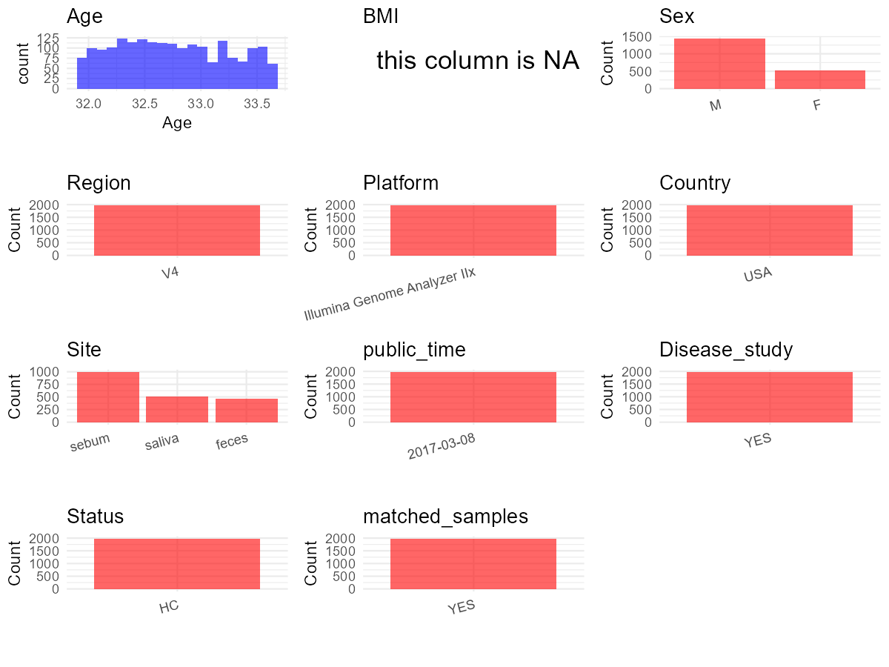

R Notebook: Metadata Processing Workflow
================

# Step 1: Obtain Initial Metadata from Each Project

To obtain the initial metadata: 1. Search for the BioProject ID (e.g.,
“PRJEBXXXX”) on the [NCBI SRA
website](https://www.ncbi.nlm.nih.gov/Traces/study/). 2. In the “Select”
table, click on “Metadata” and download the file. 3. The downloaded file
is typically named “SraRunTable.csv” and contains metadata for the
project.

``` r
# Load necessary libraries
library(dplyr)
library(ggplot2)
library(cowplot)
library(readxl)

# Set working directory (update this path to your local directory)
setwd("D:/oral_project/PRJEB19825")

# Read the initial metadata files
initial_meta<-read.csv("SraRunTable.csv",header = T)

# Combine the two metadata files
#meta <- rbind(initial_meta, initial_meta1)

#Remove entries non-oral samples
#initial_meta <- subset(initial_meta,isolate %in% c("saliva","tongue coat"))

# Check the number of samples containing "HT" in Sample.Name (e.g., healthy controls)
#nrow(subset(meta, grepl("HT", Sample.Name)))

# Display the first few rows of the metadata
head(initial_meta)
```

    ##          Run   AGE age_unit anonymized_name Assay.Type atherosclerosis
    ## 1 ERR1866468 33.13    years        sample_1      OTHER           FALSE
    ## 2 ERR1866470 33.16    years        sample_2      OTHER           FALSE
    ## 3 ERR1866472 33.52    years        sample_3      OTHER           FALSE
    ## 4 ERR1866474 33.53    years        sample_4      OTHER           FALSE
    ## 5 ERR1866476 33.53    years        sample_5      OTHER           FALSE
    ## 6 ERR1866478 33.53    years        sample_6      OTHER           FALSE
    ##   AvgSpotLen barcode..exp.   Bases BioProject      BioSample body_habitat
    ## 1        134  AACGCACGCTAG 3776094 PRJEB19825 SAMEA103748668 UBERON:feces
    ## 2        131  ACAGACCACTCA 4794794 PRJEB19825 SAMEA103750168 UBERON:feces
    ## 3        133  ATGCACTGGCGA 5771323 PRJEB19825 SAMEA103751668 UBERON:feces
    ## 4        133  ATTATCGTGCAC 4670102 PRJEB19825 SAMEA103753168 UBERON:feces
    ## 5        134  CACGACAGGCTA 4764931 PRJEB19825 SAMEA103754668 UBERON:feces
    ## 6        132  CAGATACACTTC 4259307 PRJEB19825 SAMEA103756168 UBERON:feces
    ##   body_product    body_site   Bytes center_name..exp.
    ## 1 UBERON:feces UBERON:feces 3028401              CCME
    ## 2 UBERON:feces UBERON:feces 3772889              CCME
    ## 3 UBERON:feces UBERON:feces 4521832              CCME
    ## 4 UBERON:feces UBERON:feces 3652329              CCME
    ## 5 UBERON:feces UBERON:feces 3753105              CCME
    ## 6 UBERON:feces UBERON:feces 3329468              CCME
    ##                                          Center.Name
    ## 1 UNIVERSITY OF CALIFORNIA SAN DIEGO MICROBIOME INIT
    ## 2 UNIVERSITY OF CALIFORNIA SAN DIEGO MICROBIOME INIT
    ## 3 UNIVERSITY OF CALIFORNIA SAN DIEGO MICROBIOME INIT
    ## 4 UNIVERSITY OF CALIFORNIA SAN DIEGO MICROBIOME INIT
    ## 5 UNIVERSITY OF CALIFORNIA SAN DIEGO MICROBIOME INIT
    ## 6 UNIVERSITY OF CALIFORNIA SAN DIEGO MICROBIOME INIT
    ##                 center_project_name..exp. chronic_condition
    ## 1 Moving pictures of the human microbiome             FALSE
    ## 2 Moving pictures of the human microbiome             FALSE
    ## 3 Moving pictures of the human microbiome             FALSE
    ## 4 Moving pictures of the human microbiome             FALSE
    ## 5 Moving pictures of the human microbiome             FALSE
    ## 6 Moving pictures of the human microbiome             FALSE
    ##   collection_timestamp common_sample_site Consent DATASTORE.filetype
    ## 1           2008-10-21              feces  public   fastq,run.zq,sra
    ## 2           2008-10-30              feces  public   fastq,run.zq,sra
    ## 3           2009-03-12              feces  public   fastq,run.zq,sra
    ## 4           2009-03-13              feces  public   fastq,run.zq,sra
    ## 5           2009-03-14              feces  public   fastq,run.zq,sra
    ## 6           2009-03-15              feces  public   fastq,run.zq,sra
    ##   DATASTORE.provider                         DATASTORE.region days_since_epoch
    ## 1     ena,gs,ncbi,s3 ena,gs.us-east1,ncbi.public,s3.us-east-1            14173
    ## 2     ena,gs,ncbi,s3 ena,gs.us-east1,ncbi.public,s3.us-east-1            14182
    ## 3     ena,gs,ncbi,s3 ena,gs.us-east1,ncbi.public,s3.us-east-1            14315
    ## 4     ena,gs,ncbi,s3 ena,gs.us-east1,ncbi.public,s3.us-east-1            14316
    ## 5     ena,gs,ncbi,s3 ena,gs.us-east1,ncbi.public,s3.us-east-1            14317
    ## 6     ena,gs,ncbi,s3 ena,gs.us-east1,ncbi.public,s3.us-east-1            14318
    ##   days_since_experiment_start dna_extracted elevation ENA.FIRST.PUBLIC..run.
    ## 1                           0          TRUE    1624.1             2017-03-07
    ## 2                           9          TRUE    1624.1             2017-03-07
    ## 3                         142          TRUE    1624.1             2017-03-07
    ## 4                         143          TRUE    1624.1             2017-03-07
    ## 5                         144          TRUE    1624.1             2017-03-07
    ## 6                         145          TRUE    1624.1             2017-03-07
    ##       ena_first_public ENA.LAST.UPDATE..run.      ena_last_update   env_biome
    ## 1 2017-03-07T17:05:06Z            2018-11-16 2017-03-03T17:50:02Z urban biome
    ## 2 2017-03-07T17:05:06Z            2018-11-16 2017-03-03T17:50:03Z urban biome
    ## 3 2017-03-07T17:05:06Z            2018-11-16 2017-03-03T17:50:03Z urban biome
    ## 4 2017-03-07T17:05:06Z            2018-11-16 2017-03-03T17:50:04Z urban biome
    ## 5 2017-03-07T17:05:06Z            2018-11-16 2017-03-03T17:50:04Z urban biome
    ## 6 2017-03-07T17:05:06Z            2018-11-16 2017-03-03T17:50:05Z urban biome
    ##                env_feature env_material env_package Experiment    external_id
    ## 1 human-associated habitat        feces   human-gut ERX1926652 SAMEA103748668
    ## 2 human-associated habitat        feces   human-gut ERX1926654 SAMEA103750168
    ## 3 human-associated habitat        feces   human-gut ERX1926656 SAMEA103751668
    ## 4 human-associated habitat        feces   human-gut ERX1926658 SAMEA103753168
    ## 5 human-associated habitat        feces   human-gut ERX1926660 SAMEA103754668
    ## 6 human-associated habitat        feces   human-gut ERX1926662 SAMEA103756168
    ##   geo_loc_name_country geo_loc_name_country_continent     geo_loc_name      hiv
    ## 1                  USA                  North America USA:CO\\,Boulder negative
    ## 2                  USA                  North America USA:CO\\,Boulder negative
    ## 3                  USA                  North America USA:CO\\,Boulder negative
    ## 4                  USA                  North America USA:CO\\,Boulder negative
    ## 5                  USA                  North America USA:CO\\,Boulder negative
    ## 6                  USA                  North America USA:CO\\,Boulder negative
    ##   hiv_stat host_common_name HOST host_scientific_name host_subject_id
    ## 1    FALSE            human   F4         Homo sapiens              F4
    ## 2    FALSE            human   F4         Homo sapiens              F4
    ## 3    FALSE            human   F4         Homo sapiens              F4
    ## 4    FALSE            human   F4         Homo sapiens              F4
    ## 5    FALSE            human   F4         Homo sapiens              F4
    ## 6    FALSE            human   F4         Homo sapiens              F4
    ##   host_taxid illumina_technology..exp. INSDC_center_name   INSDC_first_public
    ## 1       9606                     GAIIx            UCSDMI 2017-03-07T17:05:06Z
    ## 2       9606                     GAIIx            UCSDMI 2017-03-07T17:05:06Z
    ## 3       9606                     GAIIx            UCSDMI 2017-03-07T17:05:06Z
    ## 4       9606                     GAIIx            UCSDMI 2017-03-07T17:05:06Z
    ## 5       9606                     GAIIx            UCSDMI 2017-03-07T17:05:06Z
    ## 6       9606                     GAIIx            UCSDMI 2017-03-07T17:05:06Z
    ##      INSDC_last_update INSDC_status                   Instrument LATITUDE
    ## 1 2017-03-03T17:50:02Z       public Illumina Genome Analyzer IIx   40.015
    ## 2 2017-03-03T17:50:03Z       public Illumina Genome Analyzer IIx   40.015
    ## 3 2017-03-03T17:50:03Z       public Illumina Genome Analyzer IIx   40.015
    ## 4 2017-03-03T17:50:04Z       public Illumina Genome Analyzer IIx   40.015
    ## 5 2017-03-03T17:50:04Z       public Illumina Genome Analyzer IIx   40.015
    ## 6 2017-03-03T17:50:05Z       public Illumina Genome Analyzer IIx   40.015
    ##              Library.Name LibraryLayout LibrarySelection LibrarySource
    ## 1   550.L1S1.s.1.sequence        SINGLE              PCR   METAGENOMIC
    ## 2  550.L1S10.s.1.sequence        SINGLE              PCR   METAGENOMIC
    ## 3 550.L1S100.s.1.sequence        SINGLE              PCR   METAGENOMIC
    ## 4 550.L1S101.s.1.sequence        SINGLE              PCR   METAGENOMIC
    ## 5 550.L1S102.s.1.sequence        SINGLE              PCR   METAGENOMIC
    ## 6 550.L1S103.s.1.sequence        SINGLE              PCR   METAGENOMIC
    ##   linker..exp. longitude mislabeled myocardinfarct             Organism
    ## 1           GT  -105.271       TRUE          FALSE human gut metagenome
    ## 2           GT  -105.271      FALSE          FALSE human gut metagenome
    ## 3           GT  -105.271      FALSE          FALSE human gut metagenome
    ## 4           GT  -105.271      FALSE          FALSE human gut metagenome
    ## 5           GT  -105.271      FALSE          FALSE human gut metagenome
    ## 6           GT  -105.271      FALSE          FALSE human gut metagenome
    ##                                   pcr_primers..exp. physical_specimen_location
    ## 1 FWD:GTGCCAGCMGCCGCGGTAA; REV:GGACTACHVGGGTWTCTAAT                     UCSDMI
    ## 2 FWD:GTGCCAGCMGCCGCGGTAA; REV:GGACTACHVGGGTWTCTAAT                     UCSDMI
    ## 3 FWD:GTGCCAGCMGCCGCGGTAA; REV:GGACTACHVGGGTWTCTAAT                     UCSDMI
    ## 4 FWD:GTGCCAGCMGCCGCGGTAA; REV:GGACTACHVGGGTWTCTAAT                     UCSDMI
    ## 5 FWD:GTGCCAGCMGCCGCGGTAA; REV:GGACTACHVGGGTWTCTAAT                     UCSDMI
    ## 6 FWD:GTGCCAGCMGCCGCGGTAA; REV:GGACTACHVGGGTWTCTAAT                     UCSDMI
    ##   physical_specimen_remaining Platform          primer..exp. public
    ## 1                        TRUE ILLUMINA GTGTGCCAGCMGCCGCGGTAA   TRUE
    ## 2                        TRUE ILLUMINA GTGTGCCAGCMGCCGCGGTAA   TRUE
    ## 3                        TRUE ILLUMINA GTGTGCCAGCMGCCGCGGTAA   TRUE
    ## 4                        TRUE ILLUMINA GTGTGCCAGCMGCCGCGGTAA   TRUE
    ## 5                        TRUE ILLUMINA GTGTGCCAGCMGCCGCGGTAA   TRUE
    ## 6                        TRUE ILLUMINA GTGTGCCAGCMGCCGCGGTAA   TRUE
    ##            ReleaseDate run_center..exp. run_date..exp. run_prefix..exp.
    ## 1 2017-03-08T00:00:00Z           CGS-GL        8/27/10     s_1_sequence
    ## 2 2017-03-08T00:00:00Z           CGS-GL        8/27/10     s_1_sequence
    ## 3 2017-03-08T00:00:00Z           CGS-GL        8/27/10     s_1_sequence
    ## 4 2017-03-08T00:00:00Z           CGS-GL        8/27/10     s_1_sequence
    ## 5 2017-03-08T00:00:00Z           CGS-GL        8/27/10     s_1_sequence
    ## 6 2017-03-08T00:00:00Z           CGS-GL        8/27/10     s_1_sequence
    ##                                          runid..exp. samp_size..exp.
    ## 1 /illumina_hiseq_ucb/illumina_washu_moving_pictures         1, swab
    ## 2 /illumina_hiseq_ucb/illumina_washu_moving_pictures         1, swab
    ## 3 /illumina_hiseq_ucb/illumina_washu_moving_pictures         1, swab
    ## 4 /illumina_hiseq_ucb/illumina_washu_moving_pictures         1, swab
    ## 5 /illumina_hiseq_ucb/illumina_washu_moving_pictures         1, swab
    ## 6 /illumina_hiseq_ucb/illumina_washu_moving_pictures         1, swab
    ##   sample_center..exp.    Sample.Name                           Sample_name
    ## 1                CCME SAMEA103748668   qiita_sid_550:550.L1S1.s.1.sequence
    ## 2                CCME SAMEA103750168  qiita_sid_550:550.L1S10.s.1.sequence
    ## 3                CCME SAMEA103751668 qiita_sid_550:550.L1S100.s.1.sequence
    ## 4                CCME SAMEA103753168 qiita_sid_550:550.L1S101.s.1.sequence
    ## 5                CCME SAMEA103754668 qiita_sid_550:550.L1S102.s.1.sequence
    ## 6                CCME SAMEA103756168 qiita_sid_550:550.L1S103.s.1.sequence
    ##   sample_type      Scientific_Name   sequencing_meth..exp.    sex smoker
    ## 1       stool human gut metagenome Sequencing by synthesis female  FALSE
    ## 2       stool human gut metagenome Sequencing by synthesis female  FALSE
    ## 3       stool human gut metagenome Sequencing by synthesis female  FALSE
    ## 4       stool human gut metagenome Sequencing by synthesis female  FALSE
    ## 5       stool human gut metagenome Sequencing by synthesis female  FALSE
    ## 6       stool human gut metagenome Sequencing by synthesis female  FALSE
    ##   SRA.Study                          Submitter_Id target_gene..exp.
    ## 1 ERP021896   qiita_sid_550:550.L1S1.s.1.sequence          16S rRNA
    ## 2 ERP021896  qiita_sid_550:550.L1S10.s.1.sequence          16S rRNA
    ## 3 ERP021896 qiita_sid_550:550.L1S100.s.1.sequence          16S rRNA
    ## 4 ERP021896 qiita_sid_550:550.L1S101.s.1.sequence          16S rRNA
    ## 5 ERP021896 qiita_sid_550:550.L1S102.s.1.sequence          16S rRNA
    ## 6 ERP021896 qiita_sid_550:550.L1S103.s.1.sequence          16S rRNA
    ##   target_subfragment..exp.          create_date version
    ## 1                       V4 2017-03-12T09:42:00Z       1
    ## 2                       V4 2017-03-12T09:42:00Z       1
    ## 3                       V4 2017-03-12T09:42:00Z       1
    ## 4                       V4 2017-03-12T09:42:00Z       1
    ## 5                       V4 2017-03-12T09:42:00Z       1
    ## 6                       V4 2017-03-12T09:42:00Z       1

# Step 2: Create a Uniform Metadata Template

The uniform metadata should include the following columns:

1.  **BioProject**: Project ID (e.g., “PRJNA339212”)
2.  **Run**: Sample ID (e.g., “ERRXXXXXX” or “SRRXXXXXX”)
3.  **sample_name**: Original sample name submitted by the authors (not
    the database-assigned ID)
4.  **Age**: Age of the subject (if available)
5.  **BMI**: Body Mass Index (if available)
6.  **Sex**: Sex of the subject (“F” or “M”)
7.  **Region**: Targeted 16S rRNA region (e.g., “V3-V4”)
8.  **Platform**: Sequencing platform (e.g., “Illumina MiSeq”)
9.  **Country**: Country of sample origin (e.g., “China”)
10. **Site**: Sample site (e.g., “saliva”, “dental plaque”)
11. **public_time**: Data release date (format: “YYYY-MM-DD”)
12. **PCR_primers**: PCR primers used (e.g., “515F-806R”)
13. **title**: Title of the associated publication
14. **Disease_study**: Whether the study involves a disease (“YES” or
    “NO”)
15. **Status**: Disease status (e.g., “T2DM”, “HC”). Note: If the study
    includes both disease and healthy samples, this must be specified
    per sample.
16. **matched_samples**: matched samples (“YES” or “NO”)

``` r
# Create a uniform metadata dataframe
metadata <- data.frame(
  BioProject = initial_meta$BioProject,
  Run = initial_meta$Run,
  sample_name = initial_meta$host_subject_id,
  Age = initial_meta$AGE,
  BMI = NA,
  Sex = initial_meta$sex,
  Region = initial_meta$target_subfragment..exp.,
  Platform = initial_meta$Instrument,
  Country = initial_meta$geo_loc_name_country,
  Site = initial_meta$env_material,
  public_time = "2017-03-08",
  PCR_primers = initial_meta$pcr_primers..exp.,
  stringsAsFactors = FALSE
)
```

``` r
metadata <- metadata %>%
  mutate(Sex = recode(Sex, "female" = "F", "male" = "M"))
```

# Step 3: Manually Add Information from the Publication

、 Some information (e.g. PCR primers, study title, disease status) must
be manually extracted from the publication and added to the metadata.

``` r
# Add information obtained from the publication
metadata$title <- "Moving pictures of the human microbiome"
metadata$Disease_study <- "YES"
# Assign disease status based on sample_name patterns
metadata$Status <- "HC"
#get subjects id with Saliva available
keep_subjects<-subset(metadata,Site %in% "saliva")
#remove subjects without Saliva samples
metadata<-subset(metadata,sample_name %in% keep_subjects$sample_name)

#get subjects sampling counts
sample_counts <- table(metadata$sample_name)
# Create matched_samples column, any subjects have >=2 samples will be label "YES", otherwise "NO"
metadata$matched_samples <- ifelse(metadata$sample_name %in% names(sample_counts[sample_counts >= 2]), "YES", "NO")
```

# Step 4: Summarize and Validate the Metadata

``` r
# Check the number of unique runs and sample names
print(paste("Number of unique runs:", length(unique(metadata$Run))))
```

    ## [1] "Number of unique runs: 1968"

``` r
print(paste("Number of unique sample names:", length(unique(metadata$sample_name))))
```

    ## [1] "Number of unique sample names: 2"

# Step 5: Visualize the Metadata

``` r

```

<!-- -->

# Step 6: Finalize and Export the Metadata

``` r
# Reorder columns to match the desired format
metadata <- metadata[, c(
  "BioProject", "Run", "sample_name", "Age", "BMI", "Sex", 
  "Region", "Platform", "Country", "Site", "public_time", 
  "PCR_primers", "title", "Disease_study", "Status","matched_samples"
)]

# Export the uniform metadata to a CSV file
write.csv(metadata, file = "metadata.csv", quote = FALSE)
head(metadata)
```

    ##   BioProject        Run sample_name   Age BMI Sex Region
    ## 1 PRJEB19825 ERR1866468          F4 33.13  NA   F     V4
    ## 2 PRJEB19825 ERR1866470          F4 33.16  NA   F     V4
    ## 3 PRJEB19825 ERR1866472          F4 33.52  NA   F     V4
    ## 4 PRJEB19825 ERR1866474          F4 33.53  NA   F     V4
    ## 5 PRJEB19825 ERR1866476          F4 33.53  NA   F     V4
    ## 6 PRJEB19825 ERR1866478          F4 33.53  NA   F     V4
    ##                       Platform Country  Site public_time
    ## 1 Illumina Genome Analyzer IIx     USA feces  2017-03-08
    ## 2 Illumina Genome Analyzer IIx     USA feces  2017-03-08
    ## 3 Illumina Genome Analyzer IIx     USA feces  2017-03-08
    ## 4 Illumina Genome Analyzer IIx     USA feces  2017-03-08
    ## 5 Illumina Genome Analyzer IIx     USA feces  2017-03-08
    ## 6 Illumina Genome Analyzer IIx     USA feces  2017-03-08
    ##                                         PCR_primers
    ## 1 FWD:GTGCCAGCMGCCGCGGTAA; REV:GGACTACHVGGGTWTCTAAT
    ## 2 FWD:GTGCCAGCMGCCGCGGTAA; REV:GGACTACHVGGGTWTCTAAT
    ## 3 FWD:GTGCCAGCMGCCGCGGTAA; REV:GGACTACHVGGGTWTCTAAT
    ## 4 FWD:GTGCCAGCMGCCGCGGTAA; REV:GGACTACHVGGGTWTCTAAT
    ## 5 FWD:GTGCCAGCMGCCGCGGTAA; REV:GGACTACHVGGGTWTCTAAT
    ## 6 FWD:GTGCCAGCMGCCGCGGTAA; REV:GGACTACHVGGGTWTCTAAT
    ##                                     title Disease_study Status matched_samples
    ## 1 Moving pictures of the human microbiome           YES     HC             YES
    ## 2 Moving pictures of the human microbiome           YES     HC             YES
    ## 3 Moving pictures of the human microbiome           YES     HC             YES
    ## 4 Moving pictures of the human microbiome           YES     HC             YES
    ## 5 Moving pictures of the human microbiome           YES     HC             YES
    ## 6 Moving pictures of the human microbiome           YES     HC             YES

## Notes for Students:

1.  **Metadata Accuracy**: Always cross-check the metadata with the
    original publication to ensure accuracy.
2.  **Manual Entries**: Columns like `PCR_primers`, and `Status` often
    require manual entry based on the publication.
3.  **Disease Status**: Be careful when assigning `Status`—some studies
    include both disease and healthy samples.
4.  **Visualization**: The plots help quickly identify the distribution
    of values in each column, which is useful for quality control.
5.  **Reproducibility**: Update the working directory and file paths to
    match your local environment.
