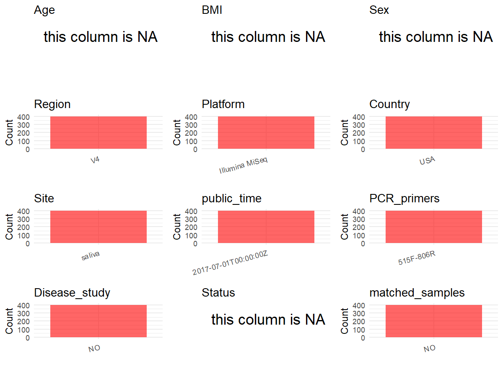

R Notebook: Metadata Processing Workflow
================

# Step 1: Obtain Initial Metadata from Each Project

To obtain the initial metadata: 1. Search for the BioProject ID (e.g.,
“PRJEBXXXX”) on the [NCBI SRA
website](https://www.ncbi.nlm.nih.gov/Traces/study/). 2. In the “Select”
table, click on “Metadata” and download the file. 3. The downloaded file
is typically named “SraRunTable.csv” and contains metadata for the
project.

``` r
# Load necessary libraries
library(dplyr)
library(ggplot2)
library(cowplot)

# Set working directory (update this path to your local directory)
setwd("D:/metadata/2/PRJEB20894")

# Read the initial metadata files
initial_meta<-read.csv("SraRunTable.csv",header = T)

# Combine the two metadata files
#meta <- rbind(initial_meta, initial_meta1)

#Remove entries non-oral samples
#initial_meta <- subset(initial_meta,BioSampleModel != "Metagenome or environmental")

# Check the number of samples containing "HT" in Sample.Name (e.g., healthy controls)
#nrow(subset(meta, grepl("HT", Sample.Name)))

# Display the first few rows of the metadata
head(initial_meta)
```

    ##          Run Assay.Type AvgSpotLen   Bases BioProject      BioSample   Bytes
    ## 1 ERR1985895   AMPLICON        302 5681828 PRJEB20894 SAMEA104082122 3315265
    ## 2 ERR1985896   AMPLICON        302 6798624 PRJEB20894 SAMEA104082123 4283396
    ## 3 ERR1985897   AMPLICON        302 4871864 PRJEB20894 SAMEA104082124 3016361
    ## 4 ERR1985898   AMPLICON        302 3242574 PRJEB20894 SAMEA104082125 1855700
    ## 5 ERR1985899   AMPLICON        302 4487720 PRJEB20894 SAMEA104082126 2816173
    ## 6 ERR1985900   AMPLICON        302 5518144 PRJEB20894 SAMEA104082127 3329627
    ##                        Center.Name Collection_Date Consent DATASTORE.filetype
    ## 1 UNIVERSITY OF COLORADO - BOULDER            2006  public   fastq,run.zq,sra
    ## 2 UNIVERSITY OF COLORADO - BOULDER            2006  public   fastq,run.zq,sra
    ## 3 UNIVERSITY OF COLORADO - BOULDER            2006  public   fastq,run.zq,sra
    ## 4 UNIVERSITY OF COLORADO - BOULDER            2006  public   fastq,run.zq,sra
    ## 5 UNIVERSITY OF COLORADO - BOULDER            2006  public   fastq,run.zq,sra
    ## 6 UNIVERSITY OF COLORADO - BOULDER            2006  public   fastq,run.zq,sra
    ##   DATASTORE.provider                         DATASTORE.region
    ## 1     ena,gs,ncbi,s3 ena,gs.us-east1,ncbi.public,s3.us-east-1
    ## 2     ena,gs,ncbi,s3 ena,gs.us-east1,ncbi.public,s3.us-east-1
    ## 3     ena,gs,ncbi,s3 ena,gs.us-east1,ncbi.public,s3.us-east-1
    ## 4     ena,gs,ncbi,s3 ena,gs.us-east1,ncbi.public,s3.us-east-1
    ## 5     ena,gs,ncbi,s3 ena,gs.us-east1,ncbi.public,s3.us-east-1
    ## 6     ena,gs,ncbi,s3 ena,gs.us-east1,ncbi.public,s3.us-east-1
    ##   ENA.FIRST.PUBLIC..run. ENA_first_public ENA.LAST.UPDATE..run. ena_last_update
    ## 1             2017-06-29       2017-06-29            2018-11-16      2017-05-16
    ## 2             2017-06-29       2017-06-29            2018-11-16      2017-05-16
    ## 3             2017-06-29       2017-06-29            2018-11-16      2017-05-16
    ## 4             2017-06-29       2017-06-29            2018-11-16      2017-05-16
    ## 5             2017-06-29       2017-06-29            2018-11-16      2017-05-16
    ## 6             2017-06-29       2017-06-29            2018-11-16      2017-05-16
    ##   environment_.biome. environment_.feature. environment_.material. Experiment
    ## 1                oral                  oral                 saliva ERX2046271
    ## 2                oral                  oral                 saliva ERX2046272
    ## 3                oral                  oral                 saliva ERX2046273
    ## 4                oral                  oral                 saliva ERX2046274
    ## 5                oral                  oral                 saliva ERX2046275
    ## 6                oral                  oral                 saliva ERX2046276
    ##      external_id geo_loc_name_country geo_loc_name_country_continent
    ## 1 SAMEA104082122                  USA                  North America
    ## 2 SAMEA104082123                  USA                  North America
    ## 3 SAMEA104082124                  USA                  North America
    ## 4 SAMEA104082125                  USA                  North America
    ## 5 SAMEA104082126                  USA                  North America
    ## 6 SAMEA104082127                  USA                  North America
    ##   geographic_location_.country_and.or_sea. geographic_location_.latitude.
    ## 1                                      USA                       40.74189
    ## 2                                      USA                       40.74189
    ## 3                                      USA                       40.74189
    ## 4                                      USA                       40.74189
    ## 5                                      USA                       40.74189
    ## 6                                      USA                       40.74189
    ##   geographic_location_.longitude. humam_oral_environmental_package
    ## 1                       -73.98931                       human-oral
    ## 2                       -73.98931                       human-oral
    ## 3                       -73.98931                       human-oral
    ## 4                       -73.98931                       human-oral
    ## 5                       -73.98931                       human-oral
    ## 6                       -73.98931                       human-oral
    ##                 INSDC_center_alias                INSDC_center_name
    ## 1 UNIVERSITY OF COLORADO - BOULDER UNIVERSITY OF COLORADO - BOULDER
    ## 2 UNIVERSITY OF COLORADO - BOULDER UNIVERSITY OF COLORADO - BOULDER
    ## 3 UNIVERSITY OF COLORADO - BOULDER UNIVERSITY OF COLORADO - BOULDER
    ## 4 UNIVERSITY OF COLORADO - BOULDER UNIVERSITY OF COLORADO - BOULDER
    ## 5 UNIVERSITY OF COLORADO - BOULDER UNIVERSITY OF COLORADO - BOULDER
    ## 6 UNIVERSITY OF COLORADO - BOULDER UNIVERSITY OF COLORADO - BOULDER
    ##     INSDC_first_public    INSDC_last_update INSDC_status     Instrument
    ## 1 2017-06-29T17:02:37Z 2017-05-16T22:14:37Z       public Illumina MiSeq
    ## 2 2017-06-29T17:02:37Z 2017-05-16T22:14:37Z       public Illumina MiSeq
    ## 3 2017-06-29T17:02:37Z 2017-05-16T22:14:37Z       public Illumina MiSeq
    ## 4 2017-06-29T17:02:37Z 2017-05-16T22:14:37Z       public Illumina MiSeq
    ## 5 2017-06-29T17:02:37Z 2017-05-16T22:14:37Z       public Illumina MiSeq
    ## 6 2017-06-29T17:02:37Z 2017-05-16T22:14:37Z       public Illumina MiSeq
    ##   investigation_type Library.Name LibraryLayout LibrarySelection LibrarySource
    ## 1         metagenome  unspecified        PAIRED              PCR   METAGENOMIC
    ## 2         metagenome  unspecified        PAIRED              PCR   METAGENOMIC
    ## 3         metagenome  unspecified        PAIRED              PCR   METAGENOMIC
    ## 4         metagenome  unspecified        PAIRED              PCR   METAGENOMIC
    ## 5         metagenome  unspecified        PAIRED              PCR   METAGENOMIC
    ## 6         metagenome  unspecified        PAIRED              PCR   METAGENOMIC
    ##          Organism Platform                                   project_name
    ## 1 oral metagenome ILLUMINA krauter_salivary_microbiome_part_6_of_6_study2
    ## 2 oral metagenome ILLUMINA krauter_salivary_microbiome_part_6_of_6_study2
    ## 3 oral metagenome ILLUMINA krauter_salivary_microbiome_part_6_of_6_study2
    ## 4 oral metagenome ILLUMINA krauter_salivary_microbiome_part_6_of_6_study2
    ## 5 oral metagenome ILLUMINA krauter_salivary_microbiome_part_6_of_6_study2
    ## 6 oral metagenome ILLUMINA krauter_salivary_microbiome_part_6_of_6_study2
    ##            ReleaseDate    Sample.Name sample_name Sequencing_method SRA.Study
    ## 1 2017-07-01T00:00:00Z SAMEA104082122  bg.s2.2846    Illumina MiSeq ERP023091
    ## 2 2017-07-01T00:00:00Z SAMEA104082123  bg.s2.2847    Illumina MiSeq ERP023091
    ## 3 2017-07-01T00:00:00Z SAMEA104082124  bg.s2.2851    Illumina MiSeq ERP023091
    ## 4 2017-07-01T00:00:00Z SAMEA104082125  bg.s2.2852    Illumina MiSeq ERP023091
    ## 5 2017-07-01T00:00:00Z SAMEA104082126  bg.s2.2854    Illumina MiSeq ERP023091
    ## 6 2017-07-01T00:00:00Z SAMEA104082127  bg.s2.2855    Illumina MiSeq ERP023091
    ##   Submitter_Id          create_date version
    ## 1   bg.s2.2846 2017-07-01T20:21:00Z       1
    ## 2   bg.s2.2847 2017-07-01T20:21:00Z       1
    ## 3   bg.s2.2851 2017-07-01T20:22:00Z       1
    ## 4   bg.s2.2852 2017-07-01T20:22:00Z       1
    ## 5   bg.s2.2854 2017-07-01T20:22:00Z       1
    ## 6   bg.s2.2855 2017-07-01T20:22:00Z       1

# Step 2: Create a Uniform Metadata Template

The uniform metadata should include the following columns:

1.  **BioProject**: Project ID (e.g., “PRJNA339212”)
2.  **Run**: Sample ID (e.g., “ERRXXXXXX” or “SRRXXXXXX”)
3.  **sample_name**: Original sample name submitted by the authors (not
    the database-assigned ID)
4.  **Age**: Age of the subject (if available)
5.  **BMI**: Body Mass Index (if available)
6.  **Sex**: Sex of the subject (“F” or “M”)
7.  **Region**: Targeted 16S rRNA region (e.g., “V3-V4”)
8.  **Platform**: Sequencing platform (e.g., “Illumina MiSeq”)
9.  **Country**: Country of sample origin (e.g., “China”)
10. **Site**: Sample site (e.g., “saliva”, “dental plaque”)
11. **public_time**: Data release date (format: “YYYY-MM-DD”)
12. **PCR_primers**: PCR primers used (e.g., “515F-806R”)
13. **title**: Title of the associated publication
14. **Disease_study**: Whether the study involves a disease (“YES” or
    “NO”)
15. **Status**: Disease status (e.g., “T2DM”, “HC”). Note: If the study
    includes both disease and healthy samples, this must be specified
    per sample.
16. **matched_samples**: matched samples (“YES” or “NO”)

``` r
# Create a uniform metadata dataframe
metadata <- data.frame(
  BioProject = initial_meta$BioProject,
  Run = initial_meta$Run,
  sample_name = initial_meta$Sample.Name,
  Age = NA,
  BMI = NA,
  Sex=NA,
  Region = "V4",
  Platform = initial_meta$Instrument,
  Country = initial_meta$geo_loc_name_country,
  Site = initial_meta$environment_.material.,
  public_time = initial_meta$ReleaseDate,
  Status = NA,
  stringsAsFactors = FALSE
)
```

# Step 3: Manually Add Information from the Publication

Some information (e.g. PCR primers, study title, disease status) must be
manually extracted from the publication and added to the metadata.

``` r
# Add information obtained from the publication
metadata$PCR_primers <- "515F-806R"
metadata$title <- "Genetic influences on the human oral microbiome"
metadata$Disease_study <- "NO"
# Assign disease status based on sample_name patterns
#metadata$Status<-"H"

keep_subjects <- unique(subset(metadata, Site == "saliva")$sample_name)
metadata <- subset(metadata, sample_name %in% keep_subjects)

metadata$matched_samples <- "NO"
```

# Step 4: Summarize and Validate the Metadata

``` r
# Check the number of unique runs and sample names
print(paste("Number of unique runs:", length(unique(metadata$Run))))
```

    ## [1] "Number of unique runs: 398"

``` r
print(paste("Number of unique sample names:", length(unique(metadata$sample_name))))
```

    ## [1] "Number of unique sample names: 398"

# Step 5: Visualize the Metadata

``` r

```

<!-- -->

# Step 6: Finalize and Export the Metadata

``` r
# Reorder columns to match the desired format
metadata <- metadata[, c(
  "BioProject", "Run", "sample_name", "Age", "BMI", "Sex", 
  "Region", "Platform", "Country", "Site", "public_time", 
  "PCR_primers", "title", "Disease_study", "Status","matched_samples"
)]

# Export the uniform metadata to a CSV file
write.csv(metadata, file = "metadata.csv", quote = TRUE)
head(metadata)
```

    ##   BioProject        Run    sample_name Age BMI Sex Region       Platform
    ## 1 PRJEB20894 ERR1985895 SAMEA104082122  NA  NA  NA     V4 Illumina MiSeq
    ## 2 PRJEB20894 ERR1985896 SAMEA104082123  NA  NA  NA     V4 Illumina MiSeq
    ## 3 PRJEB20894 ERR1985897 SAMEA104082124  NA  NA  NA     V4 Illumina MiSeq
    ## 4 PRJEB20894 ERR1985898 SAMEA104082125  NA  NA  NA     V4 Illumina MiSeq
    ## 5 PRJEB20894 ERR1985899 SAMEA104082126  NA  NA  NA     V4 Illumina MiSeq
    ## 6 PRJEB20894 ERR1985900 SAMEA104082127  NA  NA  NA     V4 Illumina MiSeq
    ##   Country   Site          public_time PCR_primers
    ## 1     USA saliva 2017-07-01T00:00:00Z   515F-806R
    ## 2     USA saliva 2017-07-01T00:00:00Z   515F-806R
    ## 3     USA saliva 2017-07-01T00:00:00Z   515F-806R
    ## 4     USA saliva 2017-07-01T00:00:00Z   515F-806R
    ## 5     USA saliva 2017-07-01T00:00:00Z   515F-806R
    ## 6     USA saliva 2017-07-01T00:00:00Z   515F-806R
    ##                                             title Disease_study Status
    ## 1 Genetic influences on the human oral microbiome            NO     NA
    ## 2 Genetic influences on the human oral microbiome            NO     NA
    ## 3 Genetic influences on the human oral microbiome            NO     NA
    ## 4 Genetic influences on the human oral microbiome            NO     NA
    ## 5 Genetic influences on the human oral microbiome            NO     NA
    ## 6 Genetic influences on the human oral microbiome            NO     NA
    ##   matched_samples
    ## 1              NO
    ## 2              NO
    ## 3              NO
    ## 4              NO
    ## 5              NO
    ## 6              NO

## Notes for Students:

1.  **Metadata Accuracy**: Always cross-check the metadata with the
    original publication to ensure accuracy.
2.  **Manual Entries**: Columns like `PCR_primers`, and `Status` often
    require manual entry based on the publication.
3.  **Disease Status**: Be careful when assigning `Status`—some studies
    include both disease and healthy samples.
4.  **Visualization**: The plots help quickly identify the distribution
    of values in each column, which is useful for quality control.
5.  **Reproducibility**: Update the working directory and file paths to
    match your local environment.
