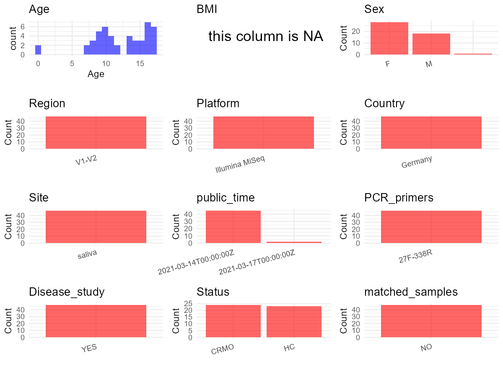

R Notebook: Metadata Processing Workflow
================

# Step 1: Obtain Initial Metadata from Each Project

To obtain the initial metadata: 1. Search for the BioProject ID (e.g.,
“PRJEBXXXX”) on the [NCBI SRA
website](https://www.ncbi.nlm.nih.gov/Traces/study/). 2. In the “Select”
table, click on “Metadata” and download the file. 3. The downloaded file
is typically named “SraRunTable.csv” and contains metadata for the
project.

``` r
# Load necessary libraries
library(dplyr)
library(ggplot2)
library(cowplot)

# Set working directory (update this path to your local directory)
setwd("E:/bioproject_YSD/PRJEB22984")

# Read the initial metadata files
initial_meta <- read.csv("SraRunTable.csv", header = T) 

# Remove entries non-oral samples
initial_meta <- subset(initial_meta, environment_.material. %in%
                         c("saliva"))

# Display the first few rows of the metadata
head(initial_meta)
```

    ##           Run Assay.Type AvgSpotLen     Bases BioProject      BioSample
    ## 2  ERR2442384   AMPLICON        601  93274250 PRJEB22984 SAMEA104717584
    ## 4  ERR2442386   AMPLICON        601 155785198 PRJEB22984 SAMEA104717586
    ## 6  ERR2442388   AMPLICON        601 167378420 PRJEB22984 SAMEA104717588
    ## 8  ERR2442390   AMPLICON        601 132871072 PRJEB22984 SAMEA104717590
    ## 10 ERR2442392   AMPLICON        601  88642735 PRJEB22984 SAMEA104717592
    ## 12 ERR2442394   AMPLICON        601  74929030 PRJEB22984 SAMEA104717594
    ##        Bytes                                   Center.Name Collection_Date
    ## 2   61751356 MAX-PLANCK-INSTITUTE FOR EVOLUTIONARY BIOLOGY        2013/6/6
    ## 4  103572459 MAX-PLANCK-INSTITUTE FOR EVOLUTIONARY BIOLOGY       2013/5/28
    ## 6  112273831 MAX-PLANCK-INSTITUTE FOR EVOLUTIONARY BIOLOGY       2013/9/11
    ## 8   86774520 MAX-PLANCK-INSTITUTE FOR EVOLUTIONARY BIOLOGY       2014/2/14
    ## 10  59578117 MAX-PLANCK-INSTITUTE FOR EVOLUTIONARY BIOLOGY        2013/4/5
    ## 12  50611108 MAX-PLANCK-INSTITUTE FOR EVOLUTIONARY BIOLOGY       2013/5/22
    ##    common_name Consent DATASTORE.filetype DATASTORE.provider
    ## 2        human  public   fastq,run.zq,sra         gs,ncbi,s3
    ## 4        human  public   fastq,run.zq,sra         gs,ncbi,s3
    ## 6        human  public   fastq,run.zq,sra         gs,ncbi,s3
    ## 8        human  public   fastq,run.zq,sra         gs,ncbi,s3
    ## 10       human  public   fastq,run.zq,sra         gs,ncbi,s3
    ## 12       human  public   fastq,run.zq,sra         gs,ncbi,s3
    ##                        DATASTORE.region ENA.FIRST.PUBLIC..run.
    ## 2  gs.us-east1,ncbi.public,s3.us-east-1               2021/3/1
    ## 4  gs.us-east1,ncbi.public,s3.us-east-1               2021/3/1
    ## 6  gs.us-east1,ncbi.public,s3.us-east-1               2021/3/1
    ## 8  gs.us-east1,ncbi.public,s3.us-east-1               2021/3/1
    ## 10 gs.us-east1,ncbi.public,s3.us-east-1               2021/3/1
    ## 12 gs.us-east1,ncbi.public,s3.us-east-1               2021/3/1
    ##    ENA.LAST.UPDATE..run.                               environment_.biome.
    ## 2             2018/11/16 area of developed space with high usage intensity
    ## 4             2018/11/16 area of developed space with high usage intensity
    ## 6             2018/11/16 area of developed space with high usage intensity
    ## 8             2018/11/16 area of developed space with high usage intensity
    ## 10            2018/11/16 area of developed space with high usage intensity
    ## 12            2018/11/16 area of developed space with high usage intensity
    ##                                environment_.feature. environment_.material.
    ## 2  area of developed space with high usage intensity                 saliva
    ## 4  area of developed space with high usage intensity                 saliva
    ## 6  area of developed space with high usage intensity                 saliva
    ## 8  area of developed space with high usage intensity                 saliva
    ## 10 area of developed space with high usage intensity                 saliva
    ## 12 area of developed space with high usage intensity                 saliva
    ##    Experiment    external_id geo_loc_name_country
    ## 2  ERX2461491 SAMEA104717584              Germany
    ## 4  ERX2461493 SAMEA104717586              Germany
    ## 6  ERX2461495 SAMEA104717588              Germany
    ## 8  ERX2461497 SAMEA104717590              Germany
    ## 10 ERX2461499 SAMEA104717592              Germany
    ## 12 ERX2461501 SAMEA104717594              Germany
    ##    geo_loc_name_country_continent geographic_location_.country_and.or_sea.
    ## 2                          Europe                                  Germany
    ## 4                          Europe                                  Germany
    ## 6                          Europe                                  Germany
    ## 8                          Europe                                  Germany
    ## 10                         Europe                                  Germany
    ## 12                         Europe                                  Germany
    ##    geographic_location_.latitude. geographic_location_.longitude. Host_Age
    ## 2                        54.33033                        10.14061       10
    ## 4                        54.33033                        10.14061       16
    ## 6                        54.33033                        10.14061       14
    ## 8                        54.33033                        10.14061       10
    ## 10                       54.33033                        10.14061       12
    ## 12                       54.33033                        10.14061       15
    ##    host_body_product host_body_site                        host_disease_status
    ## 2             saliva    oral cavity chronic recurrent multifocal osteomyelitis
    ## 4             saliva    oral cavity chronic recurrent multifocal osteomyelitis
    ## 6             saliva    oral cavity chronic recurrent multifocal osteomyelitis
    ## 8             saliva    oral cavity chronic recurrent multifocal osteomyelitis
    ## 10            saliva    oral cavity chronic recurrent multifocal osteomyelitis
    ## 12            saliva    oral cavity chronic recurrent multifocal osteomyelitis
    ##                                host_phenotype host_subject_id
    ## 2  chronic recurrent multifocal osteomyelitis        AA260503
    ## 4  chronic recurrent multifocal osteomyelitis        AE050897
    ## 6  chronic recurrent multifocal osteomyelitis        AI200999
    ## 8  chronic recurrent multifocal osteomyelitis        AU110404
    ## 10 chronic recurrent multifocal osteomyelitis        AU211200
    ## 12 chronic recurrent multifocal osteomyelitis        CA190498
    ##    human_associated_environmental_package INSDC_center_name
    ## 2                        human-associated            MPIEVB
    ## 4                        human-associated            MPIEVB
    ## 6                        human-associated            MPIEVB
    ## 8                        human-associated            MPIEVB
    ## 10                       human-associated            MPIEVB
    ## 12                       human-associated            MPIEVB
    ##      INSDC_first_public    INSDC_last_update INSDC_status     Instrument
    ## 2  2021-03-01T12:35:29Z 2018-03-24T03:42:22Z       public Illumina MiSeq
    ## 4  2021-03-01T12:35:29Z 2018-03-24T03:42:22Z       public Illumina MiSeq
    ## 6  2021-03-01T12:35:29Z 2018-03-24T03:42:22Z       public Illumina MiSeq
    ## 8  2021-03-01T12:35:29Z 2018-03-24T03:42:22Z       public Illumina MiSeq
    ## 10 2021-03-01T12:35:29Z 2018-03-24T03:42:22Z       public Illumina MiSeq
    ## 12 2021-03-01T12:35:29Z 2018-03-24T03:42:22Z       public Illumina MiSeq
    ##    investigation_type Library.Name LibraryLayout LibrarySelection LibrarySource
    ## 2          metagenome         CRMO        PAIRED              PCR   METAGENOMIC
    ## 4          metagenome         CRMO        PAIRED              PCR   METAGENOMIC
    ## 6          metagenome         CRMO        PAIRED              PCR   METAGENOMIC
    ## 8          metagenome         CRMO        PAIRED              PCR   METAGENOMIC
    ## 10         metagenome         CRMO        PAIRED              PCR   METAGENOMIC
    ## 12         metagenome         CRMO        PAIRED              PCR   METAGENOMIC
    ##    nucleic_acid_amplification nucleic_acid_extraction     Organism
    ## 2              PMID: 27053239 PSP Saliva Gene DNA Kit Homo sapiens
    ## 4              PMID: 27053239 PSP Saliva Gene DNA Kit Homo sapiens
    ## 6              PMID: 27053239 PSP Saliva Gene DNA Kit Homo sapiens
    ## 8              PMID: 27053239 PSP Saliva Gene DNA Kit Homo sapiens
    ## 10             PMID: 27053239 PSP Saliva Gene DNA Kit Homo sapiens
    ## 12             PMID: 27053239 PSP Saliva Gene DNA Kit Homo sapiens
    ##    pcr_conditions PCR_primers Platform project_name          ReleaseDate
    ## 2  PMID: 27053239  27F\\,338R ILLUMINA         CRMO 2021-03-14T00:00:00Z
    ## 4  PMID: 27053239  27F\\,338R ILLUMINA         CRMO 2021-03-14T00:00:00Z
    ## 6  PMID: 27053239  27F\\,338R ILLUMINA         CRMO 2021-03-14T00:00:00Z
    ## 8  PMID: 27053239  27F\\,338R ILLUMINA         CRMO 2021-03-14T00:00:00Z
    ## 10 PMID: 27053239  27F\\,338R ILLUMINA         CRMO 2021-03-14T00:00:00Z
    ## 12 PMID: 27053239  27F\\,338R ILLUMINA         CRMO 2021-03-14T00:00:00Z
    ##             create_date version  sample_collection_device_or_method
    ## 2  2021-04-21T09:33:00Z       1 collection in 1.5 ml Eppendorf tube
    ## 4  2021-03-15T10:09:00Z       1 collection in 1.5 ml Eppendorf tube
    ## 6  2021-04-21T09:32:00Z       1 collection in 1.5 ml Eppendorf tube
    ## 8  2021-04-21T09:34:00Z       1 collection in 1.5 ml Eppendorf tube
    ## 10 2021-03-15T10:09:00Z       1 collection in 1.5 ml Eppendorf tube
    ## 12 2021-04-21T10:35:00Z       1 collection in 1.5 ml Eppendorf tube
    ##    sample_material_processing    Sample.Name           sample_name
    ## 2                    freezing SAMEA104717584 AA260503_2_saliva_S17
    ## 4                    freezing SAMEA104717586  AE050897_2_saliva_S3
    ## 6                    freezing SAMEA104717588 AI200999_2_saliva_S19
    ## 8                    freezing SAMEA104717590 AU110404_2_saliva_S24
    ## 10                   freezing SAMEA104717592 AU211200_2_saliva_S12
    ## 12                   freezing SAMEA104717594 CA190498_2_saliva_S15
    ##    Sequencing_method SRA.Study          Submitter_Id target_gene
    ## 2           Illumina ERP104714 AA260503_2_saliva_S17    16S rRNA
    ## 4           Illumina ERP104714  AE050897_2_saliva_S3    16S rRNA
    ## 6           Illumina ERP104714 AI200999_2_saliva_S19    16S rRNA
    ## 8           Illumina ERP104714 AU110404_2_saliva_S24    16S rRNA
    ## 10          Illumina ERP104714 AU211200_2_saliva_S12    16S rRNA
    ## 12          Illumina ERP104714 CA190498_2_saliva_S15    16S rRNA
    ##    target_subfragment     ena_first_public      ena_last_update host_sex
    ## 2                V1V2 2021-03-01T12:35:29Z 2018-03-24T03:42:22Z   female
    ## 4                V1V2 2021-03-01T12:35:29Z 2018-03-24T03:42:22Z   female
    ## 6                V1V2 2021-03-01T12:35:29Z 2018-03-24T03:42:22Z     male
    ## 8                V1V2 2021-03-01T12:35:29Z 2018-03-24T03:42:22Z   female
    ## 10               V1V2 2021-03-01T12:35:29Z 2018-03-24T03:42:22Z   female
    ## 12               V1V2 2021-03-01T12:35:29Z 2018-03-24T03:42:22Z   female
    ##    scientific_name crp_in_mg.l drug_usage erythrocytes_.pl hb_in_g.dl hkt_in_.
    ## 2     Homo sapiens        12.8  medicated             4.33       10.7       34
    ## 4     Homo sapiens        13.2  medicated             4.63       12.9       37
    ## 6     Homo sapiens         0.9         no             4.59       12.8       38
    ## 8     Homo sapiens         3.7         no             4.74       13.0       38
    ## 10    Homo sapiens        15.4  medicated             4.89       14.2       42
    ## 12    Homo sapiens        11.5         no             4.55       11.6       36
    ##    mcv_in_fl thrombocytes.nl mch_in_pg mchc_in_g.dl bsg1h calzium_in_mmol.l
    ## 2         77             355      24.7         31.9    37              2.42
    ## 4         79             373      27.9         35.3    81              2.40
    ## 6         83             268      27.9         33.5    13              2.43
    ## 8         79             327      27.4         34.6    14              2.43
    ## 10        85             294      29.0         34.1    16              2.47
    ## 12        80             455      25.5         32.0    25              2.41
    ##    eosinophile_in_. ldh_in_u.l lymphos_in_. neutrophile_in_. basophile_in_.
    ## 2               1.6        164         31.9             57.9            0.2
    ## 4               1.5        169         18.3             73.3            0.3
    ## 6               1.2        153         36.7             52.8            0.2
    ## 8               5.8        210         34.1             48.8            0.6
    ## 10              1.9        181         33.1             52.4            0.7
    ## 12              1.0        192         29.0             64.0            0.0
    ##    monozyten_in_. ap_in_u.l ENA_first_public ena_last_update.1
    ## 2             8.2       237                                   
    ## 4             6.6        NA                                   
    ## 6             8.9        NA                                   
    ## 8            10.7       127                                   
    ## 10           11.0        NA                                   
    ## 12            5.0        NA                                   
    ##    INSDC_center_alias
    ## 2                    
    ## 4                    
    ## 6                    
    ## 8                    
    ## 10                   
    ## 12

# Step 2: Create a Uniform Metadata Template

The uniform metadata should include the following columns:

1.  **BioProject**: Project ID (e.g., “PRJNA339212”)
2.  **Run**: Sample ID (e.g., “ERRXXXXXX” or “SRRXXXXXX”)
3.  **sample_name**: Original sample name submitted by the authors (not
    the database-assigned ID)
4.  **Age**: Age of the subject (if available)
5.  **BMI**: Body Mass Index (if available)
6.  **Sex**: Sex of the subject (“F” or “M”)
7.  **Region**: Targeted 16S rRNA region (e.g., “V3-V4”)
8.  **Platform**: Sequencing platform (e.g., “Illumina MiSeq”)
9.  **Country**: Country of sample origin (e.g., “China”)
10. **Site**: Sample site (e.g., “saliva”, “dental plaque”)
11. **public_time**: Data release date (format: “YYYY-MM-DD”)
12. **PCR_primers**: PCR primers used (e.g., “515F-806R”)
13. **title**: Title of the associated publication
14. **Disease_study**: Whether the study involves a disease (“YES” or
    “NO”)
15. **Status**: Disease status (e.g., “T2DM”, “HC”). Note: If the study
    includes both disease and healthy samples, this must be specified
    per sample.
16. **matched_samples**: matched samples (“YES” or “NO”)

``` r
# Create a uniform metadata dataframe
metadata <- data.frame(
  BioProject = initial_meta$BioProject,
  Run = initial_meta$Run,
  sample_name = initial_meta$host_subject_id,
  Age = initial_meta$Host_Age,
  BMI = NA,
  Sex = initial_meta$host_sex,
  Region = initial_meta$target_subfragment,
  Platform = initial_meta$Instrument,
  Site = initial_meta$environment_.material.,
  public_time = initial_meta$ReleaseDate,
  Country = initial_meta$geo_loc_name_country,
  Status = initial_meta$host_disease_status,
  stringsAsFactors = FALSE
)

# Use abbreviations to indicate gender
metadata <- metadata %>%
  mutate(Sex = recode(Sex, "female" = "F", "male" = "M"))

# Add a horizontal bar between V3 and V4
metadata <- metadata %>%
  mutate(Region = recode(Region, "V1V2" = "V1-V2"))
```

# Step 3: Manually Add Information from the Publication

Some information (e.g. PCR primers, study title, disease status) must be
manually extracted from the publication and added to the metadata.

``` r
# Add information obtained from the publication
metadata$PCR_primers <- "27F-338R"
metadata$title <- "Analysis of the fecal and oral microbiota in chronic recurrent multifocal osteomyelitis"
metadata$Disease_study <- "YES"
# Assign disease status based on sample_name patterns
metadata <- metadata %>%
  mutate(Status = recode(Status, "chronic recurrent multifocal osteomyelitis" = "CRMO", "healthy" = "HC"))

# Check initial data distribution
cat("Initial sample distribution:\n")
```

    ## Initial sample distribution:

``` r
table(metadata$sample_name)
```

    ## 
    ##  AA260503  AE050897  AI200999  AU110404  AU211200  CA190498  CE170606  CI040203 
    ##         1         1         1         1         1         1         1         1 
    ##  CU260699  EA200604  EM220506  EO140699  EO150896  EU040503  EY110304  HO301200 
    ##         1         1         1         1         1         1         1         1 
    ##  IA040597  IE231105  IE310103  II090906  II231196  IT171197  IU080396  IU230600 
    ##         1         1         1         1         1         1         1         1 
    ##  IU250797  LA161000  LA281297  OA020500  OA170497  OA220499 OEI151198  OH140806 
    ##         1         1         1         1         1         1         1         1 
    ##  OI010805  ON070596  PA020697  RE290505  RI181200  RI270298  RN140505  RY020603 
    ##         1         1         1         1         1         1         1         1 
    ##  TO050504  UA210704  UE150503 UEA011204  UJ260506  UR251097  UY130300 
    ##         1         1         1         1         1         1         1

``` r
table(metadata$Site)
```

    ## 
    ## saliva 
    ##     47

``` r
# Calculate sampling frequency per subject
sample_counts <- table(metadata$sample_name)
cat("\nNumber of samples per subject:\n")
```

    ## 
    ## Number of samples per subject:

``` r
print(sample_counts)
```

    ## 
    ##  AA260503  AE050897  AI200999  AU110404  AU211200  CA190498  CE170606  CI040203 
    ##         1         1         1         1         1         1         1         1 
    ##  CU260699  EA200604  EM220506  EO140699  EO150896  EU040503  EY110304  HO301200 
    ##         1         1         1         1         1         1         1         1 
    ##  IA040597  IE231105  IE310103  II090906  II231196  IT171197  IU080396  IU230600 
    ##         1         1         1         1         1         1         1         1 
    ##  IU250797  LA161000  LA281297  OA020500  OA170497  OA220499 OEI151198  OH140806 
    ##         1         1         1         1         1         1         1         1 
    ##  OI010805  ON070596  PA020697  RE290505  RI181200  RI270298  RN140505  RY020603 
    ##         1         1         1         1         1         1         1         1 
    ##  TO050504  UA210704  UE150503 UEA011204  UJ260506  UR251097  UY130300 
    ##         1         1         1         1         1         1         1

``` r
# Create matched_samples column
metadata$matched_samples <- ifelse(metadata$sample_name %in% names(sample_counts[sample_counts >= 2]), "YES", "NO")

cat("\nMatched samples distribution:\n")
```

    ## 
    ## Matched samples distribution:

``` r
table(metadata$matched_samples)
```

    ## 
    ## NO 
    ## 47

``` r
# Identify samples for removal: single samples excluding saliva
single_samples <- names(sample_counts[sample_counts == 1])
samples_to_remove <- metadata$sample_name %in% single_samples & 
                     !(metadata$Site %in% c("saliva"))

cat("\nNumber of samples to be removed:", sum(samples_to_remove), "\n")
```

    ## 
    ## Number of samples to be removed: 0

``` r
# Remove identified samples
metadata_clean <- metadata[!samples_to_remove, ]

cat("\nFinal sample distribution after cleaning:\n")
```

    ## 
    ## Final sample distribution after cleaning:

``` r
table(metadata_clean$sample_name)
```

    ## 
    ##  AA260503  AE050897  AI200999  AU110404  AU211200  CA190498  CE170606  CI040203 
    ##         1         1         1         1         1         1         1         1 
    ##  CU260699  EA200604  EM220506  EO140699  EO150896  EU040503  EY110304  HO301200 
    ##         1         1         1         1         1         1         1         1 
    ##  IA040597  IE231105  IE310103  II090906  II231196  IT171197  IU080396  IU230600 
    ##         1         1         1         1         1         1         1         1 
    ##  IU250797  LA161000  LA281297  OA020500  OA170497  OA220499 OEI151198  OH140806 
    ##         1         1         1         1         1         1         1         1 
    ##  OI010805  ON070596  PA020697  RE290505  RI181200  RI270298  RN140505  RY020603 
    ##         1         1         1         1         1         1         1         1 
    ##  TO050504  UA210704  UE150503 UEA011204  UJ260506  UR251097  UY130300 
    ##         1         1         1         1         1         1         1

``` r
table(metadata_clean$Site)
```

    ## 
    ## saliva 
    ##     47

``` r
table(metadata_clean$matched_samples)
```

    ## 
    ## NO 
    ## 47

``` r
# Use cleaned dataset for subsequent analysis
metadata <- metadata_clean
```

# Step 4: Summarize and Validate the Metadata

``` r
# Check the number of unique runs and sample names
print(paste("Number of unique runs:", length(unique(metadata$Run))))
```

    ## [1] "Number of unique runs: 47"

``` r
print(paste("Number of unique sample names:", length(unique(metadata$sample_name))))
```

    ## [1] "Number of unique sample names: 47"

# Step 5: Visualize the Metadata

``` r

```


# Step 6: Finalize and Export the Metadata

``` r
# Reorder columns to match the desired format
metadata <- metadata[, c(
  "BioProject", "Run", "sample_name", "Age", "BMI", "Sex", 
  "Region", "Platform", "Country", "Site", "public_time", 
  "PCR_primers", "title", "Disease_study", "Status", "matched_samples"
)]

# Export the uniform metadata to a CSV file
write.csv(metadata, file = "metadata.csv", quote = FALSE)
head(metadata)
```

    ##   BioProject        Run sample_name Age BMI Sex Region       Platform Country
    ## 1 PRJEB22984 ERR2442384    AA260503  10  NA   F  V1-V2 Illumina MiSeq Germany
    ## 2 PRJEB22984 ERR2442386    AE050897  16  NA   F  V1-V2 Illumina MiSeq Germany
    ## 3 PRJEB22984 ERR2442388    AI200999  14  NA   M  V1-V2 Illumina MiSeq Germany
    ## 4 PRJEB22984 ERR2442390    AU110404  10  NA   F  V1-V2 Illumina MiSeq Germany
    ## 5 PRJEB22984 ERR2442392    AU211200  12  NA   F  V1-V2 Illumina MiSeq Germany
    ## 6 PRJEB22984 ERR2442394    CA190498  15  NA   F  V1-V2 Illumina MiSeq Germany
    ##     Site          public_time PCR_primers
    ## 1 saliva 2021-03-14T00:00:00Z    27F-338R
    ## 2 saliva 2021-03-14T00:00:00Z    27F-338R
    ## 3 saliva 2021-03-14T00:00:00Z    27F-338R
    ## 4 saliva 2021-03-14T00:00:00Z    27F-338R
    ## 5 saliva 2021-03-14T00:00:00Z    27F-338R
    ## 6 saliva 2021-03-14T00:00:00Z    27F-338R
    ##                                                                                     title
    ## 1 Analysis of the fecal and oral microbiota in chronic recurrent multifocal osteomyelitis
    ## 2 Analysis of the fecal and oral microbiota in chronic recurrent multifocal osteomyelitis
    ## 3 Analysis of the fecal and oral microbiota in chronic recurrent multifocal osteomyelitis
    ## 4 Analysis of the fecal and oral microbiota in chronic recurrent multifocal osteomyelitis
    ## 5 Analysis of the fecal and oral microbiota in chronic recurrent multifocal osteomyelitis
    ## 6 Analysis of the fecal and oral microbiota in chronic recurrent multifocal osteomyelitis
    ##   Disease_study Status matched_samples
    ## 1           YES   CRMO              NO
    ## 2           YES   CRMO              NO
    ## 3           YES   CRMO              NO
    ## 4           YES   CRMO              NO
    ## 5           YES   CRMO              NO
    ## 6           YES   CRMO              NO

## Notes for Students:

1.  **Metadata Accuracy**: Always cross-check the metadata with the
    original publication to ensure accuracy.
2.  **Manual Entries**: Columns like `PCR_primers`, and `Status` often
    require manual entry based on the publication.
3.  **Disease Status**: Be careful when assigning `Status`—some studies
    include both disease and healthy samples.
4.  **Visualization**: The plots help quickly identify the distribution
    of values in each column, which is useful for quality control.
5.  **Reproducibility**: Update the working directory and file paths to
    match your local environment.
