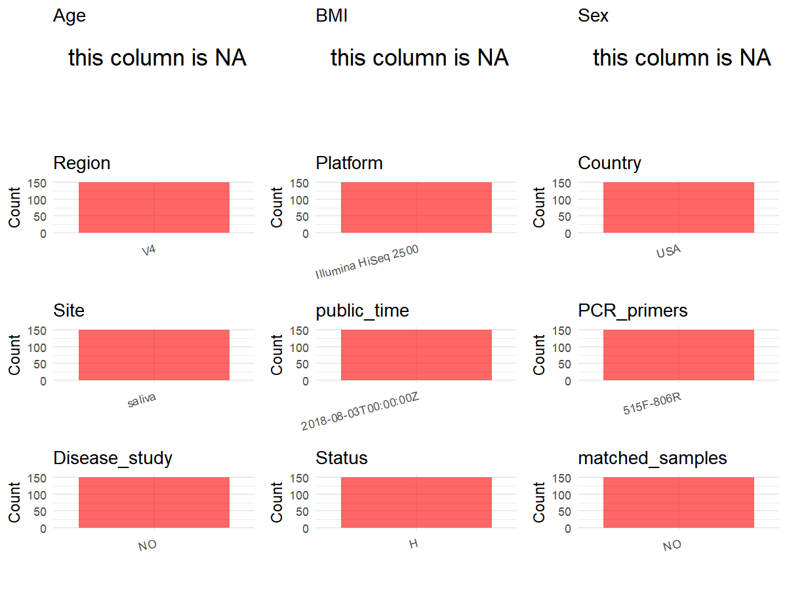

R Notebook: Metadata Processing Workflow
================

# Step 1: Obtain Initial Metadata from Each Project

To obtain the initial metadata: 1. Search for the BioProject ID (e.g.,
“PRJEBXXXX”) on the [NCBI SRA
website](https://www.ncbi.nlm.nih.gov/Traces/study/). 2. In the “Select”
table, click on “Metadata” and download the file. 3. The downloaded file
is typically named “SraRunTable.csv” and contains metadata for the
project.

``` r
# Load necessary libraries
library(dplyr)
library(ggplot2)
library(cowplot)

# Set working directory (update this path to your local directory)
setwd("D:/metadata/PRJEB23323")

# Read the initial metadata files
initial_meta<-read.csv("SraRunTable.csv",header = T)

# Combine the two metadata files
#meta <- rbind(initial_meta, initial_meta1)

#Remove entries non-oral samples
#initial_meta <- subset(initial_meta,isolate %in% c("saliva","tongue coat"))

# Check the number of samples containing "HT" in Sample.Name (e.g., healthy controls)
#nrow(subset(meta, grepl("HT", Sample.Name)))

# Display the first few rows of the metadata
head(initial_meta)
```

    ##          Run                   AGE age_units anonymized_name Assay.Type
    ## 1 ERR2190627 Missing: Not provided     years     MIC20011111      OTHER
    ## 2 ERR2190630 Missing: Not provided     years     MIC20021111      OTHER
    ## 3 ERR2190641 Missing: Not provided     years     MIC20061211      OTHER
    ## 4 ERR2190651 Missing: Not provided     years     MIC20101111      OTHER
    ## 5 ERR2190652 Missing: Not provided     years     MIC20101151      OTHER
    ## 6 ERR2190686 Missing: Not provided     years     MIC20211211      OTHER
    ##   AvgSpotLen barcode..exp.    Bases BioProject      BioSample
    ## 1        149  GCCTACTCTCGG 16173869 PRJEB23323 SAMEA104368491
    ## 2        149  AGATGCAATGAT 23090038 PRJEB23323 SAMEA104368494
    ## 3        150  TACACGCTGATG  7943250 PRJEB23323 SAMEA104368505
    ## 4        149  CGTTCCTTGTTA 24617964 PRJEB23323 SAMEA104368515
    ## 5        150  CGTCGCAGCCTT 17350050 PRJEB23323 SAMEA104368516
    ## 6        149  TTATACGTTGTA 21197789 PRJEB23323 SAMEA104368550
    ##                     BMI       body_habitat  body_product    body_site    Bytes
    ## 1 Missing: Not provided UBERON:oral cavity UBERON:saliva UBERON:mouth  8813966
    ## 2 Missing: Not provided UBERON:oral cavity UBERON:saliva UBERON:mouth 12816318
    ## 3 Missing: Not provided UBERON:oral cavity UBERON:saliva UBERON:mouth  4124108
    ## 4 Missing: Not provided UBERON:oral cavity UBERON:saliva UBERON:mouth 13637808
    ## 5 Missing: Not provided UBERON:oral cavity UBERON:saliva UBERON:mouth  9789830
    ## 6 Missing: Not provided UBERON:oral cavity UBERON:saliva UBERON:mouth 11454934
    ##   center_name..exp.                                        Center.Name
    ## 1               NCI UNIVERSITY OF CALIFORNIA SAN DIEGO MICROBIOME INIT
    ## 2               NCI UNIVERSITY OF CALIFORNIA SAN DIEGO MICROBIOME INIT
    ## 3               NCI UNIVERSITY OF CALIFORNIA SAN DIEGO MICROBIOME INIT
    ## 4               NCI UNIVERSITY OF CALIFORNIA SAN DIEGO MICROBIOME INIT
    ## 5               NCI UNIVERSITY OF CALIFORNIA SAN DIEGO MICROBIOME INIT
    ## 6               NCI UNIVERSITY OF CALIFORNIA SAN DIEGO MICROBIOME INIT
    ##   center_project_name..exp. collection_timestamp Consent DATASTORE.filetype
    ## 1    Mayo_Bangladesh_saliva           2015-02-15  public   fastq,run.zq,sra
    ## 2    Mayo_Bangladesh_saliva           2015-02-16  public   fastq,run.zq,sra
    ## 3    Mayo_Bangladesh_saliva           2015-02-22  public   fastq,run.zq,sra
    ## 4    Mayo_Bangladesh_saliva           2015-03-04  public   fastq,run.zq,sra
    ## 5    Mayo_Bangladesh_saliva           2015-03-04  public   fastq,run.zq,sra
    ## 6    Mayo_Bangladesh_saliva           2015-03-24  public   fastq,run.zq,sra
    ##   DATASTORE.provider                         DATASTORE.region Day dna_extracted
    ## 1     ena,gs,ncbi,s3 ena,gs.us-east1,ncbi.public,s3.us-east-1   0          TRUE
    ## 2     ena,gs,ncbi,s3 ena,gs.us-east1,ncbi.public,s3.us-east-1   0          TRUE
    ## 3     ena,gs,ncbi,s3 ena,gs.us-east1,ncbi.public,s3.us-east-1   0          TRUE
    ## 4     ena,gs,ncbi,s3 ena,gs.us-east1,ncbi.public,s3.us-east-1   0          TRUE
    ## 5     ena,gs,ncbi,s3 ena,gs.us-east1,ncbi.public,s3.us-east-1   4          TRUE
    ## 6     ena,gs,ncbi,s3 ena,gs.us-east1,ncbi.public,s3.us-east-1   0          TRUE
    ##   elevation ENA.FIRST.PUBLIC..run. ENA_first_public ENA.LAST.UPDATE..run.
    ## 1        97             2018-08-01       2018-08-01            2018-11-16
    ## 2        97             2018-08-01       2018-08-01            2018-11-16
    ## 3        97             2018-08-01       2018-08-01            2018-11-16
    ## 4        97             2018-08-01       2018-08-01            2018-11-16
    ## 5        97             2018-08-01       2018-08-01            2018-11-16
    ## 6        97             2018-08-01       2018-08-01            2018-11-16
    ##   ena_last_update              env_biome              env_feature env_material
    ## 1      2017-11-03 dense settlement biome human-associated habitat       saliva
    ## 2      2017-11-03 dense settlement biome human-associated habitat       saliva
    ## 3      2017-11-03 dense settlement biome human-associated habitat       saliva
    ## 4      2017-11-03 dense settlement biome human-associated habitat       saliva
    ## 5      2017-11-03 dense settlement biome human-associated habitat       saliva
    ## 6      2017-11-03 dense settlement biome human-associated habitat       saliva
    ##   env_package Experiment    external_id extraction_robot..exp.
    ## 1  human-oral ERX2246742 SAMEA104368491               HOWE.KF2
    ## 2  human-oral ERX2246745 SAMEA104368494               HOWE.KF2
    ## 3  human-oral ERX2246756 SAMEA104368505               HOWE.KF2
    ## 4  human-oral ERX2246766 SAMEA104368515               HOWE.KF2
    ## 5  human-oral ERX2246767 SAMEA104368516               HOWE.KF2
    ## 6  human-oral ERX2246801 SAMEA104368550               HOWE.KF1
    ##   extractionkit_lot..exp. geo_loc_name_country geo_loc_name_country_continent
    ## 1                  PM15G7                  USA                  North America
    ## 2                  PM15G7                  USA                  North America
    ## 3                  PM15G8                  USA                  North America
    ## 4                  PM15G7                  USA                  North America
    ## 5                  PM15G7                  USA                  North America
    ## 6                  PM15G8                  USA                  North America
    ##   geo_loc_name                height height_units host_common_name
    ## 1       USA:MD Missing: Not provided           cm            human
    ## 2       USA:MD Missing: Not provided           cm            human
    ## 3       USA:MD Missing: Not provided           cm            human
    ## 4       USA:MD Missing: Not provided           cm            human
    ## 5       USA:MD Missing: Not provided           cm            human
    ## 6       USA:MD Missing: Not provided           cm            human
    ##   host_scientific_name host_subject_id host_taxid INSDC_center_alias
    ## 1         Homo sapiens            2001       9606             UCSDMI
    ## 2         Homo sapiens            2002       9606             UCSDMI
    ## 3         Homo sapiens            2006       9606             UCSDMI
    ## 4         Homo sapiens            2010       9606             UCSDMI
    ## 5         Homo sapiens            2010       9606             UCSDMI
    ## 6         Homo sapiens            2021       9606             UCSDMI
    ##                                          INSDC_center_name   INSDC_first_public
    ## 1 University of California San Diego Microbiome Initiative 2018-08-01T17:03:05Z
    ## 2 University of California San Diego Microbiome Initiative 2018-08-01T17:03:05Z
    ## 3 University of California San Diego Microbiome Initiative 2018-08-01T17:03:05Z
    ## 4 University of California San Diego Microbiome Initiative 2018-08-01T17:03:05Z
    ## 5 University of California San Diego Microbiome Initiative 2018-08-01T17:03:05Z
    ## 6 University of California San Diego Microbiome Initiative 2018-08-01T17:03:05Z
    ##      INSDC_last_update INSDC_status          Instrument       Label LATITUDE
    ## 1 2017-11-03T16:13:29Z       public Illumina HiSeq 2500 MIC20011111 38.98472
    ## 2 2017-11-03T16:13:29Z       public Illumina HiSeq 2500 MIC20021111 38.98472
    ## 3 2017-11-03T16:13:29Z       public Illumina HiSeq 2500 MIC20061211 38.98472
    ## 4 2017-11-03T16:13:29Z       public Illumina HiSeq 2500 MIC20101111 38.98472
    ## 5 2017-11-03T16:13:30Z       public Illumina HiSeq 2500 MIC20101151 38.98472
    ## 6 2017-11-03T16:13:30Z       public Illumina HiSeq 2500 MIC20211211 38.98472
    ##        Library.Name LibraryLayout LibrarySelection LibrarySource life_stage
    ## 1 10823.MIC20011111        SINGLE              PCR   METAGENOMIC      adult
    ## 2 10823.MIC20021111        SINGLE              PCR   METAGENOMIC      adult
    ## 3 10823.MIC20061211        SINGLE              PCR   METAGENOMIC      adult
    ## 4 10823.MIC20101111        SINGLE              PCR   METAGENOMIC      adult
    ## 5 10823.MIC20101151        SINGLE              PCR   METAGENOMIC      adult
    ## 6 10823.MIC20211211        SINGLE              PCR   METAGENOMIC      adult
    ##   linker..exp. longitude mastermix_lot..exp.   method              Organism
    ## 1           GT -77.11306           151033266    Scope human oral metagenome
    ## 2           GT -77.11306           151033266    Scope human oral metagenome
    ## 3           GT -77.11306           151033266 OMNIGene human oral metagenome
    ## 4           GT -77.11306           151033266    Scope human oral metagenome
    ## 5           GT -77.11306           151033266    Scope human oral metagenome
    ## 6           GT -77.11306           151033266 OMNIGene human oral metagenome
    ##   orig_name..exp.                                 pcr_primers..exp.
    ## 1   MIC_2001_1111 FWD:GTGYCAGCMGCCGCGGTAA; REV:GGACTACNVGGGTWTCTAAT
    ## 2   MIC_2002_1111 FWD:GTGYCAGCMGCCGCGGTAA; REV:GGACTACNVGGGTWTCTAAT
    ## 3   MIC_2006_1211 FWD:GTGYCAGCMGCCGCGGTAA; REV:GGACTACNVGGGTWTCTAAT
    ## 4   MIC_2010_1111 FWD:GTGYCAGCMGCCGCGGTAA; REV:GGACTACNVGGGTWTCTAAT
    ## 5   MIC_2010_1151 FWD:GTGYCAGCMGCCGCGGTAA; REV:GGACTACNVGGGTWTCTAAT
    ## 6   MIC_2021_1211 FWD:GTGYCAGCMGCCGCGGTAA; REV:GGACTACNVGGGTWTCTAAT
    ##   physical_specimen_location physical_specimen_remaining Platform plating..exp.
    ## 1                     UCSDMI                        TRUE ILLUMINA           LDG
    ## 2                     UCSDMI                        TRUE ILLUMINA           LDG
    ## 3                     UCSDMI                        TRUE ILLUMINA           LDG
    ## 4                     UCSDMI                        TRUE ILLUMINA           LDG
    ## 5                     UCSDMI                        TRUE ILLUMINA           LDG
    ## 6                     UCSDMI                        TRUE ILLUMINA           LDG
    ##   primer_date..exp.          primer..exp. primer_plate..exp.
    ## 1            101415 GTGTGYCAGCMGCCGCGGTAA                  4
    ## 2            101415 GTGTGYCAGCMGCCGCGGTAA                  4
    ## 3            101415 GTGTGYCAGCMGCCGCGGTAA                  7
    ## 4            101415 GTGTGYCAGCMGCCGCGGTAA                  4
    ## 5            101415 GTGTGYCAGCMGCCGCGGTAA                  4
    ## 6            101415 GTGTGYCAGCMGCCGCGGTAA                  6
    ##   processing_robot..exp.              project_name..exp. public
    ## 1                   RIKE MAYO_FECAL_STABILITY_BANGLADESH   TRUE
    ## 2                   RIKE MAYO_FECAL_STABILITY_BANGLADESH   TRUE
    ## 3                   ROBE MAYO_FECAL_STABILITY_BANGLADESH   TRUE
    ## 4                   RIKE MAYO_FECAL_STABILITY_BANGLADESH   TRUE
    ## 5                   RIKE MAYO_FECAL_STABILITY_BANGLADESH   TRUE
    ## 6                 CARMEN MAYO_FECAL_STABILITY_BANGLADESH   TRUE
    ##            ReleaseDate          create_date version run_prefix..exp.
    ## 1 2018-08-03T00:00:00Z 2018-08-03T03:12:00Z       1   Mayo_1_S1_L001
    ## 2 2018-08-03T00:00:00Z 2018-08-03T03:12:00Z       1   Mayo_1_S1_L001
    ## 3 2018-08-03T00:00:00Z 2018-08-03T03:13:00Z       1   Mayo_1_S1_L001
    ## 4 2018-08-03T00:00:00Z 2018-08-03T03:15:00Z       1   Mayo_1_S1_L001
    ## 5 2018-08-03T00:00:00Z 2018-08-03T03:15:00Z       1   Mayo_1_S1_L001
    ## 6 2018-08-03T00:00:00Z 2018-08-03T03:19:00Z       1   Mayo_1_S1_L001
    ##   sample_host_id    Sample.Name                       Sample_name
    ## 1           2001 SAMEA104368491 qiita_sid_10823:10823.MIC20011111
    ## 2           2002 SAMEA104368494 qiita_sid_10823:10823.MIC20021111
    ## 3           2006 SAMEA104368505 qiita_sid_10823:10823.MIC20061211
    ## 4           2010 SAMEA104368515 qiita_sid_10823:10823.MIC20101111
    ## 5           2010 SAMEA104368516 qiita_sid_10823:10823.MIC20101151
    ## 6           2021 SAMEA104368550 qiita_sid_10823:10823.MIC20211211
    ##       sample_plate..exp.                                       SAMPLE
    ## 1 MAYO_BANGLADESH_Plate4    Saliva\\, Scope\\, 1.8ml aliquot\\, Day 0
    ## 2 MAYO_BANGLADESH_Plate4    Saliva\\, Scope\\, 1.8ml aliquot\\, Day 0
    ## 3 MAYO_BANGLADESH_Plate7 Saliva\\, OMNIGene\\, 1.8ml aliquot\\, Day 0
    ## 4 MAYO_BANGLADESH_Plate4    Saliva\\, Scope\\, 1.8ml aliquot\\, Day 0
    ## 5 MAYO_BANGLADESH_Plate4    Saliva\\, Scope\\, 1.8ml aliquot\\, Day 4
    ## 6 MAYO_BANGLADESH_Plate6 Saliva\\, OMNIGene\\, 1.8ml aliquot\\, Day 0
    ##   sample_type sequence_number   sequencing_meth..exp.                   sex
    ## 1      saliva            1111 Sequencing by synthesis Missing: Not provided
    ## 2      saliva            1111 Sequencing by synthesis Missing: Not provided
    ## 3      saliva            1211 Sequencing by synthesis Missing: Not provided
    ## 4      saliva            1111 Sequencing by synthesis Missing: Not provided
    ## 5      saliva            1151 Sequencing by synthesis Missing: Not provided
    ## 6      saliva            1211 Sequencing by synthesis Missing: Not provided
    ##        solution SRA.Study studyid                      Submitter_Id
    ## 1 1.8ml aliquot ERP105068     MIC qiita_sid_10823:10823.MIC20011111
    ## 2 1.8ml aliquot ERP105068     MIC qiita_sid_10823:10823.MIC20021111
    ## 3 1.8ml aliquot ERP105068     MIC qiita_sid_10823:10823.MIC20061211
    ## 4 1.8ml aliquot ERP105068     MIC qiita_sid_10823:10823.MIC20101111
    ## 5 1.8ml aliquot ERP105068     MIC qiita_sid_10823:10823.MIC20101151
    ## 6 1.8ml aliquot ERP105068     MIC qiita_sid_10823:10823.MIC20211211
    ##   target_gene..exp. target_subfragment..exp. tm1000_8_tool..exp.
    ## 1          16S rRNA                       V4             108379Z
    ## 2          16S rRNA                       V4             108379Z
    ## 3          16S rRNA                       V4             108379Z
    ## 4          16S rRNA                       V4             108379Z
    ## 5          16S rRNA                       V4             108379Z
    ## 6          16S rRNA                       V4             108379Z
    ##   tm300_8_tool..exp. tm50_8_tool..exp. water_lot..exp.                weight
    ## 1            311318B           311426B        RNDB7780 Missing: Not provided
    ## 2            311318B           311426B        RNDB7780 Missing: Not provided
    ## 3            208282Z           108364Z        RNDB7780 Missing: Not provided
    ## 4            311318B           311426B        RNDB7780 Missing: Not provided
    ## 5            311318B           311426B        RNDB7780 Missing: Not provided
    ## 6            3076189           409172Z        RNDB7780 Missing: Not provided
    ##   weight_units                  well_description..exp. well_id..exp.
    ## 1           kg MAYO_BANGLADESH_Plate4_MIC_2001_1111_H3            H3
    ## 2           kg MAYO_BANGLADESH_Plate4_MIC_2002_1111_F2            F2
    ## 3           kg MAYO_BANGLADESH_Plate7_MIC_2006_1211_C6            C6
    ## 4           kg MAYO_BANGLADESH_Plate4_MIC_2010_1111_C9            C9
    ## 5           kg MAYO_BANGLADESH_Plate4_MIC_2010_1151_D9            D9
    ## 6           kg MAYO_BANGLADESH_Plate6_MIC_2021_1211_F3            F3

# Step 2: Create a Uniform Metadata Template

The uniform metadata should include the following columns:

1.  **BioProject**: Project ID (e.g., “PRJNA339212”)
2.  **Run**: Sample ID (e.g., “ERRXXXXXX” or “SRRXXXXXX”)
3.  **sample_name**: Original sample name submitted by the authors (not
    the database-assigned ID)
4.  **Age**: Age of the subject (if available)
5.  **BMI**: Body Mass Index (if available)
6.  **Sex**: Sex of the subject (“F” or “M”)
7.  **Region**: Targeted 16S rRNA region (e.g., “V3-V4”)
8.  **Platform**: Sequencing platform (e.g., “Illumina MiSeq”)
9.  **Country**: Country of sample origin (e.g., “China”)
10. **Site**: Sample site (e.g., “saliva”, “dental plaque”)
11. **public_time**: Data release date (format: “YYYY-MM-DD”)
12. **PCR_primers**: PCR primers used (e.g., “515F-806R”)
13. **title**: Title of the associated publication
14. **Disease_study**: Whether the study involves a disease (“YES” or
    “NO”)
15. **Status**: Disease status (e.g., “T2DM”, “HC”). Note: If the study
    includes both disease and healthy samples, this must be specified
    per sample.
16. **matched_samples**: matched samples (“YES” or “NO”)

``` r
# Create a uniform metadata dataframe
metadata <- data.frame(
  BioProject = initial_meta$BioProject,
  Run = initial_meta$Run,
  sample_name = initial_meta$Sample.Name,
  Age = NA,
  BMI = NA,
  Sex=NA,
  Region = "V4",
  Platform = initial_meta$Instrument,
  Country = initial_meta$geo_loc_name_country,
  Site = initial_meta$env_material,
  public_time = initial_meta$ReleaseDate,
  stringsAsFactors = FALSE
)
```

# Step 3: Manually Add Information from the Publication

Some information (e.g. PCR primers, study title, disease status) must be
manually extracted from the publication and added to the metadata.

``` r
# Add information obtained from the publication
metadata$PCR_primers <- "515F-806R"
metadata$title <- "Comparison of Oral Collection Methods for Studies of Microbiota"
metadata$Disease_study <- "NO"
# Assign disease status based on sample_name patterns
metadata$Status<-"H"

keep_subjects <- unique(subset(metadata, Site == "saliva")$sample_name)
metadata <- subset(metadata, sample_name %in% keep_subjects)

sample_counts <- table(metadata$sample_name)

metadata$matched_samples <-
  ifelse(metadata$sample_name %in% names(sample_counts[sample_counts >= 2]),
         "YES", "NO")

cat("Subjects retained:", length(unique(metadata$sample_name)), "\n")
```

    ## Subjects retained: 150

``` r
cat("Matched samples distribution:\n")
```

    ## Matched samples distribution:

``` r
table(metadata$matched_samples)
```

    ## 
    ##  NO 
    ## 150

``` r
cat("Sample distribution by Site:\n")
```

    ## Sample distribution by Site:

``` r
table(metadata$Site)
```

    ## 
    ## saliva 
    ##    150

# Step 4: Summarize and Validate the Metadata

``` r
# Check the number of unique runs and sample names
print(paste("Number of unique runs:", length(unique(metadata$Run))))
```

    ## [1] "Number of unique runs: 150"

``` r
print(paste("Number of unique sample names:", length(unique(metadata$sample_name))))
```

    ## [1] "Number of unique sample names: 150"

# Step 5: Visualize the Metadata

``` r

```

<!-- -->

# Step 6: Finalize and Export the Metadata

``` r
# Reorder columns to match the desired format
metadata <- metadata[, c(
  "BioProject", "Run", "sample_name", "Age", "BMI", "Sex", 
  "Region", "Platform", "Country", "Site", "public_time", 
  "PCR_primers", "title", "Disease_study", "Status","matched_samples"
)]

# Export the uniform metadata to a CSV file
write.csv(metadata, file = "metadata.csv", quote = FALSE)
head(metadata)
```

    ##   BioProject        Run    sample_name Age BMI Sex Region            Platform
    ## 1 PRJEB23323 ERR2190627 SAMEA104368491  NA  NA  NA     V4 Illumina HiSeq 2500
    ## 2 PRJEB23323 ERR2190630 SAMEA104368494  NA  NA  NA     V4 Illumina HiSeq 2500
    ## 3 PRJEB23323 ERR2190641 SAMEA104368505  NA  NA  NA     V4 Illumina HiSeq 2500
    ## 4 PRJEB23323 ERR2190651 SAMEA104368515  NA  NA  NA     V4 Illumina HiSeq 2500
    ## 5 PRJEB23323 ERR2190652 SAMEA104368516  NA  NA  NA     V4 Illumina HiSeq 2500
    ## 6 PRJEB23323 ERR2190686 SAMEA104368550  NA  NA  NA     V4 Illumina HiSeq 2500
    ##   Country   Site          public_time PCR_primers
    ## 1     USA saliva 2018-08-03T00:00:00Z   515F-806R
    ## 2     USA saliva 2018-08-03T00:00:00Z   515F-806R
    ## 3     USA saliva 2018-08-03T00:00:00Z   515F-806R
    ## 4     USA saliva 2018-08-03T00:00:00Z   515F-806R
    ## 5     USA saliva 2018-08-03T00:00:00Z   515F-806R
    ## 6     USA saliva 2018-08-03T00:00:00Z   515F-806R
    ##                                                             title Disease_study
    ## 1 Comparison of Oral Collection Methods for Studies of Microbiota            NO
    ## 2 Comparison of Oral Collection Methods for Studies of Microbiota            NO
    ## 3 Comparison of Oral Collection Methods for Studies of Microbiota            NO
    ## 4 Comparison of Oral Collection Methods for Studies of Microbiota            NO
    ## 5 Comparison of Oral Collection Methods for Studies of Microbiota            NO
    ## 6 Comparison of Oral Collection Methods for Studies of Microbiota            NO
    ##   Status matched_samples
    ## 1      H              NO
    ## 2      H              NO
    ## 3      H              NO
    ## 4      H              NO
    ## 5      H              NO
    ## 6      H              NO

## Notes for Students:

1.  **Metadata Accuracy**: Always cross-check the metadata with the
    original publication to ensure accuracy.
2.  **Manual Entries**: Columns like `PCR_primers`, and `Status` often
    require manual entry based on the publication.
3.  **Disease Status**: Be careful when assigning `Status`—some studies
    include both disease and healthy samples.
4.  **Visualization**: The plots help quickly identify the distribution
    of values in each column, which is useful for quality control.
5.  **Reproducibility**: Update the working directory and file paths to
    match your local environment.
