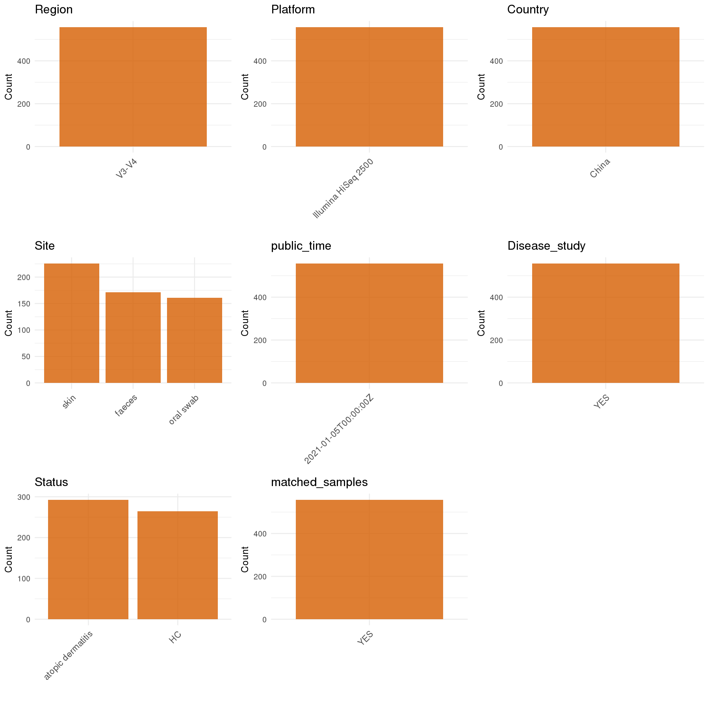

# Step 1: Obtain Initial Metadata from Each Project

This step sets the project directory and loads the raw SRA metadata for all sample types in the study.

```{r message=FALSE, warning=FALSE}
# Load libraries
library(dplyr)
library(ggplot2)
library(cowplot)
library(readxl)
library(stringr)

# (1) Setting working directory
project_id <- "PRJEB23853"

base_dir <- "E:/工作区/VSCode/RNAproject/collect_metadata_respon/project"
setwd(file.path(base_dir, project_id))

# (2) Loading raw SRA metadata file
sra_file <- "SraRunTable.csv"
initial_meta <- read.csv(sra_file, header = TRUE, stringsAsFactors = FALSE)

# (3) Loading supplementary phenotype table
supplement_file <- "1-s2.0-S0022202X19301290-mmc1.xlsx"
phenotype_meta <- read_excel(supplement_file, sheet = "Supplementary Table 1", skip = 1) %>%
  filter(!is.na(SubID)) %>%
  mutate(
    SubID = str_trim(as.character(SubID)),
    sex = case_when(
      `Gender(1,male;2,female)` == 1 ~ "M",
      `Gender(1,male;2,female)` == 2 ~ "F",
      TRUE ~ NA_character_
    ),
    age = as.numeric(`Age(year)`),
    bmi = as.numeric(`BMI (Body mass index)`)
  ) %>%
  select(SubID, Group, Stool, Qral, Skin, age, bmi, sex)

initial_meta <- initial_meta %>%
  mutate(subject_key = str_replace(Sample_name, "^[A-Z]+", "")) %>%
  left_join(phenotype_meta, by = c("subject_key" = "SubID"))
```

# Step 2: Data Overview

First, you need to get an overview of the data, which includes two steps: reading the article and reading the initial metadata. This step is very IMPORTANT!

```{r message=FALSE, warning=FALSE}
# (1) Read the article in the following order: abstract, the beginning of the results section, and the methods.
# Paper summary used for this project:
# - Title: Inverse Association Between the Skin and Oral Microbiota in Atopic Dermatitis
# - Study design: cross-sectional case-control study across skin, oral cavity, and gut habitats
# - Sample size from Results/Figure 1: skin AD/control = 121/105, oral AD/control = 84/77, stool AD/control = 88/83
# - Sampling from Materials and Methods: skin lesions were swabbed from both antecubital fossae; oral samples were collected with a swab across buccal mucosa, keratinized gingiva, supragingival plaque, and tongue dorsum; stool samples were self-collected
# - Sequencing from Supplementary Materials and Methods: V3-V4, Illumina HiSeq 2500, primers 341F/806R
# - Demographics from Supplementary Table 1: per-subject age, sex, and BMI are available for all volunteers
# - Age strata from Results and Supplementary Figure S2: toddlers (1-3 years), children (4-12 years), and teenager-adults (13-59 years)
# - Matching statement from Results: controls were matched in age, sex, and BMI at cohort level

# (2) IMPORTANT: MUST go through each column of initial_meta
head(initial_meta, 10)
colnames(initial_meta)
table(initial_meta$environment_.material.)
table(initial_meta$environment_.biome.)
table(initial_meta$geo_loc_name_country)
table(substr(initial_meta$Sample_name, nchar(initial_meta$Sample_name), nchar(initial_meta$Sample_name)))
table(initial_meta$Group, useNA = "ifany")
table(initial_meta$sex, useNA = "ifany")
# Sample_name prefixes S/O/G track skin/oral/gut materials in the full cohort,
# suffixes A/N map to AD/control across all 558 rows, and Supplementary Table 1 joins on the numeric+status subject key.
```

# Step 3: Removing Control and Non-human Samples

First, we need to remove control samples(including both negative controls and positive controls) and non-human samples.

```{r}
# (1) Parameter setup
control_column <- ""
control_keywords <- c()

species_column <- "Organism"
unique(initial_meta[[species_column]])
non_human_keywords <- c()

# (2) Remove controls and non-human samples. DO NOT need to modify code in this part, just run it.
n_samples <- nrow(initial_meta)
# Control evaluation
if (length(control_keywords) > 0) {
  if (is.null(control_column) || control_column == "") {
    stop("Error: control_keywords provided but control_column is missing.")
  }

  if (!(control_column %in% colnames(initial_meta))) {
    stop(sprintf("Error: Column '%s' not found in initial_meta.", control_column))
  }

  control_pattern <- paste(control_keywords, collapse = "|")
  control_text <- initial_meta[[control_column]]
  is_control <- grepl(control_pattern, control_text)

} else {
  is_control <- rep(FALSE, n_samples)
}

# Non-human evaluation
if (length(non_human_keywords) > 0) {
  if (is.null(species_column) || species_column == "") {
    stop("Error: non_human_keywords provided but species_column is missing.")
  }

  if (!(species_column %in% colnames(initial_meta))) {
    stop(sprintf("Error: Column '%s' not found in initial_meta.", species_column))
  }

  non_human_pattern <- paste(non_human_keywords, collapse = "|")
  species_text <- initial_meta[[species_column]]
  is_non_human <- grepl(non_human_pattern, species_text)
} else {
  is_non_human <- rep(FALSE, n_samples)
}

# Execute removal
samples_to_remove <- is_control | is_non_human
initial_meta <- initial_meta[!samples_to_remove, ]

cat("Initial samples counts:", n_samples, "\n")
cat("Removed control samples:", sum(is_control), "\n")
cat("Removed non-human samples:", sum(is_non_human), "\n")
cat("Total samples removed ", sum(samples_to_remove), "\n")
cat("Remaining samples after Step 2:", nrow(initial_meta), "\n")
```

# Step 4: Creating a Uniform Metadata Template

This step converts the raw SRA table into the standard metadata format used in our meta-analysis.

```{r}
metadata <- data.frame(
  bioproject = initial_meta$BioProject,
  sample_id = initial_meta$Run,
  subject_id = initial_meta$subject_key,
  age = initial_meta$age,
  age_info = "toddlers 1-3 years; children 4-12 years; teenager-adults 13-59 years",
  bmi = initial_meta$bmi,
  sex = initial_meta$sex,
  sequencing_region = "V3-V4",
  platform = "Illumina HiSeq 2500",
  country = initial_meta$geo_loc_name_country,
  raw_material = initial_meta$environment_.material.,
  site = "pending",
  site_group = "pending",
  public_time = initial_meta$ReleaseDate,
  pcr_primers = "341F-806R",
  title = "Inverse Association Between the Skin and Oral Microbiota in Atopic Dermatitis",
  disease_study = "yes",
  raw_status = initial_meta$Sample_name,
  raw_group = initial_meta$Group,
  status = "pending",
  matched_samples = "pending",
  is_time_series = "no",
  stringsAsFactors = FALSE
)

# Source notes for non-obvious fields:
# - subject_id uses the Supplementary Table 1 volunteer identifier after stripping the S/O/G sample-type prefix from Sample_name.
# - age, bmi, and sex come from Supplementary Table 1 rather than the SRA table.
# - age_info keeps the paper's reported age strata across the full cohort.
# - sequencing_region, platform, and pcr_primers come from the supplementary methods.
# - site is derived from the paper and the SRA material field: skin lesions from antecubital fossae, oral cavity mixed swab, and stool.
# - status is cross-checked between Sample_name suffixes and Supplementary Table 1 group labels.
metadata$public_time <- as.Date(metadata$public_time)
```

# Step 5: Manually solving pending issues

This step involves two parts: (1) handle the columns with the `raw_` prefix, and next (2) handle the `site_group` and `matched_samples` columns.

```{r}
# (1) Handle the columns with the `raw_` prefix.
metadata <- metadata %>%
  mutate(
    status = case_when(
      raw_group == "AD" & grepl("A$", raw_status) ~ "atopic dermatitis",
      raw_group == "Control" & grepl("N$", raw_status) ~ "HC",
      grepl("A$", raw_status) ~ "atopic dermatitis",
      grepl("N$", raw_status) ~ "HC",
      TRUE ~ NA_character_
    ),
    site = case_when(
      raw_material == "skin" ~ "antecubital fossa skin lesion swab",
      raw_material == "oral" ~ "oral cavity mixed swab (buccal mucosa, keratinized gingiva, supragingival plaque, tongue dorsum)",
      raw_material == "faeces" ~ "stool",
      TRUE ~ NA_character_
    )
  )
# Supplementary Table 1 group labels and Sample_name suffixes agree on AD/control coding for the joined cohort.
```

```{r}
# (2) Filling the 'site_group' and 'matched_samples' columns
unique(metadata$site)
Oral_site = c("oral cavity mixed swab (buccal mucosa, keratinized gingiva, supragingival plaque, tongue dorsum)")
Gut_site = c("stool")

metadata <- metadata %>%
  mutate(site_group = case_when(
    site %in% Oral_site ~ "oral",
    site %in% Gut_site ~ "gut",
    raw_material == "skin" ~ "other",
    TRUE ~ "other"
  ))

metadata$matched_samples <- ifelse(
  ave(metadata$subject_id, metadata$subject_id, FUN = length) > 1,
  "yes",
  "no"
)
# Subject IDs now come from Supplementary Table 1, so repeated rows across body sites resolve to matched multi-site sampling.
```

```{r}
# (3) check if there is pending value in metadata. If there is pending value, go on modify the metadata.
has_pending <- function(col) {
  if (is.character(col) || is.factor(col)) {
    any(col == "pending", na.rm = TRUE)
  } else {
    FALSE
  }
}

any_pending_value <- any(sapply(metadata, has_pending))

if (!any_pending_value) {
  message("Good! No cell contains the value 'pending'.")
} else {
  pending_cols <- names(metadata)[sapply(metadata, has_pending)]
  message("Columns containing 'pending': ", paste(pending_cols, collapse = ", "))
  message("Please continue to resolve these pending columns!")
}
```

# Step 6: Visualize the Metadata

This step makes a quick set of plots for checking the distribution of key metadata fields.

```{r}
plot_data <- metadata %>%
  select(-bioproject, -sample_id, -subject_id, -title, -raw_status, -raw_material, -raw_group)

create_simple_plots <- function(data) {
  plots <- list()
  continuous_vars <- c("age", "bmi")

  for (col in colnames(data)) {
    if (all(is.na(data[[col]]))) {
      p <- ggplot() +
        annotate("text", x = 0.5, y = 0.5, label = "this column is NA", size = 6) +
        labs(title = col) +
        theme_void()
    } else if (col %in% continuous_vars && is.numeric(data[[col]])) {
      p <- ggplot(data, aes(x = .data[[col]])) +
        geom_histogram(fill = "blue", alpha = 0.6, bins = 20, na.rm = TRUE) +
        labs(title = col, x = col, y = "Count") +
        theme_minimal()
    } else {
      count_data <- as.data.frame(table(data[[col]], useNA = "ifany"))
      p <- ggplot(count_data, aes(x = reorder(Var1, -Freq), y = Freq)) +
        geom_col(fill = "red", alpha = 0.6) +
        labs(title = col, x = NULL, y = "Count") +
        theme_minimal() +
        theme(axis.text.x = element_text(angle = 15, hjust = 1))
    }
    plots[[col]] <- p
  }

  return(plots)
}

plots <- create_simple_plots(plot_data)
p <- plot_grid(plots$age,
               plots$bmi,
               plots$sex,
               plots$site,
               plots$site_group,
               plots$sequencing_region,
               plots$platform,
               plots$country,
               plots$status,
               plots$matched_samples,
               ncol = 3, align = "hv", axis = "lb")
ggsave("Metadata_Summary.png", plot = p, width = 8, height = 6, dpi = 150)
```

```{r}

```

# Step 7: Sort and export the metadata

This step saves the cleaned metadata table as the final `metadata_v2.csv` file.

```{r}
fixed_cols <- c("bioproject", "sample_id", "subject_id", "age", "age_info",
                "bmi", "sex", "platform", "sequencing_region", "pcr_primers",
                "country", "site", "site_group", "disease_study", "status",
                "title", "public_time", "matched_samples", "is_time_series")
metadata <- metadata %>%
  select(all_of(fixed_cols), starts_with("raw_"))

write.csv(metadata, file = "metadata_v2.csv", quote = TRUE, row.names = FALSE)
```