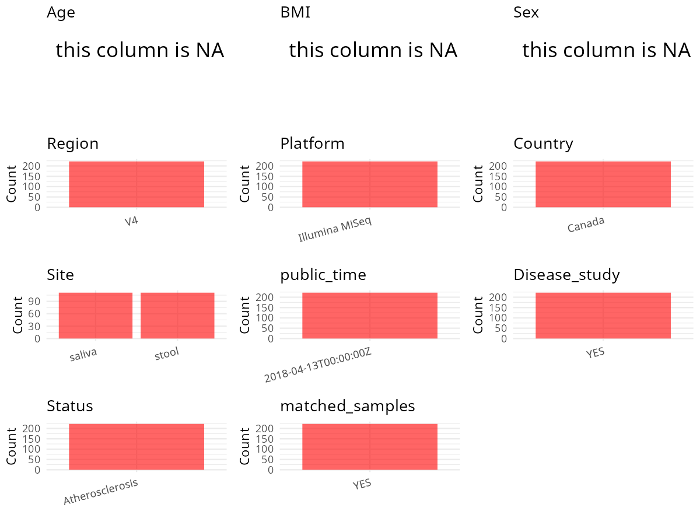

R Notebook: Metadata Processing Workflow
================

# Step 1: Obtain Initial Metadata from Each Project

To obtain the initial metadata: 1. Search for the BioProject ID (e.g.,
“PRJEBXXXX”) on the [NCBI SRA
website](https://www.ncbi.nlm.nih.gov/Traces/study/). 2. In the “Select”
table, click on “Metadata” and download the file. 3. The downloaded file
is typically named “SraRunTable.csv” and contains metadata for the
project.

``` r
# Load necessary libraries
library(dplyr)
library(ggplot2)
library(cowplot)

# Set working directory (update this path to your local directory)
setwd("/home/hby/oral_project/PRJEB24929")

# Read the initial metadata files
initial_meta <- read.csv("SraRunTable.csv", header = T)

# Combine the two metadata files
# meta <- rbind(initial_meta, initial_meta1)

# Remove entries non-oral samples
# initial_meta <- subset(initial_meta,isolate %in% c("saliva","tongue coat"))

# Check the number of samples containing "HT" in Sample.Name (e.g., healthy controls)
# nrow(subset(meta, grepl("HT", Sample.Name)))

# Display the first few rows of the metadata
head(initial_meta)
```

    ##          Run Assay.Type AvgSpotLen    Bases BioProject      BioSample    Bytes Center.Name Collection_Date common_name Consent DATASTORE.filetype DATASTORE.provider
    ## 1 ERR2433167   AMPLICON        523 79731461 PRJEB24929 SAMEA104708441 40815868         UWO            2013       human  public   fastq,run.zq,sra     ena,gs,ncbi,s3
    ## 2 ERR2433168   AMPLICON        523 79084679 PRJEB24929 SAMEA104708442 40870742         UWO            2013       human  public   fastq,run.zq,sra     ena,gs,ncbi,s3
    ## 3 ERR2433171   AMPLICON        523 53443722 PRJEB24929 SAMEA104708445 28530206         UWO            2013       human  public   fastq,run.zq,sra     ena,gs,ncbi,s3
    ## 4 ERR2433198   AMPLICON        523 50536912 PRJEB24929 SAMEA104708472 26272645         UWO            2013       human  public   fastq,run.zq,sra     ena,gs,ncbi,s3
    ## 5 ERR2433199   AMPLICON        523 54393752 PRJEB24929 SAMEA104708473 28453332         UWO            2013       human  public   fastq,run.zq,sra     ena,gs,ncbi,s3
    ## 6 ERR2433202   AMPLICON        523 11616444 PRJEB24929 SAMEA104708476  6350864         UWO            2013       human  public   fastq,run.zq,sra     ena,gs,ncbi,s3
    ##                           DATASTORE.region ENA.FIRST.PUBLIC..run.     ena_first_public ENA.LAST.UPDATE..run.      ena_last_update environment_.biome. environment_.feature.
    ## 1 ena,gs.us-east1,ncbi.public,s3.us-east-1              2018/4/12 2018-04-12T17:03:00Z            2018/11/16 2018-03-20T20:04:10Z       ENVO:02000022         ENVO:00002003
    ## 2 ena,gs.us-east1,ncbi.public,s3.us-east-1              2018/4/12 2018-04-12T17:03:00Z            2018/11/16 2018-03-20T20:04:10Z       ENVO:02000022         ENVO:00002003
    ## 3 ena,gs.us-east1,ncbi.public,s3.us-east-1              2018/4/12 2018-04-12T17:03:00Z            2018/11/16 2018-03-20T20:04:11Z       ENVO:02000019         ENVO:02000036
    ## 4 ena,gs.us-east1,ncbi.public,s3.us-east-1              2018/4/12 2018-04-12T17:03:00Z            2018/11/16 2018-03-20T20:04:12Z       ENVO:02000022         ENVO:00002003
    ## 5 ena,gs.us-east1,ncbi.public,s3.us-east-1              2018/4/12 2018-04-12T17:03:00Z            2018/11/16 2018-03-20T20:04:12Z       ENVO:02000022         ENVO:00002003
    ## 6 ena,gs.us-east1,ncbi.public,s3.us-east-1              2018/4/12 2018-04-12T17:03:00Z            2018/11/16 2018-03-20T20:04:12Z       ENVO:02000019         ENVO:02000036
    ##   environment_.material. Experiment    external_id geo_loc_name_country geo_loc_name_country_continent geographic_location_.country_and.or_sea. geographic_location_.latitude.
    ## 1                  stool ERX2452746 SAMEA104708441               Canada                  North America                                   Canada                          43.01
    ## 2                  stool ERX2452747 SAMEA104708442               Canada                  North America                                   Canada                          43.01
    ## 3                 saliva ERX2452750 SAMEA104708445               Canada                  North America                                   Canada                          43.01
    ## 4                  stool ERX2452777 SAMEA104708472               Canada                  North America                                   Canada                          43.01
    ## 5                  stool ERX2452778 SAMEA104708473               Canada                  North America                                   Canada                          43.01
    ## 6                 saliva ERX2452781 SAMEA104708476               Canada                  North America                                   Canada                          43.01
    ##   geographic_location_.longitude. host_body_product    host_body_site host_subject_id human_associated_environmental_package INSDC_center_name   INSDC_first_public    INSDC_last_update
    ## 1                          -81.28             stool Portion of saliva            6984                       human-associated               UWO 2018-04-12T17:03:00Z 2018-03-20T20:04:10Z
    ## 2                          -81.28             stool             Feces            6984                       human-associated               UWO 2018-04-12T17:03:00Z 2018-03-20T20:04:10Z
    ## 3                          -81.28            saliva Portion of saliva            6984                       human-associated               UWO 2018-04-12T17:03:00Z 2018-03-20T20:04:11Z
    ## 4                          -81.28             stool             Feces            8367                       human-associated               UWO 2018-04-12T17:03:00Z 2018-03-20T20:04:12Z
    ## 5                          -81.28             stool             Feces            8367                       human-associated               UWO 2018-04-12T17:03:00Z 2018-03-20T20:04:12Z
    ## 6                          -81.28            saliva Portion of saliva            8367                       human-associated               UWO 2018-04-12T17:03:00Z 2018-03-20T20:04:12Z
    ##   INSDC_status     Instrument investigation_type left_barcode Library.Name LibraryLayout LibrarySelection LibrarySource     Organism plaque_phenotype Platform
    ## 1       public Illumina MiSeq         metagenome     ccaaggtt  unspecified        PAIRED              PCR   METAGENOMIC Homo sapiens      progression ILLUMINA
    ## 2       public Illumina MiSeq         metagenome     ccaaggtt  unspecified        PAIRED              PCR   METAGENOMIC Homo sapiens      progression ILLUMINA
    ## 3       public Illumina MiSeq         metagenome     tccgttcg  unspecified        PAIRED              PCR   METAGENOMIC Homo sapiens      progression ILLUMINA
    ## 4       public Illumina MiSeq         metagenome     aaggttcc  unspecified        PAIRED              PCR   METAGENOMIC Homo sapiens       regression ILLUMINA
    ## 5       public Illumina MiSeq         metagenome     aaggttcc  unspecified        PAIRED              PCR   METAGENOMIC Homo sapiens       regression ILLUMINA
    ## 6       public Illumina MiSeq         metagenome     gaatccat  unspecified        PAIRED              PCR   METAGENOMIC Homo sapiens       regression ILLUMINA
    ##                                                project_name          ReleaseDate residual_value right_barcode  Sample_ID    Sample.Name       Sample_name Scientific_Name
    ## 1 The intestinal microbiome and extremes of atherosclerosis 2018-04-13T00:00:00Z        0.86222      aggcaaga    04A_gut SAMEA104708441    Athero-04A_gut    Homo sapiens
    ## 2 The intestinal microbiome and extremes of atherosclerosis 2018-04-13T00:00:00Z        0.86222      tggcttcg    04B_gut SAMEA104708442    Athero-04B_gut    Homo sapiens
    ## 3 The intestinal microbiome and extremes of atherosclerosis 2018-04-13T00:00:00Z        0.86222      tggcttcg 04B_saliva SAMEA104708445 Athero-04B_saliva    Homo sapiens
    ## 4 The intestinal microbiome and extremes of atherosclerosis 2018-04-13T00:00:00Z       -0.87263      caatggat    09B_gut SAMEA104708472    Athero-09B_gut    Homo sapiens
    ## 5 The intestinal microbiome and extremes of atherosclerosis 2018-04-13T00:00:00Z       -0.87263      gttacctg    09C_gut SAMEA104708473    Athero-09C_gut    Homo sapiens
    ## 6 The intestinal microbiome and extremes of atherosclerosis 2018-04-13T00:00:00Z       -0.87263      tggcttcg 09C_saliva SAMEA104708476 Athero-09C_saliva    Homo sapiens
    ##   Sequencing_method SRA.Study      Submitter_Id          create_date version
    ## 1    Illumina MiSeq ERP106796    Athero-04A_gut 2018-04-13T09:12:00Z       1
    ## 2    Illumina MiSeq ERP106796    Athero-04B_gut 2018-04-13T09:12:00Z       1
    ## 3    Illumina MiSeq ERP106796 Athero-04B_saliva 2018-04-13T09:12:00Z       1
    ## 4    Illumina MiSeq ERP106796    Athero-09B_gut 2018-04-13T09:16:00Z       1
    ## 5    Illumina MiSeq ERP106796    Athero-09C_gut 2018-04-13T09:16:00Z       1
    ## 6    Illumina MiSeq ERP106796 Athero-09C_saliva 2018-04-13T09:16:00Z       1

# Step 2: Create a Uniform Metadata Template

The uniform metadata should include the following columns:

1.  **BioProject**: Project ID (e.g., “PRJNA339212”)
2.  **Run**: Sample ID (e.g., “ERRXXXXXX” or “SRRXXXXXX”)
3.  **sample_name**: Original sample name submitted by the authors (not
    the database-assigned ID)
4.  **Age**: Age of the subject (if available)
5.  **BMI**: Body Mass Index (if available)
6.  **Sex**: Sex of the subject (“F” or “M”)
7.  **Region**: Targeted 16S rRNA region (e.g., “V3-V4”)
8.  **Platform**: Sequencing platform (e.g., “Illumina MiSeq”)
9.  **Country**: Country of sample origin (e.g., “China”)
10. **Site**: Sample site (e.g., “saliva”, “dental plaque”)
11. **public_time**: Data release date (format: “YYYY-MM-DD”)
12. **PCR_primers**: PCR primers used (e.g., “515F-806R”)
13. **title**: Title of the associated publication
14. **Disease_study**: Whether the study involves a disease (“YES” or
    “NO”)
15. **Status**: Disease status (e.g., “T2DM”, “HC”). Note: If the study
    includes both disease and healthy samples, this must be specified
    per sample.
16. **matched_samples**: matched samples (“YES” or “NO”)

``` r
# Create a uniform metadata dataframe
metadata <- data.frame(
  BioProject = initial_meta$BioProject,
  Run = initial_meta$Run,
  sample_name = initial_meta$Sample_ID,
  Platform = initial_meta$Instrument,
  Country = initial_meta$geo_loc_name_country,
  Site = initial_meta$host_body_product,
  public_time = initial_meta$ReleaseDate,
  stringsAsFactors = FALSE,
  Sex = NA,
  Age = NA,
  BMI = NA
)
```

# Step 3: Manually Add Information from the Publication

Some information (e.g. PCR primers, study title, disease status) must be
manually extracted from the publication and added to the metadata.

``` r
# Add information obtained from the publication
metadata$Region <- "V4"
metadata$Status <- "Atherosclerosis"
metadata$PCR_primers <- "FWD:GTGCCAGCMGCCGCGGTAA; REV:GGACTACHVGGGTWTCTAAT"
metadata$title <- "Data on the gut and saliva microbiota from a cohort of atherosclerosis patients determined by 16S rRNA gene sequencing"
metadata$Disease_study <- "YES"

# extract subject id by remove prefix of sample_name
metadata$subject_id <- sub("_.*", "", metadata$sample_name)
all_oral_sites <- c("saliva", "tongue coat", "buccal mucosa", "lower jaw mucosa", "lower labial mucosa", "upper jaw mucosa", "tongue", "buccal")
# Check initial data distribution
cat("Initial sample distribution:\n")
```

    ## Initial sample distribution:

``` r
table(metadata$subject_id)
```

    ## 
    ## 01A 01B 01C 02A 02B 02C 03A 03B 03C 04A 04B 04C 05A 05B 05C 06A 06B 06C 07A 07B 07C 08A 08B 08C 09A 09B 09C 10A 10B 10C 11A 11B 11C 12A 12B 12C 14A 14B 14C 16A 16B 16C 17A 17B 17C 19A 
    ##   1   1   1   1   1   1   1   1   1   2   2   2   2   2   2   2   2   2   2   2   2   2   2   2   2   2   2   2   2   2   2   2   2   2   2   2   2   2   2   2   2   2   2   2   2   2 
    ## 19B 19C 20A 20B 20C 21A 21B 21C 23A 23B 23C 24A 24B 24C 25A 25B 25C 26A 26B 26C 27A 27B 27C 28A 28B 28C 29A 29B 29C 30A 30B 30C 31A 31B 31C 32A 32B 32C 33A 33B 33C 34A 34B 34C 35A 35B 
    ##   2   2   2   2   2   2   2   2   2   2   2   2   2   2   2   2   2   2   2   2   2   2   2   2   2   2   2   2   2   2   2   2   2   2   2   2   2   2   2   2   2   2   2   2   2   2 
    ## 35C 36A 36B 36C 37A 37B 37C 38A 38B 38C 39A 39B 39C 40A 40B 40C 41A 41B 41C 42A 42B 42C 43A 43B 43C 44A 44B 44C 
    ##   2   2   2   2   2   2   2   2   2   2   2   2   2   2   2   2   2   2   2   2   2   2   2   2   2   2   2   2

``` r
table(metadata$Site)
```

    ## 
    ## saliva  stool 
    ##    111    120

``` r
subjects_with_oral_samples <- metadata %>%
  filter(Site %in% all_oral_sites) %>%
  distinct(subject_id) %>%
  pull(subject_id)

metadata_clean <- metadata %>%
  filter(subject_id %in% subjects_with_oral_samples)


sample_counts <- metadata_clean %>%
  group_by(subject_id) %>%
  summarise(n_samples = n(), .groups = 'drop')

metadata_clean <- merge(metadata_clean, sample_counts, by = "subject_id")

# Create matched_samples column
metadata_clean$matched_samples <- ifelse(metadata_clean$n_samples >= 2, "YES", "NO")

cat("\nFinal sample distribution after cleaning:\n")
```

    ## 
    ## Final sample distribution after cleaning:

``` r
print(table(metadata_clean$Site))
```

    ## 
    ## saliva  stool 
    ##    111    111

``` r
cat("\nFinal sample distribution after cleaning:\n")
```

    ## 
    ## Final sample distribution after cleaning:

``` r
print(table(metadata_clean$matched_samples))
```

    ## 
    ## YES 
    ## 222

``` r
metadata_clean$subject_id <- NULL
metadata_clean$n_samples <- NULL

# Use cleaned dataset for subsequent analysis
metadata <- metadata_clean
```

# Step 4: Summarize and Validate the Metadata

``` r
# Check the number of unique runs and sample names
print(paste("Number of unique runs:", length(unique(metadata$Run))))
```

    ## [1] "Number of unique runs: 222"

``` r
print(paste("Number of unique sample names:", length(unique(metadata$sample_name))))
```

    ## [1] "Number of unique sample names: 222"

# Step 5: Visualize the Metadata

``` r

```


# Step 6: Finalize and Export the Metadata

``` r
# Reorder columns to match the desired format
metadata <- metadata[, c(
  "BioProject", "Run", "sample_name", "Age", "BMI", "Sex",
  "Region", "Platform", "Country", "Site", "public_time",
  "PCR_primers", "title", "Disease_study", "Status", "matched_samples"
)]

# Export the uniform metadata to a CSV file
write.csv(metadata, file = "metadata.csv", quote = FALSE)
head(metadata)
```

    ##   BioProject        Run sample_name Age BMI Sex Region       Platform Country   Site          public_time                                       PCR_primers
    ## 1 PRJEB24929 ERR2433167     04A_gut  NA  NA  NA     V4 Illumina MiSeq  Canada  stool 2018-04-13T00:00:00Z FWD:GTGCCAGCMGCCGCGGTAA; REV:GGACTACHVGGGTWTCTAAT
    ## 2 PRJEB24929 ERR2433170  04A_saliva  NA  NA  NA     V4 Illumina MiSeq  Canada saliva 2018-04-13T00:00:00Z FWD:GTGCCAGCMGCCGCGGTAA; REV:GGACTACHVGGGTWTCTAAT
    ## 3 PRJEB24929 ERR2433168     04B_gut  NA  NA  NA     V4 Illumina MiSeq  Canada  stool 2018-04-13T00:00:00Z FWD:GTGCCAGCMGCCGCGGTAA; REV:GGACTACHVGGGTWTCTAAT
    ## 4 PRJEB24929 ERR2433171  04B_saliva  NA  NA  NA     V4 Illumina MiSeq  Canada saliva 2018-04-13T00:00:00Z FWD:GTGCCAGCMGCCGCGGTAA; REV:GGACTACHVGGGTWTCTAAT
    ## 5 PRJEB24929 ERR2433172  04C_saliva  NA  NA  NA     V4 Illumina MiSeq  Canada saliva 2018-04-13T00:00:00Z FWD:GTGCCAGCMGCCGCGGTAA; REV:GGACTACHVGGGTWTCTAAT
    ## 6 PRJEB24929 ERR2433169     04C_gut  NA  NA  NA     V4 Illumina MiSeq  Canada  stool 2018-04-13T00:00:00Z FWD:GTGCCAGCMGCCGCGGTAA; REV:GGACTACHVGGGTWTCTAAT
    ##                                                                                                                    title Disease_study          Status matched_samples
    ## 1 Data on the gut and saliva microbiota from a cohort of atherosclerosis patients determined by 16S rRNA gene sequencing           YES Atherosclerosis             YES
    ## 2 Data on the gut and saliva microbiota from a cohort of atherosclerosis patients determined by 16S rRNA gene sequencing           YES Atherosclerosis             YES
    ## 3 Data on the gut and saliva microbiota from a cohort of atherosclerosis patients determined by 16S rRNA gene sequencing           YES Atherosclerosis             YES
    ## 4 Data on the gut and saliva microbiota from a cohort of atherosclerosis patients determined by 16S rRNA gene sequencing           YES Atherosclerosis             YES
    ## 5 Data on the gut and saliva microbiota from a cohort of atherosclerosis patients determined by 16S rRNA gene sequencing           YES Atherosclerosis             YES
    ## 6 Data on the gut and saliva microbiota from a cohort of atherosclerosis patients determined by 16S rRNA gene sequencing           YES Atherosclerosis             YES

## Notes for Students:

1.  **Metadata Accuracy**: Always cross-check the metadata with the
    original publication to ensure accuracy.
2.  **Manual Entries**: Columns like `PCR_primers`, and `Status` often
    require manual entry based on the publication.
3.  **Disease Status**: Be careful when assigning `Status`—some studies
    include both disease and healthy samples.
4.  **Visualization**: The plots help quickly identify the distribution
    of values in each column, which is useful for quality control.
5.  **Reproducibility**: Update the working directory and file paths to
    match your local environment.
