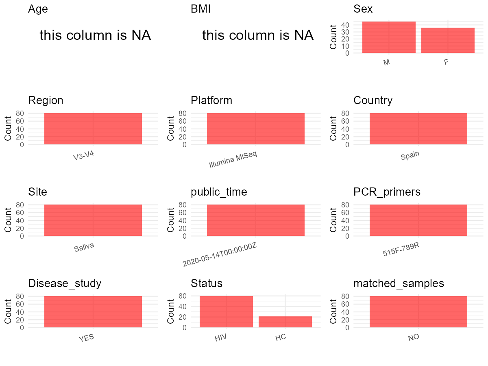

R Notebook: Metadata Processing Workflow
================

# Step 1: Obtain Initial Metadata from Each Project

To obtain the initial metadata: 1. Search for the BioProject ID (e.g.,
“PRJEBXXXX”) on the [NCBI SRA
website](https://www.ncbi.nlm.nih.gov/Traces/study/). 2. In the “Select”
table, click on “Metadata” and download the file. 3. The downloaded file
is typically named “SraRunTable.csv” and contains metadata for the
project.

``` r
# Load necessary libraries
library(dplyr)
library(ggplot2)
library(cowplot)

# Set working directory (update this path to your local directory)
setwd("D:/oral_project/PRJEB25569")

# Read the initial metadata files
initial_meta<-read.csv("SraRunTable.csv",header = T)

# Combine the two metadata files
#meta <- rbind(initial_meta, initial_meta1)

#Remove entries non-oral samples
#initial_meta <- subset(initial_meta,isolate %in% c("saliva","tongue coat"))

# Check the number of samples containing "HT" in Sample.Name (e.g., healthy controls)
#nrow(subset(meta, grepl("HT", Sample.Name)))

# Display the first few rows of the metadata
head(initial_meta)
```

    ##          Run Assay.Type AvgSpotLen    Bases BioProject      BioSample    Bytes
    ## 1 ERR2401636   AMPLICON        598 68654220 PRJEB25569 SAMEA104693149 48426010
    ## 2 ERR2401637   AMPLICON        598 61360459 PRJEB25569 SAMEA104693150 40402874
    ## 3 ERR2401638   AMPLICON        598 73164037 PRJEB25569 SAMEA104693151 49680921
    ## 4 ERR2401639   AMPLICON        598 69977006 PRJEB25569 SAMEA104693152 48125652
    ## 5 ERR2401640   AMPLICON        598 65865503 PRJEB25569 SAMEA104693153 46312890
    ## 6 ERR2401641   AMPLICON        598 68124981 PRJEB25569 SAMEA104693154 47510431
    ##                       Center.Name Collection_Date           common_name Consent
    ## 1 FISABIO- PUBLIC HEALTH RESEARCH            2012 human oral metagenome  public
    ## 2 FISABIO- PUBLIC HEALTH RESEARCH            2012 human oral metagenome  public
    ## 3 FISABIO- PUBLIC HEALTH RESEARCH            2012 human oral metagenome  public
    ## 4 FISABIO- PUBLIC HEALTH RESEARCH            2012 human oral metagenome  public
    ## 5 FISABIO- PUBLIC HEALTH RESEARCH            2012 human oral metagenome  public
    ## 6 FISABIO- PUBLIC HEALTH RESEARCH            2012 human oral metagenome  public
    ##   DATASTORE.filetype DATASTORE.provider                     DATASTORE.region
    ## 1         run.zq,sra         gs,ncbi,s3 gs.us-east1,ncbi.public,s3.us-east-1
    ## 2         run.zq,sra         gs,ncbi,s3 gs.us-east1,ncbi.public,s3.us-east-1
    ## 3         run.zq,sra         gs,ncbi,s3 gs.us-east1,ncbi.public,s3.us-east-1
    ## 4         run.zq,sra         gs,ncbi,s3 gs.us-east1,ncbi.public,s3.us-east-1
    ## 5         run.zq,sra         gs,ncbi,s3 gs.us-east1,ncbi.public,s3.us-east-1
    ## 6         run.zq,sra         gs,ncbi,s3 gs.us-east1,ncbi.public,s3.us-east-1
    ##   ENA.FIRST.PUBLIC..run.     ena_first_public ENA.LAST.UPDATE..run.
    ## 1             2020-05-12 2020-05-12T04:06:48Z            2018-11-16
    ## 2             2020-05-12 2020-05-12T04:06:48Z            2018-11-16
    ## 3             2020-05-12 2020-05-12T04:06:48Z            2018-11-16
    ## 4             2020-05-12 2020-05-12T04:06:48Z            2018-11-16
    ## 5             2020-05-12 2020-05-12T04:06:48Z            2018-11-16
    ## 6             2020-05-12 2020-05-12T04:06:48Z            2018-11-16
    ##        ena_last_update environment_.biome.    environment_.feature.
    ## 1 2018-03-14T12:18:10Z   terrestrial biome human-associated habitat
    ## 2 2018-03-14T12:18:10Z   terrestrial biome human-associated habitat
    ## 3 2018-03-14T12:18:10Z   terrestrial biome human-associated habitat
    ## 4 2018-03-14T12:18:10Z   terrestrial biome human-associated habitat
    ## 5 2018-03-14T12:18:10Z   terrestrial biome human-associated habitat
    ## 6 2018-03-14T12:18:10Z   terrestrial biome human-associated habitat
    ##     environment_.material. environmental_package Experiment    external_id
    ## 1 human-associated habitat            Human-oral ERX2442490 SAMEA104693149
    ## 2 human-associated habitat            Human-oral ERX2442491 SAMEA104693150
    ## 3 human-associated habitat            Human-oral ERX2442492 SAMEA104693151
    ## 4 human-associated habitat            Human-oral ERX2442493 SAMEA104693152
    ## 5 human-associated habitat            Human-oral ERX2442494 SAMEA104693153
    ## 6 human-associated habitat            Human-oral ERX2442495 SAMEA104693154
    ##   geo_loc_name_country geo_loc_name_country_continent
    ## 1                Spain                         Europe
    ## 2                Spain                         Europe
    ## 3                Spain                         Europe
    ## 4                Spain                         Europe
    ## 5                Spain                         Europe
    ## 6                Spain                         Europe
    ##   geographic_location_.country_and.or_sea. geographic_location_.latitude.
    ## 1                                    Spain                       40.42028
    ## 2                                    Spain                       40.42028
    ## 3                                    Spain                       40.42028
    ## 4                                    Spain                       40.42028
    ## 5                                    Spain                       40.42028
    ## 6                                    Spain                       40.42028
    ##   geographic_location_.longitude. human_gut_environmental_package
    ## 1                        3.705833                       human-gut
    ## 2                        3.705833                       human-gut
    ## 3                        3.705833                       human-gut
    ## 4                        3.705833                       human-gut
    ## 5                        3.705833                       human-gut
    ## 6                        3.705833                       human-gut
    ##                 INSDC_center_name   INSDC_first_public    INSDC_last_update
    ## 1 FISABIO- Public Health Research 2020-05-12T04:06:48Z 2018-03-14T12:18:10Z
    ## 2 FISABIO- Public Health Research 2020-05-12T04:06:48Z 2018-03-14T12:18:10Z
    ## 3 FISABIO- Public Health Research 2020-05-12T04:06:48Z 2018-03-14T12:18:10Z
    ## 4 FISABIO- Public Health Research 2020-05-12T04:06:48Z 2018-03-14T12:18:10Z
    ## 5 FISABIO- Public Health Research 2020-05-12T04:06:48Z 2018-03-14T12:18:10Z
    ## 6 FISABIO- Public Health Research 2020-05-12T04:06:48Z 2018-03-14T12:18:10Z
    ##   INSDC_status     Instrument Investigation_type Library.Name LibraryLayout
    ## 1       public Illumina MiSeq         metagenome  unspecified        PAIRED
    ## 2       public Illumina MiSeq         metagenome  unspecified        PAIRED
    ## 3       public Illumina MiSeq         metagenome  unspecified        PAIRED
    ## 4       public Illumina MiSeq         metagenome  unspecified        PAIRED
    ## 5       public Illumina MiSeq         metagenome  unspecified        PAIRED
    ## 6       public Illumina MiSeq         metagenome  unspecified        PAIRED
    ##   LibrarySelection LibrarySource              Organism Platform project_name
    ## 1              PCR   METAGENOMIC human oral metagenome ILLUMINA   PRJEB25569
    ## 2              PCR   METAGENOMIC human oral metagenome ILLUMINA   PRJEB25569
    ## 3              PCR   METAGENOMIC human oral metagenome ILLUMINA   PRJEB25569
    ## 4              PCR   METAGENOMIC human oral metagenome ILLUMINA   PRJEB25569
    ## 5              PCR   METAGENOMIC human oral metagenome ILLUMINA   PRJEB25569
    ## 6              PCR   METAGENOMIC human oral metagenome ILLUMINA   PRJEB25569
    ##            ReleaseDate          create_date version    Sample.Name Sample_name
    ## 1 2020-05-14T00:00:00Z 2020-05-14T17:31:00Z       1 SAMEA104693149      S-F1-1
    ## 2 2020-05-14T00:00:00Z 2020-05-14T17:31:00Z       1 SAMEA104693150     S-F1-11
    ## 3 2020-05-14T00:00:00Z 2020-05-14T17:32:00Z       1 SAMEA104693151     S-F1-13
    ## 4 2020-05-14T00:00:00Z 2020-05-14T17:32:00Z       1 SAMEA104693152     S-F1-15
    ## 5 2020-05-14T00:00:00Z 2020-05-14T17:32:00Z       1 SAMEA104693153     S-F1-16
    ## 6 2020-05-14T00:00:00Z 2020-05-14T17:32:00Z       1 SAMEA104693154     S-F1-17
    ##         Scientific_Name Sequencing_method SRA.Study Submitter_Id
    ## 1 human oral metagenome          Illumina ERP107497       S-F1-1
    ## 2 human oral metagenome          Illumina ERP107497      S-F1-11
    ## 3 human oral metagenome          Illumina ERP107497      S-F1-13
    ## 4 human oral metagenome          Illumina ERP107497      S-F1-15
    ## 5 human oral metagenome          Illumina ERP107497      S-F1-16
    ## 6 human oral metagenome          Illumina ERP107497      S-F1-17

# Step 2: Create a Uniform Metadata Template

The uniform metadata should include the following columns:

1.  **BioProject**: Project ID (e.g., “PRJNA339212”)
2.  **Run**: Sample ID (e.g., “ERRXXXXXX” or “SRRXXXXXX”)
3.  **sample_name**: Original sample name submitted by the authors (not
    the database-assigned ID)
4.  **Age**: Age of the subject (if available)
5.  **BMI**: Body Mass Index (if available)
6.  **Sex**: Sex of the subject (“F” or “M”)
7.  **Region**: Targeted 16S rRNA region (e.g., “V3-V4”)
8.  **Platform**: Sequencing platform (e.g., “Illumina MiSeq”)
9.  **Country**: Country of sample origin (e.g., “China”)
10. **Site**: Sample site (e.g., “saliva”, “dental plaque”)
11. **public_time**: Data release date (format: “YYYY-MM-DD”)
12. **PCR_primers**: PCR primers used (e.g., “515F-806R”)
13. **title**: Title of the associated publication
14. **Disease_study**: Whether the study involves a disease (“YES” or
    “NO”)
15. **Status**: Disease status (e.g., “T2DM”, “HC”). Note: If the study
    includes both disease and healthy samples, this must be specified
    per sample.
16. **matched_samples**: matched samples (“YES” or “NO”)

``` r
# Create a uniform metadata dataframe
metadata <- data.frame(
  BioProject = initial_meta$BioProject,
  Run = initial_meta$Run,
  sample_name = initial_meta$Sample_name,
  Age = NA,
  BMI = NA,
  #Sex = NA,
  Region = "V3-V4",
  Platform = initial_meta$Instrument,
  Country = initial_meta$geo_loc_name_country,
  #Site = initial_meta$isolate,
  public_time = initial_meta$ReleaseDate,
  stringsAsFactors = FALSE
)
```

``` r
metadata <- metadata %>%
  mutate(
    Sex = case_when(
      grepl("F2", sample_name) ~ "F", 
      grepl("F1", sample_name) ~ "M",  
    )
  )
```

# Step 3: Manually Add Information from the Publication

Some information (e.g. PCR primers, study title, disease status) must be
manually extracted from the publication and added to the metadata.

``` r
metadata<-metadata%>%
  mutate(Site=case_when(grepl("S-F1|S-F2",sample_name)~"Saliva",grepl("F1-|F2-",sample_name)~"Feces"))
# Add information obtained from the publication
metadata$PCR_primers <- "515F-789R"
metadata$title <- "Modulation of Saliva Microbiota through Prebiotic Intervention in HIV-Infected Individuals"
metadata$Disease_study <- "YES"
# Assign disease status based on sample_name patterns
metadata <- metadata %>%
  mutate(
    Status = case_when(
      grepl("11|17|23|21|28|29|30|31|32|45|48|49|50|60", sample_name) ~ "HC",  # 如果样本名称包含"A"，则性别为"F"（女性）
      TRUE ~ "HIV"  # 其他所有情况，性别也设为NA
    )
  )

#get subjects id according to sample id
metadata$sample_name<-gsub("","",metadata$sample_name)
#get subjects id with Saliva available
keep_subjects<-subset(metadata,Site %in% "Saliva")
#remove subjects without Saliva samples
metadata<-subset(metadata,sample_name %in% keep_subjects$sample_name)
#get subjects sampling counts
sample_counts <- table(metadata$sample_name)
# Create matched_samples column, any subjects have >=2 samples will be label "YES", otherwise "NO"
metadata$matched_samples <- ifelse(metadata$sample_name %in% names(sample_counts[sample_counts >= 2]), "YES", "NO")
```

# Step 4: Summarize and Validate the Metadata

``` r
# Check the number of unique runs and sample names
print(paste("Number of unique runs:", length(unique(metadata$Run))))
```

    ## [1] "Number of unique runs: 81"

``` r
print(paste("Number of unique sample names:", length(unique(metadata$sample_name))))
```

    ## [1] "Number of unique sample names: 81"

# Step 5: Visualize the Metadata

``` r

```


# Step 6: Finalize and Export the Metadata

``` r
# Reorder columns to match the desired format
metadata <- metadata[, c(
  "BioProject", "Run", "sample_name", "Age", "BMI", "Sex", 
  "Region", "Platform", "Country", "Site", "public_time", 
  "PCR_primers", "title", "Disease_study", "Status","matched_samples"
)]

# Export the uniform metadata to a CSV file
write.csv(metadata, file = "metadata.csv", quote = TRUE)
head(metadata)
```

    ##   BioProject        Run sample_name Age BMI Sex Region       Platform Country
    ## 1 PRJEB25569 ERR2401636      S-F1-1  NA  NA   M  V3-V4 Illumina MiSeq   Spain
    ## 2 PRJEB25569 ERR2401637     S-F1-11  NA  NA   M  V3-V4 Illumina MiSeq   Spain
    ## 3 PRJEB25569 ERR2401638     S-F1-13  NA  NA   M  V3-V4 Illumina MiSeq   Spain
    ## 4 PRJEB25569 ERR2401639     S-F1-15  NA  NA   M  V3-V4 Illumina MiSeq   Spain
    ## 5 PRJEB25569 ERR2401640     S-F1-16  NA  NA   M  V3-V4 Illumina MiSeq   Spain
    ## 6 PRJEB25569 ERR2401641     S-F1-17  NA  NA   M  V3-V4 Illumina MiSeq   Spain
    ##     Site          public_time PCR_primers
    ## 1 Saliva 2020-05-14T00:00:00Z   515F-789R
    ## 2 Saliva 2020-05-14T00:00:00Z   515F-789R
    ## 3 Saliva 2020-05-14T00:00:00Z   515F-789R
    ## 4 Saliva 2020-05-14T00:00:00Z   515F-789R
    ## 5 Saliva 2020-05-14T00:00:00Z   515F-789R
    ## 6 Saliva 2020-05-14T00:00:00Z   515F-789R
    ##                                                                                        title
    ## 1 Modulation of Saliva Microbiota through Prebiotic Intervention in HIV-Infected Individuals
    ## 2 Modulation of Saliva Microbiota through Prebiotic Intervention in HIV-Infected Individuals
    ## 3 Modulation of Saliva Microbiota through Prebiotic Intervention in HIV-Infected Individuals
    ## 4 Modulation of Saliva Microbiota through Prebiotic Intervention in HIV-Infected Individuals
    ## 5 Modulation of Saliva Microbiota through Prebiotic Intervention in HIV-Infected Individuals
    ## 6 Modulation of Saliva Microbiota through Prebiotic Intervention in HIV-Infected Individuals
    ##   Disease_study Status matched_samples
    ## 1           YES    HIV              NO
    ## 2           YES     HC              NO
    ## 3           YES    HIV              NO
    ## 4           YES    HIV              NO
    ## 5           YES    HIV              NO
    ## 6           YES     HC              NO

## Notes for Students:

1.  **Metadata Accuracy**: Always cross-check the metadata with the
    original publication to ensure accuracy.
2.  **Manual Entries**: Columns like `PCR_primers`, and `Status` often
    require manual entry based on the publication.
3.  **Disease Status**: Be careful when assigning `Status`—some studies
    include both disease and healthy samples.
4.  **Visualization**: The plots help quickly identify the distribution
    of values in each column, which is useful for quality control.
5.  **Reproducibility**: Update the working directory and file paths to
    match your local environment.
