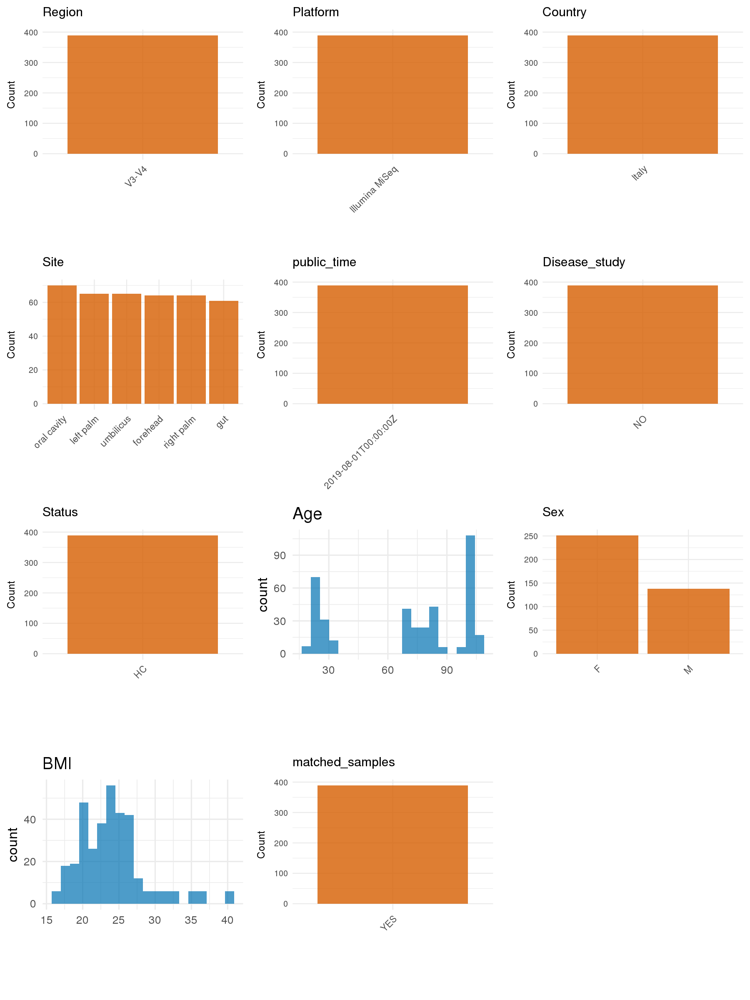

# Step 1: Obtain Initial Metadata from Each Project

This step sets the project directory, loads the raw SRA metadata, and keeps the deduplicated 16S samples across the retained body habitats used for this repository.

```{r message=FALSE, warning=FALSE}
# Load libraries
library(dplyr)
library(ggplot2)
library(cowplot)
library(readxl)

# (1) Setting working directory
project_id <- "PRJEB25916"

base_dir <- "E:/工作区/VSCode/RNAproject/collect_metadata_respon/project"
setwd(file.path(base_dir, project_id))

# (2) Loading raw SRA metadata file
sra_file <- "SraRunTable.csv"
initial_meta <- read.csv(sra_file, header = TRUE, stringsAsFactors = FALSE)

# This deposited table mixes ITS1 and 16S runs across skin, oral, and gut habitats.
# Keep the retained 16S rows across the study body habitats and collapse duplicate runs for the same submitted sample_name.
initial_meta <- initial_meta %>%
  filter(grepl("^16S_", sample_name)) %>%
  mutate(site_code = sub("^16S_[0-9]+([A-Za-z]{1,2})[0-9]+$", "\\1", sample_name)) %>%
  filter(site_code %in% c("L", "R", "F", "U", "O", "OW", "G")) %>%
  arrange(sample_name, desc(Bases)) %>%
  distinct(sample_name, .keep_all = TRUE)

clinical_data <- read_excel("msphere.00558-19-sd001.xlsx", sheet = "Clinical_data")
clinical_data <- clinical_data %>%
  select(Subject_ID, Group, Gender, Age, BMIc) %>%
  filter(!is.na(Subject_ID)) %>%
  mutate(
    subject_id = sub("^[A-Z]_(\\d+)[A-Za-z]{1,2}(\\d+)$", "\\1_\\2", Subject_ID),
    group_label = case_when(
      Group == "Y" ~ "young adults",
      Group == "E" ~ "elderly adults",
      Group == "C" ~ "centenarians",
      TRUE ~ NA_character_
    )
  ) %>%
  select(subject_id, age = Age, bmi = BMIc, sex = Gender, group_label)
```

# Step 2: Data Overview

First, you need to get an overview of the data, which includes two steps: reading the article and reading the initial metadata. This step is very IMPORTANT!

```{r message=FALSE, warning=FALSE}
# (1) Read the article in the following order: abstract, the beginning of the results section, and the methods.
# Paper summary used for this project:
# - Title: Age-Related Variation of Bacterial and Fungal Communities in Different Body Habitats across the Young, Elderly, and Centenarians in Sardinia
# - Study design: cross-sectional healthy aging cohort with skin, oral, and gut sampling across young, elderly, and centenarian groups in Sardinia, Italy
# - Recruited subjects from Results/Table 1: 65 total (young 19, elderly 24, centenarians 22)
# - Sampled body habitats from Methods/Results: skin (left palm, right palm, forehead, umbilicus), oral cavity / oral wash, and gut
# - Oral sampling from Methods: oral cavity wash / saliva collection after mouth rinsing, then centrifuged and DNA extracted from the sediment
# - Sequencing from Methods: V3-V4 16S rRNA sequencing on Illumina MiSeq; primers 341F/806R and ITS1F/ITS2 for fungi
# - This curation covers the retained 16S rows across the study body habitats, not ITS1 runs
# - The SRA 16S subset contains duplicate runs for several submitted sample_name values; the highest-Bases run is retained per sample_name to represent each deposited sample once

# (2) IMPORTANT: MUST go through each column of initial_meta
head(initial_meta, 10)
colnames(initial_meta)
table(grepl("^16S_", initial_meta$sample_name))
table(initial_meta$site_code)
table(initial_meta$geo_loc_name_country)
table(initial_meta$ReleaseDate)
initial_meta[initial_meta$sample_name %in% c("16S_6O3", "16S_6O4", "16S_6O5", "16S_6O7", "16S_6O12"), c("Run", "BioSample", "sample_name", "Bases")]
# After retaining all deduplicated 16S body-habitat rows, 381 samples remain: 255 skin, 65 oral, and 61 gut.
```

# Step 3: Removing Control and Non-human Samples

First, we need to remove control samples(including both negative controls and positive controls) and non-human samples.

```{r}
# (1) Parameter setup
control_column <- ""
control_keywords <- c()

species_column <- "Organism"
unique(initial_meta[[species_column]])
non_human_keywords <- c()

# (2) Remove controls and non-human samples. DO NOT need to modify code in this part, just run it.
n_samples <- nrow(initial_meta)
# Control evaluation
if (length(control_keywords) > 0) {
  if (is.null(control_column) || control_column == "") {
    stop("Error: control_keywords provided but control_column is missing.")
  }

  if (!(control_column %in% colnames(initial_meta))) {
    stop(sprintf("Error: Column '%s' not found in initial_meta.", control_column))
  }

  control_pattern <- paste(control_keywords, collapse = "|")
  control_text <- initial_meta[[control_column]]
  is_control <- grepl(control_pattern, control_text)

} else {
  is_control <- rep(FALSE, n_samples)
}

# Non-human evaluation
if (length(non_human_keywords) > 0) {
  if (is.null(species_column) || species_column == "") {
    stop("Error: non_human_keywords provided but species_column is missing.")
  }

  if (!(species_column %in% colnames(initial_meta))) {
    stop(sprintf("Error: Column '%s' not found in initial_meta.", species_column))
  }

  non_human_pattern <- paste(non_human_keywords, collapse = "|")
  species_text <- initial_meta[[species_column]]
  is_non_human <- grepl(non_human_pattern, species_text)
} else {
  is_non_human <- rep(FALSE, n_samples)
}

# Execute removal
samples_to_remove <- is_control | is_non_human
initial_meta <- initial_meta[!samples_to_remove, ]

cat("Initial samples counts:", n_samples, "\n")
cat("Removed control samples:", sum(is_control), "\n")
cat("Removed non-human samples:", sum(is_non_human), "\n")
cat("Total samples removed ", sum(samples_to_remove), "\n")
cat("Remaining samples after Step 2:", nrow(initial_meta), "\n")
```

# Step 4: Creating a Uniform Metadata Template

This step converts the raw SRA table into the standard metadata format used in our meta-analysis.

```{r}
metadata <- initial_meta %>%
  mutate(
    subject_id = sub("^16S_(\\d+)[A-Za-z]{1,2}(\\d+)$", "\\1_\\2", sample_name),
    raw_site_code = site_code
  ) %>%
  left_join(clinical_data, by = "subject_id") %>%
  mutate(
    age = suppressWarnings(as.numeric(age)),
    bmi = suppressWarnings(as.numeric(bmi)),
    sex = case_when(
      sex == "male" ~ "M",
      sex == "female" ~ "F",
      sex %in% c("M", "F") ~ sex,
      TRUE ~ NA_character_
    )
  )

metadata <- data.frame(
  bioproject = metadata$BioProject,
  sample_id = metadata$Run,
  subject_id = metadata$subject_id,
  age = metadata$age,
  age_info = metadata$group_label,
  bmi = metadata$bmi,
  sex = metadata$sex,
  sequencing_region = "V3-V4",
  platform = "Illumina MiSeq",
  country = metadata$geo_loc_name_country,
  raw_site_code = metadata$raw_site_code,
  site = "pending",
  site_group = "pending",
  public_time = sub("T.*$", "", metadata$ReleaseDate),
  pcr_primers = "338F-806R",
  title = "Age-Related Variation of Bacterial and Fungal Communities in Different Body Habitats across the Young, Elderly, and Centenarians in Sardinia",
  disease_study = "no",
  raw_status = metadata$group_label,
  status = "HC",
  matched_samples = "pending",
  is_time_series = "no",
  stringsAsFactors = FALSE
)

# Source notes for non-obvious fields:
# - The retained 16S subset uses submitted sample_name values matching ^16S_ and site codes L/R/F/U/O/OW/G; duplicate submitted sample names are collapsed by keeping the run with the highest Bases value.
# - subject_id keeps the batch digit and trailing numeric token from sample_name (e.g. 16S_7O35 -> 7_35), matching the clinical workbook entries after removing the leading cohort letter and site code.
# - age, bmi, sex, and age_info come from the Clinical_data sheet in msphere.00558-19-sd001.xlsx.
# - sequencing_region, platform, pcr_primers, and body-habitat sampling context come from Materials and Methods, not SRA.
# - status is standardized to HC for all retained rows because this is a non-disease healthy cohort; the healthy aging strata are preserved in age_info.
metadata$public_time <- as.Date(metadata$public_time)
```

# Step 5: Manually solving pending issues

This step involves two parts: (1) handle the columns with the `raw_` prefix, and next (2) handle the `site_group` and `matched_samples` columns.

```{r}
# (1) Handle the columns with the `raw_` prefix.
metadata <- metadata %>%
  mutate(
    site = case_when(
      raw_site_code == "L" ~ "left palm",
      raw_site_code == "R" ~ "right palm",
      raw_site_code == "F" ~ "forehead",
      raw_site_code == "U" ~ "umbilicus",
      raw_site_code == "O" ~ "saliva",
      raw_site_code == "OW" ~ "saliva",
      raw_site_code == "G" ~ "gut",
      TRUE ~ NA_character_
    ),
    status = "HC"
  )
# Retain all deposited 16S body habitats in this cohort; raw_site_code preserves the submitted O versus OW distinction even though both map to saliva in the standardized site field.
```

```{r}
# (2) Filling the 'site_group' and 'matched_samples' columns
unique(metadata$site)
Oral_site = c("saliva")
Gut_site = c("gut")

metadata <- metadata %>%
  mutate(site_group = case_when(
    site %in% Oral_site ~ "oral",
    site %in% Gut_site ~ "gut",
    TRUE ~ "other"
  ))

metadata$matched_samples <- ifelse(
  ave(metadata$subject_id, metadata$subject_id, FUN = length) > 1,
  "yes",
  "no"
)
# Subjects are sampled across multiple retained body habitats, so matched_samples is yes whenever a subject contributes more than one deduplicated site-level sample.
```

```{r}
# (3) check if there is pending value in metadata. If there is pending value, go on modify the metadata.
has_pending <- function(col) {
  if (is.character(col) || is.factor(col)) {
    any(col == "pending", na.rm = TRUE)
  } else {
    FALSE
  }
}

any_pending_value <- any(sapply(metadata, has_pending))

if (!any_pending_value) {
  message("Good! No cell contains the value 'pending'.")
} else {
  pending_cols <- names(metadata)[sapply(metadata, has_pending)]
  message("Columns containing 'pending': ", paste(pending_cols, collapse = ", "))
  message("Please continue to resolve these pending columns!")
}
```

# Step 6: Visualize the Metadata

This step makes a quick set of plots for checking the distribution of key metadata fields.

```{r}
plot_data <- metadata %>%
  select(-bioproject, -sample_id, -subject_id, -title, -raw_site_code, -raw_status)

create_simple_plots <- function(data) {
  plots <- list()
  continuous_vars <- c("age", "bmi")

  for (col in colnames(data)) {
    if (all(is.na(data[[col]]))) {
      p <- ggplot() +
        annotate("text", x = 0.5, y = 0.5, label = "this column is NA", size = 6) +
        labs(title = col) +
        theme_void()
    } else if (col %in% continuous_vars && is.numeric(data[[col]])) {
      p <- ggplot(data, aes(x = .data[[col]])) +
        geom_histogram(fill = "blue", alpha = 0.6, bins = 20, na.rm = TRUE) +
        labs(title = col, x = col, y = "Count") +
        theme_minimal()
    } else {
      count_data <- as.data.frame(table(data[[col]], useNA = "ifany"))
      p <- ggplot(count_data, aes(x = reorder(Var1, -Freq), y = Freq)) +
        geom_col(fill = "red", alpha = 0.6) +
        labs(title = col, x = NULL, y = "Count") +
        theme_minimal() +
        theme(axis.text.x = element_text(angle = 15, hjust = 1))
    }
    plots[[col]] <- p
  }

  return(plots)
}

plots <- create_simple_plots(plot_data)
p <- plot_grid(plots$age,
               plots$bmi,
               plots$sex,
               plots$site,
               plots$site_group,
               plots$sequencing_region,
               plots$platform,
               plots$country,
               plots$status,
               plots$matched_samples,
               ncol = 3, align = "hv", axis = "lb")
ggsave("Metadata_Summary.png", plot = p, width = 8, height = 6, dpi = 150)
```

```{r}

```

# Step 7: Sort and export the metadata

This step saves the cleaned metadata table as the final `metadata_v2.csv` file.

```{r}
fixed_cols <- c("bioproject", "sample_id", "subject_id", "age", "age_info",
                "bmi", "sex", "platform", "sequencing_region", "pcr_primers",
                "country", "site", "site_group", "disease_study", "status",
                "title", "public_time", "matched_samples", "is_time_series")
metadata <- metadata %>%
  select(all_of(fixed_cols), starts_with("raw_"))

write.csv(metadata, file = "metadata_v2.csv", quote = TRUE, row.names = FALSE)
```