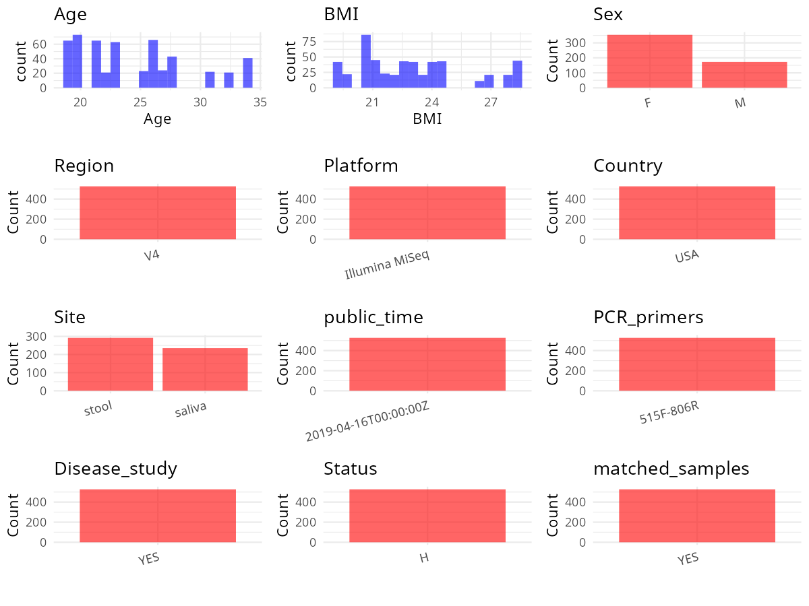

R Notebook: Metadata Processing Workflow
================

# Step 1: Obtain Initial Metadata from Each Project

To obtain the initial metadata: 1. Search for the BioProject ID (e.g.,
“PRJEBXXXX”) on the [NCBI SRA
website](https://www.ncbi.nlm.nih.gov/Traces/study/). 2. In the “Select”
table, click on “Metadata” and download the file. 3. The downloaded file
is typically named “SraRunTable.csv” and contains metadata for the
project.

``` r
# Load necessary libraries
library(dplyr)
library(ggplot2)
library(cowplot)

# Set working directory (update this path to your local directory)
setwd("/home/hby/oral_project/PRJEB27304")

# Read the initial metadata files
initial_meta <- read.csv("SraRunTable.csv", header = T)

# Combine the two metadata files
# meta <- rbind(initial_meta, initial_meta1)

# Remove entries non-oral samples
# initial_meta <- subset(initial_meta,isolate %in% c("saliva","tongue coat"))

# Check the number of samples containing "HT" in Sample.Name (e.g., healthy controls)
# nrow(subset(meta, grepl("HT", Sample.Name)))

# Display the first few rows of the metadata
head(initial_meta)
```

    ##          Run AGE   amy1cn amy1cngroup   amy2cn Assay.Type AvgSpotLen BarcodeSequence    Bases BioProject    BioSample      BMI    Bytes                                    Center.Name
    ## 1 ERR2639761  25 7.090663      medium 7.079226   AMPLICON        502    CCTACCATTGTT 28749038 PRJEB27304 SAMEA4729488 22.59430 21653983 MAX PLANCK INSTITUTE FOR DEVELOPMENTAL BIOLOGY
    ## 2 ERR2639762  32 8.592146        high 6.509050   AMPLICON        502    GAAGCTTGAATC 35812680 PRJEB27304 SAMEA4729489 23.68002 26767593 MAX PLANCK INSTITUTE FOR DEVELOPMENTAL BIOLOGY
    ## 3 ERR2639764  23 8.761398        high 6.578634   AMPLICON        502    GAGTTAGCATCA 38068166 PRJEB27304 SAMEA4729491 19.24489 28372685 MAX PLANCK INSTITUTE FOR DEVELOPMENTAL BIOLOGY
    ## 4 ERR2639765  23 8.761398        high 6.578634   AMPLICON        502    ATCGATCCACAG 32506508 PRJEB27304 SAMEA4729492 19.24489 21178575 MAX PLANCK INSTITUTE FOR DEVELOPMENTAL BIOLOGY
    ## 5 ERR2639766  20 9.668881        high 6.411239   AMPLICON        502    GACTCAACCAGT 36105848 PRJEB27304 SAMEA4729493 26.85387 23306655 MAX PLANCK INSTITUTE FOR DEVELOPMENTAL BIOLOGY
    ## 6 ERR2639767  26 6.780113      medium 6.076496   AMPLICON        502    CTGGTGCTGAAT 35038596 PRJEB27304 SAMEA4729494 21.58937 22909810 MAX PLANCK INSTITUTE FOR DEVELOPMENTAL BIOLOGY
    ##   Collection_Date      common_name Consent DATASTORE.filetype DATASTORE.provider                         DATASTORE.region ENA.FIRST.PUBLIC..run.     ENA_first_public
    ## 1        2010/1/1 human metagenome  public   fastq,run.zq,sra     ena,gs,ncbi,s3 ena,gs.us-east1,ncbi.public,s3.us-east-1              2019/4/15 2019-04-15T08:04:38Z
    ## 2        2010/1/1 human metagenome  public   fastq,run.zq,sra     ena,gs,ncbi,s3 ena,gs.us-east1,ncbi.public,s3.us-east-1              2019/4/15 2019-04-15T08:04:38Z
    ## 3        2010/1/1 human metagenome  public   fastq,run.zq,sra     ena,gs,ncbi,s3 ena,gs.us-east1,ncbi.public,s3.us-east-1              2019/4/15 2019-04-15T08:04:38Z
    ## 4        2010/1/1 human metagenome  public   fastq,run.zq,sra     ena,gs,ncbi,s3 ena,gs.us-east1,ncbi.public,s3.us-east-1              2019/4/15 2019-04-15T08:04:38Z
    ## 5        2010/1/1 human metagenome  public   fastq,run.zq,sra     ena,gs,ncbi,s3 ena,gs.us-east1,ncbi.public,s3.us-east-1              2019/4/15 2019-04-15T08:04:38Z
    ## 6        2010/1/1 human metagenome  public   fastq,run.zq,sra     ena,gs,ncbi,s3 ena,gs.us-east1,ncbi.public,s3.us-east-1              2019/4/15 2019-04-15T08:04:38Z
    ##   ENA.LAST.UPDATE..run.      ENA_last_update  environment_.biome. environment_.feature. environment_.material. Experiment  external_id gender geo_loc_name_country
    ## 1            2018/11/16 2018-06-14T16:28:51Z human gut microbiome                   gut                  stool ERX2656255 SAMEA4729488 female                  USA
    ## 2            2018/11/16 2018-06-14T16:28:51Z human gut microbiome                   gut                  stool ERX2656256 SAMEA4729489 female                  USA
    ## 3            2018/11/16 2018-06-14T16:28:52Z human gut microbiome                   gut                  stool ERX2656258 SAMEA4729491 female                  USA
    ## 4            2018/11/16 2018-06-14T16:28:52Z human gut microbiome                   gut                  stool ERX2656259 SAMEA4729492 female                  USA
    ## 5            2018/11/16 2018-06-14T16:28:52Z human gut microbiome                   gut                  stool ERX2656260 SAMEA4729493   male                  USA
    ## 6            2018/11/16 2018-06-14T16:28:52Z human gut microbiome                   gut                  stool ERX2656261 SAMEA4729494 female                  USA
    ##   geo_loc_name_country_continent geographic_location_.country_and.or_sea. geographic_location_.latitude. geographic_location_.longitude. height
    ## 1                  North America                                      USA                       42.44851                       -76.47862  171.3
    ## 2                  North America                                      USA                       42.44851                       -76.47862  170.7
    ## 3                  North America                                      USA                       42.44851                       -76.47862  157.6
    ## 4                  North America                                      USA                       42.44851                       -76.47862  157.6
    ## 5                  North America                                      USA                       42.44851                       -76.47862  180.2
    ## 6                  North America                                      USA                       42.44851                       -76.47862  169.6
    ##                                INSDC_center_name   INSDC_first_public    INSDC_last_update INSDC_status     Instrument Investigation_type Library.Name LibraryLayout LibrarySelection
    ## 1 MAX PLANCK INSTITUTE FOR DEVELOPMENTAL BIOLOGY 2019-04-15T08:04:38Z 2018-06-14T16:28:51Z       public Illumina MiSeq         metagenome           NA        PAIRED              PCR
    ## 2 MAX PLANCK INSTITUTE FOR DEVELOPMENTAL BIOLOGY 2019-04-15T08:04:38Z 2018-06-14T16:28:51Z       public Illumina MiSeq         metagenome           NA        PAIRED              PCR
    ## 3 MAX PLANCK INSTITUTE FOR DEVELOPMENTAL BIOLOGY 2019-04-15T08:04:38Z 2018-06-14T16:28:52Z       public Illumina MiSeq         metagenome           NA        PAIRED              PCR
    ## 4 MAX PLANCK INSTITUTE FOR DEVELOPMENTAL BIOLOGY 2019-04-15T08:04:38Z 2018-06-14T16:28:52Z       public Illumina MiSeq         metagenome           NA        PAIRED              PCR
    ## 5 MAX PLANCK INSTITUTE FOR DEVELOPMENTAL BIOLOGY 2019-04-15T08:04:38Z 2018-06-14T16:28:52Z       public Illumina MiSeq         metagenome           NA        PAIRED              PCR
    ## 6 MAX PLANCK INSTITUTE FOR DEVELOPMENTAL BIOLOGY 2019-04-15T08:04:38Z 2018-06-14T16:28:52Z       public Illumina MiSeq         metagenome           NA        PAIRED              PCR
    ##   LibrarySource         Organism Platform                  project_name          ReleaseDate          create_date version  Sample.Name   Sample_Name sample_type  Scientific_Name
    ## 1   METAGENOMIC human metagenome ILLUMINA amylase oral stool microbiome 2019-04-16T00:00:00Z 2019-04-16T10:54:00Z       1 SAMEA4729488  76_T4A_reext       stool human metagenome
    ## 2   METAGENOMIC human metagenome ILLUMINA amylase oral stool microbiome 2019-04-16T00:00:00Z 2019-04-16T10:54:00Z       1 SAMEA4729489  39_T2A_reext       stool human metagenome
    ## 3   METAGENOMIC human metagenome ILLUMINA amylase oral stool microbiome 2019-04-16T00:00:00Z 2019-04-16T10:54:00Z       1 SAMEA4729491 75_T11B_reext       stool human metagenome
    ## 4   METAGENOMIC human metagenome ILLUMINA amylase oral stool microbiome 2019-04-16T00:00:00Z 2019-04-16T10:54:00Z       1 SAMEA4729492        75_T5A       stool human metagenome
    ## 5   METAGENOMIC human metagenome ILLUMINA amylase oral stool microbiome 2019-04-16T00:00:00Z 2019-04-16T10:54:00Z       1 SAMEA4729493         64_T5       stool human metagenome
    ## 6   METAGENOMIC human metagenome ILLUMINA amylase oral stool microbiome 2019-04-16T00:00:00Z 2019-04-16T10:55:00Z       1 SAMEA4729494         31_T5       stool human metagenome
    ##   Sequencing_method SRA.Study subjectid  Submitter_Id timepoint weight human_gut_environmental_package human_oral_environmental_package
    ## 1             MiSeq ERP109371        76  76_T4A_reext         4   66.3                       human-gut                                 
    ## 2             MiSeq ERP109371        39  39_T2A_reext         2   69.0                       human-gut                                 
    ## 3             MiSeq ERP109371        75 75_T11B_reext        11   47.8                       human-gut                                 
    ## 4             MiSeq ERP109371        75        75_T5A         5   47.8                       human-gut                                 
    ## 5             MiSeq ERP109371        64         64_T5         5   87.2                       human-gut                                 
    ## 6             MiSeq ERP109371        31         31_T5         5   62.1                       human-gut

# Step 2: Create a Uniform Metadata Template

The uniform metadata should include the following columns:

1.  **BioProject**: Project ID (e.g., “PRJNA339212”)
2.  **Run**: Sample ID (e.g., “ERRXXXXXX” or “SRRXXXXXX”)
3.  **sample_name**: Original sample name submitted by the authors (not
    the database-assigned ID)
4.  **Age**: Age of the subject (if available)
5.  **BMI**: Body Mass Index (if available)
6.  **Sex**: Sex of the subject (“F” or “M”)
7.  **Region**: Targeted 16S rRNA region (e.g., “V3-V4”)
8.  **Platform**: Sequencing platform (e.g., “Illumina MiSeq”)
9.  **Country**: Country of sample origin (e.g., “China”)
10. **Site**: Sample site (e.g., “saliva”, “dental plaque”)
11. **public_time**: Data release date (format: “YYYY-MM-DD”)
12. **PCR_primers**: PCR primers used (e.g., “515F-806R”)
13. **title**: Title of the associated publication
14. **Disease_study**: Whether the study involves a disease (“YES” or
    “NO”)
15. **Status**: Disease status (e.g., “T2DM”, “HC”). Note: If the study
    includes both disease and healthy samples, this must be specified
    per sample.
16. **matched_samples**: matched samples (“YES” or “NO”)

``` r
# Create a uniform metadata dataframe
metadata <- data.frame(
  BioProject = initial_meta$BioProject,
  Run = initial_meta$Run,
  sample_name = initial_meta$Sample_Name,
  Sex = initial_meta$gender,
  Age = initial_meta$AGE,
  Platform = initial_meta$Instrument,
  Country = initial_meta$geo_loc_name_country,
  Site = initial_meta$sample_type,
  public_time = initial_meta$ReleaseDate,
  BMI = initial_meta$BMI,
  stringsAsFactors = FALSE
) %>%
  mutate(
    Sex = case_when(
      Sex == "male" ~ "M",
      Sex == "female" ~ "F"
    )
  )
```

# Step 3: Manually Add Information from the Publication

Some information (e.g. PCR primers, study title, disease status) must be
manually extracted from the publication and added to the metadata.

``` r
# Add information obtained from the publication
metadata$Region <- "V4"
metadata$Status <- "H"
metadata$PCR_primers <- "515F-806R"
metadata$title <- "Human Salivary Amylase Gene Copy Number Impacts Oral and Gut Microbiomes"
metadata$Disease_study <- "YES"


# extract subject id by remove prefix of sample_name
metadata$subject_id <- gsub("_reext", "", metadata$sample_name)
metadata$subject_id <- gsub("_.*", "", metadata$subject_id)
all_oral_sites <- c("saliva", "tongue coat", "buccal mucosa", "lower jaw mucosa", "lower labial mucosa", "upper jaw mucosa", "tongue", "buccal")
# Check initial data distribution
cat("Initial sample distribution:\n")
```

    ## Initial sample distribution:

``` r
table(metadata$subject_id)
```

    ## 
    ## 111   2  25  31  36  39  42  52  55   6  64  69   7  75  76   8  80  88  90  91  93  95  96  97  99 
    ##  21  21  21  23  23  21  21  24  20  21  21  22  21  21  23  22  20  21  21  11  21  22  22  21  22

``` r
table(metadata$Site)
```

    ## 
    ## saliva  stool 
    ##    235    292

``` r
subjects_with_oral_samples <- metadata %>%
  filter(Site %in% all_oral_sites) %>%
  distinct(subject_id) %>%
  pull(subject_id)

metadata_clean <- metadata %>%
  filter(subject_id %in% subjects_with_oral_samples)


sample_counts <- metadata_clean %>%
  group_by(subject_id) %>%
  summarise(n_samples = n(), .groups = "drop")

metadata_clean <- merge(metadata_clean, sample_counts, by = "subject_id")

# Create matched_samples column
metadata_clean$matched_samples <- ifelse(metadata_clean$n_samples >= 2, "YES", "NO")

cat("\nFinal sample distribution after cleaning:\n")
```

    ## 
    ## Final sample distribution after cleaning:

``` r
print(table(metadata_clean$Site))
```

    ## 
    ## saliva  stool 
    ##    235    292

``` r
cat("\nFinal sample distribution after cleaning:\n")
```

    ## 
    ## Final sample distribution after cleaning:

``` r
print(table(metadata_clean$matched_samples))
```

    ## 
    ## YES 
    ## 527

``` r
metadata_clean$subject_id <- NULL
metadata_clean$n_samples <- NULL

# Use cleaned dataset for subsequent analysis
metadata <- metadata_clean
```

# Step 4: Summarize and Validate the Metadata

``` r
# Check the number of unique runs and sample names
print(paste("Number of unique runs:", length(unique(metadata$Run))))
```

    ## [1] "Number of unique runs: 527"

``` r
print(paste("Number of unique sample names:", length(unique(metadata$sample_name))))
```

    ## [1] "Number of unique sample names: 507"

# Step 5: Visualize the Metadata

``` r

```


# Step 6: Finalize and Export the Metadata

``` r
# Reorder columns to match the desired format
metadata <- metadata[, c(
  "BioProject", "Run", "sample_name", "Age", "BMI", "Sex",
  "Region", "Platform", "Country", "Site", "public_time",
  "PCR_primers", "title", "Disease_study", "Status", "matched_samples"
)]

# Export the uniform metadata to a CSV file
write.csv(metadata, file = "metadata.csv", quote = FALSE)
head(metadata)
```

    ##   BioProject        Run   sample_name Age      BMI Sex Region       Platform Country   Site          public_time PCR_primers
    ## 1 PRJEB27304 ERR2640420 111_T4_saliva  34 28.11655   F     V4 Illumina MiSeq     USA saliva 2019-04-16T00:00:00Z   515F-806R
    ## 2 PRJEB27304 ERR2639853        111_T3  34 28.11655   F     V4 Illumina MiSeq     USA  stool 2019-04-16T00:00:00Z   515F-806R
    ## 3 PRJEB27304 ERR2639793        111_T4  34 28.11655   F     V4 Illumina MiSeq     USA  stool 2019-04-16T00:00:00Z   515F-806R
    ## 4 PRJEB27304 ERR2640520 111_T8_saliva  34 28.11655   F     V4 Illumina MiSeq     USA saliva 2019-04-16T00:00:00Z   515F-806R
    ## 5 PRJEB27304 ERR2639880        111_T9  34 28.11655   F     V4 Illumina MiSeq     USA  stool 2019-04-16T00:00:00Z   515F-806R
    ## 6 PRJEB27304 ERR2639876       111_T10  34 28.11655   F     V4 Illumina MiSeq     USA  stool 2019-04-16T00:00:00Z   515F-806R
    ##                                                                      title Disease_study Status matched_samples
    ## 1 Human Salivary Amylase Gene Copy Number Impacts Oral and Gut Microbiomes           YES      H             YES
    ## 2 Human Salivary Amylase Gene Copy Number Impacts Oral and Gut Microbiomes           YES      H             YES
    ## 3 Human Salivary Amylase Gene Copy Number Impacts Oral and Gut Microbiomes           YES      H             YES
    ## 4 Human Salivary Amylase Gene Copy Number Impacts Oral and Gut Microbiomes           YES      H             YES
    ## 5 Human Salivary Amylase Gene Copy Number Impacts Oral and Gut Microbiomes           YES      H             YES
    ## 6 Human Salivary Amylase Gene Copy Number Impacts Oral and Gut Microbiomes           YES      H             YES

## Notes for Students:

1.  **Metadata Accuracy**: Always cross-check the metadata with the
    original publication to ensure accuracy.
2.  **Manual Entries**: Columns like `PCR_primers`, and `Status` often
    require manual entry based on the publication.
3.  **Disease Status**: Be careful when assigning `Status`—some studies
    include both disease and healthy samples.
4.  **Visualization**: The plots help quickly identify the distribution
    of values in each column, which is useful for quality control.
5.  **Reproducibility**: Update the working directory and file paths to
    match your local environment.
