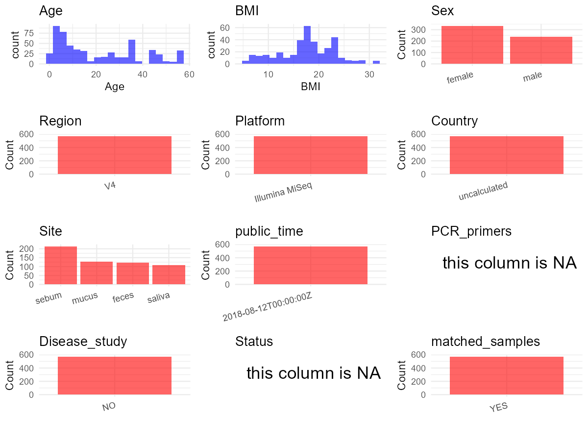

R Notebook: Metadata Processing Workflow
================

# Step 1: Obtain Initial Metadata from Each Project

To obtain the initial metadata: 1. Search for the BioProject ID (e.g.,
“PRJEBXXXX”) on the [NCBI SRA
website](https://www.ncbi.nlm.nih.gov/Traces/study/). 2. In the “Select”
table, click on “Metadata” and download the file. 3. The downloaded file
is typically named “SraRunTable.csv” and contains metadata for the
project.

``` r
# Load necessary libraries
library(dplyr)
library(ggplot2)
library(cowplot)

# Set working directory (update this path to your local directory)
setwd("D:/metadata/PRJEB28088")

# Read the initial metadata files
initial_meta<-read.csv("SraRunTable.csv",header = T)

# Combine the two metadata files
#meta <- rbind(initial_meta, initial_meta1)

#Remove entries non-oral samples
#initial_meta <- subset(initial_meta, Organism == "human oral metagenome")

# Check the number of samples containing "HT" in Sample.Name (e.g., healthy controls)
#nrow(subset(meta, grepl("HT", Sample.Name)))

# Display the first few rows of the metadata
head(initial_meta)
```

    ##   abi_left1 abi_left2 abi_left3 abi_right1 abi_right2 abi_right3        Run AGE
    ## 1        NA        NA        NA         NA         NA         NA ERR2728158  55
    ## 2        NA        NA        NA         NA         NA         NA ERR2728159  34
    ## 3        NA        NA        NA         NA         NA         NA ERR2728160  34
    ## 4        NA        NA        NA         NA         NA         NA ERR2728161  44
    ## 5        NA        NA        NA         NA         NA         NA ERR2728162   3
    ## 6        NA        NA        NA         NA         NA         NA ERR2728163  34
    ##   ancylostomide_eggs  X arm_circumference arm_length ascaris_lumbricoides_eggs
    ## 1               <NA> NA                NA         NA                      <NA>
    ## 2               <NA> NA                NA         NA                      <NA>
    ## 3               <NA> NA                NA         NA                      <NA>
    ## 4               <NA> NA                NA         NA                      <NA>
    ## 5               <NA> NA                NA         NA                      <NA>
    ## 6               <NA> NA                NA         NA                      <NA>
    ##   Assay.Type AvgSpotLen Barcode..exp.   Bases BioProject    BioSample
    ## 1      OTHER        150  GTCATGCTCCAG 5415214 PRJEB28088 SAMEA4820302
    ## 2      OTHER        150  CAATCGGCTTGC 4130375 PRJEB28088 SAMEA4820303
    ## 3      OTHER        150  TACAGTTACGCG 4814351 PRJEB28088 SAMEA4820304
    ## 4      OTHER        150  CGGCCTAAGTTC 2887503 PRJEB28088 SAMEA4820305
    ## 5      OTHER        150  TAGCGCGAACTT 3352410 PRJEB28088 SAMEA4820306
    ## 6      OTHER        150  TCGAGCCGATCT 5911123 PRJEB28088 SAMEA4820307
    ##   Birth_date blastocystis_spp BMI bp   Bytes  c_i cavi_left1 cavi_left2
    ## 1       <NA>             <NA>  NA NA 3283154 <NA>         NA         NA
    ## 2       <NA>             <NA>  NA NA 2504788 <NA>         NA         NA
    ## 3       <NA>             <NA>  NA NA 2667913 <NA>         NA         NA
    ## 4       <NA>             <NA>  NA NA 1773606 <NA>         NA         NA
    ## 5       <NA>             <NA>  NA NA 2028762 <NA>         NA         NA
    ## 6       <NA>             <NA>  NA NA 3638991 <NA>         NA         NA
    ##   cavi_left3 cavi_right1 cavi_right2 cavi_right3 center_name..exp.
    ## 1         NA          NA          NA          NA            NYULMC
    ## 2         NA          NA          NA          NA            NYULMC
    ## 3         NA          NA          NA          NA            NYULMC
    ## 4         NA          NA          NA          NA            NYULMC
    ## 5         NA          NA          NA          NA            NYULMC
    ## 6         NA          NA          NA          NA            NYULMC
    ##                                          Center.Name center_project_name..exp.
    ## 1 UNIVERSITY OF CALIFORNIA SAN DIEGO MICROBIOME INIT              Bolivar-Diet
    ## 2 UNIVERSITY OF CALIFORNIA SAN DIEGO MICROBIOME INIT              Bolivar-Diet
    ## 3 UNIVERSITY OF CALIFORNIA SAN DIEGO MICROBIOME INIT              Bolivar-Diet
    ## 4 UNIVERSITY OF CALIFORNIA SAN DIEGO MICROBIOME INIT              Bolivar-Diet
    ## 5 UNIVERSITY OF CALIFORNIA SAN DIEGO MICROBIOME INIT              Bolivar-Diet
    ## 6 UNIVERSITY OF CALIFORNIA SAN DIEGO MICROBIOME INIT              Bolivar-Diet
    ##   chilomastix_mesnili_cysts cholesterol collection_timestamp Consent
    ## 1                      <NA>        <NA>            2015/9/30  public
    ## 2                      <NA>        <NA>           2015/10/12  public
    ## 3                      <NA>        <NA>           2015/10/12  public
    ## 4                      <NA>        <NA>           2015/10/13  public
    ## 5                      <NA>        <NA>           2015/10/15  public
    ## 6                      <NA>        <NA>           2015/10/15  public
    ##             COUNTRY cuff_size DATASTORE.filetype DATASTORE.provider
    ## 1 Restricted access        NA   fastq,run.zq,sra     ena,gs,ncbi,s3
    ## 2 Restricted access        NA   fastq,run.zq,sra     ena,gs,ncbi,s3
    ## 3 Restricted access        NA   fastq,run.zq,sra     ena,gs,ncbi,s3
    ## 4 Restricted access        NA   fastq,run.zq,sra     ena,gs,ncbi,s3
    ## 5 Restricted access        NA   fastq,run.zq,sra     ena,gs,ncbi,s3
    ## 6 Restricted access        NA   fastq,run.zq,sra     ena,gs,ncbi,s3
    ##                           DATASTORE.region days_of_study
    ## 1 ena,gs.us-east1,ncbi.public,s3.us-east-1             1
    ## 2 ena,gs.us-east1,ncbi.public,s3.us-east-1            13
    ## 3 ena,gs.us-east1,ncbi.public,s3.us-east-1            13
    ## 4 ena,gs.us-east1,ncbi.public,s3.us-east-1            14
    ## 5 ena,gs.us-east1,ncbi.public,s3.us-east-1            16
    ## 6 ena,gs.us-east1,ncbi.public,s3.us-east-1            16
    ##   days_relative_to_expedition diastolic_1 diastolic_2 diatolic_3
    ## 1                  Kanarakuni          NA          NA         NA
    ## 2                  Kanarakuni          NA          NA         NA
    ## 3                  Kanarakuni          NA          NA         NA
    ## 4               +1 Kanarakuni          NA          NA         NA
    ## 5               +4 Kanarakuni          NA          NA         NA
    ## 6               +3 Kanarakuni          NA          NA         NA
    ##   dientamoeba_fragilis_cyst diet_24h
    ## 1                      <NA>     <NA>
    ## 2                      <NA>     <NA>
    ## 3                      <NA>     <NA>
    ## 4                      <NA>     <NA>
    ## 5                      <NA>     <NA>
    ## 6                      <NA>     <NA>
    ##                                                                                                                                                                                                                                                              Diet
    ## 1 Breakfast- yukuta/ aji/ casabe/ boiled fish -coporo-/ fried fish/ peccary stew; Morning snack- guava/ sugar cane; Lunch- yukuta/ aji/ casabe/ boiled fish. -coporo-/ roasted peccary; Afternoon snack- banana; Dinner- yukuta/ aji/ casabe/ boiled fish -cop...
    ## 2                                                                     Breakfast- arepa/ aji/ cereal/ tuna/ milk/ coffee/ pumpkin soup/ fried and boiled lowland paca; Lunch- aji/ casabe/ pastas/ tuna/ nestea; Dinner- rice/ aji/ casabe/ tuna/ sardine/ nestea.
    ## 3                                                                     Breakfast- arepa/ aji/ cereal/ tuna/ milk/ coffee/ pumpkin soup/ fried and boiled lowland paca; Lunch- aji/ casabe/ pastas/ tuna/ nestea; Dinner- rice/ aji/ casabe/ tuna/ sardine/ nestea.
    ## 4                                                                                                                                                                                                                                                            <NA>
    ## 5                                                                                                                                                                                                                                                            <NA>
    ## 6                                                                                                                                                                                                                                                            <NA>
    ##   dna_extracted elevation ENA_FIRST_PUBLIC ENA.LAST.UPDATE..run.
    ## 1          TRUE        10        2018/8/11            2018/11/16
    ## 2          TRUE        10        2018/8/11            2018/11/16
    ## 3          TRUE        10        2018/8/11            2018/11/16
    ## 4          TRUE        10        2018/8/11            2018/11/16
    ## 5          TRUE        10        2018/8/11            2018/11/16
    ## 6          TRUE        10        2018/8/11            2018/11/16
    ##   endolimax_nana_cysts entamoeba_coli_cysts entamoeba_coli_trofozoites
    ## 1                 <NA>                 <NA>                       <NA>
    ## 2                 <NA>                 <NA>                       <NA>
    ## 3                 <NA>                 <NA>                       <NA>
    ## 4                 <NA>                 <NA>                       <NA>
    ## 5                 <NA>                 <NA>                       <NA>
    ## 6                 <NA>                 <NA>                       <NA>
    ##   entamoeba_histolytica_dispar entamoeba_histolytica_trofozoites
    ## 1                         <NA>                              <NA>
    ## 2                         <NA>                              <NA>
    ## 3                         <NA>                              <NA>
    ## 4                         <NA>                              <NA>
    ## 5                         <NA>                              <NA>
    ## 6                         <NA>                              <NA>
    ##   enterobius_vermicularis_eggs              env_biome              env_feature
    ## 1                         <NA> dense settlement biome human-associated habitat
    ## 2                         <NA> dense settlement biome human-associated habitat
    ## 3                         <NA> dense settlement biome human-associated habitat
    ## 4                         <NA> dense settlement biome human-associated habitat
    ## 5                         <NA> dense settlement biome human-associated habitat
    ## 6                         <NA> dense settlement biome human-associated habitat
    ##   env_material Env_package ETHNICITY Experiment  external_id Family_Id
    ## 1        feces   human-gut      <NA> ERX2741403 SAMEA4820302      <NA>
    ## 2        feces   human-gut      <NA> ERX2741404 SAMEA4820303      <NA>
    ## 3        feces   human-gut      <NA> ERX2741405 SAMEA4820304      <NA>
    ## 4        feces   human-gut      <NA> ERX2741406 SAMEA4820305      <NA>
    ## 5        feces   human-gut      <NA> ERX2741407 SAMEA4820306      <NA>
    ## 6        feces   human-gut      <NA> ERX2741408 SAMEA4820307      <NA>
    ##   family_relations fitbit_bit_no fitbit_highly_active_minutes
    ## 1             <NA>            NA                           NA
    ## 2             <NA>            NA                           NA
    ## 3             <NA>            NA                           NA
    ## 4             <NA>            NA                           NA
    ## 5             <NA>            NA                           NA
    ## 6             <NA>            NA                           NA
    ##   fitbit_miles_walked fitbit_received fitbit_returned fitbit_steps gender
    ## 1                  NA              NA              NA           NA female
    ## 2                  NA              NA              NA           NA female
    ## 3                  NA              NA              NA           NA   male
    ## 4                  NA              NA              NA           NA female
    ## 5                  NA              NA              NA           NA   male
    ## 6                  NA              NA              NA           NA female
    ##   geo_loc_name_country geo_loc_name_country_continent   geo_loc_name
    ## 1         uncalculated                   uncalculated Sourth America
    ## 2         uncalculated                   uncalculated Sourth America
    ## 3         uncalculated                   uncalculated Sourth America
    ## 4         uncalculated                   uncalculated Sourth America
    ## 5         uncalculated                   uncalculated Sourth America
    ## 6         uncalculated                   uncalculated Sourth America
    ##   giardia_lamblia_cysts giardia_lamblia_trofozoites Glucose hemoglobin Host_age
    ## 1                  <NA>                        <NA>    <NA>       <NA>       55
    ## 2                  <NA>                        <NA>    <NA>       <NA>       34
    ## 3                  <NA>                        <NA>    <NA>       <NA>       34
    ## 4                  <NA>                        <NA>    <NA>       <NA>       44
    ## 5                  <NA>                        <NA>    <NA>       <NA>        3
    ## 6                  <NA>                        <NA>    <NA>       <NA>       34
    ##   host_age_units host_body_mass_index host_common_name host_height
    ## 1          years                   NA            human          NA
    ## 2          years                   NA            human          NA
    ## 3          years                   NA            human          NA
    ## 4          years                   NA            human          NA
    ## 5          years                   NA            human          NA
    ## 6          years                   NA            human          NA
    ##   host_height_units host_scientific_name host_subject_id host_taxid host_weight
    ## 1                cm         Homo sapiens              A7       9606          NA
    ## 2                cm         Homo sapiens              A5       9606          NA
    ## 3                cm         Homo sapiens              A6       9606          NA
    ## 4                cm         Homo sapiens              A2       9606          NA
    ## 5                cm         Homo sapiens              A3       9606          NA
    ## 6                cm         Homo sapiens              A5       9606          NA
    ##   host_weight_units house_id hymenolepis_nana_eggs INSDC_center_name
    ## 1                kg     <NA>                  <NA>            UCSDMI
    ## 2                kg     <NA>                  <NA>            UCSDMI
    ## 3                kg     <NA>                  <NA>            UCSDMI
    ## 4                kg     <NA>                  <NA>            UCSDMI
    ## 5                kg     <NA>                  <NA>            UCSDMI
    ## 6                kg     <NA>                  <NA>            UCSDMI
    ##     INSDC_first_public    INSDC_last_update INSDC_status     Instrument
    ## 1 2018-08-11T17:03:01Z 2018-08-06T22:41:45Z       public Illumina MiSeq
    ## 2 2018-08-11T17:03:01Z 2018-08-06T22:41:45Z       public Illumina MiSeq
    ## 3 2018-08-11T17:03:01Z 2018-08-06T22:41:45Z       public Illumina MiSeq
    ## 4 2018-08-11T17:03:01Z 2018-08-06T22:41:45Z       public Illumina MiSeq
    ## 5 2018-08-11T17:03:01Z 2018-08-06T22:41:45Z       public Illumina MiSeq
    ## 6 2018-08-11T17:03:01Z 2018-08-06T22:41:45Z       public Illumina MiSeq
    ##   iodamoeba_butschlii_cysts LATITUDE   Library.Name LibraryLayout
    ## 1                      <NA>   40.737    11874.X15.1        SINGLE
    ## 2                      <NA>   40.737 11874.X15.1053        SINGLE
    ## 3                      <NA>   40.737 11874.X15.1055        SINGLE
    ## 4                      <NA>   40.737 11874.X15.1062        SINGLE
    ## 5                      <NA>   40.737 11874.X15.1081        SINGLE
    ## 6                      <NA>   40.737 11874.X15.1083        SINGLE
    ##   LibrarySelection LibrarySource linker..exp. LONGITUDE              name
    ## 1              PCR   METAGENOMIC           CC  -73.9767 Restricted access
    ## 2              PCR   METAGENOMIC           CC  -73.9767 Restricted access
    ## 3              PCR   METAGENOMIC           CC  -73.9767 Restricted access
    ## 4              PCR   METAGENOMIC           CC  -73.9767 Restricted access
    ## 5              PCR   METAGENOMIC           CC  -73.9767 Restricted access
    ## 6              PCR   METAGENOMIC           CC  -73.9767 Restricted access
    ##   observations onchocerca             Organism
    ## 1           NA         NA human gut metagenome
    ## 2           NA         NA human gut metagenome
    ## 3           NA         NA human gut metagenome
    ## 4           NA         NA human gut metagenome
    ## 5           NA         NA human gut metagenome
    ## 6           NA         NA human gut metagenome
    ##                                   pcr_primers..exp. peak_inflation_level
    ## 1 FWD:GTGCCAGCMGCCGCGGTAA; REV:GGACTACHVGGGTWTCTAAT                   NA
    ## 2 FWD:GTGCCAGCMGCCGCGGTAA; REV:GGACTACHVGGGTWTCTAAT                   NA
    ## 3 FWD:GTGCCAGCMGCCGCGGTAA; REV:GGACTACHVGGGTWTCTAAT                   NA
    ## 4 FWD:GTGCCAGCMGCCGCGGTAA; REV:GGACTACHVGGGTWTCTAAT                   NA
    ## 5 FWD:GTGCCAGCMGCCGCGGTAA; REV:GGACTACHVGGGTWTCTAAT                   NA
    ## 6 FWD:GTGCCAGCMGCCGCGGTAA; REV:GGACTACHVGGGTWTCTAAT                   NA
    ##   physical_specimen_location physical_specimen_remaining Platform
    ## 1            Rutgers_MGDBLab                       FALSE ILLUMINA
    ## 2            Rutgers_MGDBLab                       FALSE ILLUMINA
    ## 3            Rutgers_MGDBLab                       FALSE ILLUMINA
    ## 4            Rutgers_MGDBLab                       FALSE ILLUMINA
    ## 5            Rutgers_MGDBLab                       FALSE ILLUMINA
    ## 6            Rutgers_MGDBLab                       FALSE ILLUMINA
    ##           primer..exp. pulse_obliteration_pressure pulse          ReleaseDate
    ## 1 GGACTACHVGGGTWTCTAAT                          NA    NA 2018-08-12T00:00:00Z
    ## 2 GGACTACHVGGGTWTCTAAT                          NA    NA 2018-08-12T00:00:00Z
    ## 3 GGACTACHVGGGTWTCTAAT                          NA    NA 2018-08-12T00:00:00Z
    ## 4 GGACTACHVGGGTWTCTAAT                          NA    NA 2018-08-12T00:00:00Z
    ## 5 GGACTACHVGGGTWTCTAAT                          NA    NA 2018-08-12T00:00:00Z
    ## 6 GGACTACHVGGGTWTCTAAT                          NA    NA 2018-08-12T00:00:00Z
    ##   run_center..exp. run_date..exp.          create_date version
    ## 1           NYULMC         16-Sep 2018-08-12T17:27:00Z       1
    ## 2           NYULMC         16-Sep 2018-08-12T17:27:00Z       1
    ## 3           NYULMC         16-Sep 2018-08-12T17:27:00Z       1
    ## 4           NYULMC         16-Sep 2018-08-12T17:28:00Z       1
    ## 5           NYULMC         16-Sep 2018-08-12T17:28:00Z       1
    ## 6           NYULMC         16-Sep 2018-08-12T17:28:00Z       1
    ##                run_prefix..exp.  Sample.Name                    Sample_name
    ## 1 lane1_NoIndex_L001_R2_001-13A SAMEA4820302    qiita_sid_11874:11874.X15.1
    ## 2 lane1_NoIndex_L001_R2_001-13A SAMEA4820303 qiita_sid_11874:11874.X15.1053
    ## 3 lane1_NoIndex_L001_R2_001-13A SAMEA4820304 qiita_sid_11874:11874.X15.1055
    ## 4 lane1_NoIndex_L001_R2_001-13A SAMEA4820305 qiita_sid_11874:11874.X15.1062
    ## 5 lane1_NoIndex_L001_R2_001-13A SAMEA4820306 qiita_sid_11874:11874.X15.1081
    ## 6 lane1_NoIndex_L001_R2_001-13A SAMEA4820307 qiita_sid_11874:11874.X15.1083
    ##   sample_type samplegroup  seqs   sequencing_meth..exp. sequencing_run    sex
    ## 1       feces    Visitors 31972 sequencing by synthesis        RUN_13A female
    ## 2       feces    Visitors 24311 sequencing by synthesis        RUN_13A female
    ## 3       feces    Visitors 29369 sequencing by synthesis        RUN_13A   male
    ## 4       feces    Visitors 16980 sequencing by synthesis        RUN_13A female
    ## 5       feces    Visitors 20288 sequencing by synthesis        RUN_13A   male
    ## 6       feces    Visitors 35556 sequencing by synthesis        RUN_13A female
    ##   SRA.Study strongyloides_stercolaris_larvas subject_id
    ## 1 ERP110254                             <NA>         A7
    ## 2 ERP110254                             <NA>         A5
    ## 3 ERP110254                             <NA>         A6
    ## 4 ERP110254                             <NA>         A2
    ## 5 ERP110254                             <NA>         A3
    ## 6 ERP110254                             <NA>         A5
    ##                     Submitter_Id supine_dbp1 supine_dbp2 supine_dbp3
    ## 1    qiita_sid_11874:11874.X15.1          NA          NA          NA
    ## 2 qiita_sid_11874:11874.X15.1053          NA          NA          NA
    ## 3 qiita_sid_11874:11874.X15.1055          NA          NA          NA
    ## 4 qiita_sid_11874:11874.X15.1062          NA          NA          NA
    ## 5 qiita_sid_11874:11874.X15.1081          NA          NA          NA
    ## 6 qiita_sid_11874:11874.X15.1083          NA          NA          NA
    ##   supine_sbp1 supine_sbp2 supine_sbp3 systolic_1
    ## 1          NA          NA          NA         NA
    ## 2          NA          NA          NA         NA
    ## 3          NA          NA          NA         NA
    ## 4          NA          NA          NA         NA
    ## 5          NA          NA          NA         NA
    ## 6          NA          NA          NA         NA

# Step 2: Create a Uniform Metadata Template

The uniform metadata should include the following columns:

1.  **BioProject**: Project ID (e.g., “PRJNA339212”)
2.  **Run**: Sample ID (e.g., “ERRXXXXXX” or “SRRXXXXXX”)
3.  **sample_name**: Original sample name submitted by the authors (not
    the database-assigned ID)
4.  **Age**: Age of the subject (if available)
5.  **BMI**: Body Mass Index (if available)
6.  **Sex**: Sex of the subject (“F” or “M”)
7.  **Region**: Targeted 16S rRNA region (e.g., “V3-V4”)
8.  **Platform**: Sequencing platform (e.g., “Illumina MiSeq”)
9.  **Country**: Country of sample origin (e.g., “China”)
10. **Site**: Sample site (e.g., “saliva”, “dental plaque”)
11. **public_time**: Data release date (format: “YYYY-MM-DD”)
12. **PCR_primers**: PCR primers used (e.g., “515F-806R”)
13. **title**: Title of the associated publication
14. **Disease_study**: Whether the study involves a disease (“YES” or
    “NO”)
15. **Status**: Disease status (e.g., “T2DM”, “HC”). Note: If the study
    includes both disease and healthy samples, this must be specified
    per sample.
16. **matched_samples**: matched samples (“YES” or “NO”)

``` r
# Create a uniform metadata dataframe
metadata <- data.frame(
  BioProject = initial_meta$BioProject,
  Run = initial_meta$Run,
  sample_name = initial_meta$Sample.Name,
  Age = initial_meta$AGE,
  BMI = initial_meta$BMI,
  Sex= initial_meta$sex,
  Region = "V4",
  Platform = initial_meta$Instrument,
  Country = initial_meta$geo_loc_name,
  Site = initial_meta$env_material,
  public_time = initial_meta$ReleaseDate,
  stringsAsFactors = FALSE
)
```

# Step 3: Manually Add Information from the Publication

Some information (e.g. PCR primers, study title, disease status) must be
manually extracted from the publication and added to the metadata.

``` r
# Add information obtained from the publication
metadata$PCR_primers <- "515F-806R"
metadata$title <- "Changes in the Gut Microbiota of Urban Subjects during an Immersion in the Traditional Diet and Lifestyle of a Rainforest Village"
metadata$Disease_study <- "NO"
# Assign disease status based on sample_name patterns
metadata$Status<-"H"


#extract subject id by remove prefix of sample_name
metadata$sample_name <- gsub("T|CR|CS|C|N|S", "", metadata$sample_name)

# Check initial data distribution
cat("Initial sample distribution:\n")
```

    ## Initial sample distribution:

``` r
table(metadata$sample_name)
```

    ## 
    ## AMEA4820302 AMEA4820303 AMEA4820304 AMEA4820305 AMEA4820306 AMEA4820307 
    ##           1           1           1           1           1           1 
    ## AMEA4820308 AMEA4820309 AMEA4820310 AMEA4820311 AMEA4820312 AMEA4820313 
    ##           1           1           1           1           1           1 
    ## AMEA4820314 AMEA4820315 AMEA4820316 AMEA4820317 AMEA4820318 AMEA4820319 
    ##           1           1           1           1           1           1 
    ## AMEA4820320 AMEA4820321 AMEA4820322 AMEA4820323 AMEA4820324 AMEA4820325 
    ##           1           1           1           1           1           1 
    ## AMEA4820326 AMEA4820327 AMEA4820328 AMEA4820329 AMEA4820330 AMEA4820331 
    ##           1           1           1           1           1           1 
    ## AMEA4820332 AMEA4820333 AMEA4820334 AMEA4820335 AMEA4820336 AMEA4820337 
    ##           1           1           1           1           1           1 
    ## AMEA4820338 AMEA4820339 AMEA4820340 AMEA4820341 AMEA4820342 AMEA4820343 
    ##           1           1           1           1           1           1 
    ## AMEA4820344 AMEA4820345 AMEA4820346 AMEA4820347 AMEA4820348 AMEA4820349 
    ##           1           1           1           1           1           1 
    ## AMEA4820350 AMEA4820351 AMEA4820352 AMEA4820353 AMEA4820354 AMEA4820355 
    ##           1           1           1           1           1           1 
    ## AMEA4820356 AMEA4820357 AMEA4820358 AMEA4820359 AMEA4820360 AMEA4820361 
    ##           1           1           1           1           1           1 
    ## AMEA4820362 AMEA4820363 AMEA4820364 AMEA4820365 AMEA4820366 AMEA4820367 
    ##           1           1           1           1           1           1 
    ## AMEA4820368 AMEA4820369 AMEA4820370 AMEA4820371 AMEA4820372 AMEA4820373 
    ##           1           1           1           1           1           1 
    ## AMEA4820374 AMEA4820375 AMEA4820376 AMEA4820377 AMEA4820378 AMEA4820379 
    ##           1           1           1           1           1           1 
    ## AMEA4820380 AMEA4820381 AMEA4820382 AMEA4820383 AMEA4820384 AMEA4820385 
    ##           1           1           1           1           1           1 
    ## AMEA4820386 AMEA4820387 AMEA4820388 AMEA4820389 AMEA4820390 AMEA4820391 
    ##           1           1           1           1           1           1 
    ## AMEA4820392 AMEA4820393 AMEA4820394 AMEA4820395 AMEA4820396 AMEA4820397 
    ##           1           1           1           1           1           1 
    ## AMEA4820398 AMEA4820399 AMEA4820400 AMEA4820401 AMEA4820402 AMEA4820403 
    ##           1           1           1           1           1           1 
    ## AMEA4820404 AMEA4820405 AMEA4820406 AMEA4820407 AMEA4820481 AMEA4820482 
    ##           1           1           1           1           1           1 
    ## AMEA4820483 AMEA4820484 AMEA4820485 AMEA4820486 AMEA4820487 AMEA4820488 
    ##           1           1           1           1           1           1 
    ## AMEA4820489 AMEA4820490 AMEA4820491 AMEA4820492 AMEA4820493 AMEA4820494 
    ##           1           1           1           1           1           1 
    ## AMEA4820495 AMEA4820496 AMEA4820497 AMEA4820498 AMEA4820499 AMEA4820500 
    ##           1           1           1           1           1           1 
    ## AMEA4822088 AMEA4822089 AMEA4822090 AMEA4822091 AMEA4822092 AMEA4822093 
    ##           1           1           1           1           1           1 
    ## AMEA4822094 AMEA4822095 AMEA4822096 AMEA4822097 AMEA4822098 AMEA4822099 
    ##           1           1           1           1           1           1 
    ## AMEA4822100 AMEA4822101 AMEA4822102 AMEA4822103 AMEA4822104 AMEA4822105 
    ##           1           1           1           1           1           1 
    ## AMEA4822106 AMEA4822107 AMEA4822108 AMEA4822109 AMEA4822110 AMEA4822111 
    ##           1           1           1           1           1           1 
    ## AMEA4822112 AMEA4822113 AMEA4822114 AMEA4822115 AMEA4822116 AMEA4822117 
    ##           1           1           1           1           1           1 
    ## AMEA4822118 AMEA4822119 AMEA4822120 AMEA4822121 AMEA4822122 AMEA4822123 
    ##           1           1           1           1           1           1 
    ## AMEA4822124 AMEA4822125 AMEA4822126 AMEA4822127 AMEA4822128 AMEA4822129 
    ##           1           1           1           1           1           1 
    ## AMEA4822130 AMEA4822131 AMEA4822132 AMEA4822133 AMEA4822134 AMEA4822135 
    ##           1           1           1           1           1           1 
    ## AMEA4822136 AMEA4822137 AMEA4822138 AMEA4822139 AMEA4822140 AMEA4822141 
    ##           1           1           1           1           1           1 
    ## AMEA4822142 AMEA4822143 AMEA4822144 AMEA4822145 AMEA4822146 AMEA4822147 
    ##           1           1           1           1           1           1 
    ## AMEA4822148 AMEA4822149 AMEA4822150 AMEA4822151 AMEA4822152 AMEA4822153 
    ##           1           1           1           1           1           1 
    ## AMEA4822154 AMEA4822155 AMEA4822156 AMEA4822157 AMEA4822158 AMEA4822159 
    ##           1           1           1           1           1           1 
    ## AMEA4822160 AMEA4822161 AMEA4822162 AMEA4822163 AMEA4822164 AMEA4822165 
    ##           1           1           1           1           1           1 
    ## AMEA4822166 AMEA4822167 AMEA4822169 AMEA4822170 AMEA4822171 AMEA4822172 
    ##           1           1           1           1           1           1 
    ## AMEA4822173 AMEA4822174 AMEA4822175 AMEA4822176 AMEA4822177 AMEA4822178 
    ##           1           1           1           1           1           1 
    ## AMEA4822179 AMEA4822180 AMEA4822181 AMEA4822182 AMEA4822183 AMEA4822184 
    ##           1           1           1           1           1           1 
    ## AMEA4822185 AMEA4822186 AMEA4822187 AMEA4822188 AMEA4822189 AMEA4822190 
    ##           1           1           1           1           1           1 
    ## AMEA4822191 AMEA4822192 AMEA4822193 AMEA4822194 AMEA4822195 AMEA4822196 
    ##           1           1           1           1           1           1 
    ## AMEA4822197 AMEA4822198 AMEA4822199 AMEA4822200 AMEA4822201 AMEA4822202 
    ##           1           1           1           1           1           1 
    ## AMEA4822203 AMEA4822204 AMEA4822205 AMEA4822206 AMEA4822207 AMEA4822208 
    ##           1           1           1           1           1           1 
    ## AMEA4822209 AMEA4822210 AMEA4822211 AMEA4822212 AMEA4822213 AMEA4822214 
    ##           1           1           1           1           1           1 
    ## AMEA4822215 AMEA4822216 AMEA4822217 AMEA4822218 AMEA4822219 AMEA4822220 
    ##           1           1           1           1           1           1 
    ## AMEA4822221 AMEA4822222 AMEA4822223 AMEA4822224 AMEA4822225 AMEA4822226 
    ##           1           1           1           1           1           1 
    ## AMEA4822227 AMEA4822228 AMEA4822229 AMEA4822230 AMEA4822231 AMEA4822232 
    ##           1           1           1           1           1           1 
    ## AMEA4822233 AMEA4822234 AMEA4822235 AMEA4822236 AMEA4822237 AMEA4822238 
    ##           1           1           1           1           1           1 
    ## AMEA4822239 AMEA4822240 AMEA4822241 AMEA4822242 AMEA4822243 AMEA4822244 
    ##           1           1           1           1           1           1 
    ## AMEA4822245 AMEA4822246 AMEA4822247 AMEA4822248 AMEA4822249 AMEA4822250 
    ##           1           1           1           1           1           1 
    ## AMEA4822251 AMEA4822252 AMEA4822253 AMEA4822254 AMEA4822255 AMEA4822256 
    ##           1           1           1           1           1           1 
    ## AMEA4822257 AMEA4822258 AMEA4822259 AMEA4822260 AMEA4822261 AMEA4822262 
    ##           1           1           1           1           1           1 
    ## AMEA4822263 AMEA4822264 AMEA4822265 AMEA4822266 AMEA4822267 AMEA4822268 
    ##           1           1           1           1           1           1 
    ## AMEA4822269 AMEA4822270 AMEA4822271 AMEA4822272 AMEA4822273 AMEA4822274 
    ##           1           1           1           1           1           1 
    ## AMEA4822275 AMEA4822276 AMEA4822277 AMEA4822278 AMEA4822279 AMEA4822280 
    ##           1           1           1           1           1           1 
    ## AMEA4822281 AMEA4822282 AMEA4822283 AMEA4822284 AMEA4822285 AMEA4822286 
    ##           1           1           1           1           1           1 
    ## AMEA4822287 AMEA4822288 AMEA4822289 AMEA4822290 AMEA4822291 AMEA4822292 
    ##           1           1           1           1           1           1 
    ## AMEA4822293 AMEA4822294 AMEA4822295 AMEA4822296 AMEA4822297 AMEA4822298 
    ##           1           1           1           1           1           1 
    ## AMEA4822299 AMEA4822300 AMEA4822301 AMEA4822302 AMEA4822303 AMEA4822304 
    ##           1           1           1           1           1           1 
    ## AMEA4822305 AMEA4822306 AMEA4822307 AMEA4822308 AMEA4822309 AMEA4822310 
    ##           1           1           1           1           1           1 
    ## AMEA4822311 AMEA4824201 AMEA4824202 AMEA4824203 AMEA4824204 AMEA4824205 
    ##           1           1           1           1           1           1 
    ## AMEA4824206 AMEA4824207 AMEA4824208 AMEA4824209 AMEA4824210 AMEA4824211 
    ##           1           1           1           1           1           1 
    ## AMEA4824212 AMEA4824213 AMEA4824214 AMEA4824215 AMEA4824216 AMEA4824217 
    ##           1           1           1           1           1           1 
    ## AMEA4824218 AMEA4824219 AMEA4824220 AMEA4824221 AMEA4824222 AMEA4824223 
    ##           1           1           1           1           1           1 
    ## AMEA4824224 AMEA4824225 AMEA4824226 AMEA4824227 AMEA4824228 AMEA4824229 
    ##           1           1           1           1           1           1 
    ## AMEA4824230 AMEA4824231 AMEA4824232 AMEA4824233 AMEA4824234 AMEA4824235 
    ##           1           1           1           1           1           1 
    ## AMEA4824236 AMEA4824237 AMEA4824238 AMEA4824239 AMEA4824240 AMEA4824241 
    ##           1           1           1           1           1           1 
    ## AMEA4824242 AMEA4824243 AMEA4824244 AMEA4824245 AMEA4824246 AMEA4824247 
    ##           1           1           1           1           1           1 
    ## AMEA4824248 AMEA4824249 AMEA4824250 AMEA4824251 AMEA4824252 AMEA4824253 
    ##           1           1           1           1           1           1 
    ## AMEA4824254 AMEA4824255 AMEA4824256 AMEA4824257 AMEA4824258 AMEA4824259 
    ##           1           1           1           1           1           1 
    ## AMEA4824260 AMEA4824261 AMEA4824262 AMEA4824263 AMEA4824264 AMEA4824265 
    ##           1           1           1           1           1           1 
    ## AMEA4824266 AMEA4824267 AMEA4824268 AMEA4824269 AMEA4824270 AMEA4824271 
    ##           1           1           1           1           1           1 
    ## AMEA4824272 AMEA4824273 AMEA4824274 AMEA4824275 AMEA4824276 AMEA4824277 
    ##           1           1           1           1           1           1 
    ## AMEA4824278 AMEA4824279 AMEA4824280 AMEA4824281 AMEA4824282 AMEA4824283 
    ##           1           1           1           1           1           1 
    ## AMEA4824284 AMEA4824285 AMEA4824286 AMEA4824287 AMEA4824288 AMEA4824289 
    ##           1           1           1           1           1           1 
    ## AMEA4824290 AMEA4824291 AMEA4824292 AMEA4824293 AMEA4824294 AMEA4824295 
    ##           1           1           1           1           1           1 
    ## AMEA4824296 AMEA4824297 AMEA4824298 AMEA4824299 AMEA4824300 AMEA4824301 
    ##           1           1           1           1           1           1 
    ## AMEA4824302 AMEA4824303 AMEA4824304 AMEA4824305 AMEA4824306 AMEA4824307 
    ##           1           1           1           1           1           1 
    ## AMEA4824308 AMEA4824309 AMEA4824310 AMEA4824311 AMEA4824312 AMEA4824313 
    ##           1           1           1           1           1           1 
    ## AMEA4824314 AMEA4824315 AMEA4824316 AMEA4824317 AMEA4824318 AMEA4824319 
    ##           1           1           1           1           1           1 
    ## AMEA4824320 AMEA4824321 AMEA4824322 AMEA4824323 AMEA4824324 AMEA4824325 
    ##           1           1           1           1           1           1 
    ## AMEA4824326 AMEA4824327 AMEA4824328 AMEA4824329 AMEA4824330 AMEA4824331 
    ##           1           1           1           1           1           1 
    ## AMEA4824332 AMEA4824333 AMEA4824334 AMEA4824335 AMEA4824336 AMEA4824337 
    ##           1           1           1           1           1           1 
    ## AMEA4824338 AMEA4824339 AMEA4824340 AMEA4824341 AMEA4824342 AMEA4824343 
    ##           1           1           1           1           1           1 
    ## AMEA4824344 AMEA4824345 AMEA4824346 AMEA4824347 AMEA4824348 AMEA4824349 
    ##           1           1           1           1           1           1 
    ## AMEA4824350 AMEA4824351 AMEA4824352 AMEA4824353 AMEA4824354 AMEA4824355 
    ##           1           1           1           1           1           1 
    ## AMEA4824356 AMEA4824357 AMEA4824358 AMEA4824359 AMEA4824360 AMEA4824361 
    ##           1           1           1           1           1           1 
    ## AMEA4824362 AMEA4824363 AMEA4824364 AMEA4824365 AMEA4824366 AMEA4824367 
    ##           1           1           1           1           1           1 
    ## AMEA4824368 AMEA4824369 AMEA4824370 AMEA4824371 AMEA4824372 AMEA4824373 
    ##           1           1           1           1           1           1 
    ## AMEA4824374 AMEA4824375 AMEA4824376 AMEA4824377 AMEA4824378 AMEA4824379 
    ##           1           1           1           1           1           1 
    ## AMEA4824380 AMEA4824381 AMEA4824382 AMEA4824383 AMEA4824384 AMEA4824385 
    ##           1           1           1           1           1           1 
    ## AMEA4824386 AMEA4824387 AMEA4824388 AMEA4824389 AMEA4824390 AMEA4824391 
    ##           1           1           1           1           1           1 
    ## AMEA4824392 AMEA4824393 AMEA4824394 AMEA4824395 AMEA4824396 AMEA4824397 
    ##           1           1           1           1           1           1 
    ## AMEA4824398 AMEA4824399 AMEA4824400 AMEA4824401 AMEA4824402 AMEA4824403 
    ##           1           1           1           1           1           1 
    ## AMEA4824404 AMEA4824405 AMEA4824406 AMEA4824407 AMEA4824408 AMEA4824409 
    ##           1           1           1           1           1           1 
    ## AMEA4824410 AMEA4824411 AMEA4824412 AMEA4824413 AMEA4824414 AMEA4824415 
    ##           1           1           1           1           1           1 
    ## AMEA4824416 AMEA4824417 AMEA4824419 AMEA4824420 AMEA4824421 AMEA4824422 
    ##           1           1           1           1           1           1 
    ## AMEA4824423 AMEA4824424 
    ##           1           1

``` r
table(metadata$Site)
```

    ## 
    ##  feces  mucus saliva  sebum 
    ##    123    127    108    214

``` r
# Calculate sampling frequency per subject
sample_counts <- table(metadata$sample_name)
cat("\nNumber of samples per subject:\n")
```

    ## 
    ## Number of samples per subject:

``` r
print(sample_counts)
```

    ## 
    ## AMEA4820302 AMEA4820303 AMEA4820304 AMEA4820305 AMEA4820306 AMEA4820307 
    ##           1           1           1           1           1           1 
    ## AMEA4820308 AMEA4820309 AMEA4820310 AMEA4820311 AMEA4820312 AMEA4820313 
    ##           1           1           1           1           1           1 
    ## AMEA4820314 AMEA4820315 AMEA4820316 AMEA4820317 AMEA4820318 AMEA4820319 
    ##           1           1           1           1           1           1 
    ## AMEA4820320 AMEA4820321 AMEA4820322 AMEA4820323 AMEA4820324 AMEA4820325 
    ##           1           1           1           1           1           1 
    ## AMEA4820326 AMEA4820327 AMEA4820328 AMEA4820329 AMEA4820330 AMEA4820331 
    ##           1           1           1           1           1           1 
    ## AMEA4820332 AMEA4820333 AMEA4820334 AMEA4820335 AMEA4820336 AMEA4820337 
    ##           1           1           1           1           1           1 
    ## AMEA4820338 AMEA4820339 AMEA4820340 AMEA4820341 AMEA4820342 AMEA4820343 
    ##           1           1           1           1           1           1 
    ## AMEA4820344 AMEA4820345 AMEA4820346 AMEA4820347 AMEA4820348 AMEA4820349 
    ##           1           1           1           1           1           1 
    ## AMEA4820350 AMEA4820351 AMEA4820352 AMEA4820353 AMEA4820354 AMEA4820355 
    ##           1           1           1           1           1           1 
    ## AMEA4820356 AMEA4820357 AMEA4820358 AMEA4820359 AMEA4820360 AMEA4820361 
    ##           1           1           1           1           1           1 
    ## AMEA4820362 AMEA4820363 AMEA4820364 AMEA4820365 AMEA4820366 AMEA4820367 
    ##           1           1           1           1           1           1 
    ## AMEA4820368 AMEA4820369 AMEA4820370 AMEA4820371 AMEA4820372 AMEA4820373 
    ##           1           1           1           1           1           1 
    ## AMEA4820374 AMEA4820375 AMEA4820376 AMEA4820377 AMEA4820378 AMEA4820379 
    ##           1           1           1           1           1           1 
    ## AMEA4820380 AMEA4820381 AMEA4820382 AMEA4820383 AMEA4820384 AMEA4820385 
    ##           1           1           1           1           1           1 
    ## AMEA4820386 AMEA4820387 AMEA4820388 AMEA4820389 AMEA4820390 AMEA4820391 
    ##           1           1           1           1           1           1 
    ## AMEA4820392 AMEA4820393 AMEA4820394 AMEA4820395 AMEA4820396 AMEA4820397 
    ##           1           1           1           1           1           1 
    ## AMEA4820398 AMEA4820399 AMEA4820400 AMEA4820401 AMEA4820402 AMEA4820403 
    ##           1           1           1           1           1           1 
    ## AMEA4820404 AMEA4820405 AMEA4820406 AMEA4820407 AMEA4820481 AMEA4820482 
    ##           1           1           1           1           1           1 
    ## AMEA4820483 AMEA4820484 AMEA4820485 AMEA4820486 AMEA4820487 AMEA4820488 
    ##           1           1           1           1           1           1 
    ## AMEA4820489 AMEA4820490 AMEA4820491 AMEA4820492 AMEA4820493 AMEA4820494 
    ##           1           1           1           1           1           1 
    ## AMEA4820495 AMEA4820496 AMEA4820497 AMEA4820498 AMEA4820499 AMEA4820500 
    ##           1           1           1           1           1           1 
    ## AMEA4822088 AMEA4822089 AMEA4822090 AMEA4822091 AMEA4822092 AMEA4822093 
    ##           1           1           1           1           1           1 
    ## AMEA4822094 AMEA4822095 AMEA4822096 AMEA4822097 AMEA4822098 AMEA4822099 
    ##           1           1           1           1           1           1 
    ## AMEA4822100 AMEA4822101 AMEA4822102 AMEA4822103 AMEA4822104 AMEA4822105 
    ##           1           1           1           1           1           1 
    ## AMEA4822106 AMEA4822107 AMEA4822108 AMEA4822109 AMEA4822110 AMEA4822111 
    ##           1           1           1           1           1           1 
    ## AMEA4822112 AMEA4822113 AMEA4822114 AMEA4822115 AMEA4822116 AMEA4822117 
    ##           1           1           1           1           1           1 
    ## AMEA4822118 AMEA4822119 AMEA4822120 AMEA4822121 AMEA4822122 AMEA4822123 
    ##           1           1           1           1           1           1 
    ## AMEA4822124 AMEA4822125 AMEA4822126 AMEA4822127 AMEA4822128 AMEA4822129 
    ##           1           1           1           1           1           1 
    ## AMEA4822130 AMEA4822131 AMEA4822132 AMEA4822133 AMEA4822134 AMEA4822135 
    ##           1           1           1           1           1           1 
    ## AMEA4822136 AMEA4822137 AMEA4822138 AMEA4822139 AMEA4822140 AMEA4822141 
    ##           1           1           1           1           1           1 
    ## AMEA4822142 AMEA4822143 AMEA4822144 AMEA4822145 AMEA4822146 AMEA4822147 
    ##           1           1           1           1           1           1 
    ## AMEA4822148 AMEA4822149 AMEA4822150 AMEA4822151 AMEA4822152 AMEA4822153 
    ##           1           1           1           1           1           1 
    ## AMEA4822154 AMEA4822155 AMEA4822156 AMEA4822157 AMEA4822158 AMEA4822159 
    ##           1           1           1           1           1           1 
    ## AMEA4822160 AMEA4822161 AMEA4822162 AMEA4822163 AMEA4822164 AMEA4822165 
    ##           1           1           1           1           1           1 
    ## AMEA4822166 AMEA4822167 AMEA4822169 AMEA4822170 AMEA4822171 AMEA4822172 
    ##           1           1           1           1           1           1 
    ## AMEA4822173 AMEA4822174 AMEA4822175 AMEA4822176 AMEA4822177 AMEA4822178 
    ##           1           1           1           1           1           1 
    ## AMEA4822179 AMEA4822180 AMEA4822181 AMEA4822182 AMEA4822183 AMEA4822184 
    ##           1           1           1           1           1           1 
    ## AMEA4822185 AMEA4822186 AMEA4822187 AMEA4822188 AMEA4822189 AMEA4822190 
    ##           1           1           1           1           1           1 
    ## AMEA4822191 AMEA4822192 AMEA4822193 AMEA4822194 AMEA4822195 AMEA4822196 
    ##           1           1           1           1           1           1 
    ## AMEA4822197 AMEA4822198 AMEA4822199 AMEA4822200 AMEA4822201 AMEA4822202 
    ##           1           1           1           1           1           1 
    ## AMEA4822203 AMEA4822204 AMEA4822205 AMEA4822206 AMEA4822207 AMEA4822208 
    ##           1           1           1           1           1           1 
    ## AMEA4822209 AMEA4822210 AMEA4822211 AMEA4822212 AMEA4822213 AMEA4822214 
    ##           1           1           1           1           1           1 
    ## AMEA4822215 AMEA4822216 AMEA4822217 AMEA4822218 AMEA4822219 AMEA4822220 
    ##           1           1           1           1           1           1 
    ## AMEA4822221 AMEA4822222 AMEA4822223 AMEA4822224 AMEA4822225 AMEA4822226 
    ##           1           1           1           1           1           1 
    ## AMEA4822227 AMEA4822228 AMEA4822229 AMEA4822230 AMEA4822231 AMEA4822232 
    ##           1           1           1           1           1           1 
    ## AMEA4822233 AMEA4822234 AMEA4822235 AMEA4822236 AMEA4822237 AMEA4822238 
    ##           1           1           1           1           1           1 
    ## AMEA4822239 AMEA4822240 AMEA4822241 AMEA4822242 AMEA4822243 AMEA4822244 
    ##           1           1           1           1           1           1 
    ## AMEA4822245 AMEA4822246 AMEA4822247 AMEA4822248 AMEA4822249 AMEA4822250 
    ##           1           1           1           1           1           1 
    ## AMEA4822251 AMEA4822252 AMEA4822253 AMEA4822254 AMEA4822255 AMEA4822256 
    ##           1           1           1           1           1           1 
    ## AMEA4822257 AMEA4822258 AMEA4822259 AMEA4822260 AMEA4822261 AMEA4822262 
    ##           1           1           1           1           1           1 
    ## AMEA4822263 AMEA4822264 AMEA4822265 AMEA4822266 AMEA4822267 AMEA4822268 
    ##           1           1           1           1           1           1 
    ## AMEA4822269 AMEA4822270 AMEA4822271 AMEA4822272 AMEA4822273 AMEA4822274 
    ##           1           1           1           1           1           1 
    ## AMEA4822275 AMEA4822276 AMEA4822277 AMEA4822278 AMEA4822279 AMEA4822280 
    ##           1           1           1           1           1           1 
    ## AMEA4822281 AMEA4822282 AMEA4822283 AMEA4822284 AMEA4822285 AMEA4822286 
    ##           1           1           1           1           1           1 
    ## AMEA4822287 AMEA4822288 AMEA4822289 AMEA4822290 AMEA4822291 AMEA4822292 
    ##           1           1           1           1           1           1 
    ## AMEA4822293 AMEA4822294 AMEA4822295 AMEA4822296 AMEA4822297 AMEA4822298 
    ##           1           1           1           1           1           1 
    ## AMEA4822299 AMEA4822300 AMEA4822301 AMEA4822302 AMEA4822303 AMEA4822304 
    ##           1           1           1           1           1           1 
    ## AMEA4822305 AMEA4822306 AMEA4822307 AMEA4822308 AMEA4822309 AMEA4822310 
    ##           1           1           1           1           1           1 
    ## AMEA4822311 AMEA4824201 AMEA4824202 AMEA4824203 AMEA4824204 AMEA4824205 
    ##           1           1           1           1           1           1 
    ## AMEA4824206 AMEA4824207 AMEA4824208 AMEA4824209 AMEA4824210 AMEA4824211 
    ##           1           1           1           1           1           1 
    ## AMEA4824212 AMEA4824213 AMEA4824214 AMEA4824215 AMEA4824216 AMEA4824217 
    ##           1           1           1           1           1           1 
    ## AMEA4824218 AMEA4824219 AMEA4824220 AMEA4824221 AMEA4824222 AMEA4824223 
    ##           1           1           1           1           1           1 
    ## AMEA4824224 AMEA4824225 AMEA4824226 AMEA4824227 AMEA4824228 AMEA4824229 
    ##           1           1           1           1           1           1 
    ## AMEA4824230 AMEA4824231 AMEA4824232 AMEA4824233 AMEA4824234 AMEA4824235 
    ##           1           1           1           1           1           1 
    ## AMEA4824236 AMEA4824237 AMEA4824238 AMEA4824239 AMEA4824240 AMEA4824241 
    ##           1           1           1           1           1           1 
    ## AMEA4824242 AMEA4824243 AMEA4824244 AMEA4824245 AMEA4824246 AMEA4824247 
    ##           1           1           1           1           1           1 
    ## AMEA4824248 AMEA4824249 AMEA4824250 AMEA4824251 AMEA4824252 AMEA4824253 
    ##           1           1           1           1           1           1 
    ## AMEA4824254 AMEA4824255 AMEA4824256 AMEA4824257 AMEA4824258 AMEA4824259 
    ##           1           1           1           1           1           1 
    ## AMEA4824260 AMEA4824261 AMEA4824262 AMEA4824263 AMEA4824264 AMEA4824265 
    ##           1           1           1           1           1           1 
    ## AMEA4824266 AMEA4824267 AMEA4824268 AMEA4824269 AMEA4824270 AMEA4824271 
    ##           1           1           1           1           1           1 
    ## AMEA4824272 AMEA4824273 AMEA4824274 AMEA4824275 AMEA4824276 AMEA4824277 
    ##           1           1           1           1           1           1 
    ## AMEA4824278 AMEA4824279 AMEA4824280 AMEA4824281 AMEA4824282 AMEA4824283 
    ##           1           1           1           1           1           1 
    ## AMEA4824284 AMEA4824285 AMEA4824286 AMEA4824287 AMEA4824288 AMEA4824289 
    ##           1           1           1           1           1           1 
    ## AMEA4824290 AMEA4824291 AMEA4824292 AMEA4824293 AMEA4824294 AMEA4824295 
    ##           1           1           1           1           1           1 
    ## AMEA4824296 AMEA4824297 AMEA4824298 AMEA4824299 AMEA4824300 AMEA4824301 
    ##           1           1           1           1           1           1 
    ## AMEA4824302 AMEA4824303 AMEA4824304 AMEA4824305 AMEA4824306 AMEA4824307 
    ##           1           1           1           1           1           1 
    ## AMEA4824308 AMEA4824309 AMEA4824310 AMEA4824311 AMEA4824312 AMEA4824313 
    ##           1           1           1           1           1           1 
    ## AMEA4824314 AMEA4824315 AMEA4824316 AMEA4824317 AMEA4824318 AMEA4824319 
    ##           1           1           1           1           1           1 
    ## AMEA4824320 AMEA4824321 AMEA4824322 AMEA4824323 AMEA4824324 AMEA4824325 
    ##           1           1           1           1           1           1 
    ## AMEA4824326 AMEA4824327 AMEA4824328 AMEA4824329 AMEA4824330 AMEA4824331 
    ##           1           1           1           1           1           1 
    ## AMEA4824332 AMEA4824333 AMEA4824334 AMEA4824335 AMEA4824336 AMEA4824337 
    ##           1           1           1           1           1           1 
    ## AMEA4824338 AMEA4824339 AMEA4824340 AMEA4824341 AMEA4824342 AMEA4824343 
    ##           1           1           1           1           1           1 
    ## AMEA4824344 AMEA4824345 AMEA4824346 AMEA4824347 AMEA4824348 AMEA4824349 
    ##           1           1           1           1           1           1 
    ## AMEA4824350 AMEA4824351 AMEA4824352 AMEA4824353 AMEA4824354 AMEA4824355 
    ##           1           1           1           1           1           1 
    ## AMEA4824356 AMEA4824357 AMEA4824358 AMEA4824359 AMEA4824360 AMEA4824361 
    ##           1           1           1           1           1           1 
    ## AMEA4824362 AMEA4824363 AMEA4824364 AMEA4824365 AMEA4824366 AMEA4824367 
    ##           1           1           1           1           1           1 
    ## AMEA4824368 AMEA4824369 AMEA4824370 AMEA4824371 AMEA4824372 AMEA4824373 
    ##           1           1           1           1           1           1 
    ## AMEA4824374 AMEA4824375 AMEA4824376 AMEA4824377 AMEA4824378 AMEA4824379 
    ##           1           1           1           1           1           1 
    ## AMEA4824380 AMEA4824381 AMEA4824382 AMEA4824383 AMEA4824384 AMEA4824385 
    ##           1           1           1           1           1           1 
    ## AMEA4824386 AMEA4824387 AMEA4824388 AMEA4824389 AMEA4824390 AMEA4824391 
    ##           1           1           1           1           1           1 
    ## AMEA4824392 AMEA4824393 AMEA4824394 AMEA4824395 AMEA4824396 AMEA4824397 
    ##           1           1           1           1           1           1 
    ## AMEA4824398 AMEA4824399 AMEA4824400 AMEA4824401 AMEA4824402 AMEA4824403 
    ##           1           1           1           1           1           1 
    ## AMEA4824404 AMEA4824405 AMEA4824406 AMEA4824407 AMEA4824408 AMEA4824409 
    ##           1           1           1           1           1           1 
    ## AMEA4824410 AMEA4824411 AMEA4824412 AMEA4824413 AMEA4824414 AMEA4824415 
    ##           1           1           1           1           1           1 
    ## AMEA4824416 AMEA4824417 AMEA4824419 AMEA4824420 AMEA4824421 AMEA4824422 
    ##           1           1           1           1           1           1 
    ## AMEA4824423 AMEA4824424 
    ##           1           1

``` r
# Create matched_samples column
metadata$matched_samples <- ifelse(metadata$sample_name %in% names(sample_counts[sample_counts >= 2]), "YES", "NO")

cat("\nMatched samples distribution:\n")
```

    ## 
    ## Matched samples distribution:

``` r
table(metadata$matched_samples)
```

    ## 
    ##  NO 
    ## 572

``` r
# Identify samples for removal: single samples excluding saliva and tongue coat
single_samples <- names(sample_counts[sample_counts == 1])
samples_to_remove <- metadata$sample_name %in% single_samples & 
                     !(metadata$Site %in% c("saliva", "tongue coat"))

cat("\nNumber of samples to be removed:", sum(samples_to_remove), "\n")
```

    ## 
    ## Number of samples to be removed: 464

``` r
# Remove identified samples
metadata_clean <- metadata[!samples_to_remove, ]

cat("\nFinal sample distribution after cleaning:\n")
```

    ## 
    ## Final sample distribution after cleaning:

``` r
table(metadata_clean$sample_name)
```

    ## 
    ## AMEA4820351 AMEA4820353 AMEA4820355 AMEA4820357 AMEA4820359 AMEA4820361 
    ##           1           1           1           1           1           1 
    ## AMEA4820363 AMEA4820365 AMEA4820367 AMEA4820369 AMEA4820371 AMEA4820373 
    ##           1           1           1           1           1           1 
    ## AMEA4820375 AMEA4820377 AMEA4820379 AMEA4820381 AMEA4820383 AMEA4820385 
    ##           1           1           1           1           1           1 
    ## AMEA4820387 AMEA4820389 AMEA4820391 AMEA4820393 AMEA4820395 AMEA4820397 
    ##           1           1           1           1           1           1 
    ## AMEA4820399 AMEA4820400 AMEA4820403 AMEA4820405 AMEA4820407 AMEA4822089 
    ##           1           1           1           1           1           1 
    ## AMEA4822092 AMEA4822095 AMEA4822097 AMEA4822100 AMEA4822103 AMEA4822113 
    ##           1           1           1           1           1           1 
    ## AMEA4822115 AMEA4822118 AMEA4822120 AMEA4822122 AMEA4822124 AMEA4822127 
    ##           1           1           1           1           1           1 
    ## AMEA4822130 AMEA4822133 AMEA4822136 AMEA4822139 AMEA4822142 AMEA4822145 
    ##           1           1           1           1           1           1 
    ## AMEA4822148 AMEA4822151 AMEA4822153 AMEA4822156 AMEA4822159 AMEA4822162 
    ##           1           1           1           1           1           1 
    ## AMEA4822165 AMEA4822169 AMEA4822172 AMEA4822175 AMEA4822178 AMEA4822197 
    ##           1           1           1           1           1           1 
    ## AMEA4822198 AMEA4822200 AMEA4822203 AMEA4822205 AMEA4822208 AMEA4822210 
    ##           1           1           1           1           1           1 
    ## AMEA4822213 AMEA4822215 AMEA4822217 AMEA4822220 AMEA4822223 AMEA4822225 
    ##           1           1           1           1           1           1 
    ## AMEA4822226 AMEA4822228 AMEA4822230 AMEA4822232 AMEA4822234 AMEA4822236 
    ##           1           1           1           1           1           1 
    ## AMEA4822239 AMEA4822243 AMEA4822246 AMEA4822249 AMEA4822254 AMEA4822257 
    ##           1           1           1           1           1           1 
    ## AMEA4822259 AMEA4822261 AMEA4822263 AMEA4822266 AMEA4822268 AMEA4822270 
    ##           1           1           1           1           1           1 
    ## AMEA4822273 AMEA4822276 AMEA4822281 AMEA4822285 AMEA4822288 AMEA4822291 
    ##           1           1           1           1           1           1 
    ## AMEA4822297 AMEA4822307 AMEA4822310 AMEA4824377 AMEA4824380 AMEA4824383 
    ##           1           1           1           1           1           1 
    ## AMEA4824386 AMEA4824389 AMEA4824393 AMEA4824396 AMEA4824400 AMEA4824403 
    ##           1           1           1           1           1           1

``` r
table(metadata_clean$Site)
```

    ## 
    ## saliva 
    ##    108

``` r
table(metadata_clean$matched_samples)
```

    ## 
    ##  NO 
    ## 108

``` r
# Use cleaned dataset for subsequent analysis
metadata <- metadata_clean
```

# Step 4: Summarize and Validate the Metadata

``` r
# Check the number of unique runs and sample names
print(paste("Number of unique runs:", length(unique(metadata$Run))))
```

    ## [1] "Number of unique runs: 108"

``` r
print(paste("Number of unique sample names:", length(unique(metadata$sample_name))))
```

    ## [1] "Number of unique sample names: 108"

# Step 5: Visualize the Metadata

``` r

```

<!-- -->

# Step 6: Finalize and Export the Metadata

``` r
# Reorder columns to match the desired format
metadata <- metadata[, c(
  "BioProject", "Run", "sample_name", "Age", "BMI", "Sex", 
  "Region", "Platform", "Country", "Site", "public_time", 
  "PCR_primers", "title", "Disease_study", "Status","matched_samples"
)]

# Export the uniform metadata to a CSV file
write.csv(metadata, file = "metadata.csv", quote = FALSE)
head(metadata)
```

    ##    BioProject        Run sample_name Age BMI    Sex Region       Platform
    ## 50 PRJEB28088 ERR2728207 AMEA4820351  44  NA female     V4 Illumina MiSeq
    ## 52 PRJEB28088 ERR2728209 AMEA4820353  34  NA   male     V4 Illumina MiSeq
    ## 54 PRJEB28088 ERR2728211 AMEA4820355   7  NA   male     V4 Illumina MiSeq
    ## 56 PRJEB28088 ERR2728213 AMEA4820357  47  NA female     V4 Illumina MiSeq
    ## 58 PRJEB28088 ERR2728215 AMEA4820359  44  NA female     V4 Illumina MiSeq
    ## 60 PRJEB28088 ERR2728217 AMEA4820361  55  NA female     V4 Illumina MiSeq
    ##          Country   Site          public_time PCR_primers
    ## 50 South America saliva 2018-08-12T00:00:00Z   515F-806R
    ## 52 South America saliva 2018-08-12T00:00:00Z   515F-806R
    ## 54 South America saliva 2018-08-12T00:00:00Z   515F-806R
    ## 56 South America saliva 2018-08-12T00:00:00Z   515F-806R
    ## 58 South America saliva 2018-08-12T00:00:00Z   515F-806R
    ## 60 South America saliva 2018-08-12T00:00:00Z   515F-806R
    ##                                                                                                                                title
    ## 50 Changes in the Gut Microbiota of Urban Subjects during an Immersion in the Traditional Diet and Lifestyle of a Rainforest Village
    ## 52 Changes in the Gut Microbiota of Urban Subjects during an Immersion in the Traditional Diet and Lifestyle of a Rainforest Village
    ## 54 Changes in the Gut Microbiota of Urban Subjects during an Immersion in the Traditional Diet and Lifestyle of a Rainforest Village
    ## 56 Changes in the Gut Microbiota of Urban Subjects during an Immersion in the Traditional Diet and Lifestyle of a Rainforest Village
    ## 58 Changes in the Gut Microbiota of Urban Subjects during an Immersion in the Traditional Diet and Lifestyle of a Rainforest Village
    ## 60 Changes in the Gut Microbiota of Urban Subjects during an Immersion in the Traditional Diet and Lifestyle of a Rainforest Village
    ##    Disease_study Status matched_samples
    ## 50            NO      H              NO
    ## 52            NO      H              NO
    ## 54            NO      H              NO
    ## 56            NO      H              NO
    ## 58            NO      H              NO
    ## 60            NO      H              NO

## Notes for Students:

1.  **Metadata Accuracy**: Always cross-check the metadata with the
    original publication to ensure accuracy.
2.  **Manual Entries**: Columns like `PCR_primers`, and `Status` often
    require manual entry based on the publication.
3.  **Disease Status**: Be careful when assigning `Status`—some studies
    include both disease and healthy samples.
4.  **Visualization**: The plots help quickly identify the distribution
    of values in each column, which is useful for quality control.
5.  **Reproducibility**: Update the working directory and file paths to
    match your local environment.
