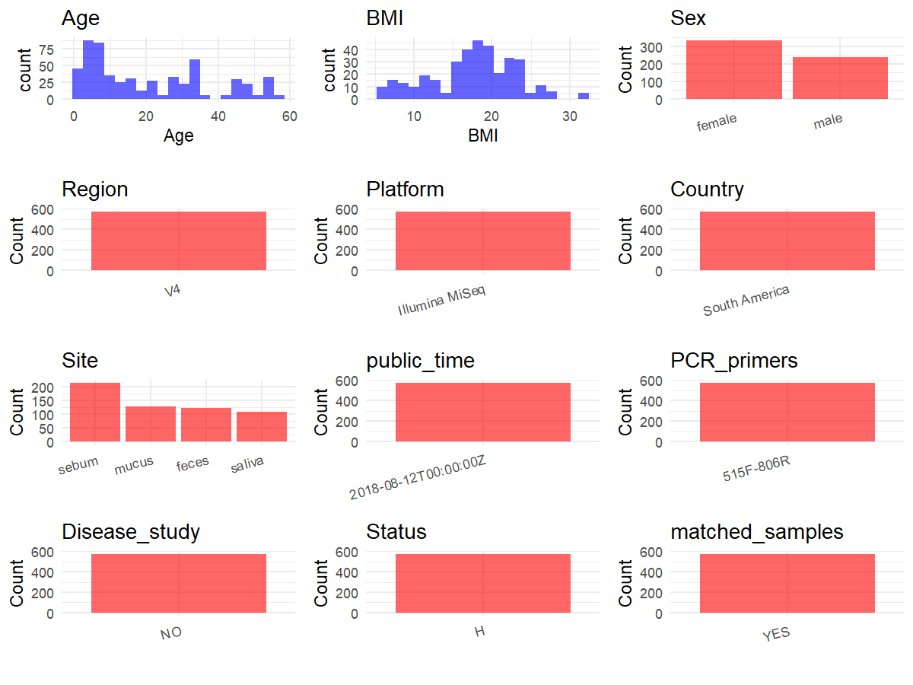

R Notebook: Metadata Processing Workflow
================

# Step 1: Obtain Initial Metadata from Each Project

To obtain the initial metadata: 1. Search for the BioProject ID (e.g.,
“PRJEBXXXX”) on the [NCBI SRA
website](https://www.ncbi.nlm.nih.gov/Traces/study/). 2. In the “Select”
table, click on “Metadata” and download the file. 3. The downloaded file
is typically named “SraRunTable.csv” and contains metadata for the
project.

``` r
# Load necessary libraries
library(dplyr)
library(ggplot2)
library(cowplot)

# Set working directory (update this path to your local directory)
setwd("D:/metadata/PRJEB28088")

# Read the initial metadata files
initial_meta<-read.csv("SraRunTable.csv",header = T)

# Combine the two metadata files
#meta <- rbind(initial_meta, initial_meta1)

#Remove entries non-oral samples
#initial_meta <- subset(initial_meta, Organism == "human oral metagenome")

# Check the number of samples containing "HT" in Sample.Name (e.g., healthy controls)
#nrow(subset(meta, grepl("HT", Sample.Name)))

# Display the first few rows of the metadata
head(initial_meta)
```

    ##   abi_left1 abi_left2 abi_left3 abi_right1 abi_right2 abi_right3        Run AGE
    ## 1        NA        NA        NA         NA         NA         NA ERR2728158  55
    ## 2        NA        NA        NA         NA         NA         NA ERR2728159  34
    ## 3        NA        NA        NA         NA         NA         NA ERR2728160  34
    ## 4        NA        NA        NA         NA         NA         NA ERR2728161  44
    ## 5        NA        NA        NA         NA         NA         NA ERR2728162   3
    ## 6        NA        NA        NA         NA         NA         NA ERR2728163  34
    ##   ancylostomide_eggs  X arm_circumference arm_length ascaris_lumbricoides_eggs
    ## 1               <NA> NA                NA         NA                      <NA>
    ## 2               <NA> NA                NA         NA                      <NA>
    ## 3               <NA> NA                NA         NA                      <NA>
    ## 4               <NA> NA                NA         NA                      <NA>
    ## 5               <NA> NA                NA         NA                      <NA>
    ## 6               <NA> NA                NA         NA                      <NA>
    ##   Assay.Type AvgSpotLen Barcode..exp.   Bases BioProject    BioSample
    ## 1      OTHER        150  GTCATGCTCCAG 5415214 PRJEB28088 SAMEA4820302
    ## 2      OTHER        150  CAATCGGCTTGC 4130375 PRJEB28088 SAMEA4820303
    ## 3      OTHER        150  TACAGTTACGCG 4814351 PRJEB28088 SAMEA4820304
    ## 4      OTHER        150  CGGCCTAAGTTC 2887503 PRJEB28088 SAMEA4820305
    ## 5      OTHER        150  TAGCGCGAACTT 3352410 PRJEB28088 SAMEA4820306
    ## 6      OTHER        150  TCGAGCCGATCT 5911123 PRJEB28088 SAMEA4820307
    ##   Birth_date blastocystis_spp BMI bp   Bytes  c_i cavi_left1 cavi_left2
    ## 1       <NA>             <NA>  NA NA 3283154 <NA>         NA         NA
    ## 2       <NA>             <NA>  NA NA 2504788 <NA>         NA         NA
    ## 3       <NA>             <NA>  NA NA 2667913 <NA>         NA         NA
    ## 4       <NA>             <NA>  NA NA 1773606 <NA>         NA         NA
    ## 5       <NA>             <NA>  NA NA 2028762 <NA>         NA         NA
    ## 6       <NA>             <NA>  NA NA 3638991 <NA>         NA         NA
    ##   cavi_left3 cavi_right1 cavi_right2 cavi_right3 center_name..exp.
    ## 1         NA          NA          NA          NA            NYULMC
    ## 2         NA          NA          NA          NA            NYULMC
    ## 3         NA          NA          NA          NA            NYULMC
    ## 4         NA          NA          NA          NA            NYULMC
    ## 5         NA          NA          NA          NA            NYULMC
    ## 6         NA          NA          NA          NA            NYULMC
    ##                                          Center.Name center_project_name..exp.
    ## 1 UNIVERSITY OF CALIFORNIA SAN DIEGO MICROBIOME INIT              Bolivar-Diet
    ## 2 UNIVERSITY OF CALIFORNIA SAN DIEGO MICROBIOME INIT              Bolivar-Diet
    ## 3 UNIVERSITY OF CALIFORNIA SAN DIEGO MICROBIOME INIT              Bolivar-Diet
    ## 4 UNIVERSITY OF CALIFORNIA SAN DIEGO MICROBIOME INIT              Bolivar-Diet
    ## 5 UNIVERSITY OF CALIFORNIA SAN DIEGO MICROBIOME INIT              Bolivar-Diet
    ## 6 UNIVERSITY OF CALIFORNIA SAN DIEGO MICROBIOME INIT              Bolivar-Diet
    ##   chilomastix_mesnili_cysts cholesterol collection_timestamp Consent
    ## 1                      <NA>        <NA>            2015/9/30  public
    ## 2                      <NA>        <NA>           2015/10/12  public
    ## 3                      <NA>        <NA>           2015/10/12  public
    ## 4                      <NA>        <NA>           2015/10/13  public
    ## 5                      <NA>        <NA>           2015/10/15  public
    ## 6                      <NA>        <NA>           2015/10/15  public
    ##             COUNTRY cuff_size DATASTORE.filetype DATASTORE.provider
    ## 1 Restricted access        NA   fastq,run.zq,sra     ena,gs,ncbi,s3
    ## 2 Restricted access        NA   fastq,run.zq,sra     ena,gs,ncbi,s3
    ## 3 Restricted access        NA   fastq,run.zq,sra     ena,gs,ncbi,s3
    ## 4 Restricted access        NA   fastq,run.zq,sra     ena,gs,ncbi,s3
    ## 5 Restricted access        NA   fastq,run.zq,sra     ena,gs,ncbi,s3
    ## 6 Restricted access        NA   fastq,run.zq,sra     ena,gs,ncbi,s3
    ##                           DATASTORE.region days_of_study
    ## 1 ena,gs.us-east1,ncbi.public,s3.us-east-1             1
    ## 2 ena,gs.us-east1,ncbi.public,s3.us-east-1            13
    ## 3 ena,gs.us-east1,ncbi.public,s3.us-east-1            13
    ## 4 ena,gs.us-east1,ncbi.public,s3.us-east-1            14
    ## 5 ena,gs.us-east1,ncbi.public,s3.us-east-1            16
    ## 6 ena,gs.us-east1,ncbi.public,s3.us-east-1            16
    ##   days_relative_to_expedition diastolic_1 diastolic_2 diatolic_3
    ## 1                  Kanarakuni          NA          NA         NA
    ## 2                  Kanarakuni          NA          NA         NA
    ## 3                  Kanarakuni          NA          NA         NA
    ## 4               +1 Kanarakuni          NA          NA         NA
    ## 5               +4 Kanarakuni          NA          NA         NA
    ## 6               +3 Kanarakuni          NA          NA         NA
    ##   dientamoeba_fragilis_cyst diet_24h
    ## 1                      <NA>     <NA>
    ## 2                      <NA>     <NA>
    ## 3                      <NA>     <NA>
    ## 4                      <NA>     <NA>
    ## 5                      <NA>     <NA>
    ## 6                      <NA>     <NA>
    ##                                                                                                                                                                                                                                                              Diet
    ## 1 Breakfast- yukuta/ aji/ casabe/ boiled fish -coporo-/ fried fish/ peccary stew; Morning snack- guava/ sugar cane; Lunch- yukuta/ aji/ casabe/ boiled fish. -coporo-/ roasted peccary; Afternoon snack- banana; Dinner- yukuta/ aji/ casabe/ boiled fish -cop...
    ## 2                                                                     Breakfast- arepa/ aji/ cereal/ tuna/ milk/ coffee/ pumpkin soup/ fried and boiled lowland paca; Lunch- aji/ casabe/ pastas/ tuna/ nestea; Dinner- rice/ aji/ casabe/ tuna/ sardine/ nestea.
    ## 3                                                                     Breakfast- arepa/ aji/ cereal/ tuna/ milk/ coffee/ pumpkin soup/ fried and boiled lowland paca; Lunch- aji/ casabe/ pastas/ tuna/ nestea; Dinner- rice/ aji/ casabe/ tuna/ sardine/ nestea.
    ## 4                                                                                                                                                                                                                                                            <NA>
    ## 5                                                                                                                                                                                                                                                            <NA>
    ## 6                                                                                                                                                                                                                                                            <NA>
    ##   dna_extracted elevation ENA_FIRST_PUBLIC ENA.LAST.UPDATE..run.
    ## 1          TRUE        10        2018/8/11            2018/11/16
    ## 2          TRUE        10        2018/8/11            2018/11/16
    ## 3          TRUE        10        2018/8/11            2018/11/16
    ## 4          TRUE        10        2018/8/11            2018/11/16
    ## 5          TRUE        10        2018/8/11            2018/11/16
    ## 6          TRUE        10        2018/8/11            2018/11/16
    ##   endolimax_nana_cysts entamoeba_coli_cysts entamoeba_coli_trofozoites
    ## 1                 <NA>                 <NA>                       <NA>
    ## 2                 <NA>                 <NA>                       <NA>
    ## 3                 <NA>                 <NA>                       <NA>
    ## 4                 <NA>                 <NA>                       <NA>
    ## 5                 <NA>                 <NA>                       <NA>
    ## 6                 <NA>                 <NA>                       <NA>
    ##   entamoeba_histolytica_dispar entamoeba_histolytica_trofozoites
    ## 1                         <NA>                              <NA>
    ## 2                         <NA>                              <NA>
    ## 3                         <NA>                              <NA>
    ## 4                         <NA>                              <NA>
    ## 5                         <NA>                              <NA>
    ## 6                         <NA>                              <NA>
    ##   enterobius_vermicularis_eggs              env_biome              env_feature
    ## 1                         <NA> dense settlement biome human-associated habitat
    ## 2                         <NA> dense settlement biome human-associated habitat
    ## 3                         <NA> dense settlement biome human-associated habitat
    ## 4                         <NA> dense settlement biome human-associated habitat
    ## 5                         <NA> dense settlement biome human-associated habitat
    ## 6                         <NA> dense settlement biome human-associated habitat
    ##   env_material Env_package ETHNICITY Experiment  external_id Family_Id
    ## 1        feces   human-gut      <NA> ERX2741403 SAMEA4820302      <NA>
    ## 2        feces   human-gut      <NA> ERX2741404 SAMEA4820303      <NA>
    ## 3        feces   human-gut      <NA> ERX2741405 SAMEA4820304      <NA>
    ## 4        feces   human-gut      <NA> ERX2741406 SAMEA4820305      <NA>
    ## 5        feces   human-gut      <NA> ERX2741407 SAMEA4820306      <NA>
    ## 6        feces   human-gut      <NA> ERX2741408 SAMEA4820307      <NA>
    ##   family_relations fitbit_bit_no fitbit_highly_active_minutes
    ## 1             <NA>            NA                           NA
    ## 2             <NA>            NA                           NA
    ## 3             <NA>            NA                           NA
    ## 4             <NA>            NA                           NA
    ## 5             <NA>            NA                           NA
    ## 6             <NA>            NA                           NA
    ##   fitbit_miles_walked fitbit_received fitbit_returned fitbit_steps gender
    ## 1                  NA              NA              NA           NA female
    ## 2                  NA              NA              NA           NA female
    ## 3                  NA              NA              NA           NA   male
    ## 4                  NA              NA              NA           NA female
    ## 5                  NA              NA              NA           NA   male
    ## 6                  NA              NA              NA           NA female
    ##   geo_loc_name_country geo_loc_name_country_continent  geo_loc_name
    ## 1         uncalculated                   uncalculated South America
    ## 2         uncalculated                   uncalculated South America
    ## 3         uncalculated                   uncalculated South America
    ## 4         uncalculated                   uncalculated South America
    ## 5         uncalculated                   uncalculated South America
    ## 6         uncalculated                   uncalculated South America
    ##   giardia_lamblia_cysts giardia_lamblia_trofozoites Glucose hemoglobin Host_age
    ## 1                  <NA>                        <NA>    <NA>       <NA>       55
    ## 2                  <NA>                        <NA>    <NA>       <NA>       34
    ## 3                  <NA>                        <NA>    <NA>       <NA>       34
    ## 4                  <NA>                        <NA>    <NA>       <NA>       44
    ## 5                  <NA>                        <NA>    <NA>       <NA>        3
    ## 6                  <NA>                        <NA>    <NA>       <NA>       34
    ##   host_age_units host_body_mass_index host_common_name host_height
    ## 1          years                   NA            human          NA
    ## 2          years                   NA            human          NA
    ## 3          years                   NA            human          NA
    ## 4          years                   NA            human          NA
    ## 5          years                   NA            human          NA
    ## 6          years                   NA            human          NA
    ##   host_height_units host_scientific_name host_subject_id host_taxid host_weight
    ## 1                cm         Homo sapiens              A7       9606          NA
    ## 2                cm         Homo sapiens              A5       9606          NA
    ## 3                cm         Homo sapiens              A6       9606          NA
    ## 4                cm         Homo sapiens              A2       9606          NA
    ## 5                cm         Homo sapiens              A3       9606          NA
    ## 6                cm         Homo sapiens              A5       9606          NA
    ##   host_weight_units house_id hymenolepis_nana_eggs INSDC_center_name
    ## 1                kg     <NA>                  <NA>            UCSDMI
    ## 2                kg     <NA>                  <NA>            UCSDMI
    ## 3                kg     <NA>                  <NA>            UCSDMI
    ## 4                kg     <NA>                  <NA>            UCSDMI
    ## 5                kg     <NA>                  <NA>            UCSDMI
    ## 6                kg     <NA>                  <NA>            UCSDMI
    ##     INSDC_first_public    INSDC_last_update INSDC_status     Instrument
    ## 1 2018-08-11T17:03:01Z 2018-08-06T22:41:45Z       public Illumina MiSeq
    ## 2 2018-08-11T17:03:01Z 2018-08-06T22:41:45Z       public Illumina MiSeq
    ## 3 2018-08-11T17:03:01Z 2018-08-06T22:41:45Z       public Illumina MiSeq
    ## 4 2018-08-11T17:03:01Z 2018-08-06T22:41:45Z       public Illumina MiSeq
    ## 5 2018-08-11T17:03:01Z 2018-08-06T22:41:45Z       public Illumina MiSeq
    ## 6 2018-08-11T17:03:01Z 2018-08-06T22:41:45Z       public Illumina MiSeq
    ##   iodamoeba_butschlii_cysts LATITUDE   Library.Name LibraryLayout
    ## 1                      <NA>   40.737    11874.X15.1        SINGLE
    ## 2                      <NA>   40.737 11874.X15.1053        SINGLE
    ## 3                      <NA>   40.737 11874.X15.1055        SINGLE
    ## 4                      <NA>   40.737 11874.X15.1062        SINGLE
    ## 5                      <NA>   40.737 11874.X15.1081        SINGLE
    ## 6                      <NA>   40.737 11874.X15.1083        SINGLE
    ##   LibrarySelection LibrarySource linker..exp. LONGITUDE              name
    ## 1              PCR   METAGENOMIC           CC  -73.9767 Restricted access
    ## 2              PCR   METAGENOMIC           CC  -73.9767 Restricted access
    ## 3              PCR   METAGENOMIC           CC  -73.9767 Restricted access
    ## 4              PCR   METAGENOMIC           CC  -73.9767 Restricted access
    ## 5              PCR   METAGENOMIC           CC  -73.9767 Restricted access
    ## 6              PCR   METAGENOMIC           CC  -73.9767 Restricted access
    ##   observations onchocerca             Organism
    ## 1           NA         NA human gut metagenome
    ## 2           NA         NA human gut metagenome
    ## 3           NA         NA human gut metagenome
    ## 4           NA         NA human gut metagenome
    ## 5           NA         NA human gut metagenome
    ## 6           NA         NA human gut metagenome
    ##                                   pcr_primers..exp. peak_inflation_level
    ## 1 FWD:GTGCCAGCMGCCGCGGTAA; REV:GGACTACHVGGGTWTCTAAT                   NA
    ## 2 FWD:GTGCCAGCMGCCGCGGTAA; REV:GGACTACHVGGGTWTCTAAT                   NA
    ## 3 FWD:GTGCCAGCMGCCGCGGTAA; REV:GGACTACHVGGGTWTCTAAT                   NA
    ## 4 FWD:GTGCCAGCMGCCGCGGTAA; REV:GGACTACHVGGGTWTCTAAT                   NA
    ## 5 FWD:GTGCCAGCMGCCGCGGTAA; REV:GGACTACHVGGGTWTCTAAT                   NA
    ## 6 FWD:GTGCCAGCMGCCGCGGTAA; REV:GGACTACHVGGGTWTCTAAT                   NA
    ##   physical_specimen_location physical_specimen_remaining Platform
    ## 1            Rutgers_MGDBLab                       FALSE ILLUMINA
    ## 2            Rutgers_MGDBLab                       FALSE ILLUMINA
    ## 3            Rutgers_MGDBLab                       FALSE ILLUMINA
    ## 4            Rutgers_MGDBLab                       FALSE ILLUMINA
    ## 5            Rutgers_MGDBLab                       FALSE ILLUMINA
    ## 6            Rutgers_MGDBLab                       FALSE ILLUMINA
    ##           primer..exp. pulse_obliteration_pressure pulse          ReleaseDate
    ## 1 GGACTACHVGGGTWTCTAAT                          NA    NA 2018-08-12T00:00:00Z
    ## 2 GGACTACHVGGGTWTCTAAT                          NA    NA 2018-08-12T00:00:00Z
    ## 3 GGACTACHVGGGTWTCTAAT                          NA    NA 2018-08-12T00:00:00Z
    ## 4 GGACTACHVGGGTWTCTAAT                          NA    NA 2018-08-12T00:00:00Z
    ## 5 GGACTACHVGGGTWTCTAAT                          NA    NA 2018-08-12T00:00:00Z
    ## 6 GGACTACHVGGGTWTCTAAT                          NA    NA 2018-08-12T00:00:00Z
    ##   run_center..exp. run_date..exp.          create_date version
    ## 1           NYULMC         16-Sep 2018-08-12T17:27:00Z       1
    ## 2           NYULMC         16-Sep 2018-08-12T17:27:00Z       1
    ## 3           NYULMC         16-Sep 2018-08-12T17:27:00Z       1
    ## 4           NYULMC         16-Sep 2018-08-12T17:28:00Z       1
    ## 5           NYULMC         16-Sep 2018-08-12T17:28:00Z       1
    ## 6           NYULMC         16-Sep 2018-08-12T17:28:00Z       1
    ##                run_prefix..exp.  Sample.Name                    Sample_name
    ## 1 lane1_NoIndex_L001_R2_001-13A SAMEA4820302    qiita_sid_11874:11874.X15.1
    ## 2 lane1_NoIndex_L001_R2_001-13A SAMEA4820303 qiita_sid_11874:11874.X15.1053
    ## 3 lane1_NoIndex_L001_R2_001-13A SAMEA4820304 qiita_sid_11874:11874.X15.1055
    ## 4 lane1_NoIndex_L001_R2_001-13A SAMEA4820305 qiita_sid_11874:11874.X15.1062
    ## 5 lane1_NoIndex_L001_R2_001-13A SAMEA4820306 qiita_sid_11874:11874.X15.1081
    ## 6 lane1_NoIndex_L001_R2_001-13A SAMEA4820307 qiita_sid_11874:11874.X15.1083
    ##   sample_type samplegroup  seqs   sequencing_meth..exp. sequencing_run    sex
    ## 1       feces    Visitors 31972 sequencing by synthesis        RUN_13A female
    ## 2       feces    Visitors 24311 sequencing by synthesis        RUN_13A female
    ## 3       feces    Visitors 29369 sequencing by synthesis        RUN_13A   male
    ## 4       feces    Visitors 16980 sequencing by synthesis        RUN_13A female
    ## 5       feces    Visitors 20288 sequencing by synthesis        RUN_13A   male
    ## 6       feces    Visitors 35556 sequencing by synthesis        RUN_13A female
    ##   SRA.Study strongyloides_stercolaris_larvas subject_id
    ## 1 ERP110254                             <NA>         A7
    ## 2 ERP110254                             <NA>         A5
    ## 3 ERP110254                             <NA>         A6
    ## 4 ERP110254                             <NA>         A2
    ## 5 ERP110254                             <NA>         A3
    ## 6 ERP110254                             <NA>         A5
    ##                     Submitter_Id supine_dbp1 supine_dbp2 supine_dbp3
    ## 1    qiita_sid_11874:11874.X15.1          NA          NA          NA
    ## 2 qiita_sid_11874:11874.X15.1053          NA          NA          NA
    ## 3 qiita_sid_11874:11874.X15.1055          NA          NA          NA
    ## 4 qiita_sid_11874:11874.X15.1062          NA          NA          NA
    ## 5 qiita_sid_11874:11874.X15.1081          NA          NA          NA
    ## 6 qiita_sid_11874:11874.X15.1083          NA          NA          NA
    ##   supine_sbp1 supine_sbp2 supine_sbp3 systolic_1
    ## 1          NA          NA          NA         NA
    ## 2          NA          NA          NA         NA
    ## 3          NA          NA          NA         NA
    ## 4          NA          NA          NA         NA
    ## 5          NA          NA          NA         NA
    ## 6          NA          NA          NA         NA

# Step 2: Create a Uniform Metadata Template

The uniform metadata should include the following columns:

1.  **BioProject**: Project ID (e.g., “PRJNA339212”)
2.  **Run**: Sample ID (e.g., “ERRXXXXXX” or “SRRXXXXXX”)
3.  **sample_name**: Original sample name submitted by the authors (not
    the database-assigned ID)
4.  **Age**: Age of the subject (if available)
5.  **BMI**: Body Mass Index (if available)
6.  **Sex**: Sex of the subject (“F” or “M”)
7.  **Region**: Targeted 16S rRNA region (e.g., “V3-V4”)
8.  **Platform**: Sequencing platform (e.g., “Illumina MiSeq”)
9.  **Country**: Country of sample origin (e.g., “China”)
10. **Site**: Sample site (e.g., “saliva”, “dental plaque”)
11. **public_time**: Data release date (format: “YYYY-MM-DD”)
12. **PCR_primers**: PCR primers used (e.g., “515F-806R”)
13. **title**: Title of the associated publication
14. **Disease_study**: Whether the study involves a disease (“YES” or
    “NO”)
15. **Status**: Disease status (e.g., “T2DM”, “HC”). Note: If the study
    includes both disease and healthy samples, this must be specified
    per sample.
16. **matched_samples**: matched samples (“YES” or “NO”)

``` r
# Create a uniform metadata dataframe
metadata <- data.frame(
  BioProject = initial_meta$BioProject,
  Run = initial_meta$Run,
  sample_name = initial_meta$Sample.Name,
  Age = initial_meta$AGE,
  BMI = initial_meta$BMI,
  Sex= initial_meta$sex,
  Region = "V4",
  Platform = initial_meta$Instrument,
  Country = initial_meta$geo_loc_name,
  Site = initial_meta$env_material,
  public_time = initial_meta$ReleaseDate,
  stringsAsFactors = FALSE
)
```

# Step 3: Manually Add Information from the Publication

Some information (e.g. PCR primers, study title, disease status) must be
manually extracted from the publication and added to the metadata.

``` r
# Add information obtained from the publication
metadata$PCR_primers <- "515F-806R"
metadata$title <- "Changes in the Gut Microbiota of Urban Subjects during an Immersion in the Traditional Diet and Lifestyle of a Rainforest Village"
metadata$Disease_study <- "NO"
# Assign disease status based on sample_name patterns
metadata$Status<-"H"


fields <- c("Age", "BMI", "Sex")

stopifnot(all(fields %in% colnames(metadata)))
clean <- metadata[complete.cases(metadata[fields]), ]

has_dup <- any(duplicated(clean[fields]))


metadata$matched_samples <- ifelse(has_dup, "YES", "NO")

output_df <- metadata[metadata$matched_samples == "YES" |
                     (metadata$matched_samples == "NO" & metadata$Site == "saliva"), ]

cat("Total rows in output_df :", nrow(output_df), "\n")
```

    ## Total rows in output_df : 572

``` r
cat("YES rows                :", sum(output_df$matched_samples == "YES"), "\n")
```

    ## YES rows                : 572

``` r
cat("NO rows                 :", sum(output_df$matched_samples == "NO"), "\n")
```

    ## NO rows                 : 0

# Step 4: Summarize and Validate the Metadata

``` r
# Check the number of unique runs and sample names
print(paste("Number of unique runs:", length(unique(metadata$Run))))
```

    ## [1] "Number of unique runs: 572"

``` r
print(paste("Number of unique sample names:", length(unique(metadata$sample_name))))
```

    ## [1] "Number of unique sample names: 572"

# Step 5: Visualize the Metadata

``` r

```

<!-- -->

# Step 6: Finalize and Export the Metadata

``` r
# Reorder columns to match the desired format
metadata <- metadata[, c(
  "BioProject", "Run", "sample_name", "Age", "BMI", "Sex", 
  "Region", "Platform", "Country", "Site", "public_time", 
  "PCR_primers", "title", "Disease_study", "Status","matched_samples"
)]

# Export the uniform metadata to a CSV file
write.csv(metadata, file = "metadata.csv", quote = TRUE)
head(metadata)
```

    ##   BioProject        Run  sample_name Age BMI    Sex Region       Platform
    ## 1 PRJEB28088 ERR2728158 SAMEA4820302  55  NA female     V4 Illumina MiSeq
    ## 2 PRJEB28088 ERR2728159 SAMEA4820303  34  NA female     V4 Illumina MiSeq
    ## 3 PRJEB28088 ERR2728160 SAMEA4820304  34  NA   male     V4 Illumina MiSeq
    ## 4 PRJEB28088 ERR2728161 SAMEA4820305  44  NA female     V4 Illumina MiSeq
    ## 5 PRJEB28088 ERR2728162 SAMEA4820306   3  NA   male     V4 Illumina MiSeq
    ## 6 PRJEB28088 ERR2728163 SAMEA4820307  34  NA female     V4 Illumina MiSeq
    ##         Country  Site          public_time PCR_primers
    ## 1 South America feces 2018-08-12T00:00:00Z   515F-806R
    ## 2 South America feces 2018-08-12T00:00:00Z   515F-806R
    ## 3 South America feces 2018-08-12T00:00:00Z   515F-806R
    ## 4 South America feces 2018-08-12T00:00:00Z   515F-806R
    ## 5 South America feces 2018-08-12T00:00:00Z   515F-806R
    ## 6 South America feces 2018-08-12T00:00:00Z   515F-806R
    ##                                                                                                                               title
    ## 1 Changes in the Gut Microbiota of Urban Subjects during an Immersion in the Traditional Diet and Lifestyle of a Rainforest Village
    ## 2 Changes in the Gut Microbiota of Urban Subjects during an Immersion in the Traditional Diet and Lifestyle of a Rainforest Village
    ## 3 Changes in the Gut Microbiota of Urban Subjects during an Immersion in the Traditional Diet and Lifestyle of a Rainforest Village
    ## 4 Changes in the Gut Microbiota of Urban Subjects during an Immersion in the Traditional Diet and Lifestyle of a Rainforest Village
    ## 5 Changes in the Gut Microbiota of Urban Subjects during an Immersion in the Traditional Diet and Lifestyle of a Rainforest Village
    ## 6 Changes in the Gut Microbiota of Urban Subjects during an Immersion in the Traditional Diet and Lifestyle of a Rainforest Village
    ##   Disease_study Status matched_samples
    ## 1            NO      H             YES
    ## 2            NO      H             YES
    ## 3            NO      H             YES
    ## 4            NO      H             YES
    ## 5            NO      H             YES
    ## 6            NO      H             YES

## Notes for Students:

1.  **Metadata Accuracy**: Always cross-check the metadata with the
    original publication to ensure accuracy.
2.  **Manual Entries**: Columns like `PCR_primers`, and `Status` often
    require manual entry based on the publication.
3.  **Disease Status**: Be careful when assigning `Status`—some studies
    include both disease and healthy samples.
4.  **Visualization**: The plots help quickly identify the distribution
    of values in each column, which is useful for quality control.
5.  **Reproducibility**: Update the working directory and file paths to
    match your local environment.
