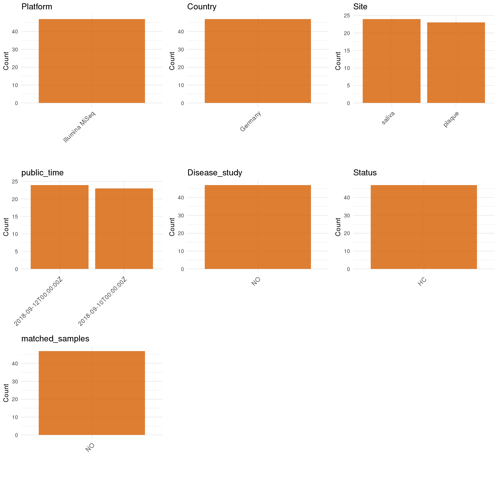

R Notebook: Metadata Processing Workflow
================

# Step 1: Obtain Initial Metadata from Each Project

To obtain the initial metadata: 1. Search for the BioProject ID (e.g.,
“PRJEBXXXX”) on the [NCBI SRA
website](https://www.ncbi.nlm.nih.gov/Traces/study/). 2. In the “Select”
table, click on “Metadata” and download the file. 3. The downloaded file
is typically named “SraRunTable.csv” and contains metadata for the
project.

``` r
# Load necessary libraries
library(dplyr)
library(ggplot2)
library(cowplot)
# Set working directory (update this path to your local directory)
setwd("/Users/dongbiao/Documents/oral/global-oral-microbiome/data/projects/PRJEB28369/")

# Read the initial metadata files
initial_meta<-read.csv("SraRunTable.csv",header = T)

head(initial_meta)
```

    ##          Run Assay.Type AvgSpotLen    Bases BioProject    BioSample   Bytes
    ## 1 ERR2757873      OTHER        295 10687840 PRJEB28369 SAMEA4859557 5669254
    ## 2 ERR2757874      OTHER        293 10771082 PRJEB28369 SAMEA4859558 5697090
    ## 3 ERR2757875      OTHER        298 10951950 PRJEB28369 SAMEA4859559 5422891
    ## 4 ERR2757876      OTHER        295 10860568 PRJEB28369 SAMEA4859560 5651703
    ## 5 ERR2757877      OTHER        293 10911088 PRJEB28369 SAMEA4859561 5762355
    ## 6 ERR2757878      OTHER        298 10806660 PRJEB28369 SAMEA4859562 5587285
    ##                      Center.Name Collection_Date Consent DATASTORE.filetype
    ## 1 POLIKLINIK FUER PARODONTOLOGIE         2015-06  public   fastq,run.zq,sra
    ## 2 POLIKLINIK FUER PARODONTOLOGIE         2015-06  public   fastq,run.zq,sra
    ## 3 POLIKLINIK FUER PARODONTOLOGIE         2015-06  public   fastq,run.zq,sra
    ## 4 POLIKLINIK FUER PARODONTOLOGIE         2015-06  public   fastq,run.zq,sra
    ## 5 POLIKLINIK FUER PARODONTOLOGIE         2015-06  public   fastq,run.zq,sra
    ## 6 POLIKLINIK FUER PARODONTOLOGIE         2015-06  public   fastq,run.zq,sra
    ##   DATASTORE.provider                         DATASTORE.region
    ## 1     ena,gs,ncbi,s3 ena,gs.us-east1,ncbi.public,s3.us-east-1
    ## 2     ena,gs,ncbi,s3 ena,gs.us-east1,ncbi.public,s3.us-east-1
    ## 3     ena,gs,ncbi,s3 ena,gs.us-east1,ncbi.public,s3.us-east-1
    ## 4     ena,gs,ncbi,s3 ena,gs.us-east1,ncbi.public,s3.us-east-1
    ## 5     ena,gs,ncbi,s3 ena,gs.us-east1,ncbi.public,s3.us-east-1
    ## 6     ena,gs,ncbi,s3 ena,gs.us-east1,ncbi.public,s3.us-east-1
    ##   ENA.FIRST.PUBLIC..run.     ena_first_public ENA.LAST.UPDATE..run.
    ## 1             2018-09-09 2018-09-09T17:02:47Z            2018-11-16
    ## 2             2018-09-09 2018-09-09T17:02:47Z            2018-11-16
    ## 3             2018-09-09 2018-09-09T17:02:47Z            2018-11-16
    ## 4             2018-09-09 2018-09-09T17:02:47Z            2018-11-16
    ## 5             2018-09-09 2018-09-09T17:02:47Z            2018-11-16
    ## 6             2018-09-09 2018-09-09T17:02:47Z            2018-11-16
    ##        ena_last_update environment_.biome.        environment_.feature.
    ## 1 2018-08-26T21:49:58Z         Oral Cavity Saliva or subgingival plaque
    ## 2 2018-08-26T21:49:58Z         Oral Cavity Saliva or subgingival plaque
    ## 3 2018-08-26T21:49:58Z         Oral Cavity Saliva or subgingival plaque
    ## 4 2018-08-26T21:49:58Z         Oral Cavity Saliva or subgingival plaque
    ## 5 2018-08-26T21:49:58Z         Oral Cavity Saliva or subgingival plaque
    ## 6 2018-08-26T21:49:58Z         Oral Cavity Saliva or subgingival plaque
    ##         environment_.material. Experiment  external_id geo_loc_name_country
    ## 1 Saliva or subgingival plaque ERX2770866 SAMEA4859557              Germany
    ## 2 Saliva or subgingival plaque ERX2770867 SAMEA4859558              Germany
    ## 3 Saliva or subgingival plaque ERX2770868 SAMEA4859559              Germany
    ## 4 Saliva or subgingival plaque ERX2770869 SAMEA4859560              Germany
    ## 5 Saliva or subgingival plaque ERX2770870 SAMEA4859561              Germany
    ## 6 Saliva or subgingival plaque ERX2770871 SAMEA4859562              Germany
    ##   geo_loc_name_country_continent geographic_location_.country_and.or_sea.
    ## 1                         Europe                                  Germany
    ## 2                         Europe                                  Germany
    ## 3                         Europe                                  Germany
    ## 4                         Europe                                  Germany
    ## 5                         Europe                                  Germany
    ## 6                         Europe                                  Germany
    ##   geographic_location_.latitude. geographic_location_.longitude.
    ## 1                       51.05041                        13.73726
    ## 2                       51.05041                        13.73726
    ## 3                       51.05041                        13.73726
    ## 4                       51.05041                        13.73726
    ## 5                       51.05041                        13.73726
    ## 6                       51.05041                        13.73726
    ##   human_oral_environmental_package              INSDC_center_name
    ## 1                       human-oral Poliklinik fuer Parodontologie
    ## 2                       human-oral Poliklinik fuer Parodontologie
    ## 3                       human-oral Poliklinik fuer Parodontologie
    ## 4                       human-oral Poliklinik fuer Parodontologie
    ## 5                       human-oral Poliklinik fuer Parodontologie
    ## 6                       human-oral Poliklinik fuer Parodontologie
    ##     INSDC_first_public    INSDC_last_update INSDC_status     Instrument
    ## 1 2018-09-09T17:02:47Z 2018-08-26T21:49:58Z       public Illumina MiSeq
    ## 2 2018-09-09T17:02:47Z 2018-08-26T21:49:58Z       public Illumina MiSeq
    ## 3 2018-09-09T17:02:47Z 2018-08-26T21:49:58Z       public Illumina MiSeq
    ## 4 2018-09-09T17:02:47Z 2018-08-26T21:49:58Z       public Illumina MiSeq
    ## 5 2018-09-09T17:02:47Z 2018-08-26T21:49:58Z       public Illumina MiSeq
    ## 6 2018-09-09T17:02:47Z 2018-08-26T21:49:58Z       public Illumina MiSeq
    ##   investigation_type Library.Name LibraryLayout LibrarySelection LibrarySource
    ## 1         metagenome  unspecified        SINGLE            other   METAGENOMIC
    ## 2         metagenome  unspecified        SINGLE            other   METAGENOMIC
    ## 3         metagenome  unspecified        SINGLE            other   METAGENOMIC
    ## 4         metagenome  unspecified        SINGLE            other   METAGENOMIC
    ## 5         metagenome  unspecified        SINGLE            other   METAGENOMIC
    ## 6         metagenome  unspecified        SINGLE            other   METAGENOMIC
    ##          Organism Platform           project_name          ReleaseDate
    ## 1 oral metagenome ILLUMINA F15FTSEUHT1095_ORAlreM 2018-09-10T00:00:00Z
    ## 2 oral metagenome ILLUMINA F15FTSEUHT1095_ORAlreM 2018-09-10T00:00:00Z
    ## 3 oral metagenome ILLUMINA F15FTSEUHT1095_ORAlreM 2018-09-10T00:00:00Z
    ## 4 oral metagenome ILLUMINA F15FTSEUHT1095_ORAlreM 2018-09-10T00:00:00Z
    ## 5 oral metagenome ILLUMINA F15FTSEUHT1095_ORAlreM 2018-09-10T00:00:00Z
    ## 6 oral metagenome ILLUMINA F15FTSEUHT1095_ORAlreM 2018-09-10T00:00:00Z
    ##            create_date version  Sample.Name         Sample_name scientific_name
    ## 1 2018-09-10T09:19:00Z       1 SAMEA4859557 OMB_Patient2_plaque oral metagenome
    ## 2 2018-09-10T09:19:00Z       1 SAMEA4859558 OMB_Patient3_plaque oral metagenome
    ## 3 2018-09-10T09:19:00Z       1 SAMEA4859559 OMB_Patient4_plaque oral metagenome
    ## 4 2018-09-10T09:19:00Z       1 SAMEA4859560 OMB_Patient5_plaque oral metagenome
    ## 5 2018-09-10T09:20:00Z       1 SAMEA4859561 OMB_Patient6_plaque oral metagenome
    ## 6 2018-09-10T09:20:00Z       1 SAMEA4859562 OMB_Patient7_plaque oral metagenome
    ##   Sequencing_method SRA.Study        Submitter_Id
    ## 1    Illumina MiSeq ERP110563 OMB_Patient2_plaque
    ## 2    Illumina MiSeq ERP110563 OMB_Patient3_plaque
    ## 3    Illumina MiSeq ERP110563 OMB_Patient4_plaque
    ## 4    Illumina MiSeq ERP110563 OMB_Patient5_plaque
    ## 5    Illumina MiSeq ERP110563 OMB_Patient6_plaque
    ## 6    Illumina MiSeq ERP110563 OMB_Patient7_plaque

# Step 2: Create a Uniform Metadata Template

The uniform metadata should include the following columns:

1.  **BioProject**: Project ID (e.g., “PRJNA339212”)
2.  **Run**: Sample ID (e.g., “ERRXXXXXX” or “SRRXXXXXX”)
3.  **sample_name**: Original sample name submitted by the authors (not
    the database-assigned ID)
4.  **Age**: Age of the subject (if available)
5.  **BMI**: Body Mass Index (if available)
6.  **Sex**: Sex of the subject (“F” or “M”)
7.  **Region**: Targeted 16S rRNA region (e.g., “V3-V4”)
8.  **Platform**: Sequencing platform (e.g., “Illumina MiSeq”)
9.  **Country**: Country of sample origin (e.g., “China”)
10. **Site**: Sample site (e.g., “saliva”, “dental plaque”)
11. **public_time**: Data release date (format: “YYYY-MM-DD”)
12. **PCR_primers**: PCR primers used (e.g., “515F-806R”)
13. **title**: Title of the associated publication
14. **Disease_study**: Whether the study involves a disease (“YES” or
    “NO”)
15. **Status**: Disease status (e.g., “T2DM”, “HC”). Note: If the study
    includes both disease and healthy samples, this must be specified
    per sample.
16. **matched_samples** : matched samples (“YES” or “NO”)

``` r
# Create a uniform metadata dataframe
sites <- sapply(strsplit(initial_meta$Sample_name, "_"), function(x) x[3])
sites[sites == "plaque (t =2)"] <- "Supragingival plaque"
sites[sites == "plaque"] <- "Supragingival plaque"
metadata <- data.frame(
  BioProject = initial_meta$BioProject,
  Run = initial_meta$Run,
  sample_name = initial_meta$Sample_name,
  Age = NA,
  BMI = NA,
  Sex=NA,
  Region = "V3-V4",
  Platform = initial_meta$Instrument,
  Country = initial_meta$geo_loc_name_country,
  Site = sites,
  public_time = initial_meta$ReleaseDate,
  stringsAsFactors = FALSE
)
```

# Step 3: Manually Add Information from the Publication

Some information (e.g. PCR primers, study title, disease status) must be
manually extracted from the publication and added to the metadata.

``` r
# Add information obtained from the publication
metadata$PCR_primers <- "341F-806R"
metadata$title <- "Obesity alters composition and diversity of the oral microbiota in patients with type 2 diabetes mellitus independently of glycemic control"
metadata$Disease_study <- "YES"

# Assign disease status based on sample_name patterns
metadata$Status <- "T2DM"

# Create matched_samples column
metadata$matched_samples <- "NO"

# Check initial data distribution
cat("Initial sample distribution:\n")
```

    ## Initial sample distribution:

``` r
table(metadata$sample_name)
```

    ## 
    ##       OMB_DD_Saliva_20(t=2)         OMB_DD_Saliva_Pat10 
    ##                           1                           1 
    ##         OMB_DD_Saliva_Pat11         OMB_DD_Saliva_Pat12 
    ##                           1                           1 
    ##         OMB_DD_Saliva_Pat13         OMB_DD_Saliva_Pat14 
    ##                           1                           1 
    ##   OMB_DD_Saliva_Pat14 (t=2)         OMB_DD_Saliva_Pat15 
    ##                           1                           1 
    ##   OMB_DD_Saliva_Pat15 (t=2)         OMB_DD_Saliva_Pat16 
    ##                           1                           1 
    ##         OMB_DD_Saliva_Pat17         OMB_DD_Saliva_Pat18 
    ##                           1                           1 
    ##         OMB_DD_Saliva_Pat19    OMB_DD_Saliva_Pat19(t=2) 
    ##                           1                           1 
    ##          OMB_DD_Saliva_Pat2         OMB_DD_Saliva_Pat20 
    ##                           1                           1 
    ##          OMB_DD_Saliva_Pat3    OMB_DD_Saliva_Pat3 (t=2) 
    ##                           1                           1 
    ##          OMB_DD_Saliva_Pat4          OMB_DD_Saliva_Pat5 
    ##                           1                           1 
    ##          OMB_DD_Saliva_Pat6    OMB_DD_Saliva_Pat6 (t=2) 
    ##                           1                           1 
    ##          OMB_DD_Saliva_Pat7          OMB_DD_Saliva_Pat8 
    ##                           1                           1 
    ##        OMB_Patient10_plaque        OMB_Patient11_plaque 
    ##                           1                           1 
    ##        OMB_Patient12_plaque        OMB_Patient13_plaque 
    ##                           1                           1 
    ##        OMB_Patient14_plaque OMB_Patient14_plaque (t =2) 
    ##                           1                           1 
    ##        OMB_Patient15_plaque OMB_Patient15_plaque (t =2) 
    ##                           1                           1 
    ##        OMB_Patient16_plaque        OMB_Patient18_plaque 
    ##                           1                           2 
    ##        OMB_Patient19_plaque OMB_Patient19_plaque (t =2) 
    ##                           1                           1 
    ##         OMB_Patient2_plaque        OMB_Patient20_plaque 
    ##                           1                           1 
    ## OMB_Patient20_plaque (t =2)         OMB_Patient3_plaque 
    ##                           1                           1 
    ##  OMB_Patient3_plaque (t =2)         OMB_Patient4_plaque 
    ##                           1                           1 
    ##         OMB_Patient5_plaque         OMB_Patient6_plaque 
    ##                           1                           1 
    ##  OMB_Patient6_plaque (t =2)         OMB_Patient7_plaque 
    ##                           1                           1

``` r
table(metadata$Site)
```

    ## 
    ##               Saliva Supragingival plaque 
    ##                   24                   23

# Step 4: Summarize and Validate the Metadata

``` r
# Check the number of unique runs and sample names
print(paste("Number of unique runs:", length(unique(metadata$Run))))
```

    ## [1] "Number of unique runs: 47"

``` r
print(paste("Number of unique sample names:", length(unique(metadata$sample_name))))
```

    ## [1] "Number of unique sample names: 46"

# Step 5: Visualize the Metadata

``` r
# Select columns for visualization
plot_data <- metadata %>%
  select(-BioProject, -Run, -sample_name, -title)

# Function to create simple plots for each column
create_simple_plots <- function(data) {
  plots <- list()
  
  for (col in colnames(data)) {
    # Check if the column is all NA
    if (all(is.na(data[[col]]))) {
      # Create an empty plot with text indicating all NA
      p <- ggplot() +
        annotate("text", x = 0.5, y = 0.5, label = "this column is NA", size = 6) +
        labs(title = col) +
        theme_void()
    } else if (is.numeric(data[[col]])) {
      # Numeric variable: histogram
      p <- ggplot(data, aes(x = .data[[col]])) +
        geom_histogram(fill = "blue", alpha = 0.6, bins = 20, na.rm = TRUE) +
        labs(title = col) +
        theme_minimal()
    } else {
      # Categorical variable: bar plot (remove NA values)
      count_data <- as.data.frame(table(data[[col]], useNA = "ifany"))
      p <- ggplot(count_data, aes(x = reorder(Var1, -Freq), y = Freq)) +
        geom_col(fill = "red", alpha = 0.6) +
        labs(title = col, x = NULL, y = "Count") +
        theme_minimal() +
        theme(axis.text.x = element_text(angle = 15, hjust = 1))
    }
    plots[[col]] <- p
  }
  
  return(plots)
}

# Generate and arrange plots
plots <- create_simple_plots(plot_data)
p<-plot_grid(plots$Age, 
          plots$BMI, 
          plots$Sex, 
          plots$Region, 
          plots$Platform, 
          plots$Country, 
          plots$Site,
          plots$public_time, 
          plots$PCR_primers,
          plots$Disease_study,
          plots$Status,
          plots$matched_samples,# add 
          ncol = 3, align = "hv", axis = "lb")
ggsave("Metadata_Summary.png", plot = p, width = 8, height = 6, dpi = 150)
```

``` r

```


# Step 6: Finalize and Export the Metadata

``` r
# Reorder columns to match the desired format
metadata <- metadata[, c(
  "BioProject", "Run", "sample_name", "Age", "BMI", "Sex", 
  "Region", "Platform", "Country", "Site", "public_time", 
  "PCR_primers", "title", "Disease_study", "Status","matched_samples"
)]

# Export the uniform metadata to a CSV file
write.csv(metadata, file = "metadata.csv", quote = FALSE)
head(metadata)
```

    ##   BioProject        Run         sample_name Age BMI Sex Region       Platform
    ## 1 PRJEB28369 ERR2757873 OMB_Patient2_plaque  NA  NA  NA  V3-V4 Illumina MiSeq
    ## 2 PRJEB28369 ERR2757874 OMB_Patient3_plaque  NA  NA  NA  V3-V4 Illumina MiSeq
    ## 3 PRJEB28369 ERR2757875 OMB_Patient4_plaque  NA  NA  NA  V3-V4 Illumina MiSeq
    ## 4 PRJEB28369 ERR2757876 OMB_Patient5_plaque  NA  NA  NA  V3-V4 Illumina MiSeq
    ## 5 PRJEB28369 ERR2757877 OMB_Patient6_plaque  NA  NA  NA  V3-V4 Illumina MiSeq
    ## 6 PRJEB28369 ERR2757878 OMB_Patient7_plaque  NA  NA  NA  V3-V4 Illumina MiSeq
    ##   Country                 Site          public_time PCR_primers
    ## 1 Germany Supragingival plaque 2018-09-10T00:00:00Z   341F-806R
    ## 2 Germany Supragingival plaque 2018-09-10T00:00:00Z   341F-806R
    ## 3 Germany Supragingival plaque 2018-09-10T00:00:00Z   341F-806R
    ## 4 Germany Supragingival plaque 2018-09-10T00:00:00Z   341F-806R
    ## 5 Germany Supragingival plaque 2018-09-10T00:00:00Z   341F-806R
    ## 6 Germany Supragingival plaque 2018-09-10T00:00:00Z   341F-806R
    ##                                                                                                                                         title
    ## 1 Obesity alters composition and diversity of the oral microbiota in patients with type 2 diabetes mellitus independently of glycemic control
    ## 2 Obesity alters composition and diversity of the oral microbiota in patients with type 2 diabetes mellitus independently of glycemic control
    ## 3 Obesity alters composition and diversity of the oral microbiota in patients with type 2 diabetes mellitus independently of glycemic control
    ## 4 Obesity alters composition and diversity of the oral microbiota in patients with type 2 diabetes mellitus independently of glycemic control
    ## 5 Obesity alters composition and diversity of the oral microbiota in patients with type 2 diabetes mellitus independently of glycemic control
    ## 6 Obesity alters composition and diversity of the oral microbiota in patients with type 2 diabetes mellitus independently of glycemic control
    ##   Disease_study Status matched_samples
    ## 1           YES   T2DM              NO
    ## 2           YES   T2DM              NO
    ## 3           YES   T2DM              NO
    ## 4           YES   T2DM              NO
    ## 5           YES   T2DM              NO
    ## 6           YES   T2DM              NO

## Notes for Students:

1.  **Metadata Accuracy**: Always cross-check the metadata with the
    original publication to ensure accuracy.
2.  **Manual Entries**: Columns like `PCR_primers`, and `Status` often
    require manual entry based on the publication.
3.  **Disease Status**: Be careful when assigning `Status`—some studies
    include both disease and healthy samples.
4.  **Visualization**: The plots help quickly identify the distribution
    of values in each column, which is useful for quality control.
5.  **Reproducibility**: Update the working directory and file paths to
    match your local environment.
