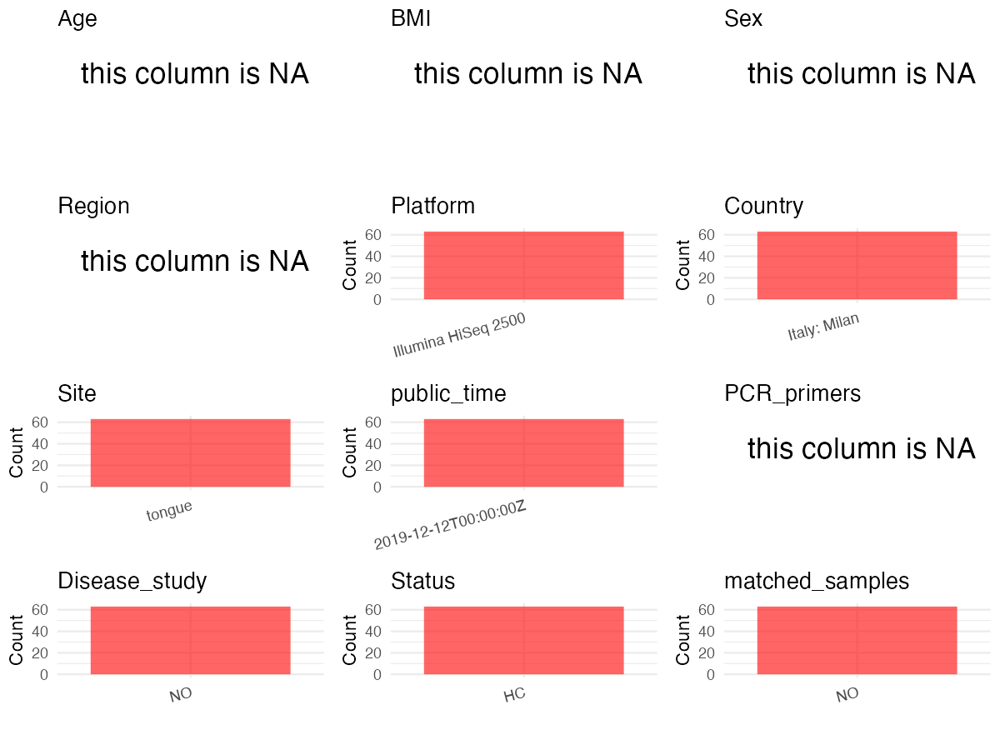

R Notebook: Metadata Processing Workflow
================

# Step 1: Obtain Initial Metadata from Each Project

To obtain the initial metadata: 1. Search for the BioProject ID (e.g.,
“PRJEBXXXX”) on the [NCBI SRA
website](https://www.ncbi.nlm.nih.gov/Traces/study/). 2. In the “Select”
table, click on “Metadata” and download the file. 3. The downloaded file
is typically named “SraRunTable.csv” and contains metadata for the
project.

``` r
# Load necessary libraries
library(dplyr)
library(ggplot2)
library(cowplot)
# Set working directory (update this path to your local directory)
setwd("/Users/dongbiao/Documents/oral/global-oral-microbiome/data/projects/PRJEB28769/")

# Read the initial metadata files
initial_meta<-read.csv("SraRunTable.csv",header = T)

head(initial_meta)
```

    ##          Run Assay.Type AvgSpotLen    Bases BioProject    BioSample    Bytes
    ## 1 ERR3727303   AMPLICON        602 10196074 PRJEB28769 SAMEA6379194  5723877
    ## 2 ERR3727304   AMPLICON        602 50868398 PRJEB28769 SAMEA6379195 27863572
    ## 3 ERR3727305   AMPLICON        602  3496416 PRJEB28769 SAMEA6379196  2003685
    ## 4 ERR3727306   AMPLICON        602 43732290 PRJEB28769 SAMEA6379197 23743970
    ## 5 ERR3727307   AMPLICON        602 20106198 PRJEB28769 SAMEA6379198 11238429
    ## 6 ERR3727308   AMPLICON        602 47670574 PRJEB28769 SAMEA6379199 26016063
    ##                        Center.Name Consent DATASTORE.filetype
    ## 1 UNIVERSITA DEGLI STUDI DI MILANO  public         run.zq,sra
    ## 2 UNIVERSITA DEGLI STUDI DI MILANO  public         run.zq,sra
    ## 3 UNIVERSITA DEGLI STUDI DI MILANO  public         run.zq,sra
    ## 4 UNIVERSITA DEGLI STUDI DI MILANO  public         run.zq,sra
    ## 5 UNIVERSITA DEGLI STUDI DI MILANO  public         run.zq,sra
    ## 6 UNIVERSITA DEGLI STUDI DI MILANO  public         run.zq,sra
    ##   DATASTORE.provider                     DATASTORE.region
    ## 1         gs,ncbi,s3 gs.us-east1,ncbi.public,s3.us-east-1
    ## 2         gs,ncbi,s3 gs.us-east1,ncbi.public,s3.us-east-1
    ## 3         gs,ncbi,s3 gs.us-east1,ncbi.public,s3.us-east-1
    ## 4         gs,ncbi,s3 gs.us-east1,ncbi.public,s3.us-east-1
    ## 5         gs,ncbi,s3 gs.us-east1,ncbi.public,s3.us-east-1
    ## 6         gs,ncbi,s3 gs.us-east1,ncbi.public,s3.us-east-1
    ##   ENA.FIRST.PUBLIC..run.     ENA_first_public ENA.LAST.UPDATE..run.
    ## 1             2019-12-11 2019-12-11T17:04:00Z            2019-12-11
    ## 2             2019-12-11 2019-12-11T17:04:00Z            2019-12-11
    ## 3             2019-12-11 2019-12-11T17:04:00Z            2019-12-11
    ## 4             2019-12-11 2019-12-11T17:04:00Z            2019-12-11
    ## 5             2019-12-11 2019-12-11T17:04:00Z            2019-12-11
    ## 6             2019-12-11 2019-12-11T17:04:00Z            2019-12-11
    ##        ENA_last_update Experiment  external_id                INSDC_center_name
    ## 1 2019-12-11T10:02:06Z ERX3728483 SAMEA6379194 Universita degli studi di Milano
    ## 2 2019-12-11T10:02:06Z ERX3728484 SAMEA6379195 Universita degli studi di Milano
    ## 3 2019-12-11T10:02:06Z ERX3728485 SAMEA6379196 Universita degli studi di Milano
    ## 4 2019-12-11T10:02:06Z ERX3728486 SAMEA6379197 Universita degli studi di Milano
    ## 5 2019-12-11T10:02:06Z ERX3728487 SAMEA6379198 Universita degli studi di Milano
    ## 6 2019-12-11T10:02:06Z ERX3728488 SAMEA6379199 Universita degli studi di Milano
    ##     INSDC_first_public    INSDC_last_update INSDC_status          Instrument
    ## 1 2019-12-11T17:04:00Z 2019-12-11T10:02:06Z       public Illumina HiSeq 2500
    ## 2 2019-12-11T17:04:00Z 2019-12-11T10:02:06Z       public Illumina HiSeq 2500
    ## 3 2019-12-11T17:04:00Z 2019-12-11T10:02:06Z       public Illumina HiSeq 2500
    ## 4 2019-12-11T17:04:00Z 2019-12-11T10:02:06Z       public Illumina HiSeq 2500
    ## 5 2019-12-11T17:04:00Z 2019-12-11T10:02:06Z       public Illumina HiSeq 2500
    ## 6 2019-12-11T17:04:00Z 2019-12-11T10:02:06Z       public Illumina HiSeq 2500
    ##   Library.Name LibraryLayout LibrarySelection LibrarySource  Organism Platform
    ## 1  unspecified        PAIRED       RANDOM PCR   METAGENOMIC bacterium ILLUMINA
    ## 2  unspecified        PAIRED       RANDOM PCR   METAGENOMIC bacterium ILLUMINA
    ## 3  unspecified        PAIRED       RANDOM PCR   METAGENOMIC bacterium ILLUMINA
    ## 4  unspecified        PAIRED       RANDOM PCR   METAGENOMIC bacterium ILLUMINA
    ## 5  unspecified        PAIRED       RANDOM PCR   METAGENOMIC bacterium ILLUMINA
    ## 6  unspecified        PAIRED       RANDOM PCR   METAGENOMIC bacterium ILLUMINA
    ##            ReleaseDate          create_date version  Sample.Name
    ## 1 2019-12-12T00:00:00Z 2019-12-12T19:20:00Z       1 SAMEA6379194
    ## 2 2019-12-12T00:00:00Z 2019-12-12T19:20:00Z       1 SAMEA6379195
    ## 3 2019-12-12T00:00:00Z 2019-12-12T19:21:00Z       1 SAMEA6379196
    ## 4 2019-12-12T00:00:00Z 2019-12-12T19:22:00Z       1 SAMEA6379197
    ## 5 2019-12-12T00:00:00Z 2019-12-12T19:22:00Z       1 SAMEA6379198
    ## 6 2019-12-12T00:00:00Z 2019-12-12T19:22:00Z       1 SAMEA6379199
    ##        Sample_name Scientific_Name SRA.Study     Submitter_Id
    ## 1 Subject_tongue11       bacterium ERP111018 Subject_tongue11
    ## 2 Subject_tongue12       bacterium ERP111018 Subject_tongue12
    ## 3 Subject_tongue13       bacterium ERP111018 Subject_tongue13
    ## 4 Subject_tongue14       bacterium ERP111018 Subject_tongue14
    ## 5 Subject_tongue15       bacterium ERP111018 Subject_tongue15
    ## 6 Subject_tongue16       bacterium ERP111018 Subject_tongue16

# Step 2: Create a Uniform Metadata Template

The uniform metadata should include the following columns:

1.  **BioProject**: Project ID (e.g., “PRJNA339212”)
2.  **Run**: Sample ID (e.g., “ERRXXXXXX” or “SRRXXXXXX”)
3.  **sample_name**: Original sample name submitted by the authors (not
    the database-assigned ID)
4.  **Age**: Age of the subject (if available)
5.  **BMI**: Body Mass Index (if available)
6.  **Sex**: Sex of the subject (“F” or “M”)
7.  **Region**: Targeted 16S rRNA region (e.g., “V3-V4”)
8.  **Platform**: Sequencing platform (e.g., “Illumina MiSeq”)
9.  **Country**: Country of sample origin (e.g., “China”)
10. **Site**: Sample site (e.g., “saliva”, “dental plaque”)
11. **public_time**: Data release date (format: “YYYY-MM-DD”)
12. **PCR_primers**: PCR primers used (e.g., “515F-806R”)
13. **title**: Title of the associated publication
14. **Disease_study**: Whether the study involves a disease (“YES” or
    “NO”)
15. **Status**: Disease status (e.g., “T2DM”, “HC”). Note: If the study
    includes both disease and healthy samples, this must be specified
    per sample.
16. **matched_samples** : matched samples (“YES” or “NO”)

``` r
# Create a uniform metadata dataframe
metadata <- data.frame(
  BioProject = initial_meta$BioProject,
  Run = initial_meta$Run,
  sample_name = initial_meta$Sample_name,
  Age = NA,
  BMI = NA,
  Sex=NA,
  Region = NA,
  Platform = initial_meta$Instrument,
  Country = "Italy: Milan",
  Site = "tongue",
  public_time = initial_meta$ReleaseDate,
  stringsAsFactors = FALSE
)
```

# Step 3: Manually Add Information from the Publication

Some information (e.g. PCR primers, study title, disease status) must be
manually extracted from the publication and added to the metadata.

``` r
# Add information obtained from the publication
metadata$PCR_primers <- NA
metadata$title <- "Exploring Associations between Interindividual Differences in Taste Perception Oral Microbiota Composition and Reported Food Intake"
metadata$Disease_study <- "NO"

# Assign disease status based on sample_name patterns
metadata$Status <- "HC"

# Create matched_samples column
metadata$matched_samples <- "NO"

# Check initial data distribution
cat("Initial sample distribution:\n")
```

    ## Initial sample distribution:

``` r
table(metadata$sample_name)
```

    ## 
    ##  Subject_tongue11 Subject_tongue110 Subject_tongue111 Subject_tongue112 
    ##                 1                 1                 1                 1 
    ## Subject_tongue113 Subject_tongue114 Subject_tongue115 Subject_tongue116 
    ##                 1                 1                 1                 1 
    ## Subject_tongue117 Subject_tongue118 Subject_tongue119  Subject_tongue12 
    ##                 1                 1                 1                 1 
    ## Subject_tongue120 Subject_tongue121 Subject_tongue122 Subject_tongue123 
    ##                 1                 1                 1                 1 
    ## Subject_tongue124 Subject_tongue125 Subject_tongue126 Subject_tongue127 
    ##                 1                 1                 1                 1 
    ## Subject_tongue128 Subject_tongue129  Subject_tongue13 Subject_tongue130 
    ##                 1                 1                 1                 1 
    ## Subject_tongue131 Subject_tongue132 Subject_tongue133 Subject_tongue134 
    ##                 1                 1                 1                 1 
    ## Subject_tongue135 Subject_tongue136 Subject_tongue137 Subject_tongue138 
    ##                 1                 1                 1                 1 
    ## Subject_tongue139  Subject_tongue14 Subject_tongue140 Subject_tongue141 
    ##                 1                 1                 1                 1 
    ## Subject_tongue142 Subject_tongue143 Subject_tongue144 Subject_tongue145 
    ##                 1                 1                 1                 1 
    ## Subject_tongue146 Subject_tongue147 Subject_tongue148 Subject_tongue149 
    ##                 1                 1                 1                 1 
    ##  Subject_tongue15 Subject_tongue150 Subject_tongue151 Subject_tongue152 
    ##                 1                 1                 1                 1 
    ## Subject_tongue153 Subject_tongue154 Subject_tongue155 Subject_tongue156 
    ##                 1                 1                 1                 1 
    ## Subject_tongue157 Subject_tongue158 Subject_tongue159  Subject_tongue16 
    ##                 1                 1                 1                 1 
    ## Subject_tongue160 Subject_tongue161 Subject_tongue162 Subject_tongue163 
    ##                 1                 1                 1                 1 
    ##  Subject_tongue17  Subject_tongue18  Subject_tongue19 
    ##                 1                 1                 1

``` r
table(metadata$Site)
```

    ## 
    ## tongue 
    ##     63

# Step 4: Summarize and Validate the Metadata

``` r
# Check the number of unique runs and sample names
print(paste("Number of unique runs:", length(unique(metadata$Run))))
```

    ## [1] "Number of unique runs: 63"

``` r
print(paste("Number of unique sample names:", length(unique(metadata$sample_name))))
```

    ## [1] "Number of unique sample names: 63"

# Step 5: Visualize the Metadata

``` r
# Select columns for visualization
plot_data <- metadata %>%
  select(-BioProject, -Run, -sample_name, -title)

# Function to create simple plots for each column
create_simple_plots <- function(data) {
  plots <- list()
  
  for (col in colnames(data)) {
    # Check if the column is all NA
    if (all(is.na(data[[col]]))) {
      # Create an empty plot with text indicating all NA
      p <- ggplot() +
        annotate("text", x = 0.5, y = 0.5, label = "this column is NA", size = 6) +
        labs(title = col) +
        theme_void()
    } else if (is.numeric(data[[col]])) {
      # Numeric variable: histogram
      p <- ggplot(data, aes(x = .data[[col]])) +
        geom_histogram(fill = "blue", alpha = 0.6, bins = 20, na.rm = TRUE) +
        labs(title = col) +
        theme_minimal()
    } else {
      # Categorical variable: bar plot (remove NA values)
      count_data <- as.data.frame(table(data[[col]], useNA = "ifany"))
      p <- ggplot(count_data, aes(x = reorder(Var1, -Freq), y = Freq)) +
        geom_col(fill = "red", alpha = 0.6) +
        labs(title = col, x = NULL, y = "Count") +
        theme_minimal() +
        theme(axis.text.x = element_text(angle = 15, hjust = 1))
    }
    plots[[col]] <- p
  }
  
  return(plots)
}

# Generate and arrange plots
plots <- create_simple_plots(plot_data)
p<-plot_grid(plots$Age, 
          plots$BMI, 
          plots$Sex, 
          plots$Region, 
          plots$Platform, 
          plots$Country, 
          plots$Site,
          plots$public_time, 
          plots$PCR_primers,
          plots$Disease_study,
          plots$Status,
          plots$matched_samples,# add 
          ncol = 3, align = "hv", axis = "lb")
ggsave("Metadata_Summary.png", plot = p, width = 8, height = 6, dpi = 150)
```

``` r

```


# Step 6: Finalize and Export the Metadata

``` r
# Reorder columns to match the desired format
metadata <- metadata[, c(
  "BioProject", "Run", "sample_name", "Age", "BMI", "Sex", 
  "Region", "Platform", "Country", "Site", "public_time", 
  "PCR_primers", "title", "Disease_study", "Status","matched_samples"
)]

# Export the uniform metadata to a CSV file
write.csv(metadata, file = "metadata.csv", quote = FALSE)
head(metadata)
```

    ##   BioProject        Run      sample_name Age BMI Sex Region            Platform
    ## 1 PRJEB28769 ERR3727303 Subject_tongue11  NA  NA  NA     NA Illumina HiSeq 2500
    ## 2 PRJEB28769 ERR3727304 Subject_tongue12  NA  NA  NA     NA Illumina HiSeq 2500
    ## 3 PRJEB28769 ERR3727305 Subject_tongue13  NA  NA  NA     NA Illumina HiSeq 2500
    ## 4 PRJEB28769 ERR3727306 Subject_tongue14  NA  NA  NA     NA Illumina HiSeq 2500
    ## 5 PRJEB28769 ERR3727307 Subject_tongue15  NA  NA  NA     NA Illumina HiSeq 2500
    ## 6 PRJEB28769 ERR3727308 Subject_tongue16  NA  NA  NA     NA Illumina HiSeq 2500
    ##        Country   Site          public_time PCR_primers
    ## 1 Italy: Milan tongue 2019-12-12T00:00:00Z          NA
    ## 2 Italy: Milan tongue 2019-12-12T00:00:00Z          NA
    ## 3 Italy: Milan tongue 2019-12-12T00:00:00Z          NA
    ## 4 Italy: Milan tongue 2019-12-12T00:00:00Z          NA
    ## 5 Italy: Milan tongue 2019-12-12T00:00:00Z          NA
    ## 6 Italy: Milan tongue 2019-12-12T00:00:00Z          NA
    ##                                                                                                                                 title
    ## 1 Exploring Associations between Interindividual Differences in Taste Perception Oral Microbiota Composition and Reported Food Intake
    ## 2 Exploring Associations between Interindividual Differences in Taste Perception Oral Microbiota Composition and Reported Food Intake
    ## 3 Exploring Associations between Interindividual Differences in Taste Perception Oral Microbiota Composition and Reported Food Intake
    ## 4 Exploring Associations between Interindividual Differences in Taste Perception Oral Microbiota Composition and Reported Food Intake
    ## 5 Exploring Associations between Interindividual Differences in Taste Perception Oral Microbiota Composition and Reported Food Intake
    ## 6 Exploring Associations between Interindividual Differences in Taste Perception Oral Microbiota Composition and Reported Food Intake
    ##   Disease_study Status matched_samples
    ## 1            NO     HC              NO
    ## 2            NO     HC              NO
    ## 3            NO     HC              NO
    ## 4            NO     HC              NO
    ## 5            NO     HC              NO
    ## 6            NO     HC              NO

## Notes for Students:

1.  **Metadata Accuracy**: Always cross-check the metadata with the
    original publication to ensure accuracy.
2.  **Manual Entries**: Columns like `PCR_primers`, and `Status` often
    require manual entry based on the publication.
3.  **Disease Status**: Be careful when assigning `Status`—some studies
    include both disease and healthy samples.
4.  **Visualization**: The plots help quickly identify the distribution
    of values in each column, which is useful for quality control.
5.  **Reproducibility**: Update the working directory and file paths to
    match your local environment.
