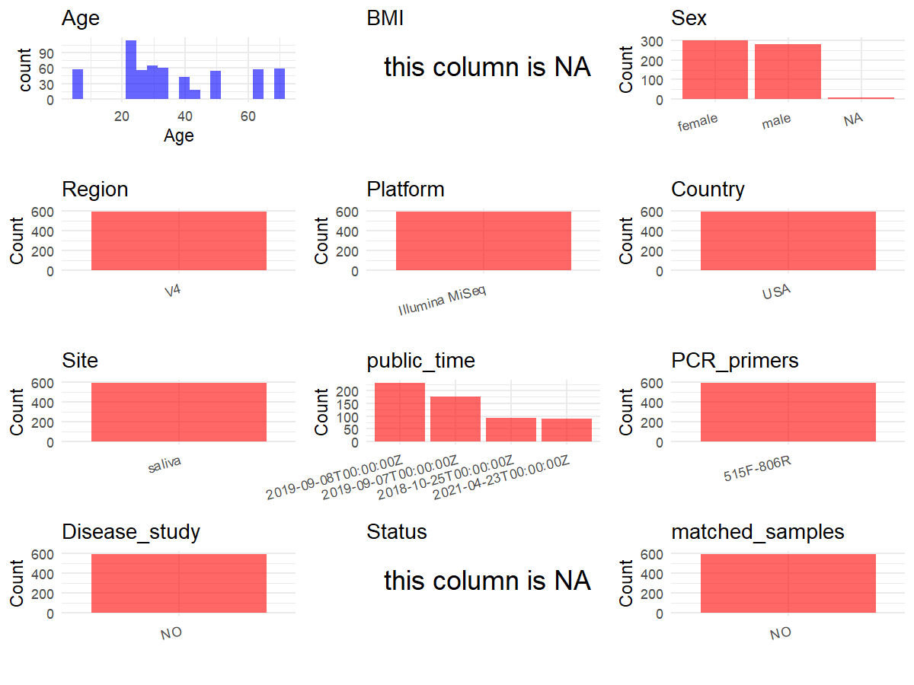

R Notebook: Metadata Processing Workflow
================

# Step 1: Obtain Initial Metadata from Each Project

To obtain the initial metadata: 1. Search for the BioProject ID (e.g.,
“PRJEBXXXX”) on the [NCBI SRA
website](https://www.ncbi.nlm.nih.gov/Traces/study/). 2. In the “Select”
table, click on “Metadata” and download the file. 3. The downloaded file
is typically named “SraRunTable.csv” and contains metadata for the
project.

``` r
# Load necessary libraries
library(dplyr)
library(ggplot2)
library(cowplot)

# Set working directory (update this path to your local directory)
setwd("D:/metadata/PRJEB29169")

# Read the initial metadata files
initial_meta<-read.csv("SraRunTable.csv",header = T)

# Combine the two metadata files
#meta <- rbind(initial_meta, initial_meta1)

#Remove entries non-oral samples
#initial_meta <- subset(initial_meta, Organism == "human oral metagenome")


# Check the number of samples containing "HT" in Sample.Name (e.g., healthy controls)
#nrow(subset(meta, grepl("HT", Sample.Name)))

# Display the first few rows of the metadata
head(initial_meta)
```

    ##          Run Assay.Type AvgSpotLen    Bases BioProject    BioSample   Bytes
    ## 1 ERR2840944      OTHER        150 10548992 PRJEB29169 SAMEA4973213 6451557
    ## 2 ERR2840945      OTHER        150  1145367 PRJEB29169 SAMEA4973214  722634
    ## 3 ERR2840946      OTHER        150  8845464 PRJEB29169 SAMEA4973215 5340267
    ## 4 ERR2840947      OTHER        150  9582428 PRJEB29169 SAMEA4973216 5901661
    ## 5 ERR2840948      OTHER        150  8492254 PRJEB29169 SAMEA4973217 5157999
    ## 6 ERR2840949      OTHER        150  8112082 PRJEB29169 SAMEA4973218 4833359
    ##   center_name..exp.                                        Center.Name
    ## 1            UCSDMI UNIVERSITY OF CALIFORNIA SAN DIEGO MICROBIOME INIT
    ## 2            UCSDMI UNIVERSITY OF CALIFORNIA SAN DIEGO MICROBIOME INIT
    ## 3            UCSDMI UNIVERSITY OF CALIFORNIA SAN DIEGO MICROBIOME INIT
    ## 4            UCSDMI UNIVERSITY OF CALIFORNIA SAN DIEGO MICROBIOME INIT
    ## 5            UCSDMI UNIVERSITY OF CALIFORNIA SAN DIEGO MICROBIOME INIT
    ## 6            UCSDMI UNIVERSITY OF CALIFORNIA SAN DIEGO MICROBIOME INIT
    ##   collection_timestamp Consent DATASTORE.filetype DATASTORE.provider
    ## 1        2018/5/1 9:15  public   fastq,run.zq,sra     ena,gs,ncbi,s3
    ## 2        2018/5/1 9:40  public   fastq,run.zq,sra     ena,gs,ncbi,s3
    ## 3       2018/5/1 12:25  public   fastq,run.zq,sra     ena,gs,ncbi,s3
    ## 4       2018/5/1 13:40  public   fastq,run.zq,sra     ena,gs,ncbi,s3
    ## 5       2018/5/1 16:42  public   fastq,run.zq,sra     ena,gs,ncbi,s3
    ## 6       2018/5/1 18:47  public   fastq,run.zq,sra     ena,gs,ncbi,s3
    ##                           DATASTORE.region dna_extracted elevation
    ## 1 ena,gs.us-east1,ncbi.public,s3.us-east-1          TRUE       193
    ## 2 ena,gs.us-east1,ncbi.public,s3.us-east-1          TRUE       193
    ## 3 ena,gs.us-east1,ncbi.public,s3.us-east-1          TRUE       193
    ## 4 ena,gs.us-east1,ncbi.public,s3.us-east-1          TRUE       193
    ## 5 ena,gs.us-east1,ncbi.public,s3.us-east-1          TRUE       193
    ## 6 ena,gs.us-east1,ncbi.public,s3.us-east-1          TRUE       193
    ##            empo_1 empo_2           empo_3 ENA.FIRST.PUBLIC..run.
    ## 1 Host-associated Animal animal secretion             2018/10/13
    ## 2 Host-associated Animal animal secretion             2018/10/13
    ## 3 Host-associated Animal animal secretion             2018/10/13
    ## 4 Host-associated Animal animal secretion             2018/10/13
    ## 5 Host-associated Animal animal secretion             2018/10/13
    ## 6 Host-associated Animal animal secretion             2018/10/13
    ##   ENA.LAST.UPDATE..run.   env_biome              env_feature env_material
    ## 1            2018/11/16 urban biome human-associated habitat       saliva
    ## 2            2018/11/16 urban biome human-associated habitat       saliva
    ## 3            2018/11/16 urban biome human-associated habitat       saliva
    ## 4            2018/11/16 urban biome human-associated habitat       saliva
    ## 5            2018/11/16 urban biome human-associated habitat       saliva
    ## 6            2018/11/16 urban biome human-associated habitat       saliva
    ##   env_package Experiment  external_id geo_loc_name_country
    ## 1  human-oral ERX2847785 SAMEA4973213                  USA
    ## 2  human-oral ERX2847786 SAMEA4973214                  USA
    ## 3  human-oral ERX2847787 SAMEA4973215                  USA
    ## 4  human-oral ERX2847788 SAMEA4973216                  USA
    ## 5  human-oral ERX2847789 SAMEA4973217                  USA
    ## 6  human-oral ERX2847790 SAMEA4973218                  USA
    ##   geo_loc_name_country_continent        geo_loc_name host_age_units
    ## 1                  North America USA:CA\\, San Diego          years
    ## 2                  North America USA:CA\\, San Diego          years
    ## 3                  North America USA:CA\\, San Diego          years
    ## 4                  North America USA:CA\\, San Diego          years
    ## 5                  North America USA:CA\\, San Diego          years
    ## 6                  North America USA:CA\\, San Diego          years
    ##   host_height_units host_subject_id host_weight_units INSDC_center_name
    ## 1                cm               A                kg            UCSDMI
    ## 2                cm               A                kg            UCSDMI
    ## 3                cm               A                kg            UCSDMI
    ## 4                cm               A                kg            UCSDMI
    ## 5                cm               A                kg            UCSDMI
    ## 6                cm               A                kg            UCSDMI
    ##     INSDC_first_public    INSDC_last_update INSDC_status     Instrument
    ## 1 2018-10-13T17:03:43Z 2018-10-12T17:17:15Z       public Illumina MiSeq
    ## 2 2018-10-13T17:03:43Z 2018-10-12T17:17:15Z       public Illumina MiSeq
    ## 3 2018-10-13T17:03:43Z 2018-10-12T17:17:15Z       public Illumina MiSeq
    ## 4 2018-10-13T17:03:43Z 2018-10-12T17:17:15Z       public Illumina MiSeq
    ## 5 2018-10-13T17:03:43Z 2018-10-12T17:17:15Z       public Illumina MiSeq
    ## 6 2018-10-13T17:03:43Z 2018-10-12T17:17:15Z       public Illumina MiSeq
    ##   LATITUDE Library.Name LibraryLayout LibrarySelection LibrarySource longitude
    ## 1   32.842     11896.A1        SINGLE              PCR   METAGENOMIC  -117.258
    ## 2   32.842     11896.A2        SINGLE              PCR   METAGENOMIC  -117.258
    ## 3   32.842     11896.A3        SINGLE              PCR   METAGENOMIC  -117.258
    ## 4   32.842     11896.A4        SINGLE              PCR   METAGENOMIC  -117.258
    ## 5   32.842     11896.A5        SINGLE              PCR   METAGENOMIC  -117.258
    ## 6   32.842     11896.A6        SINGLE              PCR   METAGENOMIC  -117.258
    ##                Organism physical_specimen_location physical_specimen_remaining
    ## 1 human oral metagenome                       UCSD                        TRUE
    ## 2 human oral metagenome                       UCSD                        TRUE
    ## 3 human oral metagenome                       UCSD                        TRUE
    ## 4 human oral metagenome                       UCSD                       FALSE
    ## 5 human oral metagenome                       UCSD                        TRUE
    ## 6 human oral metagenome                       UCSD                        TRUE
    ##   Platform          ReleaseDate          create_date version  Sample.Name
    ## 1 ILLUMINA 2018-10-25T00:00:00Z 2018-10-27T15:30:00Z       1 SAMEA4973213
    ## 2 ILLUMINA 2018-10-25T00:00:00Z 2018-10-27T15:30:00Z       1 SAMEA4973214
    ## 3 ILLUMINA 2018-10-25T00:00:00Z 2018-10-27T15:30:00Z       1 SAMEA4973215
    ## 4 ILLUMINA 2018-10-25T00:00:00Z 2018-10-27T15:31:00Z       1 SAMEA4973216
    ## 5 ILLUMINA 2018-10-25T00:00:00Z 2018-10-27T15:31:00Z       1 SAMEA4973217
    ## 6 ILLUMINA 2018-10-25T00:00:00Z 2018-10-27T15:31:00Z       1 SAMEA4973218
    ##                Sample_name sample_type   sequencing_meth..exp. SRA.Study
    ## 1 qiita_sid_11896:11896.A1      saliva Sequencing by synthesis ERP111447
    ## 2 qiita_sid_11896:11896.A2      saliva Sequencing by synthesis ERP111447
    ## 3 qiita_sid_11896:11896.A3      saliva Sequencing by synthesis ERP111447
    ## 4 qiita_sid_11896:11896.A4      saliva Sequencing by synthesis ERP111447
    ## 5 qiita_sid_11896:11896.A5      saliva Sequencing by synthesis ERP111447
    ## 6 qiita_sid_11896:11896.A6      saliva Sequencing by synthesis ERP111447
    ##               Submitter_Id     ENA.FIRST.PUBLIC      ENA.LAST.UPDATE
    ## 1 qiita_sid_11896:11896.A1 2018-10-13T17:03:43Z 2018-10-12T17:17:15Z
    ## 2 qiita_sid_11896:11896.A2 2018-10-13T17:03:43Z 2018-10-12T17:17:15Z
    ## 3 qiita_sid_11896:11896.A3 2018-10-13T17:03:43Z 2018-10-12T17:17:15Z
    ## 4 qiita_sid_11896:11896.A4 2018-10-13T17:03:43Z 2018-10-12T17:17:15Z
    ## 5 qiita_sid_11896:11896.A5 2018-10-13T17:03:43Z 2018-10-12T17:17:15Z
    ## 6 qiita_sid_11896:11896.A6 2018-10-13T17:03:43Z 2018-10-12T17:17:15Z
    ##         Scientific_Name host_body_mass_index   host_height Host_Age
    ## 1 human oral metagenome         not provided not collected    25.92
    ## 2 human oral metagenome         not provided not collected    25.92
    ## 3 human oral metagenome         not provided not collected    25.92
    ## 4 human oral metagenome         not provided not collected    25.92
    ## 5 human oral metagenome         not provided not collected    25.92
    ## 6 human oral metagenome         not provided not collected    25.92
    ##    host_body_habitat host_body_product host_body_site host_common_name
    ## 1 UBERON:oral cavity     UBERON:saliva   UBERON:mouth            human
    ## 2 UBERON:oral cavity     UBERON:saliva   UBERON:mouth            human
    ## 3 UBERON:oral cavity     UBERON:saliva   UBERON:mouth            human
    ## 4 UBERON:oral cavity     UBERON:saliva   UBERON:mouth            human
    ## 5 UBERON:oral cavity     UBERON:saliva   UBERON:mouth            human
    ## 6 UBERON:oral cavity     UBERON:saliva   UBERON:mouth            human
    ##   host_scientific_name host_taxid   host_weight  sex timepoint toothbrush_type
    ## 1         Homo sapiens       9606 not collected male         1        electric
    ## 2         Homo sapiens       9606 not collected male         2        electric
    ## 3         Homo sapiens       9606 not collected male         3        electric
    ## 4         Homo sapiens       9606 not collected male         4        electric
    ## 5         Homo sapiens       9606 not collected male         5        electric
    ## 6         Homo sapiens       9606 not collected male         6        electric
    ##   center_project_name..exp. run_date..exp. run_prefix..exp. runid..exp.
    ## 1                                                                      
    ## 2                                                                      
    ## 3                                                                      
    ## 4                                                                      
    ## 5                                                                      
    ## 6                                                                      
    ##   barcode..exp. linker..exp.                                 pcr_primers..exp.
    ## 1  TAGGACGGGAGT           GT FWD:GTGYCAGCMGCCGCGGTAA; REV:GGACTACNVGGGTWTCTAAT
    ## 2  GTTTGGCCACAC           GT FWD:GTGYCAGCMGCCGCGGTAA; REV:GGACTACNVGGGTWTCTAAT
    ## 3  TATATAGTATCC           GT FWD:GTGYCAGCMGCCGCGGTAA; REV:GGACTACNVGGGTWTCTAAT
    ## 4  CATAAGGGAGGC           GT FWD:GTGYCAGCMGCCGCGGTAA; REV:GGACTACNVGGGTWTCTAAT
    ## 5  GTGCAACCAATC           GT FWD:GTGYCAGCMGCCGCGGTAA; REV:GGACTACNVGGGTWTCTAAT
    ## 6  CTCACCTAGGAA           GT FWD:GTGYCAGCMGCCGCGGTAA; REV:GGACTACNVGGGTWTCTAAT
    ##            primer..exp. run_center..exp. target_gene..exp.
    ## 1 GTGTGYCAGCMGCCGCGGTAA           UCSDMI          16S rRNA
    ## 2 GTGTGYCAGCMGCCGCGGTAA           UCSDMI          16S rRNA
    ## 3 GTGTGYCAGCMGCCGCGGTAA           UCSDMI          16S rRNA
    ## 4 GTGTGYCAGCMGCCGCGGTAA           UCSDMI          16S rRNA
    ## 5 GTGTGYCAGCMGCCGCGGTAA           UCSDMI          16S rRNA
    ## 6 GTGTGYCAGCMGCCGCGGTAA           UCSDMI          16S rRNA
    ##   target_subfragment..exp. anonymized_name floss_regularly food host_life_stage
    ## 1                       V4                                                     
    ## 2                       V4                                                     
    ## 3                       V4                                                     
    ## 4                       V4                                                     
    ## 5                       V4                                                     
    ## 6                       V4                                                     
    ##   mouthwash_regularly Participant_ID
    ## 1                                   
    ## 2                                   
    ## 3                                   
    ## 4                                   
    ## 5                                   
    ## 6                                   
    ##   percent_reads_aligning_to_chloroplast_seqeuneces processing
    ## 1                                               NA           
    ## 2                                               NA           
    ## 3                                               NA           
    ## 4                                               NA           
    ## 5                                               NA           
    ## 6                                               NA           
    ##   saliva_flow_rate_ml_per_min saliva_sample_id
    ## 1                          NA                 
    ## 2                          NA                 
    ## 3                          NA                 
    ## 4                          NA                 
    ## 5                          NA                 
    ## 6                          NA                 
    ##   saliva_volume_ml_collected_in_5_min saliva_weight_g
    ## 1                                  NA              NA
    ## 2                                  NA              NA
    ## 3                                  NA              NA
    ## 4                                  NA              NA
    ## 5                                  NA              NA
    ## 6                                  NA              NA
    ##   self_reported_min_brushing fc_avg_cells_5_min fc_avg_cells_per_ul
    ## 1                         NA                 NA                  NA
    ## 2                         NA                 NA                  NA
    ## 3                         NA                 NA                  NA
    ## 4                         NA                 NA                  NA
    ## 5                         NA                 NA                  NA
    ## 6                         NA                 NA                  NA
    ##   fc_cells_per_ul_r1 fc_cells_per_ul_r2 qpcr_median_16s_copies_per_2ul_dna
    ## 1                 NA                 NA                                 NA
    ## 2                 NA                 NA                                 NA
    ## 3                 NA                 NA                                 NA
    ## 4                 NA                 NA                                 NA
    ## 5                 NA                 NA                                 NA
    ## 6                 NA                 NA                                 NA
    ##   sample_plate..exp.      well_description..exp. all_flow_cells_5min_avg_units
    ## 1  Lisa_SMDS_Plate_1 Lisa_SMDS_Plate_1_A1.raw_A1                   cellsin5min
    ## 2  Lisa_SMDS_Plate_1 Lisa_SMDS_Plate_1_A2.raw_B1                   cellsin5min
    ## 3  Lisa_SMDS_Plate_1 Lisa_SMDS_Plate_1_A3.raw_C1                   cellsin5min
    ## 4  Lisa_SMDS_Plate_1 Lisa_SMDS_Plate_1_A4.raw_D1                   cellsin5min
    ## 5  Lisa_SMDS_Plate_1 Lisa_SMDS_Plate_1_A5.raw_E1                   cellsin5min
    ## 6  Lisa_SMDS_Plate_1 Lisa_SMDS_Plate_1_A6.raw_F1                   cellsin5min
    ##   all_flow_cellsperul_avg_units all_qpcr_cells_5min_avg_units
    ## 1            cellspermicroliter                   cellsin5min
    ## 2            cellspermicroliter                   cellsin5min
    ## 3            cellspermicroliter                   cellsin5min
    ## 4            cellspermicroliter                   cellsin5min
    ## 5            cellspermicroliter                   cellsin5min
    ## 6            cellspermicroliter                   cellsin5min
    ##   all_qpcr_cellsperul_avg_units       collection_device
    ## 1            cellspermicroliter funnel into 15mL falcon
    ## 2            cellspermicroliter funnel into 15mL falcon
    ## 3            cellspermicroliter funnel into 15mL falcon
    ## 4            cellspermicroliter funnel into 15mL falcon
    ## 5            cellspermicroliter funnel into 15mL falcon
    ## 6            cellspermicroliter funnel into 15mL falcon
    ##   live_flow_cells_5min_avg_units live_flow_cellsperul_avg_units
    ## 1                   cellsper5min             cellspermicroliter
    ## 2                   cellsper5min             cellspermicroliter
    ## 3                   cellsper5min             cellspermicroliter
    ## 4                   cellsper5min             cellspermicroliter
    ## 5                   cellsper5min             cellspermicroliter
    ## 6                   cellsper5min             cellspermicroliter
    ##   live_qpcr_cells_5min_avg_units live_qpcr_cellsperul_avg_units
    ## 1                    cellsin5min             cellspermicroliter
    ## 2                    cellsin5min             cellspermicroliter
    ## 3                    cellsin5min             cellspermicroliter
    ## 4                    cellsin5min             cellspermicroliter
    ## 5                    cellsin5min             cellspermicroliter
    ## 6                    cellsin5min             cellspermicroliter
    ##              collection_method   life_stage timepoint_units
    ## 1 unstimulated drool 5 minutes not provided       timepoint
    ## 2 unstimulated drool 5 minutes not provided       timepoint
    ## 3 unstimulated drool 5 minutes not provided       timepoint
    ## 4 unstimulated drool 5 minutes not provided       timepoint
    ## 5 unstimulated drool 5 minutes not provided       timepoint
    ## 6 unstimulated drool 5 minutes not provided       timepoint
    ##   all_flow_cells_5min_avg all_flow_cellsperul_avg all_qpcr_cells_5min_avg
    ## 1                22611875                 20556.5              1820798070
    ## 2                 8636316                  7851.0                34584736
    ## 3                 3366582                  1772.0               391609110
    ## 4                 5952161                  4251.5                 8174983
    ## 5                 6330939                  5276.0                94799048
    ## 6                 4668222                  3334.5              2549818404
    ##   all_qpcr_cellsperul_avg live_flow_cells_5min_avg live_flow_cellsperul_avg
    ## 1             1655270.975                 13475607                  12250.5
    ## 2               31440.669                 10747573                   9770.5
    ## 3              206110.058                  3017004                   1588.0
    ## 4                5839.274                  7144704                   5103.5
    ## 5               78999.206                  6744380                   5620.5
    ## 6             1821298.860                  4752993                   3395.0
    ##   live_qpcr_cells_5min_avg live_qpcr_cellsperul_avg food_notes drink_notes
    ## 1                189337568               172125.062                       
    ## 2                  3393210                 3084.736                       
    ## 3                 55262056                29085.293                       
    ## 4                  2397970                 1712.835                       
    ## 5                  8904149                 7420.124                       
    ## 6                 60617233                43298.023                       
    ##   i5_index_id..exp. i7_index_id..exp. index2..exp. index..exp. lane..exp.
    ## 1                                                                      NA
    ## 2                                                                      NA
    ## 3                                                                      NA
    ## 4                                                                      NA
    ## 5                                                                      NA
    ## 6                                                                      NA
    ##   pool..exp. sample_project..exp. sample_sheet..exp. sample_well..exp.
    ## 1                                                                     
    ## 2                                                                     
    ## 3                                                                     
    ## 4                                                                     
    ## 5                                                                     
    ## 6                                                                     
    ##   extraction_robot..exp. extractionkit_lot..exp. linkerprimersequence..exp.
    ## 1        Carmen_HOWE_KF1               157035298      GTGTGYCAGCMGCCGCGGTAA
    ## 2        Carmen_HOWE_KF1               157035298      GTGTGYCAGCMGCCGCGGTAA
    ## 3        Carmen_HOWE_KF1               157035298      GTGTGYCAGCMGCCGCGGTAA
    ## 4        Carmen_HOWE_KF1               157035298      GTGTGYCAGCMGCCGCGGTAA
    ## 5        Carmen_HOWE_KF1               157035298      GTGTGYCAGCMGCCGCGGTAA
    ## 6        Carmen_HOWE_KF1               157035298      GTGTGYCAGCMGCCGCGGTAA
    ##   mastermix_lot..exp. orig_name..exp. plating..exp. primer_date..exp.
    ## 1              533142          A1.raw            LM                NA
    ## 2              533142          A2.raw            LM                NA
    ## 3              533142          A3.raw            LM                NA
    ## 4              533142          A4.raw            LM                NA
    ## 5              533142          A5.raw            LM                NA
    ## 6              533142          A6.raw            LM                NA
    ##   primer_plate..exp. processing_robot..exp. processing_type..exp.
    ## 1                  4                     NA                A1.raw
    ## 2                  4                     NA                A2.raw
    ## 3                  4                     NA                A3.raw
    ## 4                  4                     NA                A4.raw
    ## 5                  4                     NA                A5.raw
    ## 6                  4                     NA                A6.raw
    ##   project_name..exp.
    ## 1          Lisa SMDS
    ## 2          Lisa SMDS
    ## 3          Lisa SMDS
    ## 4          Lisa SMDS
    ## 5          Lisa SMDS
    ## 6          Lisa SMDS

# Step 2: Create a Uniform Metadata Template

The uniform metadata should include the following columns:

1.  **BioProject**: Project ID (e.g., “PRJNA339212”)
2.  **Run**: Sample ID (e.g., “ERRXXXXXX” or “SRRXXXXXX”)
3.  **sample_name**: Original sample name submitted by the authors (not
    the database-assigned ID)
4.  **Age**: Age of the subject (if available)
5.  **BMI**: Body Mass Index (if available)
6.  **Sex**: Sex of the subject (“F” or “M”)
7.  **Region**: Targeted 16S rRNA region (e.g., “V3-V4”)
8.  **Platform**: Sequencing platform (e.g., “Illumina MiSeq”)
9.  **Country**: Country of sample origin (e.g., “China”)
10. **Site**: Sample site (e.g., “saliva”, “dental plaque”)
11. **public_time**: Data release date (format: “YYYY-MM-DD”)
12. **PCR_primers**: PCR primers used (e.g., “515F-806R”)
13. **title**: Title of the associated publication
14. **Disease_study**: Whether the study involves a disease (“YES” or
    “NO”)
15. **Status**: Disease status (e.g., “T2DM”, “HC”). Note: If the study
    includes both disease and healthy samples, this must be specified
    per sample.
16. **matched_samples**: matched samples (“YES” or “NO”)

``` r
# Create a uniform metadata dataframe
metadata <- data.frame(
  BioProject = initial_meta$BioProject,
  Run = initial_meta$Run,
  sample_name = initial_meta$Sample.Name,
  Age = initial_meta$Host_Age,
  BMI = NA,
  Sex= initial_meta$sex,
  Region = "V4",
  Platform = initial_meta$Instrument,
  Country = initial_meta$geo_loc_name_country,
  Site = initial_meta$env_material,
  public_time = initial_meta$ReleaseDate,
  Status = NA,
  stringsAsFactors = FALSE
)
```

# Step 3: Manually Add Information from the Publication

Some information (e.g. PCR primers, study title, disease status) must be
manually extracted from the publication and added to the metadata.

``` r
# Add information obtained from the publication
metadata$PCR_primers <- "515F-806R"
metadata$title <- "Establishing microbial composition measurement standards with reference frames"
metadata$Disease_study <- "NO"
# Assign disease status based on sample_name patterns
#metadata$Status<-"NA"

#extract subject id by remove prefix of sample_name


keep_subjects <- unique(subset(metadata, Site == "saliva")$sample_name)
metadata <- subset(metadata, sample_name %in% keep_subjects)

metadata$matched_samples <- "NO"
```

# Step 4: Summarize and Validate the Metadata

``` r
# Check the number of unique runs and sample names
print(paste("Number of unique runs:", length(unique(metadata$Run))))
```

    ## [1] "Number of unique runs: 590"

``` r
print(paste("Number of unique sample names:", length(unique(metadata$sample_name))))
```

    ## [1] "Number of unique sample names: 270"

# Step 5: Visualize the Metadata

``` r

```

<!-- -->

# Step 6: Finalize and Export the Metadata

``` r
# Reorder columns to match the desired format
metadata <- metadata[, c(
  "BioProject", "Run", "sample_name", "Age", "BMI", "Sex", 
  "Region", "Platform", "Country", "Site", "public_time", 
  "PCR_primers", "title", "Disease_study", "Status","matched_samples"
)]

# Export the uniform metadata to a CSV file
write.csv(metadata, file = "metadata.csv", quote = TRUE)
head(metadata)
```

    ##   BioProject        Run  sample_name   Age BMI  Sex Region       Platform
    ## 1 PRJEB29169 ERR2840944 SAMEA4973213 25.92  NA male     V4 Illumina MiSeq
    ## 2 PRJEB29169 ERR2840945 SAMEA4973214 25.92  NA male     V4 Illumina MiSeq
    ## 3 PRJEB29169 ERR2840946 SAMEA4973215 25.92  NA male     V4 Illumina MiSeq
    ## 4 PRJEB29169 ERR2840947 SAMEA4973216 25.92  NA male     V4 Illumina MiSeq
    ## 5 PRJEB29169 ERR2840948 SAMEA4973217 25.92  NA male     V4 Illumina MiSeq
    ## 6 PRJEB29169 ERR2840949 SAMEA4973218 25.92  NA male     V4 Illumina MiSeq
    ##   Country   Site          public_time PCR_primers
    ## 1     USA saliva 2018-10-25T00:00:00Z   515F-806R
    ## 2     USA saliva 2018-10-25T00:00:00Z   515F-806R
    ## 3     USA saliva 2018-10-25T00:00:00Z   515F-806R
    ## 4     USA saliva 2018-10-25T00:00:00Z   515F-806R
    ## 5     USA saliva 2018-10-25T00:00:00Z   515F-806R
    ## 6     USA saliva 2018-10-25T00:00:00Z   515F-806R
    ##                                                                            title
    ## 1 Establishing microbial composition measurement standards with reference frames
    ## 2 Establishing microbial composition measurement standards with reference frames
    ## 3 Establishing microbial composition measurement standards with reference frames
    ## 4 Establishing microbial composition measurement standards with reference frames
    ## 5 Establishing microbial composition measurement standards with reference frames
    ## 6 Establishing microbial composition measurement standards with reference frames
    ##   Disease_study Status matched_samples
    ## 1            NO     NA              NO
    ## 2            NO     NA              NO
    ## 3            NO     NA              NO
    ## 4            NO     NA              NO
    ## 5            NO     NA              NO
    ## 6            NO     NA              NO

## Notes for Students:

1.  **Metadata Accuracy**: Always cross-check the metadata with the
    original publication to ensure accuracy.
2.  **Manual Entries**: Columns like `PCR_primers`, and `Status` often
    require manual entry based on the publication.
3.  **Disease Status**: Be careful when assigning `Status`—some studies
    include both disease and healthy samples.
4.  **Visualization**: The plots help quickly identify the distribution
    of values in each column, which is useful for quality control.
5.  **Reproducibility**: Update the working directory and file paths to
    match your local environment.
