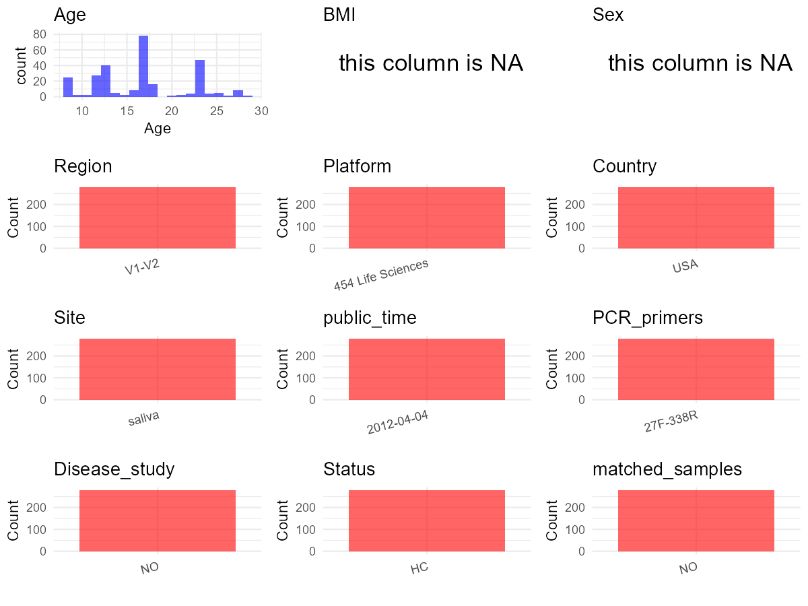

# Step 1: Obtain Initial Metadata from Each Project

To obtain the initial metadata: 1. Search for the BioProject ID (e.g.,
“PRJEBXXXX”) on the [NCBI SRA
website](https://www.ncbi.nlm.nih.gov/Traces/study/). 2. In the “Select”
table, click on “Metadata” and download the file. 3. The downloaded file
is typically named “SraRunTable.csv” and contains metadata for the
project.

    library(tidyverse)
    library(ggplot2)
    library(cowplot)

    setwd("C:/Users/zyc/Desktop/oral_project/data/projects/PRJEB2961")
    initial_meta <- read.csv("SraRunTable.csv", header = TRUE) 
    head(initial_meta)

    ##         Run age_in_years AGE age_unit altitude Assay.Type assigned_from_geo AvgSpotLen  Bases biological_specimen BioProject    BioSample
    ## 1 ERR106943           11  11    years        0   AMPLICON                 y        332 484394              saliva  PRJEB2961 SAMEA1096066
    ## 2 ERR106944           12  12    years        0   AMPLICON                 y        335 622704              saliva  PRJEB2961 SAMEA1096084
    ## 3 ERR106945           17  17    years        0   AMPLICON                 y        335 430585              saliva  PRJEB2961 SAMEA1096184
    ## 4 ERR106946           17  17    years        0   AMPLICON                 y        333 573975              saliva  PRJEB2961 SAMEA1096156
    ## 5 ERR106947           27  27    years        0   AMPLICON                 y        334 680380              saliva  PRJEB2961 SAMEA1096139
    ## 6 ERR106948           17  17    years        0   AMPLICON                 y        333 907919              saliva  PRJEB2961 SAMEA1096215
    ##         body_habitat  body_product    body_site  Bytes   Center.Name           common_name Consent DATASTORE.filetype DATASTORE.provider
    ## 1 UBERON:oral cavity UBERON:saliva UBERON:mouth 296734 CCME-COLORADO human oral metagenome  public   fastq,run.zq,sra     ena,gs,ncbi,s3
    ## 2 UBERON:oral cavity UBERON:saliva UBERON:mouth 373843 CCME-COLORADO human oral metagenome  public   fastq,run.zq,sra     ena,gs,ncbi,s3
    ## 3 UBERON:oral cavity UBERON:saliva UBERON:mouth 267540 CCME-COLORADO human oral metagenome  public   fastq,run.zq,sra     ena,gs,ncbi,s3
    ## 4 UBERON:oral cavity UBERON:saliva UBERON:mouth 342982 CCME-COLORADO human oral metagenome  public   fastq,run.zq,sra     ena,gs,ncbi,s3
    ## 5 UBERON:oral cavity UBERON:saliva UBERON:mouth 412540 CCME-COLORADO human oral metagenome  public   fastq,run.zq,sra     ena,gs,ncbi,s3
    ## 6 UBERON:oral cavity UBERON:saliva UBERON:mouth 525999 CCME-COLORADO human oral metagenome  public   fastq,run.zq,sra     ena,gs,ncbi,s3
    ##                           DATASTORE.region Depth elevation ENA.FIRST.PUBLIC..run. ena_first_public ENA.LAST.UPDATE..run. ena_last_update
    ## 1 ena,gs.us-east1,ncbi.public,s3.us-east-1     0      1624             2012-04-04       2012-04-04            2018-11-16      2013-11-04
    ## 2 ena,gs.us-east1,ncbi.public,s3.us-east-1     0      1624             2012-04-04       2012-04-04            2018-11-16      2013-11-04
    ## 3 ena,gs.us-east1,ncbi.public,s3.us-east-1     0      1624             2012-04-04       2012-04-04            2018-11-16      2013-11-04
    ## 4 ena,gs.us-east1,ncbi.public,s3.us-east-1     0      1624             2012-04-04       2012-04-04            2018-11-16      2013-11-04
    ## 5 ena,gs.us-east1,ncbi.public,s3.us-east-1     0      1624             2012-04-04       2012-04-04            2018-11-16      2013-11-04
    ## 6 ena,gs.us-east1,ncbi.public,s3.us-east-1     0      1624             2012-04-04       2012-04-04            2018-11-16      2013-11-04
    ##                       env_biome                   env_feature  env_matter           experiment_center..exp. Experiment
    ## 1 ENVO:human-associated habitat ENVO:human-associated habitat ENVO:saliva University of Colorado at Boulder  ERX084377
    ## 2 ENVO:human-associated habitat ENVO:human-associated habitat ENVO:saliva University of Colorado at Boulder  ERX084378
    ## 3 ENVO:human-associated habitat ENVO:human-associated habitat ENVO:saliva University of Colorado at Boulder  ERX084379
    ## 4 ENVO:human-associated habitat ENVO:human-associated habitat ENVO:saliva University of Colorado at Boulder  ERX084380
    ## 5 ENVO:human-associated habitat ENVO:human-associated habitat ENVO:saliva University of Colorado at Boulder  ERX084381
    ## 6 ENVO:human-associated habitat ENVO:human-associated habitat ENVO:saliva University of Colorado at Boulder  ERX084382
    ##            experiment_title..exp.  external_id geo_loc_name_country geo_loc_name_country_continent geographic_location_.country_and.or_sea.
    ## 1 stahringer_colorado_twin_saliva SAMEA1096066                  USA                  North America                                 USA: GAZ
    ## 2 stahringer_colorado_twin_saliva SAMEA1096084                  USA                  North America                                 USA: GAZ
    ## 3 stahringer_colorado_twin_saliva SAMEA1096184                  USA                  North America                                 USA: GAZ
    ## 4 stahringer_colorado_twin_saliva SAMEA1096156                  USA                  North America                                 USA: GAZ
    ## 5 stahringer_colorado_twin_saliva SAMEA1096139                  USA                  North America                                 USA: GAZ
    ## 6 stahringer_colorado_twin_saliva SAMEA1096215                  USA                  North America                                 USA: GAZ
    ##   host_common_name host_taxid INSDC_center_alias                                                          INSDC_center_name
    ## 1            human       9606      CCME-COLORADO Colorado Center for Microbial Ecology\\, University of Colorado at Boulder
    ## 2            human       9606      CCME-COLORADO Colorado Center for Microbial Ecology\\, University of Colorado at Boulder
    ## 3            human       9606      CCME-COLORADO Colorado Center for Microbial Ecology\\, University of Colorado at Boulder
    ## 4            human       9606      CCME-COLORADO Colorado Center for Microbial Ecology\\, University of Colorado at Boulder
    ## 5            human       9606      CCME-COLORADO Colorado Center for Microbial Ecology\\, University of Colorado at Boulder
    ## 6            human       9606      CCME-COLORADO Colorado Center for Microbial Ecology\\, University of Colorado at Boulder
    ##     INSDC_first_public    INSDC_last_update INSDC_status  Instrument key_seq..exp. LATITUDE Library.Name library_selection..exp.
    ## 1 2012-04-04T16:47:42Z 2013-11-04T20:05:50Z       public unspecified          TCAG    40.01     S00329:1        16S specific PCR
    ## 2 2012-04-04T16:47:44Z 2013-11-04T20:05:50Z       public unspecified          TCAG    40.01    S00305:47        16S specific PCR
    ## 3 2012-04-04T16:47:44Z 2013-11-04T20:05:50Z       public unspecified          TCAG    40.01   S09097:137        16S specific PCR
    ## 4 2012-04-04T16:47:44Z 2013-11-04T20:05:50Z       public unspecified          TCAG    40.01   S08885:128        16S specific PCR
    ## 5 2012-04-04T16:47:44Z 2013-11-04T20:05:50Z       public unspecified          TCAG    40.01      s.6:275        16S specific PCR
    ## 6 2012-04-04T16:47:45Z 2013-11-04T20:05:50Z       public unspecified          TCAG    40.01   S13366:184        16S specific PCR
    ##   LibraryLayout LibrarySelection LibrarySource longitude              Organism
    ## 1        SINGLE              PCR   METAGENOMIC   -105.27 human oral metagenome
    ## 2        SINGLE              PCR   METAGENOMIC   -105.27 human oral metagenome
    ## 3        SINGLE              PCR   METAGENOMIC   -105.27 human oral metagenome
    ## 4        SINGLE              PCR   METAGENOMIC   -105.27 human oral metagenome
    ## 5        SINGLE              PCR   METAGENOMIC   -105.27 human oral metagenome
    ## 6        SINGLE              PCR   METAGENOMIC   -105.27 human oral metagenome
    ##                                                                                                                             pcr_cond..exp.
    ## 1 initial denaturation:94degC_5min;denaturation:94degC_45sec;annealing:50degC_30sec;elongation:72degC_90sec;final elongation:72degC_1.5min
    ## 2 initial denaturation:94degC_5min;denaturation:94degC_45sec;annealing:50degC_30sec;elongation:72degC_90sec;final elongation:72degC_1.5min
    ## 3 initial denaturation:94degC_5min;denaturation:94degC_45sec;annealing:50degC_30sec;elongation:72degC_90sec;final elongation:72degC_1.5min
    ## 4 initial denaturation:94degC_5min;denaturation:94degC_45sec;annealing:50degC_30sec;elongation:72degC_90sec;final elongation:72degC_1.5min
    ## 5 initial denaturation:94degC_5min;denaturation:94degC_45sec;annealing:50degC_30sec;elongation:72degC_90sec;final elongation:72degC_1.5min
    ## 6 initial denaturation:94degC_5min;denaturation:94degC_45sec;annealing:50degC_30sec;elongation:72degC_90sec;final elongation:72degC_1.5min
    ##                                                       pcr_primers..exp. platform..exp. Platform public region..exp.          ReleaseDate
    ## 1 FWD:GCCTTGCCAGCCCGCTCAGTCAGAGTTTGATCCTGGCTCAG;REV:TGCTGCCTCCCGTAGGAGT       Titanium    LS454      y            0 2012-04-27T00:00:00Z
    ## 2 FWD:GCCTTGCCAGCCCGCTCAGTCAGAGTTTGATCCTGGCTCAG;REV:TGCTGCCTCCCGTAGGAGT       Titanium    LS454      y            0 2012-04-27T00:00:00Z
    ## 3 FWD:GCCTTGCCAGCCCGCTCAGTCAGAGTTTGATCCTGGCTCAG;REV:TGCTGCCTCCCGTAGGAGT       Titanium    LS454      y            0 2012-04-27T00:00:00Z
    ## 4 FWD:GCCTTGCCAGCCCGCTCAGTCAGAGTTTGATCCTGGCTCAG;REV:TGCTGCCTCCCGTAGGAGT       Titanium    LS454      y            0 2012-04-27T00:00:00Z
    ## 5 FWD:GCCTTGCCAGCCCGCTCAGTCAGAGTTTGATCCTGGCTCAG;REV:TGCTGCCTCCCGTAGGAGT       Titanium    LS454      y            0 2012-04-27T00:00:00Z
    ## 6 FWD:GCCTTGCCAGCCCGCTCAGTCAGAGTTTGATCCTGGCTCAG;REV:TGCTGCCTCCCGTAGGAGT       Titanium    LS454      y            0 2012-04-27T00:00:00Z
    ##   row_number..exp. run_center..exp. run_date..exp.          create_date version samp_size               sample_center..exp. sample_id
    ## 1                1        MSKCC, NY           2010 2012-09-05T18:43:00Z       2    .1\\,g University of Colorado at Boulder    380416
    ## 2               47        MSKCC, NY           2010 2012-09-05T18:44:00Z       2    .1\\,g University of Colorado at Boulder    380417
    ## 3              137        MSKCC, NY           2010 2012-09-05T18:44:00Z       2    .1\\,g University of Colorado at Boulder    380418
    ## 4              128        MSKCC, NY           2010 2012-09-05T18:44:00Z       2    .1\\,g University of Colorado at Boulder    380419
    ## 5              275        MSKCC, NY           2010 2012-09-05T18:44:00Z       2    .1\\,g University of Colorado at Boulder    380420
    ## 6              184        MSKCC, NY           2010 2012-09-05T18:45:00Z       2    .1\\,g University of Colorado at Boulder    380421
    ##    Sample.Name                    sample_name sequencing_meth..exp. SRA.Study                study_center..exp.            Submitter_Id
    ## 1 SAMEA1096066 S00329,qiime_study_1026:S00329        pyrosequencing ERP001346 University of Colorado at Boulder qiime_study_1026:S00329
    ## 2 SAMEA1096084 S00305,qiime_study_1026:S00305        pyrosequencing ERP001346 University of Colorado at Boulder qiime_study_1026:S00305
    ## 3 SAMEA1096184 S09097,qiime_study_1026:S09097        pyrosequencing ERP001346 University of Colorado at Boulder qiime_study_1026:S09097
    ## 4 SAMEA1096156 S08885,qiime_study_1026:S08885        pyrosequencing ERP001346 University of Colorado at Boulder qiime_study_1026:S08885
    ## 5 SAMEA1096139       s.6,qiime_study_1026:s.6        pyrosequencing ERP001346 University of Colorado at Boulder    qiime_study_1026:s.6
    ## 6 SAMEA1096215 S13366,qiime_study_1026:S13366        pyrosequencing ERP001346 University of Colorado at Boulder qiime_study_1026:S13366
    ##   target_gene..exp. target_subfragment..exp. taxon_id
    ## 1          16S rRNA                       V2   447426
    ## 2          16S rRNA                       V2   447426
    ## 3          16S rRNA                       V2   447426
    ## 4          16S rRNA                       V2   447426
    ## 5          16S rRNA                       V2   447426
    ## 6          16S rRNA                       V2   447426
    ##                                                                                                                   experiment_design_description..exp.
    ## 1 Saliva samples were collected for genotyping study. Community DNA was extracted, prepared and used for 16S rRNA pyrosequencing (454 Life Sciences).
    ## 2 Saliva samples were collected for genotyping study. Community DNA was extracted, prepared and used for 16S rRNA pyrosequencing (454 Life Sciences).
    ## 3 Saliva samples were collected for genotyping study. Community DNA was extracted, prepared and used for 16S rRNA pyrosequencing (454 Life Sciences).
    ## 4 Saliva samples were collected for genotyping study. Community DNA was extracted, prepared and used for 16S rRNA pyrosequencing (454 Life Sciences).
    ## 5 Saliva samples were collected for genotyping study. Community DNA was extracted, prepared and used for 16S rRNA pyrosequencing (454 Life Sciences).
    ## 6 Saliva samples were collected for genotyping study. Community DNA was extracted, prepared and used for 16S rRNA pyrosequencing (454 Life Sciences).

# Step 2: Create a Uniform Metadata Template

The uniform metadata should include the following columns:

1.  **BioProject**: Project ID (e.g., “PRJNA339212”)
2.  **Run**: Sample ID (e.g., “ERRXXXXXX” or “SRRXXXXXX”)
3.  **sample\_name**: Original sample name submitted by the authors (not
    the database-assigned ID)
4.  **Age**: Age of the subject (if available)
5.  **BMI**: Body Mass Index (if available)
6.  **Sex**: Sex of the subject (“F” or “M”)
7.  **Region**: Targeted 16S rRNA region (e.g., “V3-V4”)
8.  **Platform**: Sequencing platform (e.g., “Illumina MiSeq”)
9.  **Country**: Country of sample origin (e.g., “China”)
10. **Site**: Sample site (e.g., “saliva”, “dental plaque”)
11. **public\_time**: Data release date (format: “YYYY-MM-DD”)
12. **PCR\_primers**: PCR primers used (e.g., “515F-806R”)
13. **title**: Title of the associated publication
14. **Disease\_study**: Whether the study involves a disease (“YES” or
    “NO”)
15. **Status**: Disease status (e.g., “T2DM”, “HC”). Note: If the study
    includes both disease and healthy samples, this must be specified
    per sample.
16. **matched\_samples**: matched samples (“YES” or “NO”)

<!-- -->

    metadata <- data.frame(
      BioProject = initial_meta$BioProject,
      Run = initial_meta$Run,
      sample_name = initial_meta$sample_name,
      Age = initial_meta$age_in_years, 
      BMI = NA,  
      Sex = NA,
      Platform = initial_meta$experiment_design_description..exp.,
      Country = initial_meta$geo_loc_name_country,
      Site = initial_meta$biological_specimen,
      public_time = initial_meta$ena_first_public,
      # Status = initial_meta$Host_disease,
      stringsAsFactors = FALSE
    )

# Step 3: Manually Add Information from the Publication

Some information (e.g. PCR primers, study title, disease status) must be
manually extracted from the publication and added to the metadata.

    # metadata <- metadata %>% mutate(Site = case_when(
    #   grepl("Supragingival dental plaque",Site) ~ "Supragingival dental plaque",
    #   TRUE ~ Site
    # ))
    metadata <- metadata %>% mutate(Platform = case_when(
      grepl("454 Life Sciences",Platform) ~ "454 Life Sciences",
      TRUE ~ "454 Life Sciences"
    ))
    # metadata <- metadata %>%mutate(Status = case_when(
    #   Status == "Oral Neoplasm (Healthy Control)" ~ "HC",
    #   Status == "Oral Neoplasm (OSCC)" ~ "OSCC",
    #   TRUE ~ "Precancer"
    # ))
    # metadata <- metadata %>%
    #   mutate(Sex = recode(Sex, "female" = "F", "male" = "M"))
    # metadata <-metadata%>%
    #   mutate(Country = case_when(Country == "Taiwan" ~ "China"))

    metadata$Status <- "HC"
    metadata$matched_samples <- "NO"
    metadata$Region <- "V1-V2"
    metadata$title <- "Nurture trumps nature in a longitudinal survey of salivary bacterial communities in twins from early adolescence to early adulthood"
    metadata$Disease_study <- "NO"
    metadata$PCR_primers <- "27F-338R"

    head(metadata)

    ##   BioProject       Run                    sample_name Age BMI Sex          Platform Country   Site public_time Status matched_samples Region
    ## 1  PRJEB2961 ERR106943 S00329,qiime_study_1026:S00329  11  NA  NA 454 Life Sciences     USA saliva  2012-04-04     HC              NO  V1-V2
    ## 2  PRJEB2961 ERR106944 S00305,qiime_study_1026:S00305  12  NA  NA 454 Life Sciences     USA saliva  2012-04-04     HC              NO  V1-V2
    ## 3  PRJEB2961 ERR106945 S09097,qiime_study_1026:S09097  17  NA  NA 454 Life Sciences     USA saliva  2012-04-04     HC              NO  V1-V2
    ## 4  PRJEB2961 ERR106946 S08885,qiime_study_1026:S08885  17  NA  NA 454 Life Sciences     USA saliva  2012-04-04     HC              NO  V1-V2
    ## 5  PRJEB2961 ERR106947       s.6,qiime_study_1026:s.6  27  NA  NA 454 Life Sciences     USA saliva  2012-04-04     HC              NO  V1-V2
    ## 6  PRJEB2961 ERR106948 S13366,qiime_study_1026:S13366  17  NA  NA 454 Life Sciences     USA saliva  2012-04-04     HC              NO  V1-V2
    ##                                                                                                                                 title
    ## 1 Nurture trumps nature in a longitudinal survey of salivary bacterial communities in twins from early adolescence to early adulthood
    ## 2 Nurture trumps nature in a longitudinal survey of salivary bacterial communities in twins from early adolescence to early adulthood
    ## 3 Nurture trumps nature in a longitudinal survey of salivary bacterial communities in twins from early adolescence to early adulthood
    ## 4 Nurture trumps nature in a longitudinal survey of salivary bacterial communities in twins from early adolescence to early adulthood
    ## 5 Nurture trumps nature in a longitudinal survey of salivary bacterial communities in twins from early adolescence to early adulthood
    ## 6 Nurture trumps nature in a longitudinal survey of salivary bacterial communities in twins from early adolescence to early adulthood
    ##   Disease_study PCR_primers
    ## 1            NO    27F-338R
    ## 2            NO    27F-338R
    ## 3            NO    27F-338R
    ## 4            NO    27F-338R
    ## 5            NO    27F-338R
    ## 6            NO    27F-338R

# Step 4: Summarize and Validate the Metadata

    print(paste("Number of unique runs:", length(unique(metadata$Run))))

    ## [1] "Number of unique runs: 278"

    print(paste("Number of unique sample names:", length(unique(metadata$sample_name))))

    ## [1] "Number of unique sample names: 278"

# Step 5: Visualize the Metadata

    plot_data <- metadata %>%
      select(-BioProject, -Run, -sample_name, -title)

    # Function to create simple plots for each column
    create_simple_plots <- function(data) {
      plots <- list()
      
      for (col in colnames(data)) {
        # Check if the column is all NA
        if (all(is.na(data[[col]]))) {
          # Create an empty plot with text indicating all NA
          p <- ggplot() +
            annotate("text", x = 0.5, y = 0.5, label = "this column is NA", size = 6) +
            labs(title = col) +
            theme_void()
        } else if (is.numeric(data[[col]])) {
          # Numeric variable: histogram
          p <- ggplot(data, aes(x = .data[[col]])) +
            geom_histogram(fill = "blue", alpha = 0.6, bins = 20, na.rm = TRUE) +
            labs(title = col) +
            theme_minimal()
        } else {
          # Categorical variable: bar plot (remove NA values)
          count_data <- as.data.frame(table(data[[col]], useNA = "ifany"))
          p <- ggplot(count_data, aes(x = reorder(Var1, -Freq), y = Freq)) +
            geom_col(fill = "red", alpha = 0.6) +
            labs(title = col, x = NULL, y = "Count") +
            theme_minimal() +
            theme(axis.text.x = element_text(angle = 15, hjust = 1))
        }
        plots[[col]] <- p
      }
      
      return(plots)
    }

    plots <- create_simple_plots(plot_data)
    p<-plot_grid(plots$Age, 
              plots$BMI, 
              plots$Sex, 
              plots$Region, 
              plots$Platform, 
              plots$Country, 
              plots$Site,
              plots$public_time, 
              plots$PCR_primers,
              plots$Disease_study,
              plots$Status,
              plots$matched_samples,# add 
              ncol = 3, align = "hv", axis = "lb")
    ggsave("Metadata_Summary.png", plot = p, width = 8, height = 6, dpi = 150)

    

 \# Step 6: Finalize and Export the Metadata

    metadata <- metadata[, c(
      "BioProject", "Run", "sample_name", "Age", "BMI", "Sex", 
      "Region", "Platform", "Country", "Site", "public_time", 
      "PCR_primers", "title", "Disease_study", "Status","matched_samples"
    )]

    write.csv(metadata, file = "metadata.csv", quote = TRUE)
