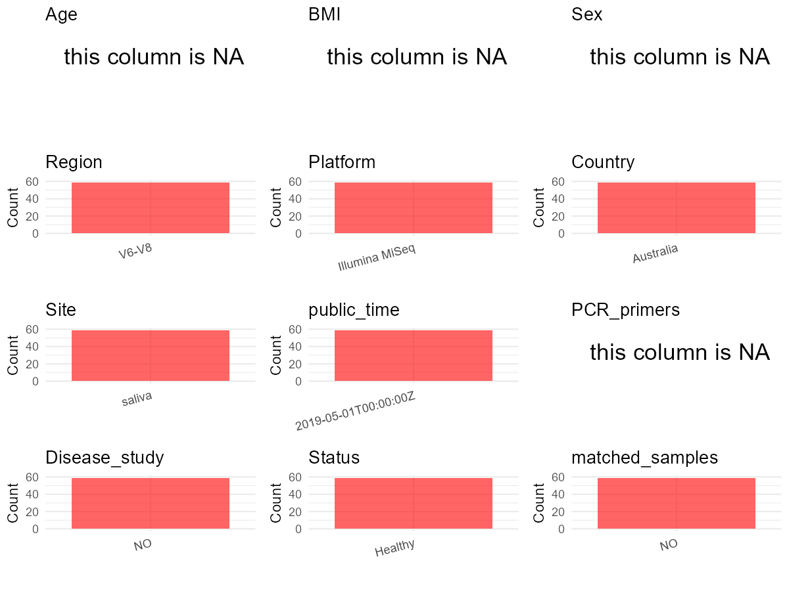

R Notebook: Metadata Processing Workflow
================

# Step 1: Obtain Initial Metadata from Each Project

To obtain the initial metadata: 1. Search for the BioProject ID (e.g.,
“PRJEBXXXX”) on the [NCBI SRA
website](https://www.ncbi.nlm.nih.gov/Traces/study/). 2. In the “Select”
table, click on “Metadata” and download the file. 3. The downloaded file
is typically named “SraRunTable.csv” and contains metadata for the
project.

``` r
# Load necessary libraries
library(dplyr)
library(ggplot2)
library(cowplot)

# Set working directory (update this path to your local directory)
setwd("D:/oral_project/PRJEB29801")

# Read the initial metadata files
initial_meta<-read.csv("SraRunTable.csv",header = T)

# Combine the two metadata files
#meta <- rbind(initial_meta, initial_meta1)

#Remove entries where Organism is "gut metagenome" (non-oral samples)
#initial_meta <- subset(initial_meta,isolation_source!= "feces")

# Check the number of samples containing "HT" in Sample.Name (e.g., healthy controls)
#nrow(subset(meta, grepl("HT", Sample.Name)))

# Display the first few rows of the metadata
head(initial_meta)
```

    ##          Run Assay.Type BioProject    BioSample
    ## 1 ERR2930086   AMPLICON PRJEB29801 SAMEA5099642
    ## 2 ERR2930087   AMPLICON PRJEB29801 SAMEA5099643
    ## 3 ERR2930088   AMPLICON PRJEB29801 SAMEA5099644
    ## 4 ERR2930089   AMPLICON PRJEB29801 SAMEA5099645
    ## 5 ERR2930090   AMPLICON PRJEB29801 SAMEA5099646
    ## 6 ERR2930091   AMPLICON PRJEB29801 SAMEA5099647
    ##                                Center.Name Collection_Date
    ## 1 FACULTY OF MEDICINE DIAMANTINA INSTITUTE         2015-11
    ## 2 FACULTY OF MEDICINE DIAMANTINA INSTITUTE         2015-11
    ## 3 FACULTY OF MEDICINE DIAMANTINA INSTITUTE         2015-11
    ## 4 FACULTY OF MEDICINE DIAMANTINA INSTITUTE         2015-11
    ## 5 FACULTY OF MEDICINE DIAMANTINA INSTITUTE         2015-11
    ## 6 FACULTY OF MEDICINE DIAMANTINA INSTITUTE         2015-11
    ##             common_name Consent ENA.FIRST.PUBLIC..run.     ENA.FIRST.PUBLIC
    ## 1 human oral metagenome  public             2019-04-29 2019-04-29T04:03:57Z
    ## 2 human oral metagenome  public             2019-04-29 2019-04-29T04:03:57Z
    ## 3 human oral metagenome  public             2019-04-29 2019-04-29T04:03:57Z
    ## 4 human oral metagenome  public             2019-04-29 2019-04-29T04:03:57Z
    ## 5 human oral metagenome  public             2019-04-29 2019-04-29T04:03:57Z
    ## 6 human oral metagenome  public             2019-04-29 2019-04-29T04:03:57Z
    ##   ENA.LAST.UPDATE..run.      ENA.LAST.UPDATE environment_.biome.
    ## 1            2018-11-28 2018-11-22T10:14:03Z              saliva
    ## 2            2018-11-28 2018-11-22T10:14:03Z              saliva
    ## 3            2018-11-26 2018-11-22T10:14:03Z              saliva
    ## 4            2018-11-26 2018-11-22T10:14:03Z              saliva
    ## 5            2018-11-28 2018-11-22T10:14:03Z              saliva
    ## 6            2018-11-28 2018-11-22T10:14:03Z              saliva
    ##   environment_.feature. environment_.material. Experiment  external_id
    ## 1                  Oral                 saliva ERX2932973 SAMEA5099642
    ## 2                  Oral                 saliva ERX2932974 SAMEA5099643
    ## 3                  Oral                 saliva ERX2932975 SAMEA5099644
    ## 4                  Oral                 saliva ERX2932976 SAMEA5099645
    ## 5                  Oral                 saliva ERX2932977 SAMEA5099646
    ## 6                  Oral                 saliva ERX2932978 SAMEA5099647
    ##   geo_loc_name_country geo_loc_name_country_continent
    ## 1            Australia                        Oceania
    ## 2            Australia                        Oceania
    ## 3            Australia                        Oceania
    ## 4            Australia                        Oceania
    ## 5            Australia                        Oceania
    ## 6            Australia                        Oceania
    ##   geographic_location_.country_and.or_sea. geographic_location_.latitude.
    ## 1                                Australia      25.2744° S\\, 133.7751° E
    ## 2                                Australia      25.2744° S\\, 133.7751° E
    ## 3                                Australia      25.2744° S\\, 133.7751° E
    ## 4                                Australia      25.2744° S\\, 133.7751° E
    ## 5                                Australia      25.2744° S\\, 133.7751° E
    ## 6                                Australia      25.2744° S\\, 133.7751° E
    ##   geographic_location_.longitude. human_oral_environmental_package
    ## 1       25.2744° S\\, 133.7751° E                       human-oral
    ## 2       25.2744° S\\, 133.7751° E                       human-oral
    ## 3       25.2744° S\\, 133.7751° E                       human-oral
    ## 4       25.2744° S\\, 133.7751° E                       human-oral
    ## 5       25.2744° S\\, 133.7751° E                       human-oral
    ## 6       25.2744° S\\, 133.7751° E                       human-oral
    ##                          INSDC_center_name   INSDC_first_public
    ## 1 Faculty of Medicine Diamantina Institute 2019-04-29T04:03:57Z
    ## 2 Faculty of Medicine Diamantina Institute 2019-04-29T04:03:57Z
    ## 3 Faculty of Medicine Diamantina Institute 2019-04-29T04:03:57Z
    ## 4 Faculty of Medicine Diamantina Institute 2019-04-29T04:03:57Z
    ## 5 Faculty of Medicine Diamantina Institute 2019-04-29T04:03:57Z
    ## 6 Faculty of Medicine Diamantina Institute 2019-04-29T04:03:57Z
    ##      INSDC_last_update INSDC_status     Instrument investigation_type
    ## 1 2018-11-22T10:14:03Z       public Illumina MiSeq         metagenome
    ## 2 2018-11-22T10:14:03Z       public Illumina MiSeq         metagenome
    ## 3 2018-11-22T10:14:03Z       public Illumina MiSeq         metagenome
    ## 4 2018-11-22T10:14:03Z       public Illumina MiSeq         metagenome
    ## 5 2018-11-22T10:14:03Z       public Illumina MiSeq         metagenome
    ## 6 2018-11-22T10:14:03Z       public Illumina MiSeq         metagenome
    ##                           Library.Name LibraryLayout LibrarySelection
    ## 1 16SrRNAgene-seqofhumanoralmicrobiome        PAIRED              PCR
    ## 2 16SrRNAgene-seqofhumanoralmicrobiome        PAIRED              PCR
    ## 3 16SrRNAgene-seqofhumanoralmicrobiome        PAIRED              PCR
    ## 4 16SrRNAgene-seqofhumanoralmicrobiome        PAIRED              PCR
    ## 5 16SrRNAgene-seqofhumanoralmicrobiome        PAIRED              PCR
    ## 6 16SrRNAgene-seqofhumanoralmicrobiome        PAIRED              PCR
    ##   LibrarySource              Organism Platform
    ## 1   METAGENOMIC human oral metagenome ILLUMINA
    ## 2   METAGENOMIC human oral metagenome ILLUMINA
    ## 3   METAGENOMIC human oral metagenome ILLUMINA
    ## 4   METAGENOMIC human oral metagenome ILLUMINA
    ## 5   METAGENOMIC human oral metagenome ILLUMINA
    ## 6   METAGENOMIC human oral metagenome ILLUMINA
    ##                                                                                      project_name
    ## 1 Effects of dietary pattern during intensified training on oral microbiota of elite race walkers
    ## 2 Effects of dietary pattern during intensified training on oral microbiota of elite race walkers
    ## 3 Effects of dietary pattern during intensified training on oral microbiota of elite race walkers
    ## 4 Effects of dietary pattern during intensified training on oral microbiota of elite race walkers
    ## 5 Effects of dietary pattern during intensified training on oral microbiota of elite race walkers
    ## 6 Effects of dietary pattern during intensified training on oral microbiota of elite race walkers
    ##            ReleaseDate  Sample.Name Sample_name       scientific_name
    ## 1 2019-05-01T00:00:00Z SAMEA5099642          S1 human oral metagenome
    ## 2 2019-05-01T00:00:00Z SAMEA5099643          S2 human oral metagenome
    ## 3 2019-05-01T00:00:00Z SAMEA5099644          S3 human oral metagenome
    ## 4 2019-05-01T00:00:00Z SAMEA5099645          S4 human oral metagenome
    ## 5 2019-05-01T00:00:00Z SAMEA5099646          S5 human oral metagenome
    ## 6 2019-05-01T00:00:00Z SAMEA5099647          S6 human oral metagenome
    ##     Sequencing_method SRA.Study Submitter_Id DATASTORE.filetype
    ## 1 16S rRNA sequencing ERP112150           S1   fastq,run.zq,sra
    ## 2 16S rRNA sequencing ERP112150           S2   fastq,run.zq,sra
    ## 3 16S rRNA sequencing ERP112150           S3                   
    ## 4 16S rRNA sequencing ERP112150           S4                   
    ## 5 16S rRNA sequencing ERP112150           S5   fastq,run.zq,sra
    ## 6 16S rRNA sequencing ERP112150           S6   fastq,run.zq,sra
    ##   DATASTORE.provider                         DATASTORE.region AvgSpotLen
    ## 1     ena,gs,ncbi,s3 ena,gs.us-east1,ncbi.public,s3.us-east-1        600
    ## 2     ena,gs,ncbi,s3 ena,gs.us-east1,ncbi.public,s3.us-east-1        600
    ## 3                                                                     NA
    ## 4                                                                     NA
    ## 5     ena,gs,ncbi,s3 ena,gs.us-east1,ncbi.public,s3.us-east-1        600
    ## 6     ena,gs,ncbi,s3 ena,gs.us-east1,ncbi.public,s3.us-east-1        600
    ##       Bases    Bytes          create_date version
    ## 1 124255527 84347580 2019-05-02T15:53:00Z       1
    ## 2 117652076 78477862 2019-05-02T15:54:00Z       1
    ## 3        NA       NA                           NA
    ## 4        NA       NA                           NA
    ## 5 111676872 75411233 2019-05-02T15:55:00Z       1
    ## 6 112087621 76859623 2019-05-02T15:56:00Z       1

# Step 2: Create a Uniform Metadata Template

The uniform metadata should include the following columns:

1.  **BioProject**: Project ID (e.g., “PRJNA339212”)
2.  **Run**: Sample ID (e.g., “ERRXXXXXX” or “SRRXXXXXX”)
3.  **sample_name**: Original sample name submitted by the authors (not
    the database-assigned ID)
4.  **Age**: Age of the subject (if available)
5.  **BMI**: Body Mass Index (if available)
6.  **Sex**: Sex of the subject (“F” or “M”)
7.  **Region**: Targeted 16S rRNA region (e.g., “V3-V4”)
8.  **Platform**: Sequencing platform (e.g., “Illumina MiSeq”)
9.  **Country**: Country of sample origin (e.g., “China”)
10. **Site**: Sample site (e.g., “saliva”, “dental plaque”)
11. **public_time**: Data release date (format: “YYYY-MM-DD”)
12. **PCR_primers**: PCR primers used (e.g., “515F-806R”)
13. **title**: Title of the associated publication
14. **Disease_study**: Whether the study involves a disease (“YES” or
    “NO”)
15. **Status**: Disease status (e.g., “T2DM”, “HC”). Note: If the study
    includes both disease and healthy samples, this must be specified
    per sample.

``` r
# Create a uniform metadata dataframe
metadata <- data.frame(
  BioProject = initial_meta$BioProject,
  Run = initial_meta$Run,
  sample_name = initial_meta$Submitter_Id,
  Age = NA,
  BMI = NA,
  Sex=NA,
  Region = "V6-V8",
  Platform = initial_meta$Instrument,
  Country = initial_meta$geo_loc_name_country,
  Site = initial_meta$environment_.material.,
  public_time = initial_meta$ReleaseDate,
  stringsAsFactors = FALSE
)
```

# Step 3: Manually Add Information from the Publication

Some information (e.g. PCR primers, study title, disease status) must be
manually extracted from the publication and added to the metadata.

``` r
# Add information obtained from the publication
metadata$PCR_primers <- NA
metadata$title <- "Analysis of the Effects of Dietary Pattern on the Oral Microbiome of Elite Endurance Athletes"
#metadata<-subset(uniform_meta,Site!="feces")
metadata$Disease_study <- "NO"
# Assign disease status based on sample_name patterns
metadata$Status <- "Healthy"
#extract subject id by remove prefix of sample_name
#metadata$sample_name <- gsub("[FSP].*", "", metadata$sample_name)
#get subjects id with Saliva available
keep_subjects<-subset(metadata,Site %in% c("saliva"))
#remove subjects without Saliva samples
metadata<-subset(metadata,sample_name %in% keep_subjects$sample_name)
#get subjects sampling counts
sample_counts <- table(metadata$sample_name)
# Create matched_samples column, any subjects have >=2 samples will be label "YES", otherwise "NO"
metadata$matched_samples <- ifelse(metadata$sample_name %in% names(sample_counts[sample_counts >= 2]), "YES", "NO")
```

# Step 4: Summarize and Validate the Metadata

``` r
# Check the number of unique runs and sample names
print(paste("Number of unique runs:", length(unique(metadata$Run))))
```

    ## [1] "Number of unique runs: 59"

``` r
print(paste("Number of unique sample names:", length(unique(metadata$sample_name))))
```

    ## [1] "Number of unique sample names: 59"

# Step 5: Visualize the Metadata

``` r

```


# Step 6: Finalize and Export the Metadata

``` r
# Reorder columns to match the desired format
metadata <- metadata[, c(
  "BioProject", "Run", "sample_name", "Age", "BMI", "Sex", 
  "Region", "Platform", "Country", "Site", "public_time", 
  "PCR_primers", "title", "Disease_study", "Status","matched_samples"
)]

# Export the uniform metadata to a CSV file
write.csv(metadata, file = "metadata.csv", quote = FALSE)
head(metadata)
```

    ##   BioProject        Run sample_name Age BMI Sex Region       Platform   Country
    ## 1 PRJEB29801 ERR2930086          S1  NA  NA  NA  V6-V8 Illumina MiSeq Australia
    ## 2 PRJEB29801 ERR2930087          S2  NA  NA  NA  V6-V8 Illumina MiSeq Australia
    ## 3 PRJEB29801 ERR2930088          S3  NA  NA  NA  V6-V8 Illumina MiSeq Australia
    ## 4 PRJEB29801 ERR2930089          S4  NA  NA  NA  V6-V8 Illumina MiSeq Australia
    ## 5 PRJEB29801 ERR2930090          S5  NA  NA  NA  V6-V8 Illumina MiSeq Australia
    ## 6 PRJEB29801 ERR2930091          S6  NA  NA  NA  V6-V8 Illumina MiSeq Australia
    ##     Site          public_time PCR_primers
    ## 1 saliva 2019-05-01T00:00:00Z          NA
    ## 2 saliva 2019-05-01T00:00:00Z          NA
    ## 3 saliva 2019-05-01T00:00:00Z          NA
    ## 4 saliva 2019-05-01T00:00:00Z          NA
    ## 5 saliva 2019-05-01T00:00:00Z          NA
    ## 6 saliva 2019-05-01T00:00:00Z          NA
    ##                                                                                           title
    ## 1 Analysis of the Effects of Dietary Pattern on the Oral Microbiome of Elite Endurance Athletes
    ## 2 Analysis of the Effects of Dietary Pattern on the Oral Microbiome of Elite Endurance Athletes
    ## 3 Analysis of the Effects of Dietary Pattern on the Oral Microbiome of Elite Endurance Athletes
    ## 4 Analysis of the Effects of Dietary Pattern on the Oral Microbiome of Elite Endurance Athletes
    ## 5 Analysis of the Effects of Dietary Pattern on the Oral Microbiome of Elite Endurance Athletes
    ## 6 Analysis of the Effects of Dietary Pattern on the Oral Microbiome of Elite Endurance Athletes
    ##   Disease_study  Status matched_samples
    ## 1            NO Healthy              NO
    ## 2            NO Healthy              NO
    ## 3            NO Healthy              NO
    ## 4            NO Healthy              NO
    ## 5            NO Healthy              NO
    ## 6            NO Healthy              NO

## Notes for Students:

1.  **Metadata Accuracy**: Always cross-check the metadata with the
    original publication to ensure accuracy.
2.  **Manual Entries**: Columns like `PCR_primers`, and `Status` often
    require manual entry based on the publication.
3.  **Disease Status**: Be careful when assigning `Status`—some studies
    include both disease and healthy samples.
4.  **Visualization**: The plots help quickly identify the distribution
    of values in each column, which is useful for quality control.
5.  **Reproducibility**: Update the working directory and file paths to
    match your local environment.
