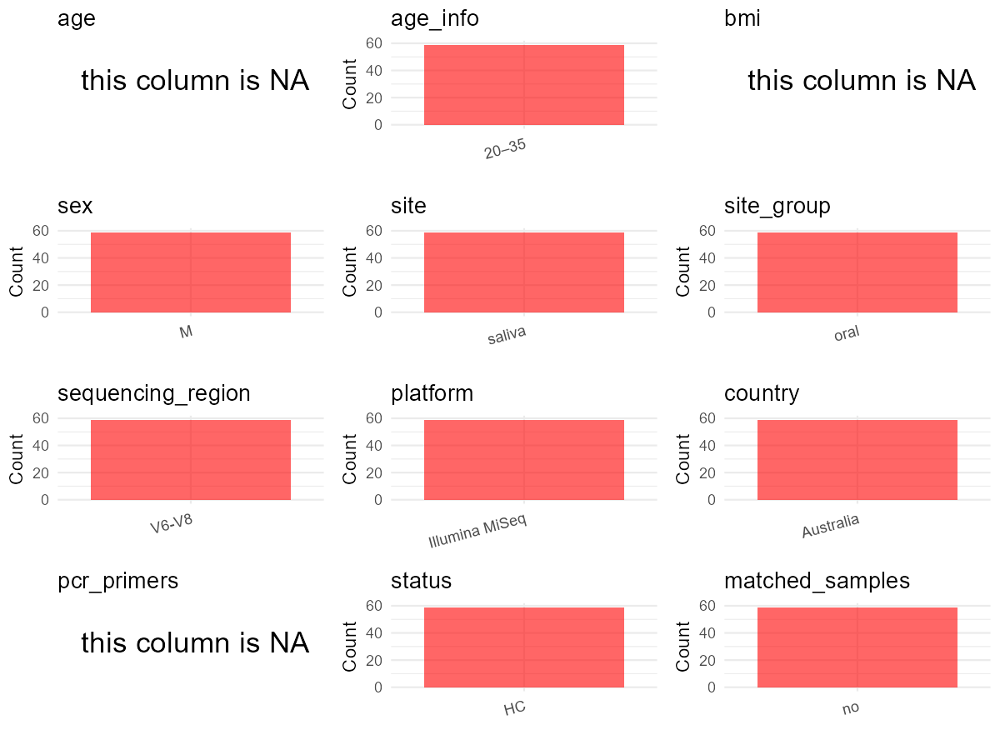

R Notebook: Metadata Processing Workflow
================

# Step 1: Obtain Initial Metadata from Each Project

This step sets the project directory, loads the raw SRA metadata, and
optionally merges supplement tables.

``` r
# Load libraries
library(dplyr)
library(ggplot2)
library(cowplot)

# (1) Setting working directory
# EDIT HERE: change project_id for each study
project_id <- "PRJEB29801" 

base_dir <- "E:/oral/26/metadata-2604/Oral-Metadata-YL-02"
setwd(file.path(base_dir, project_id))

# (2) Loading raw SRA metadata file
sra_file <- "SraRunTable.csv"
initial_meta <- read.csv(sra_file, header = TRUE)

# (3) OPTIONAL: If extra metadata (e.g., Table.x or supplemental materials) are available from the article, you may need to merge the file with initial_meta manually. Below is example code for merging. Depending on the specific case of each study, you can customize the code as needed.
#supp_table <- read.csv("supplemental_table_v2.csv", header = TRUE)
#initial_meta <- left_join(initial_meta, supp_table, by = "Sample.Name")
```

# Step 2: Data Overview

First, you need to get an overview of the data, which includes two
steps: reading the article and reading the initial metadata. This step
is very IMPORTANT!

``` r
# (1) Read the article in the following order: abstract, the beginning of the results section, and the methods. Understand the sample size, experimental design, and disease group overview. Clarify the sampling sites; for oral and gut samples, specify the exact sites like supragingival plaque, tongue, etc.

# (2) IMPORTANT: MUST go through each column of initial_meta
head(initial_meta, 10)
```

    ##           Run Assay.Type BioProject    BioSample
    ## 1  ERR2930086   AMPLICON PRJEB29801 SAMEA5099642
    ## 2  ERR2930087   AMPLICON PRJEB29801 SAMEA5099643
    ## 3  ERR2930088   AMPLICON PRJEB29801 SAMEA5099644
    ## 4  ERR2930089   AMPLICON PRJEB29801 SAMEA5099645
    ## 5  ERR2930090   AMPLICON PRJEB29801 SAMEA5099646
    ## 6  ERR2930091   AMPLICON PRJEB29801 SAMEA5099647
    ## 7  ERR2930092   AMPLICON PRJEB29801 SAMEA5099648
    ## 8  ERR2930093   AMPLICON PRJEB29801 SAMEA5099649
    ## 9  ERR2930094   AMPLICON PRJEB29801 SAMEA5099650
    ## 10 ERR2930095   AMPLICON PRJEB29801 SAMEA5099651
    ##                                 Center.Name Collection_Date
    ## 1  FACULTY OF MEDICINE DIAMANTINA INSTITUTE         2015-11
    ## 2  FACULTY OF MEDICINE DIAMANTINA INSTITUTE         2015-11
    ## 3  FACULTY OF MEDICINE DIAMANTINA INSTITUTE         2015-11
    ## 4  FACULTY OF MEDICINE DIAMANTINA INSTITUTE         2015-11
    ## 5  FACULTY OF MEDICINE DIAMANTINA INSTITUTE         2015-11
    ## 6  FACULTY OF MEDICINE DIAMANTINA INSTITUTE         2015-11
    ## 7  FACULTY OF MEDICINE DIAMANTINA INSTITUTE         2015-11
    ## 8  FACULTY OF MEDICINE DIAMANTINA INSTITUTE         2015-11
    ## 9  FACULTY OF MEDICINE DIAMANTINA INSTITUTE         2015-11
    ## 10 FACULTY OF MEDICINE DIAMANTINA INSTITUTE         2015-11
    ##              common_name Consent ENA.FIRST.PUBLIC..run.     ENA.FIRST.PUBLIC
    ## 1  human oral metagenome  public             2019-04-29 2019-04-29T04:03:57Z
    ## 2  human oral metagenome  public             2019-04-29 2019-04-29T04:03:57Z
    ## 3  human oral metagenome  public             2019-04-29 2019-04-29T04:03:57Z
    ## 4  human oral metagenome  public             2019-04-29 2019-04-29T04:03:57Z
    ## 5  human oral metagenome  public             2019-04-29 2019-04-29T04:03:57Z
    ## 6  human oral metagenome  public             2019-04-29 2019-04-29T04:03:57Z
    ## 7  human oral metagenome  public             2019-04-29 2019-04-29T04:03:57Z
    ## 8  human oral metagenome  public             2019-04-29 2019-04-29T04:03:57Z
    ## 9  human oral metagenome  public             2019-04-29 2019-04-29T04:03:57Z
    ## 10 human oral metagenome  public             2019-04-29 2019-04-29T04:03:57Z
    ##    ENA.LAST.UPDATE..run.      ENA.LAST.UPDATE environment_.biome.
    ## 1             2018-11-28 2018-11-22T10:14:03Z              saliva
    ## 2             2018-11-28 2018-11-22T10:14:03Z              saliva
    ## 3             2018-11-26 2018-11-22T10:14:03Z              saliva
    ## 4             2018-11-26 2018-11-22T10:14:03Z              saliva
    ## 5             2018-11-28 2018-11-22T10:14:03Z              saliva
    ## 6             2018-11-28 2018-11-22T10:14:03Z              saliva
    ## 7             2018-11-28 2018-11-22T10:14:03Z              saliva
    ## 8             2018-11-28 2018-11-22T10:14:03Z              saliva
    ## 9             2018-11-26 2018-11-22T10:14:03Z              saliva
    ## 10            2018-11-28 2018-11-22T10:14:03Z              saliva
    ##    environment_.feature. environment_.material. Experiment  external_id
    ## 1                   Oral                 saliva ERX2932973 SAMEA5099642
    ## 2                   Oral                 saliva ERX2932974 SAMEA5099643
    ## 3                   Oral                 saliva ERX2932975 SAMEA5099644
    ## 4                   Oral                 saliva ERX2932976 SAMEA5099645
    ## 5                   Oral                 saliva ERX2932977 SAMEA5099646
    ## 6                   Oral                 saliva ERX2932978 SAMEA5099647
    ## 7                   Oral                 saliva ERX2932979 SAMEA5099648
    ## 8                   Oral                 saliva ERX2932980 SAMEA5099649
    ## 9                   Oral                 saliva ERX2932981 SAMEA5099650
    ## 10                  Oral                 saliva ERX2932982 SAMEA5099651
    ##    geo_loc_name_country geo_loc_name_country_continent
    ## 1             Australia                        Oceania
    ## 2             Australia                        Oceania
    ## 3             Australia                        Oceania
    ## 4             Australia                        Oceania
    ## 5             Australia                        Oceania
    ## 6             Australia                        Oceania
    ## 7             Australia                        Oceania
    ## 8             Australia                        Oceania
    ## 9             Australia                        Oceania
    ## 10            Australia                        Oceania
    ##    geographic_location_.country_and.or_sea. geographic_location_.latitude.
    ## 1                                 Australia      25.2744° S\\, 133.7751° E
    ## 2                                 Australia      25.2744° S\\, 133.7751° E
    ## 3                                 Australia      25.2744° S\\, 133.7751° E
    ## 4                                 Australia      25.2744° S\\, 133.7751° E
    ## 5                                 Australia      25.2744° S\\, 133.7751° E
    ## 6                                 Australia      25.2744° S\\, 133.7751° E
    ## 7                                 Australia      25.2744° S\\, 133.7751° E
    ## 8                                 Australia      25.2744° S\\, 133.7751° E
    ## 9                                 Australia      25.2744° S\\, 133.7751° E
    ## 10                                Australia      25.2744° S\\, 133.7751° E
    ##    geographic_location_.longitude. human_oral_environmental_package
    ## 1        25.2744° S\\, 133.7751° E                       human-oral
    ## 2        25.2744° S\\, 133.7751° E                       human-oral
    ## 3        25.2744° S\\, 133.7751° E                       human-oral
    ## 4        25.2744° S\\, 133.7751° E                       human-oral
    ## 5        25.2744° S\\, 133.7751° E                       human-oral
    ## 6        25.2744° S\\, 133.7751° E                       human-oral
    ## 7        25.2744° S\\, 133.7751° E                       human-oral
    ## 8        25.2744° S\\, 133.7751° E                       human-oral
    ## 9        25.2744° S\\, 133.7751° E                       human-oral
    ## 10       25.2744° S\\, 133.7751° E                       human-oral
    ##                           INSDC_center_name   INSDC_first_public
    ## 1  Faculty of Medicine Diamantina Institute 2019-04-29T04:03:57Z
    ## 2  Faculty of Medicine Diamantina Institute 2019-04-29T04:03:57Z
    ## 3  Faculty of Medicine Diamantina Institute 2019-04-29T04:03:57Z
    ## 4  Faculty of Medicine Diamantina Institute 2019-04-29T04:03:57Z
    ## 5  Faculty of Medicine Diamantina Institute 2019-04-29T04:03:57Z
    ## 6  Faculty of Medicine Diamantina Institute 2019-04-29T04:03:57Z
    ## 7  Faculty of Medicine Diamantina Institute 2019-04-29T04:03:57Z
    ## 8  Faculty of Medicine Diamantina Institute 2019-04-29T04:03:57Z
    ## 9  Faculty of Medicine Diamantina Institute 2019-04-29T04:03:57Z
    ## 10 Faculty of Medicine Diamantina Institute 2019-04-29T04:03:57Z
    ##       INSDC_last_update INSDC_status     Instrument investigation_type
    ## 1  2018-11-22T10:14:03Z       public Illumina MiSeq         metagenome
    ## 2  2018-11-22T10:14:03Z       public Illumina MiSeq         metagenome
    ## 3  2018-11-22T10:14:03Z       public Illumina MiSeq         metagenome
    ## 4  2018-11-22T10:14:03Z       public Illumina MiSeq         metagenome
    ## 5  2018-11-22T10:14:03Z       public Illumina MiSeq         metagenome
    ## 6  2018-11-22T10:14:03Z       public Illumina MiSeq         metagenome
    ## 7  2018-11-22T10:14:03Z       public Illumina MiSeq         metagenome
    ## 8  2018-11-22T10:14:03Z       public Illumina MiSeq         metagenome
    ## 9  2018-11-22T10:14:03Z       public Illumina MiSeq         metagenome
    ## 10 2018-11-22T10:14:03Z       public Illumina MiSeq         metagenome
    ##                            Library.Name LibraryLayout LibrarySelection
    ## 1  16SrRNAgene-seqofhumanoralmicrobiome        PAIRED              PCR
    ## 2  16SrRNAgene-seqofhumanoralmicrobiome        PAIRED              PCR
    ## 3  16SrRNAgene-seqofhumanoralmicrobiome        PAIRED              PCR
    ## 4  16SrRNAgene-seqofhumanoralmicrobiome        PAIRED              PCR
    ## 5  16SrRNAgene-seqofhumanoralmicrobiome        PAIRED              PCR
    ## 6  16SrRNAgene-seqofhumanoralmicrobiome        PAIRED              PCR
    ## 7  16SrRNAgene-seqofhumanoralmicrobiome        PAIRED              PCR
    ## 8  16SrRNAgene-seqofhumanoralmicrobiome        PAIRED              PCR
    ## 9  16SrRNAgene-seqofhumanoralmicrobiome        PAIRED              PCR
    ## 10 16SrRNAgene-seqofhumanoralmicrobiome        PAIRED              PCR
    ##    LibrarySource              Organism Platform
    ## 1    METAGENOMIC human oral metagenome ILLUMINA
    ## 2    METAGENOMIC human oral metagenome ILLUMINA
    ## 3    METAGENOMIC human oral metagenome ILLUMINA
    ## 4    METAGENOMIC human oral metagenome ILLUMINA
    ## 5    METAGENOMIC human oral metagenome ILLUMINA
    ## 6    METAGENOMIC human oral metagenome ILLUMINA
    ## 7    METAGENOMIC human oral metagenome ILLUMINA
    ## 8    METAGENOMIC human oral metagenome ILLUMINA
    ## 9    METAGENOMIC human oral metagenome ILLUMINA
    ## 10   METAGENOMIC human oral metagenome ILLUMINA
    ##                                                                                       project_name
    ## 1  Effects of dietary pattern during intensified training on oral microbiota of elite race walkers
    ## 2  Effects of dietary pattern during intensified training on oral microbiota of elite race walkers
    ## 3  Effects of dietary pattern during intensified training on oral microbiota of elite race walkers
    ## 4  Effects of dietary pattern during intensified training on oral microbiota of elite race walkers
    ## 5  Effects of dietary pattern during intensified training on oral microbiota of elite race walkers
    ## 6  Effects of dietary pattern during intensified training on oral microbiota of elite race walkers
    ## 7  Effects of dietary pattern during intensified training on oral microbiota of elite race walkers
    ## 8  Effects of dietary pattern during intensified training on oral microbiota of elite race walkers
    ## 9  Effects of dietary pattern during intensified training on oral microbiota of elite race walkers
    ## 10 Effects of dietary pattern during intensified training on oral microbiota of elite race walkers
    ##             ReleaseDate  Sample.Name Sample_name       scientific_name
    ## 1  2019-05-01T00:00:00Z SAMEA5099642          S1 human oral metagenome
    ## 2  2019-05-01T00:00:00Z SAMEA5099643          S2 human oral metagenome
    ## 3  2019-05-01T00:00:00Z SAMEA5099644          S3 human oral metagenome
    ## 4  2019-05-01T00:00:00Z SAMEA5099645          S4 human oral metagenome
    ## 5  2019-05-01T00:00:00Z SAMEA5099646          S5 human oral metagenome
    ## 6  2019-05-01T00:00:00Z SAMEA5099647          S6 human oral metagenome
    ## 7  2019-05-01T00:00:00Z SAMEA5099648          S7 human oral metagenome
    ## 8  2019-05-01T00:00:00Z SAMEA5099649          S8 human oral metagenome
    ## 9  2019-05-01T00:00:00Z SAMEA5099650          S9 human oral metagenome
    ## 10 2019-05-01T00:00:00Z SAMEA5099651         S10 human oral metagenome
    ##      Sequencing_method SRA.Study Submitter_Id DATASTORE.filetype
    ## 1  16S rRNA sequencing ERP112150           S1   fastq,run.zq,sra
    ## 2  16S rRNA sequencing ERP112150           S2   fastq,run.zq,sra
    ## 3  16S rRNA sequencing ERP112150           S3                   
    ## 4  16S rRNA sequencing ERP112150           S4                   
    ## 5  16S rRNA sequencing ERP112150           S5   fastq,run.zq,sra
    ## 6  16S rRNA sequencing ERP112150           S6   fastq,run.zq,sra
    ## 7  16S rRNA sequencing ERP112150           S7   fastq,run.zq,sra
    ## 8  16S rRNA sequencing ERP112150           S8   fastq,run.zq,sra
    ## 9  16S rRNA sequencing ERP112150           S9              fastq
    ## 10 16S rRNA sequencing ERP112150          S10   fastq,run.zq,sra
    ##    DATASTORE.provider                         DATASTORE.region AvgSpotLen
    ## 1      ena,gs,ncbi,s3 ena,gs.us-east1,ncbi.public,s3.us-east-1        600
    ## 2      ena,gs,ncbi,s3 ena,gs.us-east1,ncbi.public,s3.us-east-1        600
    ## 3                                                                      NA
    ## 4                                                                      NA
    ## 5      ena,gs,ncbi,s3 ena,gs.us-east1,ncbi.public,s3.us-east-1        600
    ## 6      ena,gs,ncbi,s3 ena,gs.us-east1,ncbi.public,s3.us-east-1        600
    ## 7      ena,gs,ncbi,s3 ena,gs.us-east1,ncbi.public,s3.us-east-1        600
    ## 8      ena,gs,ncbi,s3 ena,gs.us-east1,ncbi.public,s3.us-east-1        600
    ## 9                 ena                                      ena         NA
    ## 10     ena,gs,ncbi,s3 ena,gs.us-east1,ncbi.public,s3.us-east-1        600
    ##        Bases    Bytes          create_date version
    ## 1  124255527 84347580 2019-05-02T15:53:00Z       1
    ## 2  117652076 78477862 2019-05-02T15:54:00Z       1
    ## 3         NA       NA                           NA
    ## 4         NA       NA                           NA
    ## 5  111676872 75411233 2019-05-02T15:55:00Z       1
    ## 6  112087621 76859623 2019-05-02T15:56:00Z       1
    ## 7  103396483 71549850 2019-05-02T15:57:00Z       1
    ## 8  105046765 74314802 2019-05-02T15:58:00Z       1
    ## 9         NA       NA                           NA
    ## 10 131706031 89318929 2019-05-02T16:00:00Z       1

``` r
# IMPORTANT: Check the unique values in the column of interest or query column.
lapply(initial_meta[c('environment_.biome.', 'environment_.feature.', 'environment_.material.')], table) # site
```

    ## $environment_.biome.
    ## 
    ## saliva 
    ##     59 
    ## 
    ## $environment_.feature.
    ## 
    ## Oral 
    ##   59 
    ## 
    ## $environment_.material.
    ## 
    ## saliva 
    ##     59

``` r
lapply(initial_meta[c('scientific_name')], table) # organism
```

    ## $scientific_name
    ## 
    ## human oral metagenome 
    ##                    59

``` r
table(initial_meta$Submitter_Id) # subject id
```

    ## 
    ##  S1 S10 S11 S12 S13 S14 S15 S16 S17 S18 S19  S2 S20 S21 S22 S23 S24 S25 S26 S27 
    ##   1   1   1   1   1   1   1   1   1   1   1   1   1   1   1   1   1   1   1   1 
    ## S28 S29  S3 S30 S31 S32 S33 S34 S35 S36 S37 S38 S39  S4 S40 S41 S42 S43 S44 S45 
    ##   1   1   1   1   1   1   1   1   1   1   1   1   1   1   1   1   1   1   1   1 
    ## S46 S47 S48 S49  S5 S50 S51 S52 S53 S54 S55 S56 S57 S58 S59  S6  S7  S8  S9 
    ##   1   1   1   1   1   1   1   1   1   1   1   1   1   1   1   1   1   1   1

``` r
#table(initial_meta$sequencing_meth..exp.) # output is Sequencing by synthesis
table(initial_meta$Platform) # output is Illumina. according to the methods, Illumina is correct.
```

    ## 
    ## ILLUMINA 
    ##       59

``` r
#table(initial_meta$target_subfragment..exp.)
```

# Step 3: Removing Control and Non-human Samples

First, we need to remove control samples(including both negative
controls and positive controls) and non-human samples.

``` r
# (1) EDIT HERE: Parameter setup
control_column <- "" # column name in initial_meta
# unique(initial_meta[[control_column]])
control_keywords <- c() # Enter exact keywords

species_column <- "" # column name in initial_meta
unique(initial_meta[[species_column]])
```

    ## NULL

``` r
non_human_keywords <- c() # Enter exact keywords

# (2) Remove controls and non-human samples. DO NOT need to modify code in this part, just run it.
n_samples <- nrow(initial_meta)
# Control evaluation
if (length(control_keywords) > 0) {
  if (is.null(control_column) || control_column == "") {
    stop("Error: control_keywords provided but control_column is missing.")
  }
  
  if (!(control_column %in% colnames(initial_meta))) {
    stop(sprintf("Error: Column '%s' not found in initial_meta.", control_column))
  }
  
  control_pattern <- paste(control_keywords, collapse = "|")
  control_text <- initial_meta[[control_column]]
  is_control <- grepl(control_pattern, control_text)
  
} else {
  is_control <- rep(FALSE, n_samples)
}

# Non-human evaluation
if (length(non_human_keywords) > 0) {
  if (is.null(species_column) || species_column == "") {
    stop("Error: non_human_keywords provided but species_column is missing.")
  }
  
  if (!(species_column %in% colnames(initial_meta))) {
    stop(sprintf("Error: Column '%s' not found in initial_meta.", species_column))
  }
  
  non_human_pattern <- paste(non_human_keywords, collapse = "|")
  species_text <- initial_meta[[species_column]]
  is_non_human <- grepl(non_human_pattern, species_text)
} else {
  is_non_human <- rep(FALSE, n_samples)
}

# Execute removal
samples_to_remove <- is_control | is_non_human
initial_meta <- initial_meta[!samples_to_remove, ]

cat("Initial samples counts:",n_samples,"\n")
```

    ## Initial samples counts: 59

``` r
cat("Removed control samples:", sum(is_control), "\n")
```

    ## Removed control samples: 0

``` r
cat("Removed non-human samples:", sum(is_non_human), "\n")
```

    ## Removed non-human samples: 0

``` r
cat("Total samples removed ", sum(samples_to_remove), "\n")
```

    ## Total samples removed  0

``` r
cat("Remaining samples after Step 2:", nrow(initial_meta), "\n")
```

    ## Remaining samples after Step 2: 59

# Step 4: Creating a Uniform Metadata Template

This step converts the raw SRA table into the standard metadata format
used in our meta-analysis. The uniform metadata should include the
following columns: 1. **bioproject**: Project ID from SRA or other
database e.g. `PRJNA1234`, `CNP1234`, ‘OEP1234’, ‘qiita_1234’ 2.
**sample_id**: SRA sample/run ID. Unique id for each sample!
e.g. `DRR1234567`, `ERR1234567` and `SRR1234567`. If no such column
exists, can use column like sample_name. 3. **subject_id**: subject id
for each person if available. e.g. `patient_01`, `Host_03_before`,
`subject12` 4. **age**: Age of the subject if available. e.g. `35`, `42`
\| not `adult`, `chilren` 5. **age_info**: If the age is not explicitly
stated but approximate age range information is available, mark it in
this column. e.g., `18-55`, `children`, `infant`, `elder` 6. **bmi**:
Body Mass Index if available. e.g. `22.5`, `18.9` \| not `normal`,
`overweight` 7. **sex**: Sex of the subject. Mandatory to write as M/F
\| not `female`, `woman` 8. **sequencing_region**: Targeted 16S rRNA
region. e.g. `V3-V4`, `V4` 9. **platform**: Sequencing platform.
e.g. `Illumina MiSeq`, `454 GS FLX Titanium`, `Ion Torrent` 10.
**country**: Country of sample origin. e.g. `China`, `Japan` \| not city
name like `Beijing` 11. **site**: Sampling site. For oral and gut sites,
specify the exact sites as detailed as possible. For example, if it is
known to be supragingival plaque, do not record it as ‘dental plaque’,
unless the original text provides only a vague description.
e.g. `saliva`, `tongue coating` \| not broad term like `oral` 12.
**site_group**: only accepts one of following three values: ‘oral’,
‘gut’, or ‘other’. 13. **public_time**: Data release date.
e.g. `2021-06-22` \| not `June 2021` 14. **pcr_primers**: PCR primers
used. e.g. `515F-806R`, `27F-338R` \| not primer sequences 15.
**title**: Title of the associated publication. 16. **disease_study**:
Whether the study involves disease samples. If it’s not clear, can
record as NA. Only three values accepted: ‘yes’, ‘no’ or NA 17.
**status**: Disease status for each sample if available, else record as
NA. Only accept following abbreviations, Write full names for all other
diseases. HC: healthy control CD: Crohn’s disease CRC: colorectal cancer
COPD: chronic obstructive pulmonary disease HIV: human immunodeficiency
virus ICU: intensive care unit OSCC: oral squamous cell carcinoma RA:
rheumatoid arthritis UC: ulcerative colitis 18. **matched_samples**:
Whether the subject has matched samples. Only accept ‘yes’ or ‘no’. 19.
**is_time_series**: Whether the study is a time series study. Only
accept ‘yes’ or ‘no’.

``` r
# Extract columns from initial_meta as follows: (1) No modification needed → extract directly. (2) Modification needed → create a new column with the prefix raw_ and mark the original column as “pending”. (3) Need to find or determine based on the article.
metadata <- data.frame(
  bioproject = initial_meta$BioProject,
  sample_id = initial_meta$Run,
  subject_id = initial_meta$Submitter_Id,
  age = NA,
  age_info = "20–35",
  bmi = NA,
  sex = "M",  # Article: The aim of this study was to investigate the shifts in the oral microbiome of elite male endurance race walkers from Europe, Asia, the Americas and Australia
  sequencing_region = "V6-V8", # extract from methods section
  platform = "Illumina MiSeq", # extract from methods section, NOT initial_meta
  country = initial_meta$geo_loc_name_country,
  site = initial_meta$environment_.material.,
  site_group = "pending", # modify later
  public_time = initial_meta$ReleaseDate,
  pcr_primers = NA, # Format: xxF-xxR
  title = "Analysis of the effects of dietary pattern on the oral microbiome of elite endurance athletes", # extract from article
  disease_study = "no", # determine according to the article
  status = "HC", 
  matched_samples = "pending", # modify later
  is_time_series = "no", # determine according to the article
  stringsAsFactors = FALSE
)
metadata$public_time <- as.Date(metadata$public_time)
```

# Step 5: Manually solving pending issues

This step involves two parts: (1) handle the columns with the `raw_`
prefix, and next (2) handle the `site_group` and `matched_samples`
columns.

``` r
# (1) Handle the columns with the `raw_` prefix.
# In this part, you need to customize the code based on the situation of the raw_ columns to obtain the content of the target columns. IMPORTANT: Add comments if the modification is not straightforward!!
```

``` r
# (2) Filling the 'site_group' and 'matched_samples' columns
# editing site_group
unique(metadata$site)
```

    ## [1] "saliva"

``` r
# EDIT HERE: add oral sites
Oral_site = unique(metadata$site)
# EDIT HERE: add gut sites
Gut_site = c()
# just run
metadata <- metadata %>%
  mutate(site_group = case_when(
    site %in% Oral_site ~ "oral",
    site %in% Gut_site ~ "gut",
    TRUE ~ "other" 
  ))

# editing matched_samples, just run.
metadata$matched_samples <- ifelse(
  ave(metadata$subject_id, metadata$subject_id, FUN = length) > 1, 
  "yes", 
  "no"
)
```

``` r
# (3) check if there is pending value in metadata. If there is pending value, go on modify the metadata.
# Function to check if a column contains "pending"
has_pending <- function(col) {
  if (is.character(col) || is.factor(col)) {
    any(col == "pending", na.rm = TRUE)
  } else {
    FALSE
  }
}

# Check for any pending value
any_pending_value <- any(sapply(metadata, has_pending))

if (!any_pending_value) {
  message("Good! No cell contains the value 'pending'.")
} else {
  pending_cols <- names(metadata)[sapply(metadata, has_pending)]
  message("Columns containing 'pending': ", paste(pending_cols, collapse = ", "))
  message("Please continue to resolve these pending columns!")
}
```

    ## Good! No cell contains the value 'pending'.

# Step 6: Visualize the Metadata

This step makes a quick set of plots for checking the distribution of
key metadata fields.

``` r
# Select columns for visualization, just run
plot_data <- metadata %>%
  select(-bioproject, -sample_id, -subject_id, -title)

create_simple_plots <- function(data) {
  plots <- list()
  continuous_vars <- c("age", "bmi")

  for (col in colnames(data)) {
    if (all(is.na(data[[col]]))) {
      p <- ggplot() +
        annotate("text", x = 0.5, y = 0.5, label = "this column is NA", size = 6) +
        labs(title = col) +
        theme_void()
    } else if (col %in% continuous_vars && is.numeric(data[[col]])) {
      p <- ggplot(data, aes(x = .data[[col]])) +
        geom_histogram(fill = "blue", alpha = 0.6, bins = 20, na.rm = TRUE) +
        labs(title = col, x = col, y = "Count") +
        theme_minimal()
    } else {
      count_data <- as.data.frame(table(data[[col]], useNA = "ifany"))
      p <- ggplot(count_data, aes(x = reorder(Var1, -Freq), y = Freq)) +
        geom_col(fill = "red", alpha = 0.6) +
        labs(title = col, x = NULL, y = "Count") +
        theme_minimal() +
        theme(axis.text.x = element_text(angle = 15, hjust = 1))
    }
    plots[[col]] <- p
  }

  return(plots)
}

# Generate and arrange plots
plots <- create_simple_plots(plot_data)
p <- plot_grid(plots$age,
               plots$age_info,
               plots$bmi,
               plots$sex,
               plots$site,
               plots$site_group,
               plots$sequencing_region,
               plots$platform,
               plots$country,
               plots$pcr_primers,
               plots$status,
               plots$matched_samples,
               ncol = 3, align = "hv", axis = "lb")
ggsave("Metadata_Summary_v2.png", plot = p, width = 8, height = 6, dpi = 150)
```

``` r
# Insert Metadata_Summary.png into the current Rmd output

```


# Step 7: Sort and export the metadata

This step saves the cleaned metadata table as the final `metadata.csv`
file.

``` r
# Reorder the data frame
fixed_cols <- c("bioproject", "sample_id", "subject_id", "age", "age_info",
                "bmi", "sex", "platform", "sequencing_region", "pcr_primers", 
                "country", "site", "site_group", "disease_study", "status", 
                "title", "public_time", "matched_samples", "is_time_series")  
metadata <- metadata %>%
  select(all_of(fixed_cols), everything())

# save metadata 
# head(metadata)
write.csv(metadata, file = "metadata_v2.csv", quote = TRUE)
```
