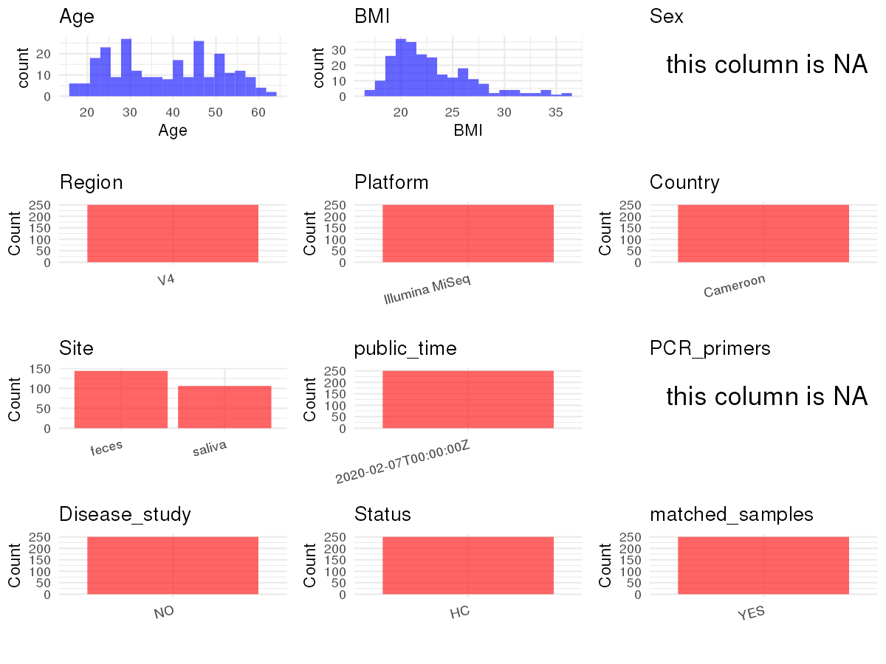

R Notebook: Metadata Processing Workflow
================

# Step 1: Obtain Initial Metadata from Each Project

To obtain the initial metadata: 1. Search for the BioProject ID (e.g.,
“PRJEBXXXX”) on the [NCBI SRA
website](https://www.ncbi.nlm.nih.gov/Traces/study/). 2. In the “Select”
table, click on “Metadata” and download the file. 3. The downloaded file
is typically named “SraRunTable.csv” and contains metadata for the
project.

``` r
# Load necessary libraries
library(dplyr)
library(ggplot2)
library(cowplot)

# Set working directory (update this path to your local directory)
setwd("/home/dongbiao/word_embedding_microbiome/all_data/oral/global-oral-microbiome/data/projects/PRJEB30836")

# Read the initial metadata files
initial_meta <- read.csv("SraRunTable.csv", header = T)

# Display the first few rows of the metadata
head(initial_meta)
```

    ##          Run
    ## 1 ERR3618854
    ## 2 ERR3618855
    ## 3 ERR3618856
    ## 4 ERR3618857
    ## 5 ERR3618858
    ## 6 ERR3618859
    ##                                                                          adapters
    ## 1 Read1: TATGGTAATTGTGTGYCAGCMGCCGCGGTAA; Read2: AGTCAGTCAGCCGGACTACNVGGGTWTCTAAT
    ## 2 Read1: TATGGTAATTGTGTGYCAGCMGCCGCGGTAA; Read2: AGTCAGTCAGCCGGACTACNVGGGTWTCTAAT
    ## 3 Read1: TATGGTAATTGTGTGYCAGCMGCCGCGGTAA; Read2: AGTCAGTCAGCCGGACTACNVGGGTWTCTAAT
    ## 4 Read1: TATGGTAATTGTGTGYCAGCMGCCGCGGTAA; Read2: AGTCAGTCAGCCGGACTACNVGGGTWTCTAAT
    ## 5 Read1: TATGGTAATTGTGTGYCAGCMGCCGCGGTAA; Read2: AGTCAGTCAGCCGGACTACNVGGGTWTCTAAT
    ## 6 Read1: TATGGTAATTGTGTGYCAGCMGCCGCGGTAA; Read2: AGTCAGTCAGCCGGACTACNVGGGTWTCTAAT
    ##   Assay.Type AvgSpotLen    Bases BioProject    BioSample    Bytes
    ## 1   AMPLICON        302 21467670 PRJEB30836 SAMEA6119747 13925170
    ## 2   AMPLICON        302 14112158 PRJEB30836 SAMEA6119748  9282013
    ## 3   AMPLICON        302  9403374 PRJEB30836 SAMEA6119749  6050848
    ## 4   AMPLICON        302 10031836 PRJEB30836 SAMEA6119750  6556063
    ## 5   AMPLICON        302  9549844 PRJEB30836 SAMEA6119751  6325113
    ## 6   AMPLICON        302 21181072 PRJEB30836 SAMEA6119752 12768301
    ##                                          Center.Name Collection_Date
    ## 1 ALFRED WEGENER INSTITUTE FOR POLAR AND MARINE RESE      2017-05-27
    ## 2 ALFRED WEGENER INSTITUTE FOR POLAR AND MARINE RESE      2017-05-24
    ## 3 ALFRED WEGENER INSTITUTE FOR POLAR AND MARINE RESE      2017-05-31
    ## 4 ALFRED WEGENER INSTITUTE FOR POLAR AND MARINE RESE      2017-05-30
    ## 5 ALFRED WEGENER INSTITUTE FOR POLAR AND MARINE RESE      2017-05-31
    ## 6 ALFRED WEGENER INSTITUTE FOR POLAR AND MARINE RESE      2017-05-27
    ##        common_name Consent DATASTORE.filetype DATASTORE.provider
    ## 1 feces metagenome  public         run.zq,sra         gs,ncbi,s3
    ## 2 feces metagenome  public         run.zq,sra         gs,ncbi,s3
    ## 3 feces metagenome  public         run.zq,sra         gs,ncbi,s3
    ## 4 feces metagenome  public         run.zq,sra         gs,ncbi,s3
    ## 5 feces metagenome  public         run.zq,sra         gs,ncbi,s3
    ## 6 feces metagenome  public         run.zq,sra         gs,ncbi,s3
    ##                       DATASTORE.region delivery ENA.FIRST.PUBLIC..run.
    ## 1 gs.us-east1,ncbi.public,s3.us-east-1  natural             2020-02-06
    ## 2 gs.us-east1,ncbi.public,s3.us-east-1  natural             2020-02-06
    ## 3 gs.us-east1,ncbi.public,s3.us-east-1  natural             2020-02-06
    ## 4 gs.us-east1,ncbi.public,s3.us-east-1  natural             2020-02-06
    ## 5 gs.us-east1,ncbi.public,s3.us-east-1  natural             2020-02-06
    ## 6 gs.us-east1,ncbi.public,s3.us-east-1  natural             2020-02-06
    ##       ENA.FIRST.PUBLIC ENA.LAST.UPDATE..run.      ENA.LAST.UPDATE
    ## 1 2020-02-06T04:04:29Z            2019-10-24 2019-10-24T22:19:38Z
    ## 2 2020-02-06T04:04:29Z            2019-10-24 2019-10-24T22:19:38Z
    ## 3 2020-02-06T04:04:29Z            2019-10-24 2019-10-24T22:19:38Z
    ## 4 2020-02-06T04:04:29Z            2019-10-24 2019-10-24T22:19:38Z
    ## 5 2020-02-06T04:04:29Z            2019-10-24 2019-10-24T22:19:38Z
    ## 6 2020-02-06T04:04:29Z            2019-10-24 2019-10-24T22:19:38Z
    ##        environment_.biome. environment_.feature. environment_.material.
    ## 1 human-associated habitat       organic feature                  feces
    ## 2 human-associated habitat       organic feature                  feces
    ## 3 human-associated habitat       organic feature                  feces
    ## 4 human-associated habitat       organic feature                  feces
    ## 5 human-associated habitat       organic feature                  feces
    ## 6 human-associated habitat       organic feature                  feces
    ##   Experiment  external_id geo_loc_name_country geo_loc_name_country_continent
    ## 1 ERX3614258 SAMEA6119747             Cameroon                         Africa
    ## 2 ERX3614259 SAMEA6119748             Cameroon                         Africa
    ## 3 ERX3614260 SAMEA6119749             Cameroon                         Africa
    ## 4 ERX3614261 SAMEA6119750             Cameroon                         Africa
    ## 5 ERX3614262 SAMEA6119751             Cameroon                         Africa
    ## 6 ERX3614263 SAMEA6119752             Cameroon                         Africa
    ##   geographic_location_.country_and.or_sea. geographic_location_.latitude.
    ## 1                                 Cameroon                         3.4433
    ## 2                                 Cameroon                         3.5178
    ## 3                                 Cameroon                         3.8603
    ## 4                                 Cameroon                         3.8603
    ## 5                                 Cameroon                         3.8603
    ## 6                                 Cameroon                         3.4433
    ##   geographic_location_.longitude. geographic_location_.region_and_locality.
    ## 1                         11.8121                        Cameroon: Ngoantet
    ## 2                         11.5099                        Cameroon: Mbalmayo
    ## 3                         11.4915                         Cameroon: Yaounde
    ## 4                         11.4915                         Cameroon: Yaounde
    ## 5                         11.4915                         Cameroon: Yaounde
    ## 6                         11.8121                        Cameroon: Ngoantet
    ##   host_age host_body_mass_index host_body_product host_body_site
    ## 1       30                 21.6             feces          feces
    ## 2       27                 22.5             feces          feces
    ## 3       32                 20.1             feces          feces
    ## 4       20                 18.6             feces          feces
    ## 5       60                 17.9             feces          feces
    ## 6       47                 19.4             feces          feces
    ##   host_disease_status host_height host_subject_id host_total_mass
    ## 1             healthy       156.2           BEN34            52.7
    ## 2             healthy       180.2           BEB22            73.0
    ## 3             healthy       158.7           BEY17            50.7
    ## 4             healthy       160.2           BEY02            47.8
    ## 5             healthy       177.1           BEY31            56.2
    ## 6             healthy       167.3           BEN29            54.2
    ##   ihmc_ethnicity                                  INSDC_center_name
    ## 1           Béti ALFRED WEGENER INSTITUTE FOR POLAR AND MARINE RESE
    ## 2           Béti ALFRED WEGENER INSTITUTE FOR POLAR AND MARINE RESE
    ## 3           Béti ALFRED WEGENER INSTITUTE FOR POLAR AND MARINE RESE
    ## 4           Béti ALFRED WEGENER INSTITUTE FOR POLAR AND MARINE RESE
    ## 5           Béti ALFRED WEGENER INSTITUTE FOR POLAR AND MARINE RESE
    ## 6           Béti ALFRED WEGENER INSTITUTE FOR POLAR AND MARINE RESE
    ##     INSDC_first_public    INSDC_last_update INSDC_status     Instrument
    ## 1 2020-02-06T04:04:29Z 2019-10-24T22:19:38Z       public Illumina MiSeq
    ## 2 2020-02-06T04:04:29Z 2019-10-24T22:19:38Z       public Illumina MiSeq
    ## 3 2020-02-06T04:04:29Z 2019-10-24T22:19:38Z       public Illumina MiSeq
    ## 4 2020-02-06T04:04:29Z 2019-10-24T22:19:38Z       public Illumina MiSeq
    ## 5 2020-02-06T04:04:29Z 2019-10-24T22:19:38Z       public Illumina MiSeq
    ## 6 2020-02-06T04:04:29Z 2019-10-24T22:19:38Z       public Illumina MiSeq
    ##   investigation_type Language library_construction_method Library.Name
    ## 1     mimarks-survey   Ewondo                         PCR       FBen34
    ## 2     mimarks-survey   Ewondo                         PCR       FBeb22
    ## 3     mimarks-survey   Ewondo                         PCR       FBey17
    ## 4     mimarks-survey    Bassa                         PCR        FBey2
    ## 5     mimarks-survey     Eton                         PCR       FBey31
    ## 6     mimarks-survey   Ewondo                         PCR       FBen29
    ##   library_reads_sequenced library_screening_strategy LibraryLayout
    ## 1                  142170                        PCR        PAIRED
    ## 2                   93458                        PCR        PAIRED
    ## 3                   62274                        PCR        PAIRED
    ## 4                   66436                        PCR        PAIRED
    ## 5                   63244                        PCR        PAIRED
    ## 6                  140272                        PCR        PAIRED
    ##   LibrarySelection LibrarySource
    ## 1              PCR       GENOMIC
    ## 2              PCR       GENOMIC
    ## 3              PCR       GENOMIC
    ## 4              PCR       GENOMIC
    ## 5              PCR       GENOMIC
    ## 6              PCR       GENOMIC
    ##                                                                              miscellaneous_parameter
    ## 1   Stool consistency (Bristol scale): 2 #### Absence of parasites by microscopy: no #### Smoker: no
    ## 2  Stool consistency (Bristol scale): 2 #### Absence of parasites by microscopy: yes #### Smoker: no
    ## 3  Stool consistency (Bristol scale): 1 #### Absence of parasites by microscopy: yes #### Smoker: no
    ## 4  Stool consistency (Bristol scale): 2 #### Absence of parasites by microscopy: yes #### Smoker: no
    ## 5 Stool consistency (Bristol scale): 1 #### Absence of parasites by microscopy: yes #### Smoker: yes
    ## 6  Stool consistency (Bristol scale): 4 #### Absence of parasites by microscopy: no #### Smoker: yes
    ##       multiplex_identifiers            nucleic_acid_extraction
    ## 1 ATGCCATGCCGT+ACGGCATGGCAT MOBIO PowerFecal DNA isolation kit
    ## 2 TAATACGGATCG+CGATCCGTATTA MOBIO PowerFecal DNA isolation kit
    ## 3 GTAGATCGTGTA+TACACGATCTAC MOBIO PowerFecal DNA isolation kit
    ## 4 ACGAGACTGATT+AATCAGTCTCGT MOBIO PowerFecal DNA isolation kit
    ## 5 CACTGGTGCATA+TATGCACCAGTG MOBIO PowerFecal DNA isolation kit
    ## 6 ATGTGTGTAGAC+GTCTACACACAT MOBIO PowerFecal DNA isolation kit
    ##   number_of_children         Organism
    ## 1                  7 feces metagenome
    ## 2                  1 feces metagenome
    ## 3                  3 feces metagenome
    ## 4                  0 feces metagenome
    ## 5                  6 feces metagenome
    ## 6                  5 feces metagenome
    ##                                                                                                                                          PCR_primers
    ## 1 515F: AATGATACGGCGACCACCGAGATCTACACTATGGTAATTGTGTGCCAGCMGCCGCGGTAA; 806rcbc0: CAAGCAGAAGACGGCATACGAGATTCCCTTGTCTCCAGTCAGTCAGCCGGACTACHVGGGTWTCTAAT
    ## 2 515F: AATGATACGGCGACCACCGAGATCTACACTATGGTAATTGTGTGCCAGCMGCCGCGGTAA; 806rcbc0: CAAGCAGAAGACGGCATACGAGATTCCCTTGTCTCCAGTCAGTCAGCCGGACTACHVGGGTWTCTAAT
    ## 3 515F: AATGATACGGCGACCACCGAGATCTACACTATGGTAATTGTGTGCCAGCMGCCGCGGTAA; 806rcbc0: CAAGCAGAAGACGGCATACGAGATTCCCTTGTCTCCAGTCAGTCAGCCGGACTACHVGGGTWTCTAAT
    ## 4 515F: AATGATACGGCGACCACCGAGATCTACACTATGGTAATTGTGTGCCAGCMGCCGCGGTAA; 806rcbc0: CAAGCAGAAGACGGCATACGAGATTCCCTTGTCTCCAGTCAGTCAGCCGGACTACHVGGGTWTCTAAT
    ## 5 515F: AATGATACGGCGACCACCGAGATCTACACTATGGTAATTGTGTGCCAGCMGCCGCGGTAA; 806rcbc0: CAAGCAGAAGACGGCATACGAGATTCCCTTGTCTCCAGTCAGTCAGCCGGACTACHVGGGTWTCTAAT
    ## 6 515F: AATGATACGGCGACCACCGAGATCTACACTATGGTAATTGTGTGCCAGCMGCCGCGGTAA; 806rcbc0: CAAGCAGAAGACGGCATACGAGATTCCCTTGTCTCCAGTCAGTCAGCCGGACTACHVGGGTWTCTAAT
    ##   Platform       pob project_name          ReleaseDate          create_date
    ## 1 ILLUMINA Mfouladja   MICROREGAL 2020-02-07T00:00:00Z 2020-02-07T16:10:00Z
    ## 2 ILLUMINA  Mbalmayo   MICROREGAL 2020-02-07T00:00:00Z 2020-02-07T16:10:00Z
    ## 3 ILLUMINA      Esse   MICROREGAL 2020-02-07T00:00:00Z 2020-02-07T16:11:00Z
    ## 4 ILLUMINA Mandoumba   MICROREGAL 2020-02-07T00:00:00Z 2020-02-07T16:11:00Z
    ## 5 ILLUMINA     Obala   MICROREGAL 2020-02-07T00:00:00Z 2020-02-07T16:11:00Z
    ## 6 ILLUMINA  Ngoantet   MICROREGAL 2020-02-07T00:00:00Z 2020-02-07T16:12:00Z
    ##   version    sample_collection_device_or_method
    ## 1       1 self-collection in plastic containers
    ## 2       1 self-collection in plastic containers
    ## 3       1 self-collection in plastic containers
    ## 4       1 self-collection in plastic containers
    ## 5       1 self-collection in plastic containers
    ## 6       1 self-collection in plastic containers
    ##                                                                                           sample_material_processing
    ## 1 Perserved in RNA-Later, extracted immediately upon return from the field trip; dried fecal samples stored at -80°C
    ## 2 Perserved in RNA-Later, extracted immediately upon return from the field trip; dried fecal samples stored at -80°C
    ## 3 Perserved in RNA-Later, extracted immediately upon return from the field trip; dried fecal samples stored at -80°C
    ## 4 Perserved in RNA-Later, extracted immediately upon return from the field trip; dried fecal samples stored at -80°C
    ## 5 Perserved in RNA-Later, extracted immediately upon return from the field trip; dried fecal samples stored at -80°C
    ## 6 Perserved in RNA-Later, extracted immediately upon return from the field trip; dried fecal samples stored at -80°C
    ##    Sample.Name sample_name sample_storage_location sample_storage_temperature
    ## 1 SAMEA6119747      FBen34                   Paris                        -80
    ## 2 SAMEA6119748      FBeb22                   Paris                        -80
    ## 3 SAMEA6119749      FBey17                   Paris                        -80
    ## 4 SAMEA6119750       FBey2                   Paris                        -80
    ## 5 SAMEA6119751      FBey31                   Paris                        -80
    ## 6 SAMEA6119752      FBen29                   Paris                        -80
    ##   sample_volume_or_weight_for_dna_extraction  scientific_name
    ## 1                                        280 feces metagenome
    ## 2                                        296 feces metagenome
    ## 3                                        304 feces metagenome
    ## 4                                        305 feces metagenome
    ## 5                                        313 feces metagenome
    ## 6                                        314 feces metagenome
    ##    Sequencing_method SRA.Study Submitter_Id tabacco_use_frequency Target_Gene
    ## 1 Illumina MiSeq 300 ERP113323       FBen34                    no    16S rRNA
    ## 2 Illumina MiSeq 300 ERP113323       FBeb22                    no    16S rRNA
    ## 3 Illumina MiSeq 300 ERP113323       FBey17                    no    16S rRNA
    ## 4 Illumina MiSeq 300 ERP113323        FBey2                    no    16S rRNA
    ## 5 Illumina MiSeq 300 ERP113323       FBey31         longtimeHeavy    16S rRNA
    ## 6 Illumina MiSeq 300 ERP113323       FBen29         longtimeHeavy    16S rRNA
    ##   target_subfragment travelled_abroad. breast_fed
    ## 1                 V4                no        yes
    ## 2                 V4                no        yes
    ## 3                 V4                no        yes
    ## 4                 V4                no        yes
    ## 5                 V4                no        yes
    ## 6                 V4               yes        yes
    ##   X24h_recall_nutrient_intake._alcohol_mg X24h_recall_nutrient_intake._ash_g
    ## 1                                       0                                7.8
    ## 2                                       0                               16.0
    ## 3                                       0                               15.8
    ## 4                                       0                               12.5
    ## 5                                       4                               15.4
    ## 6                                      58                               47.4
    ##   X24h_recall_nutrient_intake._betacar_ug X24h_recall_nutrient_intake._ca_mg
    ## 1                                 45879.0                              515.8
    ## 2                                 62920.7                             1255.0
    ## 3                                 19736.4                              513.5
    ## 4                                 14579.8                              612.5
    ## 5                                  6969.2                              190.4
    ## 6                                 21950.5                             1139.6
    ##   X24h_recall_nutrient_intake._cu_mg X24h_recall_nutrient_intake._energy_kcal
    ## 1                                1.5                                   1483.8
    ## 2                                1.6                                   2231.7
    ## 3                                1.6                                   1924.9
    ## 4                                0.8                                   1209.3
    ## 5                                1.6                                   2899.4
    ## 6                                1.1                                   2312.6
    ##   X24h_recall_nutrient_intake._fe_mg X24h_recall_nutrient_intake._fibres_g
    ## 1                               14.8                                  29.0
    ## 2                               28.2                                  23.1
    ## 3                                9.7                                  33.5
    ## 4                               13.9                                  19.7
    ## 5                               11.5                                  27.7
    ## 6                               71.6                                  17.6
    ##   X24h_recall_nutrient_intake._glucids_g X24h_recall_nutrient_intake._k_mg
    ## 1                                  242.5                            2481.1
    ## 2                                  285.9                            3512.1
    ## 3                                  282.8                            4759.2
    ## 4                                  180.0                            2830.4
    ## 5                                  546.5                            3714.9
    ## 6                                  315.5                            7380.4
    ##   X24h_recall_nutrient_intake._lipids_g X24h_recall_nutrient_intake._mg_mg
    ## 1                                  46.4                              233.7
    ## 2                                  88.8                              341.0
    ## 3                                  57.7                              363.0
    ## 4                                  36.7                              271.1
    ## 5                                  54.4                              354.6
    ## 6                                  44.7                              257.2
    ##   X24h_recall_nutrient_intake._na_mg X24h_recall_nutrient_intake._p_mg
    ## 1                              124.4                             521.2
    ## 2                              177.5                            1103.6
    ## 3                              990.9                             820.8
    ## 4                              988.8                             763.1
    ## 5                             1696.7                             765.5
    ## 6                              290.1                             991.4
    ##   X24h_recall_nutrient_intake._proteins_g X24h_recall_nutrient_intake._ret_ug
    ## 1                                    23.9                                 0.0
    ## 2                                    72.0                                42.8
    ## 3                                    68.7                                17.8
    ## 4                                    39.6                                29.1
    ## 5                                    48.9                                18.9
    ## 6                                    60.5                                 0.0
    ##   X24h_recall_nutrient_intake._vita_um X24h_recall_nutrient_intake._vitb12_ug
    ## 1                               3414.4                                    0.0
    ## 2                               3788.4                                    3.0
    ## 3                               1660.0                                    6.3
    ## 4                               1016.2                                    1.9
    ## 5                                599.4                                    2.0
    ## 6                                776.5                                    0.0
    ##   X24h_recall_nutrient_intake._vitb1_mg X24h_recall_nutrient_intake._vitb2_mg
    ## 1                                   1.1                                   0.8
    ## 2                                   1.0                                   2.0
    ## 3                                   1.0                                   0.8
    ## 4                                   0.6                                   0.9
    ## 5                                   0.8                                   0.6
    ## 6                                   0.6                                   2.1
    ##   X24h_recall_nutrient_intake._vitb3_mg X24h_recall_nutrient_intake._vitb6_ug
    ## 1                                  11.9                                   1.8
    ## 2                                  17.5                                   2.1
    ## 3                                  16.1                                   2.9
    ## 4                                  11.2                                   1.1
    ## 5                                  10.2                                   2.2
    ## 6                                   9.7                                   1.0
    ##   X24h_recall_nutrient_intake._vitb9_ug X24h_recall_nutrient_intake._vitc_mg
    ## 1                                 351.0                                636.1
    ## 2                                 307.7                                371.4
    ## 3                                 231.5                                143.9
    ## 4                                 537.2                                148.5
    ## 5                                 206.9                                147.2
    ## 6                                 256.7                               1384.0
    ##   X24h_recall_nutrient_intake._vitd_ug X24h_recall_nutrient_intake._vite_mg
    ## 1                                  0.0                                 17.7
    ## 2                                  7.6                                 17.8
    ## 3                                  1.3                                  6.5
    ## 4                                  5.0                                  8.1
    ## 5                                  6.4                                 12.2
    ## 6                                  0.0                                  9.0
    ##   X24h_recall_nutrient_intake._water_g X24h_recall_nutrient_intake._zn_mg
    ## 1                               1469.3                                3.7
    ## 2                               1147.0                                7.1
    ## 3                                883.0                                5.3
    ## 4                                660.2                                4.3
    ## 5                               1040.0                                6.3
    ## 6                               1654.4                                4.5
    ##   animals_in_the_household floor_in_the_house number_of_people_in_the_household
    ## 1                      yes                 no                                12
    ## 2                      yes                yes                                10
    ## 3                      yes                yes                                 6
    ## 4                      yes                yes                                 2
    ## 5                      yes                yes                                 9
    ## 6                      yes                 no                                 5
    ##   sanit_toillette self.reported_food_intolerance purging_frequency
    ## 1           squat                             no             never
    ## 2             sit                            yes             never
    ## 3           squat                             no        onceAyear+
    ## 4           squat                            yes             never
    ## 5           squat                            yes             never
    ## 6           squat                             no             never
    ##   water_use._private_external_water_tap water_use._rainwater
    ## 1                                    no                  yes
    ## 2                                    no                   no
    ## 3                                    no                   no
    ## 4                                    no                   no
    ## 5                                    no                   no
    ## 6                                    no                  yes
    ##   water_use._shared_external_water_tap water_use._water_tap_in_the_house
    ## 1                                   no                                no
    ## 2                                   no                                no
    ## 3                                  yes                                no
    ## 4                                  yes                                no
    ## 5                                  yes                                no
    ## 6                                   no                                no
    ##   water_use._well water_use.pump education_level electricity
    ## 1             yes             no         primary          no
    ## 2              no            yes         primary         yes
    ## 3              no             no       secondary         yes
    ## 4              no             no      university         yes
    ## 5              no             no       secondary         yes
    ## 6             yes            yes       secondary          no
    ##   traditional_medicine_use_frequency moved_to_current_location_at_age.
    ## 1                              never                                19
    ## 2                              never                                 0
    ## 3                             rarely                                21
    ## 4                             rarely                                 9
    ## 5                              never                                15
    ## 6                              never                                 0
    ##   antibiotic_use._last_taken antiparasitic_drugs._last_taken
    ## 1                       4-6m                            4-6m
    ## 2                      6-12m                                
    ## 3                       4-6m                            2-3m
    ## 4                       4-6m                            4-6m
    ## 5                       4-6m                             1y+
    ## 6                        1y+                             1y+
    ##   moved_to_current_location_.years_ago..
    ## 1                                     5+
    ## 2                                   born
    ## 3                                     5+
    ## 4                                     5+
    ## 5                                     5+
    ## 6                                   born
    ##   food_frequency_questionaire_.times.month.._cheese
    ## 1                                                 0
    ## 2                                                NA
    ## 3                                                 1
    ## 4                                                 1
    ## 5                                                 0
    ## 6                                                 0
    ##   food_frequency_questionaire_.times.month.._chicken
    ## 1                                                  2
    ## 2                                                 NA
    ## 3                                                  2
    ## 4                                                  2
    ## 5                                                  2
    ## 6                                                  6
    ##   food_frequency_questionaire_.times.month.._corn
    ## 1                                               1
    ## 2                                              NA
    ## 3                                               1
    ## 4                                               2
    ## 5                                               6
    ## 6                                               2
    ##   food_frequency_questionaire_.times.month.._eggs
    ## 1                                               2
    ## 2                                              NA
    ## 3                                               2
    ## 4                                              16
    ## 5                                              16
    ## 6                                               2
    ##   food_frequency_questionaire_.times.month.._fish
    ## 1                                               2
    ## 2                                              NA
    ## 3                                              30
    ## 4                                               6
    ## 5                                              30
    ## 6                                              16
    ##   food_frequency_questionaire_.times.month.._flour
    ## 1                                                6
    ## 2                                               NA
    ## 3                                               30
    ## 4                                               30
    ## 5                                               30
    ## 6                                                2
    ##   food_frequency_questionaire_.times.month.._kossam
    ## 1                                                 2
    ## 2                                                NA
    ## 3                                                 6
    ## 4                                                 2
    ## 5                                                16
    ## 6                                                 0
    ##   food_frequency_questionaire_.times.month.._macabo
    ## 1                                                 2
    ## 2                                                NA
    ## 3                                                 1
    ## 4                                                 1
    ## 5                                                16
    ## 6                                                 6
    ##   food_frequency_questionaire_.times.month.._meat
    ## 1                                               0
    ## 2                                              NA
    ## 3                                               6
    ## 4                                               6
    ## 5                                               2
    ## 6                                               2
    ##   food_frequency_questionaire_.times.month.._millet
    ## 1                                                 0
    ## 2                                                NA
    ## 3                                                 0
    ## 4                                                 0
    ## 5                                                 0
    ## 6                                                 0
    ##   food_frequency_questionaire_.times.month.._offal
    ## 1                                                2
    ## 2                                               NA
    ## 3                                                1
    ## 4                                                1
    ## 5                                                1
    ## 6                                                6
    ##   food_frequency_questionaire_.times.month.._rice
    ## 1                                               6
    ## 2                                              NA
    ## 3                                               6
    ## 4                                              16
    ## 5                                              16
    ## 6                                               2
    ##   food_frequency_questionaire_.times.month.._seafood
    ## 1                                                  0
    ## 2                                                 NA
    ## 3                                                  1
    ## 4                                                  1
    ## 5                                                 16
    ## 6                                                  1
    ##   food_frequency_questionaire_.times.month.._snails
    ## 1                                                 0
    ## 2                                                NA
    ## 3                                                 0
    ## 4                                                 1
    ## 5                                                 1
    ## 6                                                 0
    ##   food_frequency_questionaire_.times.month.._taro
    ## 1                                               0
    ## 2                                              NA
    ## 3                                               0
    ## 4                                               0
    ## 5                                               0
    ## 6                                               0
    ##   food_frequency_questionaire_.times.month.._game
    ## 1                                               1
    ## 2                                              NA
    ## 3                                               1
    ## 4                                               1
    ## 5                                               2
    ## 6                                               6
    ##   food_frequency_questionaire_.times.month.._manioc
    ## 1                                                30
    ## 2                                                NA
    ## 3                                                30
    ## 4                                                 6
    ## 5                                                30
    ## 6                                                30
    ##   food_frequency_questionaire_.times.month.._peanuts
    ## 1                                                 30
    ## 2                                                 NA
    ## 3                                                 30
    ## 4                                                  6
    ## 5                                                 30
    ## 6                                                 30

# Step 2: Create a Uniform Metadata Template

The uniform metadata should include the following columns:

1.  **BioProject**: Project ID (e.g., “PRJNA339212”)
2.  **Run**: Sample ID (e.g., “ERRXXXXXX” or “SRRXXXXXX”)
3.  **sample_name**: Original sample name submitted by the authors (not
    the database-assigned ID)
4.  **Age**: Age of the subject (if available)
5.  **BMI**: Body Mass Index (if available)
6.  **Sex**: Sex of the subject (“F” or “M”)
7.  **Region**: Targeted 16S rRNA region (e.g., “V3-V4”)
8.  **Platform**: Sequencing platform (e.g., “Illumina MiSeq”)
9.  **Country**: Country of sample origin (e.g., “China”)
10. **Site**: Sample site (e.g., “saliva”, “dental plaque”)
11. **public_time**: Data release date (format: “YYYY-MM-DD”)
12. **PCR_primers**: PCR primers used (e.g., “515F-806R”)
13. **title**: Title of the associated publication
14. **Disease_study**: Whether the study involves a disease (“YES” or
    “NO”)
15. **Status**: Disease status (e.g., “T2DM”, “HC”). Note: If the study
    includes both disease and healthy samples, this must be specified
    per sample.
16. **matched_samples**: matched samples (“YES” or “NO”)

``` r
# Create a uniform metadata dataframe
metadata <- data.frame(
  BioProject = initial_meta$BioProject,
  Run = initial_meta$Run,
  sample_name = initial_meta$host_subject_id,
  Age = initial_meta$host_age,
  Sex = NA,
  BMI = initial_meta$host_body_mass_index,  
  Region = "V4",
  Platform = initial_meta$Instrument,
  Country = initial_meta$geo_loc_name_country,
  Site = initial_meta$host_body_site,
  public_time = initial_meta$ReleaseDate,
  stringsAsFactors = FALSE
)

metadata$Age[metadata$Age > 110] <- NA
metadata$BMI[metadata$BMI > 50] <- NA
```

# Step 3: Manually Add Information from the Publication

Some information (e.g. PCR primers, study title, disease status) must be
manually extracted from the publication and added to the metadata.

``` r
# Add information obtained from the publication
metadata$PCR_primers <- NA
metadata$title <- "Response of the human gut and saliva microbiome to urbanization in Cameroon"
metadata$Disease_study <- "NO"

metadata$Status <- "HC"

# Check initial data distribution
cat("Initial sample distribution:\n")
```

    ## Initial sample distribution:

``` r
table(metadata$sample_name)
```

    ## 
    ## BEB01 BEB02 BEB03 BEB04 BEB05 BEB06 BEB07 BEB08 BEB09 BEB10 BEB11 BEB12 BEB13 
    ##     2     2     2     1     2     2     2     2     2     2     2     2     2 
    ## BEB14 BEB15 BEB16 BEB17 BEB18 BEB19 BEB21 BEB22 BEB23 BEB24 BEB25 BEB26 BEB27 
    ##     2     2     2     2     2     2     2     2     2     2     2     2     2 
    ## BEB28 BEB29 BEB30 BEB31 BEB32 BEB33 BEB34 BEN01 BEN02 BEN04 BEN05 BEN06 BEN07 
    ##     2     2     2     2     2     2     1     2     2     2     2     2     2 
    ## BEN08 BEN09 BEN10 BEN11 BEN12 BEN13 BEN14 BEN15 BEN16 BEN17 BEN18 BEN19 BEN20 
    ##     2     2     2     2     2     2     2     2     2     2     2     2     2 
    ## BEN21 BEN22 BEN23 BEN24 BEN25 BEN26 BEN27 BEN28 BEN29 BEN30 BEN31 BEN32 BEN33 
    ##     2     2     2     2     2     2     2     2     2     2     2     2     2 
    ## BEN34 BEN35 BEN36 BEN37 BEN38 BEN39 BEN40 BEN41 BEN42 BEN43 BEN44 BEN45 BEN46 
    ##     2     2     2     2     2     2     2     2     2     2     1     1     2 
    ## BEN47 BEN48 BEN49 BEN50 BEN51 BEN52 BEN53 BEN54 BEN55 BEN56 BEN57 BEN58 BEN59 
    ##     1     1     1     1     1     1     1     1     1     1     1     1     1 
    ## BEN60 BEN61 BEN62 BEN63 BEN64 BEN65 BEN66 BEN69 BEN70 BEN71 BEN72 BEN73 BEN74 
    ##     1     1     1     1     1     1     1     1     1     1     1     1     1 
    ## BEN75 BEN76 BEN77 BEN78 BEN79 BEN80 BEN81 BEN82 BEY01 BEY02 BEY03 BEY04 BEY05 
    ##     1     1     1     1     1     1     1     1     2     2     2     2     2 
    ## BEY06 BEY07 BEY08 BEY09 BEY10 BEY11 BEY12 BEY13 BEY14 BEY15 BEY16 BEY17 BEY18 
    ##     2     2     2     2     2     2     2     2     2     2     2     2     2 
    ## BEY19 BEY20 BEY21 BEY22 BEY23 BEY24 BEY25 BEY26 BEY27 BEY28 BEY29 BEY30 BEY31 
    ##     2     2     2     2     2     2     2     2     2     2     2     2     2 
    ## BEY32 
    ##     2

``` r
table(metadata$Site)
```

    ## 
    ##  feces saliva 
    ##    144    106

``` r
# Calculate sampling frequency per subject
sample_counts <- table(metadata$sample_name)
cat("\nNumber of samples per subject:\n")
```

    ## 
    ## Number of samples per subject:

``` r
print(sample_counts)
```

    ## 
    ## BEB01 BEB02 BEB03 BEB04 BEB05 BEB06 BEB07 BEB08 BEB09 BEB10 BEB11 BEB12 BEB13 
    ##     2     2     2     1     2     2     2     2     2     2     2     2     2 
    ## BEB14 BEB15 BEB16 BEB17 BEB18 BEB19 BEB21 BEB22 BEB23 BEB24 BEB25 BEB26 BEB27 
    ##     2     2     2     2     2     2     2     2     2     2     2     2     2 
    ## BEB28 BEB29 BEB30 BEB31 BEB32 BEB33 BEB34 BEN01 BEN02 BEN04 BEN05 BEN06 BEN07 
    ##     2     2     2     2     2     2     1     2     2     2     2     2     2 
    ## BEN08 BEN09 BEN10 BEN11 BEN12 BEN13 BEN14 BEN15 BEN16 BEN17 BEN18 BEN19 BEN20 
    ##     2     2     2     2     2     2     2     2     2     2     2     2     2 
    ## BEN21 BEN22 BEN23 BEN24 BEN25 BEN26 BEN27 BEN28 BEN29 BEN30 BEN31 BEN32 BEN33 
    ##     2     2     2     2     2     2     2     2     2     2     2     2     2 
    ## BEN34 BEN35 BEN36 BEN37 BEN38 BEN39 BEN40 BEN41 BEN42 BEN43 BEN44 BEN45 BEN46 
    ##     2     2     2     2     2     2     2     2     2     2     1     1     2 
    ## BEN47 BEN48 BEN49 BEN50 BEN51 BEN52 BEN53 BEN54 BEN55 BEN56 BEN57 BEN58 BEN59 
    ##     1     1     1     1     1     1     1     1     1     1     1     1     1 
    ## BEN60 BEN61 BEN62 BEN63 BEN64 BEN65 BEN66 BEN69 BEN70 BEN71 BEN72 BEN73 BEN74 
    ##     1     1     1     1     1     1     1     1     1     1     1     1     1 
    ## BEN75 BEN76 BEN77 BEN78 BEN79 BEN80 BEN81 BEN82 BEY01 BEY02 BEY03 BEY04 BEY05 
    ##     1     1     1     1     1     1     1     1     2     2     2     2     2 
    ## BEY06 BEY07 BEY08 BEY09 BEY10 BEY11 BEY12 BEY13 BEY14 BEY15 BEY16 BEY17 BEY18 
    ##     2     2     2     2     2     2     2     2     2     2     2     2     2 
    ## BEY19 BEY20 BEY21 BEY22 BEY23 BEY24 BEY25 BEY26 BEY27 BEY28 BEY29 BEY30 BEY31 
    ##     2     2     2     2     2     2     2     2     2     2     2     2     2 
    ## BEY32 
    ##     2

``` r
# Create matched_samples column
metadata$matched_samples <- "YES"
```

# Step 4: Summarize and Validate the Metadata

``` r
# Check the number of unique runs and sample names
print(paste("Number of unique runs:", length(unique(metadata$Run))))
```

    ## [1] "Number of unique runs: 250"

``` r
print(paste("Number of unique sample names:", length(unique(metadata$sample_name))))
```

    ## [1] "Number of unique sample names: 144"

# Step 5: Visualize the Metadata

``` r

```


# Step 6: Finalize and Export the Metadata

``` r
# Reorder columns to match the desired format
metadata <- metadata[, c(
  "BioProject", "Run", "sample_name", "Age", "BMI", "Sex", 
  "Region", "Platform", "Country", "Site", "public_time", 
  "PCR_primers", "title", "Disease_study", "Status", "matched_samples"
)]

# Export the uniform metadata to a CSV file
write.csv(metadata, file = "metadata.csv", quote = TRUE)
head(metadata)
```

    ##   BioProject        Run sample_name Age  BMI Sex Region       Platform  Country
    ## 1 PRJEB30836 ERR3618854       BEN34  30 21.6  NA     V4 Illumina MiSeq Cameroon
    ## 2 PRJEB30836 ERR3618855       BEB22  27 22.5  NA     V4 Illumina MiSeq Cameroon
    ## 3 PRJEB30836 ERR3618856       BEY17  32 20.1  NA     V4 Illumina MiSeq Cameroon
    ## 4 PRJEB30836 ERR3618857       BEY02  20 18.6  NA     V4 Illumina MiSeq Cameroon
    ## 5 PRJEB30836 ERR3618858       BEY31  60 17.9  NA     V4 Illumina MiSeq Cameroon
    ## 6 PRJEB30836 ERR3618859       BEN29  47 19.4  NA     V4 Illumina MiSeq Cameroon
    ##    Site          public_time PCR_primers
    ## 1 feces 2020-02-07T00:00:00Z          NA
    ## 2 feces 2020-02-07T00:00:00Z          NA
    ## 3 feces 2020-02-07T00:00:00Z          NA
    ## 4 feces 2020-02-07T00:00:00Z          NA
    ## 5 feces 2020-02-07T00:00:00Z          NA
    ## 6 feces 2020-02-07T00:00:00Z          NA
    ##                                                                         title
    ## 1 Response of the human gut and saliva microbiome to urbanization in Cameroon
    ## 2 Response of the human gut and saliva microbiome to urbanization in Cameroon
    ## 3 Response of the human gut and saliva microbiome to urbanization in Cameroon
    ## 4 Response of the human gut and saliva microbiome to urbanization in Cameroon
    ## 5 Response of the human gut and saliva microbiome to urbanization in Cameroon
    ## 6 Response of the human gut and saliva microbiome to urbanization in Cameroon
    ##   Disease_study Status matched_samples
    ## 1            NO     HC             YES
    ## 2            NO     HC             YES
    ## 3            NO     HC             YES
    ## 4            NO     HC             YES
    ## 5            NO     HC             YES
    ## 6            NO     HC             YES

## Notes for Students:

1.  **Metadata Accuracy**: Always cross-check the metadata with the
    original publication to ensure accuracy.
2.  **Manual Entries**: Columns like `PCR_primers`, and `Status` often
    require manual entry based on the publication.
3.  **Disease Status**: Be careful when assigning `Status`—some studies
    include both disease and healthy samples.
4.  **Visualization**: The plots help quickly identify the distribution
    of values in each column, which is useful for quality control.
5.  **Reproducibility**: Update the working directory and file paths to
    match your local environment.
