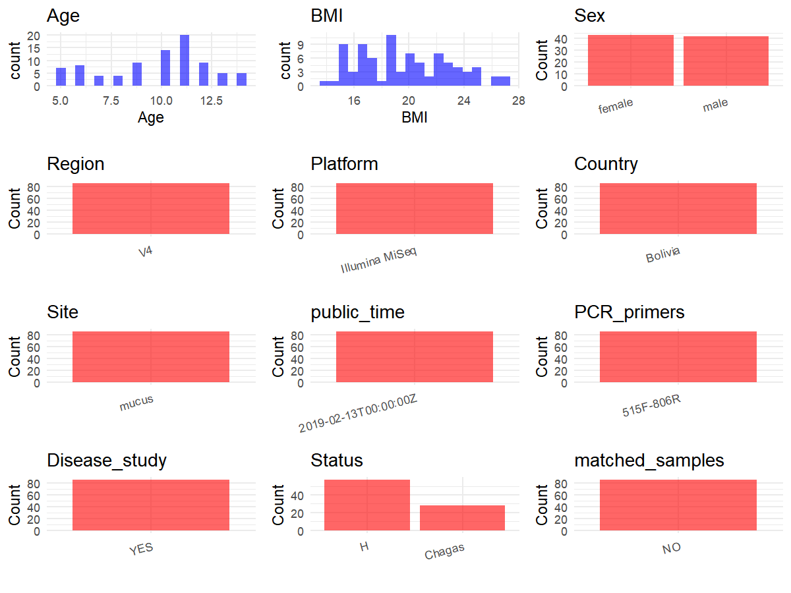

R Notebook: Metadata Processing Workflow
================

# Step 1: Obtain Initial Metadata from Each Project

To obtain the initial metadata: 1. Search for the BioProject ID (e.g.,
“PRJEBXXXX”) on the [NCBI SRA
website](https://www.ncbi.nlm.nih.gov/Traces/study/). 2. In the “Select”
table, click on “Metadata” and download the file. 3. The downloaded file
is typically named “SraRunTable.csv” and contains metadata for the
project.

``` r
# Load necessary libraries
library(dplyr)
library(ggplot2)
library(cowplot)

# Set working directory (update this path to your local directory)
setwd("D:/metadata/PRJEB31199")

# Read the initial metadata files
initial_meta<-read.csv("SraRunTable.csv",header = T)

# Combine the two metadata files
#meta <- rbind(initial_meta, initial_meta1)

#Remove entries non-oral samples
#initial_meta <- subset(initial_meta, Organism == "human oral metagenome")

# Check the number of samples containing "HT" in Sample.Name (e.g., healthy controls)
#nrow(subset(meta, grepl("HT", Sample.Name)))

# Display the first few rows of the metadata
head(initial_meta)
```

    ##          Run anonymized_name Assay.Type AvgSpotLen Barcode..exp.   Bases
    ## 1 ERR3149990             156      OTHER        150  TCTGAGGTTGCC 1154525
    ## 2 ERR3149991             157      OTHER        147  TACCGCTTCTTC  504325
    ## 3 ERR3149992             158      OTHER        150  TCATTCCACTCA 2663978
    ## 4 ERR3149993             159      OTHER        150  GCTATCAAGACA 2467154
    ## 5 ERR3149994             160      OTHER        150  GCACACCTGATA  930230
    ## 6 ERR3149995             161      OTHER        150  CATCAAGCATAG 1080540
    ##   BioProject    BioSample   Bytes center_name..exp.
    ## 1 PRJEB31199 SAMEA5332107  690090             NYUMC
    ## 2 PRJEB31199 SAMEA5332108  352771             NYUMC
    ## 3 PRJEB31199 SAMEA5332109 1495393             NYUMC
    ## 4 PRJEB31199 SAMEA5332110 1474502             NYUMC
    ## 5 PRJEB31199 SAMEA5332111  560807             NYUMC
    ## 6 PRJEB31199 SAMEA5332112  617591             NYUMC
    ##                                          Center.Name
    ## 1 UNIVERSITY OF CALIFORNIA SAN DIEGO MICROBIOME INIT
    ## 2 UNIVERSITY OF CALIFORNIA SAN DIEGO MICROBIOME INIT
    ## 3 UNIVERSITY OF CALIFORNIA SAN DIEGO MICROBIOME INIT
    ## 4 UNIVERSITY OF CALIFORNIA SAN DIEGO MICROBIOME INIT
    ## 5 UNIVERSITY OF CALIFORNIA SAN DIEGO MICROBIOME INIT
    ## 6 UNIVERSITY OF CALIFORNIA SAN DIEGO MICROBIOME INIT
    ##                                              center_project_name..exp.
    ## 1 Microbiota of Children with Chagas Disease treated with Benznidazole
    ## 2 Microbiota of Children with Chagas Disease treated with Benznidazole
    ## 3 Microbiota of Children with Chagas Disease treated with Benznidazole
    ## 4 Microbiota of Children with Chagas Disease treated with Benznidazole
    ## 5 Microbiota of Children with Chagas Disease treated with Benznidazole
    ## 6 Microbiota of Children with Chagas Disease treated with Benznidazole
    ##   collection_timestamp Consent DATASTORE.filetype DATASTORE.provider
    ## 1           2013/10/24  public   fastq,run.zq,sra     ena,gs,ncbi,s3
    ## 2           2013/10/25  public   fastq,run.zq,sra     ena,gs,ncbi,s3
    ## 3           2013/10/26  public   fastq,run.zq,sra     ena,gs,ncbi,s3
    ## 4           2013/10/25  public   fastq,run.zq,sra     ena,gs,ncbi,s3
    ## 5           2013/10/25  public   fastq,run.zq,sra     ena,gs,ncbi,s3
    ## 6           2013/10/27  public   fastq,run.zq,sra     ena,gs,ncbi,s3
    ##                           DATASTORE.region dna_extracted elevation
    ## 1 ena,gs.us-east1,ncbi.public,s3.us-east-1          TRUE      3290
    ## 2 ena,gs.us-east1,ncbi.public,s3.us-east-1          TRUE      3290
    ## 3 ena,gs.us-east1,ncbi.public,s3.us-east-1          TRUE      3290
    ## 4 ena,gs.us-east1,ncbi.public,s3.us-east-1          TRUE      3290
    ## 5 ena,gs.us-east1,ncbi.public,s3.us-east-1          TRUE      3290
    ## 6 ena,gs.us-east1,ncbi.public,s3.us-east-1          TRUE      3290
    ##             empo_1            empo_2            empo_3 ENA_FIRST_PUBLIC
    ## 1  Host-associated Animal-associated  Animal secretion        2019/2/12
    ## 2 Host-asssociated Animal-associated    Animal surface        2019/2/12
    ## 3 Host-asssociated Animal-associated Animal distal gut        2019/2/12
    ## 4  Host-associated Animal-associated  Animal secretion        2019/2/12
    ## 5 Host-asssociated Animal-associated    Animal surface        2019/2/12
    ## 6 Host-asssociated Animal-associated Animal distal gut        2019/2/12
    ##       ENA_first_public ENA.LAST.UPDATE..run.      ENA_last_update     env_biome
    ## 1 2019-02-12T17:04:21Z             2019/2/11 2019-02-11T16:01:28Z village biome
    ## 2 2019-02-12T17:04:21Z             2019/2/11 2019-02-11T16:01:28Z village biome
    ## 3 2019-02-12T17:04:21Z             2019/2/11 2019-02-11T16:01:28Z village biome
    ## 4 2019-02-12T17:04:21Z             2019/2/11 2019-02-11T16:01:28Z village biome
    ## 5 2019-02-12T17:04:21Z             2019/2/11 2019-02-11T16:01:28Z village biome
    ## 6 2019-02-12T17:04:21Z             2019/2/11 2019-02-11T16:01:28Z village biome
    ##                env_feature env_material Env_package Experiment  external_id
    ## 1 human-associated habitat        mucus  human-oral ERX3179067 SAMEA5332107
    ## 2 human-associated habitat        sebum  human-skin ERX3179068 SAMEA5332108
    ## 3 human-associated habitat        feces   human-gut ERX3179069 SAMEA5332109
    ## 4 human-associated habitat        mucus  human-oral ERX3179070 SAMEA5332110
    ## 5 human-associated habitat        sebum  human-skin ERX3179071 SAMEA5332111
    ## 6 human-associated habitat        feces   human-gut ERX3179072 SAMEA5332112
    ##   geo_loc_name_country geo_loc_name_country_continent
    ## 1              Bolivia                  South America
    ## 2              Bolivia                  South America
    ## 3              Bolivia                  South America
    ## 4              Bolivia                  South America
    ## 5              Bolivia                  South America
    ## 6              Bolivia                  South America
    ##                   geo_loc_name Host_age host_age_units  host_body_habitat
    ## 1 Bolivia:Yamparaez\\,Tarabuco       10          years UBERON:oral cavity
    ## 2 Bolivia:Yamparaez\\,Tarabuco       10          years        UBERON:skin
    ## 3 Bolivia:Yamparaez\\,Tarabuco       10          years       UBERON:feces
    ## 4 Bolivia:Yamparaez\\,Tarabuco        8          years UBERON:oral cavity
    ## 5 Bolivia:Yamparaez\\,Tarabuco        8          years        UBERON:skin
    ## 6 Bolivia:Yamparaez\\,Tarabuco        8          years       UBERON:feces
    ##   host_body_mass_index host_body_product         host_body_site host_height
    ## 1                27.00     UBERON:saliva          UBERON:mucosa         116
    ## 2                26.50      UBERON:sebum UBERON:skin of forearm         116
    ## 3                26.50      UBERON:feces           UBERON:feces         116
    ## 4                17.13     UBERON:saliva          UBERON:mucosa         122
    ## 5                17.13      UBERON:sebum UBERON:skin of forearm         122
    ## 6                17.13      UBERON:feces           UBERON:feces         122
    ##   host_height_units host_weight host_weight_units INSDC_center_name
    ## 1                cm        35.7                kg            UCSDMI
    ## 2                cm        35.7                kg            UCSDMI
    ## 3                cm        35.7                kg            UCSDMI
    ## 4                cm        25.5                kg            UCSDMI
    ## 5                cm        25.5                kg            UCSDMI
    ## 6                cm        25.5                kg            UCSDMI
    ##     INSDC_first_public    INSDC_last_update INSDC_status     Instrument
    ## 1 2019-02-12T17:04:21Z 2019-02-11T16:01:28Z       public Illumina MiSeq
    ## 2 2019-02-12T17:04:21Z 2019-02-11T16:01:28Z       public Illumina MiSeq
    ## 3 2019-02-12T17:04:21Z 2019-02-11T16:01:28Z       public Illumina MiSeq
    ## 4 2019-02-12T17:04:21Z 2019-02-11T16:01:28Z       public Illumina MiSeq
    ## 5 2019-02-12T17:04:21Z 2019-02-11T16:01:28Z       public Illumina MiSeq
    ## 6 2019-02-12T17:04:21Z 2019-02-11T16:01:28Z       public Illumina MiSeq
    ##   LATITUDE Library.Name LibraryLayout LibrarySelection LibrarySource
    ## 1   -19.17     11724.16        SINGLE              PCR   METAGENOMIC
    ## 2   -19.17     11724.16        SINGLE              PCR   METAGENOMIC
    ## 3   -19.17     11724.16        SINGLE              PCR   METAGENOMIC
    ## 4   -19.17     11724.16        SINGLE              PCR   METAGENOMIC
    ## 5   -19.17     11724.16        SINGLE              PCR   METAGENOMIC
    ## 6   -19.17     11724.16        SINGLE              PCR   METAGENOMIC
    ##   linker..exp. LONGITUDE medical_conditions              Organism
    ## 1           GT    -64.92    Negative Chagas human oral metagenome
    ## 2           GT    -64.92    Negative Chagas human skin metagenome
    ## 3           GT    -64.92    Negative Chagas  human gut metagenome
    ## 4           GT    -64.92    Negative Chagas human oral metagenome
    ## 5           GT    -64.92    Negative Chagas human skin metagenome
    ## 6           GT    -64.92    Negative Chagas  human gut metagenome
    ##                                   pcr_primers..exp. physical_specimen_location
    ## 1 FWD:GTGCCAGCMGCCGCGGTAA; REV:GGACTACHVGGGTWTCTAAT NYU Langone Medical Center
    ## 2 FWD:GTGCCAGCMGCCGCGGTAA; REV:GGACTACHVGGGTWTCTAAT NYU Langone Medical Center
    ## 3 FWD:GTGCCAGCMGCCGCGGTAA; REV:GGACTACHVGGGTWTCTAAT NYU Langone Medical Center
    ## 4 FWD:GTGCCAGCMGCCGCGGTAA; REV:GGACTACHVGGGTWTCTAAT NYU Langone Medical Center
    ## 5 FWD:GTGCCAGCMGCCGCGGTAA; REV:GGACTACHVGGGTWTCTAAT NYU Langone Medical Center
    ## 6 FWD:GTGCCAGCMGCCGCGGTAA; REV:GGACTACHVGGGTWTCTAAT NYU Langone Medical Center
    ##   physical_specimen_remaining Platform           primer..exp.
    ## 1                       FALSE ILLUMINA CCGGACTACHVGGGTWTCTAAT
    ## 2                       FALSE ILLUMINA CCGGACTACHVGGGTWTCTAAT
    ## 3                       FALSE ILLUMINA CCGGACTACHVGGGTWTCTAAT
    ## 4                       FALSE ILLUMINA CCGGACTACHVGGGTWTCTAAT
    ## 5                       FALSE ILLUMINA CCGGACTACHVGGGTWTCTAAT
    ## 6                       FALSE ILLUMINA CCGGACTACHVGGGTWTCTAAT
    ##   real_sampling_time_days          ReleaseDate run_center..exp. run_date..exp.
    ## 1      Control post-treat 2019-02-13T00:00:00Z            NYUMC      2005/8/14
    ## 2      Control post-treat 2019-02-13T00:00:00Z            NYUMC      2005/8/14
    ## 3      Control post-treat 2019-02-13T00:00:00Z            NYUMC      2005/8/14
    ## 4      Control post-treat 2019-02-13T00:00:00Z            NYUMC      2005/8/14
    ## 5      Control post-treat 2019-02-13T00:00:00Z            NYUMC      2005/8/14
    ## 6      Control post-treat 2019-02-13T00:00:00Z            NYUMC      2005/8/14
    ##            create_date version  Sample.Name               Sample_name
    ## 1 2019-02-16T14:12:00Z       1 SAMEA5332107 qiita_sid_11724:11724.156
    ## 2 2019-02-16T14:12:00Z       1 SAMEA5332108 qiita_sid_11724:11724.157
    ## 3 2019-02-16T14:13:00Z       1 SAMEA5332109 qiita_sid_11724:11724.158
    ## 4 2019-02-16T14:13:00Z       1 SAMEA5332110 qiita_sid_11724:11724.159
    ## 5 2019-02-16T14:13:00Z       1 SAMEA5332111 qiita_sid_11724:11724.160
    ## 6 2019-02-16T14:12:00Z       1 SAMEA5332112 qiita_sid_11724:11724.161
    ##   sample_type_orig sample_type       Scientific_Name   sequencing_meth..exp.
    ## 1      oral mucosa      saliva human oral metagenome Sequencing by synthesis
    ## 2             skin        skin human skin metagenome Sequencing by synthesis
    ## 3            stool       stool  human gut metagenome Sequencing by synthesis
    ## 4      oral mucosa      saliva human oral metagenome Sequencing by synthesis
    ## 5             skin        skin human skin metagenome Sequencing by synthesis
    ## 6            stool       stool  human gut metagenome Sequencing by synthesis
    ##      sex SRA.Study              Submitter_Id target_gene..exp.
    ## 1 female ERP113722 qiita_sid_11724:11724.156          16S rRNA
    ## 2 female ERP113722 qiita_sid_11724:11724.157          16S rRNA
    ## 3 female ERP113722 qiita_sid_11724:11724.158          16S rRNA
    ## 4   male ERP113722 qiita_sid_11724:11724.159          16S rRNA
    ## 5   male ERP113722 qiita_sid_11724:11724.160          16S rRNA
    ## 6   male ERP113722 qiita_sid_11724:11724.161          16S rRNA
    ##   target_subfragment
    ## 1                 V4
    ## 2                 V4
    ## 3                 V4
    ## 4                 V4
    ## 5                 V4
    ## 6                 V4

# Step 2: Create a Uniform Metadata Template

The uniform metadata should include the following columns:

1.  **BioProject**: Project ID (e.g., “PRJNA339212”)
2.  **Run**: Sample ID (e.g., “ERRXXXXXX” or “SRRXXXXXX”)
3.  **sample_name**: Original sample name submitted by the authors (not
    the database-assigned ID)
4.  **Age**: Age of the subject (if available)
5.  **BMI**: Body Mass Index (if available)
6.  **Sex**: Sex of the subject (“F” or “M”)
7.  **Region**: Targeted 16S rRNA region (e.g., “V3-V4”)
8.  **Platform**: Sequencing platform (e.g., “Illumina MiSeq”)
9.  **Country**: Country of sample origin (e.g., “China”)
10. **Site**: Sample site (e.g., “saliva”, “dental plaque”)
11. **public_time**: Data release date (format: “YYYY-MM-DD”)
12. **PCR_primers**: PCR primers used (e.g., “515F-806R”)
13. **title**: Title of the associated publication
14. **Disease_study**: Whether the study involves a disease (“YES” or
    “NO”)
15. **Status**: Disease status (e.g., “T2DM”, “HC”). Note: If the study
    includes both disease and healthy samples, this must be specified
    per sample.
16. **matched_samples**: matched samples (“YES” or “NO”)

``` r
# Create a uniform metadata dataframe
metadata <- data.frame(
  BioProject = initial_meta$BioProject,
  Run = initial_meta$Run,
  sample_name = initial_meta$Sample.Name,
  Age = initial_meta$Host_age,
  BMI = initial_meta$host_body_mass_index,
  Sex= initial_meta$sex,
  Region = "V4",
  Platform = initial_meta$Instrument,
  Country = initial_meta$geo_loc_name_country,
  Site = initial_meta$env_material,
  public_time = initial_meta$ReleaseDate,
  stringsAsFactors = FALSE
)
```

# Step 3: Manually Add Information from the Publication

Some information (e.g. PCR primers, study title, disease status) must be
manually extracted from the publication and added to the metadata.

``` r
# Add information obtained from the publication
metadata$PCR_primers <- "515F-806R"
metadata$title <- "The fecal oral and skin microbiota of children with Chagas disease treated with benznidazole"
metadata$Disease_study <- "YES"
# Assign disease status based on sample_name patterns
#metadata$Status<-"NA"

#extract subject id by remove prefix of sample_name

metadata <- metadata %>%
  mutate(Status = case_when(
    initial_meta$medical_conditions == "Negative Chagas" ~ "H",
    initial_meta$medical_conditions == "Chronic Chagas" ~ "Chagas"
  ))
keep_subjects <- unique(subset(metadata, Site == "mucus")$sample_name)
metadata <- subset(metadata, sample_name %in% keep_subjects)

sample_counts <- table(metadata$sample_name)

metadata$matched_samples <-
  ifelse(metadata$sample_name %in% names(sample_counts[sample_counts >= 2]),
         "YES", "NO")

cat("Subjects retained:", length(unique(metadata$sample_name)), "\n")
```

    ## Subjects retained: 85

``` r
cat("Matched samples distribution:\n")
```

    ## Matched samples distribution:

``` r
table(metadata$matched_samples)
```

    ## 
    ## NO 
    ## 85

``` r
cat("Sample distribution by Site:\n")
```

    ## Sample distribution by Site:

``` r
table(metadata$Site)
```

    ## 
    ## mucus 
    ##    85

# Step 4: Summarize and Validate the Metadata

``` r
# Check the number of unique runs and sample names
print(paste("Number of unique runs:", length(unique(metadata$Run))))
```

    ## [1] "Number of unique runs: 85"

``` r
print(paste("Number of unique sample names:", length(unique(metadata$sample_name))))
```

    ## [1] "Number of unique sample names: 85"

# Step 5: Visualize the Metadata

``` r

```

<!-- -->

# Step 6: Finalize and Export the Metadata

``` r
# Reorder columns to match the desired format
metadata <- metadata[, c(
  "BioProject", "Run", "sample_name", "Age", "BMI", "Sex", 
  "Region", "Platform", "Country", "Site", "public_time", 
  "PCR_primers", "title", "Disease_study", "Status","matched_samples"
)]

# Export the uniform metadata to a CSV file
write.csv(metadata, file = "metadata.csv", quote = FALSE)
head(metadata)
```

    ##    BioProject        Run  sample_name Age   BMI    Sex Region       Platform
    ## 1  PRJEB31199 ERR3149990 SAMEA5332107  10 27.00 female     V4 Illumina MiSeq
    ## 4  PRJEB31199 ERR3149993 SAMEA5332110   8 17.13   male     V4 Illumina MiSeq
    ## 7  PRJEB31199 ERR3149996 SAMEA5332113   6 15.27   male     V4 Illumina MiSeq
    ## 10 PRJEB31199 ERR3149999 SAMEA5332116   7 15.50   male     V4 Illumina MiSeq
    ## 13 PRJEB31199 ERR3150002 SAMEA5332119  12 16.40   male     V4 Illumina MiSeq
    ## 16 PRJEB31199 ERR3150005 SAMEA5332122  10 16.74   male     V4 Illumina MiSeq
    ##    Country  Site          public_time PCR_primers
    ## 1  Bolivia mucus 2019-02-13T00:00:00Z   515F-806R
    ## 4  Bolivia mucus 2019-02-13T00:00:00Z   515F-806R
    ## 7  Bolivia mucus 2019-02-13T00:00:00Z   515F-806R
    ## 10 Bolivia mucus 2019-02-13T00:00:00Z   515F-806R
    ## 13 Bolivia mucus 2019-02-13T00:00:00Z   515F-806R
    ## 16 Bolivia mucus 2019-02-13T00:00:00Z   515F-806R
    ##                                                                                           title
    ## 1  The fecal oral and skin microbiota of children with Chagas disease treated with benznidazole
    ## 4  The fecal oral and skin microbiota of children with Chagas disease treated with benznidazole
    ## 7  The fecal oral and skin microbiota of children with Chagas disease treated with benznidazole
    ## 10 The fecal oral and skin microbiota of children with Chagas disease treated with benznidazole
    ## 13 The fecal oral and skin microbiota of children with Chagas disease treated with benznidazole
    ## 16 The fecal oral and skin microbiota of children with Chagas disease treated with benznidazole
    ##    Disease_study Status matched_samples
    ## 1            YES      H              NO
    ## 4            YES      H              NO
    ## 7            YES      H              NO
    ## 10           YES Chagas              NO
    ## 13           YES Chagas              NO
    ## 16           YES Chagas              NO

## Notes for Students:

1.  **Metadata Accuracy**: Always cross-check the metadata with the
    original publication to ensure accuracy.
2.  **Manual Entries**: Columns like `PCR_primers`, and `Status` often
    require manual entry based on the publication.
3.  **Disease Status**: Be careful when assigning `Status`—some studies
    include both disease and healthy samples.
4.  **Visualization**: The plots help quickly identify the distribution
    of values in each column, which is useful for quality control.
5.  **Reproducibility**: Update the working directory and file paths to
    match your local environment.
