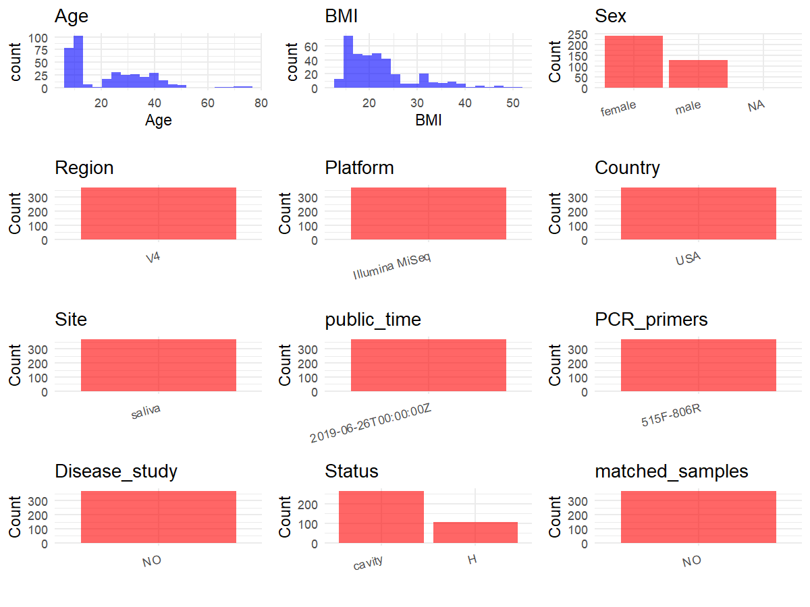

R Notebook: Metadata Processing Workflow
================

# Step 1: Obtain Initial Metadata from Each Project

To obtain the initial metadata: 1. Search for the BioProject ID (e.g.,
“PRJEBXXXX”) on the [NCBI SRA
website](https://www.ncbi.nlm.nih.gov/Traces/study/). 2. In the “Select”
table, click on “Metadata” and download the file. 3. The downloaded file
is typically named “SraRunTable.csv” and contains metadata for the
project.

``` r
# Load necessary libraries
library(dplyr)
library(ggplot2)
library(cowplot)

# Set working directory (update this path to your local directory)
setwd("D:/metadata/PRJEB33119")

# Read the initial metadata files
initial_meta<-read.csv("SraRunTable.csv",header = T)

# Combine the two metadata files
#meta <- rbind(initial_meta, initial_meta1)

#Remove entries non-oral samples
#initial_meta <- subset(initial_meta, Organism == "human oral metagenome")

# Check the number of samples containing "HT" in Sample.Name (e.g., healthy controls)
#nrow(subset(meta, grepl("HT", Sample.Name)))

# Display the first few rows of the metadata
head(initial_meta)
```

    ##          Run african_american anonymized_name Asian Assay.Type AvgSpotLen
    ## 1 ERR3384888               No          C.0006    No      OTHER        150
    ## 2 ERR3384899               No          C.0028    No      OTHER        150
    ## 3 ERR3384900               No          C.0035    No      OTHER        150
    ## 4 ERR3384901               No          C.0036    No      OTHER        150
    ## 5 ERR3384902               No          C.0038    No      OTHER        150
    ## 6 ERR3384910               No          C.0053    No      OTHER        150
    ##   Barcode..exp.   Bases BioProject    BioSample   Bytes center_name..exp.
    ## 1  CAGGAACCAGGA 2493300 PRJEB33119 SAMEA5723553 1729022            UCSDMI
    ## 2  CTAGCGTGCGTT 2058900 PRJEB33119 SAMEA5723564 1437232            UCSDMI
    ## 3  CTACAGGGTCTC 4777800 PRJEB33119 SAMEA5723565 3258882            UCSDMI
    ## 4  GTTCATTAAACT 4071450 PRJEB33119 SAMEA5723566 2871700            UCSDMI
    ## 5  GCTGCGTATACC 3011850 PRJEB33119 SAMEA5723567 2152986            UCSDMI
    ## 6  AATACAGACCTG 4367100 PRJEB33119 SAMEA5723575 3016313            UCSDMI
    ##                                          Center.Name center_project_name..exp.
    ## 1 UNIVERSITY OF CALIFORNIA SAN DIEGO MICROBIOME INIT              DMNS_Garneau
    ## 2 UNIVERSITY OF CALIFORNIA SAN DIEGO MICROBIOME INIT              DMNS_Garneau
    ## 3 UNIVERSITY OF CALIFORNIA SAN DIEGO MICROBIOME INIT              DMNS_Garneau
    ## 4 UNIVERSITY OF CALIFORNIA SAN DIEGO MICROBIOME INIT              DMNS_Garneau
    ## 5 UNIVERSITY OF CALIFORNIA SAN DIEGO MICROBIOME INIT              DMNS_Garneau
    ## 6 UNIVERSITY OF CALIFORNIA SAN DIEGO MICROBIOME INIT              DMNS_Garneau
    ##   collection_timestamp Consent DATASTORE.filetype DATASTORE.provider
    ## 1            2015/11/6  public   fastq,run.zq,sra     ena,gs,ncbi,s3
    ## 2            2015/11/9  public   fastq,run.zq,sra     ena,gs,ncbi,s3
    ## 3           2015/11/10  public   fastq,run.zq,sra     ena,gs,ncbi,s3
    ## 4           2015/11/10  public   fastq,run.zq,sra     ena,gs,ncbi,s3
    ## 5           2015/11/12  public   fastq,run.zq,sra     ena,gs,ncbi,s3
    ## 6           2015/11/15  public   fastq,run.zq,sra     ena,gs,ncbi,s3
    ##                           DATASTORE.region dna_extracted elevation
    ## 1 ena,gs.us-east1,ncbi.public,s3.us-east-1          TRUE      1609
    ## 2 ena,gs.us-east1,ncbi.public,s3.us-east-1          TRUE      1609
    ## 3 ena,gs.us-east1,ncbi.public,s3.us-east-1          TRUE      1609
    ## 4 ena,gs.us-east1,ncbi.public,s3.us-east-1          TRUE      1609
    ## 5 ena,gs.us-east1,ncbi.public,s3.us-east-1          TRUE      1609
    ## 6 ena,gs.us-east1,ncbi.public,s3.us-east-1          TRUE      1609
    ##            empo_1 empo_2           empo_3 ENA_FIRST_PUBLIC_run
    ## 1 Host-associated Animal Animal secretion            2019/6/25
    ## 2 Host-associated Animal Animal secretion            2019/6/25
    ## 3 Host-associated Animal Animal secretion            2019/6/25
    ## 4 Host-associated Animal Animal secretion            2019/6/25
    ## 5 Host-associated Animal Animal secretion            2019/6/25
    ## 6 Host-associated Animal Animal secretion            2019/6/25
    ##       ENA_first_public ENA.LAST.UPDATE..run.      ENA_last_update   env_biome
    ## 1 2019-06-25T04:06:07Z             2019/6/19 2019-06-19T19:16:16Z urban biome
    ## 2 2019-06-25T04:06:07Z             2019/6/19 2019-06-19T19:16:16Z urban biome
    ## 3 2019-06-25T04:06:07Z             2019/6/19 2019-06-19T19:16:17Z urban biome
    ## 4 2019-06-25T04:06:07Z             2019/6/19 2019-06-19T19:16:17Z urban biome
    ## 5 2019-06-25T04:06:07Z             2019/6/19 2019-06-19T19:16:17Z urban biome
    ## 6 2019-06-25T04:06:07Z             2019/6/19 2019-06-19T19:16:17Z urban biome
    ##                env_feature env_material Env_package Experiment  external_id
    ## 1 human-associated habitat       saliva  human-oral ERX3408772 SAMEA5723553
    ## 2 human-associated habitat       saliva  human-oral ERX3408783 SAMEA5723564
    ## 3 human-associated habitat       saliva  human-oral ERX3408784 SAMEA5723565
    ## 4 human-associated habitat       saliva  human-oral ERX3408785 SAMEA5723566
    ## 5 human-associated habitat       saliva  human-oral ERX3408786 SAMEA5723567
    ## 6 human-associated habitat       saliva  human-oral ERX3408794 SAMEA5723575
    ##   extraction_robot..exp. extractionkit_lot..exp. geo_loc_name_country
    ## 1                     NA                      NA                  USA
    ## 2                     NA                      NA                  USA
    ## 3                     NA                      NA                  USA
    ## 4                     NA                      NA                  USA
    ## 5                     NA                      NA                  USA
    ## 6                     NA                      NA                  USA
    ##   geo_loc_name_country_continent     geo_loc_name host_age_units
    ## 1                  North America USA:CO\\, Denver          years
    ## 2                  North America USA:CO\\, Denver          years
    ## 3                  North America USA:CO\\, Denver          years
    ## 4                  North America USA:CO\\, Denver          years
    ## 5                  North America USA:CO\\, Denver          years
    ## 6                  North America USA:CO\\, Denver          years
    ##   host_height_units host_weight_units INSDC_center_name   INSDC_first_public
    ## 1                cm                kg            UCSDMI 2019-06-25T04:06:07Z
    ## 2                cm                kg            UCSDMI 2019-06-25T04:06:07Z
    ## 3                cm                kg            UCSDMI 2019-06-25T04:06:07Z
    ## 4                cm                kg            UCSDMI 2019-06-25T04:06:07Z
    ## 5                cm                kg            UCSDMI 2019-06-25T04:06:07Z
    ## 6                cm                kg            UCSDMI 2019-06-25T04:06:07Z
    ##      INSDC_last_update INSDC_status     Instrument LATITUDE Library.Name
    ## 1 2019-06-19T19:16:16Z       public Illumina MiSeq  39.7392 11293.C.0006
    ## 2 2019-06-19T19:16:16Z       public Illumina MiSeq  39.7392 11293.C.0028
    ## 3 2019-06-19T19:16:17Z       public Illumina MiSeq  39.7392 11293.C.0035
    ## 4 2019-06-19T19:16:17Z       public Illumina MiSeq  39.7392 11293.C.0036
    ## 5 2019-06-19T19:16:17Z       public Illumina MiSeq  39.7392 11293.C.0038
    ## 6 2019-06-19T19:16:17Z       public Illumina MiSeq  39.7392 11293.C.0053
    ##   LibraryLayout LibrarySelection LibrarySource linker..exp. LONGITUDE
    ## 1        SINGLE              PCR   METAGENOMIC           GT -104.9903
    ## 2        SINGLE              PCR   METAGENOMIC           GT -104.9903
    ## 3        SINGLE              PCR   METAGENOMIC           GT -104.9903
    ## 4        SINGLE              PCR   METAGENOMIC           GT -104.9903
    ## 5        SINGLE              PCR   METAGENOMIC           GT -104.9903
    ## 6        SINGLE              PCR   METAGENOMIC           GT -104.9903
    ##   mastermix_lot..exp. native_american              Organism orig_name..exp.
    ## 1              443912              No human oral metagenome          C.0006
    ## 2              443912              No human oral metagenome          C.0028
    ## 3              443912              No human oral metagenome          C.0035
    ## 4              443912              No human oral metagenome          C.0036
    ## 5              443912              No human oral metagenome          C.0038
    ## 6              443912              No human oral metagenome          C.0053
    ##   pacific_islander                                 pcr_primers..exp.
    ## 1               No FWD:GTGYCAGCMGCCGCGGTAA; REV:GGACTACNVGGGTWTCTAAT
    ## 2               No FWD:GTGYCAGCMGCCGCGGTAA; REV:GGACTACNVGGGTWTCTAAT
    ## 3               No FWD:GTGYCAGCMGCCGCGGTAA; REV:GGACTACNVGGGTWTCTAAT
    ## 4               No FWD:GTGYCAGCMGCCGCGGTAA; REV:GGACTACNVGGGTWTCTAAT
    ## 5               No FWD:GTGYCAGCMGCCGCGGTAA; REV:GGACTACNVGGGTWTCTAAT
    ## 6               No FWD:GTGYCAGCMGCCGCGGTAA; REV:GGACTACNVGGGTWTCTAAT
    ##   physical_specimen_location physical_specimen_remaining Platform plating..exp.
    ## 1                     UCSDMI                       FALSE ILLUMINA            NA
    ## 2                     UCSDMI                       FALSE ILLUMINA            NA
    ## 3                     UCSDMI                       FALSE ILLUMINA            NA
    ## 4                     UCSDMI                       FALSE ILLUMINA            NA
    ## 5                     UCSDMI                       FALSE ILLUMINA            NA
    ## 6                     UCSDMI                       FALSE ILLUMINA            NA
    ##   primer_date..exp.          primer..exp. primer_plate..exp.
    ## 1             11917 GTGTGCCAGCMGCCGCGGTAA                  2
    ## 2             11917 GTGTGCCAGCMGCCGCGGTAA                  2
    ## 3             11917 GTGTGCCAGCMGCCGCGGTAA                  2
    ## 4             11917 GTGTGCCAGCMGCCGCGGTAA                  2
    ## 5             11917 GTGTGCCAGCMGCCGCGGTAA                  3
    ## 6             11917 GTGTGCCAGCMGCCGCGGTAA                  3
    ##   processing_robot..exp. project_name..exp. race_na race_other
    ## 1                 CARMEN               DMNS      No         No
    ## 2                 CARMEN               DMNS      No         No
    ## 3                 CARMEN               DMNS      No         No
    ## 4                 CARMEN               DMNS      No         No
    ## 5                   RIKE               DMNS      No         No
    ## 6                   RIKE               DMNS      No         No
    ##            ReleaseDate run_center..exp. run_date..exp.          create_date
    ## 1 2019-06-26T00:00:00Z           UCSDMI        2/21/17 2019-06-26T08:54:00Z
    ## 2 2019-06-26T00:00:00Z           UCSDMI        2/21/17 2019-06-26T08:54:00Z
    ## 3 2019-06-26T00:00:00Z           UCSDMI        2/21/17 2019-06-26T08:54:00Z
    ## 4 2019-06-26T00:00:00Z           UCSDMI        2/21/17 2019-06-26T08:54:00Z
    ## 5 2019-06-26T00:00:00Z           UCSDMI        2/21/17 2019-06-26T08:54:00Z
    ## 6 2019-06-26T00:00:00Z           UCSDMI        2/21/17 2019-06-26T08:55:00Z
    ##   version run_prefix..exp.  Sample.Name                  sample_name
    ## 1       1     DMNS_S1_L001 SAMEA5723553 qiita_sid_11293:11293.C.0006
    ## 2       1     DMNS_S1_L001 SAMEA5723564 qiita_sid_11293:11293.C.0028
    ## 3       1     DMNS_S1_L001 SAMEA5723565 qiita_sid_11293:11293.C.0035
    ## 4       1     DMNS_S1_L001 SAMEA5723566 qiita_sid_11293:11293.C.0036
    ## 5       1     DMNS_S1_L001 SAMEA5723567 qiita_sid_11293:11293.C.0038
    ## 6       1     DMNS_S1_L001 SAMEA5723575 qiita_sid_11293:11293.C.0053
    ##   sample_plate..exp. sample_type       scientific_name   sequencing_meth..exp.
    ## 1       DMNS_Plate_2      saliva human oral metagenome Sequencing by synthesis
    ## 2       DMNS_Plate_2      saliva human oral metagenome Sequencing by synthesis
    ## 3       DMNS_Plate_2      saliva human oral metagenome Sequencing by synthesis
    ## 4       DMNS_Plate_2      saliva human oral metagenome Sequencing by synthesis
    ## 5       DMNS_Plate_3      saliva human oral metagenome Sequencing by synthesis
    ## 6       DMNS_Plate_3      saliva human oral metagenome Sequencing by synthesis
    ##   SRA.Study                 Submitter_Id target_gene..exp. target_subfragment
    ## 1 ERP115887 qiita_sid_11293:11293.C.0006          16S rRNA                 V4
    ## 2 ERP115887 qiita_sid_11293:11293.C.0028          16S rRNA                 V4
    ## 3 ERP115887 qiita_sid_11293:11293.C.0035          16S rRNA                 V4
    ## 4 ERP115887 qiita_sid_11293:11293.C.0036          16S rRNA                 V4
    ## 5 ERP115887 qiita_sid_11293:11293.C.0038          16S rRNA                 V4
    ## 6 ERP115887 qiita_sid_11293:11293.C.0053          16S rRNA                 V4
    ##   tm1000_8_tool..exp. tm300_8_tool..exp. tm50_8_tool..exp. water_lot..exp.
    ## 1                  NA            3076189           409172Z         1798402
    ## 2                  NA            3076189           409172Z         1798402
    ## 3                  NA            3076189           409172Z         1798402
    ## 4                  NA            3076189           409172Z         1798402
    ## 5                  NA            311318B           311426B         1798402
    ## 6                  NA            311318B           311426B         1798402
    ##   well_description..exp. well_id..exp. white host_subject_id
    ## 1 DMNS_Plate_2_C.0006_F4            F4   Yes          C-0006
    ## 2 DMNS_Plate_2_C.0028_G9            G9   Yes          C-0028
    ## 3 DMNS_Plate_2_C.0035_A1            A1   Yes          C-0035
    ## 4 DMNS_Plate_2_C.0036_B1            B1   Yes          C-0036
    ## 5 DMNS_Plate_3_C.0038_G1            G1   Yes          C-0038
    ## 6 DMNS_Plate_3_C.0053_B2            B2   Yes          C-0053
    ##   antibiotics_last_6_months  BMI brush_teeth_daily collection_date_orig
    ## 1                        no 48.8                 1       2015/11/6 0:00
    ## 2                        no 19.6                 2       2015/11/9 0:00
    ## 3                        no 23.5                 2      2015/11/10 0:00
    ## 4                        no 21.6                 2      2015/11/10 0:00
    ## 5                        no 18.6                 2      2015/11/12 0:00
    ## 6                        no 15.0                 1      2015/11/15 0:00
    ##   enrolling_with_others               ETHNICITY floss_each_day
    ## 1                   Yes Non-Hispanic/Non-Latino              0
    ## 2                   Yes Non-Hispanic/Non-Latino              1
    ## 3                   Yes Non-Hispanic/Non-Latino              2
    ## 4                   Yes Non-Hispanic/Non-Latino              1
    ## 5                   Yes Non-Hispanic/Non-Latino              1
    ## 6                   Yes Non-Hispanic/Non-Latino              0
    ##   gained_weight_last_6_mo Host_age host_body_habitat host_body_mass_index
    ## 1                      no       31      UBERON:mouth                 48.8
    ## 2                      no       42      UBERON:mouth                 19.6
    ## 3                     yes       38      UBERON:mouth                 23.5
    ## 4                      no       27      UBERON:mouth                 21.6
    ## 5                      no       11      UBERON:mouth                 18.6
    ## 6                      no        9      UBERON:mouth                 15.0
    ##   host_body_product       host_body_site host_height host_weight
    ## 1     UBERON:saliva UBERON:buccal mucosa      179.07      156.76
    ## 2     UBERON:saliva UBERON:buccal mucosa      160.02       50.35
    ## 3     UBERON:saliva UBERON:buccal mucosa      179.07       75.11
    ## 4     UBERON:saliva UBERON:buccal mucosa      173.99       65.05
    ## 5     UBERON:saliva UBERON:buccal mucosa      147.32       40.19
    ## 6     UBERON:saliva UBERON:buccal mucosa      135.89       27.39
    ##          last_cavity     last_dentist_visit lost_weight_last_6_mo
    ## 1       2+ years ago         4-6 months ago                    no
    ## 2       2+ years ago   more than 1 year ago                   yes
    ## 3       2+ years ago   more than 1 year ago                    no
    ## 4       2+ years ago less than 3 months ago                    no
    ## 5 Never had a cavity less than 3 months ago                    no
    ## 6       2+ years ago less than 3 months ago                    no
    ##   percent_body_fat periodontal_disease    sex time_since_last_eating twins
    ## 1             34.9                  no   male       20min-1 hour ago    No
    ## 2             10.4                  no female       20min-1 hour ago    No
    ## 3             20.8                  no   male          1-2 hours ago    No
    ## 4             11.5                  no   male          1-2 hours ago    No
    ## 5             21.6                  no female       20min-1 hour ago    No
    ## 6             10.8                  no female       20min-1 hour ago    No
    ##   liking_0_percent liking_2point4_percent liking_4point3_percent Family_Id
    ## 1               36                     45                     24         2
    ## 2               49                     26                     52        10
    ## 3                8                     28                     48        11
    ## 4               60                     48                     47        12
    ## 5               23                     38                     12        13
    ## 6               29                     55                     52        19
    ##   family_microbiome_data host_common_name host_scientific_name host_taxid
    ## 1                     No            human         Homo sapiens       9606
    ## 2                    Yes            human         Homo sapiens       9606
    ## 3                     No            human         Homo sapiens       9606
    ## 4                     No            human         Homo sapiens       9606
    ## 5                     No            human         Homo sapiens       9606
    ## 6                     No            human         Homo sapiens       9606
    ##   life_stage liking_13point7_percent pedigree_id liking_7point7_percent
    ## 1      adult                      48           1                     NA
    ## 2      adult                      63           2                     29
    ## 3      adult                      49           1                     62
    ## 4      adult                      51           1                     57
    ## 5      child                      91           3                     10
    ## 6      child                      36           3                      4
    ##   intensity_2point4_percent intensity_13point7_percent
    ## 1                         1                          4
    ## 2                        47                         52
    ## 3                        72                         49
    ## 4                         2                          3
    ## 5                        54                         71
    ## 6                        25                         68
    ##   intensity_4point3_percent intensity_7point7_percent intensity_0_percent
    ## 1                        70                        19                  12
    ## 2                         0                        93                  31
    ## 3                         4                        29                  95
    ## 4                         5                        20                  27
    ## 5                        66                        10                  51
    ## 6                        70                         8                  62
    ##   smoker frequency_hard_liquor frequency_beer frequency_sweetened_tea
    ## 1     No                 never    1x per week                   never
    ## 2     No                 never          never                   never
    ## 3     No                 never     1x per day                   never
    ## 4     No                 never          never                   never
    ## 5                                                                    
    ## 6                                                                    
    ##   frequency_tea_coffee_with_cream_or_sugar frequency_diet_soda
    ## 1                                    never         1x per week
    ## 2                                    never               never
    ## 3                       3x or more per day               never
    ## 4                                    never               never
    ## 5                                                             
    ## 6                                                             
    ##   frequency_energy_drinks frequency_whole_milk frequency_black_tea_coffee
    ## 1                   never                never                      never
    ## 2                   never                never              2-3x per week
    ## 3                   never                never                      never
    ## 4                   never                never                      never
    ## 5                                                                        
    ## 6                                                                        
    ##   frequency_fat_free_milk frequency_reduced_fat_milk
    ## 1              2x per day                      never
    ## 2                   never                      never
    ## 3                   never                1x per week
    ## 4                   never                1x per week
    ## 5                                                   
    ## 6                                                   
    ##   frequency_sweetened_juice_beverage
    ## 1                      2-3x per week
    ## 2                              never
    ## 3                              never
    ## 4                              never
    ## 5                                   
    ## 6

# Step 2: Create a Uniform Metadata Template

The uniform metadata should include the following columns:

1.  **BioProject**: Project ID (e.g., “PRJNA339212”)
2.  **Run**: Sample ID (e.g., “ERRXXXXXX” or “SRRXXXXXX”)
3.  **sample_name**: Original sample name submitted by the authors (not
    the database-assigned ID)
4.  **Age**: Age of the subject (if available)
5.  **BMI**: Body Mass Index (if available)
6.  **Sex**: Sex of the subject (“F” or “M”)
7.  **Region**: Targeted 16S rRNA region (e.g., “V3-V4”)
8.  **Platform**: Sequencing platform (e.g., “Illumina MiSeq”)
9.  **Country**: Country of sample origin (e.g., “China”)
10. **Site**: Sample site (e.g., “saliva”, “dental plaque”)
11. **public_time**: Data release date (format: “YYYY-MM-DD”)
12. **PCR_primers**: PCR primers used (e.g., “515F-806R”)
13. **title**: Title of the associated publication
14. **Disease_study**: Whether the study involves a disease (“YES” or
    “NO”)
15. **Status**: Disease status (e.g., “T2DM”, “HC”). Note: If the study
    includes both disease and healthy samples, this must be specified
    per sample.
16. **matched_samples**: matched samples (“YES” or “NO”)

``` r
# Create a uniform metadata dataframe
metadata <- data.frame(
  BioProject = initial_meta$BioProject,
  Run = initial_meta$Run,
  sample_name = initial_meta$Sample.Name,
  Age = initial_meta$Host_age,
  BMI = initial_meta$BMI,
  Sex=initial_meta$sex,
  Region = "V4",
  Platform = initial_meta$Instrument,
  Country = initial_meta$geo_loc_name_country,
  Site = initial_meta$env_material,
  public_time = initial_meta$ReleaseDate,
  stringsAsFactors = FALSE
)
```

# Step 3: Manually Add Information from the Publication

Some information (e.g. PCR primers, study title, disease status) must be
manually extracted from the publication and added to the metadata.

``` r
# Add information obtained from the publication
metadata$PCR_primers <- "515F-806R"
metadata$title <- "Patterns of Oral Microbiota Diversity in Adults and Children: A Crowdsourced Population Study"
metadata$Disease_study <- "NO"
# Assign disease status based on sample_name patterns
#metadata$Status<-"H"
metadata <- metadata %>%
  mutate(Status = case_when(
    initial_meta$last_cavity == "Never had a cavity" ~ "H",
    initial_meta$last_cavity != "Never had a cavity" ~ "cavity"
  ))

keep_subjects <- unique(subset(metadata, Site == "saliva")$sample_name)
metadata <- subset(metadata, sample_name %in% keep_subjects)

metadata$matched_samples <- "NO"
```

# Step 4: Summarize and Validate the Metadata

``` r
# Check the number of unique runs and sample names
print(paste("Number of unique runs:", length(unique(metadata$Run))))
```

    ## [1] "Number of unique runs: 368"

``` r
print(paste("Number of unique sample names:", length(unique(metadata$sample_name))))
```

    ## [1] "Number of unique sample names: 368"

# Step 5: Visualize the Metadata

``` r

```

<!-- -->

# Step 6: Finalize and Export the Metadata

``` r
# Reorder columns to match the desired format
metadata <- metadata[, c(
  "BioProject", "Run", "sample_name", "Age", "BMI", "Sex", 
  "Region", "Platform", "Country", "Site", "public_time", 
  "PCR_primers", "title", "Disease_study", "Status","matched_samples"
)]

# Export the uniform metadata to a CSV file
write.csv(metadata, file = "metadata.csv", quote = TRUE)
head(metadata)
```

    ##   BioProject        Run  sample_name Age  BMI    Sex Region       Platform
    ## 1 PRJEB33119 ERR3384888 SAMEA5723553  31 48.8   male     V4 Illumina MiSeq
    ## 2 PRJEB33119 ERR3384899 SAMEA5723564  42 19.6 female     V4 Illumina MiSeq
    ## 3 PRJEB33119 ERR3384900 SAMEA5723565  38 23.5   male     V4 Illumina MiSeq
    ## 4 PRJEB33119 ERR3384901 SAMEA5723566  27 21.6   male     V4 Illumina MiSeq
    ## 5 PRJEB33119 ERR3384902 SAMEA5723567  11 18.6 female     V4 Illumina MiSeq
    ## 6 PRJEB33119 ERR3384910 SAMEA5723575   9 15.0 female     V4 Illumina MiSeq
    ##   Country   Site          public_time PCR_primers
    ## 1     USA saliva 2019-06-26T00:00:00Z   515F-806R
    ## 2     USA saliva 2019-06-26T00:00:00Z   515F-806R
    ## 3     USA saliva 2019-06-26T00:00:00Z   515F-806R
    ## 4     USA saliva 2019-06-26T00:00:00Z   515F-806R
    ## 5     USA saliva 2019-06-26T00:00:00Z   515F-806R
    ## 6     USA saliva 2019-06-26T00:00:00Z   515F-806R
    ##                                                                                           title
    ## 1 Patterns of Oral Microbiota Diversity in Adults and Children: A Crowdsourced Population Study
    ## 2 Patterns of Oral Microbiota Diversity in Adults and Children: A Crowdsourced Population Study
    ## 3 Patterns of Oral Microbiota Diversity in Adults and Children: A Crowdsourced Population Study
    ## 4 Patterns of Oral Microbiota Diversity in Adults and Children: A Crowdsourced Population Study
    ## 5 Patterns of Oral Microbiota Diversity in Adults and Children: A Crowdsourced Population Study
    ## 6 Patterns of Oral Microbiota Diversity in Adults and Children: A Crowdsourced Population Study
    ##   Disease_study Status matched_samples
    ## 1            NO cavity              NO
    ## 2            NO cavity              NO
    ## 3            NO cavity              NO
    ## 4            NO cavity              NO
    ## 5            NO      H              NO
    ## 6            NO cavity              NO

## Notes for Students:

1.  **Metadata Accuracy**: Always cross-check the metadata with the
    original publication to ensure accuracy.
2.  **Manual Entries**: Columns like `PCR_primers`, and `Status` often
    require manual entry based on the publication.
3.  **Disease Status**: Be careful when assigning `Status`—some studies
    include both disease and healthy samples.
4.  **Visualization**: The plots help quickly identify the distribution
    of values in each column, which is useful for quality control.
5.  **Reproducibility**: Update the working directory and file paths to
    match your local environment.
