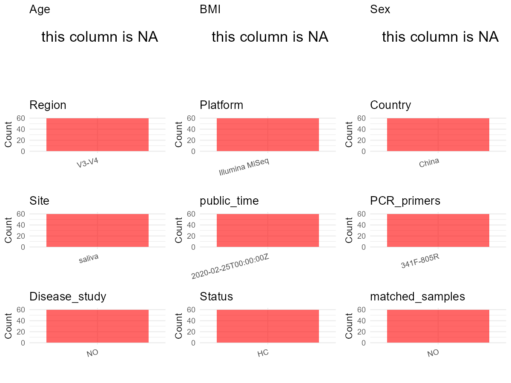

R Notebook: Metadata Processing Workflow
================

# Step 1: Obtain Initial Metadata from Each Project

To obtain the initial metadata: 1. Search for the BioProject ID (e.g.,
“PRJEBXXXX”) on the [NCBI SRA
website](https://www.ncbi.nlm.nih.gov/Traces/study/). 2. In the “Select”
table, click on “Metadata” and download the file. 3. The downloaded file
is typically named “SraRunTable.csv” and contains metadata for the
project.

``` r
# Load necessary libraries
library(dplyr)
library(ggplot2)
library(cowplot)

# Set working directory (update this path to your local directory)
setwd("E:/bioproject_YSD/PRJEB34215")

# Read the initial metadata files
initial_meta <- read.csv("SraRunTable.csv", header = T) 

# Display the first few rows of the metadata
head(initial_meta)
```

    ##          Run       Assay.Type AvgSpotLen    Bases BioProject    BioSample
    ## 1 ERR3503101 Targeted-Capture        459 27293352 PRJEB34215 SAMEA5927614
    ## 2 ERR3503102 Targeted-Capture        459 29081946 PRJEB34215 SAMEA5927615
    ## 3 ERR3503103 Targeted-Capture        460 46023835 PRJEB34215 SAMEA5927616
    ## 4 ERR3503104 Targeted-Capture        458 50707174 PRJEB34215 SAMEA5927617
    ## 5 ERR3503105 Targeted-Capture        460 32418351 PRJEB34215 SAMEA5927618
    ## 6 ERR3503106 Targeted-Capture        460 42303474 PRJEB34215 SAMEA5927619
    ##      Bytes        Center.Name Collection_Date Consent DATASTORE.filetype
    ## 1 12907287 LANZHOU UNIVERSITY         2017-09  public         run.zq,sra
    ## 2 13870271 LANZHOU UNIVERSITY         2017-09  public         run.zq,sra
    ## 3 21717045 LANZHOU UNIVERSITY         2017-09  public         run.zq,sra
    ## 4 24025685 LANZHOU UNIVERSITY         2017-09  public         run.zq,sra
    ## 5 15302048 LANZHOU UNIVERSITY         2017-09  public         run.zq,sra
    ## 6 20009345 LANZHOU UNIVERSITY         2017-09  public         run.zq,sra
    ##   DATASTORE.provider                     DATASTORE.region
    ## 1         gs,ncbi,s3 gs.us-east1,ncbi.public,s3.us-east-1
    ## 2         gs,ncbi,s3 gs.us-east1,ncbi.public,s3.us-east-1
    ## 3         gs,ncbi,s3 gs.us-east1,ncbi.public,s3.us-east-1
    ## 4         gs,ncbi,s3 gs.us-east1,ncbi.public,s3.us-east-1
    ## 5         gs,ncbi,s3 gs.us-east1,ncbi.public,s3.us-east-1
    ## 6         gs,ncbi,s3 gs.us-east1,ncbi.public,s3.us-east-1
    ##   ENA.FIRST.PUBLIC..run.     ena_first_public ENA.LAST.UPDATE..run.
    ## 1             2020-02-17 2019-10-31T04:02:51Z            2019-09-04
    ## 2             2020-02-17 2019-10-31T04:02:51Z            2019-09-04
    ## 3             2020-02-17 2019-10-31T04:02:51Z            2019-09-04
    ## 4             2020-02-17 2019-10-31T04:02:51Z            2019-09-04
    ## 5             2020-02-17 2019-10-31T04:02:51Z            2019-09-04
    ## 6             2020-02-17 2019-10-31T04:02:51Z            2019-09-04
    ##        ena_last_update environment_.biome.
    ## 1 2019-09-01T09:24:39Z             Plateau
    ## 2 2019-09-01T09:24:39Z             Plateau
    ## 3 2019-09-01T09:24:39Z             Plateau
    ## 4 2019-09-01T09:24:39Z             Plateau
    ## 5 2019-09-01T09:24:39Z             Plateau
    ## 6 2019-09-01T09:24:39Z             Plateau
    ##                                                 environment_.feature.
    ## 1 low oxygen\\, air pressure\\, and temperature\\, and high radiation
    ## 2 low oxygen\\, air pressure\\, and temperature\\, and high radiation
    ## 3 low oxygen\\, air pressure\\, and temperature\\, and high radiation
    ## 4 low oxygen\\, air pressure\\, and temperature\\, and high radiation
    ## 5 low oxygen\\, air pressure\\, and temperature\\, and high radiation
    ## 6 low oxygen\\, air pressure\\, and temperature\\, and high radiation
    ##   environment_.material. Experiment  external_id geo_loc_name_country
    ## 1                 saliva ERX3524315 SAMEA5927614                China
    ## 2                 saliva ERX3524316 SAMEA5927615                China
    ## 3                 saliva ERX3524317 SAMEA5927616                China
    ## 4                 saliva ERX3524318 SAMEA5927617                China
    ## 5                 saliva ERX3524319 SAMEA5927618                China
    ## 6                 saliva ERX3524320 SAMEA5927619                China
    ##   geo_loc_name_country_continent geographic_location_.country_and.or_sea.
    ## 1                           Asia                                    China
    ## 2                           Asia                                    China
    ## 3                           Asia                                    China
    ## 4                           Asia                                    China
    ## 5                           Asia                                    China
    ## 6                           Asia                                    China
    ##   geographic_location_.latitude. geographic_location_.longitude.
    ## 1                   102° 31' 25?                      35° 12' 9?
    ## 2                   102° 31' 25?                      35° 12' 9?
    ## 3                   102° 31' 25?                      35° 12' 9?
    ## 4                   102° 31' 25?                      35° 12' 9?
    ## 5                   102° 31' 25?                      35° 12' 9?
    ## 6                   102° 31' 25?                      35° 12' 9?
    ##   human_oral_environmental_package  INSDC_center_name   INSDC_first_public
    ## 1                       human-oral LANZHOU UNIVERSITY 2019-10-31T04:02:51Z
    ## 2                       human-oral LANZHOU UNIVERSITY 2019-10-31T04:02:51Z
    ## 3                       human-oral LANZHOU UNIVERSITY 2019-10-31T04:02:51Z
    ## 4                       human-oral LANZHOU UNIVERSITY 2019-10-31T04:02:51Z
    ## 5                       human-oral LANZHOU UNIVERSITY 2019-10-31T04:02:51Z
    ## 6                       human-oral LANZHOU UNIVERSITY 2019-10-31T04:02:51Z
    ##      INSDC_last_update INSDC_status     Instrument investigation_type
    ## 1 2019-09-01T09:24:39Z       public Illumina MiSeq   bacteria_archaea
    ## 2 2019-09-01T09:24:39Z       public Illumina MiSeq   bacteria_archaea
    ## 3 2019-09-01T09:24:39Z       public Illumina MiSeq   bacteria_archaea
    ## 4 2019-09-01T09:24:39Z       public Illumina MiSeq   bacteria_archaea
    ## 5 2019-09-01T09:24:39Z       public Illumina MiSeq   bacteria_archaea
    ## 6 2019-09-01T09:24:39Z       public Illumina MiSeq   bacteria_archaea
    ##   Library.Name LibraryLayout LibrarySelection LibrarySource        Organism
    ## 1  unspecified        SINGLE              PCR       GENOMIC oral metagenome
    ## 2  unspecified        SINGLE              PCR       GENOMIC oral metagenome
    ## 3  unspecified        SINGLE              PCR       GENOMIC oral metagenome
    ## 4  unspecified        SINGLE              PCR       GENOMIC oral metagenome
    ## 5  unspecified        SINGLE              PCR       GENOMIC oral metagenome
    ## 6  unspecified        SINGLE              PCR       GENOMIC oral metagenome
    ##   Platform
    ## 1 ILLUMINA
    ## 2 ILLUMINA
    ## 3 ILLUMINA
    ## 4 ILLUMINA
    ## 5 ILLUMINA
    ## 6 ILLUMINA
    ##                                                                                                                               project_name
    ## 1 Pyrosequencing analysis of the school children salivary microbiome from Han\\, Tibetan\\, and Hui ethnics in the Qinghai-Tibetan Plateau
    ## 2 Pyrosequencing analysis of the school children salivary microbiome from Han\\, Tibetan\\, and Hui ethnics in the Qinghai-Tibetan Plateau
    ## 3 Pyrosequencing analysis of the school children salivary microbiome from Han\\, Tibetan\\, and Hui ethnics in the Qinghai-Tibetan Plateau
    ## 4 Pyrosequencing analysis of the school children salivary microbiome from Han\\, Tibetan\\, and Hui ethnics in the Qinghai-Tibetan Plateau
    ## 5 Pyrosequencing analysis of the school children salivary microbiome from Han\\, Tibetan\\, and Hui ethnics in the Qinghai-Tibetan Plateau
    ## 6 Pyrosequencing analysis of the school children salivary microbiome from Han\\, Tibetan\\, and Hui ethnics in the Qinghai-Tibetan Plateau
    ##            ReleaseDate          create_date version  Sample.Name sample_name
    ## 1 2020-02-25T00:00:00Z 2020-02-25T15:11:00Z       1 SAMEA5927614         O32
    ## 2 2020-02-25T00:00:00Z 2020-02-25T15:13:00Z       1 SAMEA5927615         O37
    ## 3 2020-02-25T00:00:00Z 2020-02-25T15:15:00Z       1 SAMEA5927616         O40
    ## 4 2020-02-25T00:00:00Z 2020-02-25T15:16:00Z       1 SAMEA5927617         O41
    ## 5 2020-02-25T00:00:00Z 2020-02-25T15:16:00Z       1 SAMEA5927618         O45
    ## 6 2020-02-25T00:00:00Z 2020-02-25T15:16:00Z       1 SAMEA5927619         O47
    ##   scientific_name                         Sequencing_method SRA.Study
    ## 1 oral metagenome Illumina MiSeq high-throughput sequencing ERP117089
    ## 2 oral metagenome Illumina MiSeq high-throughput sequencing ERP117089
    ## 3 oral metagenome Illumina MiSeq high-throughput sequencing ERP117089
    ## 4 oral metagenome Illumina MiSeq high-throughput sequencing ERP117089
    ## 5 oral metagenome Illumina MiSeq high-throughput sequencing ERP117089
    ## 6 oral metagenome Illumina MiSeq high-throughput sequencing ERP117089
    ##   Submitter_Id
    ## 1          O32
    ## 2          O37
    ## 3          O40
    ## 4          O41
    ## 5          O45
    ## 6          O47

# Step 2: Create a Uniform Metadata Template

The uniform metadata should include the following columns:

1.  **BioProject**: Project ID (e.g., “PRJNA339212”)
2.  **Run**: Sample ID (e.g., “ERRXXXXXX” or “SRRXXXXXX”)
3.  **sample_name**: Original sample name submitted by the authors (not
    the database-assigned ID)
4.  **Age**: Age of the subject (if available)
5.  **BMI**: Body Mass Index (if available)
6.  **Sex**: Sex of the subject (“F” or “M”)
7.  **Region**: Targeted 16S rRNA region (e.g., “V3-V4”)
8.  **Platform**: Sequencing platform (e.g., “Illumina MiSeq”)
9.  **Country**: Country of sample origin (e.g., “China”)
10. **Site**: Sample site (e.g., “saliva”, “dental plaque”)
11. **public_time**: Data release date (format: “YYYY-MM-DD”)
12. **PCR_primers**: PCR primers used (e.g., “515F-806R”)
13. **title**: Title of the associated publication
14. **Disease_study**: Whether the study involves a disease (“YES” or
    “NO”)
15. **Status**: Disease status (e.g., “T2DM”, “HC”). Note: If the study
    includes both disease and healthy samples, this must be specified
    per sample.
16. **matched_samples**: matched samples (“YES” or “NO”)

``` r
# Create a uniform metadata dataframe
metadata <- data.frame(
  BioProject = initial_meta$BioProject,
  Run = initial_meta$Run,
  sample_name = initial_meta$Submitter_Id,
  Age = NA,
  BMI = NA,
  Sex = NA,
  Region = "V3-V4",
  Platform = initial_meta$Instrument,
  Country = initial_meta$geo_loc_name_country,
  Site = initial_meta$environment_.material.,
  public_time = initial_meta$ReleaseDate,
  stringsAsFactors = FALSE
)
```

# Step 3: Manually Add Information from the Publication

Some information (e.g. PCR primers, study title, disease status) must be
manually extracted from the publication and added to the metadata.

``` r
# Add information obtained from the publication
metadata$PCR_primers <- "341F-805R"
metadata$title <- "Oral microbiota of children is conserved across han tibetan and hui groups and is correlated with diet and gut microbiota"
metadata$Disease_study <- "NO"
# Assign disease status based on sample_name patterns
metadata$Status <- "HC"

# Check initial data distribution
cat("Initial sample distribution:\n")
```

    ## Initial sample distribution:

``` r
table(metadata$sample_name)
```

    ## 
    ## O102 O110 O123 O125 O127 O133 O135 O137 O142 O144 O146 O161 O168 O169 O170 O173 
    ##    1    1    1    1    1    1    1    1    1    1    1    1    1    1    1    1 
    ## O176 O177 O182 O186 O193 O194 O195 O218 O220 O226 O231 O244 O245 O253 O255 O272 
    ##    1    1    1    1    1    1    1    1    1    1    1    1    1    1    1    1 
    ## O274 O275 O281 O293 O301 O308  O32 O330 O339 O348  O37  O40  O41  O45  O47  O54 
    ##    1    1    1    1    1    1    1    1    1    1    1    1    1    1    1    1 
    ##  O55  O57  O60  O66  O67  O68  O72  O74  O80  O81  O88  O95 
    ##    1    1    1    1    1    1    1    1    1    1    1    1

``` r
table(metadata$Site)
```

    ## 
    ## saliva 
    ##     60

``` r
# Calculate sampling frequency per subject
sample_counts <- table(metadata$sample_name)
cat("\nNumber of samples per subject:\n")
```

    ## 
    ## Number of samples per subject:

``` r
print(sample_counts)
```

    ## 
    ## O102 O110 O123 O125 O127 O133 O135 O137 O142 O144 O146 O161 O168 O169 O170 O173 
    ##    1    1    1    1    1    1    1    1    1    1    1    1    1    1    1    1 
    ## O176 O177 O182 O186 O193 O194 O195 O218 O220 O226 O231 O244 O245 O253 O255 O272 
    ##    1    1    1    1    1    1    1    1    1    1    1    1    1    1    1    1 
    ## O274 O275 O281 O293 O301 O308  O32 O330 O339 O348  O37  O40  O41  O45  O47  O54 
    ##    1    1    1    1    1    1    1    1    1    1    1    1    1    1    1    1 
    ##  O55  O57  O60  O66  O67  O68  O72  O74  O80  O81  O88  O95 
    ##    1    1    1    1    1    1    1    1    1    1    1    1

``` r
# Create matched_samples column
metadata$matched_samples <- ifelse(metadata$sample_name %in% names(sample_counts[sample_counts >= 2]), "YES", "NO")

cat("\nMatched samples distribution:\n")
```

    ## 
    ## Matched samples distribution:

``` r
table(metadata$matched_samples)
```

    ## 
    ## NO 
    ## 60

``` r
# Identify samples for removal: single samples excluding saliva
single_samples <- names(sample_counts[sample_counts == 1])
samples_to_remove <- metadata$sample_name %in% single_samples & 
                     !(metadata$Site %in% c("saliva"))

cat("\nNumber of samples to be removed:", sum(samples_to_remove), "\n")
```

    ## 
    ## Number of samples to be removed: 0

``` r
# Remove identified samples
metadata_clean <- metadata[!samples_to_remove, ]

cat("\nFinal sample distribution after cleaning:\n")
```

    ## 
    ## Final sample distribution after cleaning:

``` r
table(metadata_clean$sample_name)
```

    ## 
    ## O102 O110 O123 O125 O127 O133 O135 O137 O142 O144 O146 O161 O168 O169 O170 O173 
    ##    1    1    1    1    1    1    1    1    1    1    1    1    1    1    1    1 
    ## O176 O177 O182 O186 O193 O194 O195 O218 O220 O226 O231 O244 O245 O253 O255 O272 
    ##    1    1    1    1    1    1    1    1    1    1    1    1    1    1    1    1 
    ## O274 O275 O281 O293 O301 O308  O32 O330 O339 O348  O37  O40  O41  O45  O47  O54 
    ##    1    1    1    1    1    1    1    1    1    1    1    1    1    1    1    1 
    ##  O55  O57  O60  O66  O67  O68  O72  O74  O80  O81  O88  O95 
    ##    1    1    1    1    1    1    1    1    1    1    1    1

``` r
table(metadata_clean$Site)
```

    ## 
    ## saliva 
    ##     60

``` r
table(metadata_clean$matched_samples)
```

    ## 
    ## NO 
    ## 60

``` r
# Use cleaned dataset for subsequent analysis
metadata <- metadata_clean
```

# Step 4: Summarize and Validate the Metadata

``` r
# Check the number of unique runs and sample names
print(paste("Number of unique runs:", length(unique(metadata$Run))))
```

    ## [1] "Number of unique runs: 60"

``` r
print(paste("Number of unique sample names:", length(unique(metadata$sample_name))))
```

    ## [1] "Number of unique sample names: 60"

# Step 5: Visualize the Metadata

``` r

```


# Step 6: Finalize and Export the Metadata

``` r
# Reorder columns to match the desired format
metadata <- metadata[, c(
  "BioProject", "Run", "sample_name", "Age", "BMI", "Sex", 
  "Region", "Platform", "Country", "Site", "public_time", 
  "PCR_primers", "title", "Disease_study", "Status", "matched_samples"
)]

# Export the uniform metadata to a CSV file
write.csv(metadata, file = "metadata.csv", quote = FALSE)
head(metadata)
```

    ##   BioProject        Run sample_name Age BMI Sex Region       Platform Country
    ## 1 PRJEB34215 ERR3503101         O32  NA  NA  NA  V3-V4 Illumina MiSeq   China
    ## 2 PRJEB34215 ERR3503102         O37  NA  NA  NA  V3-V4 Illumina MiSeq   China
    ## 3 PRJEB34215 ERR3503103         O40  NA  NA  NA  V3-V4 Illumina MiSeq   China
    ## 4 PRJEB34215 ERR3503104         O41  NA  NA  NA  V3-V4 Illumina MiSeq   China
    ## 5 PRJEB34215 ERR3503105         O45  NA  NA  NA  V3-V4 Illumina MiSeq   China
    ## 6 PRJEB34215 ERR3503106         O47  NA  NA  NA  V3-V4 Illumina MiSeq   China
    ##     Site          public_time PCR_primers
    ## 1 saliva 2020-02-25T00:00:00Z   341F-805R
    ## 2 saliva 2020-02-25T00:00:00Z   341F-805R
    ## 3 saliva 2020-02-25T00:00:00Z   341F-805R
    ## 4 saliva 2020-02-25T00:00:00Z   341F-805R
    ## 5 saliva 2020-02-25T00:00:00Z   341F-805R
    ## 6 saliva 2020-02-25T00:00:00Z   341F-805R
    ##                                                                                                                       title
    ## 1 Oral microbiota of children is conserved across han tibetan and hui groups and is correlated with diet and gut microbiota
    ## 2 Oral microbiota of children is conserved across han tibetan and hui groups and is correlated with diet and gut microbiota
    ## 3 Oral microbiota of children is conserved across han tibetan and hui groups and is correlated with diet and gut microbiota
    ## 4 Oral microbiota of children is conserved across han tibetan and hui groups and is correlated with diet and gut microbiota
    ## 5 Oral microbiota of children is conserved across han tibetan and hui groups and is correlated with diet and gut microbiota
    ## 6 Oral microbiota of children is conserved across han tibetan and hui groups and is correlated with diet and gut microbiota
    ##   Disease_study Status matched_samples
    ## 1            NO     HC              NO
    ## 2            NO     HC              NO
    ## 3            NO     HC              NO
    ## 4            NO     HC              NO
    ## 5            NO     HC              NO
    ## 6            NO     HC              NO

## Notes for Students:

1.  **Metadata Accuracy**: Always cross-check the metadata with the
    original publication to ensure accuracy.
2.  **Manual Entries**: Columns like `PCR_primers`, and `Status` often
    require manual entry based on the publication.
3.  **Disease Status**: Be careful when assigning `Status`—some studies
    include both disease and healthy samples.
4.  **Visualization**: The plots help quickly identify the distribution
    of values in each column, which is useful for quality control.
5.  **Reproducibility**: Update the working directory and file paths to
    match your local environment.
