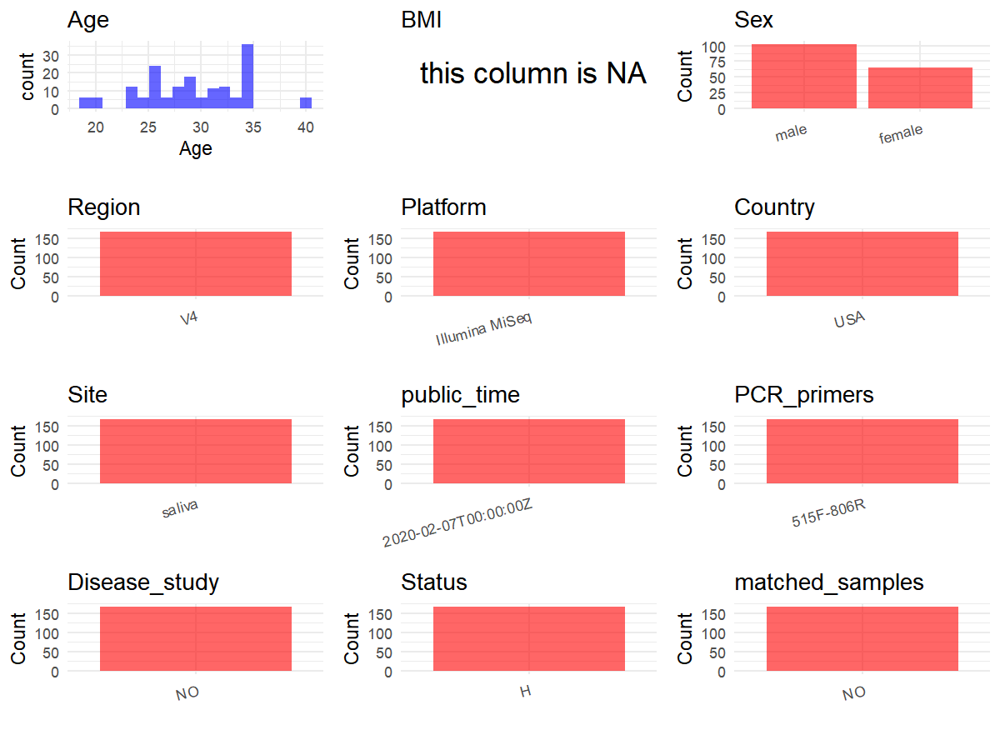

R Notebook: Metadata Processing Workflow
================

# Step 1: Obtain Initial Metadata from Each Project

To obtain the initial metadata: 1. Search for the BioProject ID (e.g.,
“PRJEBXXXX”) on the [NCBI SRA
website](https://www.ncbi.nlm.nih.gov/Traces/study/). 2. In the “Select”
table, click on “Metadata” and download the file. 3. The downloaded file
is typically named “SraRunTable.csv” and contains metadata for the
project.

``` r
# Load necessary libraries
library(dplyr)
library(ggplot2)
library(cowplot)

# Set working directory (update this path to your local directory)
setwd("D:/metadata/PRJEB34272")

# Read the initial metadata files
initial_meta<-read.csv("SraRunTable.csv",header = T)

# Combine the two metadata files
#meta <- rbind(initial_meta, initial_meta1)

#Remove entries non-oral samples
#initial_meta <- subset(initial_meta, Organism == "human oral metagenome")

# Check the number of samples containing "HT" in Sample.Name (e.g., healthy controls)
#nrow(subset(meta, grepl("HT", Sample.Name)))

# Display the first few rows of the metadata
head(initial_meta)
```

    ##          Run anonymized_name Assay.Type AvgSpotLen barcode..exp.    Bases
    ## 1 ERR3507429            A1.1      OTHER        150  TAGGACGGGAGT 15388335
    ## 2 ERR3507430            A1.2      OTHER        150  AAGTCTTATCTC 13524780
    ## 3 ERR3507431            A1.3      OTHER        150  TTGCACCGTCGA 10897723
    ## 4 ERR3507432            A2.1      OTHER        150  CTCCGAACAACA 10139124
    ## 5 ERR3507433            A2.2      OTHER        150  TCTGGCTACGAC 13307205
    ## 6 ERR3507434            A2.3      OTHER        150  AGTAGTTTCCTT 13829938
    ##   BioProject    BioSample   Bytes center_name..exp.
    ## 1 PRJEB34272 SAMEA5936285 9469089            UCSDMI
    ## 2 PRJEB34272 SAMEA5936286 8521501            UCSDMI
    ## 3 PRJEB34272 SAMEA5936287 6441898            UCSDMI
    ## 4 PRJEB34272 SAMEA5936288 6483462            UCSDMI
    ## 5 PRJEB34272 SAMEA5936289 8214696            UCSDMI
    ## 6 PRJEB34272 SAMEA5936290 8575395            UCSDMI
    ##                                          Center.Name center_project_name..exp.
    ## 1 UNIVERSITY OF CALIFORNIA SAN DIEGO MICROBIOME INIT                  Lisa SRS
    ## 2 UNIVERSITY OF CALIFORNIA SAN DIEGO MICROBIOME INIT                  Lisa SRS
    ## 3 UNIVERSITY OF CALIFORNIA SAN DIEGO MICROBIOME INIT                  Lisa SRS
    ## 4 UNIVERSITY OF CALIFORNIA SAN DIEGO MICROBIOME INIT                  Lisa SRS
    ## 5 UNIVERSITY OF CALIFORNIA SAN DIEGO MICROBIOME INIT                  Lisa SRS
    ## 6 UNIVERSITY OF CALIFORNIA SAN DIEGO MICROBIOME INIT                  Lisa SRS
    ##   collection_timestamp Consent DATASTORE.filetype DATASTORE.provider
    ## 1        8/24/18 14:02  public         run.zq,sra         gs,ncbi,s3
    ## 2        8/24/18 14:30  public         run.zq,sra         gs,ncbi,s3
    ## 3        8/24/18 16:25  public         run.zq,sra         gs,ncbi,s3
    ## 4        8/22/18 14:20  public         run.zq,sra         gs,ncbi,s3
    ## 5        8/22/18 14:40  public         run.zq,sra         gs,ncbi,s3
    ## 6        8/22/18 16:18  public         run.zq,sra         gs,ncbi,s3
    ##                       DATASTORE.region dna_extracted elevation           empo_1
    ## 1 gs.us-east1,ncbi.public,s3.us-east-1          TRUE       193 Host-asssociated
    ## 2 gs.us-east1,ncbi.public,s3.us-east-1          TRUE       193 Host-asssociated
    ## 3 gs.us-east1,ncbi.public,s3.us-east-1          TRUE       193 Host-asssociated
    ## 4 gs.us-east1,ncbi.public,s3.us-east-1          TRUE       193 Host-asssociated
    ## 5 gs.us-east1,ncbi.public,s3.us-east-1          TRUE       193 Host-asssociated
    ## 6 gs.us-east1,ncbi.public,s3.us-east-1          TRUE       193 Host-asssociated
    ##   empo_2           empo_3 ENA_FIRST_PUBLIC     ena_first_public
    ## 1 Animal Animal secretion         2020/2/5 2020-02-05T04:04:59Z
    ## 2 Animal Animal secretion         2020/2/5 2020-02-05T04:04:59Z
    ## 3 Animal Animal secretion         2020/2/5 2020-02-05T04:04:59Z
    ## 4 Animal Animal secretion         2020/2/5 2020-02-05T04:04:59Z
    ## 5 Animal Animal secretion         2020/2/5 2020-02-05T04:04:59Z
    ## 6 Animal Animal secretion         2020/2/5 2020-02-05T04:04:59Z
    ##   ENA.LAST.UPDATE..run.      ena_last_update   env_biome
    ## 1             2019/9/26 2019-09-05T13:41:49Z urban biome
    ## 2             2019/9/26 2019-09-05T13:41:49Z urban biome
    ## 3             2019/9/26 2019-09-05T13:41:49Z urban biome
    ## 4             2019/9/26 2019-09-05T13:41:49Z urban biome
    ## 5             2019/9/26 2019-09-05T13:41:49Z urban biome
    ## 6             2019/9/26 2019-09-05T13:41:49Z urban biome
    ##                 env_feature env_material     env_package Experiment
    ## 1 animal-associated habitat       saliva host-associated ERX3528643
    ## 2 animal-associated habitat       saliva host-associated ERX3528644
    ## 3 animal-associated habitat       saliva host-associated ERX3528645
    ## 4 animal-associated habitat       saliva host-associated ERX3528646
    ## 5 animal-associated habitat       saliva host-associated ERX3528647
    ## 6 animal-associated habitat       saliva host-associated ERX3528648
    ##    external_id geo_loc_name_country geo_loc_name_country_continent
    ## 1 SAMEA5936285                  USA                  North America
    ## 2 SAMEA5936286                  USA                  North America
    ## 3 SAMEA5936287                  USA                  North America
    ## 4 SAMEA5936288                  USA                  North America
    ## 5 SAMEA5936289                  USA                  North America
    ## 6 SAMEA5936290                  USA                  North America
    ##         geo_loc_name host_age_units host_height_units host_subject_id
    ## 1 USA:CA\\,San Diego          years                cm              A1
    ## 2 USA:CA\\,San Diego          years                cm              A1
    ## 3 USA:CA\\,San Diego          years                cm              A1
    ## 4 USA:CA\\,San Diego          years                cm              A2
    ## 5 USA:CA\\,San Diego          years                cm              A2
    ## 6 USA:CA\\,San Diego          years                cm              A2
    ##   host_weight_units INSDC_center_name   INSDC_first_public    INSDC_last_update
    ## 1                kg            UCSDMI 2020-02-05T04:04:59Z 2019-09-05T13:41:49Z
    ## 2                kg            UCSDMI 2020-02-05T04:04:59Z 2019-09-05T13:41:49Z
    ## 3                kg            UCSDMI 2020-02-05T04:04:59Z 2019-09-05T13:41:49Z
    ## 4                kg            UCSDMI 2020-02-05T04:04:59Z 2019-09-05T13:41:49Z
    ## 5                kg            UCSDMI 2020-02-05T04:04:59Z 2019-09-05T13:41:49Z
    ## 6                kg            UCSDMI 2020-02-05T04:04:59Z 2019-09-05T13:41:49Z
    ##   INSDC_status     Instrument latitude Library.Name LibraryLayout
    ## 1       public Illumina MiSeq     32.5   11899.A1.1        SINGLE
    ## 2       public Illumina MiSeq     32.5   11899.A1.2        SINGLE
    ## 3       public Illumina MiSeq     32.5   11899.A1.3        SINGLE
    ## 4       public Illumina MiSeq     32.5   11899.A2.1        SINGLE
    ## 5       public Illumina MiSeq     32.5   11899.A2.2        SINGLE
    ## 6       public Illumina MiSeq     32.5   11899.A2.3        SINGLE
    ##   LibrarySelection LibrarySource linker..exp. longitude              Organism
    ## 1              PCR   METAGENOMIC           GT   -117.25 human oral metagenome
    ## 2              PCR   METAGENOMIC           GT   -117.25 human oral metagenome
    ## 3              PCR   METAGENOMIC           GT   -117.25 human oral metagenome
    ## 4              PCR   METAGENOMIC           GT   -117.25 human oral metagenome
    ## 5              PCR   METAGENOMIC           GT   -117.25 human oral metagenome
    ## 6              PCR   METAGENOMIC           GT   -117.25 human oral metagenome
    ##                                   pcr_primers..exp. physical_specimen_location
    ## 1 FWD:GTGYCAGCMGCCGCGGTAA; REV:GGACTACNVGGGTWTCTAAT                     UCSDMI
    ## 2 FWD:GTGYCAGCMGCCGCGGTAA; REV:GGACTACNVGGGTWTCTAAT                     UCSDMI
    ## 3 FWD:GTGYCAGCMGCCGCGGTAA; REV:GGACTACNVGGGTWTCTAAT                     UCSDMI
    ## 4 FWD:GTGYCAGCMGCCGCGGTAA; REV:GGACTACNVGGGTWTCTAAT                     UCSDMI
    ## 5 FWD:GTGYCAGCMGCCGCGGTAA; REV:GGACTACNVGGGTWTCTAAT                     UCSDMI
    ## 6 FWD:GTGYCAGCMGCCGCGGTAA; REV:GGACTACNVGGGTWTCTAAT                     UCSDMI
    ##   physical_specimen_remaining Platform          primer..exp.
    ## 1                        TRUE ILLUMINA GTGTGYCAGCMGCCGCGGTAA
    ## 2                        TRUE ILLUMINA GTGTGYCAGCMGCCGCGGTAA
    ## 3                        TRUE ILLUMINA GTGTGYCAGCMGCCGCGGTAA
    ## 4                        TRUE ILLUMINA GTGTGYCAGCMGCCGCGGTAA
    ## 5                        TRUE ILLUMINA GTGTGYCAGCMGCCGCGGTAA
    ## 6                        TRUE ILLUMINA GTGTGYCAGCMGCCGCGGTAA
    ##            ReleaseDate run_center..exp. run_date..exp.          create_date
    ## 1 2020-02-07T00:00:00Z           UCSDMI      2010/6/18 2020-02-07T15:44:00Z
    ## 2 2020-02-07T00:00:00Z           UCSDMI      2010/6/18 2020-02-07T15:44:00Z
    ## 3 2020-02-07T00:00:00Z           UCSDMI      2010/6/18 2020-02-07T15:44:00Z
    ## 4 2020-02-07T00:00:00Z           UCSDMI      2010/6/18 2020-02-07T15:45:00Z
    ## 5 2020-02-07T00:00:00Z           UCSDMI      2010/6/18 2020-02-07T15:45:00Z
    ## 6 2020-02-07T00:00:00Z           UCSDMI      2010/6/18 2020-02-07T15:45:00Z
    ##   version
    ## 1       1
    ## 2       1
    ## 3       1
    ## 4       1
    ## 5       1
    ## 6       1
    ##                                                                      run_prefix..exp.
    ## 1 AGP_245_HNRC_3_Karin_HPG_Mouse_1_Lisa_Saliva_Response_1_Pro_test_Vogtmann_1_S1_L001
    ## 2 AGP_245_HNRC_3_Karin_HPG_Mouse_1_Lisa_Saliva_Response_1_Pro_test_Vogtmann_1_S1_L001
    ## 3 AGP_245_HNRC_3_Karin_HPG_Mouse_1_Lisa_Saliva_Response_1_Pro_test_Vogtmann_1_S1_L001
    ## 4 AGP_245_HNRC_3_Karin_HPG_Mouse_1_Lisa_Saliva_Response_1_Pro_test_Vogtmann_1_S1_L001
    ## 5 AGP_245_HNRC_3_Karin_HPG_Mouse_1_Lisa_Saliva_Response_1_Pro_test_Vogtmann_1_S1_L001
    ## 6 AGP_245_HNRC_3_Karin_HPG_Mouse_1_Lisa_Saliva_Response_1_Pro_test_Vogtmann_1_S1_L001
    ##                          runid..exp.  Sample.Name                Sample_name
    ## 1 181006_M05314_0128_000000000-BR6YB SAMEA5936285 qiita_sid_11899:11899.A1.1
    ## 2 181006_M05314_0128_000000000-BR6YB SAMEA5936286 qiita_sid_11899:11899.A1.2
    ## 3 181006_M05314_0128_000000000-BR6YB SAMEA5936287 qiita_sid_11899:11899.A1.3
    ## 4 181006_M05314_0128_000000000-BR6YB SAMEA5936288 qiita_sid_11899:11899.A2.1
    ## 5 181006_M05314_0128_000000000-BR6YB SAMEA5936289 qiita_sid_11899:11899.A2.2
    ## 6 181006_M05314_0128_000000000-BR6YB SAMEA5936290 qiita_sid_11899:11899.A2.3
    ##   sample_type       Scientific_Name   sequencing_meth..exp. SRA.Study
    ## 1      saliva human oral metagenome Sequencing by synthesis ERP117149
    ## 2      saliva human oral metagenome Sequencing by synthesis ERP117149
    ## 3      saliva human oral metagenome Sequencing by synthesis ERP117149
    ## 4      saliva human oral metagenome Sequencing by synthesis ERP117149
    ## 5      saliva human oral metagenome Sequencing by synthesis ERP117149
    ## 6      saliva human oral metagenome Sequencing by synthesis ERP117149
    ##                 Submitter_Id target_gene..exp. target_subfragment
    ## 1 qiita_sid_11899:11899.A1.1          16S rRNA                 V4
    ## 2 qiita_sid_11899:11899.A1.2          16S rRNA                 V4
    ## 3 qiita_sid_11899:11899.A1.3          16S rRNA                 V4
    ## 4 qiita_sid_11899:11899.A2.1          16S rRNA                 V4
    ## 5 qiita_sid_11899:11899.A2.2          16S rRNA                 V4
    ## 6 qiita_sid_11899:11899.A2.3          16S rRNA                 V4
    ##   antibiotics_in_the_past_6_mo bite_nails chew_gum_how_often_what_kind
    ## 1                          yes         no                           no
    ## 2                          yes         no                           no
    ## 3                          yes         no                           no
    ## 4                           no        yes                           no
    ## 5                           no        yes                           no
    ## 6                           no        yes                           no
    ##   collection_code collection_description fc_avg_cells_5_min fc_avg_cells_per_ul
    ## 1               1                 beofre           24425500               11103
    ## 2               2            15min-later           49281300               27379
    ## 3               3             2hrs-later          255770000              102308
    ## 4               1                 beofre            1167950                 249
    ## 5               2            15min-later             726600                 173
    ## 6               3             2hrs-later            4020750                 894
    ##   fc_cells_per_ul_r1 fc_cells_per_ul_r2 floss_regularly host_age
    ## 1              11351              10854              no       34
    ## 2              27306              27451              no       34
    ## 3             108976              95640              no       34
    ## 4                235                262              no       23
    ## 5                164                182              no       23
    ## 6                850                937              no       23
    ##   host_body_habitat host_body_product host_body_site host_common_name
    ## 1     UBERON:saliva     UBERON:saliva  UBERON:saliva            human
    ## 2     UBERON:saliva     UBERON:saliva  UBERON:saliva            human
    ## 3     UBERON:saliva     UBERON:saliva  UBERON:saliva            human
    ## 4     UBERON:saliva     UBERON:saliva  UBERON:saliva            human
    ## 5     UBERON:saliva     UBERON:saliva  UBERON:saliva            human
    ## 6     UBERON:saliva     UBERON:saliva  UBERON:saliva            human
    ##   host_life_stage host_scientific_name host_taxid how_often_brush_teeth
    ## 1           adult         Homo sapiens       9606                1x day
    ## 2           adult         Homo sapiens       9606                1x day
    ## 3           adult         Homo sapiens       9606                1x day
    ## 4           adult         Homo sapiens       9606              1-2x day
    ## 5           adult         Homo sapiens       9606              1-2x day
    ## 6           adult         Homo sapiens       9606              1-2x day
    ##   mouthwash_regularly on_any_medications primary_water_source processing
    ## 1                 yes                 no         city/bottled        PMA
    ## 2                 yes                 no         city/bottled        PMA
    ## 3                 yes                 no         city/bottled        PMA
    ## 4                  no                 no                 city        PMA
    ## 5                  no                 no                 city        PMA
    ## 6                  no                 no                 city        PMA
    ##   saliva_flow_rate_ml_per_min saliva_sample_id
    ## 1                        0.44             A1.1
    ## 2                        0.36             A1.2
    ## 3                        0.50             A1.3
    ## 4                        0.94             A2.1
    ## 5                        0.84             A2.2
    ## 6                        0.90             A2.3
    ##   saliva_volume_ml_collected_in_5_min saliva_weight_g
    ## 1                                 2.2            2.17
    ## 2                                 1.8            1.79
    ## 3                                 2.5            2.47
    ## 4                                 4.7            4.71
    ## 5                                 4.2            4.18
    ## 6                                 4.5            4.33
    ##   self_reported_min_brushing  sex treatment_code Treatment_Description
    ## 1                      1 min male              A       water-mouthwash
    ## 2                      1 min male              A       water-mouthwash
    ## 3                      1 min male              A       water-mouthwash
    ## 4                     5 mins male              A       water-mouthwash
    ## 5                     5 mins male              A       water-mouthwash
    ## 6                     5 mins male              A       water-mouthwash
    ##   how_often_drink_soda host_body_mass_index   host_height   host_weight
    ## 1               rarely                                                 
    ## 2               rarely                                                 
    ## 3               rarely                                                 
    ## 4              1x week        not collected not collected not collected
    ## 5              1x week        not collected not collected not collected
    ## 6              1x week        not collected not collected not collected
    ##   gdna_plate_location miseq_name       treatment  Collection
    ## 1                  A1       A1.1 water-mouthwash      beofre
    ## 2                  A2       A1.2 water-mouthwash 15min-later
    ## 3                  A3       A1.3 water-mouthwash  2hrs-later
    ## 4                  A4       A2.1 water-mouthwash      beofre
    ## 5                  A5       A2.2 water-mouthwash 15min-later
    ## 6                  A6       A2.3 water-mouthwash  2hrs-later
    ##   date_of_sample_collection end_tube_volume_ml end_tube_weight_g
    ## 1              8/24/18 0:00                4.2             11.08
    ## 2              8/24/18 0:00                3.8             10.69
    ## 3              8/24/18 0:00                4.5             11.54
    ## 4              8/22/18 0:00                6.7             13.63
    ## 5              8/22/18 0:00                6.2             13.11
    ## 6              8/22/18 0:00                6.5             13.42
    ##   floss_how_often gender how_long_brush_teeth participant_identifier
    ## 1              no   male                1 min                     A1
    ## 2              no   male                1 min                     A1
    ## 3              no   male                1 min                     A1
    ## 4              no   male               5 mins                     A2
    ## 5              no   male               5 mins                     A2
    ## 6              no   male               5 mins                     A2
    ##   related_to_anyone_else_in_the_study saliva_volume saliva_weight
    ## 1                                 yes           2.2          2.17
    ## 2                                 yes           1.8          1.79
    ## 3                                 yes           2.5          2.47
    ## 4                                  no           4.7          4.71
    ## 5                                  no           4.2          4.18
    ## 6                                  no           4.5          4.33
    ##   start_tube_weight_g Time_of_sample_collection time_since_first_collection
    ## 1                8.91                   2:02:00                           0
    ## 2                8.90                   2:30:00                     0:28:00
    ## 3                9.07                   4:25:00                     2:23:00
    ## 4                8.92                   2:20:00                           0
    ## 5                8.93                   2:40:00                     0:20:00
    ## 6                9.09                   4:18:00                     1:58:00
    ##   use_mouthwash
    ## 1           yes
    ## 2           yes
    ## 3           yes
    ## 4            no
    ## 5            no
    ## 6            no
    ##                                                                                                                      any_other_details
    ## 1 last month just finished antibiotics therapy to eradicate H.pylori in stomach, curious if H.pylori can be detected in oral cavity rn
    ## 2 last month just finished antibiotics therapy to eradicate H.pylori in stomach, curious if H.pylori can be detected in oral cavity rn
    ## 3 last month just finished antibiotics therapy to eradicate H.pylori in stomach, curious if H.pylori can be detected in oral cavity rn
    ## 4                                                                                                                                     
    ## 5                                                                                                                                     
    ## 6                                                                                                                                     
    ##   how_often_use_mouthwash what_kind_of_mouthwash mouthwash_contains_alcohol
    ## 1                               Crest Pro-health                         no
    ## 2                               Crest Pro-health                         no
    ## 3                               Crest Pro-health                         no
    ## 4                                                                          
    ## 5                                                                          
    ## 6

# Step 2: Create a Uniform Metadata Template

The uniform metadata should include the following columns:

1.  **BioProject**: Project ID (e.g., “PRJNA339212”)
2.  **Run**: Sample ID (e.g., “ERRXXXXXX” or “SRRXXXXXX”)
3.  **sample_name**: Original sample name submitted by the authors (not
    the database-assigned ID)
4.  **Age**: Age of the subject (if available)
5.  **BMI**: Body Mass Index (if available)
6.  **Sex**: Sex of the subject (“F” or “M”)
7.  **Region**: Targeted 16S rRNA region (e.g., “V3-V4”)
8.  **Platform**: Sequencing platform (e.g., “Illumina MiSeq”)
9.  **Country**: Country of sample origin (e.g., “China”)
10. **Site**: Sample site (e.g., “saliva”, “dental plaque”)
11. **public_time**: Data release date (format: “YYYY-MM-DD”)
12. **PCR_primers**: PCR primers used (e.g., “515F-806R”)
13. **title**: Title of the associated publication
14. **Disease_study**: Whether the study involves a disease (“YES” or
    “NO”)
15. **Status**: Disease status (e.g., “T2DM”, “HC”). Note: If the study
    includes both disease and healthy samples, this must be specified
    per sample.
16. **matched_samples**: matched samples (“YES” or “NO”)

``` r
# Create a uniform metadata dataframe
metadata <- data.frame(
  BioProject = initial_meta$BioProject,
  Run = initial_meta$Run,
  sample_name = initial_meta$Sample.Name,
  Age = initial_meta$host_age,
  BMI = NA,
  Sex=initial_meta$sex,
  Region = "V4",
  Platform = initial_meta$Instrument,
  Country = initial_meta$geo_loc_name_country,
  Site = initial_meta$env_material,
  public_time = initial_meta$ReleaseDate,
  stringsAsFactors = FALSE
)
```

# Step 3: Manually Add Information from the Publication

Some information (e.g. PCR primers, study title, disease status) must be
manually extracted from the publication and added to the metadata.

``` r
# Add information obtained from the publication
metadata$PCR_primers <- "515F-806R"
metadata$title <- "Quantifying Live Microbial Load in Human Saliva Samples over Time Reveals Stable Composition and Dynamic Load"
metadata$Disease_study <- "NO"
# Assign disease status based on sample_name patterns
metadata$Status<-"H"
keep_subjects <- unique(subset(metadata, Site == "saliva")$sample_name)
metadata <- subset(metadata, sample_name %in% keep_subjects)

sample_counts <- table(metadata$sample_name)

metadata$matched_samples <-
  ifelse(metadata$sample_name %in% names(sample_counts[sample_counts >= 2]),
         "YES", "NO")

cat("Subjects retained:", length(unique(metadata$sample_name)), "\n")
```

    ## Subjects retained: 167

``` r
cat("Matched samples distribution:\n")
```

    ## Matched samples distribution:

``` r
table(metadata$matched_samples)
```

    ## 
    ##  NO 
    ## 167

``` r
cat("Sample distribution by Site:\n")
```

    ## Sample distribution by Site:

``` r
table(metadata$Site)
```

    ## 
    ## saliva 
    ##    167

# Step 4: Summarize and Validate the Metadata

``` r
# Check the number of unique runs and sample names
print(paste("Number of unique runs:", length(unique(metadata$Run))))
```

    ## [1] "Number of unique runs: 167"

``` r
print(paste("Number of unique sample names:", length(unique(metadata$sample_name))))
```

    ## [1] "Number of unique sample names: 167"

# Step 5: Visualize the Metadata

``` r

```

<!-- -->

# Step 6: Finalize and Export the Metadata

``` r
# Reorder columns to match the desired format
metadata <- metadata[, c(
  "BioProject", "Run", "sample_name", "Age", "BMI", "Sex", 
  "Region", "Platform", "Country", "Site", "public_time", 
  "PCR_primers", "title", "Disease_study", "Status","matched_samples"
)]

# Export the uniform metadata to a CSV file
write.csv(metadata, file = "metadata.csv", quote = FALSE)
head(metadata)
```

    ##   BioProject        Run  sample_name Age BMI  Sex Region       Platform Country
    ## 1 PRJEB34272 ERR3507429 SAMEA5936285  34  NA male     V4 Illumina MiSeq     USA
    ## 2 PRJEB34272 ERR3507430 SAMEA5936286  34  NA male     V4 Illumina MiSeq     USA
    ## 3 PRJEB34272 ERR3507431 SAMEA5936287  34  NA male     V4 Illumina MiSeq     USA
    ## 4 PRJEB34272 ERR3507432 SAMEA5936288  23  NA male     V4 Illumina MiSeq     USA
    ## 5 PRJEB34272 ERR3507433 SAMEA5936289  23  NA male     V4 Illumina MiSeq     USA
    ## 6 PRJEB34272 ERR3507434 SAMEA5936290  23  NA male     V4 Illumina MiSeq     USA
    ##     Site          public_time PCR_primers
    ## 1 saliva 2020-02-07T00:00:00Z   515F-806R
    ## 2 saliva 2020-02-07T00:00:00Z   515F-806R
    ## 3 saliva 2020-02-07T00:00:00Z   515F-806R
    ## 4 saliva 2020-02-07T00:00:00Z   515F-806R
    ## 5 saliva 2020-02-07T00:00:00Z   515F-806R
    ## 6 saliva 2020-02-07T00:00:00Z   515F-806R
    ##                                                                                                           title
    ## 1 Quantifying Live Microbial Load in Human Saliva Samples over Time Reveals Stable Composition and Dynamic Load
    ## 2 Quantifying Live Microbial Load in Human Saliva Samples over Time Reveals Stable Composition and Dynamic Load
    ## 3 Quantifying Live Microbial Load in Human Saliva Samples over Time Reveals Stable Composition and Dynamic Load
    ## 4 Quantifying Live Microbial Load in Human Saliva Samples over Time Reveals Stable Composition and Dynamic Load
    ## 5 Quantifying Live Microbial Load in Human Saliva Samples over Time Reveals Stable Composition and Dynamic Load
    ## 6 Quantifying Live Microbial Load in Human Saliva Samples over Time Reveals Stable Composition and Dynamic Load
    ##   Disease_study Status matched_samples
    ## 1            NO      H              NO
    ## 2            NO      H              NO
    ## 3            NO      H              NO
    ## 4            NO      H              NO
    ## 5            NO      H              NO
    ## 6            NO      H              NO

## Notes for Students:

1.  **Metadata Accuracy**: Always cross-check the metadata with the
    original publication to ensure accuracy.
2.  **Manual Entries**: Columns like `PCR_primers`, and `Status` often
    require manual entry based on the publication.
3.  **Disease Status**: Be careful when assigning `Status`—some studies
    include both disease and healthy samples.
4.  **Visualization**: The plots help quickly identify the distribution
    of values in each column, which is useful for quality control.
5.  **Reproducibility**: Update the working directory and file paths to
    match your local environment.
