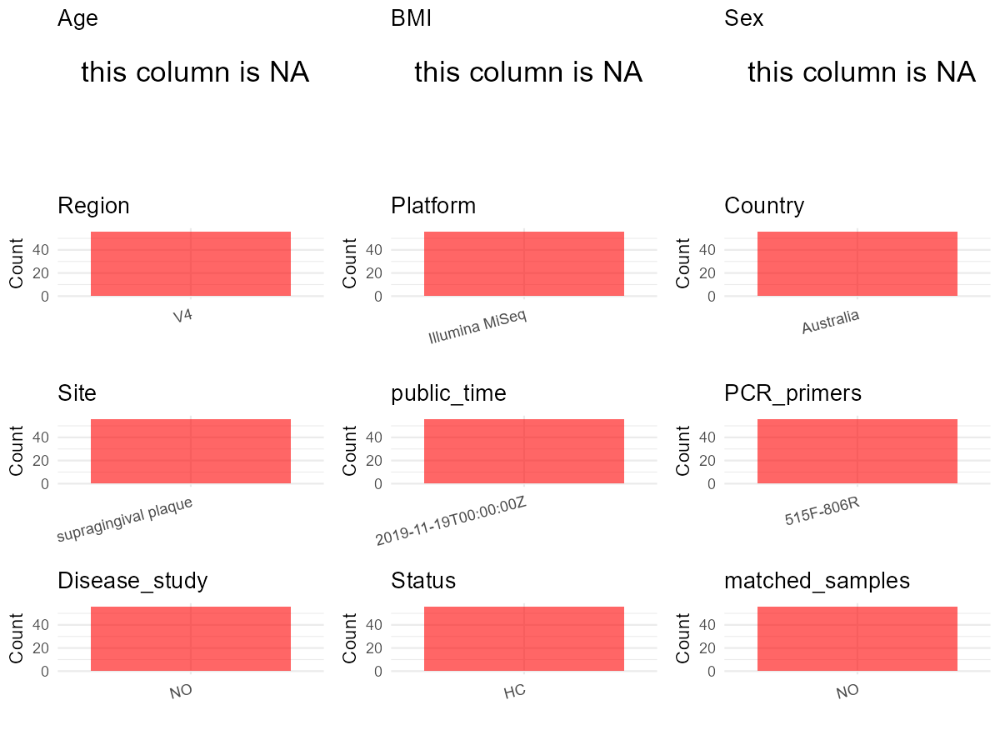

R Notebook: Metadata Processing Workflow
================

# Step 1: Obtain Initial Metadata from Each Project

To obtain the initial metadata: 1. Search for the BioProject ID (e.g.,
“PRJEBXXXX”) on the [NCBI SRA
website](https://www.ncbi.nlm.nih.gov/Traces/study/). 2. In the “Select”
table, click on “Metadata” and download the file. 3. The downloaded file
is typically named “SraRunTable.csv” and contains metadata for the
project.

``` r
# Load necessary libraries
library(dplyr)
library(ggplot2)
library(cowplot)

# Set working directory (update this path to your local directory)
setwd("D:/studylearning/董彪师兄项目/任务4_20251009/PRJEB34486")

# Read the initial metadata files
initial_meta<-read.csv("SraRunTable.csv",header = T)

# Display the first few rows of the metadata
head(initial_meta)
```

    ##          Run Assay.Type AvgSpotLen    Bases BioProject    BioSample    Bytes
    ## 1 ERR3528896   AMPLICON        501 82572364 PRJEB34486 SAMEA5785357 52146136
    ## 2 ERR3528897   AMPLICON        501 74709683 PRJEB34486 SAMEA5785375 46166490
    ## 3 ERR3528898   AMPLICON        501 79979536 PRJEB34486 SAMEA5785376 49626349
    ## 4 ERR3528899   AMPLICON        501 91050344 PRJEB34486 SAMEA5785358 56992819
    ## 5 ERR3528900   AMPLICON        501 96195271 PRJEB34486 SAMEA5785377 59916988
    ## 6 ERR3528901   AMPLICON        501 86394453 PRJEB34486 SAMEA5785378 53401335
    ##                Center.Name Collection_Date  common_name Consent
    ## 1 THE UNIVERSITY OF SYDNEY      2016-12-18 oral biofilm  public
    ## 2 THE UNIVERSITY OF SYDNEY      2016-02-03 oral biofilm  public
    ## 3 THE UNIVERSITY OF SYDNEY      2016-02-03 oral biofilm  public
    ## 4 THE UNIVERSITY OF SYDNEY      2016-12-18 oral biofilm  public
    ## 5 THE UNIVERSITY OF SYDNEY      2016-02-03 oral biofilm  public
    ## 6 THE UNIVERSITY OF SYDNEY      2016-02-03 oral biofilm  public
    ##   DATASTORE.filetype DATASTORE.provider                     DATASTORE.region
    ## 1         run.zq,sra         gs,ncbi,s3 gs.us-east1,ncbi.public,s3.us-east-1
    ## 2         run.zq,sra         gs,ncbi,s3 gs.us-east1,ncbi.public,s3.us-east-1
    ## 3         run.zq,sra         gs,ncbi,s3 gs.us-east1,ncbi.public,s3.us-east-1
    ## 4         run.zq,sra         gs,ncbi,s3 gs.us-east1,ncbi.public,s3.us-east-1
    ## 5         run.zq,sra         gs,ncbi,s3 gs.us-east1,ncbi.public,s3.us-east-1
    ## 6         run.zq,sra         gs,ncbi,s3 gs.us-east1,ncbi.public,s3.us-east-1
    ##   ENA.FIRST.PUBLIC..run.     ena_first_public ENA.LAST.UPDATE..run.
    ## 1             2019-11-18 2019-11-18T04:03:24Z            2019-09-25
    ## 2             2019-11-18 2019-11-18T04:03:24Z            2019-09-25
    ## 3             2019-11-18 2019-11-18T04:03:24Z            2019-09-25
    ## 4             2019-11-18 2019-11-18T04:03:24Z            2019-09-25
    ## 5             2019-11-18 2019-11-18T04:03:24Z            2019-09-25
    ## 6             2019-11-18 2019-11-18T04:03:24Z            2019-09-25
    ##        ena_last_update environment_.biome. environment_.feature.
    ## 1 2019-09-18T21:59:10Z       ENVO_00000446         ENVO_00000856
    ## 2 2019-09-18T21:59:11Z       ENVO_00000446         ENVO_00000856
    ## 3 2019-09-18T21:59:11Z       ENVO_00000446         ENVO_00000856
    ## 4 2019-09-18T21:59:10Z       ENVO_00000446         ENVO_00000856
    ## 5 2019-09-18T21:59:11Z       ENVO_00000446         ENVO_00000856
    ## 6 2019-09-18T21:59:11Z       ENVO_00000446         ENVO_00000856
    ##   environment_.material. Experiment  external_id geo_loc_name_country
    ## 1          ENVO_00002034 ERX3548491 SAMEA5785357            Australia
    ## 2          ENVO_00002034 ERX3548492 SAMEA5785375            Australia
    ## 3          ENVO_00002034 ERX3548493 SAMEA5785376            Australia
    ## 4          ENVO_00002034 ERX3548494 SAMEA5785358            Australia
    ## 5          ENVO_00002034 ERX3548495 SAMEA5785377            Australia
    ## 6          ENVO_00002034 ERX3548496 SAMEA5785378            Australia
    ##   geo_loc_name_country_continent geographic_location_.country_and.or_sea.
    ## 1                        Oceania                                Australia
    ## 2                        Oceania                                Australia
    ## 3                        Oceania                                Australia
    ## 4                        Oceania                                Australia
    ## 5                        Oceania                                Australia
    ## 6                        Oceania                                Australia
    ##   geographic_location_.latitude. geographic_location_.longitude.
    ## 1                        33.8086                         150.987
    ## 2                        33.8086                         150.987
    ## 3                        33.8086                         150.987
    ## 4                        33.8086                         150.987
    ## 5                        33.8086                         150.987
    ## 6                        33.8086                         150.987
    ##   human_oral_environmental_package INSDC_center_name   INSDC_first_public
    ## 1                       human-oral Sydney University 2019-11-18T04:03:24Z
    ## 2                       human-oral Sydney University 2019-11-18T04:03:24Z
    ## 3                       human-oral Sydney University 2019-11-18T04:03:24Z
    ## 4                       human-oral Sydney University 2019-11-18T04:03:24Z
    ## 5                       human-oral Sydney University 2019-11-18T04:03:24Z
    ## 6                       human-oral Sydney University 2019-11-18T04:03:24Z
    ##      INSDC_last_update INSDC_status     Instrument investigation_type
    ## 1 2019-09-18T21:59:10Z       public Illumina MiSeq     mimarks-survey
    ## 2 2019-09-18T21:59:11Z       public Illumina MiSeq     mimarks-survey
    ## 3 2019-09-18T21:59:11Z       public Illumina MiSeq     mimarks-survey
    ## 4 2019-09-18T21:59:10Z       public Illumina MiSeq     mimarks-survey
    ## 5 2019-09-18T21:59:11Z       public Illumina MiSeq     mimarks-survey
    ## 6 2019-09-18T21:59:11Z       public Illumina MiSeq     mimarks-survey
    ##   Library.Name LibraryLayout LibrarySelection LibrarySource        Organism
    ## 1    ZHO3803A3        PAIRED              PCR       GENOMIC oral metagenome
    ## 2   ZHO3803A21        PAIRED              PCR       GENOMIC oral metagenome
    ## 3   ZHO3803A22        PAIRED              PCR       GENOMIC oral metagenome
    ## 4    ZHO3803A4        PAIRED              PCR       GENOMIC oral metagenome
    ## 5   ZHO3803A23        PAIRED              PCR       GENOMIC oral metagenome
    ## 6   ZHO3803A24        PAIRED              PCR       GENOMIC oral metagenome
    ##   Platform      project_name          ReleaseDate          create_date version
    ## 1 ILLUMINA Condition Testing 2019-11-19T00:00:00Z 2019-11-19T14:03:00Z       1
    ## 2 ILLUMINA Condition Testing 2019-11-19T00:00:00Z 2019-11-19T14:03:00Z       1
    ## 3 ILLUMINA Condition Testing 2019-11-19T00:00:00Z 2019-11-19T14:03:00Z       1
    ## 4 ILLUMINA Condition Testing 2019-11-19T00:00:00Z 2019-11-19T14:03:00Z       1
    ## 5 ILLUMINA Condition Testing 2019-11-19T00:00:00Z 2019-11-19T14:04:00Z       1
    ## 6 ILLUMINA Condition Testing 2019-11-19T00:00:00Z 2019-11-19T14:04:00Z       1
    ##    Sample.Name Sample_name Scientific_Name Sequencing_method SRA.Study
    ## 1 SAMEA5785357        T0MB oral metagenome    Illumina MiSeq ERP117396
    ## 2 SAMEA5785375       T0MBa oral metagenome    Illumina MiSeq ERP117396
    ## 3 SAMEA5785376       T0MBb oral metagenome    Illumina MiSeq ERP117396
    ## 4 SAMEA5785358        T0ME oral metagenome    Illumina MiSeq ERP117396
    ## 5 SAMEA5785377       T0MEa oral metagenome    Illumina MiSeq ERP117396
    ## 6 SAMEA5785378       T0MEb oral metagenome    Illumina MiSeq ERP117396
    ##   Submitter_Id
    ## 1         T0MB
    ## 2        T0MBa
    ## 3        T0MBb
    ## 4         T0ME
    ## 5        T0MEa
    ## 6        T0MEb

# Step 2: Create a Uniform Metadata Template

The uniform metadata should include the following columns:

1.  **BioProject**: Project ID (e.g., “PRJNA339212”)
2.  **Run**: Sample ID (e.g., “ERRXXXXXX” or “SRRXXXXXX”)
3.  **sample_name**: Original sample name submitted by the authors (not
    the database-assigned ID)
4.  **Age**: Age of the subject (if available)
5.  **BMI**: Body Mass Index (if available)
6.  **Sex**: Sex of the subject (“F” or “M”)
7.  **Region**: Targeted 16S rRNA region (e.g., “V3-V4”)
8.  **Platform**: Sequencing platform (e.g., “Illumina MiSeq”)
9.  **Country**: Country of sample origin (e.g., “China”)
10. **Site**: Sample site (e.g., “saliva”, “dental plaque”)
11. **public_time**: Data release date (format: “YYYY-MM-DD”)
12. **PCR_primers**: PCR primers used (e.g., “515F-806R”)
13. **title**: Title of the associated publication
14. **Disease_study**: Whether the study involves a disease (“YES” or
    “NO”)
15. **Status**: Disease status (e.g., “T2DM”, “HC”). Note: If the study
    includes both disease and healthy samples, this must be specified
    per sample.

``` r
# Create a uniform metadata dataframe
metadata <- data.frame(
  BioProject = initial_meta$BioProject,
  Run = initial_meta$Run,
  sample_name = initial_meta$Sample_name,
  Age = NA,
  BMI = NA,
  Sex= NA,
  Region = "V4",
  Platform = initial_meta$Instrument,
  Country = initial_meta$geo_loc_name_country,
  Site = "supragingival plaque",
  public_time = initial_meta$ReleaseDate,
  stringsAsFactors = FALSE
)
```

# Step 3: Manually Add Information from the Publication

Some information (e.g. PCR primers, study title, disease status) must be
manually extracted from the publication and added to the metadata.

``` r
# Add information obtained from the publication
metadata$PCR_primers <- "515F-806R"  # Update based on the publication
metadata$title <- "Storage media and not extraction method has the biggest impact on recovery of bacteria from the oral microbiome"
metadata$Disease_study <- "NO"
metadata$Status <- "HC"

#extract subject id by remove prefix of sample_name
#metadata$sample_name <- gsub("_st|_sal", "", metadata$sample_name)

# Check initial data distribution
cat("Initial sample distribution:\n")
```

    ## Initial sample distribution:

``` r
table(metadata$sample_name)
```

    ## 
    ##   T0MB  T0MBa  T0MBb   T0ME  T0MEa  T0MEb T0MRTa T0MRTb   T0QB  T0QBa  T0QBb 
    ##      1      1      1      1      1      1      1      1      1      1      1 
    ##   T0QE  T0QEa  T0QEb T0QRTa T0QRTb   T1MB  T1MBa  T1MBb   T1ME  T1MEa  T1MEb 
    ##      1      1      1      1      1      1      1      1      1      1      1 
    ##   T1QB  T1QBa  T1QBb   T1QE  T1QEa  T1QEb   T3MB  T3MBa  T3MBb   T3ME  T3MEa 
    ##      1      1      1      1      1      1      1      1      1      1      1 
    ##  T3MEb   T3QB  T3QBa  T3QBb   T3QE  T3QEa  T3QEb   T6MB  T6MBa  T6MBb   T6ME 
    ##      1      1      1      1      1      1      1      1      1      1      1 
    ##  T6MEa  T6MEb T6MRTa T6MRTb   T6QB  T6QBa  T6QBb   T6QE  T6QEa  T6QEb T6QRTa 
    ##      1      1      1      1      1      1      1      1      1      1      1 
    ## T6QRTb 
    ##      1

``` r
table(metadata$Site)
```

    ## 
    ## supragingival plaque 
    ##                   56

``` r
# Calculate sampling frequency per subject
sample_counts <- table(metadata$sample_name)
cat("\nNumber of samples per subject:\n")
```

    ## 
    ## Number of samples per subject:

``` r
print(sample_counts)
```

    ## 
    ##   T0MB  T0MBa  T0MBb   T0ME  T0MEa  T0MEb T0MRTa T0MRTb   T0QB  T0QBa  T0QBb 
    ##      1      1      1      1      1      1      1      1      1      1      1 
    ##   T0QE  T0QEa  T0QEb T0QRTa T0QRTb   T1MB  T1MBa  T1MBb   T1ME  T1MEa  T1MEb 
    ##      1      1      1      1      1      1      1      1      1      1      1 
    ##   T1QB  T1QBa  T1QBb   T1QE  T1QEa  T1QEb   T3MB  T3MBa  T3MBb   T3ME  T3MEa 
    ##      1      1      1      1      1      1      1      1      1      1      1 
    ##  T3MEb   T3QB  T3QBa  T3QBb   T3QE  T3QEa  T3QEb   T6MB  T6MBa  T6MBb   T6ME 
    ##      1      1      1      1      1      1      1      1      1      1      1 
    ##  T6MEa  T6MEb T6MRTa T6MRTb   T6QB  T6QBa  T6QBb   T6QE  T6QEa  T6QEb T6QRTa 
    ##      1      1      1      1      1      1      1      1      1      1      1 
    ## T6QRTb 
    ##      1

``` r
# Create matched_samples column
metadata$matched_samples <- ifelse(metadata$sample_name %in% names(sample_counts[sample_counts >= 2]), "YES", "NO")

cat("\nMatched samples distribution:\n")
```

    ## 
    ## Matched samples distribution:

``` r
table(metadata$matched_samples)
```

    ## 
    ## NO 
    ## 56

``` r
# Identify samples for removal: single samples excluding supragingival plaque 
single_samples <- names(sample_counts[sample_counts == 1])
samples_to_remove <- metadata$sample_name %in% single_samples & !(metadata$Site %in% c("supragingival plaque"))

cat("\nNumber of samples to be removed:", sum(samples_to_remove), "\n")
```

    ## 
    ## Number of samples to be removed: 0

``` r
# Remove identified samples
metadata_clean <- metadata[!samples_to_remove, ]

cat("\nFinal sample distribution after cleaning:\n")
```

    ## 
    ## Final sample distribution after cleaning:

``` r
table(metadata_clean$sample_name)
```

    ## 
    ##   T0MB  T0MBa  T0MBb   T0ME  T0MEa  T0MEb T0MRTa T0MRTb   T0QB  T0QBa  T0QBb 
    ##      1      1      1      1      1      1      1      1      1      1      1 
    ##   T0QE  T0QEa  T0QEb T0QRTa T0QRTb   T1MB  T1MBa  T1MBb   T1ME  T1MEa  T1MEb 
    ##      1      1      1      1      1      1      1      1      1      1      1 
    ##   T1QB  T1QBa  T1QBb   T1QE  T1QEa  T1QEb   T3MB  T3MBa  T3MBb   T3ME  T3MEa 
    ##      1      1      1      1      1      1      1      1      1      1      1 
    ##  T3MEb   T3QB  T3QBa  T3QBb   T3QE  T3QEa  T3QEb   T6MB  T6MBa  T6MBb   T6ME 
    ##      1      1      1      1      1      1      1      1      1      1      1 
    ##  T6MEa  T6MEb T6MRTa T6MRTb   T6QB  T6QBa  T6QBb   T6QE  T6QEa  T6QEb T6QRTa 
    ##      1      1      1      1      1      1      1      1      1      1      1 
    ## T6QRTb 
    ##      1

``` r
table(metadata_clean$Site)
```

    ## 
    ## supragingival plaque 
    ##                   56

``` r
table(metadata_clean$matched_samples)
```

    ## 
    ## NO 
    ## 56

``` r
# Use cleaned dataset for subsequent analysis
metadata <- metadata_clean
```

# Step 4: Summarize and Validate the Metadata

``` r
# Check the number of unique runs and sample names
print(paste("Number of unique runs:", length(unique(metadata$Run))))
```

    ## [1] "Number of unique runs: 56"

``` r
print(paste("Number of unique sample names:", length(unique(metadata$sample_name))))
```

    ## [1] "Number of unique sample names: 56"

# Step 5: Visualize the Metadata

``` r

```


# Step 6: Finalize and Export the Metadata

``` r
# Reorder columns to match the desired format
metadata <- metadata[, c(
  "BioProject", "Run", "sample_name", "Age", "BMI", "Sex", 
  "Region", "Platform", "Country", "Site", "public_time", 
  "PCR_primers", "title", "Disease_study", "Status","matched_samples"
)]

# Export the uniform metadata to a CSV file
write.csv(metadata, file = "metadata.csv", quote = FALSE)
head(metadata)
```

    ##   BioProject        Run sample_name Age BMI Sex Region       Platform   Country
    ## 1 PRJEB34486 ERR3528896        T0MB  NA  NA  NA     V4 Illumina MiSeq Australia
    ## 2 PRJEB34486 ERR3528897       T0MBa  NA  NA  NA     V4 Illumina MiSeq Australia
    ## 3 PRJEB34486 ERR3528898       T0MBb  NA  NA  NA     V4 Illumina MiSeq Australia
    ## 4 PRJEB34486 ERR3528899        T0ME  NA  NA  NA     V4 Illumina MiSeq Australia
    ## 5 PRJEB34486 ERR3528900       T0MEa  NA  NA  NA     V4 Illumina MiSeq Australia
    ## 6 PRJEB34486 ERR3528901       T0MEb  NA  NA  NA     V4 Illumina MiSeq Australia
    ##                   Site          public_time PCR_primers
    ## 1 supragingival plaque 2019-11-19T00:00:00Z   515F-806R
    ## 2 supragingival plaque 2019-11-19T00:00:00Z   515F-806R
    ## 3 supragingival plaque 2019-11-19T00:00:00Z   515F-806R
    ## 4 supragingival plaque 2019-11-19T00:00:00Z   515F-806R
    ## 5 supragingival plaque 2019-11-19T00:00:00Z   515F-806R
    ## 6 supragingival plaque 2019-11-19T00:00:00Z   515F-806R
    ##                                                                                                             title
    ## 1 Storage media and not extraction method has the biggest impact on recovery of bacteria from the oral microbiome
    ## 2 Storage media and not extraction method has the biggest impact on recovery of bacteria from the oral microbiome
    ## 3 Storage media and not extraction method has the biggest impact on recovery of bacteria from the oral microbiome
    ## 4 Storage media and not extraction method has the biggest impact on recovery of bacteria from the oral microbiome
    ## 5 Storage media and not extraction method has the biggest impact on recovery of bacteria from the oral microbiome
    ## 6 Storage media and not extraction method has the biggest impact on recovery of bacteria from the oral microbiome
    ##   Disease_study Status matched_samples
    ## 1            NO     HC              NO
    ## 2            NO     HC              NO
    ## 3            NO     HC              NO
    ## 4            NO     HC              NO
    ## 5            NO     HC              NO
    ## 6            NO     HC              NO

## Notes for Students:

1.  **Metadata Accuracy**: Always cross-check the metadata with the
    original publication to ensure accuracy.
2.  **Manual Entries**: Columns like `PCR_primers`, and `Status` often
    require manual entry based on the publication.
3.  **Disease Status**: Be careful when assigning `Status`—some studies
    include both disease and healthy samples.
4.  **Visualization**: The plots help quickly identify the distribution
    of values in each column, which is useful for quality control.
5.  **Reproducibility**: Update the working directory and file paths to
    match your local environment.
