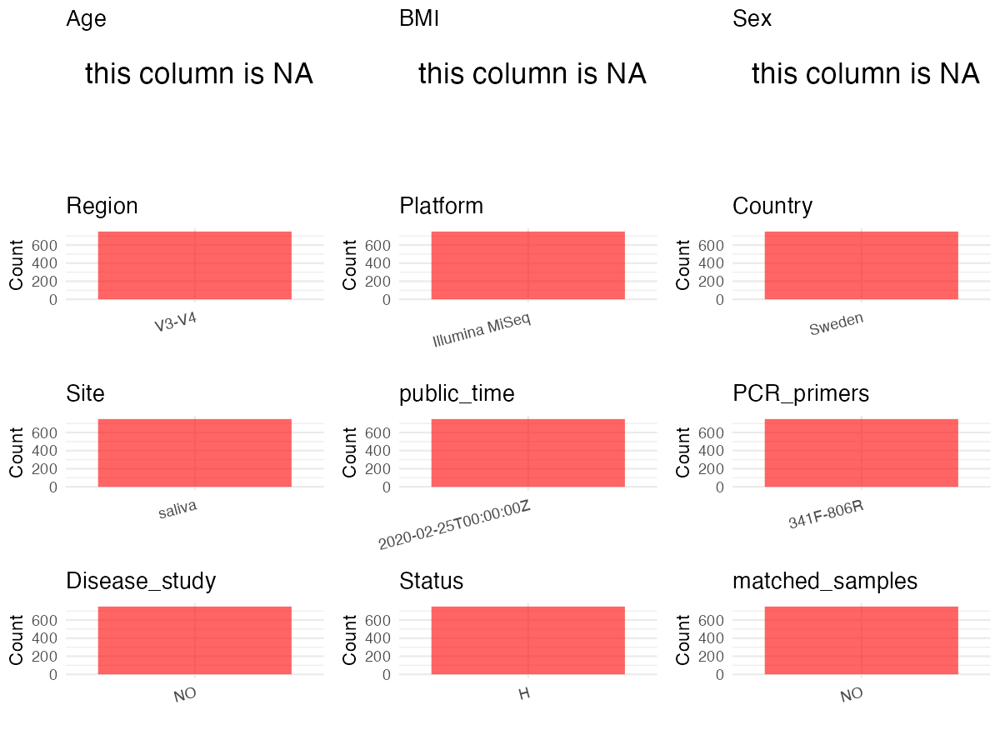

R Notebook: Metadata Processing Workflow
================

# Step 1: Obtain Initial Metadata from Each Project

To obtain the initial metadata: 1. Search for the BioProject ID (e.g.,
“PRJEBXXXX”) on the [NCBI SRA
website](https://www.ncbi.nlm.nih.gov/Traces/study/). 2. In the “Select”
table, click on “Metadata” and download the file. 3. The downloaded file
is typically named “SraRunTable.csv” and contains metadata for the
project.

``` r
# Load necessary libraries
library(dplyr)
library(ggplot2)
library(cowplot)
library(stringr)
# Set working directory (update this path to your local directory)
setwd("/Users/dongbiao/Documents/oral/global-oral-microbiome/data/projects/PRJEB35824")

# Read the initial metadata files
initial_meta <- read.csv("SraRunTable.csv",header = T) %>% filter(`Sample.Name` != "Mock.DNA.even")
 
head(initial_meta)
```

    ##          Run Assay.Type AvgSpotLen    Bases bio_material BioProject
    ## 1 ERR3772665   AMPLICON        599 50417536      07-100M PRJEB35824
    ## 2 ERR3772666   AMPLICON        600 50673125      07-100M PRJEB35824
    ## 3 ERR3772667   AMPLICON        601 67765309      07-100M PRJEB35824
    ## 4 ERR3772668   AMPLICON        601 73826189      07-100M PRJEB35824
    ## 5 ERR3772669   AMPLICON        599 72637403      07-100M PRJEB35824
    ## 6 ERR3772670   AMPLICON        600 71905298      07-100M PRJEB35824
    ##      BioSample    Bytes Center.Name common_name Consent DATASTORE.filetype
    ## 1 SAMEA6431156 38709524        UMEA       human  public         run.zq,sra
    ## 2 SAMEA6431157 38775874        UMEA       human  public         run.zq,sra
    ## 3 SAMEA6431158 55902714        UMEA       human  public         run.zq,sra
    ## 4 SAMEA6431159 61086053        UMEA       human  public         run.zq,sra
    ## 5 SAMEA6431160 55498241        UMEA       human  public         run.zq,sra
    ## 6 SAMEA6431161 55446415        UMEA       human  public         run.zq,sra
    ##   DATASTORE.provider                     DATASTORE.region
    ## 1         gs,ncbi,s3 gs.us-east1,ncbi.public,s3.us-east-1
    ## 2         gs,ncbi,s3 gs.us-east1,ncbi.public,s3.us-east-1
    ## 3         gs,ncbi,s3 gs.us-east1,ncbi.public,s3.us-east-1
    ## 4         gs,ncbi,s3 gs.us-east1,ncbi.public,s3.us-east-1
    ## 5         gs,ncbi,s3 gs.us-east1,ncbi.public,s3.us-east-1
    ## 6         gs,ncbi,s3 gs.us-east1,ncbi.public,s3.us-east-1
    ##   ENA.FIRST.PUBLIC..run.     ena_first_public ENA.LAST.UPDATE..run.
    ## 1             2020-02-14 2020-02-14T04:05:01Z            2019-12-23
    ## 2             2020-02-14 2020-02-14T04:05:01Z            2019-12-23
    ## 3             2020-02-14 2020-02-14T04:05:01Z            2019-12-23
    ## 4             2020-02-14 2020-02-14T04:05:01Z            2019-12-23
    ## 5             2020-02-14 2020-02-14T04:05:01Z            2019-12-23
    ## 6             2020-02-14 2020-02-14T04:05:01Z            2019-12-23
    ##        ena_last_update Experiment  external_id geo_loc_name_country
    ## 1 2019-12-19T14:35:35Z ERX3774422 SAMEA6431156               Sweden
    ## 2 2019-12-19T14:35:35Z ERX3774423 SAMEA6431157               Sweden
    ## 3 2019-12-19T14:35:35Z ERX3774424 SAMEA6431158               Sweden
    ## 4 2019-12-19T14:35:35Z ERX3774425 SAMEA6431159               Sweden
    ## 5 2019-12-19T14:35:35Z ERX3774426 SAMEA6431160               Sweden
    ## 6 2019-12-19T14:35:35Z ERX3774427 SAMEA6431161               Sweden
    ##   geo_loc_name_country_continent geographic_location_.country_and.or_sea.
    ## 1                         Europe                                   Sweden
    ## 2                         Europe                                   Sweden
    ## 3                         Europe                                   Sweden
    ## 4                         Europe                                   Sweden
    ## 5                         Europe                                   Sweden
    ## 6                         Europe                                   Sweden
    ##   INSDC_center_name   INSDC_first_public    INSDC_last_update INSDC_status
    ## 1              Umea 2020-02-14T04:05:01Z 2019-12-19T14:35:35Z       public
    ## 2              Umea 2020-02-14T04:05:01Z 2019-12-19T14:35:35Z       public
    ## 3              Umea 2020-02-14T04:05:01Z 2019-12-19T14:35:35Z       public
    ## 4              Umea 2020-02-14T04:05:01Z 2019-12-19T14:35:35Z       public
    ## 5              Umea 2020-02-14T04:05:01Z 2019-12-19T14:35:35Z       public
    ## 6              Umea 2020-02-14T04:05:01Z 2019-12-19T14:35:35Z       public
    ##       Instrument Library.Name LibraryLayout LibrarySelection LibrarySource
    ## 1 Illumina MiSeq  unspecified        PAIRED              PCR         OTHER
    ## 2 Illumina MiSeq  unspecified        PAIRED              PCR         OTHER
    ## 3 Illumina MiSeq  unspecified        PAIRED              PCR         OTHER
    ## 4 Illumina MiSeq  unspecified        PAIRED              PCR         OTHER
    ## 5 Illumina MiSeq  unspecified        PAIRED              PCR         OTHER
    ## 6 Illumina MiSeq  unspecified        PAIRED              PCR         OTHER
    ##       Organism Platform          ReleaseDate          create_date version
    ## 1 Homo sapiens ILLUMINA 2020-02-25T00:00:00Z 2020-02-26T22:59:00Z       1
    ## 2 Homo sapiens ILLUMINA 2020-02-25T00:00:00Z 2020-02-26T23:00:00Z       1
    ## 3 Homo sapiens ILLUMINA 2020-02-25T00:00:00Z 2020-02-26T23:00:00Z       1
    ## 4 Homo sapiens ILLUMINA 2020-02-25T00:00:00Z 2020-02-26T23:00:00Z       1
    ## 5 Homo sapiens ILLUMINA 2020-02-25T00:00:00Z 2020-02-26T23:07:00Z       1
    ## 6 Homo sapiens ILLUMINA 2020-02-25T00:00:00Z 2020-02-26T23:06:00Z       1
    ##    Sample.Name       Sample_name Scientific_Name SRA.Study      Submitter_Id
    ## 1 SAMEA6431156  OMIC7.1-1-1-swab    Homo sapiens ERP118940  OMIC7.1-1-1-swab
    ## 2 SAMEA6431157 OMIC7.13-2-1-swab    Homo sapiens ERP118940 OMIC7.13-2-1-swab
    ## 3 SAMEA6431158    OMIC1-3-1-swab    Homo sapiens ERP118940    OMIC1-3-1-swab
    ## 4 SAMEA6431159    OMIC1-4-1-swab    Homo sapiens ERP118940    OMIC1-4-1-swab
    ## 5 SAMEA6431160 OMIC7.25-5-1-swab    Homo sapiens ERP118940 OMIC7.25-5-1-swab
    ## 6 SAMEA6431161 OMIC7.37-6-1-swab    Homo sapiens ERP118940 OMIC7.37-6-1-swab
    ##   tissue_type
    ## 1      saliva
    ## 2      saliva
    ## 3      saliva
    ## 4      saliva
    ## 5      saliva
    ## 6      saliva

# Step 2: Create a Uniform Metadata Template

The uniform metadata should include the following columns:

1.  **BioProject**: Project ID (e.g., “PRJNA339212”)
2.  **Run**: Sample ID (e.g., “ERRXXXXXX” or “SRRXXXXXX”)
3.  **sample_name**: Original sample name submitted by the authors (not
    the database-assigned ID)
4.  **Age**: Age of the subject (if available)
5.  **BMI**: Body Mass Index (if available)
6.  **Sex**: Sex of the subject (“F” or “M”)
7.  **Region**: Targeted 16S rRNA region (e.g., “V3-V4”)
8.  **Platform**: Sequencing platform (e.g., “Illumina MiSeq”)
9.  **Country**: Country of sample origin (e.g., “China”)
10. **Site**: Sample site (e.g., “saliva”, “dental plaque”)
11. **public_time**: Data release date (format: “YYYY-MM-DD”)
12. **PCR_primers**: PCR primers used (e.g., “515F-806R”)
13. **title**: Title of the associated publication
14. **Disease_study**: Whether the study involves a disease (“YES” or
    “NO”)
15. **Status**: Disease status (e.g., “T2DM”, “HC”). Note: If the study
    includes both disease and healthy samples, this must be specified
    per sample.
16. **matched_samples** : matched samples (“YES” or “NO”)

``` r
# Create a uniform metadata dataframe
metadata <- data.frame(
  BioProject = initial_meta$BioProject,
  Run = initial_meta$Run,
  sample_name = initial_meta$Sample_name,
  Age = NA,
  BMI = NA,
  Sex= NA,
  Region = "V3-V4",
  Platform = initial_meta$Instrument,
  Country = initial_meta$geo_loc_name_country,
  Site = initial_meta$tissue_type,
  public_time = initial_meta$ReleaseDate,
  stringsAsFactors = FALSE
)
```

# Step 3: Manually Add Information from the Publication

Some information (e.g. PCR primers, study title, disease status) must be
manually extracted from the publication and added to the metadata.

``` r
# Add information obtained from the publication
metadata$PCR_primers <- "341F-806R"
metadata$title <- "A longitudinal study of the development of the saliva microbiome in infants 2 days to 5 years compared to the microbiome in adolescents"
metadata$Disease_study <- "NO"

# Assign disease status based on sample_name patterns
metadata$Status <- "H"

# Create matched_samples column
metadata$matched_samples <- "NO"

# Check initial data distribution
cat("Initial sample distribution:\n")
```

    ## Initial sample distribution:

``` r
table(metadata$sample_name)
```

    ## 
    ##      OMIC1-29-1-swab       OMIC1-3-1-swab      OMIC1-31-1-swab 
    ##                    1                    1                    1 
    ##      OMIC1-33-1-swab      OMIC1-35-1-swab      OMIC1-37-1-swab 
    ##                    1                    1                    1 
    ##      OMIC1-39-1-swab       OMIC1-4-1-swab      OMIC1-52-1-swab 
    ##                    1                    1                    1 
    ##      OMIC1-53-1-swab      OMIC1-57-1-swab      OMIC1-59-1-swab 
    ##                    1                    1                    1 
    ##      OMIC1-60-1-swab      OMIC1-61-1-swab      OMIC1-62-1-swab 
    ##                    1                    1                    1 
    ##      OMIC1-63-1-swab      OMIC1-64-1-swab      OMIC1-65-1-swab 
    ##                    1                    1                    1 
    ##      OMIC1-67-1-swab      OMIC1-69-1-swab      OMIC1-71-1-swab 
    ##                    1                    1                    1 
    ##      OMIC1-73-1-swab      OMIC1-75-1-swab      OMIC1-76-1-swab 
    ##                    1                    1                    1 
    ##      OMIC1-77-1-swab      OMIC1-79-1-swab      OMIC1-83-1-swab 
    ##                    1                    1                    1 
    ##      OMIC1-91-1-swab      OMIC1-92-1-swab      OMIC1-93-1-swab 
    ##                    1                    1                    1 
    ##  OMIC10.1-123-5-swab OMIC10.10-124-5-swab OMIC10.11-139-5-swab 
    ##                    1                    1                    1 
    ## OMIC10.12-153-5-swab OMIC10.13-173-5-swab OMIC10.14-184-5-swab 
    ##                    1                    1                    1 
    ## OMIC10.15-201-5-swab OMIC10.19-125-5-swab  OMIC10.2-138-5-swab 
    ##                    1                    1                    1 
    ## OMIC10.20-142-5-swab OMIC10.21-154-5-swab OMIC10.22-174-5-swab 
    ##                    1                    1                    1 
    ## OMIC10.23-185-5-swab OMIC10.24-202-5-swab OMIC10.28-127-5-swab 
    ##                    1                    1                    1 
    ## OMIC10.29-143-5-swab  OMIC10.3-152-5-swab OMIC10.31-175-5-swab 
    ##                    1                    1                    1 
    ## OMIC10.32-186-5-swab OMIC10.33-204-5-swab OMIC10.37-130-5-swab 
    ##                    1                    1                    1 
    ## OMIC10.38-144-5-swab OMIC10.39-159-5-swab  OMIC10.4-172-5-swab 
    ##                    1                    1                    1 
    ## OMIC10.40-178-5-swab OMIC10.41-190-5-swab OMIC10.42-205-5-swab 
    ##                    1                    1                    1 
    ## OMIC10.46-131-5-swab OMIC10.47-147-5-swab OMIC10.48-161-5-swab 
    ##                    1                    1                    1 
    ## OMIC10.49-179-5-swab  OMIC10.5-182-5-swab OMIC10.50-192-5-swab 
    ##                    1                    1                    1 
    ## OMIC10.51-207-5-swab OMIC10.55-135-5-swab OMIC10.56-149-5-swab 
    ##                    1                    1                    1 
    ## OMIC10.57-168-5-swab OMIC10.58-180-5-swab OMIC10.59-193-5-swab 
    ##                    1                    1                    1 
    ##  OMIC10.6-198-5-swab OMIC10.60-209-5-swab OMIC10.64-137-5-swab 
    ##                    1                    1                    1 
    ## OMIC10.65-151-5-swab OMIC10.66-170-5-swab OMIC10.67-181-5-swab 
    ##                    1                    1                    1 
    ## OMIC10.68-196-5-swab OMIC10.69-210-5-swab    OMIC14-100-3-swab 
    ##                    1                    1                    1 
    ##    OMIC14-101-3-swab    OMIC14-104-3-swab    OMIC14-108-3-swab 
    ##                    1                    1                    1 
    ##    OMIC14-109-3-swab     OMIC14-11-3-swab    OMIC14-110-3-swab 
    ##                    1                    1                    1 
    ##    OMIC14-112-3-swab    OMIC14-114-3-swab    OMIC14-117-3-swab 
    ##                    1                    1                    1 
    ##     OMIC14-12-3-swab    OMIC14-120-3-swab    OMIC14-121-3-swab 
    ##                    1                    1                    1 
    ##    OMIC14-122-3-swab    OMIC14-123-3-swab    OMIC14-125-3-swab 
    ##                    1                    1                    1 
    ##    OMIC14-129-3-swab     OMIC14-13-3-swab    OMIC14-130-3-swab 
    ##                    1                    1                    1 
    ##    OMIC14-132-3-swab    OMIC14-133-3-swab    OMIC14-135-3-swab 
    ##                    1                    1                    1 
    ##    OMIC14-137-3-swab    OMIC14-138-3-swab    OMIC14-140-3-swab 
    ##                    1                    1                    1 
    ##     OMIC14-15-3-swab     OMIC14-16-3-swab     OMIC14-17-3-swab 
    ##                    1                    1                    1 
    ##      OMIC14-2-3-swab     OMIC14-21-3-swab     OMIC14-22-3-swab 
    ##                    1                    1                    1 
    ##     OMIC14-23-3-swab     OMIC14-24-3-swab     OMIC14-25-3-swab 
    ##                    1                    1                    1 
    ##     OMIC14-26-3-swab     OMIC14-27-3-swab     OMIC14-29-3-swab 
    ##                    1                    1                    1 
    ##     OMIC14-31-3-swab     OMIC14-32-3-swab     OMIC14-33-3-swab 
    ##                    1                    1                    1 
    ##     OMIC14-34-3-swab     OMIC14-35-3-swab     OMIC14-36-3-swab 
    ##                    1                    1                    1 
    ##     OMIC14-40-3-swab     OMIC14-44-3-swab     OMIC14-46-3-swab 
    ##                    1                    1                    1 
    ##      OMIC14-5-3-swab     OMIC14-50-3-swab     OMIC14-51-3-swab 
    ##                    1                    1                    1 
    ##     OMIC14-56-3-swab     OMIC14-57-3-swab     OMIC14-58-3-swab 
    ##                    1                    1                    1 
    ##     OMIC14-59-3-swab      OMIC14-6-3-swab     OMIC14-60-3-swab 
    ##                    1                    1                    1 
    ##     OMIC14-61-3-swab     OMIC14-62-3-swab     OMIC14-65-3-swab 
    ##                    1                    1                    1 
    ##     OMIC14-66-3-swab     OMIC14-67-3-swab     OMIC14-68-3-swab 
    ##                    1                    1                    1 
    ##      OMIC14-7-3-swab     OMIC14-70-3-swab     OMIC14-72-3-swab 
    ##                    1                    1                    1 
    ##     OMIC14-73-3-swab     OMIC14-76-3-swab     OMIC14-77-3-swab 
    ##                    1                    1                    1 
    ##     OMIC14-78-3-swab     OMIC14-80-3-swab     OMIC14-83-3-swab 
    ##                    1                    1                    1 
    ##     OMIC14-84-3-swab     OMIC14-85-3-swab     OMIC14-88-3-swab 
    ##                    1                    1                    1 
    ##     OMIC14-89-3-swab      OMIC14-9-3-swab     OMIC14-93-3-swab 
    ##                    1                    1                    1 
    ##     OMIC14-94-3-swab     OMIC14-96-3-swab     OMIC15-11-4-swab 
    ##                    1                    1                    1 
    ##     OMIC15-12-4-swab    OMIC15-142-3-swab    OMIC15-144-3-swab 
    ##                    1                    1                    1 
    ##    OMIC15-145-3-swab    OMIC15-147-3-swab     OMIC15-15-4-swab 
    ##                    1                    1                    1 
    ##    OMIC15-150-3-swab    OMIC15-152-3-swab    OMIC15-153-3-swab 
    ##                    1                    1                    1 
    ##    OMIC15-155-3-swab    OMIC15-156-3-swab    OMIC15-157-3-swab 
    ##                    1                    1                    1 
    ##    OMIC15-159-3-swab     OMIC15-16-4-swab    OMIC15-162-3-swab 
    ##                    1                    1                    1 
    ##    OMIC15-163-3-swab    OMIC15-164-3-swab    OMIC15-168-3-swab 
    ##                    1                    1                    1 
    ##    OMIC15-169-3-swab     OMIC15-17-4-swab    OMIC15-173-3-swab 
    ##                    1                    1                    1 
    ##    OMIC15-174-3-swab    OMIC15-175-3-swab    OMIC15-178-3-swab 
    ##                    1                    1                    1 
    ##    OMIC15-179-3-swab     OMIC15-18-4-swab    OMIC15-180-3-swab 
    ##                    1                    1                    1 
    ##    OMIC15-181-3-swab    OMIC15-182-3-swab    OMIC15-184-3-swab 
    ##                    1                    1                    1 
    ##    OMIC15-185-3-swab    OMIC15-186-3-swab    OMIC15-188-3-swab 
    ##                    1                    1                    1 
    ##    OMIC15-189-3-swab    OMIC15-190-3-swab    OMIC15-192-3-swab 
    ##                    1                    1                    1 
    ##    OMIC15-193-3-swab    OMIC15-195-3-swab    OMIC15-196-3-swab 
    ##                    1                    1                    1 
    ##    OMIC15-198-3-swab      OMIC15-2-4-swab    OMIC15-200-3-swab 
    ##                    1                    1                    1 
    ##    OMIC15-209-3-swab     OMIC15-21-4-swab     OMIC15-23-4-swab 
    ##                    1                    1                    1 
    ##     OMIC15-24-4-swab     OMIC15-25-4-swab     OMIC15-26-4-swab 
    ##                    1                    1                    1 
    ##     OMIC15-27-4-swab     OMIC15-28-4-swab     OMIC15-29-4-swab 
    ##                    1                    1                    1 
    ##    OMIC15-300-4-swab     OMIC15-31-4-swab     OMIC15-32-4-swab 
    ##                    1                    1                    1 
    ##     OMIC15-34-4-swab     OMIC15-35-4-swab     OMIC15-36-4-swab 
    ##                    1                    1                    1 
    ##     OMIC15-41-4-swab     OMIC15-42-4-swab     OMIC15-43-4-swab 
    ##                    1                    1                    1 
    ##     OMIC15-44-4-swab     OMIC15-45-4-swab     OMIC15-46-4-swab 
    ##                    1                    1                    1 
    ##      OMIC15-5-4-swab     OMIC15-50-4-swab     OMIC15-52-4-swab 
    ##                    1                    1                    1 
    ##     OMIC15-54-4-swab     OMIC15-58-4-swab     OMIC15-59-4-swab 
    ##                    1                    1                    1 
    ##      OMIC15-6-4-swab     OMIC15-60-4-swab     OMIC15-62-4-swab 
    ##                    1                    1                    1 
    ##     OMIC15-63-4-swab     OMIC15-64-4-swab     OMIC15-65-4-swab 
    ##                    1                    1                    1 
    ##     OMIC15-66-4-swab     OMIC15-67-4-swab     OMIC15-68-4-swab 
    ##                    1                    1                    1 
    ##      OMIC15-7-4-swab     OMIC15-70-4-swab     OMIC15-72-4-swab 
    ##                    1                    1                    1 
    ##      OMIC15-9-4-swab    OMIC16-100-4-swab    OMIC16-101-4-swab 
    ##                    1                    1                    1 
    ##    OMIC16-103-4-swab    OMIC16-108-4-swab    OMIC16-109-4-swab 
    ##                    1                    1                    1 
    ##    OMIC16-110-4-swab    OMIC16-112-4-swab    OMIC16-114-4-swab 
    ##                    1                    1                    1 
    ##    OMIC16-116-4-swab    OMIC16-120-4-swab    OMIC16-122-4-swab 
    ##                    1                    1                    1 
    ##    OMIC16-123-4-swab    OMIC16-124-4-swab    OMIC16-125-4-swab 
    ##                    1                    1                    1 
    ##    OMIC16-127-4-swab    OMIC16-130-4-swab    OMIC16-131-4-swab 
    ##                    1                    1                    1 
    ##    OMIC16-133-4-swab    OMIC16-135-4-swab    OMIC16-137-4-swab 
    ##                    1                    1                    1 
    ##    OMIC16-138-4-swab    OMIC16-141-4-swab    OMIC16-142-4-swab 
    ##                    1                    1                    1 
    ##    OMIC16-143-4-swab    OMIC16-144-4-swab    OMIC16-145-4-swab 
    ##                    1                    1                    1 
    ##    OMIC16-147-4-swab    OMIC16-149-4-swab    OMIC16-151-4-swab 
    ##                    1                    1                    1 
    ##    OMIC16-152-4-swab    OMIC16-153-4-swab    OMIC16-154-4-swab 
    ##                    1                    1                    1 
    ##    OMIC16-156-4-swab    OMIC16-157-4-swab    OMIC16-158-4-swab 
    ##                    1                    1                    1 
    ##    OMIC16-160-4-swab    OMIC16-161-4-swab    OMIC16-164-4-swab 
    ##                    1                    1                    1 
    ##    OMIC16-165-4-swab    OMIC16-167-4-swab    OMIC16-168-4-swab 
    ##                    1                    1                    1 
    ##    OMIC16-172-4-swab    OMIC16-173-4-swab    OMIC16-174-4-swab 
    ##                    1                    1                    1 
    ##    OMIC16-175-4-swab    OMIC16-176-4-swab    OMIC16-178-4-swab 
    ##                    1                    1                    1 
    ##    OMIC16-182-4-swab    OMIC16-185-4-swab    OMIC16-188-4-swab 
    ##                    1                    1                    1 
    ##    OMIC16-189-4-swab    OMIC16-190-4-swab    OMIC16-192-4-swab 
    ##                    1                    1                    1 
    ##    OMIC16-194-4-swab    OMIC16-195-4-swab    OMIC16-196-4-swab 
    ##                    1                    1                    1 
    ##    OMIC16-198-4-swab    OMIC16-199-4-swab    OMIC16-201-4-swab 
    ##                    1                    1                    1 
    ##    OMIC16-204-4-swab    OMIC16-206-4-swab    OMIC16-207-4-swab 
    ##                    1                    1                    1 
    ##    OMIC16-209-4-swab    OMIC16-210-4-swab     OMIC16-74-4-swab 
    ##                    1                    1                    1 
    ##     OMIC16-76-4-swab     OMIC16-83-4-swab     OMIC16-85-4-swab 
    ##                    1                    1                    1 
    ##     OMIC16-87-4-swab     OMIC16-88-4-swab     OMIC16-89-4-swab 
    ##                    1                    1                    1 
    ##     OMIC16-94-4-swab     OMIC16-98-4-swab     OMIC16-99-4-swab 
    ##                    1                    1                    1 
    ##    OMIC17-103-3-swab    OMIC17-105-4-swab    OMIC17-116-3-swab 
    ##                    1                    1                    1 
    ##    OMIC17-118-4-swab    OMIC17-127-3-swab    OMIC17-129-4-swab 
    ##                    1                    1                    1 
    ##    OMIC17-139-3-swab    OMIC17-139-4-swab    OMIC17-140-4-swab 
    ##                    1                    1                    1 
    ##    OMIC17-150-4-swab    OMIC17-159-4-swab    OMIC17-170-4-swab 
    ##                    1                    1                    1 
    ##    OMIC17-171-4-swab    OMIC17-179-4-swab     OMIC17-18-3-swab 
    ##                    1                    1                    1 
    ##    OMIC17-180-4-swab    OMIC17-184-4-swab    OMIC17-193-4-swab 
    ##                    1                    1                    1 
    ##    OMIC17-201-3-swab    OMIC17-202-3-swab    OMIC17-204-3-swab 
    ##                    1                    1                    1 
    ##    OMIC17-205-4-swab    OMIC17-206-3-swab    OMIC17-207-3-swab 
    ##                    1                    1                    1 
    ##    OMIC17-210-3-swab     OMIC17-22-1-swab     OMIC17-28-1-swab 
    ##                    1                    1                    1 
    ##    OMIC17-300-3-swab     OMIC17-38-3-swab     OMIC17-52-3-swab 
    ##                    1                    1                    1 
    ##     OMIC17-64-3-swab     OMIC17-74-3-swab      OMIC17-8-3-swab 
    ##                    1                    1                    1 
    ##     OMIC17-80-4-swab     OMIC17-82-4-swab     OMIC17-84-4-swab 
    ##                    1                    1                    1 
    ##     OMIC17-87-3-swab     OMIC17-91-4-swab     OMIC17-93-4-swab 
    ##                    1                    1                    1 
    ##     OMIC17-96-4-swab     OMIC2-100-1-swab     OMIC2-101-1-swab 
    ##                    1                    1                    1 
    ##     OMIC2-102-1-swab     OMIC2-103-1-swab     OMIC2-104-1-swab 
    ##                    1                    1                    1 
    ##     OMIC2-105-1-swab     OMIC2-106-1-swab     OMIC2-107-1-swab 
    ##                    1                    1                    1 
    ##     OMIC2-108-1-swab     OMIC2-109-1-swab     OMIC2-110-1-swab 
    ##                    1                    1                    1 
    ##     OMIC2-111-1-swab     OMIC2-112-1-swab     OMIC2-113-1-swab 
    ##                    1                    1                    1 
    ##     OMIC2-114-1-swab     OMIC2-115-1-swab     OMIC2-116-1-swab 
    ##                    1                    1                    1 
    ##     OMIC2-117-1-swab     OMIC2-118-1-swab     OMIC2-119-1-swab 
    ##                    1                    1                    1 
    ##     OMIC2-121-1-swab     OMIC2-122-1-swab     OMIC2-123-1-swab 
    ##                    1                    1                    1 
    ##     OMIC2-124-1-swab     OMIC2-125-1-swab     OMIC2-126-1-swab 
    ##                    1                    1                    1 
    ##     OMIC2-127-1-swab     OMIC2-128-1-swab     OMIC2-129-1-swab 
    ##                    1                    1                    1 
    ##     OMIC2-130-1-swab     OMIC2-131-1-swab     OMIC2-132-1-swab 
    ##                    1                    1                    1 
    ##     OMIC2-133-1-swab     OMIC2-134-1-swab     OMIC2-135-1-swab 
    ##                    1                    1                    1 
    ##     OMIC2-136-1-swab     OMIC2-137-1-swab     OMIC2-138-1-swab 
    ##                    1                    1                    1 
    ##     OMIC2-139-1-swab     OMIC2-140-1-swab     OMIC2-141-1-swab 
    ##                    1                    1                    1 
    ##     OMIC2-142-1-swab     OMIC2-143-1-swab     OMIC2-144-1-swab 
    ##                    1                    1                    1 
    ##     OMIC2-145-1-swab     OMIC2-146-1-swab     OMIC2-147-1-swab 
    ##                    1                    1                    1 
    ##     OMIC2-148-1-swab     OMIC2-149-1-swab     OMIC2-150-1-swab 
    ##                    1                    1                    1 
    ##     OMIC2-151-1-swab     OMIC2-152-1-swab     OMIC2-153-1-swab 
    ##                    1                    1                    1 
    ##     OMIC2-154-1-swab     OMIC2-155-1-swab     OMIC2-157-1-swab 
    ##                    1                    1                    1 
    ##     OMIC2-158-1-swab     OMIC2-159-1-swab     OMIC2-161-1-swab 
    ##                    1                    1                    1 
    ##     OMIC2-162-1-swab     OMIC2-163-1-swab     OMIC2-164-1-swab 
    ##                    1                    1                    1 
    ##     OMIC2-165-1-swab     OMIC2-166-1-swab     OMIC2-167-1-swab 
    ##                    1                    1                    1 
    ##     OMIC2-168-1-swab     OMIC2-169-1-swab     OMIC2-170-1-swab 
    ##                    1                    1                    1 
    ##     OMIC2-171-1-swab     OMIC2-172-1-swab     OMIC2-173-1-swab 
    ##                    1                    1                    1 
    ##     OMIC2-174-1-swab     OMIC2-175-1-swab     OMIC2-176-1-swab 
    ##                    1                    1                    1 
    ##     OMIC2-177-1-swab     OMIC2-178-1-swab     OMIC2-179-1-swab 
    ##                    1                    1                    1 
    ##     OMIC2-180-1-swab     OMIC2-181-1-swab     OMIC2-182-1-swab 
    ##                    1                    1                    1 
    ##     OMIC2-183-1-swab     OMIC2-184-1-swab     OMIC2-185-1-swab 
    ##                    1                    1                    1 
    ##     OMIC2-186-1-swab      OMIC2-94-1-swab      OMIC2-96-1-swab 
    ##                    1                    1                    1 
    ##      OMIC2-97-1-swab      OMIC2-98-1-swab      OMIC2-99-1-swab 
    ##                    1                    1                    1 
    ##      OMIC3-10-2-swab      OMIC3-11-2-swab      OMIC3-12-2-swab 
    ##                    1                    1                    1 
    ##      OMIC3-13-2-swab      OMIC3-14-2-swab      OMIC3-15-2-swab 
    ##                    1                    1                    1 
    ##      OMIC3-16-2-swab      OMIC3-17-2-swab      OMIC3-18-2-swab 
    ##                    1                    1                    1 
    ##     OMIC3-187-1-swab     OMIC3-188-1-swab     OMIC3-189-1-swab 
    ##                    1                    1                    1 
    ##     OMIC3-190-1-swab     OMIC3-191-1-swab     OMIC3-192-1-swab 
    ##                    1                    1                    1 
    ##     OMIC3-193-1-swab     OMIC3-194-1-swab     OMIC3-195-1-swab 
    ##                    1                    1                    1 
    ##     OMIC3-196-1-swab     OMIC3-197-1-swab     OMIC3-198-1-swab 
    ##                    1                    1                    1 
    ##     OMIC3-199-1-swab       OMIC3-2-2-swab     OMIC3-200-1-swab 
    ##                    1                    1                    1 
    ##     OMIC3-201-1-swab     OMIC3-203-1-swab     OMIC3-204-1-swab 
    ##                    1                    1                    1 
    ##     OMIC3-205-1-swab     OMIC3-206-1-swab     OMIC3-207-1-swab 
    ##                    1                    1                    1 
    ##     OMIC3-208-1-swab      OMIC3-21-2-swab     OMIC3-210-1-swab 
    ##                    1                    1                    1 
    ##      OMIC3-22-2-swab      OMIC3-23-2-swab      OMIC3-24-2-swab 
    ##                    1                    1                    1 
    ##      OMIC3-25-2-swab      OMIC3-26-2-swab      OMIC3-27-2-swab 
    ##                    1                    1                    1 
    ##      OMIC3-29-2-swab       OMIC3-3-2-swab      OMIC3-30-2-swab 
    ##                    1                    1                    1 
    ##     OMIC3-300-2-swab      OMIC3-31-2-swab      OMIC3-32-2-swab 
    ##                    1                    1                    1 
    ##      OMIC3-33-2-swab      OMIC3-35-2-swab      OMIC3-36-2-swab 
    ##                    1                    1                    1 
    ##      OMIC3-37-2-swab      OMIC3-38-2-swab      OMIC3-40-2-swab 
    ##                    1                    1                    1 
    ##      OMIC3-41-2-swab      OMIC3-44-2-swab      OMIC3-45-2-swab 
    ##                    1                    1                    1 
    ##      OMIC3-46-2-swab       OMIC3-5-2-swab      OMIC3-50-2-swab 
    ##                    1                    1                    1 
    ##      OMIC3-51-2-swab      OMIC3-52-2-swab      OMIC3-54-2-swab 
    ##                    1                    1                    1 
    ##      OMIC3-55-2-swab      OMIC3-56-2-swab      OMIC3-57-2-swab 
    ##                    1                    1                    1 
    ##      OMIC3-58-2-swab      OMIC3-59-2-swab       OMIC3-6-2-swab 
    ##                    1                    1                    1 
    ##      OMIC3-60-2-swab      OMIC3-61-2-swab      OMIC3-62-2-swab 
    ##                    1                    1                    1 
    ##      OMIC3-64-2-swab      OMIC3-65-2-swab      OMIC3-66-2-swab 
    ##                    1                    1                    1 
    ##      OMIC3-67-2-swab      OMIC3-68-2-swab      OMIC3-69-2-swab 
    ##                    1                    1                    1 
    ##       OMIC3-7-2-swab      OMIC3-70-2-swab      OMIC3-71-2-swab 
    ##                    1                    1                    1 
    ##      OMIC3-72-2-swab      OMIC3-74-2-swab      OMIC3-76-2-swab 
    ##                    1                    1                    1 
    ##      OMIC3-77-2-swab      OMIC3-78-2-swab       OMIC3-8-2-swab 
    ##                    1                    1                    1 
    ##      OMIC3-80-2-swab      OMIC3-81-2-swab       OMIC3-9-2-swab 
    ##                    1                    1                    1 
    ##     OMIC4-116-2-swab     OMIC4-117-2-swab     OMIC4-118-2-swab 
    ##                    1                    1                    1 
    ##     OMIC4-120-2-swab     OMIC4-121-2-swab     OMIC4-122-2-swab 
    ##                    1                    1                    1 
    ##     OMIC4-123-2-swab     OMIC4-125-2-swab     OMIC4-127-2-swab 
    ##                    1                    1                    1 
    ##     OMIC4-128-2-swab     OMIC4-129-2-swab     OMIC4-130-2-swab 
    ##                    1                    1                    1 
    ##     OMIC4-132-2-swab     OMIC4-133-2-swab     OMIC4-135-2-swab 
    ##                    1                    1                    1 
    ##     OMIC4-137-2-swab     OMIC4-138-2-swab     OMIC4-139-2-swab 
    ##                    1                    1                    1 
    ##     OMIC4-140-2-swab     OMIC4-142-2-swab     OMIC4-143-2-swab 
    ##                    1                    1                    1 
    ##     OMIC4-144-2-swab     OMIC4-145-2-swab     OMIC4-146-2-swab 
    ##                    1                    1                    1 
    ##     OMIC4-147-2-swab     OMIC4-150-2-swab     OMIC4-152-2-swab 
    ##                    1                    1                    1 
    ##     OMIC4-153-2-swab     OMIC4-155-2-swab     OMIC4-156-2-swab 
    ##                    1                    1                    1 
    ##     OMIC4-157-2-swab     OMIC4-159-2-swab     OMIC4-162-2-swab 
    ##                    1                    1                    1 
    ##     OMIC4-163-2-swab     OMIC4-164-2-swab     OMIC4-168-2-swab 
    ##                    1                    1                    1 
    ##     OMIC4-169-2-swab     OMIC4-170-2-swab     OMIC4-173-2-swab 
    ##                    1                    1                    1 
    ##     OMIC4-174-2-swab     OMIC4-175-2-swab     OMIC4-178-2-swab 
    ##                    1                    1                    1 
    ##     OMIC4-179-2-swab     OMIC4-180-2-swab     OMIC4-181-2-swab 
    ##                    1                    1                    1 
    ##     OMIC4-182-2-swab     OMIC4-184-2-swab     OMIC4-185-2-swab 
    ##                    1                    1                    1 
    ##     OMIC4-186-2-swab     OMIC4-188-2-swab     OMIC4-189-2-swab 
    ##                    1                    1                    1 
    ##     OMIC4-192-2-swab     OMIC4-193-2-swab     OMIC4-194-2-swab 
    ##                    1                    1                    1 
    ##     OMIC4-195-2-swab     OMIC4-196-2-swab     OMIC4-198-2-swab 
    ##                    1                    1                    1 
    ##     OMIC4-199-2-swab     OMIC4-200-2-swab     OMIC4-201-2-swab 
    ##                    1                    1                    1 
    ##     OMIC4-202-2-swab     OMIC4-204-2-swab     OMIC4-205-2-swab 
    ##                    1                    1                    1 
    ##     OMIC4-206-2-swab     OMIC4-207-2-swab     OMIC4-209-2-swab 
    ##                    1                    1                    1 
    ##     OMIC4-210-2-swab     OMIC7.1-1-1-swab   OMIC7.10-96-2-swab 
    ##                    1                    1                    1 
    ##  OMIC7.11-105-2-swab    OMIC7.13-2-1-swab   OMIC7.14-12-1-swab 
    ##                    1                    1                    1 
    ##   OMIC7.15-20-1-swab   OMIC7.16-34-1-swab   OMIC7.17-46-1-swab 
    ##                    1                    1                    1 
    ##   OMIC7.18-56-1-swab   OMIC7.19-80-1-swab    OMIC7.2-11-1-swab 
    ##                    1                    1                    1 
    ##   OMIC7.20-89-1-swab   OMIC7.21-85-2-swab   OMIC7.22-97-2-swab 
    ##                    1                    1                    1 
    ##  OMIC7.23-108-2-swab    OMIC7.25-5-1-swab   OMIC7.26-13-1-swab 
    ##                    1                    1                    1 
    ##   OMIC7.27-23-1-swab   OMIC7.28-36-1-swab   OMIC7.29-47-1-swab 
    ##                    1                    1                    1 
    ##    OMIC7.3-19-1-swab   OMIC7.30-58-1-swab   OMIC7.31-81-1-swab 
    ##                    1                    1                    1 
    ##   OMIC7.32-90-1-swab   OMIC7.33-87-2-swab   OMIC7.34-98-2-swab 
    ##                    1                    1                    1 
    ##  OMIC7.35-190-2-swab    OMIC7.37-6-1-swab   OMIC7.38-14-1-swab 
    ##                    1                    1                    1 
    ##   OMIC7.39-24-1-swab    OMIC7.4-32-1-swab   OMIC7.40-38-1-swab 
    ##                    1                    1                    1 
    ##   OMIC7.41-48-1-swab   OMIC7.42-66-1-swab  OMIC7.44-120-1-swab 
    ##                    1                    1                    1 
    ##   OMIC7.45-88-2-swab  OMIC7.46-100-2-swab  OMIC7.47-110-2-swab 
    ##                    1                    1                    1 
    ##    OMIC7.49-7-1-swab    OMIC7.5-44-1-swab   OMIC7.50-15-1-swab 
    ##                    1                    1                    1 
    ##   OMIC7.51-25-1-swab   OMIC7.52-40-1-swab   OMIC7.53-49-1-swab 
    ##                    1                    1                    1 
    ##   OMIC7.54-68-1-swab   OMIC7.55-84-1-swab  OMIC7.56-156-1-swab 
    ##                    1                    1                    1 
    ##   OMIC7.57-89-2-swab  OMIC7.58-101-2-swab  OMIC7.59-111-2-swab 
    ##                    1                    1                    1 
    ##    OMIC7.6-55-1-swab    OMIC7.61-8-1-swab   OMIC7.62-16-1-swab 
    ##                    1                    1                    1 
    ##   OMIC7.63-26-1-swab   OMIC7.64-41-1-swab   OMIC7.65-50-1-swab 
    ##                    1                    1                    1 
    ##   OMIC7.66-70-1-swab   OMIC7.67-85-1-swab  OMIC7.68-160-1-swab 
    ##                    1                    1                    1 
    ##   OMIC7.69-91-2-swab    OMIC7.7-78-1-swab  OMIC7.71-112-2-swab 
    ##                    1                    1                    1 
    ##    OMIC7.73-9-1-swab   OMIC7.74-17-1-swab   OMIC7.75-27-1-swab 
    ##                    1                    1                    1 
    ##   OMIC7.76-42-1-swab   OMIC7.77-51-1-swab   OMIC7.78-72-1-swab 
    ##                    1                    1                    1 
    ##   OMIC7.79-86-1-swab    OMIC7.8-88-1-swab  OMIC7.80-202-1-swab 
    ##                    1                    1                    1 
    ##   OMIC7.81-93-2-swab  OMIC7.82-103-2-swab  OMIC7.83-114-2-swab 
    ##                    1                    1                    1 
    ##   OMIC7.85-10-1-swab   OMIC7.86-18-1-swab   OMIC7.87-30-1-swab 
    ##                    1                    1                    1 
    ##   OMIC7.88-43-1-swab   OMIC7.89-54-1-swab    OMIC7.9-84-2-swab 
    ##                    1                    1                    1 
    ##   OMIC7.90-74-1-swab   OMIC7.91-87-1-swab   OMIC7.92-83-2-swab 
    ##                    1                    1                    1 
    ##   OMIC7.93-94-2-swab  OMIC7.94-104-2-swab   OMIC9.10-77-5-swab 
    ##                    1                    1                    1 
    ##   OMIC9.11-94-5-swab  OMIC9.12-108-5-swab    OMIC9.16-2-5-swab 
    ##                    1                    1                    1 
    ##   OMIC9.17-18-5-swab   OMIC9.18-32-5-swab   OMIC9.19-43-5-swab 
    ##                    1                    1                    1 
    ##   OMIC9.20-57-5-swab   OMIC9.21-66-5-swab   OMIC9.22-80-5-swab 
    ##                    1                    1                    1 
    ##   OMIC9.23-96-5-swab  OMIC9.24-109-5-swab    OMIC9.28-8-5-swab 
    ##                    1                    1                    1 
    ##   OMIC9.29-23-5-swab   OMIC9.30-33-5-swab   OMIC9.31-44-5-swab 
    ##                    1                    1                    1 
    ##   OMIC9.32-58-5-swab   OMIC9.33-67-5-swab   OMIC9.34-84-5-swab 
    ##                    1                    1                    1 
    ##   OMIC9.35-99-5-swab  OMIC9.36-112-5-swab    OMIC9.40-9-5-swab 
    ##                    1                    1                    1 
    ##  OMIC9.42-300-5-swab   OMIC9.43-45-5-swab   OMIC9.44-59-5-swab 
    ##                    1                    1                    1 
    ##   OMIC9.45-68-5-swab   OMIC9.46-85-5-swab  OMIC9.48-114-5-swab 
    ##                    1                    1                    1 
    ##    OMIC9.5-17-5-swab   OMIC9.52-11-5-swab   OMIC9.53-26-5-swab 
    ##                    1                    1                    1 
    ##   OMIC9.54-34-5-swab   OMIC9.55-46-5-swab   OMIC9.56-60-5-swab 
    ##                    1                    1                    1 
    ##   OMIC9.57-70-5-swab   OMIC9.58-87-5-swab  OMIC9.59-101-5-swab 
    ##                    1                    1                    1 
    ##    OMIC9.6-31-5-swab  OMIC9.60-116-5-swab   OMIC9.64-12-5-swab 
    ##                    1                    1                    1 
    ##   OMIC9.65-27-5-swab   OMIC9.66-35-5-swab   OMIC9.67-50-5-swab 
    ##                    1                    1                    1 
    ##   OMIC9.68-62-5-swab   OMIC9.69-71-5-swab    OMIC9.7-41-5-swab 
    ##                    1                    1                    1 
    ##   OMIC9.70-88-5-swab  OMIC9.71-103-5-swab  OMIC9.72-117-5-swab 
    ##                    1                    1                    1 
    ##   OMIC9.76-15-5-swab   OMIC9.77-28-5-swab   OMIC9.78-36-5-swab 
    ##                    1                    1                    1 
    ##   OMIC9.79-52-5-swab    OMIC9.8-56-5-swab   OMIC9.80-63-5-swab 
    ##                    1                    1                    1 
    ##   OMIC9.81-72-5-swab   OMIC9.82-89-5-swab  OMIC9.83-104-5-swab 
    ##                    1                    1                    1 
    ##  OMIC9.84-118-5-swab   OMIC9.88-16-5-swab   OMIC9.89-29-5-swab 
    ##                    1                    1                    1 
    ##    OMIC9.9-65-5-swab   OMIC9.90-40-5-swab   OMIC9.91-54-5-swab 
    ##                    1                    1                    1 
    ##   OMIC9.92-64-5-swab   OMIC9.93-76-5-swab   OMIC9.94-93-5-swab 
    ##                    1                    1                    1 
    ##  OMIC9.95-105-5-swab  OMIC9.96-122-5-swab 
    ##                    1                    1

``` r
table(metadata$Site)
```

    ## 
    ## saliva 
    ##    749

# Step 4: Summarize and Validate the Metadata

``` r
# Check the number of unique runs and sample names
print(paste("Number of unique runs:", length(unique(metadata$Run))))
```

    ## [1] "Number of unique runs: 749"

``` r
print(paste("Number of unique sample names:", length(unique(metadata$sample_name))))
```

    ## [1] "Number of unique sample names: 749"

# Step 5: Visualize the Metadata

``` r
# Select columns for visualization
plot_data <- metadata %>%
  select(-BioProject, -Run, -sample_name, -title)

# Function to create simple plots for each column
create_simple_plots <- function(data) {
  plots <- list()
  
  for (col in colnames(data)) {
    # Check if the column is all NA
    if (all(is.na(data[[col]]))) {
      # Create an empty plot with text indicating all NA
      p <- ggplot() +
        annotate("text", x = 0.5, y = 0.5, label = "this column is NA", size = 6) +
        labs(title = col) +
        theme_void()
    } else if (is.numeric(data[[col]])) {
      # Numeric variable: histogram
      p <- ggplot(data, aes(x = .data[[col]])) +
        geom_histogram(fill = "blue", alpha = 0.6, bins = 20, na.rm = TRUE) +
        labs(title = col) +
        theme_minimal()
    } else {
      # Categorical variable: bar plot (remove NA values)
      count_data <- as.data.frame(table(data[[col]], useNA = "ifany"))
      p <- ggplot(count_data, aes(x = reorder(Var1, -Freq), y = Freq)) +
        geom_col(fill = "red", alpha = 0.6) +
        labs(title = col, x = NULL, y = "Count") +
        theme_minimal() +
        theme(axis.text.x = element_text(angle = 15, hjust = 1))
    }
    plots[[col]] <- p
  }
  
  return(plots)
}

# Generate and arrange plots
plots <- create_simple_plots(plot_data)
p<-plot_grid(plots$Age, 
          plots$BMI, 
          plots$Sex, 
          plots$Region, 
          plots$Platform, 
          plots$Country, 
          plots$Site,
          plots$public_time, 
          plots$PCR_primers,
          plots$Disease_study,
          plots$Status,
          plots$matched_samples,# add 
          ncol = 3, align = "hv", axis = "lb")
ggsave("Metadata_Summary.png", plot = p, width = 8, height = 6, dpi = 150)
```

``` r

```


# Step 6: Finalize and Export the Metadata

``` r
# Reorder columns to match the desired format
metadata <- metadata[, c(
  "BioProject", "Run", "sample_name", "Age", "BMI", "Sex", 
  "Region", "Platform", "Country", "Site", "public_time", 
  "PCR_primers", "title", "Disease_study", "Status","matched_samples"
)]

# Export the uniform metadata to a CSV file
write.csv(metadata, file = "metadata.csv", quote = FALSE)
head(metadata)
```

    ##   BioProject        Run       sample_name Age BMI Sex Region       Platform
    ## 1 PRJEB35824 ERR3772665  OMIC7.1-1-1-swab  NA  NA  NA  V3-V4 Illumina MiSeq
    ## 2 PRJEB35824 ERR3772666 OMIC7.13-2-1-swab  NA  NA  NA  V3-V4 Illumina MiSeq
    ## 3 PRJEB35824 ERR3772667    OMIC1-3-1-swab  NA  NA  NA  V3-V4 Illumina MiSeq
    ## 4 PRJEB35824 ERR3772668    OMIC1-4-1-swab  NA  NA  NA  V3-V4 Illumina MiSeq
    ## 5 PRJEB35824 ERR3772669 OMIC7.25-5-1-swab  NA  NA  NA  V3-V4 Illumina MiSeq
    ## 6 PRJEB35824 ERR3772670 OMIC7.37-6-1-swab  NA  NA  NA  V3-V4 Illumina MiSeq
    ##   Country   Site          public_time PCR_primers
    ## 1  Sweden saliva 2020-02-25T00:00:00Z   341F-806R
    ## 2  Sweden saliva 2020-02-25T00:00:00Z   341F-806R
    ## 3  Sweden saliva 2020-02-25T00:00:00Z   341F-806R
    ## 4  Sweden saliva 2020-02-25T00:00:00Z   341F-806R
    ## 5  Sweden saliva 2020-02-25T00:00:00Z   341F-806R
    ## 6  Sweden saliva 2020-02-25T00:00:00Z   341F-806R
    ##                                                                                                                                     title
    ## 1 A longitudinal study of the development of the saliva microbiome in infants 2 days to 5 years compared to the microbiome in adolescents
    ## 2 A longitudinal study of the development of the saliva microbiome in infants 2 days to 5 years compared to the microbiome in adolescents
    ## 3 A longitudinal study of the development of the saliva microbiome in infants 2 days to 5 years compared to the microbiome in adolescents
    ## 4 A longitudinal study of the development of the saliva microbiome in infants 2 days to 5 years compared to the microbiome in adolescents
    ## 5 A longitudinal study of the development of the saliva microbiome in infants 2 days to 5 years compared to the microbiome in adolescents
    ## 6 A longitudinal study of the development of the saliva microbiome in infants 2 days to 5 years compared to the microbiome in adolescents
    ##   Disease_study Status matched_samples
    ## 1            NO      H              NO
    ## 2            NO      H              NO
    ## 3            NO      H              NO
    ## 4            NO      H              NO
    ## 5            NO      H              NO
    ## 6            NO      H              NO

## Notes for Students:

1.  **Metadata Accuracy**: Always cross-check the metadata with the
    original publication to ensure accuracy.
2.  **Manual Entries**: Columns like `PCR_primers`, and `Status` often
    require manual entry based on the publication.
3.  **Disease Status**: Be careful when assigning `Status`—some studies
    include both disease and healthy samples.
4.  **Visualization**: The plots help quickly identify the distribution
    of values in each column, which is useful for quality control.
5.  **Reproducibility**: Update the working directory and file paths to
    match your local environment.
