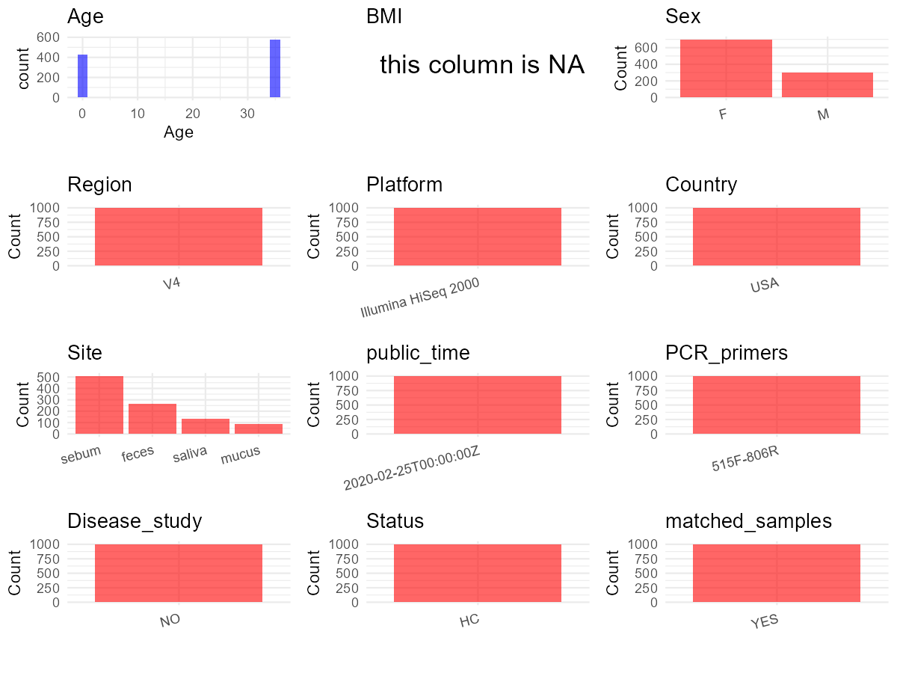

R Notebook: Metadata Processing Workflow
================

# Step 1: Obtain Initial Metadata from Each Project

To obtain the initial metadata: 1. Search for the BioProject ID (e.g.,
“PRJEBXXXX”) on the [NCBI SRA
website](https://www.ncbi.nlm.nih.gov/Traces/study/). 2. In the “Select”
table, click on “Metadata” and download the file. 3. The downloaded file
is typically named “SraRunTable.csv” and contains metadata for the
project.

``` r
# Load necessary libraries
library(dplyr)
library(ggplot2)
library(cowplot)

# Set working directory (update this path to your local directory)
setwd("D:/oral_project/PRJEB36860")

# Read the initial metadata files
initial_meta<-read.csv("SraRunTable.csv",header = T)

# Combine the two metadata files
#meta <- rbind(initial_meta, initial_meta1)

#Remove entries non-oral samples
#initial_meta <- subset(initial_meta,isolate %in% c("saliva","tongue coat"))

# Check the number of samples containing "HT" in Sample.Name (e.g., healthy controls)
#nrow(subset(meta, grepl("HT", Sample.Name)))

# Display the first few rows of the metadata
head(initial_meta)
```

    ##          Run anonymized_name Assay.Type AvgSpotLen barcode..exp.    Bases
    ## 1 ERR3936609  1.10.A.DM.530P      OTHER         99  GCATAGCATCAA 12633393
    ## 2 ERR3936610  1.11.A.DM.520P      OTHER         99  CGTGACAATAGT 19790836
    ## 3 ERR3936611  1.11.A.DM.800A      OTHER         99  CGTACTCTCGAG 17293624
    ## 4 ERR3936612  1.14.A.DM.200P      OTHER         99  CGGGTGTTTGCT 11397215
    ## 5 ERR3936613  1.14.A.DM.500P      OTHER         99  CGGATCTAGTGT  2282834
    ## 6 ERR3936614  1.15.A.DM.545P      OTHER         99  TCACCTCCTTGT    24437
    ##   BioProject    BioSample    Bytes center_name..exp.
    ## 1 PRJEB36860 SAMEA6572583  9124515              CCME
    ## 2 PRJEB36860 SAMEA6572584 14391735              CCME
    ## 3 PRJEB36860 SAMEA6572585 12442306              CCME
    ## 4 PRJEB36860 SAMEA6572586  8308753              CCME
    ## 5 PRJEB36860 SAMEA6572587  1683885              CCME
    ## 6 PRJEB36860 SAMEA6572588    46912              CCME
    ##                                          Center.Name
    ## 1 UNIVERSITY OF CALIFORNIA SAN DIEGO MICROBIOME INIT
    ## 2 UNIVERSITY OF CALIFORNIA SAN DIEGO MICROBIOME INIT
    ## 3 UNIVERSITY OF CALIFORNIA SAN DIEGO MICROBIOME INIT
    ## 4 UNIVERSITY OF CALIFORNIA SAN DIEGO MICROBIOME INIT
    ## 5 UNIVERSITY OF CALIFORNIA SAN DIEGO MICROBIOME INIT
    ## 6 UNIVERSITY OF CALIFORNIA SAN DIEGO MICROBIOME INIT
    ##                  center_project_name..exp. collection_timestamp Consent
    ## 1 Knight 16S KnightBaby Infant Time Series           2012-01-10  public
    ## 2 Knight 16S KnightBaby Infant Time Series           2012-01-11  public
    ## 3 Knight 16S KnightBaby Infant Time Series           2012-01-11  public
    ## 4 Knight 16S KnightBaby Infant Time Series           2012-01-14  public
    ## 5 Knight 16S KnightBaby Infant Time Series           2012-01-14  public
    ## 6 Knight 16S KnightBaby Infant Time Series           2012-01-15  public
    ##   DATASTORE.filetype DATASTORE.provider                     DATASTORE.region
    ## 1         run.zq,sra         gs,ncbi,s3 gs.us-east1,ncbi.public,s3.us-east-1
    ## 2         run.zq,sra         gs,ncbi,s3 gs.us-east1,ncbi.public,s3.us-east-1
    ## 3         run.zq,sra         gs,ncbi,s3 gs.us-east1,ncbi.public,s3.us-east-1
    ## 4         run.zq,sra         gs,ncbi,s3 gs.us-east1,ncbi.public,s3.us-east-1
    ## 5         run.zq,sra         gs,ncbi,s3 gs.us-east1,ncbi.public,s3.us-east-1
    ## 6         run.zq,sra         gs,ncbi,s3 gs.us-east1,ncbi.public,s3.us-east-1
    ##   dna_extracted elevation          empo_1            empo_2            empo_3
    ## 1          TRUE    1624.1 Host-associated Animal-associated Animal distal gut
    ## 2          TRUE    1624.1 Host-associated Animal-associated Animal distal gut
    ## 3          TRUE    1624.1 Host-associated Animal-associated Animal distal gut
    ## 4          TRUE    1624.1 Host-associated Animal-associated Animal distal gut
    ## 5          TRUE    1624.1 Host-associated Animal-associated Animal distal gut
    ## 6          TRUE    1624.1 Host-associated Animal-associated Animal distal gut
    ##   ENA.FIRST.PUBLIC..run.     ena_first_public ENA.LAST.UPDATE..run.
    ## 1             2020-02-20 2020-02-20T17:05:46Z            2020-02-24
    ## 2             2020-02-20 2020-02-20T17:05:46Z            2020-02-24
    ## 3             2020-02-20 2020-02-20T17:05:46Z            2020-02-24
    ## 4             2020-02-20 2020-02-20T17:05:46Z            2020-02-24
    ## 5             2020-02-20 2020-02-20T17:05:46Z            2020-02-24
    ## 6             2020-02-20 2020-02-20T17:05:46Z            2020-02-24
    ##        ena_last_update   env_biome              env_feature env_material
    ## 1 2020-02-24T20:14:40Z urban biome human-associated habitat        feces
    ## 2 2020-02-24T20:14:40Z urban biome human-associated habitat        feces
    ## 3 2020-02-24T20:14:40Z urban biome human-associated habitat        feces
    ## 4 2020-02-24T20:14:40Z urban biome human-associated habitat        feces
    ## 5 2020-02-24T20:14:40Z urban biome human-associated habitat        feces
    ## 6 2020-02-24T20:14:40Z urban biome human-associated habitat        feces
    ##   env_package experiment_center..exp. Experiment    experiment_title..exp.
    ## 1   human-gut                    CCME ERX3944457 Knight_Infant_time_series
    ## 2   human-gut                    CCME ERX3944458 Knight_Infant_time_series
    ## 3   human-gut                    CCME ERX3944459 Knight_Infant_time_series
    ## 4   human-gut                    CCME ERX3944460 Knight_Infant_time_series
    ## 5   human-gut                    CCME ERX3944461 Knight_Infant_time_series
    ## 6   human-gut                    CCME ERX3944462 Knight_Infant_time_series
    ##    external_id geo_loc_name_country geo_loc_name_country_continent
    ## 1 SAMEA6572583                  USA                  North America
    ## 2 SAMEA6572584                  USA                  North America
    ## 3 SAMEA6572585                  USA                  North America
    ## 4 SAMEA6572586                  USA                  North America
    ## 5 SAMEA6572587                  USA                  North America
    ## 6 SAMEA6572588                  USA                  North America
    ##       geo_loc_name host_age_units host_height_units host_subject_id
    ## 1 USA:CO\\,Boulder           days                cm        Infant01
    ## 2 USA:CO\\,Boulder           days                cm        Infant01
    ## 3 USA:CO\\,Boulder           days                cm        Infant01
    ## 4 USA:CO\\,Boulder           days                cm        Infant01
    ## 5 USA:CO\\,Boulder           days                cm        Infant01
    ## 6 USA:CO\\,Boulder           days                cm        Infant01
    ##   host_weight_units INSDC_center_name   INSDC_first_public    INSDC_last_update
    ## 1                kg            UCSDMI 2020-02-20T17:05:46Z 2020-02-24T20:14:40Z
    ## 2                kg            UCSDMI 2020-02-20T17:05:46Z 2020-02-24T20:14:40Z
    ## 3                kg            UCSDMI 2020-02-20T17:05:46Z 2020-02-24T20:14:40Z
    ## 4                kg            UCSDMI 2020-02-20T17:05:46Z 2020-02-24T20:14:40Z
    ## 5                kg            UCSDMI 2020-02-20T17:05:46Z 2020-02-24T20:14:40Z
    ## 6                kg            UCSDMI 2020-02-20T17:05:46Z 2020-02-24T20:14:40Z
    ##   INSDC_status          Instrument latitude          Library.Name LibraryLayout
    ## 1       public Illumina HiSeq 2000    40.01 1718.1.10.I01.DM.530P        SINGLE
    ## 2       public Illumina HiSeq 2000    40.01 1718.1.11.I01.DM.520P        SINGLE
    ## 3       public Illumina HiSeq 2000    40.01 1718.1.11.I01.DM.800A        SINGLE
    ## 4       public Illumina HiSeq 2000    40.01 1718.1.14.I01.DM.200P        SINGLE
    ## 5       public Illumina HiSeq 2000    40.01 1718.1.14.I01.DM.500P        SINGLE
    ## 6       public Illumina HiSeq 2000    40.01 1718.1.15.I01.DM.545P        SINGLE
    ##   LibrarySelection LibrarySource linker..exp. longitude             Organism
    ## 1              PCR   METAGENOMIC           GT   -105.27 human gut metagenome
    ## 2              PCR   METAGENOMIC           GT   -105.27 human gut metagenome
    ## 3              PCR   METAGENOMIC           GT   -105.27 human gut metagenome
    ## 4              PCR   METAGENOMIC           GT   -105.27 human gut metagenome
    ## 5              PCR   METAGENOMIC           GT   -105.27 human gut metagenome
    ## 6              PCR   METAGENOMIC           GT   -105.27 human gut metagenome
    ##                                   pcr_primers..exp. physical_specimen_location
    ## 1 FWD:GTGCCAGCMGCCGCGGTAA; REV:GGACTACHVGGGTWTCTAAT                     UCSDMI
    ## 2 FWD:GTGCCAGCMGCCGCGGTAA; REV:GGACTACHVGGGTWTCTAAT                     UCSDMI
    ## 3 FWD:GTGCCAGCMGCCGCGGTAA; REV:GGACTACHVGGGTWTCTAAT                     UCSDMI
    ## 4 FWD:GTGCCAGCMGCCGCGGTAA; REV:GGACTACHVGGGTWTCTAAT                     UCSDMI
    ## 5 FWD:GTGCCAGCMGCCGCGGTAA; REV:GGACTACHVGGGTWTCTAAT                     UCSDMI
    ## 6 FWD:GTGCCAGCMGCCGCGGTAA; REV:GGACTACHVGGGTWTCTAAT                     UCSDMI
    ##   physical_specimen_remaining plate_renamed..exp. Platform
    ## 1                       FALSE                   2 ILLUMINA
    ## 2                       FALSE                   2 ILLUMINA
    ## 3                       FALSE                   2 ILLUMINA
    ## 4                       FALSE                   2 ILLUMINA
    ## 5                       FALSE                   2 ILLUMINA
    ## 6                       FALSE                   7 ILLUMINA
    ##            primer..exp. public       qiita..exp. qiita_option_processing..exp.
    ## 1 GTGTGCCAGCMGCCGCGGTAA   TRUE golay 12 defaults             golay 12 defaults
    ## 2 GTGTGCCAGCMGCCGCGGTAA   TRUE golay 12 defaults             golay 12 defaults
    ## 3 GTGTGCCAGCMGCCGCGGTAA   TRUE golay 12 defaults             golay 12 defaults
    ## 4 GTGTGCCAGCMGCCGCGGTAA   TRUE golay 12 defaults             golay 12 defaults
    ## 5 GTGTGCCAGCMGCCGCGGTAA   TRUE golay 12 defaults             golay 12 defaults
    ## 6 GTGTGCCAGCMGCCGCGGTAA   TRUE golay 12 defaults             golay 12 defaults
    ##            ReleaseDate run_center..exp. run_date..exp.          create_date
    ## 1 2020-02-25T00:00:00Z             CCME        5/22/12 2020-02-29T22:31:00Z
    ## 2 2020-02-25T00:00:00Z             CCME        5/22/12 2020-02-29T22:31:00Z
    ## 3 2020-02-25T00:00:00Z             CCME        5/22/12 2020-02-29T22:32:00Z
    ## 4 2020-02-25T00:00:00Z             CCME        5/22/12 2020-02-29T22:32:00Z
    ## 5 2020-02-25T00:00:00Z             CCME        5/22/12 2020-02-29T22:32:00Z
    ## 6 2020-02-25T00:00:00Z             CCME        5/22/12 2020-02-29T22:32:00Z
    ##   version                                   run_prefix..exp.
    ## 1       1 460_Knight16S_KnightBaby_25512_NoIndex_L001_R1_001
    ## 2       1 460_Knight16S_KnightBaby_25512_NoIndex_L001_R1_001
    ## 3       1 460_Knight16S_KnightBaby_25512_NoIndex_L001_R1_001
    ## 4       1 460_Knight16S_KnightBaby_25512_NoIndex_L001_R1_001
    ## 5       1 460_Knight16S_KnightBaby_25512_NoIndex_L001_R1_001
    ## 6       1 460_Knight16S_KnightBaby_25512_NoIndex_L001_R1_001
    ##   sample_center..exp.  Sample.Name                          Sample_name
    ## 1                CCME SAMEA6572583 qiita_sid_1718:1718.1.10.I01.DM.530P
    ## 2                CCME SAMEA6572584 qiita_sid_1718:1718.1.11.I01.DM.520P
    ## 3                CCME SAMEA6572585 qiita_sid_1718:1718.1.11.I01.DM.800A
    ## 4                CCME SAMEA6572586 qiita_sid_1718:1718.1.14.I01.DM.200P
    ## 5                CCME SAMEA6572587 qiita_sid_1718:1718.1.14.I01.DM.500P
    ## 6                CCME SAMEA6572588 qiita_sid_1718:1718.1.15.I01.DM.545P
    ##   sample_type      Scientific_Name   sequencing_meth..exp. SRA.Study
    ## 1       feces human gut metagenome sequencing by synthesis ERP120109
    ## 2       feces human gut metagenome sequencing by synthesis ERP120109
    ## 3       feces human gut metagenome sequencing by synthesis ERP120109
    ## 4       feces human gut metagenome sequencing by synthesis ERP120109
    ## 5       feces human gut metagenome sequencing by synthesis ERP120109
    ## 6       feces human gut metagenome sequencing by synthesis ERP120109
    ##                           Submitter_Id target_gene..exp.
    ## 1 qiita_sid_1718:1718.1.10.I01.DM.530P          16S rRNA
    ## 2 qiita_sid_1718:1718.1.11.I01.DM.520P          16S rRNA
    ## 3 qiita_sid_1718:1718.1.11.I01.DM.800A          16S rRNA
    ## 4 qiita_sid_1718:1718.1.14.I01.DM.200P          16S rRNA
    ## 5 qiita_sid_1718:1718.1.14.I01.DM.500P          16S rRNA
    ## 6 qiita_sid_1718:1718.1.15.I01.DM.545P          16S rRNA
    ##   target_subfragment..exp. abx_past_6_mos age_in_years Host_age
    ## 1                       V4   not provided     0.183440       67
    ## 2                       V4   not provided     0.186178       68
    ## 3                       V4   not provided     0.186178       68
    ## 4                       V4   not provided     0.191650       70
    ## 5                       V4   not provided     0.191650       70
    ## 6                       V4   not provided     0.197129       72
    ##   host_body_habitat host_body_mass_index host_body_product host_body_site
    ## 1      UBERON:feces         not provided      UBERON:feces   UBERON:feces
    ## 2      UBERON:feces         not provided      UBERON:feces   UBERON:feces
    ## 3      UBERON:feces         not provided      UBERON:feces   UBERON:feces
    ## 4      UBERON:feces         not provided      UBERON:feces   UBERON:feces
    ## 5      UBERON:feces         not provided      UBERON:feces   UBERON:feces
    ## 6      UBERON:feces         not provided      UBERON:feces   UBERON:feces
    ##   host_common_name  host_height host_scientific_name host_taxid  host_weight
    ## 1            human not provided         Homo sapiens       9606 not provided
    ## 2            human not provided         Homo sapiens       9606 not provided
    ## 3            human not provided         Homo sapiens       9606 not provided
    ## 4            human not provided         Homo sapiens       9606 not provided
    ## 5            human not provided         Homo sapiens       9606 not provided
    ## 6            human not provided         Homo sapiens       9606 not provided
    ##      sex family_relationship
    ## 1 female              infant
    ## 2 female              infant
    ## 3 female              infant
    ## 4 female              infant
    ## 5 female              infant
    ## 6 female              infant

# Step 2: Create a Uniform Metadata Template

The uniform metadata should include the following columns:

1.  **BioProject**: Project ID (e.g., “PRJNA339212”)
2.  **Run**: Sample ID (e.g., “ERRXXXXXX” or “SRRXXXXXX”)
3.  **sample_name**: Original sample name submitted by the authors (not
    the database-assigned ID)
4.  **Age**: Age of the subject (if available)
5.  **BMI**: Body Mass Index (if available)
6.  **Sex**: Sex of the subject (“F” or “M”)
7.  **Region**: Targeted 16S rRNA region (e.g., “V3-V4”)
8.  **Platform**: Sequencing platform (e.g., “Illumina MiSeq”)
9.  **Country**: Country of sample origin (e.g., “China”)
10. **Site**: Sample site (e.g., “saliva”, “dental plaque”)
11. **public_time**: Data release date (format: “YYYY-MM-DD”)
12. **PCR_primers**: PCR primers used (e.g., “515F-806R”)
13. **title**: Title of the associated publication
14. **Disease_study**: Whether the study involves a disease (“YES” or
    “NO”)
15. **Status**: Disease status (e.g., “T2DM”, “HC”). Note: If the study
    includes both disease and healthy samples, this must be specified
    per sample.
16. **matched_samples**: matched samples (“YES” or “NO”)

``` r
# Create a uniform metadata dataframe
metadata <- data.frame(
  BioProject = initial_meta$BioProject,
  Run = initial_meta$Run,
  sample_name = initial_meta$host_subject_id,
  Age = initial_meta$age_in_years,
  BMI = NA,
  Sex = initial_meta$sex,
  Region = initial_meta$target_subfragment..exp.,
  Platform = initial_meta$Instrument,
  Country = initial_meta$geo_loc_name_country,
  Site = initial_meta$env_material,
  public_time = initial_meta$ReleaseDate,
  stringsAsFactors = FALSE
)
```

``` r
metadata <- metadata %>%
  mutate(Sex = recode(Sex, "female" = "F", "male" = "M"))
```

# Step 3: Manually Add Information from the Publication

Some information (e.g. PCR primers, study title, disease status) must be
manually extracted from the publication and added to the metadata.

``` r
# Add information obtained from the publication
metadata$PCR_primers <- "515F-806R"
metadata$title <- "Naturalization of the microbiota developmental trajectory of Cesarean-born neonates after vaginal seeding"
metadata$Disease_study <- "NO"
# Assign disease status based on sample_name patterns
metadata$Status <- "HC"

#get subjects id with Saliva available
keep_subjects <- subset(metadata, Site %in% c("saliva", "mucus"))
#remove subjects without Saliva samples
metadata<-subset(metadata,sample_name %in% keep_subjects$sample_name)
#get subjects sampling counts
sample_counts <- table(metadata$sample_name)
# Create matched_samples column, any subjects have >=2 samples will be label "YES", otherwise "NO"
metadata$matched_samples <- ifelse(metadata$sample_name %in% names(sample_counts[sample_counts >= 2]), "YES", "NO")
```

# Step 4: Summarize and Validate the Metadata

``` r
# Check the number of unique runs and sample names
print(paste("Number of unique runs:", length(unique(metadata$Run))))
```

    ## [1] "Number of unique runs: 1003"

``` r
print(paste("Number of unique sample names:", length(unique(metadata$sample_name))))
```

    ## [1] "Number of unique sample names: 5"

# Step 5: Visualize the Metadata

``` r

```

<!-- -->

# Step 6: Finalize and Export the Metadata

``` r
# Reorder columns to match the desired format
metadata <- metadata[, c(
  "BioProject", "Run", "sample_name", "Age", "BMI", "Sex", 
  "Region", "Platform", "Country", "Site", "public_time", 
  "PCR_primers", "title", "Disease_study", "Status","matched_samples"
)]

# Export the uniform metadata to a CSV file
write.csv(metadata, file = "metadata.csv", quote = FALSE)
head(metadata)
```

    ##   BioProject        Run sample_name      Age BMI Sex Region            Platform
    ## 1 PRJEB36860 ERR3936609    Infant01 0.183440  NA   F     V4 Illumina HiSeq 2000
    ## 2 PRJEB36860 ERR3936610    Infant01 0.186178  NA   F     V4 Illumina HiSeq 2000
    ## 3 PRJEB36860 ERR3936611    Infant01 0.186178  NA   F     V4 Illumina HiSeq 2000
    ## 4 PRJEB36860 ERR3936612    Infant01 0.191650  NA   F     V4 Illumina HiSeq 2000
    ## 5 PRJEB36860 ERR3936613    Infant01 0.191650  NA   F     V4 Illumina HiSeq 2000
    ## 6 PRJEB36860 ERR3936614    Infant01 0.197129  NA   F     V4 Illumina HiSeq 2000
    ##   Country  Site          public_time PCR_primers
    ## 1     USA feces 2020-02-25T00:00:00Z   515F-806R
    ## 2     USA feces 2020-02-25T00:00:00Z   515F-806R
    ## 3     USA feces 2020-02-25T00:00:00Z   515F-806R
    ## 4     USA feces 2020-02-25T00:00:00Z   515F-806R
    ## 5     USA feces 2020-02-25T00:00:00Z   515F-806R
    ## 6     USA feces 2020-02-25T00:00:00Z   515F-806R
    ##                                                                                                       title
    ## 1 Naturalization of the microbiota developmental trajectory of Cesarean-born neonates after vaginal seeding
    ## 2 Naturalization of the microbiota developmental trajectory of Cesarean-born neonates after vaginal seeding
    ## 3 Naturalization of the microbiota developmental trajectory of Cesarean-born neonates after vaginal seeding
    ## 4 Naturalization of the microbiota developmental trajectory of Cesarean-born neonates after vaginal seeding
    ## 5 Naturalization of the microbiota developmental trajectory of Cesarean-born neonates after vaginal seeding
    ## 6 Naturalization of the microbiota developmental trajectory of Cesarean-born neonates after vaginal seeding
    ##   Disease_study Status matched_samples
    ## 1            NO     HC             YES
    ## 2            NO     HC             YES
    ## 3            NO     HC             YES
    ## 4            NO     HC             YES
    ## 5            NO     HC             YES
    ## 6            NO     HC             YES

## Notes for Students:

1.  **Metadata Accuracy**: Always cross-check the metadata with the
    original publication to ensure accuracy.
2.  **Manual Entries**: Columns like `PCR_primers`, and `Status` often
    require manual entry based on the publication.
3.  **Disease Status**: Be careful when assigning `Status`—some studies
    include both disease and healthy samples.
4.  **Visualization**: The plots help quickly identify the distribution
    of values in each column, which is useful for quality control.
5.  **Reproducibility**: Update the working directory and file paths to
    match your local environment.
