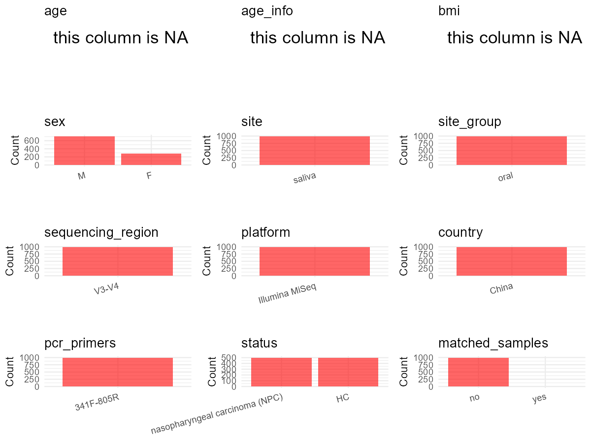

# Step 1: Obtain Initial Metadata from Each Project

This step sets the project directory, loads the raw SRA metadata, and optionally merges supplement tables.

```{r message=FALSE, warning=FALSE}
# Load libraries
library(dplyr)
library(ggplot2)
library(cowplot)

# =============================================================
# Curation Notes - PRJEB37445
# sample_id     : initial_meta column 'Run' (ERR accession)
# subject_id    : From initial_meta 'Sample_name' — prefix before first dot
#                 (e.g., "case_05", "control_28")
# sex           : From initial_meta 'Sample_name' — 3rd dot-separated field
#                 (e.g., "male"/"female")
# age           : NA — age ranges available in Sample_name and Host_Age
#                 column but no exact ages; user instructed to use NA
# age_info      : NA
# bmi           : NA — not available in metadata; paper Table 1 has BMI
#                 categories but no per-sample values
# platform      : Paper Methods ("Illumina MiSeq") — NOT from metadata
# sequencing_region : Paper Methods ("V3-V4"); metadata has 'V3-4'
# pcr_primers   : Paper Methods ("341F-805R")
# country       : initial_meta column 'geo_loc_name_country' = "China"
# site          : From initial_meta 'environment_(material)' = "saliva"
# site_group    : "oral" — saliva is an oral site
# title         : Paper full title
# disease_study : "yes" — NPC patient cohort (paper title + abstract)
# status        : From disease_status: "case" -> "nasopharyngeal
#                 carcinoma (NPC)"; "control" -> "HC" (healthy control)
# public_time   : initial_meta column 'ReleaseDate'
# is_time_series: "no" — single timepoint design; only control_28 appears
#                 twice (2 samples for same individual)
# matched_samples: determined by subject_id frequency
# controls      : none — disease_status "control" = healthy human subjects
#                 (not negative/positive technical controls)
# non-human     : none — all samples are human (Organism = "human oral
#                 metagenome")
# =============================================================

# (1) Setting working directory
# EDIT HERE: change project_id for each study
project_id <- "PRJEB37445"

base_dir <- "D:/metadata_collect"
setwd(file.path(base_dir, project_id))

# (2) Loading raw SRA metadata file
sra_file <- "SraRunTable.csv"
initial_meta <- read.csv(sra_file, header = TRUE)

# (3) OPTIONAL: If extra metadata (e.g., Table.x or supplemental materials) are available from the article, you may need to merge the file with initial_meta manually. Below is example code for merging. Depending on the specific case of each study, you can customize the code as needed.
# supp_table <- read.csv("supplemental_table.csv", header = TRUE)
# initial_meta <- left_join(initial_meta, supp_table, by = merge_col_name)
```

# Step 2: Data Overview

First, you need to get an overview of the data, which includes two steps: reading the article and reading the initial metadata. This step is very IMPORTANT!

```{r message=FALSE, warning=FALSE}
# (1) Read the article in the following order: abstract, the beginning of the results section, and the methods. Understand the sample size, experimental design, and disease group overview. Clarify the sampling sites; for oral and gut samples, specify the exact sites like supragingival plaque, tongue, etc.
# Paper: "Influence of Pre-treatment Saliva Microbial Diversity and Composition on Nasopharyngeal Carcinoma Prognosis"
# - 482 NPC cases from Wuzhou, Guangxi, China (2010-2013)
# - Saliva samples (unstimulated, 2-4 ml)
# - 16S rRNA V3-V4 region, primers 341F/805R
# - Illumina MiSeq, 2x300 bp paired-end
# - Sampling site: saliva (exact, per paper Methods)
# - Case-control design: 499 cases + 496 controls in metadata;
#   paper reports 482 final NPC cases after exclusions
# - status: case -> "nasopharyngeal carcinoma (NPC)", control -> "HC"
# - Single timepoint design; is_time_series = "no"

# (2) IMPORTANT: MUST go through each column of initial_meta
# head(initial_meta, 10)

# IMPORTANT: Check the unique values in the column of interest or query column.
# lapply(initial_meta[c('environment_(material)', 'Organism', 'human_oral_environmental_package')], table)
# table(initial_meta$disease_status)    # case: 499, control: 496
# table(initial_meta$sex)               # male: 710, female: 284, empty: 1
# Sample_name format: {group}_{id}.{age_range}.{sex}.{run}
#   e.g., "case_05.35-39.female.run1", "control_28.20-29.male.plate6"
# table(initial_meta$Host_Age)          # 10 age ranges: 20-29 through 70-74
# table(initial_meta$Instrument)        # Illumina MiSeq (all)
# table(initial_meta$target_subfragment) # V3-4 (all) — paper says V3-V4
# table(initial_meta$geo_loc_name_country) # China (all)
# table(initial_meta$host_id)           # matches Sample_name prefix (994 non-empty)
```

# Step 3: Removing Control and Non-human Samples

First, we need to remove control samples(including both negative controls and positive controls) and non-human samples.

```{r}
# (1) EDIT HERE: Parameter setup
# disease_status "control" = healthy human comparison subjects
# from the original case-control study design, NOT technical controls.
# No negative/positive controls present in this metadata.
control_column <- ""
# unique(initial_meta[[control_column]])
control_keywords <- c()     # Enter exact keywords

# All samples are human (Organism = "human oral metagenome")
species_column <- ""          # column name in initial_meta
# unique(initial_meta[[species_column]])
non_human_keywords <- c()            # Enter exact keywords


# (2) Remove controls and non-human samples. DO NOT need to modify code in this part, just run it.
n_samples <- nrow(initial_meta)
# Control evaluation
if (length(control_keywords) > 0) {
  if (is.null(control_column) || control_column == "") {
    stop("Error: control_keywords provided but control_column is missing.")
  }

  if (!(control_column %in% colnames(initial_meta))) {
    stop(sprintf("Error: Column '%s' not found in initial_meta.", control_column))
  }

  control_pattern <- paste(control_keywords, collapse = "|")
  control_text <- initial_meta[[control_column]]
  is_control <- grepl(control_pattern, control_text)

} else {
  is_control <- rep(FALSE, n_samples)
}

# Non-human evaluation
if (length(non_human_keywords) > 0) {
  if (is.null(species_column) || species_column == "") {
    stop("Error: non_human_keywords provided but species_column is missing.")
  }

  if (!(species_column %in% colnames(initial_meta))) {
    stop(sprintf("Error: Column '%s' not found in initial_meta.", species_column))
  }

  non_human_pattern <- paste(non_human_keywords, collapse = "|")
  species_text <- initial_meta[[species_column]]
  is_non_human <- grepl(non_human_pattern, species_text)
} else {
  is_non_human <- rep(FALSE, n_samples)
}

# Execute removal
samples_to_remove <- is_control | is_non_human
initial_meta <- initial_meta[!samples_to_remove, ]

cat("Initial samples counts:",n_samples,"\n")
cat("Removed control samples:", sum(is_control), "\n")
cat("Removed non-human samples:", sum(is_non_human), "\n")
cat("Total samples removed ", sum(samples_to_remove), "\n")
cat("Remaining samples after Step 2:", nrow(initial_meta), "\n")
```

# Step 4: Creating a Uniform Metadata Template

This step converts the raw SRA table into the standard metadata format used in our meta-analysis.
The uniform metadata should include the following columns:
1. **bioproject**: Project ID from SRA or other database
   e.g. `PRJNA1234`, `CNP1234`, 'OEP1234', 'qiita_1234'
2. **sample_id**: SRA sample/run ID. Unique id for each sample!
   e.g. `DRR1234567`, `ERR1234567` and `SRR1234567`. If no such column exists, can use column like sample_name.
3. **subject_id**: subject id for each person if available.
   e.g. `patient_01`, `Host_03_before`, `subject12`
4. **age**: Age of the subject if available.
   e.g. `35`, `42` | not `adult`, `chilren`
5. **age_info**: If the age is not explicitly stated but approximate age range information is available, mark it in this column.
   e.g., `18-55`, `children`, `infant`, `elder`
6. **bmi**: Body Mass Index if available.
   e.g. `22.5`, `18.9` | not `normal`, `overweight`
7. **sex**: Sex of the subject.
   Mandatory to write as M/F | not `female`, `woman`
8. **sequencing_region**: Targeted 16S rRNA region.
   e.g. `V3-V4`, `V4`
9. **platform**: Sequencing platform.
   e.g. `Illumina MiSeq`, `454 GS FLX Titanium`, `Ion Torrent`
10. **country**: Country of sample origin.
    e.g. `China`, `Japan` | not city name like `Beijing`
11. **site**: Sampling site. For oral and gut sites, specify the exact sites as detailed as possible. For example, if it is known to be supragingival plaque, do not record it as 'dental plaque', unless the original text provides only a vague description.
    e.g. `saliva`, `tongue coating` | not broad term like `oral`
12. **site_group**: only accepts one of following three values: 'oral', 'gut', or 'other'.
13. **public_time**: Data release date.
    e.g. `2021-06-22` | not `June 2021`
14. **pcr_primers**: PCR primers used.
    e.g. `515F-806R`, `27F-338R` | not primer sequences
15. **title**: Title of the associated publication.
16. **disease_study**: Whether the study involves disease samples. If it's not clear, can record as NA. Only three values accepted: 'yes', 'no' or NA
17. **status**: Disease status for each sample if available, else record as NA. Only accept following abbreviations, Write full names for all other diseases.
    HC: healthy control
    CD: Crohn's disease
    CRC: colorectal cancer
    COPD: chronic obstructive pulmonary disease
    HIV: human immunodeficiency virus
    ICU: intensive care unit
    OSCC: oral squamous cell carcinoma
    RA: rheumatoid arthritis
    UC: ulcerative colitis
18. **matched_samples**: Whether the subject has matched samples. Only accept 'yes' or 'no'.
19. **is_time_series**: Whether the study is a time series study. Only accept 'yes' or 'no'.

```{r}
# Extract columns from initial_meta as follows: (1) No modification needed -> extract directly. (2) Modification needed -> create a new column with the prefix raw_ and mark the original column as "pending". (3) Need to find or determine based on the article.
# Sample_name format: {group}_{id}.{age_range}.{sex}.{run}
#   e.g., "case_05.35-39.female.run1", "control_28.20-29.male.plate6"
# Extract subject_id from Sample_name prefix (before first dot)
# Extract sex from Sample_name (3rd dot-separated field)
initial_meta <- initial_meta %>%
  mutate(
    raw_subject_id = sapply(strsplit(Sample_name, "\\."), `[`, 1),
    raw_sex_from_name = sapply(strsplit(Sample_name, "\\."), `[`, 3)
  ) # From initial_meta 'Sample_name': split by dot to extract subject_id, sex

metadata <- data.frame(
  bioproject = initial_meta$BioProject,
  sample_id = initial_meta$Run,
  # From Sample_name prefix (e.g., "case_05", "control_28")
  subject_id = initial_meta$raw_subject_id,
  age = NA,
  age_info = NA,
  # BMI not available per sample in metadata; paper Table 1 has categories
  # but no individual-level values
  bmi = NA,
  # raw_sex from Sample_name 3rd field (e.g., "male"/"female")
  raw_sex = initial_meta$raw_sex_from_name,
  sex = "pending",
  # Paper Methods: "16s rRNA ... 341F/805R V3-V4 primers"
  # metadata has "V3-4" in target_subfragment; use paper value
  sequencing_region = "V3-V4",
  # Paper Methods: "Illumina MiSeq" — NOT from metadata Platform column
  platform = "Illumina MiSeq",
  country = initial_meta$geo_loc_name_country,
  # From initial_meta 'environment_(material)' = "saliva"
  # Paper Methods: "unstimulated saliva samples (2-4 ml)"
  raw_site = initial_meta$environment_.material.,
  site = "pending",
  site_group = "pending", # modify later
  public_time = initial_meta$ReleaseDate,
  # Paper Methods: primers 341F/805R
  pcr_primers = "341F-805R",
  # Paper full title
  title = "Influence of Pre-treatment Saliva Microbial Diversity and Composition on Nasopharyngeal Carcinoma Prognosis",
  # Paper title and abstract describe NPC patient cohort; disease study = "yes"
  disease_study = "yes",
  # From initial_meta 'disease_status': "case" -> full disease name
  # "nasopharyngeal carcinoma (NPC)"; "control" -> "HC" (healthy control)
  raw_status = initial_meta$disease_status,
  status = "pending",
  matched_samples = "pending", # modify later
  # Paper: single timepoint saliva collection; only control_28 appears
  # twice, all other subjects have 1 sample
  is_time_series = "no",
  stringsAsFactors = FALSE
)
metadata$public_time <- as.Date(metadata$public_time)
```

# Step 5: Manually solving pending issues

This step involves two parts: (1) handle the columns with the `raw_` prefix, and next (2) handle the `site_group` and `matched_samples` columns.

```{r}
# (1) Handle the columns with the `raw_` prefix.
# In this part, you need to customize the code based on the situation of the raw_ columns to obtain the content of the target columns. IMPORTANT: Add comments if the modification is not straightforward!!
metadata <- metadata %>%
  mutate(sex = case_when(
    raw_sex == "male" ~ "M",
    raw_sex == "female" ~ "F",
    TRUE ~ NA_character_
  )) # From initial_meta 'sex' column: lowercase 'male' -> "M", 'female' -> "F"

# site: from initial_meta 'environment_(material)' = "saliva"
# Paper Methods confirms: "unstimulated saliva samples (2-4 ml)"
metadata$site <- metadata$raw_site

# status: from initial_meta 'disease_status'
# "case" -> "nasopharyngeal carcinoma (NPC)" (full disease name;
# not in standard abbreviation list)
# "control" -> "HC" (healthy control)
metadata <- metadata %>%
  mutate(status = case_when(
    raw_status == "case" ~ "nasopharyngeal carcinoma (NPC)",
    raw_status == "control" ~ "HC",
    TRUE ~ NA_character_
  )) # From initial_meta 'disease_status' column
```

```{r}
# (2) Filling the 'site_group' and 'matched_samples' columns
# editing site_group
unique(metadata$site)
# EDIT HERE: add oral sites
# Paper Methods: saliva samples — saliva is an oral site
Oral_site = c("saliva")
# EDIT HERE: add gut sites
Gut_site = c()
# just run
metadata <- metadata %>%
  mutate(site_group = case_when(
    site %in% Oral_site ~ "oral",
    site %in% Gut_site ~ "gut",
    TRUE ~ "other"
  ))

# editing matched_samples, just run.
# Most subjects have 1 sample; only control_28 has 2 samples
# (saliva collected on two different runs: plate6 and run1)
metadata$matched_samples <- ifelse(
  ave(metadata$subject_id, metadata$subject_id, FUN = length) > 1,
  "yes",
  "no"
)
```

```{r}
# (3) check if there is pending value in metadata. If there is pending value, go on modify the metadata.
# Function to check if a column contains "pending"
has_pending <- function(col) {
  if (is.character(col) || is.factor(col)) {
    any(col == "pending", na.rm = TRUE)
  } else {
    FALSE
  }
}

# Check for any pending value
any_pending_value <- any(sapply(metadata, has_pending))

if (!any_pending_value) {
  message("Good! No cell contains the value 'pending'.")
} else {
  pending_cols <- names(metadata)[sapply(metadata, has_pending)]
  message("Columns containing 'pending': ", paste(pending_cols, collapse = ", "))
  message("Please continue to resolve these pending columns!")
}
```

# Step 6: Visualize the Metadata

This step makes a quick set of plots for checking the distribution of key metadata fields.

```{r}
# Select columns for visualization, just run
plot_data <- metadata %>%
  select(-bioproject, -sample_id, -subject_id, -title)

create_simple_plots <- function(data) {
  plots <- list()
  continuous_vars <- c("age", "bmi")

  for (col in colnames(data)) {
    if (all(is.na(data[[col]]))) {
      p <- ggplot() +
        annotate("text", x = 0.5, y = 0.5, label = "this column is NA", size = 6) +
        labs(title = col) +
        theme_void()
    } else if (col %in% continuous_vars && is.numeric(data[[col]])) {
      p <- ggplot(data, aes(x = .data[[col]])) +
        geom_histogram(fill = "blue", alpha = 0.6, bins = 20, na.rm = TRUE) +
        labs(title = col, x = col, y = "Count") +
        theme_minimal()
    } else {
      count_data <- as.data.frame(table(data[[col]], useNA = "ifany"))
      p <- ggplot(count_data, aes(x = reorder(Var1, -Freq), y = Freq)) +
        geom_col(fill = "red", alpha = 0.6) +
        labs(title = col, x = NULL, y = "Count") +
        theme_minimal() +
        theme(axis.text.x = element_text(angle = 15, hjust = 1))
    }
    plots[[col]] <- p
  }

  return(plots)
}

# Generate and arrange plots
plots <- create_simple_plots(plot_data)
p <- plot_grid(plots$age,
               plots$age_info,
               plots$bmi,
               plots$sex,
               plots$site,
               plots$site_group,
               plots$sequencing_region,
               plots$platform,
               plots$country,
               plots$pcr_primers,
               plots$status,
               plots$matched_samples,
               ncol = 3, align = "hv", axis = "lb")
ggsave("Metadata_Summary_v2.png", plot = p, width = 8, height = 6, dpi = 150)
```

```{r}
# Insert Metadata_Summary_v2.png into the current Rmd output

```

# Step 7: Sort and export the metadata

This step saves the cleaned metadata table as the final `metadata.csv` file.

```{r}
# Reorder the data frame
fixed_cols <- c("bioproject", "sample_id", "subject_id", "age", "age_info",
                "bmi", "sex", "platform", "sequencing_region", "pcr_primers",
                "country", "site", "site_group", "disease_study", "status",
                "title", "public_time", "matched_samples", "is_time_series")
metadata <- metadata %>%
  select(all_of(fixed_cols), everything())

# save metadata
# head(metadata)
write.csv(metadata, file = "metadata_v2.csv", quote = TRUE)
```
