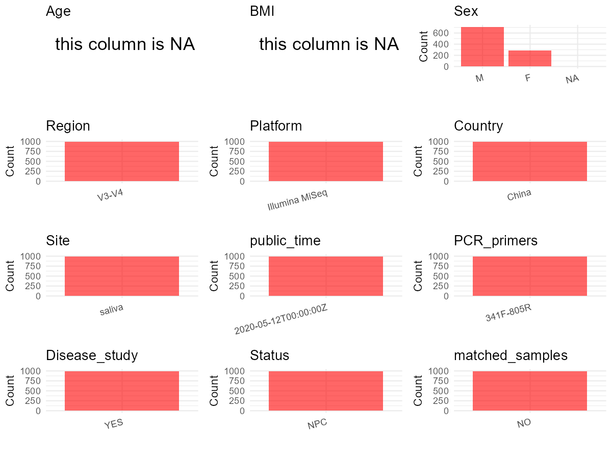

R Notebook: Metadata Processing Workflow
================

# Step 1: Obtain Initial Metadata from Each Project

To obtain the initial metadata: 1. Search for the BioProject ID (e.g.,
“PRJEBXXXX”) on the [NCBI SRA
website](https://www.ncbi.nlm.nih.gov/Traces/study/). 2. In the “Select”
table, click on “Metadata” and download the file. 3. The downloaded file
is typically named “SraRunTable.csv” and contains metadata for the
project.

``` r
# Load necessary libraries
library(dplyr)
library(ggplot2)
library(cowplot)

# Set working directory (update this path to your local directory)
setwd("D:/oral_project/PRJEB37445")

# Read the initial metadata files
initial_meta<-read.csv("SraRunTable.csv",header = T)

# Combine the two metadata files
#meta <- rbind(initial_meta, initial_meta1)

#Remove entries non-oral samples
#initial_meta <- subset(initial_meta,isolate %in% c("saliva","tongue coat"))

# Check the number of samples containing "HT" in Sample.Name (e.g., healthy controls)
#nrow(subset(meta, grepl("HT", Sample.Name)))

# Display the first few rows of the metadata
head(initial_meta)
```

    ##          Run Assay.Type AvgSpotLen    Bases BioProject    BioSample    Bytes
    ## 1 ERR4029286   AMPLICON        522 20955300 PRJEB37445 SAMEA6677085 11128375
    ## 2 ERR4042824   AMPLICON        600 44294400 PRJEB37445 SAMEA6795666 23798562
    ## 3 ERR4042833   AMPLICON        600 38784600 PRJEB37445 SAMEA6795764 21062866
    ## 4 ERR4042839   AMPLICON        600 39120000 PRJEB37445 SAMEA6795770 22897298
    ## 5 ERR4042846   AMPLICON        600 28857600 PRJEB37445 SAMEA6795776 15946332
    ## 6 ERR4042847   AMPLICON        600 31655400 PRJEB37445 SAMEA6795777 17409985
    ##            Center.Name Collection_Date Consent DATASTORE.filetype
    ## 1 KAROLINSKA INSITUTET         2014-05  public         run.zq,sra
    ## 2 KAROLINSKA INSITUTET         2012-04  public   fastq,run.zq,sra
    ## 3 KAROLINSKA INSITUTET         2013-07  public   fastq,run.zq,sra
    ## 4 KAROLINSKA INSITUTET         2012-06  public         run.zq,sra
    ## 5 KAROLINSKA INSITUTET         2013-03  public   fastq,run.zq,sra
    ## 6 KAROLINSKA INSITUTET         2013-11  public   fastq,run.zq,sra
    ##   DATASTORE.provider                     DATASTORE.region disease_status
    ## 1         gs,ncbi,s3 gs.us-east1,ncbi.public,s3.us-east-1        control
    ## 2         gs,ncbi,s3 gs.us-east1,ncbi.public,s3.us-east-1           case
    ## 3         gs,ncbi,s3 gs.us-east1,ncbi.public,s3.us-east-1           case
    ## 4         gs,ncbi,s3 gs.us-east1,ncbi.public,s3.us-east-1           case
    ## 5         gs,ncbi,s3 gs.us-east1,ncbi.public,s3.us-east-1           case
    ## 6         gs,ncbi,s3 gs.us-east1,ncbi.public,s3.us-east-1           case
    ##   ENA.FIRST.PUBLIC..run.     ena_first_public ENA.LAST.UPDATE..run.
    ## 1             2020-05-09 2020-05-09T04:05:38Z            2020-04-16
    ## 2             2020-05-09 2020-05-09T04:05:38Z            2020-04-20
    ## 3             2020-05-09 2020-05-09T04:05:38Z            2020-04-20
    ## 4             2020-05-09 2020-05-09T04:05:38Z            2020-04-20
    ## 5             2020-05-09 2020-05-09T04:05:38Z            2020-04-20
    ## 6             2020-05-09 2020-05-09T04:05:38Z            2020-04-20
    ##        ena_last_update environment_.biome.    environment_.feature.
    ## 1 2020-04-14T18:19:26Z         urban biome human-associated habitat
    ## 2 2020-04-20T21:11:04Z         urban biome human-associated habitat
    ## 3 2020-04-20T21:11:07Z         urban biome human-associated habitat
    ## 4 2020-04-20T21:11:07Z         urban biome human-associated habitat
    ## 5 2020-04-20T21:11:07Z         urban biome human-associated habitat
    ## 6 2020-04-20T21:11:07Z         urban biome human-associated habitat
    ##   environment_.material. Experiment  external_id geo_loc_name_country
    ## 1                 saliva ERX4030602 SAMEA6677085                China
    ## 2                 saliva ERX4044018 SAMEA6795666                China
    ## 3                 saliva ERX4044027 SAMEA6795764                China
    ## 4                 saliva ERX4044033 SAMEA6795770                China
    ## 5                 saliva ERX4044040 SAMEA6795776                China
    ## 6                 saliva ERX4044041 SAMEA6795777                China
    ##   geo_loc_name_country_continent geographic_location_.country_and.or_sea.
    ## 1                           Asia                                    China
    ## 2                           Asia                                    China
    ## 3                           Asia                                    China
    ## 4                           Asia                                    China
    ## 5                           Asia                                    China
    ## 6                           Asia                                    China
    ##   geographic_location_.latitude. geographic_location_.longitude. Host_Age
    ## 1                          24.47                          111.28    20-29
    ## 2                          24.47                          111.28    35-39
    ## 3                          24.47                          111.28    50-54
    ## 4                          24.47                          111.28    55-59
    ## 5                          24.47                          111.28    60-64
    ## 6                          24.47                          111.28    60-64
    ##   human_oral_environmental_package    INSDC_center_name   INSDC_first_public
    ## 1                       human-oral KAROLINSKA INSITUTET 2020-05-09T04:05:38Z
    ## 2                       human-oral KAROLINSKA INSITUTET 2020-05-09T04:05:38Z
    ## 3                       human-oral KAROLINSKA INSITUTET 2020-05-09T04:05:38Z
    ## 4                       human-oral KAROLINSKA INSITUTET 2020-05-09T04:05:38Z
    ## 5                       human-oral KAROLINSKA INSITUTET 2020-05-09T04:05:38Z
    ## 6                       human-oral KAROLINSKA INSITUTET 2020-05-09T04:05:38Z
    ##      INSDC_last_update INSDC_status     Instrument Investigation_type
    ## 1 2020-04-14T18:19:26Z       public Illumina MiSeq         metagenome
    ## 2 2020-04-20T21:11:04Z       public Illumina MiSeq         metagenome
    ## 3 2020-04-20T21:11:07Z       public Illumina MiSeq         metagenome
    ## 4 2020-04-20T21:11:07Z       public Illumina MiSeq         metagenome
    ## 5 2020-04-20T21:11:07Z       public Illumina MiSeq         metagenome
    ## 6 2020-04-20T21:11:07Z       public Illumina MiSeq         metagenome
    ##    Library.Name LibraryLayout LibrarySelection LibrarySource
    ## 1 npcgee_plate6        PAIRED              PCR   METAGENOMIC
    ## 2   npcgee run1        PAIRED              PCR   METAGENOMIC
    ## 3   npcgee run3        PAIRED              PCR   METAGENOMIC
    ## 4   npcgee run3        PAIRED              PCR   METAGENOMIC
    ## 5   npcgee run3        PAIRED              PCR   METAGENOMIC
    ## 6   npcgee run3        PAIRED              PCR   METAGENOMIC
    ##                Organism Platform           project_name          ReleaseDate
    ## 1 human oral metagenome ILLUMINA npcgee_oral_microbiome 2020-05-12T00:00:00Z
    ## 2 human oral metagenome ILLUMINA npcgee_oral_microbiome 2020-05-12T00:00:00Z
    ## 3 human oral metagenome ILLUMINA npcgee_oral_microbiome 2020-05-12T00:00:00Z
    ## 4 human oral metagenome ILLUMINA npcgee_oral_microbiome 2020-05-12T00:00:00Z
    ## 5 human oral metagenome ILLUMINA npcgee_oral_microbiome 2020-05-12T00:00:00Z
    ## 6 human oral metagenome ILLUMINA npcgee_oral_microbiome 2020-05-12T00:00:00Z
    ##            create_date version  Sample.Name                  Sample_name
    ## 1 2020-05-12T11:54:00Z       1 SAMEA6677085 control_28.20-29.male.plate6
    ## 2 2020-05-12T20:40:00Z       1 SAMEA6795666    case_05.35-39.female.run1
    ## 3 2020-05-12T20:39:00Z       1 SAMEA6795764     case_103.50-54.male.run3
    ## 4 2020-05-13T05:09:00Z       1 SAMEA6795770     case_109.55-59.male.run3
    ## 5 2020-05-12T20:40:00Z       1 SAMEA6795776     case_115.60-64.male.run3
    ## 6 2020-05-12T20:40:00Z       1 SAMEA6795777     case_116.60-64.male.run3
    ##         Scientific_Name       Sequencing_method SRA.Study
    ## 1 human oral metagenome sequencing by synthesis ERP120759
    ## 2 human oral metagenome sequencing by synthesis ERP120759
    ## 3 human oral metagenome sequencing by synthesis ERP120759
    ## 4 human oral metagenome sequencing by synthesis ERP120759
    ## 5 human oral metagenome sequencing by synthesis ERP120759
    ## 6 human oral metagenome sequencing by synthesis ERP120759
    ##                   Submitter_Id target_gene target_subfragment  host_id
    ## 1 control_28.20-29.male.plate6    16s rRNA               V3-4         
    ## 2    case_05.35-39.female.run1    16s rRNA               V3-4  case_05
    ## 3     case_103.50-54.male.run3    16s rRNA               V3-4 case_103
    ## 4     case_109.55-59.male.run3    16s rRNA               V3-4 case_109
    ## 5     case_115.60-64.male.run3    16s rRNA               V3-4 case_115
    ## 6     case_116.60-64.male.run3    16s rRNA               V3-4 case_116
    ##   Sequencing_batch    sex host_subject_id
    ## 1               NA             control_28
    ## 2                1 female                
    ## 3                3   male                
    ## 4                3   male                
    ## 5                3   male                
    ## 6                3   male

# Step 2: Create a Uniform Metadata Template

The uniform metadata should include the following columns:

1.  **BioProject**: Project ID (e.g., “PRJNA339212”)
2.  **Run**: Sample ID (e.g., “ERRXXXXXX” or “SRRXXXXXX”)
3.  **sample_name**: Original sample name submitted by the authors (not
    the database-assigned ID)
4.  **Age**: Age of the subject (if available)
5.  **BMI**: Body Mass Index (if available)
6.  **Sex**: Sex of the subject (“F” or “M”)
7.  **Region**: Targeted 16S rRNA region (e.g., “V3-V4”)
8.  **Platform**: Sequencing platform (e.g., “Illumina MiSeq”)
9.  **Country**: Country of sample origin (e.g., “China”)
10. **Site**: Sample site (e.g., “saliva”, “dental plaque”)
11. **public_time**: Data release date (format: “YYYY-MM-DD”)
12. **PCR_primers**: PCR primers used (e.g., “515F-806R”)
13. **title**: Title of the associated publication
14. **Disease_study**: Whether the study involves a disease (“YES” or
    “NO”)
15. **Status**: Disease status (e.g., “T2DM”, “HC”). Note: If the study
    includes both disease and healthy samples, this must be specified
    per sample.
16. **matched_samples**: matched samples (“YES” or “NO”)

``` r
# Create a uniform metadata dataframe
metadata <- data.frame(
  BioProject = initial_meta$BioProject,
  Run = initial_meta$Run,
  sample_name = initial_meta$Sample_name,
  Age = NA,
  BMI = NA,
  Sex = initial_meta$sex,
  Region = "V3-V4",
  Platform = initial_meta$Instrument,
  Country = initial_meta$geo_loc_name_country,
  Site = initial_meta$environment_.material.,
  public_time = initial_meta$ReleaseDate,
  stringsAsFactors = FALSE
)
```

# Step 3: Manually Add Information from the Publication

Some information (e.g. PCR primers, study title, disease status) must be
manually extracted from the publication and added to the metadata.

``` r
# Add information obtained from the publication
metadata$PCR_primers <- "341F-805R"
metadata$title <- "Influence of Pre-treatment Saliva Microbial Diversity and Composition on Nasopharyngeal Carcinoma Prognosis"
metadata$Disease_study <- "YES"
# Assign disease status based on sample_name patterns
metadata$Status<-"NPC"

#get subjects id according to sample id
metadata$sample_name<-gsub("case_|control_","",metadata$sample_name)
#get subjects id with Saliva available
keep_subjects<-subset(metadata,Site %in% "saliva")
#remove subjects without Saliva samples
metadata<-subset(metadata,sample_name %in% keep_subjects$sample_name)
#get subjects sampling counts
sample_counts <- table(metadata$sample_name)
# Create matched_samples column, any subjects have >=2 samples will be label "YES", otherwise "NO"
metadata <- metadata %>%
  group_by(sample_name) %>%
  mutate(
    sample_count = n(),
    unique_sites = n_distinct(Site),
    matched_samples = ifelse(sample_count >= 2 & unique_sites >= 2, "YES", "NO")
  ) %>%
  select(-sample_count, -unique_sites)  # 移除临时列
```

``` r
metadata <- metadata %>%
  mutate(
    Sex = trimws(Sex),                # 去掉首尾空格
    Sex = tolower(Sex),               # 全部转小写，方便统一处理
    Sex = case_when(
      Sex == "female" ~ "F",
      Sex == "male" ~ "M",
      TRUE ~ NA_character_            # 其他未识别的情况也转成 NA
    )
  )
```

# Step 4: Summarize and Validate the Metadata

``` r
# Check the number of unique runs and sample names
print(paste("Number of unique runs:", length(unique(metadata$Run))))
```

    ## [1] "Number of unique runs: 995"

``` r
print(paste("Number of unique sample names:", length(unique(metadata$sample_name))))
```

    ## [1] "Number of unique sample names: 877"

# Step 5: Visualize the Metadata

``` r

```


# Step 6: Finalize and Export the Metadata

``` r
# Reorder columns to match the desired format
metadata <- metadata[, c(
  "BioProject", "Run", "sample_name", "Age", "BMI", "Sex", 
  "Region", "Platform", "Country", "Site", "public_time", 
  "PCR_primers", "title", "Disease_study", "Status","matched_samples"
)]

# Export the uniform metadata to a CSV file
write.csv(metadata, file = "metadata.csv", quote = TRUE)
head(metadata)
```

    ## # A tibble: 6 × 16
    ## # Groups:   sample_name [6]
    ##   BioProject Run     sample_name Age   BMI   Sex   Region Platform Country Site 
    ##   <chr>      <chr>   <chr>       <lgl> <lgl> <chr> <chr>  <chr>    <chr>   <chr>
    ## 1 PRJEB37445 ERR402… 28.20-29.m… NA    NA    <NA>  V3-V4  Illumin… China   sali…
    ## 2 PRJEB37445 ERR404… 05.35-39.f… NA    NA    F     V3-V4  Illumin… China   sali…
    ## 3 PRJEB37445 ERR404… 103.50-54.… NA    NA    M     V3-V4  Illumin… China   sali…
    ## 4 PRJEB37445 ERR404… 109.55-59.… NA    NA    M     V3-V4  Illumin… China   sali…
    ## 5 PRJEB37445 ERR404… 115.60-64.… NA    NA    M     V3-V4  Illumin… China   sali…
    ## 6 PRJEB37445 ERR404… 116.60-64.… NA    NA    M     V3-V4  Illumin… China   sali…
    ## # ℹ 6 more variables: public_time <chr>, PCR_primers <chr>, title <chr>,
    ## #   Disease_study <chr>, Status <chr>, matched_samples <chr>

## Notes for Students:

1.  **Metadata Accuracy**: Always cross-check the metadata with the
    original publication to ensure accuracy.
2.  **Manual Entries**: Columns like `PCR_primers`, and `Status` often
    require manual entry based on the publication.
3.  **Disease Status**: Be careful when assigning `Status`—some studies
    include both disease and healthy samples.
4.  **Visualization**: The plots help quickly identify the distribution
    of values in each column, which is useful for quality control.
5.  **Reproducibility**: Update the working directory and file paths to
    match your local environment.
