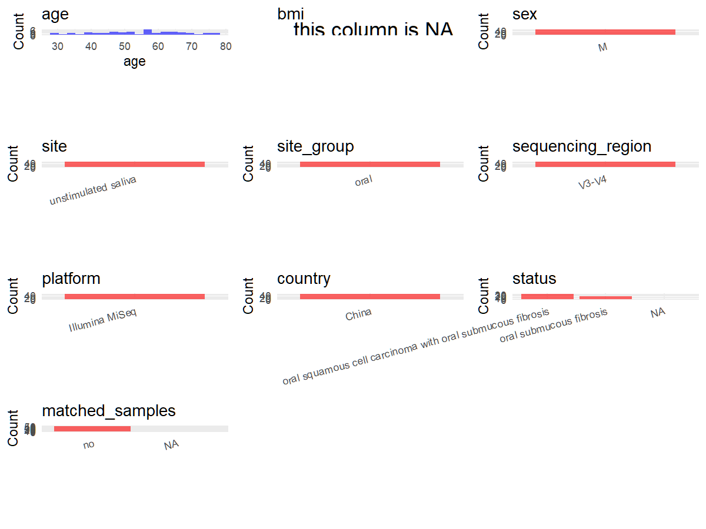

R Notebook: Metadata Processing Workflow
================

# Step 1: Obtain Initial Metadata from Each Project

To obtain the initial metadata: 1. Search for the BioProject ID (e.g.,
“PRJEBXXXX”) on the [NCBI SRA
website](https://www.ncbi.nlm.nih.gov/Traces/study/). 2. In the “Select”
table, click on “Metadata” and download the file. 3. The downloaded file
is typically named “SraRunTable.csv” and contains metadata for the
project.

``` r
# Load necessary libraries
library(dplyr)
library(ggplot2)
library(cowplot)
library(stringr)

# Set working directory (update this path to your local directory)
setwd("/home/hby/oral_project/PRJEB37501")

# Read the initial metadata files
initial_meta <- read.csv("SraRunTable.csv", header = T)

# Combine the two metadata files
# meta <- rbind(initial_meta, initial_meta1)

# Remove entries non-oral samples
# initial_meta <- subset(initial_meta,isolate %in% c("saliva","tongue coat"))

# Check the number of samples containing "HT" in Sample.Name (e.g., healthy controls)
# nrow(subset(meta, grepl("HT", Sample.Name)))

# Display the first few rows of the metadata
head(initial_meta)
```

    ##          Run Assay.Type AvgSpotLen    Bases BioProject    BioSample    Bytes Center.Name Collection_Date Consent DATASTORE.filetype DATASTORE.provider
    ## 1 ERR4586597   AMPLICON        602 68829670 PRJEB37501 SAMEA7305799 41463235        NCKU       2018/4/23  public   fastq,run.zq,sra         gs,ncbi,s3
    ## 2 ERR4586598   AMPLICON        602 68652080 PRJEB37501 SAMEA7305800 38132192        NCKU       2018/6/25  public   fastq,run.zq,sra         gs,ncbi,s3
    ## 3 ERR4586599   AMPLICON        602 69531602 PRJEB37501 SAMEA7305801 38560907        NCKU       2018/6/28  public   fastq,run.zq,sra         gs,ncbi,s3
    ## 4 ERR4586600   AMPLICON        602 62155296 PRJEB37501 SAMEA7305802 34738106        NCKU       2018/7/11  public   fastq,run.zq,sra         gs,ncbi,s3
    ## 5 ERR4586601   AMPLICON        602 66518592 PRJEB37501 SAMEA7305803 37150966        NCKU       2018/7/11  public   fastq,run.zq,sra         gs,ncbi,s3
    ## 6 ERR4586602   AMPLICON        602 67729214 PRJEB37501 SAMEA7305804 37366297        NCKU       2018/6/15  public   fastq,run.zq,sra         gs,ncbi,s3
    ##                       DATASTORE.region ENA.FIRST.PUBLIC..run.     ena_first_public ENA.LAST.UPDATE..run.      ena_last_update environment_.biome. environment_.feature.
    ## 1 gs.us-east1,ncbi.public,s3.us-east-1               2021/1/5 2021-01-05T04:27:30Z             2020/9/13 2020-09-13T10:14:28Z               Human       Oral Metagenome
    ## 2 gs.us-east1,ncbi.public,s3.us-east-1               2021/1/5 2021-01-05T04:27:30Z             2020/9/13 2020-09-13T10:14:28Z               Human       Oral Metagenome
    ## 3 gs.us-east1,ncbi.public,s3.us-east-1               2021/1/5 2021-01-05T04:27:30Z             2020/9/13 2020-09-13T10:14:28Z               Human       Oral Metagenome
    ## 4 gs.us-east1,ncbi.public,s3.us-east-1               2021/1/5 2021-01-05T04:27:30Z             2020/9/13 2020-09-13T10:14:28Z               Human       Oral Metagenome
    ## 5 gs.us-east1,ncbi.public,s3.us-east-1               2021/1/5 2021-01-05T04:27:30Z             2020/9/13 2020-09-13T10:14:28Z               Human       Oral Metagenome
    ## 6 gs.us-east1,ncbi.public,s3.us-east-1               2021/1/5 2021-01-05T04:27:30Z             2020/9/13 2020-09-13T10:14:28Z               Human       Oral Metagenome
    ##   environment_material Experiment  external_id geo_loc_name_country geo_loc_name_country_continent geographic_location_.country_and.or_sea. geographic_location_.latitude.
    ## 1               Saliva ERX4520426 SAMEA7305799                China                           Asia                                    China                       23.00188
    ## 2               Saliva ERX4520427 SAMEA7305800                China                           Asia                                    China                       23.00188
    ## 3               Saliva ERX4520428 SAMEA7305801                China                           Asia                                    China                       23.00188
    ## 4               Saliva ERX4520429 SAMEA7305802                China                           Asia                                    China                       23.00188
    ## 5               Saliva ERX4520430 SAMEA7305803                China                           Asia                                    China                       23.00188
    ## 6               Saliva ERX4520431 SAMEA7305804                China                           Asia                                    China                       23.00188
    ##   geographic_location_.longitude. Host_Age host_disease_status host_sex host_subject_id human_oral_environmental_package              INSDC_center_name   INSDC_first_public
    ## 1                        120.2175       35            OSCC-OSF     male              A1                       human-oral NATIONAL CHENG KUNG UNIVERSITY 2021-01-05T04:27:30Z
    ## 2                        120.2175       76                 OSF     male             A10                       human-oral NATIONAL CHENG KUNG UNIVERSITY 2021-01-05T04:27:30Z
    ## 3                        120.2175       32                 OSF     male             A12                       human-oral NATIONAL CHENG KUNG UNIVERSITY 2021-01-05T04:27:30Z
    ## 4                        120.2175       56                 OSF     male             A15                       human-oral NATIONAL CHENG KUNG UNIVERSITY 2021-01-05T04:27:30Z
    ## 5                        120.2175       51                 OSF     male             A16                       human-oral NATIONAL CHENG KUNG UNIVERSITY 2021-01-05T04:27:30Z
    ## 6                        120.2175       67            OSCC-OSF     male             A20                       human-oral NATIONAL CHENG KUNG UNIVERSITY 2021-01-05T04:27:30Z
    ##      INSDC_last_update INSDC_status     Instrument investigation_type Library.Name LibraryLayout LibrarySelection LibrarySource              Organism Platform           project_name
    ## 1 2020-09-13T10:14:28Z       public Illumina MiSeq         metagenome  unspecified        PAIRED              PCR   METAGENOMIC human oral metagenome ILLUMINA Oral Cancer Microbiome
    ## 2 2020-09-13T10:14:28Z       public Illumina MiSeq         metagenome  unspecified        PAIRED              PCR   METAGENOMIC human oral metagenome ILLUMINA Oral Cancer Microbiome
    ## 3 2020-09-13T10:14:28Z       public Illumina MiSeq         metagenome  unspecified        PAIRED              PCR   METAGENOMIC human oral metagenome ILLUMINA Oral Cancer Microbiome
    ## 4 2020-09-13T10:14:28Z       public Illumina MiSeq         metagenome  unspecified        PAIRED              PCR   METAGENOMIC human oral metagenome ILLUMINA Oral Cancer Microbiome
    ## 5 2020-09-13T10:14:28Z       public Illumina MiSeq         metagenome  unspecified        PAIRED              PCR   METAGENOMIC human oral metagenome ILLUMINA Oral Cancer Microbiome
    ## 6 2020-09-13T10:14:28Z       public Illumina MiSeq         metagenome  unspecified        PAIRED              PCR   METAGENOMIC human oral metagenome ILLUMINA Oral Cancer Microbiome
    ##            ReleaseDate          create_date version  Sample.Name Sample_name sample_storage_temperature       Scientific_Name  Sequencing_method SRA.Study Submitter_Id
    ## 1 2021-01-06T00:00:00Z 2021-01-07T23:18:00Z       1 SAMEA7305799          A1                        -80 human oral metagenome Illumina MiSeq 16S ERP120824           A1
    ## 2 2021-01-06T00:00:00Z 2021-01-07T23:19:00Z       1 SAMEA7305800         A10                        -80 human oral metagenome Illumina MiSeq 16S ERP120824          A10
    ## 3 2021-01-06T00:00:00Z 2021-01-07T23:18:00Z       1 SAMEA7305801         A12                        -80 human oral metagenome Illumina MiSeq 16S ERP120824          A12
    ## 4 2021-01-06T00:00:00Z 2021-01-07T23:18:00Z       1 SAMEA7305802         A15                        -80 human oral metagenome Illumina MiSeq 16S ERP120824          A15
    ## 5 2021-01-06T00:00:00Z 2021-01-07T23:18:00Z       1 SAMEA7305803         A16                        -80 human oral metagenome Illumina MiSeq 16S ERP120824          A16
    ## 6 2021-01-06T00:00:00Z 2021-01-07T23:18:00Z       1 SAMEA7305804         A20                        -80 human oral metagenome Illumina MiSeq 16S ERP120824          A20

# Step 2: Create a Uniform Metadata Template

The uniform metadata should include the following columns:

1.  **BioProject**: Project ID (e.g., “PRJNA339212”)
2.  **Run**: Sample ID (e.g., “ERRXXXXXX” or “SRRXXXXXX”)
3.  **sample_name**: Original sample name submitted by the authors (not
    the database-assigned ID)
4.  **Age**: Age of the subject (if available)
5.  **BMI**: Body Mass Index (if available)
6.  **Sex**: Sex of the subject (“F” or “M”)
7.  **Region**: Targeted 16S rRNA region (e.g., “V3-V4”)
8.  **Platform**: Sequencing platform (e.g., “Illumina MiSeq”)
9.  **Country**: Country of sample origin (e.g., “China”)
10. **Site**: Sample site (e.g., “saliva”, “dental plaque”)
11. **public_time**: Data release date (format: “YYYY-MM-DD”)
12. **PCR_primers**: PCR primers used (e.g., “515F-806R”)
13. **title**: Title of the associated publication
14. **Disease_study**: Whether the study involves a disease (“YES” or
    “NO”)
15. **Status**: Disease status (e.g., “T2DM”, “HC”). Note: If the study
    includes both disease and healthy samples, this must be specified
    per sample.
16. **matched_samples**: matched samples (“YES” or “NO”)

``` r
# Create a uniform metadata dataframe
metadata <- data.frame(
  BioProject = initial_meta$BioProject,
  Run = initial_meta$Run,
  sample_name = initial_meta$Sample_name,
  Sex = initial_meta$host_sex,
  Age = initial_meta$Host_Age,
  Platform = initial_meta$Instrument,
  Country = initial_meta$geo_loc_name_country,
  Site = initial_meta$environment_material,
  public_time = initial_meta$ReleaseDate,
  Status = initial_meta$host_disease_status,
  BMI = NA,
  stringsAsFactors = FALSE
) %>%
  mutate(
    Site = case_when(
      Site == "Saliva" ~ "saliva",
      TRUE ~ as.character(Status)
    )
  )
```

# Step 3: Manually Add Information from the Publication

Some information (e.g. PCR primers, study title, disease status) must be
manually extracted from the publication and added to the metadata.

``` r
# Add information obtained from the publication
metadata$Region <- "V3-V4"
metadata$PCR_primers <- "27F-518R"
metadata$title <- "Carcinogenesis of Male Oral Submucous Fibrosis Alters Salivary Microbiomes"
metadata$Disease_study <- "YES"
metadata$matched_samples <- "No"

cat("\nFinal sample distribution:\n")
```

    ## 
    ## Final sample distribution:

``` r
table(metadata$sample_name)
```

    ## 
    ##       A1      A10      A12      A15      A16      A20       A3       A4       A5       A6       A7       A8       B1      B10      B11      B12      B17       B2       B6       C1 
    ##        1        1        1        1        1        1        1        1        1        1        1        1        1        1        1        1        1        1        1        1 
    ##      C10      C11      C13      C15      C17      C18       C2       C4       C6       C7       C8       C9      D10      D11      D17      D19       D3       D4       D5       D6 
    ##        1        1        1        1        1        1        1        1        1        1        1        1        1        1        1        1        1        1        1        1 
    ##       D7       D8       D9      E11      E13      E14      E18       E2       E4       E6       E7       F3  OSF-100 OSF-1042 OSF-1062  OSF-217  OSF-262  OSF-285  OSF-365  OSF-570 
    ##        1        1        1        1        1        1        1        1        1        1        1        1        1        1        1        1        1        1        1        1 
    ##  OSF-741  OSF-797 SCC-1012 SCC-1035  SCC-519  SCC-579  SCC-673  SCC-718  SCC-887  SCC-937  SCC-938  SCC-982  SCC-990 
    ##        1        1        1        1        1        1        1        1        1        1        1        1        1

``` r
table(metadata$Site)
```

    ## 
    ## saliva 
    ##     73

``` r
table(metadata$matched_samples)
```

    ## 
    ## No 
    ## 73

# Step 4: Summarize and Validate the Metadata

``` r
# Check the number of unique runs and sample names
print(paste("Number of unique runs:", length(unique(metadata$Run))))
```

    ## [1] "Number of unique runs: 73"

``` r
print(paste("Number of unique sample names:", length(unique(metadata$sample_name))))
```

    ## [1] "Number of unique sample names: 73"

# Step 5: Visualize the Metadata

``` r

```


# Step 6: Finalize and Export the Metadata

``` r
# Reorder columns to match the desired format
metadata <- metadata[, c(
  "BioProject", "Run", "sample_name", "Age", "BMI", "Sex",
  "Region", "Platform", "Country", "Site", "public_time",
  "PCR_primers", "title", "Disease_study", "Status", "matched_samples"
)]

# Export the uniform metadata to a CSV file
write.csv(metadata, file = "metadata.csv", quote = FALSE)
head(metadata)
```

    ##   BioProject        Run sample_name Age BMI  Sex Region       Platform Country   Site          public_time PCR_primers
    ## 1 PRJEB37501 ERR4586597          A1  35  NA male  V3-V4 Illumina MiSeq   China saliva 2021-01-06T00:00:00Z    27F-518R
    ## 2 PRJEB37501 ERR4586598         A10  76  NA male  V3-V4 Illumina MiSeq   China saliva 2021-01-06T00:00:00Z    27F-518R
    ## 3 PRJEB37501 ERR4586599         A12  32  NA male  V3-V4 Illumina MiSeq   China saliva 2021-01-06T00:00:00Z    27F-518R
    ## 4 PRJEB37501 ERR4586600         A15  56  NA male  V3-V4 Illumina MiSeq   China saliva 2021-01-06T00:00:00Z    27F-518R
    ## 5 PRJEB37501 ERR4586601         A16  51  NA male  V3-V4 Illumina MiSeq   China saliva 2021-01-06T00:00:00Z    27F-518R
    ## 6 PRJEB37501 ERR4586602         A20  67  NA male  V3-V4 Illumina MiSeq   China saliva 2021-01-06T00:00:00Z    27F-518R
    ##                                                                        title Disease_study   Status matched_samples
    ## 1 Carcinogenesis of Male Oral Submucous Fibrosis Alters Salivary Microbiomes           YES OSCC-OSF              No
    ## 2 Carcinogenesis of Male Oral Submucous Fibrosis Alters Salivary Microbiomes           YES      OSF              No
    ## 3 Carcinogenesis of Male Oral Submucous Fibrosis Alters Salivary Microbiomes           YES      OSF              No
    ## 4 Carcinogenesis of Male Oral Submucous Fibrosis Alters Salivary Microbiomes           YES      OSF              No
    ## 5 Carcinogenesis of Male Oral Submucous Fibrosis Alters Salivary Microbiomes           YES      OSF              No
    ## 6 Carcinogenesis of Male Oral Submucous Fibrosis Alters Salivary Microbiomes           YES OSCC-OSF              No

## Notes for Students:

1.  **Metadata Accuracy**: Always cross-check the metadata with the
    original publication to ensure accuracy.
2.  **Manual Entries**: Columns like `PCR_primers`, and `Status` often
    require manual entry based on the publication.
3.  **Disease Status**: Be careful when assigning `Status`—some studies
    include both disease and healthy samples.
4.  **Visualization**: The plots help quickly identify the distribution
    of values in each column, which is useful for quality control.
5.  **Reproducibility**: Update the working directory and file paths to
    match your local environment.
