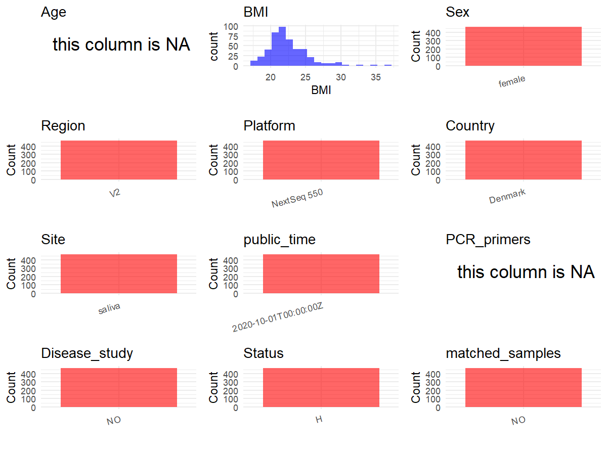

R Notebook: Metadata Processing Workflow
================

# Step 1: Obtain Initial Metadata from Each Project

To obtain the initial metadata: 1. Search for the BioProject ID (e.g.,
“PRJEBXXXX”) on the [NCBI SRA
website](https://www.ncbi.nlm.nih.gov/Traces/study/). 2. In the “Select”
table, click on “Metadata” and download the file. 3. The downloaded file
is typically named “SraRunTable.csv” and contains metadata for the
project.

``` r
# Load necessary libraries
library(dplyr)
library(ggplot2)
library(cowplot)

# Set working directory (update this path to your local directory)
setwd("D:/metadata/4/PRJEB37731")

# Read the initial metadata files
initial_meta<-read.csv("SraRunTable.csv",header = T)
keep_ids <- paste0("SAMEA6662", 389:857)

initial_meta <- initial_meta %>%
  filter(BioSample %in% keep_ids)
# Combine the two metadata files
#meta <- rbind(initial_meta, initial_meta1)

#Remove entries non-oral samples
#initial_meta <- subset(initial_meta,BioSampleModel != "Metagenome or environmental")

# Check the number of samples containing "HT" in Sample.Name (e.g., healthy controls)
#nrow(subset(meta, grepl("HT", Sample.Name)))

# Display the first few rows of the metadata
head(initial_meta)
```

    ##          Run Assay.Type BioProject    BioSample
    ## 1 ERR4031677        WGS PRJEB37731 SAMEA6662389
    ## 2 ERR4031678        WGS PRJEB37731 SAMEA6662390
    ## 3 ERR4031679        WGS PRJEB37731 SAMEA6662391
    ## 4 ERR4031680        WGS PRJEB37731 SAMEA6662392
    ## 5 ERR4031681        WGS PRJEB37731 SAMEA6662393
    ## 6 ERR4031682        WGS PRJEB37731 SAMEA6662394
    ##                                          Center.Name Collection_Date Consent
    ## 1 CENTRE FOR TRANSLATIONAL MICROBIOME RESEARCH (CTMR         2018-01  public
    ## 2 CENTRE FOR TRANSLATIONAL MICROBIOME RESEARCH (CTMR         2018-01  public
    ## 3 CENTRE FOR TRANSLATIONAL MICROBIOME RESEARCH (CTMR         2018-01  public
    ## 4 CENTRE FOR TRANSLATIONAL MICROBIOME RESEARCH (CTMR         2018-01  public
    ## 5 CENTRE FOR TRANSLATIONAL MICROBIOME RESEARCH (CTMR         2018-01  public
    ## 6 CENTRE FOR TRANSLATIONAL MICROBIOME RESEARCH (CTMR         2018-01  public
    ##   ENA.FIRST.PUBLIC..run.     ena_first_public ENA.LAST.UPDATE..run.
    ## 1             2020-09-30 2020-09-30T04:07:35Z            2020-04-18
    ## 2             2020-09-30 2020-09-30T04:07:35Z            2020-04-18
    ## 3             2020-09-30 2020-09-30T04:07:35Z            2020-04-18
    ## 4             2020-09-30 2020-09-30T04:07:35Z            2020-04-18
    ## 5             2020-09-30 2020-09-30T04:07:35Z            2020-04-18
    ## 6             2020-09-30 2020-09-30T04:07:35Z            2020-04-18
    ##        ena_last_update Experiment  external_id geo_loc_name_country
    ## 1 2020-04-11T11:56:53Z ERX4032977 SAMEA6662389              Denmark
    ## 2 2020-04-11T11:56:53Z ERX4032978 SAMEA6662390              Denmark
    ## 3 2020-04-11T11:56:53Z ERX4032979 SAMEA6662391              Denmark
    ## 4 2020-04-11T11:56:53Z ERX4032980 SAMEA6662392              Denmark
    ## 5 2020-04-11T11:56:53Z ERX4032981 SAMEA6662393              Denmark
    ## 6 2020-04-11T11:56:53Z ERX4032982 SAMEA6662394              Denmark
    ##   geo_loc_name_country_continent geographic_location_.country_and.or_sea.
    ## 1                         Europe                                  Denmark
    ## 2                         Europe                                  Denmark
    ## 3                         Europe                                  Denmark
    ## 4                         Europe                                  Denmark
    ## 5                         Europe                                  Denmark
    ## 6                         Europe                                  Denmark
    ##   geographic_location_.latitude. geographic_location_.longitude.
    ## 1                           55.7                            12.6
    ## 2                           55.7                            12.6
    ## 3                           55.7                            12.6
    ## 4                           55.7                            12.6
    ## 5                           55.7                            12.6
    ## 6                           55.7                            12.6
    ##   host_body_product host_subject_id
    ## 1            saliva               2
    ## 2            saliva               4
    ## 3            saliva               5
    ## 4            saliva               6
    ## 5            saliva               7
    ## 6            saliva               9
    ##                                     INSDC_center_name   INSDC_first_public
    ## 1 Centre for Translational Microbiome Research (CTMR) 2020-09-30T04:07:35Z
    ## 2 Centre for Translational Microbiome Research (CTMR) 2020-09-30T04:07:35Z
    ## 3 Centre for Translational Microbiome Research (CTMR) 2020-09-30T04:07:35Z
    ## 4 Centre for Translational Microbiome Research (CTMR) 2020-09-30T04:07:35Z
    ## 5 Centre for Translational Microbiome Research (CTMR) 2020-09-30T04:07:35Z
    ## 6 Centre for Translational Microbiome Research (CTMR) 2020-09-30T04:07:35Z
    ##      INSDC_last_update INSDC_status  Instrument Library.Name LibraryLayout
    ## 1 2020-04-11T11:56:53Z       public NextSeq 550  unspecified        SINGLE
    ## 2 2020-04-11T11:56:53Z       public NextSeq 550  unspecified        SINGLE
    ## 3 2020-04-11T11:56:53Z       public NextSeq 550  unspecified        SINGLE
    ## 4 2020-04-11T11:56:53Z       public NextSeq 550  unspecified        SINGLE
    ## 5 2020-04-11T11:56:53Z       public NextSeq 550  unspecified        SINGLE
    ## 6 2020-04-11T11:56:53Z       public NextSeq 550  unspecified        SINGLE
    ##   LibrarySelection LibrarySource        Organism Platform project_name
    ## 1           RANDOM   METAGENOMIC oral metagenome ILLUMINA       MiMens
    ## 2           RANDOM   METAGENOMIC oral metagenome ILLUMINA       MiMens
    ## 3           RANDOM   METAGENOMIC oral metagenome ILLUMINA       MiMens
    ## 4           RANDOM   METAGENOMIC oral metagenome ILLUMINA       MiMens
    ## 5           RANDOM   METAGENOMIC oral metagenome ILLUMINA       MiMens
    ## 6           RANDOM   METAGENOMIC oral metagenome ILLUMINA       MiMens
    ##            ReleaseDate  Sample.Name             Sample_name Scientific_Name
    ## 1 2020-10-01T00:00:00Z SAMEA6662389 Subject2_oral_menstrual oral metagenome
    ## 2 2020-10-01T00:00:00Z SAMEA6662390 Subject4_oral_menstrual oral metagenome
    ## 3 2020-10-01T00:00:00Z SAMEA6662391 Subject5_oral_menstrual oral metagenome
    ## 4 2020-10-01T00:00:00Z SAMEA6662392 Subject6_oral_menstrual oral metagenome
    ## 5 2020-10-01T00:00:00Z SAMEA6662393 Subject7_oral_menstrual oral metagenome
    ## 6 2020-10-01T00:00:00Z SAMEA6662394 Subject9_oral_menstrual oral metagenome
    ##   Sequencing_method SRA.Study            Submitter_Id AvgSpotLen     Bases
    ## 1  Illumina NextSeq ERP121061 Subject2_oral_menstrual        111 152755875
    ## 2  Illumina NextSeq ERP121061 Subject4_oral_menstrual        107  30553594
    ## 3  Illumina NextSeq ERP121061 Subject5_oral_menstrual        101  51173159
    ## 4  Illumina NextSeq ERP121061 Subject6_oral_menstrual        120 257870116
    ## 5  Illumina NextSeq ERP121061 Subject7_oral_menstrual        123 334068629
    ## 6  Illumina NextSeq ERP121061 Subject9_oral_menstrual        124 369702259
    ##       Bytes DATASTORE.filetype DATASTORE.provider
    ## 1  64164868         run.zq,sra         gs,ncbi,s3
    ## 2  13209852         run.zq,sra         gs,ncbi,s3
    ## 3  21761562         run.zq,sra         gs,ncbi,s3
    ## 4 109321154         run.zq,sra         gs,ncbi,s3
    ## 5 138657135         run.zq,sra         gs,ncbi,s3
    ## 6 152585124         run.zq,sra         gs,ncbi,s3
    ##                       DATASTORE.region          create_date version
    ## 1 gs.us-east1,ncbi.public,s3.us-east-1 2020-10-01T12:52:00Z       1
    ## 2 gs.us-east1,ncbi.public,s3.us-east-1 2020-10-01T12:52:00Z       1
    ## 3 gs.us-east1,ncbi.public,s3.us-east-1 2020-10-01T12:52:00Z       1
    ## 4 gs.us-east1,ncbi.public,s3.us-east-1 2020-10-01T12:53:00Z       1
    ## 5 gs.us-east1,ncbi.public,s3.us-east-1 2020-10-01T12:53:00Z       1
    ## 6 gs.us-east1,ncbi.public,s3.us-east-1 2020-10-01T12:53:00Z       1
    ##   host_body_site Antibiotics_past_3_months birth_control
    ## 1          mouth                                        
    ## 2          mouth                                        
    ## 3          mouth                                        
    ## 4          mouth                                        
    ## 5          mouth                                        
    ## 6          mouth                                        
    ##   broad.scale_environmental_context douche drinking_habits environmental_medium
    ## 1                                                                              
    ## 2                                                                              
    ## 3                                                                              
    ## 4                                                                              
    ## 5                                                                              
    ## 6                                                                              
    ##   Host_Age local_environmental_context pregnancy Sample_Collection_Device
    ## 1       NA                                                               
    ## 2       NA                                                               
    ## 3       NA                                                               
    ## 4       NA                                                               
    ## 5       NA                                                               
    ## 6       NA                                                               
    ##   sample_collection_method sample_storage_medium sample_storage_temperature
    ## 1                                                                          
    ## 2                                                                          
    ## 3                                                                          
    ## 4                                                                          
    ## 5                                                                          
    ## 6                                                                          
    ##   smoking_status menstrual_hygiene_product           common_name
    ## 1                                          human oral metagenome
    ## 2                                          human oral metagenome
    ## 3                                          human oral metagenome
    ## 4                                          human oral metagenome
    ## 5                                          human oral metagenome
    ## 6                                          human oral metagenome
    ##   environment_.biome. environment_.feature. environment_.material.
    ## 1               mouth          oral opening                 saliva
    ## 2               mouth          oral opening                 saliva
    ## 3               mouth          oral opening                 saliva
    ## 4               mouth          oral opening                 saliva
    ## 5               mouth          oral opening                 saliva
    ## 6               mouth          oral opening                 saliva
    ##   experimental_factor geographic_location_.region_and_locality.
    ## 1     menstrual phase                                Copenhagen
    ## 2     menstrual phase                                Copenhagen
    ## 3     menstrual phase                                Copenhagen
    ## 4     menstrual phase                                Copenhagen
    ## 5     menstrual phase                                Copenhagen
    ## 6     menstrual phase                                Copenhagen
    ##   host_body_mass_index host_sex human_associated_environmental_package
    ## 1                21.72   female                       human-associated
    ## 2                24.62   female                       human-associated
    ## 3                17.88   female                       human-associated
    ## 4                21.97   female                       human-associated
    ## 5                19.60   female                       human-associated
    ## 6                27.10   female                       human-associated
    ##   investigation_type library_reads_sequenced nucleic_acid_extraction
    ## 1         metagenome                 1504328       MO Bio PowerFecal
    ## 2         metagenome                  328880       MO Bio PowerFecal
    ## 3         metagenome                  604638       MO Bio PowerFecal
    ## 4         metagenome                 2287782       MO Bio PowerFecal
    ## 5         metagenome                 2845880       MO Bio PowerFecal
    ## 6         metagenome                 3121490       MO Bio PowerFecal
    ##   sample_collection_device_or_method host_body.mass_index
    ## 1               SalivaGene Collector                   NA
    ## 2               SalivaGene Collector                   NA
    ## 3               SalivaGene Collector                   NA
    ## 4               SalivaGene Collector                   NA
    ## 5               SalivaGene Collector                   NA
    ## 6               SalivaGene Collector                   NA
    ##   travel_outside_the_country_in_last_six_months host_disease_status PCR_primers
    ## 1                                        Mexico                                
    ## 2                                        Sweden                                
    ## 3                                                                              
    ## 4                                   Netherlands                                
    ## 5                        Serbia, Croatia, Italy           allergies            
    ## 6                                                         allergies            
    ##   presence_of_pets_or_farm_animals drug_usage
    ## 1                              dog           
    ## 2                                            
    ## 3                                            
    ## 4                              dog           
    ## 5                                            
    ## 6                                    cannabis
    ##   gynecological_disorder_previous_3_months urine.urogenital_tract_disorder
    ## 1                                                                         
    ## 2                                                                         
    ## 3                                                                         
    ## 4                                                                         
    ## 5                                                                         
    ## 6                                                                         
    ##   gynecological_disorder
    ## 1                       
    ## 2                       
    ## 3                       
    ## 4                       
    ## 5                       
    ## 6

# Step 2: Create a Uniform Metadata Template

The uniform metadata should include the following columns:

1.  **BioProject**: Project ID (e.g., “PRJNA339212”)
2.  **Run**: Sample ID (e.g., “ERRXXXXXX” or “SRRXXXXXX”)
3.  **sample_name**: Original sample name submitted by the authors (not
    the database-assigned ID)
4.  **Age**: Age of the subject (if available)
5.  **BMI**: Body Mass Index (if available)
6.  **Sex**: Sex of the subject (“F” or “M”)
7.  **Region**: Targeted 16S rRNA region (e.g., “V3-V4”)
8.  **Platform**: Sequencing platform (e.g., “Illumina MiSeq”)
9.  **Country**: Country of sample origin (e.g., “China”)
10. **Site**: Sample site (e.g., “saliva”, “dental plaque”)
11. **public_time**: Data release date (format: “YYYY-MM-DD”)
12. **PCR_primers**: PCR primers used (e.g., “515F-806R”)
13. **title**: Title of the associated publication
14. **Disease_study**: Whether the study involves a disease (“YES” or
    “NO”)
15. **Status**: Disease status (e.g., “T2DM”, “HC”). Note: If the study
    includes both disease and healthy samples, this must be specified
    per sample.
16. **matched_samples**: matched samples (“YES” or “NO”)

``` r
# Create a uniform metadata dataframe
metadata <- data.frame(
  BioProject = initial_meta$BioProject,
  Run = initial_meta$Run,
  sample_name = initial_meta$Sample.Name,
  Age = NA,
  BMI = initial_meta$host_body_mass_index,
  Sex=initial_meta$host_sex,
  Region = "V2",
  Platform = initial_meta$Instrument,
  Country = initial_meta$geo_loc_name_country,
  Site = initial_meta$environment_.material.,
  public_time = initial_meta$ReleaseDate,
  PCR_primers = NA,
  stringsAsFactors = FALSE
)
```

# Step 3: Manually Add Information from the Publication

Some information (e.g. PCR primers, study title, disease status) must be
manually extracted from the publication and added to the metadata.

``` r
# Add information obtained from the publication
#metadata$PCR_primers <- "515F-806R"
metadata$title <- "Dysbiosis of the Human Oral Microbiome During the Menstrual Cycle and Vulnerability to the External Exposures of Smoking and Dietary Sugar"
metadata$Disease_study <- "NO"
metadata$Status <- "H"
# Assign disease status based on sample_name patterns

keep_subjects <- unique(subset(metadata, Site == "saliva")$sample_name)
metadata <- subset(metadata, sample_name %in% keep_subjects)


metadata$matched_samples <- "NO"
```

# Step 4: Summarize and Validate the Metadata

``` r
# Check the number of unique runs and sample names
print(paste("Number of unique runs:", length(unique(metadata$Run))))
```

    ## [1] "Number of unique runs: 466"

``` r
print(paste("Number of unique sample names:", length(unique(metadata$sample_name))))
```

    ## [1] "Number of unique sample names: 466"

# Step 5: Visualize the Metadata

``` r

```

<!-- -->

# Step 6: Finalize and Export the Metadata

``` r
# Reorder columns to match the desired format
metadata <- metadata[, c(
  "BioProject", "Run", "sample_name", "Age", "BMI", "Sex", 
  "Region", "Platform", "Country", "Site", "public_time", 
  "PCR_primers", "title", "Disease_study", "Status","matched_samples"
)]

# Export the uniform metadata to a CSV file
write.csv(metadata, file = "metadata.csv", quote = TRUE)
head(metadata)
```

    ##   BioProject        Run  sample_name Age   BMI    Sex Region    Platform
    ## 1 PRJEB37731 ERR4031677 SAMEA6662389  NA 21.72 female     V2 NextSeq 550
    ## 2 PRJEB37731 ERR4031678 SAMEA6662390  NA 24.62 female     V2 NextSeq 550
    ## 3 PRJEB37731 ERR4031679 SAMEA6662391  NA 17.88 female     V2 NextSeq 550
    ## 4 PRJEB37731 ERR4031680 SAMEA6662392  NA 21.97 female     V2 NextSeq 550
    ## 5 PRJEB37731 ERR4031681 SAMEA6662393  NA 19.60 female     V2 NextSeq 550
    ## 6 PRJEB37731 ERR4031682 SAMEA6662394  NA 27.10 female     V2 NextSeq 550
    ##   Country   Site          public_time PCR_primers
    ## 1 Denmark saliva 2020-10-01T00:00:00Z          NA
    ## 2 Denmark saliva 2020-10-01T00:00:00Z          NA
    ## 3 Denmark saliva 2020-10-01T00:00:00Z          NA
    ## 4 Denmark saliva 2020-10-01T00:00:00Z          NA
    ## 5 Denmark saliva 2020-10-01T00:00:00Z          NA
    ## 6 Denmark saliva 2020-10-01T00:00:00Z          NA
    ##                                                                                                                                        title
    ## 1 Dysbiosis of the Human Oral Microbiome During the Menstrual Cycle and Vulnerability to the External Exposures of Smoking and Dietary Sugar
    ## 2 Dysbiosis of the Human Oral Microbiome During the Menstrual Cycle and Vulnerability to the External Exposures of Smoking and Dietary Sugar
    ## 3 Dysbiosis of the Human Oral Microbiome During the Menstrual Cycle and Vulnerability to the External Exposures of Smoking and Dietary Sugar
    ## 4 Dysbiosis of the Human Oral Microbiome During the Menstrual Cycle and Vulnerability to the External Exposures of Smoking and Dietary Sugar
    ## 5 Dysbiosis of the Human Oral Microbiome During the Menstrual Cycle and Vulnerability to the External Exposures of Smoking and Dietary Sugar
    ## 6 Dysbiosis of the Human Oral Microbiome During the Menstrual Cycle and Vulnerability to the External Exposures of Smoking and Dietary Sugar
    ##   Disease_study Status matched_samples
    ## 1            NO      H              NO
    ## 2            NO      H              NO
    ## 3            NO      H              NO
    ## 4            NO      H              NO
    ## 5            NO      H              NO
    ## 6            NO      H              NO

## Notes for Students:

1.  **Metadata Accuracy**: Always cross-check the metadata with the
    original publication to ensure accuracy.
2.  **Manual Entries**: Columns like `PCR_primers`, and `Status` often
    require manual entry based on the publication.
3.  **Disease Status**: Be careful when assigning `Status`—some studies
    include both disease and healthy samples.
4.  **Visualization**: The plots help quickly identify the distribution
    of values in each column, which is useful for quality control.
5.  **Reproducibility**: Update the working directory and file paths to
    match your local environment.
