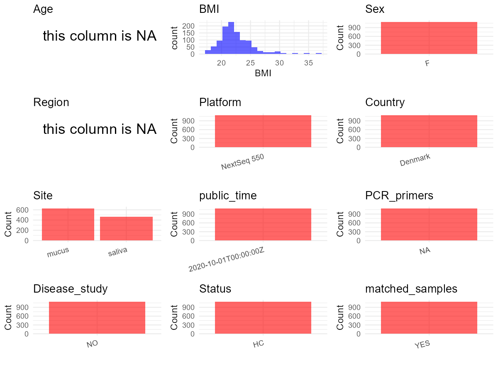

R Notebook: Metadata Processing Workflow
================

# Step 1: Obtain Initial Metadata from Each Project

To obtain the initial metadata: 1. Search for the BioProject ID (e.g.,
“PRJEBXXXX”) on the [NCBI SRA
website](https://www.ncbi.nlm.nih.gov/Traces/study/). 2. In the “Select”
table, click on “Metadata” and download the file. 3. The downloaded file
is typically named “SraRunTable.csv” and contains metadata for the
project.

``` r
# Load necessary libraries
library(dplyr)
library(ggplot2)
library(cowplot)

# Set working directory (update this path to your local directory)
setwd("E:/bioproject_YL/PRJEB37731")

# Read the initial metadata files
initial_meta <- read.csv("SraRunTable.csv", header = T)

# Remove entries non-oral samples
initial_meta <- initial_meta[initial_meta$environment_.material. != "feces" & 
                            initial_meta$environment_.material. != "", ]

# Display the first few rows of the metadata
head(initial_meta)
```

    ##          Run Assay.Type BioProject    BioSample
    ## 1 ERR4031202        WGS PRJEB37731 SAMEA6661911
    ## 2 ERR4031203        WGS PRJEB37731 SAMEA6661912
    ## 3 ERR4031204        WGS PRJEB37731 SAMEA6661913
    ## 4 ERR4031205        WGS PRJEB37731 SAMEA6661914
    ## 5 ERR4031206        WGS PRJEB37731 SAMEA6661915
    ## 6 ERR4031207        WGS PRJEB37731 SAMEA6661916
    ##                                          Center.Name Collection_Date Consent
    ## 1 CENTRE FOR TRANSLATIONAL MICROBIOME RESEARCH (CTMR         2018-01  public
    ## 2 CENTRE FOR TRANSLATIONAL MICROBIOME RESEARCH (CTMR         2018-01  public
    ## 3 CENTRE FOR TRANSLATIONAL MICROBIOME RESEARCH (CTMR         2018-01  public
    ## 4 CENTRE FOR TRANSLATIONAL MICROBIOME RESEARCH (CTMR         2018-01  public
    ## 5 CENTRE FOR TRANSLATIONAL MICROBIOME RESEARCH (CTMR         2018-01  public
    ## 6 CENTRE FOR TRANSLATIONAL MICROBIOME RESEARCH (CTMR         2018-01  public
    ##   ENA.FIRST.PUBLIC..run.     ENA.FIRST.PUBLIC ENA.LAST.UPDATE..run.
    ## 1             2020-09-30 2020-09-30T04:07:35Z            2020-04-17
    ## 2             2020-09-30 2020-09-30T04:07:35Z            2020-04-17
    ## 3             2020-09-30 2020-09-30T04:07:35Z            2020-04-17
    ## 4             2020-09-30 2020-09-30T04:07:35Z            2020-04-17
    ## 5             2020-09-30 2020-09-30T04:07:35Z            2020-04-17
    ## 6             2020-09-30 2020-09-30T04:07:35Z            2020-04-17
    ##        ENA.LAST.UPDATE Experiment  external_id geo_loc_name_country
    ## 1 2020-04-11T11:56:45Z ERX4032502 SAMEA6661911              Denmark
    ## 2 2020-04-11T11:56:45Z ERX4032503 SAMEA6661912              Denmark
    ## 3 2020-04-11T11:56:45Z ERX4032504 SAMEA6661913              Denmark
    ## 4 2020-04-11T11:56:45Z ERX4032505 SAMEA6661914              Denmark
    ## 5 2020-04-11T11:56:45Z ERX4032506 SAMEA6661915              Denmark
    ## 6 2020-04-11T11:56:45Z ERX4032507 SAMEA6661916              Denmark
    ##   geo_loc_name_country_continent geographic_location_.country_and.or_sea.
    ## 1                         Europe                                  Denmark
    ## 2                         Europe                                  Denmark
    ## 3                         Europe                                  Denmark
    ## 4                         Europe                                  Denmark
    ## 5                         Europe                                  Denmark
    ## 6                         Europe                                  Denmark
    ##   geographic_location_.latitude. geographic_location_.longitude.
    ## 1                           55.7                            12.6
    ## 2                           55.7                            12.6
    ## 3                           55.7                            12.6
    ## 4                           55.7                            12.6
    ## 5                           55.7                            12.6
    ## 6                           55.7                            12.6
    ##   host_body_product host_subject_id
    ## 1             mucus               3
    ## 2             mucus               4
    ## 3             mucus               5
    ## 4             mucus               6
    ## 5             mucus               7
    ## 6             mucus               9
    ##                                     INSDC_center_name   INSDC_first_public
    ## 1 Centre for Translational Microbiome Research (CTMR) 2020-09-30T04:07:35Z
    ## 2 Centre for Translational Microbiome Research (CTMR) 2020-09-30T04:07:35Z
    ## 3 Centre for Translational Microbiome Research (CTMR) 2020-09-30T04:07:35Z
    ## 4 Centre for Translational Microbiome Research (CTMR) 2020-09-30T04:07:35Z
    ## 5 Centre for Translational Microbiome Research (CTMR) 2020-09-30T04:07:35Z
    ## 6 Centre for Translational Microbiome Research (CTMR) 2020-09-30T04:07:35Z
    ##      INSDC_last_update INSDC_status  Instrument Library.Name LibraryLayout
    ## 1 2020-04-11T11:56:45Z       public NextSeq 550  unspecified        SINGLE
    ## 2 2020-04-11T11:56:45Z       public NextSeq 550  unspecified        SINGLE
    ## 3 2020-04-11T11:56:45Z       public NextSeq 550  unspecified        SINGLE
    ## 4 2020-04-11T11:56:45Z       public NextSeq 550  unspecified        SINGLE
    ## 5 2020-04-11T11:56:45Z       public NextSeq 550  unspecified        SINGLE
    ## 6 2020-04-11T11:56:45Z       public NextSeq 550  unspecified        SINGLE
    ##   LibrarySelection LibrarySource           Organism Platform project_name
    ## 1           RANDOM   METAGENOMIC vaginal metagenome ILLUMINA       MiMens
    ## 2           RANDOM   METAGENOMIC vaginal metagenome ILLUMINA       MiMens
    ## 3           RANDOM   METAGENOMIC vaginal metagenome ILLUMINA       MiMens
    ## 4           RANDOM   METAGENOMIC vaginal metagenome ILLUMINA       MiMens
    ## 5           RANDOM   METAGENOMIC vaginal metagenome ILLUMINA       MiMens
    ## 6           RANDOM   METAGENOMIC vaginal metagenome ILLUMINA       MiMens
    ##            ReleaseDate  Sample.Name                Sample_name
    ## 1 2020-10-01T00:00:00Z SAMEA6661911 Subject3_vaginal_menstrual
    ## 2 2020-10-01T00:00:00Z SAMEA6661912 Subject4_vaginal_menstrual
    ## 3 2020-10-01T00:00:00Z SAMEA6661913 Subject5_vaginal_menstrual
    ## 4 2020-10-01T00:00:00Z SAMEA6661914 Subject6_vaginal_menstrual
    ## 5 2020-10-01T00:00:00Z SAMEA6661915 Subject7_vaginal_menstrual
    ## 6 2020-10-01T00:00:00Z SAMEA6661916 Subject9_vaginal_menstrual
    ##      Scientific_Name Sequencing_method SRA.Study               Submitter_Id
    ## 1 vaginal metagenome  Illumina NextSeq ERP121061 Subject3_vaginal_menstrual
    ## 2 vaginal metagenome  Illumina NextSeq ERP121061 Subject4_vaginal_menstrual
    ## 3 vaginal metagenome  Illumina NextSeq ERP121061 Subject5_vaginal_menstrual
    ## 4 vaginal metagenome  Illumina NextSeq ERP121061 Subject6_vaginal_menstrual
    ## 5 vaginal metagenome  Illumina NextSeq ERP121061 Subject7_vaginal_menstrual
    ## 6 vaginal metagenome  Illumina NextSeq ERP121061 Subject9_vaginal_menstrual
    ##   AvgSpotLen     Bases     Bytes DATASTORE.filetype DATASTORE.provider
    ## 1        139 416824909 171706048         run.zq,sra         gs,ncbi,s3
    ## 2        140 362610092 153942609         run.zq,sra         gs,ncbi,s3
    ## 3        140 440283956 181534200         run.zq,sra         gs,ncbi,s3
    ## 4        140 435984537 180078109         run.zq,sra         gs,ncbi,s3
    ## 5        139 336537901 138248893         run.zq,sra         gs,ncbi,s3
    ## 6        140 456509032 188353137         run.zq,sra         gs,ncbi,s3
    ##                       DATASTORE.region          create_date version
    ## 1 gs.us-east1,ncbi.public,s3.us-east-1 2020-10-01T12:24:00Z       1
    ## 2 gs.us-east1,ncbi.public,s3.us-east-1 2020-10-01T12:24:00Z       1
    ## 3 gs.us-east1,ncbi.public,s3.us-east-1 2020-10-01T12:24:00Z       1
    ## 4 gs.us-east1,ncbi.public,s3.us-east-1 2020-10-01T12:25:00Z       1
    ## 5 gs.us-east1,ncbi.public,s3.us-east-1 2020-10-01T12:25:00Z       1
    ## 6 gs.us-east1,ncbi.public,s3.us-east-1 2020-10-01T12:25:00Z       1
    ##   host_body_site Antibiotics_past_3_months birth_control
    ## 1         vagina                                        
    ## 2         vagina                                        
    ## 3         vagina                                        
    ## 4         vagina                                        
    ## 5         vagina                                        
    ## 6         vagina                                        
    ##   broad.scale_environmental_context douche drinking_habits environmental_medium
    ## 1                                                                              
    ## 2                                                                              
    ## 3                                                                              
    ## 4                                                                              
    ## 5                                                                              
    ## 6                                                                              
    ##   Host_Age local_environmental_context pregnancy Sample_Collection_Device
    ## 1       NA                                                               
    ## 2       NA                                                               
    ## 3       NA                                                               
    ## 4       NA                                                               
    ## 5       NA                                                               
    ## 6       NA                                                               
    ##   sample_collection_method sample_storage_medium sample_storage_temperature
    ## 1                                                                          
    ## 2                                                                          
    ## 3                                                                          
    ## 4                                                                          
    ## 5                                                                          
    ## 6                                                                          
    ##   smoking_status menstrual_hygiene_product              common_name
    ## 1                                          human vaginal metagenome
    ## 2                                          human vaginal metagenome
    ## 3                                          human vaginal metagenome
    ## 4                                          human vaginal metagenome
    ## 5                                          human vaginal metagenome
    ## 6                                          human vaginal metagenome
    ##   environment_.biome. environment_.feature. environment_.material.
    ## 1              vagina       lumen of vagina                  mucus
    ## 2              vagina       lumen of vagina                  mucus
    ## 3              vagina       lumen of vagina                  mucus
    ## 4              vagina       lumen of vagina                  mucus
    ## 5              vagina       lumen of vagina                  mucus
    ## 6              vagina       lumen of vagina                  mucus
    ##   experimental_factor geographic_location_.region_and_locality.
    ## 1     menstrual phase                                Copenhagen
    ## 2     menstrual phase                                Copenhagen
    ## 3     menstrual phase                                Copenhagen
    ## 4     menstrual phase                                Copenhagen
    ## 5     menstrual phase                                Copenhagen
    ## 6     menstrual phase                                Copenhagen
    ##   host_body_mass_index host_sex human_associated_environmental_package
    ## 1                21.72   female                       human-associated
    ## 2                24.62   female                       human-associated
    ## 3                17.88   female                       human-associated
    ## 4                21.97   female                       human-associated
    ## 5                19.60   female                       human-associated
    ## 6                27.10   female                       human-associated
    ##   investigation_type library_reads_sequenced nucleic_acid_extraction
    ## 1         metagenome                 3014238       MO Bio PowerFecal
    ## 2         metagenome                 2598697       MO Bio PowerFecal
    ## 3         metagenome                 3150379       MO Bio PowerFecal
    ## 4         metagenome                 3117598       MO Bio PowerFecal
    ## 5         metagenome                 2444824       MO Bio PowerFecal
    ## 6         metagenome                 3268499       MO Bio PowerFecal
    ##   sample_collection_device_or_method host_body.mass_index
    ## 1                          FLOQSwabs                   NA
    ## 2                          FLOQSwabs                   NA
    ## 3                          FLOQSwabs                   NA
    ## 4                          FLOQSwabs                   NA
    ## 5                          FLOQSwabs                   NA
    ## 6                          FLOQSwabs                   NA
    ##   travel_outside_the_country_in_last_six_months host_disease_status PCR_primers
    ## 1                                                                              
    ## 2                                        Sweden                                
    ## 3                                                                              
    ## 4                                   Netherlands                                
    ## 5                        Serbia, Croatia, Italy           allergies            
    ## 6                                                         allergies            
    ##   presence_of_pets_or_farm_animals drug_usage
    ## 1                                            
    ## 2                                            
    ## 3                                            
    ## 4                              dog           
    ## 5                                            
    ## 6                                    cannabis
    ##   gynecological_disorder_previous_3_months urine.urogenital_tract_disorder
    ## 1                                                              candidiasis
    ## 2                                                                         
    ## 3                                                                         
    ## 4                                                                         
    ## 5                                                                         
    ## 6                                                                         
    ##   gynecological_disorder
    ## 1                       
    ## 2                       
    ## 3                       
    ## 4                       
    ## 5                       
    ## 6

# Step 2: Create a Uniform Metadata Template

The uniform metadata should include the following columns:

1.  **BioProject**: Project ID (e.g., “PRJNA339212”)
2.  **Run**: Sample ID (e.g., “ERRXXXXXX” or “SRRXXXXXX”)
3.  **sample_name**: Original sample name submitted by the authors (not
    the database-assigned ID)
4.  **Age**: Age of the subject (if available)
5.  **BMI**: Body Mass Index (if available)
6.  **Sex**: Sex of the subject (“F” or “M”)
7.  **Region**: Targeted 16S rRNA region (e.g., “V3-V4”)
8.  **Platform**: Sequencing platform (e.g., “Illumina MiSeq”)
9.  **Country**: Country of sample origin (e.g., “China”)
10. **Site**: Sample site (e.g., “saliva”, “dental plaque”)
11. **public_time**: Data release date (format: “YYYY-MM-DD”)
12. **PCR_primers**: PCR primers used (e.g., “515F-806R”)
13. **title**: Title of the associated publication
14. **Disease_study**: Whether the study involves a disease (“YES” or
    “NO”)
15. **Status**: Disease status (e.g., “T2DM”, “HC”). Note: If the study
    includes both disease and healthy samples, this must be specified
    per sample.
16. **matched_samples**: matched samples (“YES” or “NO”)

``` r
# Create a uniform metadata dataframe
metadata <- data.frame(
  BioProject = initial_meta$BioProject,
  Run = initial_meta$Run,
  sample_name = initial_meta$host_subject_id,
  Age = NA,
  BMI = initial_meta$host_body_mass_index,  
  Sex = initial_meta$host_sex,
  Region = NA,
  Platform = initial_meta$Instrument,
  Country = initial_meta$geo_loc_name_country,
  Site = initial_meta$environment_.material.,
  public_time = initial_meta$ReleaseDate,
  stringsAsFactors = FALSE
)

# Use abbreviations to indicate gender
metadata <- metadata %>%
  mutate(Sex = recode(Sex, "female" = "F",))
```

# Step 3: Manually Add Information from the Publication

Some information (e.g. PCR primers, study title, disease status) must be
manually extracted from the publication and added to the metadata.

``` r
# Add information obtained from the publication
metadata$PCR_primers <- "NA"
metadata$title <- "Dysbiosis of the human oral microbiome during the menstrual cycle and vulnerability to the external exposures of smoking and dietary sugar"
metadata$Disease_study <- "NO"
# Assign disease status based on sample_name patterns
metadata$Status <- "HC"

# Check initial data distribution
cat("Initial sample distribution:\n")
```

    ## Initial sample distribution:

``` r
table(metadata$sample_name)
```

    ## 
    ##   2   3   4   5   6   7   9  10  11  12  14  15  16  17  18  19  20  21  22  23 
    ##   7   5   7   6   7   7   7   6   7   7   7   7   7   6   7   7   7   7   7   7 
    ##  24  25  26  27  28  29  30  31  32  33  34  35  36  37  38  39  41  42  44  45 
    ##   7   7   7   7   7   7   6   7   7   7   7   7   7   7   7   7   7   7   6   7 
    ##  46  47  48  49  50  51  52  53  54  55  56  58  59  60  61  62  63  64  65  66 
    ##   7   7   7   7   7   7   7   7   7   7   7   7   7   7   7   7   7   7   7   7 
    ##  67  68  70  71  72  73  74  75  76  77  78  79  80  81  82  83  84  85  86  87 
    ##   7   7   7   7   7   7   7   7   6   7   7   7   7   7   7   7   7   7   7   7 
    ##  88  89  90  91  92  93  94  95  96  97  98  99 100 101 102 103 104 105 106 107 
    ##   7   7   7   7   7   5   7   7   7   7   7   7   7   6   7   6   7   7   7   7 
    ## 108 109 110 111 112 113 114 115 116 117 118 119 120 121 122 123 124 125 126 127 
    ##   7   7   7   7   7   7   6   7   7   7   7   7   7   7   7   7   7   7   7   7 
    ## 128 129 130 131 132 133 134 135 136 137 138 139 140 141 142 143 144 145 146 147 
    ##   7   7   6   7   7   7   7   7   7   7   7   7   7   7   6   7   7   7   7   6 
    ## 148 149 150 151 152 153 154 155 156 157 158 159 160 161 162 163 164 165 166 168 
    ##   7   7   7   5   7   6   7   6   7   7   7   6   7   7   7   7   7   5   7   5

``` r
table(metadata$Site)
```

    ## 
    ##  mucus saliva 
    ##    629    466

``` r
# Calculate sampling frequency per subject
sample_counts <- table(metadata$sample_name)
cat("\nNumber of samples per subject:\n")
```

    ## 
    ## Number of samples per subject:

``` r
print(sample_counts)
```

    ## 
    ##   2   3   4   5   6   7   9  10  11  12  14  15  16  17  18  19  20  21  22  23 
    ##   7   5   7   6   7   7   7   6   7   7   7   7   7   6   7   7   7   7   7   7 
    ##  24  25  26  27  28  29  30  31  32  33  34  35  36  37  38  39  41  42  44  45 
    ##   7   7   7   7   7   7   6   7   7   7   7   7   7   7   7   7   7   7   6   7 
    ##  46  47  48  49  50  51  52  53  54  55  56  58  59  60  61  62  63  64  65  66 
    ##   7   7   7   7   7   7   7   7   7   7   7   7   7   7   7   7   7   7   7   7 
    ##  67  68  70  71  72  73  74  75  76  77  78  79  80  81  82  83  84  85  86  87 
    ##   7   7   7   7   7   7   7   7   6   7   7   7   7   7   7   7   7   7   7   7 
    ##  88  89  90  91  92  93  94  95  96  97  98  99 100 101 102 103 104 105 106 107 
    ##   7   7   7   7   7   5   7   7   7   7   7   7   7   6   7   6   7   7   7   7 
    ## 108 109 110 111 112 113 114 115 116 117 118 119 120 121 122 123 124 125 126 127 
    ##   7   7   7   7   7   7   6   7   7   7   7   7   7   7   7   7   7   7   7   7 
    ## 128 129 130 131 132 133 134 135 136 137 138 139 140 141 142 143 144 145 146 147 
    ##   7   7   6   7   7   7   7   7   7   7   7   7   7   7   6   7   7   7   7   6 
    ## 148 149 150 151 152 153 154 155 156 157 158 159 160 161 162 163 164 165 166 168 
    ##   7   7   7   5   7   6   7   6   7   7   7   6   7   7   7   7   7   5   7   5

``` r
# Create matched_samples column
metadata$matched_samples <- ifelse(metadata$sample_name %in% names(sample_counts[sample_counts >= 2]), "YES", "NO")

cat("\nMatched samples distribution:\n")
```

    ## 
    ## Matched samples distribution:

``` r
table(metadata$matched_samples)
```

    ## 
    ##  YES 
    ## 1095

``` r
# Identify samples for removal: single samples excluding saliva and mucus
single_samples <- names(sample_counts[sample_counts == 1])
samples_to_remove <- metadata$sample_name %in% single_samples & 
                     !(metadata$Site %in% c("saliva", "mucus"))

cat("\nNumber of samples to be removed:", sum(samples_to_remove), "\n")
```

    ## 
    ## Number of samples to be removed: 0

``` r
# Remove identified samples
metadata_clean <- metadata[!samples_to_remove, ]

cat("\nFinal sample distribution after cleaning:\n")
```

    ## 
    ## Final sample distribution after cleaning:

``` r
table(metadata_clean$sample_name)
```

    ## 
    ##   2   3   4   5   6   7   9  10  11  12  14  15  16  17  18  19  20  21  22  23 
    ##   7   5   7   6   7   7   7   6   7   7   7   7   7   6   7   7   7   7   7   7 
    ##  24  25  26  27  28  29  30  31  32  33  34  35  36  37  38  39  41  42  44  45 
    ##   7   7   7   7   7   7   6   7   7   7   7   7   7   7   7   7   7   7   6   7 
    ##  46  47  48  49  50  51  52  53  54  55  56  58  59  60  61  62  63  64  65  66 
    ##   7   7   7   7   7   7   7   7   7   7   7   7   7   7   7   7   7   7   7   7 
    ##  67  68  70  71  72  73  74  75  76  77  78  79  80  81  82  83  84  85  86  87 
    ##   7   7   7   7   7   7   7   7   6   7   7   7   7   7   7   7   7   7   7   7 
    ##  88  89  90  91  92  93  94  95  96  97  98  99 100 101 102 103 104 105 106 107 
    ##   7   7   7   7   7   5   7   7   7   7   7   7   7   6   7   6   7   7   7   7 
    ## 108 109 110 111 112 113 114 115 116 117 118 119 120 121 122 123 124 125 126 127 
    ##   7   7   7   7   7   7   6   7   7   7   7   7   7   7   7   7   7   7   7   7 
    ## 128 129 130 131 132 133 134 135 136 137 138 139 140 141 142 143 144 145 146 147 
    ##   7   7   6   7   7   7   7   7   7   7   7   7   7   7   6   7   7   7   7   6 
    ## 148 149 150 151 152 153 154 155 156 157 158 159 160 161 162 163 164 165 166 168 
    ##   7   7   7   5   7   6   7   6   7   7   7   6   7   7   7   7   7   5   7   5

``` r
table(metadata_clean$Site)
```

    ## 
    ##  mucus saliva 
    ##    629    466

``` r
table(metadata_clean$matched_samples)
```

    ## 
    ##  YES 
    ## 1095

``` r
# Use cleaned dataset for subsequent analysis
metadata <- metadata_clean
```

# Step 4: Summarize and Validate the Metadata

``` r
# Check the number of unique runs and sample names
print(paste("Number of unique runs:", length(unique(metadata$Run))))
```

    ## [1] "Number of unique runs: 1095"

``` r
print(paste("Number of unique sample names:", length(unique(metadata$sample_name))))
```

    ## [1] "Number of unique sample names: 160"

# Step 5: Visualize the Metadata

``` r

```


# Step 6: Finalize and Export the Metadata

``` r
# Reorder columns to match the desired format
metadata <- metadata[, c(
  "BioProject", "Run", "sample_name", "Age", "BMI", "Sex", 
  "Region", "Platform", "Country", "Site", "public_time", 
  "PCR_primers", "title", "Disease_study", "Status", "matched_samples"
)]

# Export the uniform metadata to a CSV file
write.csv(metadata, file = "metadata.csv", quote = FALSE)
head(metadata)
```

    ##   BioProject        Run sample_name Age   BMI Sex Region    Platform Country
    ## 1 PRJEB37731 ERR4031202           3  NA 21.72   F     NA NextSeq 550 Denmark
    ## 2 PRJEB37731 ERR4031203           4  NA 24.62   F     NA NextSeq 550 Denmark
    ## 3 PRJEB37731 ERR4031204           5  NA 17.88   F     NA NextSeq 550 Denmark
    ## 4 PRJEB37731 ERR4031205           6  NA 21.97   F     NA NextSeq 550 Denmark
    ## 5 PRJEB37731 ERR4031206           7  NA 19.60   F     NA NextSeq 550 Denmark
    ## 6 PRJEB37731 ERR4031207           9  NA 27.10   F     NA NextSeq 550 Denmark
    ##    Site          public_time PCR_primers
    ## 1 mucus 2020-10-01T00:00:00Z          NA
    ## 2 mucus 2020-10-01T00:00:00Z          NA
    ## 3 mucus 2020-10-01T00:00:00Z          NA
    ## 4 mucus 2020-10-01T00:00:00Z          NA
    ## 5 mucus 2020-10-01T00:00:00Z          NA
    ## 6 mucus 2020-10-01T00:00:00Z          NA
    ##                                                                                                                                        title
    ## 1 Dysbiosis of the human oral microbiome during the menstrual cycle and vulnerability to the external exposures of smoking and dietary sugar
    ## 2 Dysbiosis of the human oral microbiome during the menstrual cycle and vulnerability to the external exposures of smoking and dietary sugar
    ## 3 Dysbiosis of the human oral microbiome during the menstrual cycle and vulnerability to the external exposures of smoking and dietary sugar
    ## 4 Dysbiosis of the human oral microbiome during the menstrual cycle and vulnerability to the external exposures of smoking and dietary sugar
    ## 5 Dysbiosis of the human oral microbiome during the menstrual cycle and vulnerability to the external exposures of smoking and dietary sugar
    ## 6 Dysbiosis of the human oral microbiome during the menstrual cycle and vulnerability to the external exposures of smoking and dietary sugar
    ##   Disease_study Status matched_samples
    ## 1            NO     HC             YES
    ## 2            NO     HC             YES
    ## 3            NO     HC             YES
    ## 4            NO     HC             YES
    ## 5            NO     HC             YES
    ## 6            NO     HC             YES

## Notes for Students:

1.  **Metadata Accuracy**: Always cross-check the metadata with the
    original publication to ensure accuracy.
2.  **Manual Entries**: Columns like `PCR_primers`, and `Status` often
    require manual entry based on the publication.
3.  **Disease Status**: Be careful when assigning `Status`—some studies
    include both disease and healthy samples.
4.  **Visualization**: The plots help quickly identify the distribution
    of values in each column, which is useful for quality control.
5.  **Reproducibility**: Update the working directory and file paths to
    match your local environment.
