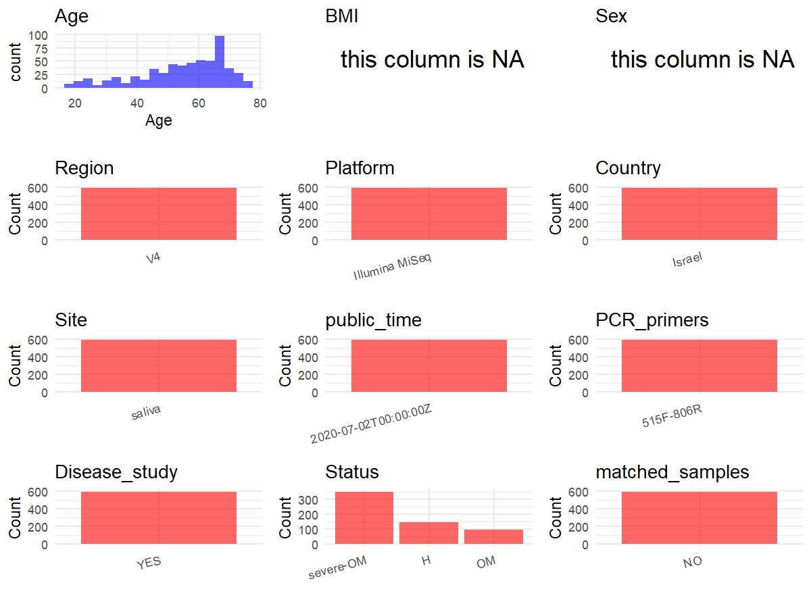

R Notebook: Metadata Processing Workflow
================

# Step 1: Obtain Initial Metadata from Each Project

To obtain the initial metadata: 1. Search for the BioProject ID (e.g.,
“PRJEBXXXX”) on the [NCBI SRA
website](https://www.ncbi.nlm.nih.gov/Traces/study/). 2. In the “Select”
table, click on “Metadata” and download the file. 3. The downloaded file
is typically named “SraRunTable.csv” and contains metadata for the
project.

``` r
# Load necessary libraries
library(dplyr)
library(ggplot2)
library(cowplot)

# Set working directory (update this path to your local directory)
setwd("D:/metadata/PRJEB38062")

# Read the initial metadata files
initial_meta<-read.csv("SraRunTable.csv",header = T)

# Combine the two metadata files
#meta <- rbind(initial_meta, initial_meta1)

#Remove entries non-oral samples
#initial_meta <- subset(initial_meta,isolate %in% c("saliva","tongue coat"))

# Check the number of samples containing "HT" in Sample.Name (e.g., healthy controls)
#nrow(subset(meta, grepl("HT", Sample.Name)))

# Display the first few rows of the metadata
head(initial_meta)
```

    ##          Run anonymized_name Assay.Type barcode..exp. BioProject    BioSample
    ## 1 ERR4079044         R159W03      OTHER  CGGGACACCCGA PRJEB38062 SAMEA6807191
    ## 2 ERR4079045         R159W04      OTHER  ATGCTGCAACAC PRJEB38062 SAMEA6807192
    ## 3 ERR4079046         R160W03      OTHER  TAATCTCGCCGG PRJEB38062 SAMEA6807193
    ## 4 ERR4079047         R161W00      OTHER  GGTGAGCAAGCA PRJEB38062 SAMEA6807194
    ## 5 ERR4079048         R161W01      OTHER  CCTAACGGTCCA PRJEB38062 SAMEA6807195
    ## 6 ERR4079049         R161W02      OTHER  AGCCCTGCTACA PRJEB38062 SAMEA6807196
    ##                          center_name..exp.
    ## 1 Faculty of medicine, Bar-Ilan university
    ## 2 Faculty of medicine, Bar-Ilan university
    ## 3 Faculty of medicine, Bar-Ilan university
    ## 4 Faculty of medicine, Bar-Ilan university
    ## 5 Faculty of medicine, Bar-Ilan university
    ## 6 Faculty of medicine, Bar-Ilan university
    ##                                          Center.Name
    ## 1 UNIVERSITY OF CALIFORNIA SAN DIEGO MICROBIOME INIT
    ## 2 UNIVERSITY OF CALIFORNIA SAN DIEGO MICROBIOME INIT
    ## 3 UNIVERSITY OF CALIFORNIA SAN DIEGO MICROBIOME INIT
    ## 4 UNIVERSITY OF CALIFORNIA SAN DIEGO MICROBIOME INIT
    ## 5 UNIVERSITY OF CALIFORNIA SAN DIEGO MICROBIOME INIT
    ## 6 UNIVERSITY OF CALIFORNIA SAN DIEGO MICROBIOME INIT
    ##                                                                                                               center_project_name..exp.
    ## 1 The role of oral microbiome in the pathogenesis of oral mucositis among patients treated with hematopoietic stem cell transplentation
    ## 2 The role of oral microbiome in the pathogenesis of oral mucositis among patients treated with hematopoietic stem cell transplentation
    ## 3 The role of oral microbiome in the pathogenesis of oral mucositis among patients treated with hematopoietic stem cell transplentation
    ## 4 The role of oral microbiome in the pathogenesis of oral mucositis among patients treated with hematopoietic stem cell transplentation
    ## 5 The role of oral microbiome in the pathogenesis of oral mucositis among patients treated with hematopoietic stem cell transplentation
    ## 6 The role of oral microbiome in the pathogenesis of oral mucositis among patients treated with hematopoietic stem cell transplentation
    ##   collection_timestamp Consent days_from_transplantation dna_extracted
    ## 1            2018/4/22  public                         7          TRUE
    ## 2             2018/5/8  public                        23          TRUE
    ## 3             2018/5/1  public                        13          TRUE
    ## 4            2018/4/22  public                        -3          TRUE
    ## 5            2018/5/14  public                        19          TRUE
    ## 6             2018/5/1  public                         6          TRUE
    ##   elevation           empo_1 empo_2           empo_3 ENA_FIRST_PUBLIC
    ## 1       29m Host-asssociated Animal Animal secretion         2020/7/1
    ## 2       29m Host-asssociated Animal Animal secretion         2020/7/1
    ## 3       29m Host-asssociated Animal Animal secretion         2020/7/1
    ## 4       29m Host-asssociated Animal Animal secretion         2020/7/1
    ## 5       29m Host-asssociated Animal Animal secretion         2020/7/1
    ## 6       29m Host-asssociated Animal Animal secretion         2020/7/1
    ##       ena_first_public ENA.LAST.UPDATE..run.      ena_last_update   env_biome
    ## 1 2020-07-01T17:10:50Z             2020/4/28 2020-04-28T19:24:43Z urban biome
    ## 2 2020-07-01T17:10:50Z             2020/4/28 2020-04-28T19:24:43Z urban biome
    ## 3 2020-07-01T17:10:50Z             2020/4/28 2020-04-28T19:24:43Z urban biome
    ## 4 2020-07-01T17:10:50Z             2020/4/28 2020-04-28T19:24:43Z urban biome
    ## 5 2020-07-01T17:10:50Z             2020/4/28 2020-04-28T19:24:43Z urban biome
    ## 6 2020-07-01T17:10:50Z             2020/4/28 2020-04-28T19:24:43Z urban biome
    ##                env_feature env_material env_package Experiment  external_id
    ## 1 human-associated habitat       saliva  human-oral ERX4077259 SAMEA6807191
    ## 2 human-associated habitat       saliva  human-oral ERX4077260 SAMEA6807192
    ## 3 human-associated habitat       saliva  human-oral ERX4077261 SAMEA6807193
    ## 4 human-associated habitat       saliva  human-oral ERX4077262 SAMEA6807194
    ## 5 human-associated habitat       saliva  human-oral ERX4077263 SAMEA6807195
    ## 6 human-associated habitat       saliva  human-oral ERX4077264 SAMEA6807196
    ##   geo_loc_name_country geo_loc_name_country_continent     geo_loc_name host_age
    ## 1               Israel                           Asia Israel:Ramat Gan       55
    ## 2               Israel                           Asia Israel:Ramat Gan       55
    ## 3               Israel                           Asia Israel:Ramat Gan       52
    ## 4               Israel                           Asia Israel:Ramat Gan       55
    ## 5               Israel                           Asia Israel:Ramat Gan       55
    ## 6               Israel                           Asia Israel:Ramat Gan       55
    ##   host_age_units host_body_habitat host_body_product host_body_site
    ## 1          years     UBERON:saliva     UBERON:saliva  UBERON:saliva
    ## 2          years     UBERON:saliva     UBERON:saliva  UBERON:saliva
    ## 3          years     UBERON:saliva     UBERON:saliva  UBERON:saliva
    ## 4          years     UBERON:saliva     UBERON:saliva  UBERON:saliva
    ## 5          years     UBERON:saliva     UBERON:saliva  UBERON:saliva
    ## 6          years     UBERON:saliva     UBERON:saliva  UBERON:saliva
    ##   host_common_name host_scientific_name host_subject_id host_taxid
    ## 1            human         Homo sapiens            R159       9606
    ## 2            human         Homo sapiens            R159       9606
    ## 3            human         Homo sapiens            R160       9606
    ## 4            human         Homo sapiens            R161       9606
    ## 5            human         Homo sapiens            R161       9606
    ## 6            human         Homo sapiens            R161       9606
    ##   INSDC_center_name   INSDC_first_public    INSDC_last_update INSDC_status
    ## 1            UCSDMI 2020-07-01T17:10:50Z 2020-04-28T19:24:43Z       public
    ## 2            UCSDMI 2020-07-01T17:10:50Z 2020-04-28T19:24:43Z       public
    ## 3            UCSDMI 2020-07-01T17:10:50Z 2020-04-28T19:24:43Z       public
    ## 4            UCSDMI 2020-07-01T17:10:50Z 2020-04-28T19:24:43Z       public
    ## 5            UCSDMI 2020-07-01T17:10:50Z 2020-04-28T19:24:43Z       public
    ## 6            UCSDMI 2020-07-01T17:10:50Z 2020-04-28T19:24:43Z       public
    ##       Instrument latitude  Library.Name LibraryLayout LibrarySelection
    ## 1 Illumina MiSeq 32.04721 13035.R159W03        SINGLE              PCR
    ## 2 Illumina MiSeq 32.04721 13035.R159W04        SINGLE              PCR
    ## 3 Illumina MiSeq 32.04721 13035.R160W03        SINGLE              PCR
    ## 4 Illumina MiSeq 32.04721 13035.R161W00        SINGLE              PCR
    ## 5 Illumina MiSeq 32.04721 13035.R161W01        SINGLE              PCR
    ## 6 Illumina MiSeq 32.04721 13035.R161W02        SINGLE              PCR
    ##   LibrarySource linker..exp. longitude oral_mucositis_grade
    ## 1   METAGENOMIC           cc  34.84558                    3
    ## 2   METAGENOMIC           cc  34.84558                    3
    ## 3   METAGENOMIC           cc  34.84558                    3
    ## 4   METAGENOMIC           cc  34.84558                    3
    ## 5   METAGENOMIC           cc  34.84558                    3
    ## 6   METAGENOMIC           cc  34.84558                    3
    ##                Organism
    ## 1 human oral metagenome
    ## 2 human oral metagenome
    ## 3 human oral metagenome
    ## 4 human oral metagenome
    ## 5 human oral metagenome
    ## 6 human oral metagenome
    ##                                                                                                                            pcr_primers..exp.
    ## 1 FWD:AATGATACGGCGACCACCGAGATCTACACTATGGTAATTGTGTGCCAGCMGCCGCGGTAA, REV:CAAGCAGAAGACGGCATACGAGATXXXXXXXXXXXXAGTCAGTCAGCCGGACTACHVGGGTWTCTAAT
    ## 2 FWD:AATGATACGGCGACCACCGAGATCTACACTATGGTAATTGTGTGCCAGCMGCCGCGGTAA, REV:CAAGCAGAAGACGGCATACGAGATXXXXXXXXXXXXAGTCAGTCAGCCGGACTACHVGGGTWTCTAAT
    ## 3 FWD:AATGATACGGCGACCACCGAGATCTACACTATGGTAATTGTGTGCCAGCMGCCGCGGTAA, REV:CAAGCAGAAGACGGCATACGAGATXXXXXXXXXXXXAGTCAGTCAGCCGGACTACHVGGGTWTCTAAT
    ## 4 FWD:AATGATACGGCGACCACCGAGATCTACACTATGGTAATTGTGTGCCAGCMGCCGCGGTAA, REV:CAAGCAGAAGACGGCATACGAGATXXXXXXXXXXXXAGTCAGTCAGCCGGACTACHVGGGTWTCTAAT
    ## 5 FWD:AATGATACGGCGACCACCGAGATCTACACTATGGTAATTGTGTGCCAGCMGCCGCGGTAA, REV:CAAGCAGAAGACGGCATACGAGATXXXXXXXXXXXXAGTCAGTCAGCCGGACTACHVGGGTWTCTAAT
    ## 6 FWD:AATGATACGGCGACCACCGAGATCTACACTATGGTAATTGTGTGCCAGCMGCCGCGGTAA, REV:CAAGCAGAAGACGGCATACGAGATXXXXXXXXXXXXAGTCAGTCAGCCGGACTACHVGGGTWTCTAAT
    ##   physical_specimen_location physical_specimen_remaining Platform
    ## 1        Bar-Ilan University                       FALSE ILLUMINA
    ## 2        Bar-Ilan University                       FALSE ILLUMINA
    ## 3        Bar-Ilan University                       FALSE ILLUMINA
    ## 4        Bar-Ilan University                       FALSE ILLUMINA
    ## 5        Bar-Ilan University                       FALSE ILLUMINA
    ## 6        Bar-Ilan University                       FALSE ILLUMINA
    ##   prophylaxis_bin          ReleaseDate
    ## 1     MTX or both 2020-07-02T00:00:00Z
    ## 2     MTX or both 2020-07-02T00:00:00Z
    ## 3     MTX or both 2020-07-02T00:00:00Z
    ## 4     MTX or both 2020-07-02T00:00:00Z
    ## 5     MTX or both 2020-07-02T00:00:00Z
    ## 6     MTX or both 2020-07-02T00:00:00Z
    ##                                    run_center..exp. run_date..exp.
    ## 1 genome center, Faculty of medicine, Sefad, Israel           2019
    ## 2 genome center, Faculty of medicine, Sefad, Israel           2019
    ## 3 genome center, Faculty of medicine, Sefad, Israel           2019
    ## 4 genome center, Faculty of medicine, Sefad, Israel           2019
    ## 5 genome center, Faculty of medicine, Sefad, Israel           2019
    ## 6 genome center, Faculty of medicine, Sefad, Israel           2019
    ##   run_prefix..exp. runid..exp.  Sample.Name                   Sample_name
    ## 1    ok106_S0_L001       ok106 SAMEA6807191 qiita_sid_13035:13035.R159W03
    ## 2    ok106_S0_L001       ok106 SAMEA6807192 qiita_sid_13035:13035.R159W04
    ## 3    ok106_S0_L001       ok106 SAMEA6807193 qiita_sid_13035:13035.R160W03
    ## 4    ok106_S0_L001       ok106 SAMEA6807194 qiita_sid_13035:13035.R161W00
    ## 5    ok106_S0_L001       ok106 SAMEA6807195 qiita_sid_13035:13035.R161W01
    ## 6    ok106_S0_L001       ok106 SAMEA6807196 qiita_sid_13035:13035.R161W02
    ##   sample_type       Scientific_Name   sequencing_meth..exp. SRA.Study
    ## 1      saliva human oral metagenome Sequencing by synthesis ERP121435
    ## 2      saliva human oral metagenome Sequencing by synthesis ERP121435
    ## 3      saliva human oral metagenome Sequencing by synthesis ERP121435
    ## 4      saliva human oral metagenome Sequencing by synthesis ERP121435
    ## 5      saliva human oral metagenome Sequencing by synthesis ERP121435
    ## 6      saliva human oral metagenome Sequencing by synthesis ERP121435
    ##                    Submitter_Id target_gene..exp. target_subfragment AvgSpotLen
    ## 1 qiita_sid_13035:13035.R159W03          16S rRNA                 V4        250
    ## 2 qiita_sid_13035:13035.R159W04          16S rRNA                 V4        250
    ## 3 qiita_sid_13035:13035.R160W03          16S rRNA                 V4        251
    ## 4 qiita_sid_13035:13035.R161W00          16S rRNA                 V4        250
    ## 5 qiita_sid_13035:13035.R161W01          16S rRNA                 V4        250
    ## 6 qiita_sid_13035:13035.R161W02          16S rRNA                 V4        250
    ##     Bases   Bytes DATASTORE.filetype DATASTORE.provider
    ## 1 4023956 2340471         run.zq,sra         gs,ncbi,s3
    ## 2 3572856 2222464         run.zq,sra         gs,ncbi,s3
    ## 3     251   26549                sra         gs,ncbi,s3
    ## 4 8373600 4965678         run.zq,sra         gs,ncbi,s3
    ## 5 6963563 4341614         run.zq,sra         gs,ncbi,s3
    ## 6 5940311 3206825         run.zq,sra         gs,ncbi,s3
    ##                       DATASTORE.region          create_date version
    ## 1 gs.us-east1,ncbi.public,s3.us-east-1 2020-07-21T11:12:00Z       1
    ## 2 gs.us-east1,ncbi.public,s3.us-east-1 2020-07-05T04:25:00Z       1
    ## 3 gs.us-east1,ncbi.public,s3.us-east-1 2020-07-05T04:25:00Z       1
    ## 4 gs.us-east1,ncbi.public,s3.us-east-1 2020-07-05T04:26:00Z       1
    ## 5 gs.us-east1,ncbi.public,s3.us-east-1 2020-07-05T04:58:00Z       2
    ## 6 gs.us-east1,ncbi.public,s3.us-east-1 2020-07-05T04:27:00Z       1
    ##                                                   primer..exp.
    ## 1 AATGATACGGCGACCACCGAGATCTACACTATGGTAATTGTGTGCCAGCMGCCGCGGTAA
    ## 2                                                             
    ## 3                                                             
    ## 4                                                             
    ## 5                                                             
    ## 6

# Step 2: Create a Uniform Metadata Template

The uniform metadata should include the following columns:

1.  **BioProject**: Project ID (e.g., “PRJNA339212”)
2.  **Run**: Sample ID (e.g., “ERRXXXXXX” or “SRRXXXXXX”)
3.  **sample_name**: Original sample name submitted by the authors (not
    the database-assigned ID)
4.  **Age**: Age of the subject (if available)
5.  **BMI**: Body Mass Index (if available)
6.  **Sex**: Sex of the subject (“F” or “M”)
7.  **Region**: Targeted 16S rRNA region (e.g., “V3-V4”)
8.  **Platform**: Sequencing platform (e.g., “Illumina MiSeq”)
9.  **Country**: Country of sample origin (e.g., “China”)
10. **Site**: Sample site (e.g., “saliva”, “dental plaque”)
11. **public_time**: Data release date (format: “YYYY-MM-DD”)
12. **PCR_primers**: PCR primers used (e.g., “515F-806R”)
13. **title**: Title of the associated publication
14. **Disease_study**: Whether the study involves a disease (“YES” or
    “NO”)
15. **Status**: Disease status (e.g., “T2DM”, “HC”). Note: If the study
    includes both disease and healthy samples, this must be specified
    per sample.
16. **matched_samples**: matched samples (“YES” or “NO”)

``` r
# Create a uniform metadata dataframe
metadata <- data.frame(
  BioProject = initial_meta$BioProject,
  Run = initial_meta$Run,
  sample_name = initial_meta$Sample.Name,
  Age = initial_meta$host_age,
  BMI = NA,
  Sex=NA,
  Region = "V4",
  Platform = initial_meta$Instrument,
  Country = initial_meta$geo_loc_name_country,
  Site = initial_meta$env_material,
  public_time = initial_meta$ReleaseDate,
  stringsAsFactors = FALSE
)
```

# Step 3: Manually Add Information from the Publication

Some information (e.g. PCR primers, study title, disease status) must be
manually extracted from the publication and added to the metadata.

``` r
# Add information obtained from the publication
metadata$PCR_primers <- "515F-806R"
metadata$title <- "Patterns of salivary microbiota injury and oral mucositis in recipients of allogeneic hematopoietic stem cell transplantation"
metadata$Disease_study <- "YES"
# Assign disease status based on sample_name patterns
#metadata$Status<-"H"
metadata <- metadata %>%
  mutate(Status = case_when(
    initial_meta$oral_mucositis_grade == "0" ~ "H",
    initial_meta$oral_mucositis_grade == "1" ~ "OM",
    initial_meta$oral_mucositis_grade %in% c("2", "3", "4") ~ "severe-OM"
  ))


keep_subjects <- unique(subset(metadata, Site == "saliva")$sample_name)
metadata <- subset(metadata, sample_name %in% keep_subjects)

metadata$matched_samples <- "NO"
```

# Step 4: Summarize and Validate the Metadata

``` r
# Check the number of unique runs and sample names
print(paste("Number of unique runs:", length(unique(metadata$Run))))
```

    ## [1] "Number of unique runs: 593"

``` r
print(paste("Number of unique sample names:", length(unique(metadata$sample_name))))
```

    ## [1] "Number of unique sample names: 593"

# Step 5: Visualize the Metadata

``` r

```

<!-- -->

# Step 6: Finalize and Export the Metadata

``` r
# Reorder columns to match the desired format
metadata <- metadata[, c(
  "BioProject", "Run", "sample_name", "Age", "BMI", "Sex", 
  "Region", "Platform", "Country", "Site", "public_time", 
  "PCR_primers", "title", "Disease_study", "Status","matched_samples"
)]

# Export the uniform metadata to a CSV file
write.csv(metadata, file = "metadata.csv", quote = TRUE)
head(metadata)
```

    ##   BioProject        Run  sample_name Age BMI Sex Region       Platform Country
    ## 1 PRJEB38062 ERR4079044 SAMEA6807191  55  NA  NA     V4 Illumina MiSeq  Israel
    ## 2 PRJEB38062 ERR4079045 SAMEA6807192  55  NA  NA     V4 Illumina MiSeq  Israel
    ## 3 PRJEB38062 ERR4079046 SAMEA6807193  52  NA  NA     V4 Illumina MiSeq  Israel
    ## 4 PRJEB38062 ERR4079047 SAMEA6807194  55  NA  NA     V4 Illumina MiSeq  Israel
    ## 5 PRJEB38062 ERR4079048 SAMEA6807195  55  NA  NA     V4 Illumina MiSeq  Israel
    ## 6 PRJEB38062 ERR4079049 SAMEA6807196  55  NA  NA     V4 Illumina MiSeq  Israel
    ##     Site          public_time PCR_primers
    ## 1 saliva 2020-07-02T00:00:00Z   515F-806R
    ## 2 saliva 2020-07-02T00:00:00Z   515F-806R
    ## 3 saliva 2020-07-02T00:00:00Z   515F-806R
    ## 4 saliva 2020-07-02T00:00:00Z   515F-806R
    ## 5 saliva 2020-07-02T00:00:00Z   515F-806R
    ## 6 saliva 2020-07-02T00:00:00Z   515F-806R
    ##                                                                                                                           title
    ## 1 Patterns of salivary microbiota injury and oral mucositis in recipients of allogeneic hematopoietic stem cell transplantation
    ## 2 Patterns of salivary microbiota injury and oral mucositis in recipients of allogeneic hematopoietic stem cell transplantation
    ## 3 Patterns of salivary microbiota injury and oral mucositis in recipients of allogeneic hematopoietic stem cell transplantation
    ## 4 Patterns of salivary microbiota injury and oral mucositis in recipients of allogeneic hematopoietic stem cell transplantation
    ## 5 Patterns of salivary microbiota injury and oral mucositis in recipients of allogeneic hematopoietic stem cell transplantation
    ## 6 Patterns of salivary microbiota injury and oral mucositis in recipients of allogeneic hematopoietic stem cell transplantation
    ##   Disease_study    Status matched_samples
    ## 1           YES severe-OM              NO
    ## 2           YES severe-OM              NO
    ## 3           YES severe-OM              NO
    ## 4           YES severe-OM              NO
    ## 5           YES severe-OM              NO
    ## 6           YES severe-OM              NO

## Notes for Students:

1.  **Metadata Accuracy**: Always cross-check the metadata with the
    original publication to ensure accuracy.
2.  **Manual Entries**: Columns like `PCR_primers`, and `Status` often
    require manual entry based on the publication.
3.  **Disease Status**: Be careful when assigning `Status`—some studies
    include both disease and healthy samples.
4.  **Visualization**: The plots help quickly identify the distribution
    of values in each column, which is useful for quality control.
5.  **Reproducibility**: Update the working directory and file paths to
    match your local environment.
