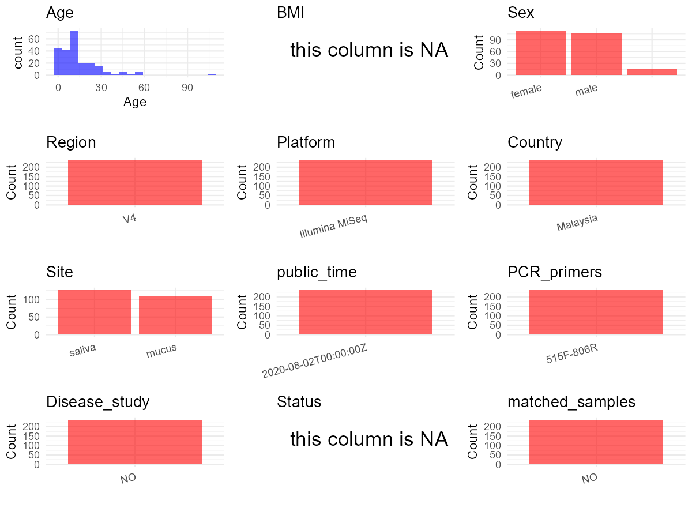

R Notebook: Metadata Processing Workflow
================

# Step 1: Obtain Initial Metadata from Each Project

To obtain the initial metadata: 1. Search for the BioProject ID (e.g.,
“PRJEBXXXX”) on the [NCBI SRA
website](https://www.ncbi.nlm.nih.gov/Traces/study/). 2. In the “Select”
table, click on “Metadata” and download the file. 3. The downloaded file
is typically named “SraRunTable.csv” and contains metadata for the
project.

``` r
# Load necessary libraries
library(dplyr)
library(ggplot2)
library(cowplot)

# Set working directory (update this path to your local directory)
setwd("D:/studylearning/董彪师兄项目/任务3_20251004/PRJEB38610")

# Read the initial metadata files
initial_meta<-read.csv("SraRunTable.csv",header = T)

# Display the first few rows of the metadata
head(initial_meta)
```

    ##          Run Assay.Type AvgSpotLen    Bases BioProject    BioSample    Bytes
    ## 1 ERR4183761   AMPLICON        249  1083897 PRJEB38610 SAMEA6870160   516583
    ## 2 ERR4183762   AMPLICON        249    86652 PRJEB38610 SAMEA6870153    79496
    ## 3 ERR4183763   AMPLICON        249    52539 PRJEB38610 SAMEA6870081    57246
    ## 4 ERR4183764   AMPLICON        249  5925204 PRJEB38610 SAMEA6870107  2651160
    ## 5 ERR4183765   AMPLICON        249 34019874 PRJEB38610 SAMEA6870004 13292825
    ## 6 ERR4183766   AMPLICON        249  2574411 PRJEB38610 SAMEA6869977  1164244
    ##                 Center.Name Collection_Date Consent DATASTORE.filetype
    ## 1 UNIVERSITY OF SOUTHAMPTON            2017  public         run.zq,sra
    ## 2 UNIVERSITY OF SOUTHAMPTON            2017  public         run.zq,sra
    ## 3 UNIVERSITY OF SOUTHAMPTON            2017  public         run.zq,sra
    ## 4 UNIVERSITY OF SOUTHAMPTON            2017  public         run.zq,sra
    ## 5 UNIVERSITY OF SOUTHAMPTON            2017  public         run.zq,sra
    ## 6 UNIVERSITY OF SOUTHAMPTON            2017  public         run.zq,sra
    ##   DATASTORE.provider                     DATASTORE.region
    ## 1         gs,ncbi,s3 gs.us-east1,ncbi.public,s3.us-east-1
    ## 2         gs,ncbi,s3 gs.us-east1,ncbi.public,s3.us-east-1
    ## 3         gs,ncbi,s3 gs.us-east1,ncbi.public,s3.us-east-1
    ## 4         gs,ncbi,s3 gs.us-east1,ncbi.public,s3.us-east-1
    ## 5         gs,ncbi,s3 gs.us-east1,ncbi.public,s3.us-east-1
    ## 6         gs,ncbi,s3 gs.us-east1,ncbi.public,s3.us-east-1
    ##   ENA.FIRST.PUBLIC..run.     ena_first_public ENA.LAST.UPDATE..run.
    ## 1             2020-08-01 2020-08-01T04:06:13Z            2020-06-01
    ## 2             2020-08-01 2020-08-01T04:06:13Z            2020-06-01
    ## 3             2020-08-01 2020-08-01T04:06:13Z            2020-06-01
    ## 4             2020-08-01 2020-08-01T04:06:13Z            2020-06-01
    ## 5             2020-08-01 2020-08-01T04:06:13Z            2020-06-01
    ## 6             2020-08-01 2020-08-01T04:06:13Z            2020-06-01
    ##        ena_last_update environment_.biome. environment_.feature.
    ## 1 2020-06-01T19:03:00Z        Homo sapiens          oral opening
    ## 2 2020-06-01T19:03:00Z        Homo sapiens          oral opening
    ## 3 2020-06-01T19:02:57Z        Homo sapiens          oral opening
    ## 4 2020-06-01T19:02:58Z        Homo sapiens          oral opening
    ## 5 2020-06-01T19:02:55Z        Homo sapiens         nassal cavity
    ## 6 2020-06-01T19:02:54Z        Homo sapiens         nassal cavity
    ##   environment_.material. Experiment  external_id geo_loc_name_country
    ## 1                 saliva ERX4147052 SAMEA6870160             Malaysia
    ## 2                 saliva ERX4147053 SAMEA6870153             Malaysia
    ## 3                 saliva ERX4147054 SAMEA6870081             Malaysia
    ## 4                 saliva ERX4147055 SAMEA6870107             Malaysia
    ## 5                  mucus ERX4147056 SAMEA6870004             Malaysia
    ## 6                  mucus ERX4147057 SAMEA6869977             Malaysia
    ##   geo_loc_name_country_continent geographic_location_.country_and.or_sea.
    ## 1                           Asia                                 Malaysia
    ## 2                           Asia                                 Malaysia
    ## 3                           Asia                                 Malaysia
    ## 4                           Asia                                 Malaysia
    ## 5                           Asia                                 Malaysia
    ## 6                           Asia                                 Malaysia
    ##   geographic_location_.latitude. geographic_location_.longitude. Host_Age
    ## 1                       5.074816                        103.0032       10
    ## 2                       5.074816                        103.0032        7
    ## 3                       4.047140                        103.2859       36
    ## 4                       5.074816                        103.0032        9
    ## 5                       5.074816                        103.0032       23
    ## 6                       5.074816                        103.0032       10
    ##   host_subject_id human_associated_environmental_package
    ## 1           101_M                       human-associated
    ## 2            76_M                       human-associated
    ## 3            22_M                       human-associated
    ## 4            90_M                       human-associated
    ## 5            72_N                       human-associated
    ## 6           127_N                       human-associated
    ##           INSDC_center_name   INSDC_first_public    INSDC_last_update
    ## 1 University of Southampton 2020-08-01T04:06:13Z 2020-06-01T19:03:00Z
    ## 2 University of Southampton 2020-08-01T04:06:13Z 2020-06-01T19:03:00Z
    ## 3 University of Southampton 2020-08-01T04:06:13Z 2020-06-01T19:02:57Z
    ## 4 University of Southampton 2020-08-01T04:06:13Z 2020-06-01T19:02:58Z
    ## 5 University of Southampton 2020-08-01T04:06:13Z 2020-06-01T19:02:55Z
    ## 6 University of Southampton 2020-08-01T04:06:13Z 2020-06-01T19:02:54Z
    ##   INSDC_status     Instrument investigation_type Library.Name LibraryLayout
    ## 1       public Illumina MiSeq     mimarks-survey  unspecified        PAIRED
    ## 2       public Illumina MiSeq     mimarks-survey  unspecified        PAIRED
    ## 3       public Illumina MiSeq     mimarks-survey  unspecified        PAIRED
    ## 4       public Illumina MiSeq     mimarks-survey  unspecified        PAIRED
    ## 5       public Illumina MiSeq     mimarks-survey  unspecified        PAIRED
    ## 6       public Illumina MiSeq     mimarks-survey  unspecified        PAIRED
    ##   LibrarySelection LibrarySource                        Organism
    ## 1              PCR         OTHER           human oral metagenome
    ## 2              PCR         OTHER           human oral metagenome
    ## 3              PCR         OTHER           human oral metagenome
    ## 4              PCR         OTHER           human oral metagenome
    ## 5              PCR         OTHER human nasopharyngeal metagenome
    ## 6              PCR         OTHER human nasopharyngeal metagenome
    ##                                             PCR_primers Platform
    ## 1 515F GTGCCAGCMGCCGCGGTAA\\, 806R GGACTACHVGGGTWTCTAAT ILLUMINA
    ## 2 515F GTGCCAGCMGCCGCGGTAA\\, 806R GGACTACHVGGGTWTCTAAT ILLUMINA
    ## 3 515F GTGCCAGCMGCCGCGGTAA\\, 806R GGACTACHVGGGTWTCTAAT ILLUMINA
    ## 4 515F GTGCCAGCMGCCGCGGTAA\\, 806R GGACTACHVGGGTWTCTAAT ILLUMINA
    ## 5 515F GTGCCAGCMGCCGCGGTAA\\, 806R GGACTACHVGGGTWTCTAAT ILLUMINA
    ## 6 515F GTGCCAGCMGCCGCGGTAA\\, 806R GGACTACHVGGGTWTCTAAT ILLUMINA
    ##         project_name          ReleaseDate          create_date version
    ## 1 Orang Asli URT 16S 2020-08-02T00:00:00Z 2020-08-02T09:11:00Z       1
    ## 2 Orang Asli URT 16S 2020-08-02T00:00:00Z 2020-08-02T09:11:00Z       1
    ## 3 Orang Asli URT 16S 2020-08-02T00:00:00Z 2020-08-02T09:11:00Z       1
    ## 4 Orang Asli URT 16S 2020-08-02T00:00:00Z 2020-08-02T09:12:00Z       1
    ## 5 Orang Asli URT 16S 2020-08-02T00:00:00Z 2020-08-02T09:12:00Z       1
    ## 6 Orang Asli URT 16S 2020-08-02T00:00:00Z 2020-08-02T09:12:00Z       1
    ##    Sample.Name Sample_name                 Scientific_Name Sequencing_method
    ## 1 SAMEA6870160   105122677           human oral metagenome          Ilummina
    ## 2 SAMEA6870153   117122490           human oral metagenome          Ilummina
    ## 3 SAMEA6870081   120122452           human oral metagenome          Ilummina
    ## 4 SAMEA6870107   123123166           human oral metagenome          Ilummina
    ## 5 SAMEA6870004   132123270 human nasopharyngeal metagenome          Ilummina
    ## 6 SAMEA6869977   136122892 human nasopharyngeal metagenome          Ilummina
    ##   SRA.Study Submitter_Id target_gene target_subfragment host_body_site
    ## 1 ERP122045    105122677         16S                 V4           oral
    ## 2 ERP122045    117122490         16S                 V4           oral
    ## 3 ERP122045    120122452         16S                 V4           oral
    ## 4 ERP122045    123123166         16S                 V4           oral
    ## 5 ERP122045    132123270         16S                 V4          nasal
    ## 6 ERP122045    136122892         16S                 V4          nasal
    ##       smoker host_sex
    ## 1 non-smoker     male
    ## 2 non-smoker     male
    ## 3 non-smoker   female
    ## 4 non-smoker   female
    ## 5 non-smoker   female
    ## 6 non-smoker   female

# Step 2: Create a Uniform Metadata Template

The uniform metadata should include the following columns:

1.  **BioProject**: Project ID (e.g., “PRJNA339212”)
2.  **Run**: Sample ID (e.g., “ERRXXXXXX” or “SRRXXXXXX”)
3.  **sample_name**: Original sample name submitted by the authors (not
    the database-assigned ID)
4.  **Age**: Age of the subject (if available)
5.  **BMI**: Body Mass Index (if available)
6.  **Sex**: Sex of the subject (“F” or “M”)
7.  **Region**: Targeted 16S rRNA region (e.g., “V3-V4”)
8.  **Platform**: Sequencing platform (e.g., “Illumina MiSeq”)
9.  **Country**: Country of sample origin (e.g., “China”)
10. **Site**: Sample site (e.g., “saliva”, “dental plaque”)
11. **public_time**: Data release date (format: “YYYY-MM-DD”)
12. **PCR_primers**: PCR primers used (e.g., “515F-806R”)
13. **title**: Title of the associated publication
14. **Disease_study**: Whether the study involves a disease (“YES” or
    “NO”)
15. **Status**: Disease status (e.g., “T2DM”, “HC”). Note: If the study
    includes both disease and healthy samples, this must be specified
    per sample.

``` r
# Create a uniform metadata dataframe
metadata <- data.frame(
  BioProject = initial_meta$BioProject,
  Run = initial_meta$Run,
  sample_name = initial_meta$Sample.Name,
  Age = initial_meta$Host_Age,
  BMI = NA,
  Sex= initial_meta$host_sex,
  Region = "V4",
  Platform = initial_meta$Instrument,
  Country = initial_meta$geo_loc_name_country,
  Site = initial_meta$environment_.material.,
  public_time = initial_meta$ReleaseDate,
  stringsAsFactors = FALSE
)
```

# Step 3: Manually Add Information from the Publication

Some information (e.g. PCR primers, study title, disease status) must be
manually extracted from the publication and added to the metadata.

``` r
# Add information obtained from the publication
metadata$PCR_primers <- "515F-806R"  # Update based on the publication
metadata$title <- "The upper respiratory tract microbiome of indigenous Orang Asli in north-eastern Peninsular Malaysia"
metadata$Disease_study <- "NO"
metadata$Status <- NA_character_

#extract subject id by remove prefix of sample_name
#metadata$sample_name <- gsub("_st|_sal", "", metadata$sample_name)

# Check initial data distribution
cat("Initial sample distribution:\n")
```

    ## Initial sample distribution:

``` r
table(metadata$sample_name)
```

    ## 
    ## SAMEA6869961 SAMEA6869962 SAMEA6869963 SAMEA6869964 SAMEA6869965 SAMEA6869966 
    ##            1            1            1            1            1            1 
    ## SAMEA6869967 SAMEA6869968 SAMEA6869969 SAMEA6869970 SAMEA6869971 SAMEA6869972 
    ##            1            1            1            1            1            1 
    ## SAMEA6869973 SAMEA6869974 SAMEA6869975 SAMEA6869976 SAMEA6869977 SAMEA6869978 
    ##            1            1            1            1            1            1 
    ## SAMEA6869979 SAMEA6869980 SAMEA6869981 SAMEA6869982 SAMEA6869983 SAMEA6869984 
    ##            1            1            1            1            1            1 
    ## SAMEA6869985 SAMEA6869986 SAMEA6869987 SAMEA6869988 SAMEA6869989 SAMEA6869990 
    ##            1            1            1            1            1            1 
    ## SAMEA6869991 SAMEA6869992 SAMEA6869993 SAMEA6869994 SAMEA6869995 SAMEA6869996 
    ##            1            1            1            1            1            1 
    ## SAMEA6869997 SAMEA6869998 SAMEA6869999 SAMEA6870000 SAMEA6870001 SAMEA6870002 
    ##            1            1            1            1            1            1 
    ## SAMEA6870003 SAMEA6870004 SAMEA6870005 SAMEA6870006 SAMEA6870007 SAMEA6870008 
    ##            1            1            1            1            1            1 
    ## SAMEA6870009 SAMEA6870010 SAMEA6870011 SAMEA6870012 SAMEA6870013 SAMEA6870014 
    ##            1            1            1            1            1            1 
    ## SAMEA6870015 SAMEA6870016 SAMEA6870017 SAMEA6870018 SAMEA6870019 SAMEA6870020 
    ##            1            1            1            1            1            1 
    ## SAMEA6870021 SAMEA6870022 SAMEA6870023 SAMEA6870024 SAMEA6870025 SAMEA6870026 
    ##            1            1            1            1            1            1 
    ## SAMEA6870027 SAMEA6870028 SAMEA6870029 SAMEA6870030 SAMEA6870031 SAMEA6870032 
    ##            1            1            1            1            1            1 
    ## SAMEA6870033 SAMEA6870034 SAMEA6870035 SAMEA6870036 SAMEA6870037 SAMEA6870038 
    ##            1            1            1            1            1            1 
    ## SAMEA6870039 SAMEA6870040 SAMEA6870041 SAMEA6870042 SAMEA6870043 SAMEA6870044 
    ##            1            1            1            1            1            1 
    ## SAMEA6870045 SAMEA6870046 SAMEA6870047 SAMEA6870048 SAMEA6870049 SAMEA6870050 
    ##            1            1            1            1            1            1 
    ## SAMEA6870051 SAMEA6870052 SAMEA6870053 SAMEA6870054 SAMEA6870055 SAMEA6870056 
    ##            1            1            1            1            1            1 
    ## SAMEA6870057 SAMEA6870058 SAMEA6870059 SAMEA6870060 SAMEA6870061 SAMEA6870062 
    ##            1            1            1            1            1            1 
    ## SAMEA6870063 SAMEA6870064 SAMEA6870065 SAMEA6870066 SAMEA6870067 SAMEA6870068 
    ##            1            1            1            1            1            1 
    ## SAMEA6870069 SAMEA6870070 SAMEA6870071 SAMEA6870072 SAMEA6870073 SAMEA6870074 
    ##            1            1            1            1            1            1 
    ## SAMEA6870075 SAMEA6870076 SAMEA6870077 SAMEA6870078 SAMEA6870079 SAMEA6870080 
    ##            1            1            1            1            1            1 
    ## SAMEA6870081 SAMEA6870082 SAMEA6870083 SAMEA6870084 SAMEA6870085 SAMEA6870086 
    ##            1            1            1            1            1            1 
    ## SAMEA6870087 SAMEA6870088 SAMEA6870089 SAMEA6870090 SAMEA6870091 SAMEA6870092 
    ##            1            1            1            1            1            1 
    ## SAMEA6870093 SAMEA6870094 SAMEA6870095 SAMEA6870096 SAMEA6870097 SAMEA6870098 
    ##            1            1            1            1            1            1 
    ## SAMEA6870099 SAMEA6870100 SAMEA6870101 SAMEA6870102 SAMEA6870103 SAMEA6870104 
    ##            1            1            1            1            1            1 
    ## SAMEA6870105 SAMEA6870106 SAMEA6870107 SAMEA6870108 SAMEA6870109 SAMEA6870110 
    ##            1            1            1            1            1            1 
    ## SAMEA6870111 SAMEA6870112 SAMEA6870113 SAMEA6870114 SAMEA6870115 SAMEA6870116 
    ##            1            1            1            1            1            1 
    ## SAMEA6870117 SAMEA6870118 SAMEA6870119 SAMEA6870120 SAMEA6870121 SAMEA6870122 
    ##            1            1            1            1            1            1 
    ## SAMEA6870123 SAMEA6870124 SAMEA6870125 SAMEA6870126 SAMEA6870127 SAMEA6870128 
    ##            1            1            1            1            1            1 
    ## SAMEA6870129 SAMEA6870130 SAMEA6870131 SAMEA6870132 SAMEA6870133 SAMEA6870134 
    ##            1            1            1            1            1            1 
    ## SAMEA6870135 SAMEA6870136 SAMEA6870137 SAMEA6870138 SAMEA6870139 SAMEA6870140 
    ##            1            1            1            1            1            1 
    ## SAMEA6870141 SAMEA6870142 SAMEA6870143 SAMEA6870144 SAMEA6870145 SAMEA6870146 
    ##            1            1            1            1            1            1 
    ## SAMEA6870147 SAMEA6870148 SAMEA6870149 SAMEA6870150 SAMEA6870151 SAMEA6870152 
    ##            1            1            1            1            1            1 
    ## SAMEA6870153 SAMEA6870154 SAMEA6870155 SAMEA6870156 SAMEA6870157 SAMEA6870158 
    ##            1            1            1            1            1            1 
    ## SAMEA6870159 SAMEA6870160 SAMEA6870161 SAMEA6870162 SAMEA6870163 SAMEA6870164 
    ##            1            1            1            1            1            1 
    ## SAMEA6870165 SAMEA6870166 SAMEA6870167 SAMEA6870168 SAMEA6870169 SAMEA6870170 
    ##            1            1            1            1            1            1 
    ## SAMEA6870171 SAMEA6870172 SAMEA6870173 SAMEA6870174 SAMEA6870175 SAMEA6870176 
    ##            1            1            1            1            1            1 
    ## SAMEA6870177 SAMEA6870178 SAMEA6870179 SAMEA6870180 SAMEA6870181 SAMEA6870182 
    ##            1            1            1            1            1            1 
    ## SAMEA6870183 SAMEA6870184 SAMEA6870185 SAMEA6870186 SAMEA6870187 SAMEA6870188 
    ##            1            1            1            1            1            1 
    ## SAMEA6870189 SAMEA6870190 SAMEA6870191 SAMEA6870192 SAMEA6870193 SAMEA6870194 
    ##            1            1            1            1            1            1 
    ## SAMEA6870195 SAMEA6870196 SAMEA6870197 
    ##            1            1            1

``` r
table(metadata$Site)
```

    ## 
    ##  mucus saliva 
    ##    110    127

``` r
# Calculate sampling frequency per subject
sample_counts <- table(metadata$sample_name)
cat("\nNumber of samples per subject:\n")
```

    ## 
    ## Number of samples per subject:

``` r
print(sample_counts)
```

    ## 
    ## SAMEA6869961 SAMEA6869962 SAMEA6869963 SAMEA6869964 SAMEA6869965 SAMEA6869966 
    ##            1            1            1            1            1            1 
    ## SAMEA6869967 SAMEA6869968 SAMEA6869969 SAMEA6869970 SAMEA6869971 SAMEA6869972 
    ##            1            1            1            1            1            1 
    ## SAMEA6869973 SAMEA6869974 SAMEA6869975 SAMEA6869976 SAMEA6869977 SAMEA6869978 
    ##            1            1            1            1            1            1 
    ## SAMEA6869979 SAMEA6869980 SAMEA6869981 SAMEA6869982 SAMEA6869983 SAMEA6869984 
    ##            1            1            1            1            1            1 
    ## SAMEA6869985 SAMEA6869986 SAMEA6869987 SAMEA6869988 SAMEA6869989 SAMEA6869990 
    ##            1            1            1            1            1            1 
    ## SAMEA6869991 SAMEA6869992 SAMEA6869993 SAMEA6869994 SAMEA6869995 SAMEA6869996 
    ##            1            1            1            1            1            1 
    ## SAMEA6869997 SAMEA6869998 SAMEA6869999 SAMEA6870000 SAMEA6870001 SAMEA6870002 
    ##            1            1            1            1            1            1 
    ## SAMEA6870003 SAMEA6870004 SAMEA6870005 SAMEA6870006 SAMEA6870007 SAMEA6870008 
    ##            1            1            1            1            1            1 
    ## SAMEA6870009 SAMEA6870010 SAMEA6870011 SAMEA6870012 SAMEA6870013 SAMEA6870014 
    ##            1            1            1            1            1            1 
    ## SAMEA6870015 SAMEA6870016 SAMEA6870017 SAMEA6870018 SAMEA6870019 SAMEA6870020 
    ##            1            1            1            1            1            1 
    ## SAMEA6870021 SAMEA6870022 SAMEA6870023 SAMEA6870024 SAMEA6870025 SAMEA6870026 
    ##            1            1            1            1            1            1 
    ## SAMEA6870027 SAMEA6870028 SAMEA6870029 SAMEA6870030 SAMEA6870031 SAMEA6870032 
    ##            1            1            1            1            1            1 
    ## SAMEA6870033 SAMEA6870034 SAMEA6870035 SAMEA6870036 SAMEA6870037 SAMEA6870038 
    ##            1            1            1            1            1            1 
    ## SAMEA6870039 SAMEA6870040 SAMEA6870041 SAMEA6870042 SAMEA6870043 SAMEA6870044 
    ##            1            1            1            1            1            1 
    ## SAMEA6870045 SAMEA6870046 SAMEA6870047 SAMEA6870048 SAMEA6870049 SAMEA6870050 
    ##            1            1            1            1            1            1 
    ## SAMEA6870051 SAMEA6870052 SAMEA6870053 SAMEA6870054 SAMEA6870055 SAMEA6870056 
    ##            1            1            1            1            1            1 
    ## SAMEA6870057 SAMEA6870058 SAMEA6870059 SAMEA6870060 SAMEA6870061 SAMEA6870062 
    ##            1            1            1            1            1            1 
    ## SAMEA6870063 SAMEA6870064 SAMEA6870065 SAMEA6870066 SAMEA6870067 SAMEA6870068 
    ##            1            1            1            1            1            1 
    ## SAMEA6870069 SAMEA6870070 SAMEA6870071 SAMEA6870072 SAMEA6870073 SAMEA6870074 
    ##            1            1            1            1            1            1 
    ## SAMEA6870075 SAMEA6870076 SAMEA6870077 SAMEA6870078 SAMEA6870079 SAMEA6870080 
    ##            1            1            1            1            1            1 
    ## SAMEA6870081 SAMEA6870082 SAMEA6870083 SAMEA6870084 SAMEA6870085 SAMEA6870086 
    ##            1            1            1            1            1            1 
    ## SAMEA6870087 SAMEA6870088 SAMEA6870089 SAMEA6870090 SAMEA6870091 SAMEA6870092 
    ##            1            1            1            1            1            1 
    ## SAMEA6870093 SAMEA6870094 SAMEA6870095 SAMEA6870096 SAMEA6870097 SAMEA6870098 
    ##            1            1            1            1            1            1 
    ## SAMEA6870099 SAMEA6870100 SAMEA6870101 SAMEA6870102 SAMEA6870103 SAMEA6870104 
    ##            1            1            1            1            1            1 
    ## SAMEA6870105 SAMEA6870106 SAMEA6870107 SAMEA6870108 SAMEA6870109 SAMEA6870110 
    ##            1            1            1            1            1            1 
    ## SAMEA6870111 SAMEA6870112 SAMEA6870113 SAMEA6870114 SAMEA6870115 SAMEA6870116 
    ##            1            1            1            1            1            1 
    ## SAMEA6870117 SAMEA6870118 SAMEA6870119 SAMEA6870120 SAMEA6870121 SAMEA6870122 
    ##            1            1            1            1            1            1 
    ## SAMEA6870123 SAMEA6870124 SAMEA6870125 SAMEA6870126 SAMEA6870127 SAMEA6870128 
    ##            1            1            1            1            1            1 
    ## SAMEA6870129 SAMEA6870130 SAMEA6870131 SAMEA6870132 SAMEA6870133 SAMEA6870134 
    ##            1            1            1            1            1            1 
    ## SAMEA6870135 SAMEA6870136 SAMEA6870137 SAMEA6870138 SAMEA6870139 SAMEA6870140 
    ##            1            1            1            1            1            1 
    ## SAMEA6870141 SAMEA6870142 SAMEA6870143 SAMEA6870144 SAMEA6870145 SAMEA6870146 
    ##            1            1            1            1            1            1 
    ## SAMEA6870147 SAMEA6870148 SAMEA6870149 SAMEA6870150 SAMEA6870151 SAMEA6870152 
    ##            1            1            1            1            1            1 
    ## SAMEA6870153 SAMEA6870154 SAMEA6870155 SAMEA6870156 SAMEA6870157 SAMEA6870158 
    ##            1            1            1            1            1            1 
    ## SAMEA6870159 SAMEA6870160 SAMEA6870161 SAMEA6870162 SAMEA6870163 SAMEA6870164 
    ##            1            1            1            1            1            1 
    ## SAMEA6870165 SAMEA6870166 SAMEA6870167 SAMEA6870168 SAMEA6870169 SAMEA6870170 
    ##            1            1            1            1            1            1 
    ## SAMEA6870171 SAMEA6870172 SAMEA6870173 SAMEA6870174 SAMEA6870175 SAMEA6870176 
    ##            1            1            1            1            1            1 
    ## SAMEA6870177 SAMEA6870178 SAMEA6870179 SAMEA6870180 SAMEA6870181 SAMEA6870182 
    ##            1            1            1            1            1            1 
    ## SAMEA6870183 SAMEA6870184 SAMEA6870185 SAMEA6870186 SAMEA6870187 SAMEA6870188 
    ##            1            1            1            1            1            1 
    ## SAMEA6870189 SAMEA6870190 SAMEA6870191 SAMEA6870192 SAMEA6870193 SAMEA6870194 
    ##            1            1            1            1            1            1 
    ## SAMEA6870195 SAMEA6870196 SAMEA6870197 
    ##            1            1            1

``` r
# Create matched_samples column
metadata$matched_samples <- ifelse(metadata$sample_name %in% names(sample_counts[sample_counts >= 2]), "YES", "NO")

cat("\nMatched samples distribution:\n")
```

    ## 
    ## Matched samples distribution:

``` r
table(metadata$matched_samples)
```

    ## 
    ##  NO 
    ## 237

``` r
# Identify samples for removal: single samples excluding saliva,mucus 
single_samples <- names(sample_counts[sample_counts == 1])
samples_to_remove <- metadata$sample_name %in% single_samples & !(metadata$Site %in% c("saliva","mucus"))

cat("\nNumber of samples to be removed:", sum(samples_to_remove), "\n")
```

    ## 
    ## Number of samples to be removed: 0

``` r
# Remove identified samples
metadata_clean <- metadata[!samples_to_remove, ]

cat("\nFinal sample distribution after cleaning:\n")
```

    ## 
    ## Final sample distribution after cleaning:

``` r
table(metadata_clean$sample_name)
```

    ## 
    ## SAMEA6869961 SAMEA6869962 SAMEA6869963 SAMEA6869964 SAMEA6869965 SAMEA6869966 
    ##            1            1            1            1            1            1 
    ## SAMEA6869967 SAMEA6869968 SAMEA6869969 SAMEA6869970 SAMEA6869971 SAMEA6869972 
    ##            1            1            1            1            1            1 
    ## SAMEA6869973 SAMEA6869974 SAMEA6869975 SAMEA6869976 SAMEA6869977 SAMEA6869978 
    ##            1            1            1            1            1            1 
    ## SAMEA6869979 SAMEA6869980 SAMEA6869981 SAMEA6869982 SAMEA6869983 SAMEA6869984 
    ##            1            1            1            1            1            1 
    ## SAMEA6869985 SAMEA6869986 SAMEA6869987 SAMEA6869988 SAMEA6869989 SAMEA6869990 
    ##            1            1            1            1            1            1 
    ## SAMEA6869991 SAMEA6869992 SAMEA6869993 SAMEA6869994 SAMEA6869995 SAMEA6869996 
    ##            1            1            1            1            1            1 
    ## SAMEA6869997 SAMEA6869998 SAMEA6869999 SAMEA6870000 SAMEA6870001 SAMEA6870002 
    ##            1            1            1            1            1            1 
    ## SAMEA6870003 SAMEA6870004 SAMEA6870005 SAMEA6870006 SAMEA6870007 SAMEA6870008 
    ##            1            1            1            1            1            1 
    ## SAMEA6870009 SAMEA6870010 SAMEA6870011 SAMEA6870012 SAMEA6870013 SAMEA6870014 
    ##            1            1            1            1            1            1 
    ## SAMEA6870015 SAMEA6870016 SAMEA6870017 SAMEA6870018 SAMEA6870019 SAMEA6870020 
    ##            1            1            1            1            1            1 
    ## SAMEA6870021 SAMEA6870022 SAMEA6870023 SAMEA6870024 SAMEA6870025 SAMEA6870026 
    ##            1            1            1            1            1            1 
    ## SAMEA6870027 SAMEA6870028 SAMEA6870029 SAMEA6870030 SAMEA6870031 SAMEA6870032 
    ##            1            1            1            1            1            1 
    ## SAMEA6870033 SAMEA6870034 SAMEA6870035 SAMEA6870036 SAMEA6870037 SAMEA6870038 
    ##            1            1            1            1            1            1 
    ## SAMEA6870039 SAMEA6870040 SAMEA6870041 SAMEA6870042 SAMEA6870043 SAMEA6870044 
    ##            1            1            1            1            1            1 
    ## SAMEA6870045 SAMEA6870046 SAMEA6870047 SAMEA6870048 SAMEA6870049 SAMEA6870050 
    ##            1            1            1            1            1            1 
    ## SAMEA6870051 SAMEA6870052 SAMEA6870053 SAMEA6870054 SAMEA6870055 SAMEA6870056 
    ##            1            1            1            1            1            1 
    ## SAMEA6870057 SAMEA6870058 SAMEA6870059 SAMEA6870060 SAMEA6870061 SAMEA6870062 
    ##            1            1            1            1            1            1 
    ## SAMEA6870063 SAMEA6870064 SAMEA6870065 SAMEA6870066 SAMEA6870067 SAMEA6870068 
    ##            1            1            1            1            1            1 
    ## SAMEA6870069 SAMEA6870070 SAMEA6870071 SAMEA6870072 SAMEA6870073 SAMEA6870074 
    ##            1            1            1            1            1            1 
    ## SAMEA6870075 SAMEA6870076 SAMEA6870077 SAMEA6870078 SAMEA6870079 SAMEA6870080 
    ##            1            1            1            1            1            1 
    ## SAMEA6870081 SAMEA6870082 SAMEA6870083 SAMEA6870084 SAMEA6870085 SAMEA6870086 
    ##            1            1            1            1            1            1 
    ## SAMEA6870087 SAMEA6870088 SAMEA6870089 SAMEA6870090 SAMEA6870091 SAMEA6870092 
    ##            1            1            1            1            1            1 
    ## SAMEA6870093 SAMEA6870094 SAMEA6870095 SAMEA6870096 SAMEA6870097 SAMEA6870098 
    ##            1            1            1            1            1            1 
    ## SAMEA6870099 SAMEA6870100 SAMEA6870101 SAMEA6870102 SAMEA6870103 SAMEA6870104 
    ##            1            1            1            1            1            1 
    ## SAMEA6870105 SAMEA6870106 SAMEA6870107 SAMEA6870108 SAMEA6870109 SAMEA6870110 
    ##            1            1            1            1            1            1 
    ## SAMEA6870111 SAMEA6870112 SAMEA6870113 SAMEA6870114 SAMEA6870115 SAMEA6870116 
    ##            1            1            1            1            1            1 
    ## SAMEA6870117 SAMEA6870118 SAMEA6870119 SAMEA6870120 SAMEA6870121 SAMEA6870122 
    ##            1            1            1            1            1            1 
    ## SAMEA6870123 SAMEA6870124 SAMEA6870125 SAMEA6870126 SAMEA6870127 SAMEA6870128 
    ##            1            1            1            1            1            1 
    ## SAMEA6870129 SAMEA6870130 SAMEA6870131 SAMEA6870132 SAMEA6870133 SAMEA6870134 
    ##            1            1            1            1            1            1 
    ## SAMEA6870135 SAMEA6870136 SAMEA6870137 SAMEA6870138 SAMEA6870139 SAMEA6870140 
    ##            1            1            1            1            1            1 
    ## SAMEA6870141 SAMEA6870142 SAMEA6870143 SAMEA6870144 SAMEA6870145 SAMEA6870146 
    ##            1            1            1            1            1            1 
    ## SAMEA6870147 SAMEA6870148 SAMEA6870149 SAMEA6870150 SAMEA6870151 SAMEA6870152 
    ##            1            1            1            1            1            1 
    ## SAMEA6870153 SAMEA6870154 SAMEA6870155 SAMEA6870156 SAMEA6870157 SAMEA6870158 
    ##            1            1            1            1            1            1 
    ## SAMEA6870159 SAMEA6870160 SAMEA6870161 SAMEA6870162 SAMEA6870163 SAMEA6870164 
    ##            1            1            1            1            1            1 
    ## SAMEA6870165 SAMEA6870166 SAMEA6870167 SAMEA6870168 SAMEA6870169 SAMEA6870170 
    ##            1            1            1            1            1            1 
    ## SAMEA6870171 SAMEA6870172 SAMEA6870173 SAMEA6870174 SAMEA6870175 SAMEA6870176 
    ##            1            1            1            1            1            1 
    ## SAMEA6870177 SAMEA6870178 SAMEA6870179 SAMEA6870180 SAMEA6870181 SAMEA6870182 
    ##            1            1            1            1            1            1 
    ## SAMEA6870183 SAMEA6870184 SAMEA6870185 SAMEA6870186 SAMEA6870187 SAMEA6870188 
    ##            1            1            1            1            1            1 
    ## SAMEA6870189 SAMEA6870190 SAMEA6870191 SAMEA6870192 SAMEA6870193 SAMEA6870194 
    ##            1            1            1            1            1            1 
    ## SAMEA6870195 SAMEA6870196 SAMEA6870197 
    ##            1            1            1

``` r
table(metadata_clean$Site)
```

    ## 
    ##  mucus saliva 
    ##    110    127

``` r
table(metadata_clean$matched_samples)
```

    ## 
    ##  NO 
    ## 237

``` r
# Use cleaned dataset for subsequent analysis
metadata <- metadata_clean
```

# Step 4: Summarize and Validate the Metadata

``` r
# Check the number of unique runs and sample names
print(paste("Number of unique runs:", length(unique(metadata$Run))))
```

    ## [1] "Number of unique runs: 237"

``` r
print(paste("Number of unique sample names:", length(unique(metadata$sample_name))))
```

    ## [1] "Number of unique sample names: 237"

# Step 5: Visualize the Metadata

``` r

```


# Step 6: Finalize and Export the Metadata

``` r
# Reorder columns to match the desired format
metadata <- metadata[, c(
  "BioProject", "Run", "sample_name", "Age", "BMI", "Sex", 
  "Region", "Platform", "Country", "Site", "public_time", 
  "PCR_primers", "title", "Disease_study", "Status","matched_samples"
)]

# Export the uniform metadata to a CSV file
write.csv(metadata, file = "metadata.csv", quote = FALSE)
head(metadata)
```

    ##   BioProject        Run  sample_name Age BMI    Sex Region       Platform
    ## 1 PRJEB38610 ERR4183761 SAMEA6870160  10  NA   male     V4 Illumina MiSeq
    ## 2 PRJEB38610 ERR4183762 SAMEA6870153   7  NA   male     V4 Illumina MiSeq
    ## 3 PRJEB38610 ERR4183763 SAMEA6870081  36  NA female     V4 Illumina MiSeq
    ## 4 PRJEB38610 ERR4183764 SAMEA6870107   9  NA female     V4 Illumina MiSeq
    ## 5 PRJEB38610 ERR4183765 SAMEA6870004  23  NA female     V4 Illumina MiSeq
    ## 6 PRJEB38610 ERR4183766 SAMEA6869977  10  NA female     V4 Illumina MiSeq
    ##    Country   Site          public_time PCR_primers
    ## 1 Malaysia saliva 2020-08-02T00:00:00Z   515F-806R
    ## 2 Malaysia saliva 2020-08-02T00:00:00Z   515F-806R
    ## 3 Malaysia saliva 2020-08-02T00:00:00Z   515F-806R
    ## 4 Malaysia saliva 2020-08-02T00:00:00Z   515F-806R
    ## 5 Malaysia  mucus 2020-08-02T00:00:00Z   515F-806R
    ## 6 Malaysia  mucus 2020-08-02T00:00:00Z   515F-806R
    ##                                                                                                  title
    ## 1 The upper respiratory tract microbiome of indigenous Orang Asli in north-eastern Peninsular Malaysia
    ## 2 The upper respiratory tract microbiome of indigenous Orang Asli in north-eastern Peninsular Malaysia
    ## 3 The upper respiratory tract microbiome of indigenous Orang Asli in north-eastern Peninsular Malaysia
    ## 4 The upper respiratory tract microbiome of indigenous Orang Asli in north-eastern Peninsular Malaysia
    ## 5 The upper respiratory tract microbiome of indigenous Orang Asli in north-eastern Peninsular Malaysia
    ## 6 The upper respiratory tract microbiome of indigenous Orang Asli in north-eastern Peninsular Malaysia
    ##   Disease_study Status matched_samples
    ## 1            NO   <NA>              NO
    ## 2            NO   <NA>              NO
    ## 3            NO   <NA>              NO
    ## 4            NO   <NA>              NO
    ## 5            NO   <NA>              NO
    ## 6            NO   <NA>              NO

## Notes for Students:

1.  **Metadata Accuracy**: Always cross-check the metadata with the
    original publication to ensure accuracy.
2.  **Manual Entries**: Columns like `PCR_primers`, and `Status` often
    require manual entry based on the publication.
3.  **Disease Status**: Be careful when assigning `Status`—some studies
    include both disease and healthy samples.
4.  **Visualization**: The plots help quickly identify the distribution
    of values in each column, which is useful for quality control.
5.  **Reproducibility**: Update the working directory and file paths to
    match your local environment.
