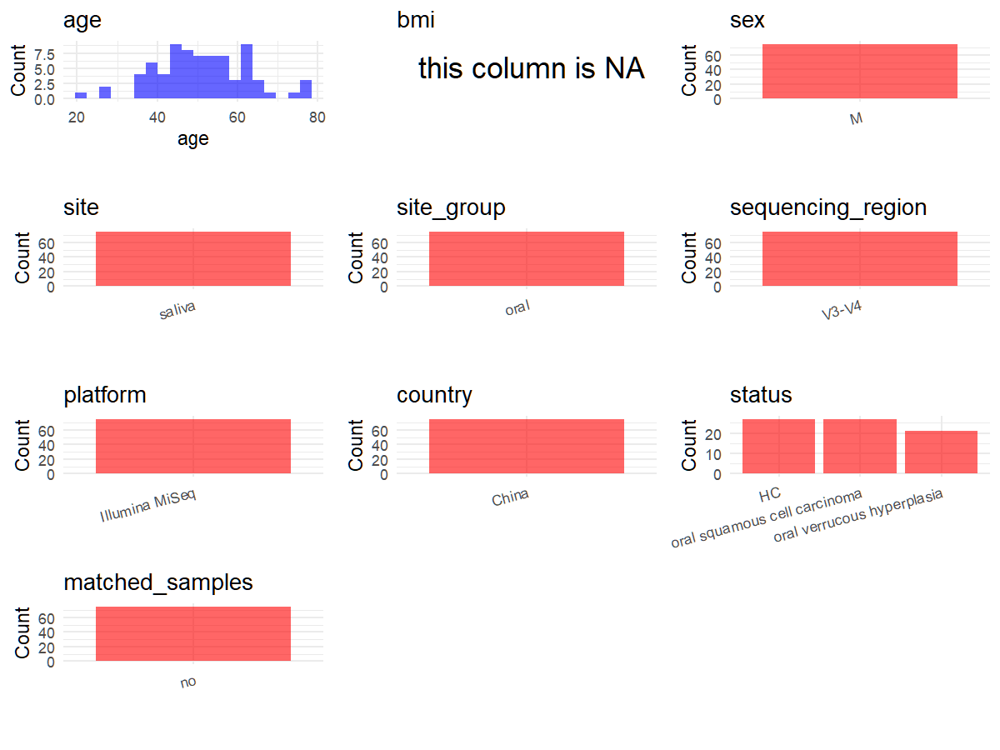

# Step 1: Obtain Initial Metadata from Each Project

This step sets the project directory and loads the raw SRA metadata.

```{r message=FALSE, warning=FALSE}
# Load libraries
library(dplyr)
library(ggplot2)
library(cowplot)

# (1) Setting working directory
project_id <- "PRJEB39064"

base_dir <- "E:/工作区/VSCode/RNAproject/collect_metadata_respon/project"
setwd(file.path(base_dir, project_id))

# (2) Loading raw SRA metadata file
sra_file <- "SraRunTable.csv"
initial_meta <- read.csv(sra_file, header = TRUE, stringsAsFactors = FALSE)
```

# Step 2: Data Overview

First, you need to get an overview of the data, which includes two steps: reading the article and reading the initial metadata. This step is very IMPORTANT!

```{r message=FALSE, warning=FALSE}
# (1) Read the article in the following order: abstract, the beginning of the results section, and the methods.
# Paper summary used for this project:
# - Title: Taxonomic and Functional Dysregulation in Salivary Microbiomes During Oral Carcinogenesis
# - Study design: cross-sectional comparison of healthy, OVH, and OSCC cohorts
# - Sample size from Results: 75 male participants total; normal 27, OVH 21, OSCC 27
# - Site from Methods: standardized saliva collection after >=1 hour without food, drink, or oral hygiene products; participants rinsed with water, waited 5 minutes, and provided 5 mL saliva without coughing sputum
# - Sample handling from Methods: saliva was centrifuged at 2,600 x g at 4 C for 15 min, then processed and frozen within 30 minutes
# - Sequencing from Methods: barcoded 341F/806R primers targeting V3-V4; Illumina MiSeq v3 chemistry (2 x 300 bp)
# - Cohort detail from Results: OVH cohort had >8-year follow-up without recurrence; OSCC cohort had primary OVH followed by OSCC development within eight years
# - Supplementary lead from Results: Table S2 contains participant metadata comparisons (age and lifestyle factors), so it should be collected if the project needs group-level covariates beyond SRA
# - Data availability from paper: ENA accession PRJEB39064 is named explicitly; the article also names a GitHub repository, but it is not currently accessible here and should not be relied on as a required source
# - Country is set to China following the SRA geography field for this project, despite the Taiwanese recruitment site described in the paper

# (2) IMPORTANT: MUST go through each column of initial_meta
# head(initial_meta, 10)
# colnames(initial_meta)
# table(initial_meta$host_disease_status)
# table(initial_meta$host_sex)
# table(initial_meta$environment_material)
# table(initial_meta$geo_loc_name_country)
# table(initial_meta$Sample_name)
# host_disease_status counts H/OVH/OSCC are 27/21/27,
# matching the normal/OVH/OSCC cohort counts reported in the paper.
```

# Step 3: Removing Control and Non-human Samples

First, we need to remove control samples(including both negative controls and positive controls) and non-human samples.

```{r}
# (1) Parameter setup
control_column <- ""
control_keywords <- c()

species_column <- "Organism"
unique(initial_meta[[species_column]])
non_human_keywords <- c()

# (2) Remove controls and non-human samples. DO NOT need to modify code in this part, just run it.
n_samples <- nrow(initial_meta)
# Control evaluation
if (length(control_keywords) > 0) {
  if (is.null(control_column) || control_column == "") {
    stop("Error: control_keywords provided but control_column is missing.")
  }

  if (!(control_column %in% colnames(initial_meta))) {
    stop(sprintf("Error: Column '%s' not found in initial_meta.", control_column))
  }

  control_pattern <- paste(control_keywords, collapse = "|")
  control_text <- initial_meta[[control_column]]
  is_control <- grepl(control_pattern, control_text)

} else {
  is_control <- rep(FALSE, n_samples)
}

# Non-human evaluation
if (length(non_human_keywords) > 0) {
  if (is.null(species_column) || species_column == "") {
    stop("Error: non_human_keywords provided but species_column is missing.")
  }

  if (!(species_column %in% colnames(initial_meta))) {
    stop(sprintf("Error: Column '%s' not found in initial_meta.", species_column))
  }

  non_human_pattern <- paste(non_human_keywords, collapse = "|")
  species_text <- initial_meta[[species_column]]
  is_non_human <- grepl(non_human_pattern, species_text)
} else {
  is_non_human <- rep(FALSE, n_samples)
}

# Execute removal
samples_to_remove <- is_control | is_non_human
initial_meta <- initial_meta[!samples_to_remove, ]

cat("Initial samples counts:", n_samples, "\n")
cat("Removed control samples:", sum(is_control), "\n")
cat("Removed non-human samples:", sum(is_non_human), "\n")
cat("Total samples removed ", sum(samples_to_remove), "\n")
cat("Remaining samples after Step 2:", nrow(initial_meta), "\n")
```

# Step 4: Creating a Uniform Metadata Template

This step converts the raw SRA table into the standard metadata format used in our meta-analysis.

```{r}
metadata <- data.frame(
  bioproject = initial_meta$BioProject,
  sample_id = initial_meta$Run,
  subject_id = initial_meta$Sample_name,
  age = as.numeric(initial_meta$Host_Age),
  age_info = NA_character_,
  bmi = NA_real_,
  raw_sex = initial_meta$host_sex,
  sex = "pending",
  sequencing_region = "V3-V4",
  platform = "Illumina MiSeq",
  country = "China",
  site = "saliva",
  site_group = "pending",
  public_time = initial_meta$ReleaseDate,
  pcr_primers = "341F-806R",
  title = "Taxonomic and Functional Dysregulation in Salivary Microbiomes During Oral Carcinogenesis",
  disease_study = "yes",
  raw_status = initial_meta$host_disease_status,
  status = "pending",
  matched_samples = "pending",
  is_time_series = "no",
  stringsAsFactors = FALSE
)

# Source notes for non-obvious fields:
# - subject_id uses Sample_name because the table has 75 unique submitted sample names and one saliva sample per participant.
# - age comes from Host_Age, so age_info remains NA unless a future supplement review needs group-level summaries from Table S2.
# - sex is converted from host_sex to M/F format in Step 5.
# - site is fixed as saliva from the explicit collection protocol in Materials and Methods, not from a broad oral-site assumption.
# - sequencing_region, platform, and pcr_primers come from Materials and Methods, not from SRA fields.
# - the accessible paper text gives the primer pair as 341F/806R; if the project later requires exact primer sequences, recover them from the cited prior protocol or supplementary material.
# - country follows the SRA field and is set to China for consistency with the deposited metadata, even though the paper describes recruitment in Taiwan.
# - status is derived from host_disease_status after matching the 27/21/27 cohort counts and the cohort definitions in the paper.
# - Supplementary Table S2 is the first place to check if BMI or additional lifestyle covariates need to be added later; use the article supplement rather than relying on the unavailable GitHub repository.
metadata$public_time <- as.Date(metadata$public_time)
```

# Step 5: Manually solving pending issues

This step involves two parts: (1) handle the columns with the `raw_` prefix, and next (2) handle the `site_group` and `matched_samples` columns.

```{r}
# (1) Handle the columns with the `raw_` prefix.
metadata <- metadata %>%
  mutate(
    sex = case_when(
      raw_sex == "male" ~ "M",
      raw_sex == "female" ~ "F",
      TRUE ~ NA_character_
    ),
    status = case_when(
      raw_status == "H" ~ "HC",
      raw_status == "OVH" ~ "oral verrucous hyperplasia",
      raw_status == "OSCC" ~ "oral squamous cell carcinoma",
      TRUE ~ NA_character_
    )
  )
# host_disease_status counts H/OVH/OSCC are 27/21/27,
# matching the normal/OVH/OSCC cohort counts reported in the paper.
```

```{r}
# (2) Filling the 'site_group' and 'matched_samples' columns
unique(metadata$site)
Oral_site = c("saliva")
Gut_site = c("feces")

metadata <- metadata %>%
  mutate(site_group = case_when(
    site %in% Oral_site ~ "oral",
    site %in% Gut_site ~ "gut",
    TRUE ~ "other"
  ))

metadata$matched_samples <- ifelse(
  ave(metadata$subject_id, metadata$subject_id, FUN = length) > 1,
  "yes",
  "no"
)
# The study uses one saliva sample per participant, so matched_samples resolves to "no".
```

```{r}
# (3) check if there is pending value in metadata. If there is pending value, go on modify the metadata.
has_pending <- function(col) {
  if (is.character(col) || is.factor(col)) {
    any(col == "pending", na.rm = TRUE)
  } else {
    FALSE
  }
}

any_pending_value <- any(sapply(metadata, has_pending))

if (!any_pending_value) {
  message("Good! No cell contains the value 'pending'.")
} else {
  pending_cols <- names(metadata)[sapply(metadata, has_pending)]
  message("Columns containing 'pending': ", paste(pending_cols, collapse = ", "))
  message("Please continue to resolve these pending columns!")
}
```

# Step 6: Visualize the Metadata

This step makes a quick set of plots for checking the distribution of key metadata fields.

```{r}
plot_data <- metadata %>%
  select(-bioproject, -sample_id, -subject_id, -title)

create_simple_plots <- function(data) {
  plots <- list()
  continuous_vars <- c("age", "bmi")

  for (col in colnames(data)) {
    if (all(is.na(data[[col]]))) {
      p <- ggplot() +
        annotate("text", x = 0.5, y = 0.5, label = "this column is NA", size = 6) +
        labs(title = col) +
        theme_void()
    } else if (col %in% continuous_vars && is.numeric(data[[col]])) {
      p <- ggplot(data, aes(x = .data[[col]])) +
        geom_histogram(fill = "blue", alpha = 0.6, bins = 20, na.rm = TRUE) +
        labs(title = col, x = col, y = "Count") +
        theme_minimal()
    } else {
      count_data <- as.data.frame(table(data[[col]], useNA = "ifany"))
      p <- ggplot(count_data, aes(x = reorder(Var1, -Freq), y = Freq)) +
        geom_col(fill = "red", alpha = 0.6) +
        labs(title = col, x = NULL, y = "Count") +
        theme_minimal() +
        theme(axis.text.x = element_text(angle = 15, hjust = 1))
    }
    plots[[col]] <- p
  }

  return(plots)
}

plots <- create_simple_plots(plot_data)
p <- plot_grid(plots$age,
               plots$bmi,
               plots$sex,
               plots$site,
               plots$site_group,
               plots$sequencing_region,
               plots$platform,
               plots$country,
               plots$status,
               plots$matched_samples,
               ncol = 3, align = "hv", axis = "lb")
ggsave("Metadata_Summary.png", plot = p, width = 8, height = 6, dpi = 150)
```

```{r}

```

# Step 7: Sort and export the metadata

This step saves the cleaned metadata table as the final `metadata_v2.csv` file.

```{r}
fixed_cols <- c("bioproject", "sample_id", "subject_id", "age", "age_info",
                "bmi", "sex", "platform", "sequencing_region", "pcr_primers",
                "country", "site", "site_group", "disease_study", "status",
                "title", "public_time", "matched_samples", "is_time_series")
metadata <- metadata %>%
  select(all_of(fixed_cols), starts_with("raw_"))

write.csv(metadata, file = "metadata_v2.csv", quote = TRUE, row.names = FALSE)
```