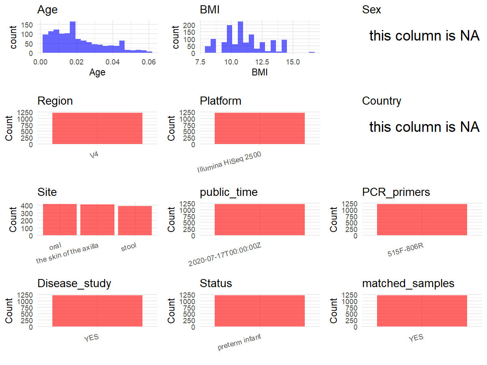

R Notebook: Metadata Processing Workflow
================

# Step 1: Obtain Initial Metadata from Each Project

To obtain the initial metadata: 1. Search for the BioProject ID (e.g.,
“PRJEBXXXX”) on the [NCBI SRA
website](https://www.ncbi.nlm.nih.gov/Traces/study/). 2. In the “Select”
table, click on “Metadata” and download the file. 3. The downloaded file
is typically named “SraRunTable.csv” and contains metadata for the
project.

``` r
# Load necessary libraries
library(dplyr)
library(ggplot2)
library(cowplot)

# Set working directory (update this path to your local directory)
setwd("D:/metadata/PRJEB39420")

# Read the initial metadata files
initial_meta<-read.csv("SraRunTable.csv",header = T)

# Combine the two metadata files
#meta <- rbind(initial_meta, initial_meta1)

#Remove entries non-oral samples
initial_meta <- subset(initial_meta, Organism != "metagenome")

# Check the number of samples containing "HT" in Sample.Name (e.g., healthy controls)
#nrow(subset(meta, grepl("HT", Sample.Name)))

# Display the first few rows of the metadata
head(initial_meta)
```

    ##            Run Assay.Type Barcode..exp. BioProject    BioSample
    ## 165 ERR4345235      OTHER  AAGAACTCATGA PRJEB39420 SAMEA7062963
    ## 166 ERR4345236      OTHER  TTGCTGGACGCT PRJEB39420 SAMEA7062964
    ## 167 ERR4345237      OTHER  TACCGAAGGTAT PRJEB39420 SAMEA7062965
    ## 168 ERR4345238      OTHER  ACGCTTAACGAC PRJEB39420 SAMEA7062966
    ## 169 ERR4345239      OTHER  AGCCCTGCTACA PRJEB39420 SAMEA7062967
    ## 170 ERR4345240      OTHER  GTTGATACGATG PRJEB39420 SAMEA7062968
    ##     center_name..exp.                                        Center.Name
    ## 165            UCSDMI UNIVERSITY OF CALIFORNIA SAN DIEGO MICROBIOME INIT
    ## 166            UCSDMI UNIVERSITY OF CALIFORNIA SAN DIEGO MICROBIOME INIT
    ## 167            UCSDMI UNIVERSITY OF CALIFORNIA SAN DIEGO MICROBIOME INIT
    ## 168            UCSDMI UNIVERSITY OF CALIFORNIA SAN DIEGO MICROBIOME INIT
    ## 169            UCSDMI UNIVERSITY OF CALIFORNIA SAN DIEGO MICROBIOME INIT
    ## 170            UCSDMI UNIVERSITY OF CALIFORNIA SAN DIEGO MICROBIOME INIT
    ##     center_project_name..exp. Consent ENA_FIRST_PUBLIC     ENA_first_public
    ## 165                Megan_Doty  public        2020/7/16 2020-07-16T17:05:32Z
    ## 166                Megan_Doty  public        2020/7/16 2020-07-16T17:05:32Z
    ## 167                Megan_Doty  public        2020/7/16 2020-07-16T17:05:32Z
    ## 168                Megan_Doty  public        2020/7/16 2020-07-16T17:05:32Z
    ## 169                Megan_Doty  public        2020/7/16 2020-07-16T17:05:32Z
    ## 170                Megan_Doty  public        2020/7/16 2020-07-16T17:05:32Z
    ##     ENA.LAST.UPDATE..run.      ENA_last_update Experiment  external_id
    ## 165             2020/7/16 2020-07-16T09:42:11Z ERX4289899 SAMEA7062963
    ## 166             2020/7/16 2020-07-16T09:42:11Z ERX4289900 SAMEA7062964
    ## 167             2020/7/16 2020-07-16T09:42:11Z ERX4289901 SAMEA7062965
    ## 168             2020/7/16 2020-07-16T09:42:11Z ERX4289902 SAMEA7062966
    ## 169             2020/7/16 2020-07-16T09:42:11Z ERX4289903 SAMEA7062967
    ## 170             2020/7/16 2020-07-16T09:42:11Z ERX4289904 SAMEA7062968
    ##     extraction_robot..exp. extractionkit_lot..exp. host_subject_id
    ## 165               HOWE_KF3               154050095         11712-1
    ## 166               HOWE_KF3               154050095         11712-1
    ## 167               HOWE_KF3               154050095         11712-1
    ## 168               HOWE_KF3               154050095         11712-1
    ## 169               HOWE_KF3               154050095         11712-1
    ## 170               HOWE_KF3               154050095         11712-1
    ##     INSDC_center_name   INSDC_first_public    INSDC_last_update INSDC_status
    ## 165            UCSDMI 2020-07-16T17:05:32Z 2020-07-16T09:42:11Z       public
    ## 166            UCSDMI 2020-07-16T17:05:32Z 2020-07-16T09:42:11Z       public
    ## 167            UCSDMI 2020-07-16T17:05:32Z 2020-07-16T09:42:11Z       public
    ## 168            UCSDMI 2020-07-16T17:05:32Z 2020-07-16T09:42:11Z       public
    ## 169            UCSDMI 2020-07-16T17:05:32Z 2020-07-16T09:42:11Z       public
    ## 170            UCSDMI 2020-07-16T17:05:32Z 2020-07-16T09:42:11Z       public
    ##              Instrument lane..exp.           Library.Name LibraryLayout
    ## 165 Illumina HiSeq 2500          1  11712.SUBJECT1.ORAL.1        SINGLE
    ## 166 Illumina HiSeq 2500          1 11712.SUBJECT1.ORAL.10        SINGLE
    ## 167 Illumina HiSeq 2500          1  11712.SUBJECT1.ORAL.2        SINGLE
    ## 168 Illumina HiSeq 2500          1  11712.SUBJECT1.ORAL.3        SINGLE
    ## 169 Illumina HiSeq 2500          1  11712.SUBJECT1.ORAL.4        SINGLE
    ## 170 Illumina HiSeq 2500          1  11712.SUBJECT1.ORAL.5        SINGLE
    ##     LibrarySelection LibrarySource mastermix_lot..exp.              Organism
    ## 165              PCR   METAGENOMIC              443912 human oral metagenome
    ## 166              PCR   METAGENOMIC              443912 human oral metagenome
    ## 167              PCR   METAGENOMIC              443912 human oral metagenome
    ## 168              PCR   METAGENOMIC              443912 human oral metagenome
    ## 169              PCR   METAGENOMIC              443912 human oral metagenome
    ## 170              PCR   METAGENOMIC              443912 human oral metagenome
    ##      orig_name..exp.                                 pcr_primers..exp. Platform
    ## 165  SUBJECT1.ORAL.1 FWD:GTGYCAGCMGCCGCGGTAA; REV:GGACTACNVGGGTWTCTAAT ILLUMINA
    ## 166 SUBJECT1.ORAL.10 FWD:GTGYCAGCMGCCGCGGTAA; REV:GGACTACNVGGGTWTCTAAT ILLUMINA
    ## 167  SUBJECT1.ORAL.2 FWD:GTGYCAGCMGCCGCGGTAA; REV:GGACTACNVGGGTWTCTAAT ILLUMINA
    ## 168  SUBJECT1.ORAL.3 FWD:GTGYCAGCMGCCGCGGTAA; REV:GGACTACNVGGGTWTCTAAT ILLUMINA
    ## 169  SUBJECT1.ORAL.4 FWD:GTGYCAGCMGCCGCGGTAA; REV:GGACTACNVGGGTWTCTAAT ILLUMINA
    ## 170  SUBJECT1.ORAL.5 FWD:GTGYCAGCMGCCGCGGTAA; REV:GGACTACNVGGGTWTCTAAT ILLUMINA
    ##     plating..exp. primer_date..exp.          primer..exp. primer_plate..exp.
    ## 165           LDG           1/19/17 GTGTGYCAGCMGCCGCGGTAA                  1
    ## 166           LDG           1/19/17 GTGTGYCAGCMGCCGCGGTAA                  1
    ## 167           LDG           1/19/17 GTGTGYCAGCMGCCGCGGTAA                  1
    ## 168           LDG           1/19/17 GTGTGYCAGCMGCCGCGGTAA                  1
    ## 169           LDG           1/19/17 GTGTGYCAGCMGCCGCGGTAA                  1
    ## 170           LDG           1/19/17 GTGTGYCAGCMGCCGCGGTAA                  1
    ##     processing_robot..exp. project_name..exp.          ReleaseDate
    ## 165                   RIKE         Megan_Doty 2020-07-17T00:00:00Z
    ## 166                   RIKE         Megan_Doty 2020-07-17T00:00:00Z
    ## 167                   RIKE         Megan_Doty 2020-07-17T00:00:00Z
    ## 168                   RIKE         Megan_Doty 2020-07-17T00:00:00Z
    ## 169                   RIKE         Megan_Doty 2020-07-17T00:00:00Z
    ## 170                   RIKE         Megan_Doty 2020-07-17T00:00:00Z
    ##     run_date..exp.     run_prefix..exp.                          runid..exp.
    ## 165      2003/7/17 Megan_Doty_1_S1_L001 170307_D00611_0447_BHFFTFBCXY_Knight
    ## 166      2003/7/17 Megan_Doty_1_S1_L001 170307_D00611_0447_BHFFTFBCXY_Knight
    ## 167      2003/7/17 Megan_Doty_1_S1_L001 170307_D00611_0447_BHFFTFBCXY_Knight
    ## 168      2003/7/17 Megan_Doty_1_S1_L001 170307_D00611_0447_BHFFTFBCXY_Knight
    ## 169      2003/7/17 Megan_Doty_1_S1_L001 170307_D00611_0447_BHFFTFBCXY_Knight
    ## 170      2003/7/17 Megan_Doty_1_S1_L001 170307_D00611_0447_BHFFTFBCXY_Knight
    ##      Sample.Name                            Sample_name sample_plate..exp.
    ## 165 SAMEA7062963  qiita_sid_11712:11712.SUBJECT1.ORAL.1       Megan_Doty_1
    ## 166 SAMEA7062964 qiita_sid_11712:11712.SUBJECT1.ORAL.10       Megan_Doty_1
    ## 167 SAMEA7062965  qiita_sid_11712:11712.SUBJECT1.ORAL.2       Megan_Doty_1
    ## 168 SAMEA7062966  qiita_sid_11712:11712.SUBJECT1.ORAL.3       Megan_Doty_1
    ## 169 SAMEA7062967  qiita_sid_11712:11712.SUBJECT1.ORAL.4       Megan_Doty_1
    ## 170 SAMEA7062968  qiita_sid_11712:11712.SUBJECT1.ORAL.5       Megan_Doty_1
    ##           Scientific_Name   sequencing_meth..exp. SRA.Study
    ## 165 human oral metagenome Sequencing by synthesis ERP122936
    ## 166 human oral metagenome Sequencing by synthesis ERP122936
    ## 167 human oral metagenome Sequencing by synthesis ERP122936
    ## 168 human oral metagenome Sequencing by synthesis ERP122936
    ## 169 human oral metagenome Sequencing by synthesis ERP122936
    ## 170 human oral metagenome Sequencing by synthesis ERP122936
    ##                               Submitter_Id target_gene..exp. target_subfragment
    ## 165  qiita_sid_11712:11712.SUBJECT1.ORAL.1          16S rRNA                 V4
    ## 166 qiita_sid_11712:11712.SUBJECT1.ORAL.10          16S rRNA                 V4
    ## 167  qiita_sid_11712:11712.SUBJECT1.ORAL.2          16S rRNA                 V4
    ## 168  qiita_sid_11712:11712.SUBJECT1.ORAL.3          16S rRNA                 V4
    ## 169  qiita_sid_11712:11712.SUBJECT1.ORAL.4          16S rRNA                 V4
    ## 170  qiita_sid_11712:11712.SUBJECT1.ORAL.5          16S rRNA                 V4
    ##     tm1000_8_tool..exp. tm300_8_tool..exp. tm50_8_tool..exp. water_lot..exp.
    ## 165             108379Z            311318B           311426B         1798402
    ## 166             108379Z            311318B           311426B         1798402
    ## 167             108379Z            311318B           311426B         1798402
    ## 168             108379Z            311318B           311426B         1798402
    ## 169             108379Z            311318B           311426B         1798402
    ## 170             108379Z            311318B           311426B         1798402
    ##     AvgSpotLen    Bases    Bytes DATASTORE.filetype DATASTORE.provider
    ## 165        149   538891   309579         run.zq,sra         gs,ncbi,s3
    ## 166        149 31959095 13301069         run.zq,sra         gs,ncbi,s3
    ## 167        149 10957442  6196498         run.zq,sra         gs,ncbi,s3
    ## 168        149 23639547  8834720         run.zq,sra         gs,ncbi,s3
    ## 169        149 33551220 13579814         run.zq,sra         gs,ncbi,s3
    ## 170        149 41877507 17052129         run.zq,sra         gs,ncbi,s3
    ##                         DATASTORE.region          create_date version
    ## 165 gs.us-east1,ncbi.public,s3.us-east-1 2020-07-19T19:56:00Z       1
    ## 166 gs.us-east1,ncbi.public,s3.us-east-1 2020-07-19T19:59:00Z       1
    ## 167 gs.us-east1,ncbi.public,s3.us-east-1 2020-07-31T15:46:00Z       1
    ## 168 gs.us-east1,ncbi.public,s3.us-east-1 2020-07-19T20:01:00Z       1
    ## 169 gs.us-east1,ncbi.public,s3.us-east-1 2020-07-31T15:46:00Z       1
    ## 170 gs.us-east1,ncbi.public,s3.us-east-1 2020-07-31T15:46:00Z       1
    ##     birth_length birth_weight Collection_time dc_wt dhm_wk1 formula_wk1
    ## 165           50         2990         8:11:00  2962       0    50.45389
    ## 166           50         2990         6:00:00  2962       0    50.45389
    ## 167           50         2990   not collected  2962       0    50.45389
    ## 168           50         2990   not collected  2962       0    50.45389
    ## 169           50         2990   not collected  2962       0    50.45389
    ## 170           50         2990   not collected  2962       0    50.45389
    ##     Host_age host_body_mass_index hr_1stfeed maternal_age     mbm_wk1
    ## 165        2                11.96         22           34 11.56235069
    ## 166       11                11.96         22           34 11.56235069
    ## 167        3                11.96         22           34 11.56235069
    ## 168        4                11.96         22           34 11.56235069
    ## 169        5                11.96         22           34 11.56235069
    ## 170        6                11.96         22           34 11.56235069
    ##     ml_dhm_wk1 ml_formula_wk1 ml_mbm_wk1 nadir_wt pct_bw_lost pct_dc_wt_abovebw
    ## 165          0           1056        242     2873    3.913043        -0.9364548
    ## 166          0           1056        242     2873    3.913043        -0.9364548
    ## 167          0           1056        242     2873    3.913043        -0.9364548
    ## 168          0           1056        242     2873    3.913043        -0.9364548
    ## 169          0           1056        242     2873    3.913043        -0.9364548
    ## 170          0           1056        242     2873    3.913043        -0.9364548
    ##     time_only_bm hm_only_wk1 pct_formula_wk1 LOS ms_plate_num dol_1stformula
    ## 165            1    11.56235        81.35593  11           14              2
    ## 166            1    11.56235        81.35593  11           14              2
    ## 167            1    11.56235        81.35593  11           14              2
    ## 168            1    11.56235        81.35593  11           14              2
    ## 169            1    11.56235        81.35593  11           14              2
    ## 170            1    11.56235        81.35593  11           14              2
    ##     avg_hero_score high_hero_score
    ## 165           0.34            1.45
    ## 166           0.34            1.45
    ## 167           0.34            1.45
    ## 168           0.34            1.45
    ## 169           0.34            1.45
    ## 170           0.34            1.45

# Step 2: Create a Uniform Metadata Template

The uniform metadata should include the following columns:

1.  **BioProject**: Project ID (e.g., “PRJNA339212”)
2.  **Run**: Sample ID (e.g., “ERRXXXXXX” or “SRRXXXXXX”)
3.  **sample_name**: Original sample name submitted by the authors (not
    the database-assigned ID)
4.  **Age**: Age of the subject (if available)
5.  **BMI**: Body Mass Index (if available)
6.  **Sex**: Sex of the subject (“F” or “M”)
7.  **Region**: Targeted 16S rRNA region (e.g., “V3-V4”)
8.  **Platform**: Sequencing platform (e.g., “Illumina MiSeq”)
9.  **Country**: Country of sample origin (e.g., “China”)
10. **Site**: Sample site (e.g., “saliva”, “dental plaque”)
11. **public_time**: Data release date (format: “YYYY-MM-DD”)
12. **PCR_primers**: PCR primers used (e.g., “515F-806R”)
13. **title**: Title of the associated publication
14. **Disease_study**: Whether the study involves a disease (“YES” or
    “NO”)
15. **Status**: Disease status (e.g., “T2DM”, “HC”). Note: If the study
    includes both disease and healthy samples, this must be specified
    per sample.
16. **matched_samples**: matched samples (“YES” or “NO”)

``` r
# Create a uniform metadata dataframe
metadata <- data.frame(
  BioProject = initial_meta$BioProject,
  Run = initial_meta$Run,
  sample_name = initial_meta$Sample.Name,
  Age = initial_meta$Host_age / 365,
  BMI = initial_meta$host_body_mass_index,
  Sex=NA,
  Region = "V4",
  Platform = initial_meta$Instrument,
  Country = NA,
  #Site = initial_meta$Organism,
  public_time = initial_meta$ReleaseDate,
  stringsAsFactors = FALSE
)
```

# Step 3: Manually Add Information from the Publication

Some information (e.g. PCR primers, study title, disease status) must be
manually extracted from the publication and added to the metadata.

``` r
# Add information obtained from the publication
metadata$PCR_primers <- "515F-806R"
metadata$title <- "Multiomic Analyses of Nascent Preterm Infant Microbiomes Differentiation Suggest Opportunities for Targeted Intervention"
metadata$Disease_study <- "YES"
# Assign disease status based on sample_name patterns
metadata$Status<-"preterm infant"
metadata <- metadata %>%
  mutate(Site = case_when(
    initial_meta$Organism == "human oral metagenome" ~ "oral",
    initial_meta$Organism == "human gut metagenome" ~ "stool",
    initial_meta$Organism == "human skin metagenome" ~ "the skin of the axilla",
  ))
fields <- c("Age", "BMI")

stopifnot(all(fields %in% colnames(metadata)))


has_duplicate <- metadata %>% 
  select(all_of(fields)) %>% 
  na.omit() %>%                
  duplicated() %>%             
  any()                        

metadata <- metadata %>% 
  mutate(matched_samples = if (has_duplicate) "YES" else "NO")

output_df <- metadata %>% 
  filter(matched_samples == "YES" | 
        (matched_samples == "NO" & Site == "oral"))

cat("Total rows in output_df :", nrow(output_df), "\n")
```

    ## Total rows in output_df : 1221

``` r
cat("YES rows                :", sum(output_df$matched_samples == "YES"), "\n")
```

    ## YES rows                : 1221

``` r
cat("NO          :", sum(output_df$matched_samples == "NO"), "\n")
```

    ## NO          : 0

# Step 4: Summarize and Validate the Metadata

``` r
# Check the number of unique runs and sample names
print(paste("Number of unique runs:", length(unique(metadata$Run))))
```

    ## [1] "Number of unique runs: 1221"

``` r
print(paste("Number of unique sample names:", length(unique(metadata$sample_name))))
```

    ## [1] "Number of unique sample names: 1221"

# Step 5: Visualize the Metadata

``` r

```

<!-- -->

# Step 6: Finalize and Export the Metadata

``` r
# Reorder columns to match the desired format
metadata <- metadata[, c(
  "BioProject", "Run", "sample_name", "Age", "BMI", "Sex", 
  "Region", "Platform", "Country", "Site", "public_time", 
  "PCR_primers", "title", "Disease_study", "Status","matched_samples"
)]

# Export the uniform metadata to a CSV file
write.csv(metadata, file = "metadata.csv", quote = TRUE)
head(metadata)
```

    ##   BioProject        Run  sample_name         Age   BMI Sex Region
    ## 1 PRJEB39420 ERR4345235 SAMEA7062963 0.005479452 11.96  NA     V4
    ## 2 PRJEB39420 ERR4345236 SAMEA7062964 0.030136986 11.96  NA     V4
    ## 3 PRJEB39420 ERR4345237 SAMEA7062965 0.008219178 11.96  NA     V4
    ## 4 PRJEB39420 ERR4345238 SAMEA7062966 0.010958904 11.96  NA     V4
    ## 5 PRJEB39420 ERR4345239 SAMEA7062967 0.013698630 11.96  NA     V4
    ## 6 PRJEB39420 ERR4345240 SAMEA7062968 0.016438356 11.96  NA     V4
    ##              Platform Country Site          public_time PCR_primers
    ## 1 Illumina HiSeq 2500      NA oral 2020-07-17T00:00:00Z   515F-806R
    ## 2 Illumina HiSeq 2500      NA oral 2020-07-17T00:00:00Z   515F-806R
    ## 3 Illumina HiSeq 2500      NA oral 2020-07-17T00:00:00Z   515F-806R
    ## 4 Illumina HiSeq 2500      NA oral 2020-07-17T00:00:00Z   515F-806R
    ## 5 Illumina HiSeq 2500      NA oral 2020-07-17T00:00:00Z   515F-806R
    ## 6 Illumina HiSeq 2500      NA oral 2020-07-17T00:00:00Z   515F-806R
    ##                                                                                                                      title
    ## 1 Multiomic Analyses of Nascent Preterm Infant Microbiomes Differentiation Suggest Opportunities for Targeted Intervention
    ## 2 Multiomic Analyses of Nascent Preterm Infant Microbiomes Differentiation Suggest Opportunities for Targeted Intervention
    ## 3 Multiomic Analyses of Nascent Preterm Infant Microbiomes Differentiation Suggest Opportunities for Targeted Intervention
    ## 4 Multiomic Analyses of Nascent Preterm Infant Microbiomes Differentiation Suggest Opportunities for Targeted Intervention
    ## 5 Multiomic Analyses of Nascent Preterm Infant Microbiomes Differentiation Suggest Opportunities for Targeted Intervention
    ## 6 Multiomic Analyses of Nascent Preterm Infant Microbiomes Differentiation Suggest Opportunities for Targeted Intervention
    ##   Disease_study         Status matched_samples
    ## 1           YES preterm infant             YES
    ## 2           YES preterm infant             YES
    ## 3           YES preterm infant             YES
    ## 4           YES preterm infant             YES
    ## 5           YES preterm infant             YES
    ## 6           YES preterm infant             YES

## Notes for Students:

1.  **Metadata Accuracy**: Always cross-check the metadata with the
    original publication to ensure accuracy.
2.  **Manual Entries**: Columns like `PCR_primers`, and `Status` often
    require manual entry based on the publication.
3.  **Disease Status**: Be careful when assigning `Status`—some studies
    include both disease and healthy samples.
4.  **Visualization**: The plots help quickly identify the distribution
    of values in each column, which is useful for quality control.
5.  **Reproducibility**: Update the working directory and file paths to
    match your local environment.
