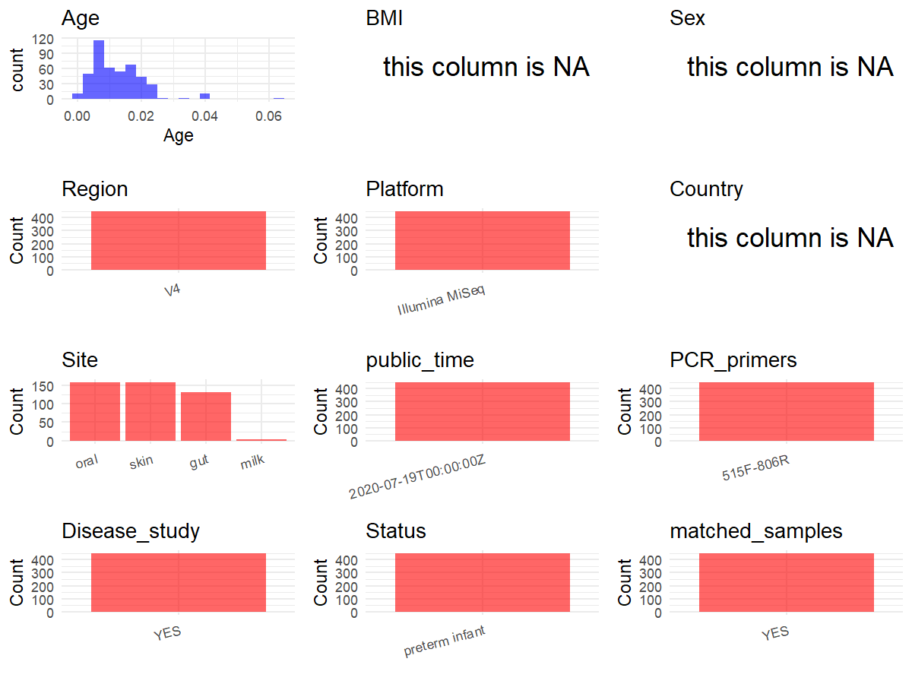

R Notebook: Metadata Processing Workflow
================

# Step 1: Obtain Initial Metadata from Each Project

To obtain the initial metadata: 1. Search for the BioProject ID (e.g.,
“PRJEBXXXX”) on the [NCBI SRA
website](https://www.ncbi.nlm.nih.gov/Traces/study/). 2. In the “Select”
table, click on “Metadata” and download the file. 3. The downloaded file
is typically named “SraRunTable.csv” and contains metadata for the
project.

``` r
# Load necessary libraries
library(dplyr)
library(ggplot2)
library(cowplot)

# Set working directory (update this path to your local directory)
setwd("D:/metadata/PRJEB39436")

# Read the initial metadata files
initial_meta<-read.csv("SraRunTable.csv",header = T)

# Combine the two metadata files
#meta <- rbind(initial_meta, initial_meta1)

#Remove entries non-oral samples
initial_meta <- subset(initial_meta, Organism != "metagenome")

# Check the number of samples containing "HT" in Sample.Name (e.g., healthy controls)
#nrow(subset(meta, grepl("HT", Sample.Name)))

# Display the first few rows of the metadata
head(initial_meta)
```

    ##          Run Assay.Type AvgSpotLen Barcode..exp.   Bases BioProject
    ## 1 ERR4350157      OTHER        150  CACAATACACCG   70650 PRJEB39436
    ## 2 ERR4350158      OTHER        150  AGGACGCCAGCA   69750 PRJEB39436
    ## 3 ERR4350159      OTHER        150  GAATGCGTATAA  387300 PRJEB39436
    ## 4 ERR4350160      OTHER        150  CTGGTGCTGAAT  383850 PRJEB39436
    ## 5 ERR4350161      OTHER        150  CACGTTTATTCC 2776350 PRJEB39436
    ## 6 ERR4350162      OTHER        150  AATTCACCTCCT 7255350 PRJEB39436
    ##      BioSample   Bytes center_name..exp.
    ## 1 SAMEA7065358   71873            UCSDMI
    ## 2 SAMEA7065359   71221            UCSDMI
    ## 3 SAMEA7065360  253014            UCSDMI
    ## 4 SAMEA7065361  269481            UCSDMI
    ## 5 SAMEA7065362 1816853            UCSDMI
    ## 6 SAMEA7065363 4013014            UCSDMI
    ##                                          Center.Name center_project_name..exp.
    ## 1 UNIVERSITY OF CALIFORNIA SAN DIEGO MICROBIOME INIT                 Stillwell
    ## 2 UNIVERSITY OF CALIFORNIA SAN DIEGO MICROBIOME INIT                 Stillwell
    ## 3 UNIVERSITY OF CALIFORNIA SAN DIEGO MICROBIOME INIT                 Stillwell
    ## 4 UNIVERSITY OF CALIFORNIA SAN DIEGO MICROBIOME INIT                 Stillwell
    ## 5 UNIVERSITY OF CALIFORNIA SAN DIEGO MICROBIOME INIT                 Stillwell
    ## 6 UNIVERSITY OF CALIFORNIA SAN DIEGO MICROBIOME INIT                 Stillwell
    ##   Consent DATASTORE.filetype DATASTORE.provider
    ## 1  public         run.zq,sra         gs,ncbi,s3
    ## 2  public         run.zq,sra         gs,ncbi,s3
    ## 3  public         run.zq,sra         gs,ncbi,s3
    ## 4  public         run.zq,sra         gs,ncbi,s3
    ## 5  public         run.zq,sra         gs,ncbi,s3
    ## 6  public         run.zq,sra         gs,ncbi,s3
    ##                       DATASTORE.region ENA_FIRST_PUBLIC     ENA_first_public
    ## 1 gs.us-east1,ncbi.public,s3.us-east-1        2020/7/18 2020-07-18T04:05:54Z
    ## 2 gs.us-east1,ncbi.public,s3.us-east-1        2020/7/18 2020-07-18T04:05:54Z
    ## 3 gs.us-east1,ncbi.public,s3.us-east-1        2020/7/18 2020-07-18T04:05:54Z
    ## 4 gs.us-east1,ncbi.public,s3.us-east-1        2020/7/18 2020-07-18T04:05:54Z
    ## 5 gs.us-east1,ncbi.public,s3.us-east-1        2020/7/18 2020-07-18T04:05:54Z
    ## 6 gs.us-east1,ncbi.public,s3.us-east-1        2020/7/18 2020-07-18T04:05:54Z
    ##   ENA.LAST.UPDATE..run.      ENA_last_update Experiment  external_id
    ## 1             2020/7/16 2020-07-16T21:03:28Z ERX4294809 SAMEA7065358
    ## 2             2020/7/16 2020-07-16T21:03:28Z ERX4294810 SAMEA7065359
    ## 3             2020/7/16 2020-07-16T21:03:28Z ERX4294811 SAMEA7065360
    ## 4             2020/7/16 2020-07-16T21:03:28Z ERX4294812 SAMEA7065361
    ## 5             2020/7/16 2020-07-16T21:03:28Z ERX4294813 SAMEA7065362
    ## 6             2020/7/16 2020-07-16T21:03:28Z ERX4294814 SAMEA7065363
    ##   extraction_robot..exp. extractionkit_lot..exp. host_subject_id
    ## 1               HOWE_KF2                 PM16F23         11713-1
    ## 2               HOWE_KF2                 PM16F23         11713-1
    ## 3               HOWE_KF2                 PM16F23         11713-1
    ## 4               HOWE_KF2                 PM16F23         11713-1
    ## 5               HOWE_KF1                 PM16F23         11713-1
    ## 6               HOWE_KF1                 PM16F23         11713-1
    ##   INSDC_center_name   INSDC_first_public    INSDC_last_update INSDC_status
    ## 1            UCSDMI 2020-07-18T04:05:54Z 2020-07-16T21:03:28Z       public
    ## 2            UCSDMI 2020-07-18T04:05:54Z 2020-07-16T21:03:28Z       public
    ## 3            UCSDMI 2020-07-18T04:05:54Z 2020-07-16T21:03:28Z       public
    ## 4            UCSDMI 2020-07-18T04:05:54Z 2020-07-16T21:03:28Z       public
    ## 5            UCSDMI 2020-07-18T04:05:54Z 2020-07-16T21:03:28Z       public
    ## 6            UCSDMI 2020-07-18T04:05:54Z 2020-07-16T21:03:28Z       public
    ##       Instrument Library.Name LibraryLayout LibrarySelection LibrarySource
    ## 1 Illumina MiSeq 11713.1.C.1A        SINGLE              PCR   METAGENOMIC
    ## 2 Illumina MiSeq 11713.1.C.1B        SINGLE              PCR   METAGENOMIC
    ## 3 Illumina MiSeq 11713.1.C.1C        SINGLE              PCR   METAGENOMIC
    ## 4 Illumina MiSeq 11713.1.F.1A        SINGLE              PCR   METAGENOMIC
    ## 5 Illumina MiSeq 11713.1.F.1B        SINGLE              PCR   METAGENOMIC
    ## 6 Illumina MiSeq 11713.1.F.1C        SINGLE              PCR   METAGENOMIC
    ##   mastermix_lot..exp.              Organism orig_name..exp. paltform..exp.
    ## 1              373139 human milk metagenome          1.C.1A       Illumina
    ## 2              373139 human milk metagenome          1.C.1B       Illumina
    ## 3              373139 human milk metagenome          1.C.1C       Illumina
    ## 4              373139  human gut metagenome          1.F.1A       Illumina
    ## 5              373139  human gut metagenome          1.F.1B       Illumina
    ## 6              373139  human gut metagenome          1.F.1C       Illumina
    ##                                   pcr_primers..exp. Platform plating..exp.
    ## 1 FWD:GTGYCAGCMGCCGCGGTAA; REV:GGACTACNVGGGTWTCTAAT ILLUMINA           LDG
    ## 2 FWD:GTGYCAGCMGCCGCGGTAA; REV:GGACTACNVGGGTWTCTAAT ILLUMINA           LDG
    ## 3 FWD:GTGYCAGCMGCCGCGGTAA; REV:GGACTACNVGGGTWTCTAAT ILLUMINA           LDG
    ## 4 FWD:GTGYCAGCMGCCGCGGTAA; REV:GGACTACNVGGGTWTCTAAT ILLUMINA           LDG
    ## 5 FWD:GTGYCAGCMGCCGCGGTAA; REV:GGACTACNVGGGTWTCTAAT ILLUMINA           LDG
    ## 6 FWD:GTGYCAGCMGCCGCGGTAA; REV:GGACTACNVGGGTWTCTAAT ILLUMINA           LDG
    ##   primer_date..exp.          primer..exp. primer_plate..exp.
    ## 1        2012/12/16 GTGTGYCAGCMGCCGCGGTAA                  6
    ## 2        2012/12/16 GTGTGYCAGCMGCCGCGGTAA                  6
    ## 3        2012/12/16 GTGTGYCAGCMGCCGCGGTAA                  6
    ## 4        2012/12/16 GTGTGYCAGCMGCCGCGGTAA                  5
    ## 5        2012/12/16 GTGTGYCAGCMGCCGCGGTAA                  1
    ## 6        2012/12/16 GTGTGYCAGCMGCCGCGGTAA                  1
    ##   processing_robot..exp. project_name..exp.          ReleaseDate run_date..exp.
    ## 1                   RIKE          Stillwell 2020-07-19T00:00:00Z      2002/8/17
    ## 2                   RIKE          Stillwell 2020-07-19T00:00:00Z      2002/8/17
    ## 3                   RIKE          Stillwell 2020-07-19T00:00:00Z      2002/8/17
    ## 4                   RIKE          Stillwell 2020-07-19T00:00:00Z      2002/8/17
    ## 5                   JERE          Stillwell 2020-07-19T00:00:00Z      2002/8/17
    ## 6                   JERE          Stillwell 2020-07-19T00:00:00Z      2002/8/17
    ##            create_date version  run_prefix..exp.
    ## 1 2020-07-20T14:57:00Z       1 Stillwell_S1_L001
    ## 2 2020-07-20T14:58:00Z       1 Stillwell_S1_L001
    ## 3 2020-07-20T14:58:00Z       1 Stillwell_S1_L001
    ## 4 2020-07-20T14:58:00Z       1 Stillwell_S1_L001
    ## 5 2020-07-20T14:59:00Z       1 Stillwell_S1_L001
    ## 6 2020-07-20T14:59:00Z       1 Stillwell_S1_L001
    ##                          runid..exp.  Sample.Name                  Sample_name
    ## 1 170216_M04586_0012_000000000-AVWL8 SAMEA7065358 qiita_sid_11713:11713.1.C.1A
    ## 2 170216_M04586_0012_000000000-AVWL8 SAMEA7065359 qiita_sid_11713:11713.1.C.1B
    ## 3 170216_M04586_0012_000000000-AVWL8 SAMEA7065360 qiita_sid_11713:11713.1.C.1C
    ## 4 170216_M04586_0012_000000000-AVWL8 SAMEA7065361 qiita_sid_11713:11713.1.F.1A
    ## 5 170216_M04586_0012_000000000-AVWL8 SAMEA7065362 qiita_sid_11713:11713.1.F.1B
    ## 6 170216_M04586_0012_000000000-AVWL8 SAMEA7065363 qiita_sid_11713:11713.1.F.1C
    ##   sample_plate..exp.       Scientific_Name   sequencing_meth..exp. SRA.Study
    ## 1  Stillwell_Plate_6 human milk metagenome Sequencing by synthesis ERP122952
    ## 2  Stillwell_Plate_6 human milk metagenome Sequencing by synthesis ERP122952
    ## 3  Stillwell_Plate_6 human milk metagenome Sequencing by synthesis ERP122952
    ## 4  Stillwell_Plate_5  human gut metagenome Sequencing by synthesis ERP122952
    ## 5  Stillwell_Plate_1  human gut metagenome Sequencing by synthesis ERP122952
    ## 6  Stillwell_Plate_1  human gut metagenome Sequencing by synthesis ERP122952
    ##                   Submitter_Id target_gene..exp. target_subfragment
    ## 1 qiita_sid_11713:11713.1.C.1A          16S rRNA                 V4
    ## 2 qiita_sid_11713:11713.1.C.1B          16S rRNA                 V4
    ## 3 qiita_sid_11713:11713.1.C.1C          16S rRNA                 V4
    ## 4 qiita_sid_11713:11713.1.F.1A          16S rRNA                 V4
    ## 5 qiita_sid_11713:11713.1.F.1B          16S rRNA                 V4
    ## 6 qiita_sid_11713:11713.1.F.1C          16S rRNA                 V4
    ##   tm1000_8_tool..exp. tm300_8_tool..exp. tm50_8_tool..exp. water_lot..exp.
    ## 1             108379Z            311318B           311426B        RNBF2734
    ## 2             108379Z            311318B           311426B        RNBF2734
    ## 3             108379Z            311318B           311426B        RNBF2734
    ## 4             108379Z            311318B           311426B        RNBF2734
    ## 5             108379Z            109375A           311411B        RNBF2734
    ## 6             108379Z            109375A           311411B        RNBF2734
    ##   birth_ga_w birth_head_cir birth_length birth_weight day_14_head_cir_wdn
    ## 1         28           23.5         34.5          830                23.5
    ## 2         28           23.5         34.5          830                23.5
    ## 3         28           23.5         34.5          830                23.5
    ## 4         28           23.5         34.5          830                23.5
    ## 5         28           23.5         34.5          830                23.5
    ## 6         28           23.5         34.5          830                23.5
    ##   day_14_length_wdn day_14_weight_wdn disch_ga_d disch_ga_w dol_first_feeding
    ## 1              35.5               900          0         40                 4
    ## 2              35.5               900          0         40                 4
    ## 3              35.5               900          0         40                 4
    ## 4              35.5               900          0         40                 4
    ## 5              35.5               900          0         40                 4
    ## 6              35.5               900          0         40                 4
    ##   gravida headcir_36wpma headcir_disch Host_age host_length_36wpma
    ## 1       2             30            32        1                 42
    ## 2       2             30            32        7                 42
    ## 3       2             30            32        8                 42
    ## 4       2             30            32        1                 42
    ## 5       2             30            32        2                 42
    ## 6       2             30            32        5                 42
    ##   host_length_disch host_weight_36wpma host_weight_disch maternal_age
    ## 1                49               1843              2640           25
    ## 2                49               1843              2640           25
    ## 3                49               1843              2640           25
    ## 4                49               1843              2640           25
    ## 5                49               1843              2640           25
    ## 6                49               1843              2640           25
    ##   ms_sample_type_y ms_plate_num
    ## 1        Colostrum            5
    ## 2        Colostrum            5
    ## 3        Colostrum            5
    ## 4            Stool            2
    ## 5            Stool see ms_notes
    ## 6            Stool            1
    ##                                                                                                                                                                                          ms_notes
    ## 1                                                                                                                                                                                                
    ## 2                                                                                                                                                                                                
    ## 3                                                                                                                                                                                                
    ## 4                                                                                                                                                                                                
    ## 5 cannot determine which sample goes with 1B as there are duplicates. The extra sample is likely day 3 or day 4 of infant age. 11713.1.F.1B.mzXML on plate 1 and 11713.1.F.1B.P2.mzXML on plate 2
    ## 6

# Step 2: Create a Uniform Metadata Template

The uniform metadata should include the following columns:

1.  **BioProject**: Project ID (e.g., “PRJNA339212”)
2.  **Run**: Sample ID (e.g., “ERRXXXXXX” or “SRRXXXXXX”)
3.  **sample_name**: Original sample name submitted by the authors (not
    the database-assigned ID)
4.  **Age**: Age of the subject (if available)
5.  **BMI**: Body Mass Index (if available)
6.  **Sex**: Sex of the subject (“F” or “M”)
7.  **Region**: Targeted 16S rRNA region (e.g., “V3-V4”)
8.  **Platform**: Sequencing platform (e.g., “Illumina MiSeq”)
9.  **Country**: Country of sample origin (e.g., “China”)
10. **Site**: Sample site (e.g., “saliva”, “dental plaque”)
11. **public_time**: Data release date (format: “YYYY-MM-DD”)
12. **PCR_primers**: PCR primers used (e.g., “515F-806R”)
13. **title**: Title of the associated publication
14. **Disease_study**: Whether the study involves a disease (“YES” or
    “NO”)
15. **Status**: Disease status (e.g., “T2DM”, “HC”). Note: If the study
    includes both disease and healthy samples, this must be specified
    per sample.
16. **matched_samples**: matched samples (“YES” or “NO”)

``` r
# Create a uniform metadata dataframe
metadata <- data.frame(
  BioProject = initial_meta$BioProject,
  Run = initial_meta$Run,
  sample_name = initial_meta$Sample.Name,
  Age = initial_meta$Host_age / 365,
  BMI = NA,
  Sex=NA,
  Region = "V4",
  Platform = initial_meta$Instrument,
  Country = NA,
  #Site = initial_meta$ms_sample_type_y,
  public_time = initial_meta$ReleaseDate,
  stringsAsFactors = FALSE
)
```

# Step 3: Manually Add Information from the Publication

Some information (e.g. PCR primers, study title, disease status) must be
manually extracted from the publication and added to the metadata.

``` r
# Add information obtained from the publication
metadata$PCR_primers <- "515F-806R"
metadata$title <- "Multiomic Analyses of Nascent Preterm Infant Microbiomes Differentiation Suggest Opportunities for Targeted Intervention"
metadata$Disease_study <- "YES"
# Assign disease status based on sample_name patterns
metadata$Status<-"preterm infant"

metadata <- metadata %>%
  mutate(Site = case_when(
    initial_meta$Organism == "human oral metagenome" ~ "oral",
    initial_meta$Organism == "human gut metagenome" ~ "gut",
    initial_meta$Organism == "human skin metagenome" ~ "skin",
    initial_meta$Organism == "human milk metagenome" ~ "milk",
  ))

fields <- c("Host_age", "birth_length", "birth_weight",
            "day_14_weight_wdn", "day_14_length_wdn")
stopifnot(all(fields %in% colnames(initial_meta)))

init_clean <- initial_meta[complete.cases(initial_meta[fields]), ]

has_dup <- any(duplicated(init_clean[fields]))

metadata$matched_samples <- ifelse(has_dup, "YES", "NO")

output_df <- metadata %>% 
  filter(matched_samples == "YES" | 
        (matched_samples == "NO" & Site == "oral"))

cat("Total rows in output_df :", nrow(output_df), "\n")
```

    ## Total rows in output_df : 448

``` r
cat("YES rows                :", sum(output_df$matched_samples == "YES"), "\n")
```

    ## YES rows                : 448

``` r
cat("NO rows                 :", sum(output_df$matched_samples == "NO"), "\n")
```

    ## NO rows                 : 0

# Step 4: Summarize and Validate the Metadata

``` r
# Check the number of unique runs and sample names
print(paste("Number of unique runs:", length(unique(metadata$Run))))
```

    ## [1] "Number of unique runs: 448"

``` r
print(paste("Number of unique sample names:", length(unique(metadata$sample_name))))
```

    ## [1] "Number of unique sample names: 448"

# Step 5: Visualize the Metadata

``` r

```

<!-- -->

# Step 6: Finalize and Export the Metadata

``` r
# Reorder columns to match the desired format
metadata <- metadata[, c(
  "BioProject", "Run", "sample_name", "Age", "BMI", "Sex", 
  "Region", "Platform", "Country", "Site", "public_time", 
  "PCR_primers", "title", "Disease_study", "Status","matched_samples"
)]

# Export the uniform metadata to a CSV file
write.csv(metadata, file = "metadata.csv", quote = TRUE)
head(metadata)
```

    ##   BioProject        Run  sample_name         Age BMI Sex Region       Platform
    ## 1 PRJEB39436 ERR4350157 SAMEA7065358 0.002739726  NA  NA     V4 Illumina MiSeq
    ## 2 PRJEB39436 ERR4350158 SAMEA7065359 0.019178082  NA  NA     V4 Illumina MiSeq
    ## 3 PRJEB39436 ERR4350159 SAMEA7065360 0.021917808  NA  NA     V4 Illumina MiSeq
    ## 4 PRJEB39436 ERR4350160 SAMEA7065361 0.002739726  NA  NA     V4 Illumina MiSeq
    ## 5 PRJEB39436 ERR4350161 SAMEA7065362 0.005479452  NA  NA     V4 Illumina MiSeq
    ## 6 PRJEB39436 ERR4350162 SAMEA7065363 0.013698630  NA  NA     V4 Illumina MiSeq
    ##   Country Site          public_time PCR_primers
    ## 1      NA milk 2020-07-19T00:00:00Z   515F-806R
    ## 2      NA milk 2020-07-19T00:00:00Z   515F-806R
    ## 3      NA milk 2020-07-19T00:00:00Z   515F-806R
    ## 4      NA  gut 2020-07-19T00:00:00Z   515F-806R
    ## 5      NA  gut 2020-07-19T00:00:00Z   515F-806R
    ## 6      NA  gut 2020-07-19T00:00:00Z   515F-806R
    ##                                                                                                                      title
    ## 1 Multiomic Analyses of Nascent Preterm Infant Microbiomes Differentiation Suggest Opportunities for Targeted Intervention
    ## 2 Multiomic Analyses of Nascent Preterm Infant Microbiomes Differentiation Suggest Opportunities for Targeted Intervention
    ## 3 Multiomic Analyses of Nascent Preterm Infant Microbiomes Differentiation Suggest Opportunities for Targeted Intervention
    ## 4 Multiomic Analyses of Nascent Preterm Infant Microbiomes Differentiation Suggest Opportunities for Targeted Intervention
    ## 5 Multiomic Analyses of Nascent Preterm Infant Microbiomes Differentiation Suggest Opportunities for Targeted Intervention
    ## 6 Multiomic Analyses of Nascent Preterm Infant Microbiomes Differentiation Suggest Opportunities for Targeted Intervention
    ##   Disease_study         Status matched_samples
    ## 1           YES preterm infant             YES
    ## 2           YES preterm infant             YES
    ## 3           YES preterm infant             YES
    ## 4           YES preterm infant             YES
    ## 5           YES preterm infant             YES
    ## 6           YES preterm infant             YES

## Notes for Students:

1.  **Metadata Accuracy**: Always cross-check the metadata with the
    original publication to ensure accuracy.
2.  **Manual Entries**: Columns like `PCR_primers`, and `Status` often
    require manual entry based on the publication.
3.  **Disease Status**: Be careful when assigning `Status`—some studies
    include both disease and healthy samples.
4.  **Visualization**: The plots help quickly identify the distribution
    of values in each column, which is useful for quality control.
5.  **Reproducibility**: Update the working directory and file paths to
    match your local environment.
