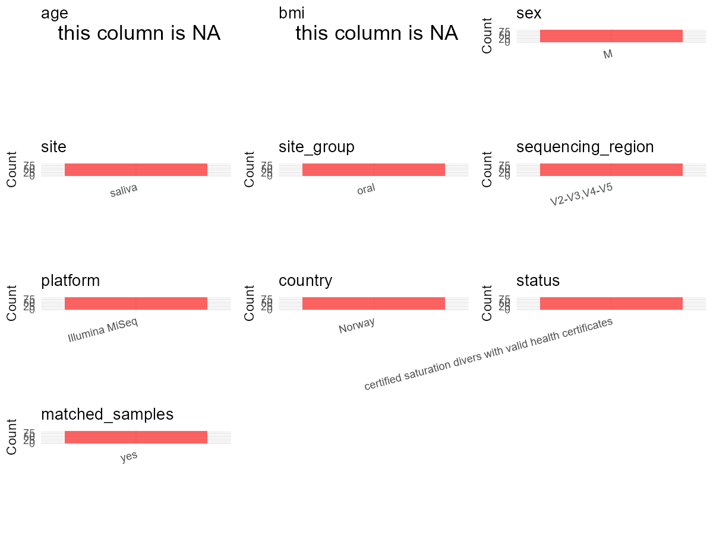

# Step 1: Obtain Initial Metadata from Each Project

This step sets the project directory and loads the raw SRA metadata.

```{r message=FALSE, warning=FALSE}
# Load libraries
library(dplyr)
library(ggplot2)
library(cowplot)

# (1) Setting working directory
project_id <- "PRJEB40804"

base_dir <- "D:/YL2025/2026/global-oral-github-YL-v2/global-oral-microbiome/data/projects/"
setwd(file.path(base_dir, project_id))

# (2) Loading raw SRA metadata file
sra_file <- "SraRunTable.csv"
initial_meta <- read.csv(sra_file, header = TRUE, stringsAsFactors = FALSE)
```

# Step 2: Data Overview

First, you need to get an overview of the data, which includes two steps: reading the article and reading the initial metadata. This step is very IMPORTANT!

```{r message=FALSE, warning=FALSE}
# (1) Read the article in the following order: abstract, the beginning of the results section, and the methods.
# Paper summary used for this project:
# - Title: Shifts in the Oral Microbiota During a Four-Week Commercial Saturation Dive to 200 Meters
# - Study design: longitudinal repeated-measures sampling during a four-week commercial saturation dive
# - Sample type: saliva
# - Cohort structure from the paper and SraRunTable.csv: 30 divers enrolled, 23 men with complete four-timepoint saliva series retained, 92 samples total
# - Sampling timepoints from Materials and Methods: before saturation (D0), day 2 at depth (D2), day 5 at depth (D5), and end of bottom phase before decompression (D28)
# - Sequencing from the paper full text: QIAseq 16S Region Panel targeting V2-V3 and V4-V5, sequenced on Illumina MiSeq with a MiSeq v3 flowcell (2 x 300 cycles)
# - Participants from Materials and Methods: all included divers were male non-smokers and held valid health certificates for saturation work
# - Cohort summary from Table 1: mean age 44 years (range 31-60) and mean BMI 26.8 kg/m2 (range 20.2-31.2), but no per-subject values are reported
# - Exact PCR primer pair names were not recoverable from the accessible paper text reviewed in this session
# - Geography from SRA is not a country value; geo_loc_name_country is uncalculated and the location field records sea locations in the Mediterranean Sea
# - The study is an occupational longitudinal exposure study rather than a disease case-control design
# - The paper reports the targeted 16S regions, so sequencing_region can be filled even though exact primer sequences remain unresolved

# (2) IMPORTANT: MUST go through each column of initial_meta
head(initial_meta, 10)
colnames(initial_meta)
table(initial_meta$Organism)
table(initial_meta$environment_.material.)
table(initial_meta$geo_loc_name_country)
table(initial_meta$geographic_location_.country_and.or_sea.)
table(sub("_.*$", "", initial_meta$Sample_name))
# All 92 rows are human saliva metagenome samples with Sample_name values like D01_19_03.
# The subject prefix before the first underscore identifies 23 divers, each with 4 repeated samples.
```

# Step 3: Removing Control and Non-human Samples

First, we need to remove control samples(including both negative controls and positive controls) and non-human samples.

```{r}
# (1) Parameter setup
control_column <- ""
control_keywords <- c()

species_column <- "Organism"
unique(initial_meta[[species_column]])
non_human_keywords <- c()

# (2) Remove controls and non-human samples. DO NOT need to modify code in this part, just run it.
n_samples <- nrow(initial_meta)
# Control evaluation
if (length(control_keywords) > 0) {
  if (is.null(control_column) || control_column == "") {
    stop("Error: control_keywords provided but control_column is missing.")
  }

  if (!(control_column %in% colnames(initial_meta))) {
    stop(sprintf("Error: Column '%s' not found in initial_meta.", control_column))
  }

  control_pattern <- paste(control_keywords, collapse = "|")
  control_text <- initial_meta[[control_column]]
  is_control <- grepl(control_pattern, control_text)

} else {
  is_control <- rep(FALSE, n_samples)
}

# Non-human evaluation
if (length(non_human_keywords) > 0) {
  if (is.null(species_column) || species_column == "") {
    stop("Error: non_human_keywords provided but species_column is missing.")
  }

  if (!(species_column %in% colnames(initial_meta))) {
    stop(sprintf("Error: Column '%s' not found in initial_meta.", species_column))
  }

  non_human_pattern <- paste(non_human_keywords, collapse = "|")
  species_text <- initial_meta[[species_column]]
  is_non_human <- grepl(non_human_pattern, species_text)
} else {
  is_non_human <- rep(FALSE, n_samples)
}

# Execute removal
samples_to_remove <- is_control | is_non_human
initial_meta <- initial_meta[!samples_to_remove, ]

cat("Initial samples counts:", n_samples, "\n")
cat("Removed control samples:", sum(is_control), "\n")
cat("Removed non-human samples:", sum(is_non_human), "\n")
cat("Total samples removed ", sum(samples_to_remove), "\n")
cat("Remaining samples after Step 2:", nrow(initial_meta), "\n")
```

# Step 4: Creating a Uniform Metadata Template

This step converts the raw SRA table into the standard metadata format used in our meta-analysis.

```{r}
metadata <- data.frame(
  bioproject = initial_meta$BioProject,
  sample_id = initial_meta$Run,
  raw_subject_id = initial_meta$Sample_name,
  subject_id = sub("_.*$", "", initial_meta$Sample_name),
  age = NA_real_,
  age_info = "adult male non-smokers; cohort mean age 44 years (range 31-60)",
  bmi = NA_real_,
  sex = "M",
  sequencing_region = "V2-V3,V4-V5",
  platform = "Illumina MiSeq",
  country = "Norway",
  site = "saliva",
  site_group = "pending",
  public_time = sub("T.*$", "", initial_meta$ReleaseDate),
  pcr_primers = NA_character_,
  title = "Shifts in the Oral Microbiota During a Four-Week Commercial Saturation Dive to 200 Meters",
  disease_study = "no",
  status = "certified saturation divers with valid health certificates",
  matched_samples = "pending",
  is_time_series = "yes",
  stringsAsFactors = FALSE
)

# Source notes for non-obvious fields:
# - raw_subject_id preserves the deposited Sample_name in the exported metadata.
# - subject_id is derived from the Sample_name prefix before the first underscore (for example D01 from D01_19_03),
#   because the SRA table encodes 23 divers with four repeated saliva samples each.
# - age is unavailable per sample, so age_info stores the cohort summary from Table 1: adult male non-smokers with mean age 44 years (range 31-60).
# - bmi is left NA because Table 1 reports only a cohort summary (mean 26.8 kg/m2, range 20.2-31.2) rather than per-subject BMI values.
# - sex is set to M because the paper states that all included divers were male.
# - sequencing_region and platform come from the paper full text: QIAseq 16S Region Panel targeting V2-V3 and V4-V5 on Illumina MiSeq with a MiSeq v3 flowcell (2 x 300 cycles).
# - country is left NA because SRA geo_loc_name_country is uncalculated and the location field records sea names rather than a country.
# - status is set to certified saturation divers with valid health certificates because the paper describes a certified occupational cohort that passed pre-saturation medical examination, even though it is not framed as a disease case-control study.
# - pcr_primers is left NA because the accessible paper text reviewed here identified the targeted regions and QIAseq panel but not exact primer pair names.
metadata$public_time <- as.Date(metadata$public_time)
```

# Step 5: Manually solving pending issues

This step involves two parts: (1) handle the columns with the `raw_` prefix, and next (2) handle the `site_group` and `matched_samples` columns.

```{r}
# (1) raw_subject_id is already carried in metadata to preserve the original Sample_name used to derive subject_id.
metadata <- metadata
```

```{r}
# (2) Filling the 'site_group' and 'matched_samples' columns
unique(metadata$site)
Oral_site = c("saliva")
Gut_site = c("feces")

metadata <- metadata %>%
  mutate(site_group = case_when(
    site %in% Oral_site ~ "oral",
    site %in% Gut_site ~ "gut",
    TRUE ~ "other"
  ))

metadata$matched_samples <- ifelse(
  ave(metadata$subject_id, metadata$subject_id, FUN = length) > 1,
  "yes",
  "no"
)
# Sample_name shows 23 divers with four repeated samples each, so matched_samples resolves to yes.
```

```{r}
# (3) check if there is pending value in metadata. If there is pending value, go on modify the metadata.
has_pending <- function(col) {
  if (is.character(col) || is.factor(col)) {
    any(col == "pending", na.rm = TRUE)
  } else {
    FALSE
  }
}

any_pending_value <- any(sapply(metadata, has_pending))

if (!any_pending_value) {
  message("Good! No cell contains the value 'pending'.")
} else {
  pending_cols <- names(metadata)[sapply(metadata, has_pending)]
  message("Columns containing 'pending': ", paste(pending_cols, collapse = ", "))
  message("Please continue to resolve these pending columns!")
}
```

# Step 6: Visualize the Metadata

This step makes a quick set of plots for checking the distribution of key metadata fields.

```{r}
plot_data <- metadata %>%
  select(-bioproject, -sample_id, -subject_id, -title)

create_simple_plots <- function(data) {
  plots <- list()
  continuous_vars <- c("age", "bmi")

  for (col in colnames(data)) {
    if (all(is.na(data[[col]]))) {
      p <- ggplot() +
        annotate("text", x = 0.5, y = 0.5, label = "this column is NA", size = 6) +
        labs(title = col) +
        theme_void()
    } else if (col %in% continuous_vars && is.numeric(data[[col]])) {
      p <- ggplot(data, aes(x = .data[[col]])) +
        geom_histogram(fill = "blue", alpha = 0.6, bins = 20, na.rm = TRUE) +
        labs(title = col, x = col, y = "Count") +
        theme_minimal()
    } else {
      count_data <- as.data.frame(table(data[[col]], useNA = "ifany"))
      p <- ggplot(count_data, aes(x = reorder(Var1, -Freq), y = Freq)) +
        geom_col(fill = "red", alpha = 0.6) +
        labs(title = col, x = NULL, y = "Count") +
        theme_minimal() +
        theme(axis.text.x = element_text(angle = 15, hjust = 1))
    }
    plots[[col]] <- p
  }

  return(plots)
}

plots <- create_simple_plots(plot_data)
p <- plot_grid(plots$age,
               plots$bmi,
               plots$sex,
               plots$site,
               plots$site_group,
               plots$sequencing_region,
               plots$platform,
               plots$country,
               plots$status,
               plots$matched_samples,
               ncol = 3, align = "hv", axis = "lb")
ggsave("Metadata_Summary_v2.png", plot = p, width = 8, height = 6, dpi = 150)
```

```{r}

```

# Step 7: Sort and export the metadata

This step saves the cleaned metadata table as the final `metadata_v2.csv` file.

```{r}
fixed_cols <- c("bioproject", "sample_id", "subject_id", "age", "age_info",
                "bmi", "sex", "platform", "sequencing_region", "pcr_primers",
                "country", "site", "site_group", "disease_study", "status",
                "title", "public_time", "matched_samples", "is_time_series")
metadata <- metadata %>%
  select(all_of(fixed_cols), starts_with("raw_"))

write.csv(metadata, file = "metadata_v2.csv", quote = TRUE, row.names = FALSE)
```
