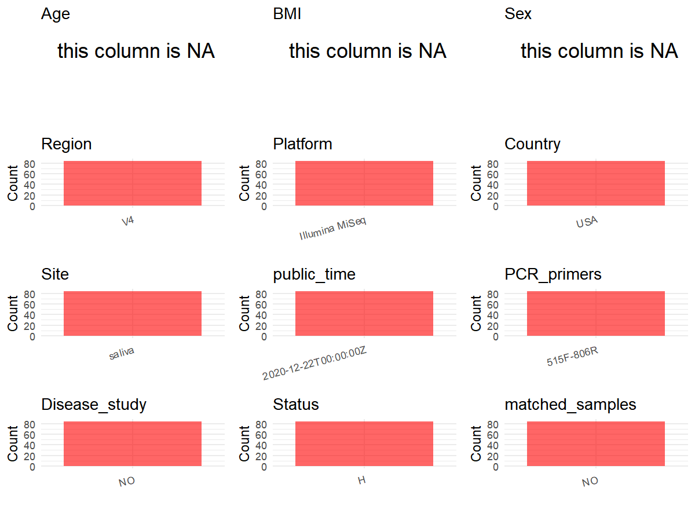

R Notebook: Metadata Processing Workflow
================

# Step 1: Obtain Initial Metadata from Each Project

To obtain the initial metadata: 1. Search for the BioProject ID (e.g.,
“PRJEBXXXX”) on the [NCBI SRA
website](https://www.ncbi.nlm.nih.gov/Traces/study/). 2. In the “Select”
table, click on “Metadata” and download the file. 3. The downloaded file
is typically named “SraRunTable.csv” and contains metadata for the
project.

``` r
# Load necessary libraries
library(dplyr)
library(ggplot2)
library(cowplot)

# Set working directory (update this path to your local directory)
setwd("D:/metadata/PRJEB42056")

# Read the initial metadata files
initial_meta<-read.csv("SraRunTable.csv",header = T)

# Combine the two metadata files
#meta <- rbind(initial_meta, initial_meta1)

#Remove entries non-oral samples
#initial_meta <- subset(initial_meta, Organism == "human oral metagenome")

# Check the number of samples containing "HT" in Sample.Name (e.g., healthy controls)
#nrow(subset(meta, grepl("HT", Sample.Name)))

# Display the first few rows of the metadata
head(initial_meta)
```

    ##          Run Assay.Type AvgSpotLen Barcode..exp.   Bases BioProject
    ## 1 ERR5002282   AMPLICON        150  TCCGGACTCCTG   20230 PRJEB42056
    ## 2 ERR5002283   AMPLICON        150  CGTGGCTTTCCG   74894 PRJEB42056
    ## 3 ERR5002284   AMPLICON        150  GGTGCAGACAGA 1820836 PRJEB42056
    ## 4 ERR5002285   AMPLICON        150  CACGCTATTGGA  119120 PRJEB42056
    ## 5 ERR5002286   AMPLICON        150  TGATTTAATTGC   52693 PRJEB42056
    ## 6 ERR5002287   AMPLICON        150  CTGAGGCCCTTC  191595 PRJEB42056
    ##      BioSample   Bytes center_name..exp.
    ## 1 SAMEA7726826   67012            UCSDMI
    ## 2 SAMEA7726827  110634            UCSDMI
    ## 3 SAMEA7726828 1163298            UCSDMI
    ## 4 SAMEA7726829  130870            UCSDMI
    ## 5 SAMEA7726830   92944            UCSDMI
    ## 6 SAMEA7726831  171009            UCSDMI
    ##                                          Center.Name center_project_name..exp.
    ## 1 UNIVERSITY OF CALIFORNIA SAN DIEGO MICROBIOME INIT              EtOH testing
    ## 2 UNIVERSITY OF CALIFORNIA SAN DIEGO MICROBIOME INIT              EtOH testing
    ## 3 UNIVERSITY OF CALIFORNIA SAN DIEGO MICROBIOME INIT              EtOH testing
    ## 4 UNIVERSITY OF CALIFORNIA SAN DIEGO MICROBIOME INIT              EtOH testing
    ## 5 UNIVERSITY OF CALIFORNIA SAN DIEGO MICROBIOME INIT              EtOH testing
    ## 6 UNIVERSITY OF CALIFORNIA SAN DIEGO MICROBIOME INIT              EtOH testing
    ##   collection_timestamp Consent DATASTORE.filetype DATASTORE.provider
    ## 1             2019/8/7  public   fastq,run.zq,sra         gs,ncbi,s3
    ## 2             2019/8/7  public   fastq,run.zq,sra         gs,ncbi,s3
    ## 3             2019/8/7  public   fastq,run.zq,sra         gs,ncbi,s3
    ## 4             2019/8/7  public   fastq,run.zq,sra         gs,ncbi,s3
    ## 5             2019/8/7  public   fastq,run.zq,sra         gs,ncbi,s3
    ## 6             2019/8/7  public   fastq,run.zq,sra         gs,ncbi,s3
    ##                       DATASTORE.region dna_extracted elevation  empo_1   empo_2
    ## 1 gs.us-east1,ncbi.public,s3.us-east-1          TRUE       193 Control Negative
    ## 2 gs.us-east1,ncbi.public,s3.us-east-1          TRUE       193 Control Negative
    ## 3 gs.us-east1,ncbi.public,s3.us-east-1          TRUE       193 Control Negative
    ## 4 gs.us-east1,ncbi.public,s3.us-east-1          TRUE       193 Control Negative
    ## 5 gs.us-east1,ncbi.public,s3.us-east-1          TRUE       193 Control Negative
    ## 6 gs.us-east1,ncbi.public,s3.us-east-1          TRUE       193 Control Negative
    ##                empo_3 ENA_FIRST_PUBLIC_run ENA.LAST.UPDATE..run.   env_biome
    ## 1 Sterile water blank           2020/12/17            2020/12/17 urban biome
    ## 2 Sterile water blank           2020/12/17            2020/12/17 urban biome
    ## 3 Sterile water blank           2020/12/17            2020/12/17 urban biome
    ## 4 Sterile water blank           2020/12/17            2020/12/17 urban biome
    ## 5 Sterile water blank           2020/12/17            2020/12/17 urban biome
    ## 6 Sterile water blank           2020/12/17            2020/12/17 urban biome
    ##         env_feature  env_material      Env_package Experiment  external_id
    ## 1 research facility sterile water misc environment ERX4811565 SAMEA7726826
    ## 2 research facility sterile water misc environment ERX4811566 SAMEA7726827
    ## 3 research facility sterile water misc environment ERX4811567 SAMEA7726828
    ## 4 research facility sterile water misc environment ERX4811568 SAMEA7726829
    ## 5 research facility sterile water misc environment ERX4811569 SAMEA7726830
    ## 6 research facility sterile water misc environment ERX4811570 SAMEA7726831
    ##   extraction_robot..exp. extractionkit_lot..exp. geo_loc_name_country
    ## 1           Carmen, HOWE               163012884                  USA
    ## 2           Carmen, HOWE               163012884                  USA
    ## 3           Carmen, HOWE               163012884                  USA
    ## 4           Carmen, HOWE               163012884                  USA
    ## 5           Carmen, HOWE               163012884                  USA
    ## 6           Carmen, HOWE               163012884                  USA
    ##   geo_loc_name_country_continent       geo_loc_name host_age_units
    ## 1                  North America USA:CA\\,San Diego          years
    ## 2                  North America USA:CA\\,San Diego          years
    ## 3                  North America USA:CA\\,San Diego          years
    ## 4                  North America USA:CA\\,San Diego          years
    ## 5                  North America USA:CA\\,San Diego          years
    ## 6                  North America USA:CA\\,San Diego          years
    ##   host_height_units host_subject_id host_weight_units
    ## 1                cm      BLANK1.10H                kg
    ## 2                cm       BLANK1.3H                kg
    ## 3                cm       BLANK1.4H                kg
    ## 4                cm       BLANK1.5H                kg
    ## 5                cm       BLANK1.6H                kg
    ## 6                cm       BLANK1.7H                kg
    ##                                          INSDC_center_name   INSDC_first_public
    ## 1 University of California San Diego Microbiome Initiative 2020-12-17T08:09:46Z
    ## 2 University of California San Diego Microbiome Initiative 2020-12-17T08:09:46Z
    ## 3 University of California San Diego Microbiome Initiative 2020-12-17T08:09:46Z
    ## 4 University of California San Diego Microbiome Initiative 2020-12-17T08:09:46Z
    ## 5 University of California San Diego Microbiome Initiative 2020-12-17T08:09:46Z
    ## 6 University of California San Diego Microbiome Initiative 2020-12-17T08:09:46Z
    ##      INSDC_last_update INSDC_status     Instrument LATITUDE     Library.Name
    ## 1 2020-12-16T22:13:15Z       public Illumina MiSeq     32.5 12610.BLANK1.10H
    ## 2 2020-12-16T22:13:15Z       public Illumina MiSeq     32.5  12610.BLANK1.3H
    ## 3 2020-12-16T22:13:15Z       public Illumina MiSeq     32.5  12610.BLANK1.4H
    ## 4 2020-12-16T22:13:15Z       public Illumina MiSeq     32.5  12610.BLANK1.5H
    ## 5 2020-12-16T22:13:15Z       public Illumina MiSeq     32.5  12610.BLANK1.6H
    ## 6 2020-12-16T22:13:15Z       public Illumina MiSeq     32.5  12610.BLANK1.7H
    ##   LibraryLayout LibrarySelection LibrarySource linker..exp. LONGITUDE
    ## 1        SINGLE              PCR   METAGENOMIC           GT   -117.25
    ## 2        SINGLE              PCR   METAGENOMIC           GT   -117.25
    ## 3        SINGLE              PCR   METAGENOMIC           GT   -117.25
    ## 4        SINGLE              PCR   METAGENOMIC           GT   -117.25
    ## 5        SINGLE              PCR   METAGENOMIC           GT   -117.25
    ## 6        SINGLE              PCR   METAGENOMIC           GT   -117.25
    ##   mastermix_lot..exp.   Organism orig_name..exp.
    ## 1              678071 metagenome      BLANK1.10H
    ## 2              678071 metagenome       BLANK1.3H
    ## 3              678071 metagenome       BLANK1.4H
    ## 4              678071 metagenome       BLANK1.5H
    ## 5              678071 metagenome       BLANK1.6H
    ## 6              678071 metagenome       BLANK1.7H
    ##                                   pcr_primers..exp. physical_specimen_location
    ## 1 FWD:GTGYCAGCMGCCGCGGTAA; REV:GGACTACNVGGGTWTCTAAT                     UCSDMI
    ## 2 FWD:GTGYCAGCMGCCGCGGTAA; REV:GGACTACNVGGGTWTCTAAT                     UCSDMI
    ## 3 FWD:GTGYCAGCMGCCGCGGTAA; REV:GGACTACNVGGGTWTCTAAT                     UCSDMI
    ## 4 FWD:GTGYCAGCMGCCGCGGTAA; REV:GGACTACNVGGGTWTCTAAT                     UCSDMI
    ## 5 FWD:GTGYCAGCMGCCGCGGTAA; REV:GGACTACNVGGGTWTCTAAT                     UCSDMI
    ## 6 FWD:GTGYCAGCMGCCGCGGTAA; REV:GGACTACNVGGGTWTCTAAT                     UCSDMI
    ##   physical_specimen_remaining Platform plating..exp. primer_date..exp.
    ## 1                        TRUE ILLUMINA            MB             42019
    ## 2                        TRUE ILLUMINA            MB             42019
    ## 3                        TRUE ILLUMINA            MB             42019
    ## 4                        TRUE ILLUMINA            MB             42019
    ## 5                        TRUE ILLUMINA            MB             42019
    ## 6                        TRUE ILLUMINA            MB             42019
    ##            primer..exp. primer_plate..exp. processing_robot..exp.
    ## 1 GTGTGYCAGCMGCCGCGGTAA                  5                Echo550
    ## 2 GTGTGYCAGCMGCCGCGGTAA                  5                Echo550
    ## 3 GTGTGYCAGCMGCCGCGGTAA                  5                Echo550
    ## 4 GTGTGYCAGCMGCCGCGGTAA                  5                Echo550
    ## 5 GTGTGYCAGCMGCCGCGGTAA                  5                Echo550
    ## 6 GTGTGYCAGCMGCCGCGGTAA                  5                Echo550
    ##   project_name..exp.          ReleaseDate run_center..exp. run_date..exp.
    ## 1   AGP EtOH Testing 2020-12-22T00:00:00Z           UCSDMI      2008/7/19
    ## 2   AGP EtOH Testing 2020-12-22T00:00:00Z           UCSDMI      2008/7/19
    ## 3   AGP EtOH Testing 2020-12-22T00:00:00Z           UCSDMI      2008/7/19
    ## 4   AGP EtOH Testing 2020-12-22T00:00:00Z           UCSDMI      2008/7/19
    ## 5   AGP EtOH Testing 2020-12-22T00:00:00Z           UCSDMI      2008/7/19
    ## 6   AGP EtOH Testing 2020-12-22T00:00:00Z           UCSDMI      2008/7/19
    ##            create_date version                             run_prefix..exp.
    ## 1 2020-12-31T13:44:00Z       1 AGP_EtOH_1-3_Lisa-Joanna_Megan_Livia_S1_L001
    ## 2 2020-12-31T13:44:00Z       1 AGP_EtOH_1-3_Lisa-Joanna_Megan_Livia_S1_L001
    ## 3 2020-12-31T13:46:00Z       1 AGP_EtOH_1-3_Lisa-Joanna_Megan_Livia_S1_L001
    ## 4 2020-12-31T13:45:00Z       1 AGP_EtOH_1-3_Lisa-Joanna_Megan_Livia_S1_L001
    ## 5 2020-12-31T13:44:00Z       1 AGP_EtOH_1-3_Lisa-Joanna_Megan_Livia_S1_L001
    ## 6 2020-12-31T13:45:00Z       1 AGP_EtOH_1-3_Lisa-Joanna_Megan_Livia_S1_L001
    ##                          runid..exp.  Sample.Name
    ## 1 190807_M05314_0201_000000000-CJT5L SAMEA7726826
    ## 2 190807_M05314_0201_000000000-CJT5L SAMEA7726827
    ## 3 190807_M05314_0201_000000000-CJT5L SAMEA7726828
    ## 4 190807_M05314_0201_000000000-CJT5L SAMEA7726829
    ## 5 190807_M05314_0201_000000000-CJT5L SAMEA7726830
    ## 6 190807_M05314_0201_000000000-CJT5L SAMEA7726831
    ##                        Sample_name sample_plate..exp.
    ## 1 qiita_sid_12610:12610.BLANK1.10H   AGP_EtOH_Plate_1
    ## 2  qiita_sid_12610:12610.BLANK1.3H   AGP_EtOH_Plate_1
    ## 3  qiita_sid_12610:12610.BLANK1.4H   AGP_EtOH_Plate_1
    ## 4  qiita_sid_12610:12610.BLANK1.5H   AGP_EtOH_Plate_1
    ## 5  qiita_sid_12610:12610.BLANK1.6H   AGP_EtOH_Plate_1
    ## 6  qiita_sid_12610:12610.BLANK1.7H   AGP_EtOH_Plate_1
    ##                    sample_type   sequencing_meth..exp. SRA.Study
    ## 1 control blank DNA extraction Sequencing by synthesis ERP125919
    ## 2 control blank DNA extraction Sequencing by synthesis ERP125919
    ## 3 control blank DNA extraction Sequencing by synthesis ERP125919
    ## 4 control blank DNA extraction Sequencing by synthesis ERP125919
    ## 5 control blank DNA extraction Sequencing by synthesis ERP125919
    ## 6 control blank DNA extraction Sequencing by synthesis ERP125919
    ##                       Submitter_Id target_gene..exp. target_subfragment..exp.
    ## 1 qiita_sid_12610:12610.BLANK1.10H          16S rRNA                       V4
    ## 2  qiita_sid_12610:12610.BLANK1.3H          16S rRNA                       V4
    ## 3  qiita_sid_12610:12610.BLANK1.4H          16S rRNA                       V4
    ## 4  qiita_sid_12610:12610.BLANK1.5H          16S rRNA                       V4
    ## 5  qiita_sid_12610:12610.BLANK1.6H          16S rRNA                       V4
    ## 6  qiita_sid_12610:12610.BLANK1.7H          16S rRNA                       V4
    ##   tm1000_8_tool..exp. tm300_8_tool..exp. tm50_8_tool..exp. water_lot..exp.
    ## 1             311172B                 NA                NA         2003606
    ## 2             311172B                 NA                NA         2003606
    ## 3             311172B                 NA                NA         2003606
    ## 4             311172B                 NA                NA         2003606
    ## 5             311172B                 NA                NA         2003606
    ## 6             311172B                 NA                NA         2003606
    ##            well_description..exp. well_id..exp. ENA_first_public
    ## 1 AGP_EtOH_Plate_1_BLANK1.10H_H10           H10       2020/12/17
    ## 2   AGP_EtOH_Plate_1_BLANK1.3H_H3            H3       2020/12/17
    ## 3   AGP_EtOH_Plate_1_BLANK1.4H_H4            H4       2020/12/17
    ## 4   AGP_EtOH_Plate_1_BLANK1.5H_H5            H5       2020/12/17
    ## 5   AGP_EtOH_Plate_1_BLANK1.6H_H6            H6       2020/12/17
    ## 6   AGP_EtOH_Plate_1_BLANK1.7H_H7            H7       2020/12/17
    ##   ENA_last_update INSDC_center_alias              collection_type tube_id
    ## 1      2020/12/16             UCSDMI control blank DNA extraction        
    ## 2      2020/12/16             UCSDMI control blank DNA extraction        
    ## 3      2020/12/16             UCSDMI control blank DNA extraction        
    ## 4      2020/12/16             UCSDMI control blank DNA extraction        
    ## 5      2020/12/16             UCSDMI control blank DNA extraction        
    ## 6      2020/12/16             UCSDMI control blank DNA extraction        
    ##   Host_age host_body_habitat host_body_mass_index host_body_product
    ## 1                                                                  
    ## 2                                                                  
    ## 3                                                                  
    ## 4                                                                  
    ## 5                                                                  
    ## 6                                                                  
    ##   host_body_site host_common_name host_height host_life_stage
    ## 1                                                            
    ## 2                                                            
    ## 3                                                            
    ## 4                                                            
    ## 5                                                            
    ## 6                                                            
    ##   host_scientific_name host_taxid host_weight preservation_method sample_area
    ## 1                              NA                                            
    ## 2                              NA                                            
    ## 3                              NA                                            
    ## 4                              NA                                            
    ## 5                              NA                                            
    ## 6                              NA                                            
    ##   sex volume_ml2 volume_ml ENA_first_public.1 ENA_last_update.1 scientific_name
    ## 1             NA                                                               
    ## 2             NA                                                               
    ## 3             NA                                                               
    ## 4             NA                                                               
    ## 5             NA                                                               
    ## 6             NA

# Step 2: Create a Uniform Metadata Template

The uniform metadata should include the following columns:

1.  **BioProject**: Project ID (e.g., “PRJNA339212”)
2.  **Run**: Sample ID (e.g., “ERRXXXXXX” or “SRRXXXXXX”)
3.  **sample_name**: Original sample name submitted by the authors (not
    the database-assigned ID)
4.  **Age**: Age of the subject (if available)
5.  **BMI**: Body Mass Index (if available)
6.  **Sex**: Sex of the subject (“F” or “M”)
7.  **Region**: Targeted 16S rRNA region (e.g., “V3-V4”)
8.  **Platform**: Sequencing platform (e.g., “Illumina MiSeq”)
9.  **Country**: Country of sample origin (e.g., “China”)
10. **Site**: Sample site (e.g., “saliva”, “dental plaque”)
11. **public_time**: Data release date (format: “YYYY-MM-DD”)
12. **PCR_primers**: PCR primers used (e.g., “515F-806R”)
13. **title**: Title of the associated publication
14. **Disease_study**: Whether the study involves a disease (“YES” or
    “NO”)
15. **Status**: Disease status (e.g., “T2DM”, “HC”). Note: If the study
    includes both disease and healthy samples, this must be specified
    per sample.
16. **matched_samples**: matched samples (“YES” or “NO”)

``` r
# Create a uniform metadata dataframe
metadata <- data.frame(
  BioProject = initial_meta$BioProject,
  Run = initial_meta$Run,
  sample_name = initial_meta$Sample.Name,
  Age = NA,
  BMI = NA,
  Sex=NA,
  Region = "V4",
  Platform = initial_meta$Instrument,
  Country = initial_meta$geo_loc_name_country,
  Site = initial_meta$env_material,
  public_time = initial_meta$ReleaseDate,
  stringsAsFactors = FALSE
)
```

# Step 3: Manually Add Information from the Publication

Some information (e.g. PCR primers, study title, disease status) must be
manually extracted from the publication and added to the metadata.

``` r
# Add information obtained from the publication
metadata$PCR_primers <- "515F-806R"
metadata$title <- "Evaluation of the Effect of Storage Methods on Fecal， Saliva， and Skin Microbiome Composition"
metadata$Disease_study <- "NO"
# Assign disease status based on sample_name patterns
metadata$Status<-"H"

keep_subjects <- unique(subset(metadata, Site == "saliva")$sample_name)
metadata <- subset(metadata, sample_name %in% keep_subjects)

sample_counts <- table(metadata$sample_name)

metadata$matched_samples <-
  ifelse(metadata$sample_name %in% names(sample_counts[sample_counts >= 2]),
         "YES", "NO")

cat("Subjects retained:", length(unique(metadata$sample_name)), "\n")
```

    ## Subjects retained: 84

``` r
cat("Matched samples distribution:\n")
```

    ## Matched samples distribution:

``` r
table(metadata$matched_samples)
```

    ## 
    ## NO 
    ## 84

``` r
cat("Sample distribution by Site:\n")
```

    ## Sample distribution by Site:

``` r
table(metadata$Site)
```

    ## 
    ## saliva 
    ##     84

# Step 4: Summarize and Validate the Metadata

``` r
# Check the number of unique runs and sample names
print(paste("Number of unique runs:", length(unique(metadata$Run))))
```

    ## [1] "Number of unique runs: 84"

``` r
print(paste("Number of unique sample names:", length(unique(metadata$sample_name))))
```

    ## [1] "Number of unique sample names: 84"

# Step 5: Visualize the Metadata

``` r

```

<!-- -->

# Step 6: Finalize and Export the Metadata

``` r
# Reorder columns to match the desired format
metadata <- metadata[, c(
  "BioProject", "Run", "sample_name", "Age", "BMI", "Sex", 
  "Region", "Platform", "Country", "Site", "public_time", 
  "PCR_primers", "title", "Disease_study", "Status","matched_samples"
)]

# Export the uniform metadata to a CSV file
write.csv(metadata, file = "metadata.csv", quote = FALSE)
head(metadata)
```

    ##    BioProject        Run  sample_name Age BMI Sex Region       Platform Country
    ## 39 PRJEB42056 ERR5002320 SAMEA7726864  NA  NA  NA     V4 Illumina MiSeq     USA
    ## 41 PRJEB42056 ERR5002322 SAMEA7726866  NA  NA  NA     V4 Illumina MiSeq     USA
    ## 43 PRJEB42056 ERR5002324 SAMEA7726868  NA  NA  NA     V4 Illumina MiSeq     USA
    ## 47 PRJEB42056 ERR5002328 SAMEA7726872  NA  NA  NA     V4 Illumina MiSeq     USA
    ## 51 PRJEB42056 ERR5002332 SAMEA7726876  NA  NA  NA     V4 Illumina MiSeq     USA
    ## 54 PRJEB42056 ERR5002335 SAMEA7726879  NA  NA  NA     V4 Illumina MiSeq     USA
    ##      Site          public_time PCR_primers
    ## 39 saliva 2020-12-22T00:00:00Z   515F-806R
    ## 41 saliva 2020-12-22T00:00:00Z   515F-806R
    ## 43 saliva 2020-12-22T00:00:00Z   515F-806R
    ## 47 saliva 2020-12-22T00:00:00Z   515F-806R
    ## 51 saliva 2020-12-22T00:00:00Z   515F-806R
    ## 54 saliva 2020-12-22T00:00:00Z   515F-806R
    ##                                                                                              title
    ## 39 Evaluation of the Effect of Storage Methods on Fecal， Saliva， and Skin Microbiome Composition
    ## 41 Evaluation of the Effect of Storage Methods on Fecal， Saliva， and Skin Microbiome Composition
    ## 43 Evaluation of the Effect of Storage Methods on Fecal， Saliva， and Skin Microbiome Composition
    ## 47 Evaluation of the Effect of Storage Methods on Fecal， Saliva， and Skin Microbiome Composition
    ## 51 Evaluation of the Effect of Storage Methods on Fecal， Saliva， and Skin Microbiome Composition
    ## 54 Evaluation of the Effect of Storage Methods on Fecal， Saliva， and Skin Microbiome Composition
    ##    Disease_study Status matched_samples
    ## 39            NO      H              NO
    ## 41            NO      H              NO
    ## 43            NO      H              NO
    ## 47            NO      H              NO
    ## 51            NO      H              NO
    ## 54            NO      H              NO

## Notes for Students:

1.  **Metadata Accuracy**: Always cross-check the metadata with the
    original publication to ensure accuracy.
2.  **Manual Entries**: Columns like `PCR_primers`, and `Status` often
    require manual entry based on the publication.
3.  **Disease Status**: Be careful when assigning `Status`—some studies
    include both disease and healthy samples.
4.  **Visualization**: The plots help quickly identify the distribution
    of values in each column, which is useful for quality control.
5.  **Reproducibility**: Update the working directory and file paths to
    match your local environment.
