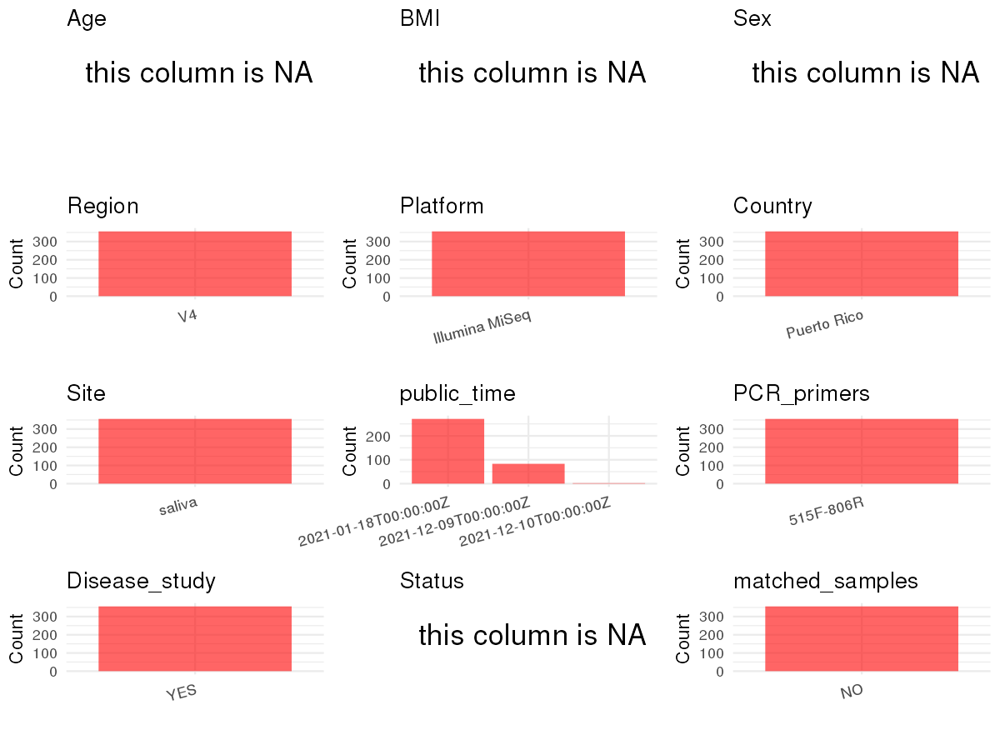

R Notebook: Metadata Processing Workflow
================

# Step 1: Obtain Initial Metadata from Each Project

To obtain the initial metadata: 1. Search for the BioProject ID (e.g.,
“PRJEBXXXX”) on the [NCBI SRA
website](https://www.ncbi.nlm.nih.gov/Traces/study/). 2. In the “Select”
table, click on “Metadata” and download the file. 3. The downloaded file
is typically named “SraRunTable.csv” and contains metadata for the
project.

``` r
# Load necessary libraries
library(dplyr)
library(stringr)
library(ggplot2)
library(cowplot)

# Set working directory (update this path to your local directory)
setwd("/home/dongbiao/word_embedding_microbiome/all_data/oral/global-oral-microbiome/data/projects/PRJEB42371")

# Read the initial metadata files
initial_meta <- read.csv("SraRunTable.csv", header = T) %>% filter(env_material != "sterile water")

# Display the first few rows of the metadata
head(initial_meta)
```

    ##          Run Assay.Type AvgSpotLen Barcode..exp.   Bases BioProject
    ## 1 ERR7598783   AMPLICON        251         AAAAA 9144934 PRJEB42371
    ## 2 ERR7598842   AMPLICON        251         AAAAA    7781 PRJEB42371
    ## 3 ERR7598705   AMPLICON        251         AAAAA 3379715 PRJEB42371
    ## 4 ERR7598706   AMPLICON        251         AAAAA 1738175 PRJEB42371
    ## 5 ERR7598707   AMPLICON        251         AAAAA  288650 PRJEB42371
    ## 6 ERR7598708   AMPLICON        251         AAAAA  461338 PRJEB42371
    ##      BioSample   Bytes center_name..exp.
    ## 1 SAMEA7767208 4437175     U Puerto Rico
    ## 2 SAMEA7767193   55939     U Puerto Rico
    ## 3 SAMEA7767094 1840927     U Puerto Rico
    ## 4 SAMEA7767095  992966     U Puerto Rico
    ## 5 SAMEA7767106  225113     U Puerto Rico
    ## 6 SAMEA7767117  328075     U Puerto Rico
    ##                                          Center.Name
    ## 1 UNIVERSITY OF CALIFORNIA SAN DIEGO MICROBIOME INIT
    ## 2 UNIVERSITY OF CALIFORNIA SAN DIEGO MICROBIOME INIT
    ## 3 UNIVERSITY OF CALIFORNIA SAN DIEGO MICROBIOME INIT
    ## 4 UNIVERSITY OF CALIFORNIA SAN DIEGO MICROBIOME INIT
    ## 5 UNIVERSITY OF CALIFORNIA SAN DIEGO MICROBIOME INIT
    ## 6 UNIVERSITY OF CALIFORNIA SAN DIEGO MICROBIOME INIT
    ##     center_project_name..exp. collection_timestamp Consent     COUNTRY
    ## 1 ORAL MICROBIOTA PUERTO RICO                 2019  public Puerto Rico
    ## 2 ORAL MICROBIOTA PUERTO RICO                 2019  public Puerto Rico
    ## 3 ORAL MICROBIOTA PUERTO RICO                 2019  public Puerto Rico
    ## 4 ORAL MICROBIOTA PUERTO RICO                 2019  public Puerto Rico
    ## 5 ORAL MICROBIOTA PUERTO RICO                 2019  public Puerto Rico
    ## 6 ORAL MICROBIOTA PUERTO RICO                 2019  public Puerto Rico
    ##   DATASTORE.filetype DATASTORE.provider                     DATASTORE.region
    ## 1   fastq,run.zq,sra         gs,ncbi,s3 gs.us-east1,ncbi.public,s3.us-east-1
    ## 2   fastq,run.zq,sra         gs,ncbi,s3 gs.us-east1,ncbi.public,s3.us-east-1
    ## 3   fastq,run.zq,sra         gs,ncbi,s3 gs.us-east1,ncbi.public,s3.us-east-1
    ## 4   fastq,run.zq,sra         gs,ncbi,s3 gs.us-east1,ncbi.public,s3.us-east-1
    ## 5   fastq,run.zq,sra         gs,ncbi,s3 gs.us-east1,ncbi.public,s3.us-east-1
    ## 6   fastq,run.zq,sra         gs,ncbi,s3 gs.us-east1,ncbi.public,s3.us-east-1
    ##   dna_extracted elevation          empo_1            empo_2           empo_3
    ## 1          TRUE         8 Host-associated Animal-associated Animal secretion
    ## 2          TRUE         8 Host-associated Animal-associated Animal secretion
    ## 3          TRUE         8 Host-associated Animal-associated Animal secretion
    ## 4          TRUE         8 Host-associated Animal-associated Animal secretion
    ## 5          TRUE         8 Host-associated Animal-associated Animal secretion
    ## 6          TRUE         8 Host-associated Animal-associated Animal secretion
    ##   ENA.FIRST.PUBLIC..run. ENA.LAST.UPDATE..run.   env_biome
    ## 1             2021-12-08            2021-12-09 urban biome
    ## 2             2021-12-08            2021-12-09 urban biome
    ## 3             2021-12-08            2021-12-09 urban biome
    ## 4             2021-12-08            2021-12-09 urban biome
    ## 5             2021-12-08            2021-12-09 urban biome
    ## 6             2021-12-08            2021-12-09 urban biome
    ##                env_feature env_material env_package Experiment  external_id
    ## 1 human-associated habitat       saliva  human-oral ERX7169365 SAMEA7767208
    ## 2 human-associated habitat       saliva  human-oral ERX7169424 SAMEA7767193
    ## 3 human-associated habitat       saliva  human-oral ERX7169287 SAMEA7767094
    ## 4 human-associated habitat       saliva  human-oral ERX7169288 SAMEA7767095
    ## 5 human-associated habitat       saliva  human-oral ERX7169289 SAMEA7767106
    ## 6 human-associated habitat       saliva  human-oral ERX7169290 SAMEA7767117
    ##   geo_loc_name_country geo_loc_name_country_continent         geo_loc_name
    ## 1          Puerto Rico                  North America Puerto Rico:San Juan
    ## 2          Puerto Rico                  North America Puerto Rico:San Juan
    ## 3          Puerto Rico                  North America Puerto Rico:San Juan
    ## 4          Puerto Rico                  North America Puerto Rico:San Juan
    ## 5          Puerto Rico                  North America Puerto Rico:San Juan
    ## 6          Puerto Rico                  North America Puerto Rico:San Juan
    ##   host_age_units host_height_units host_subject_id host_weight_units
    ## 1          years                cm             O80                kg
    ## 2          years                cm             O67                kg
    ## 3          years                cm              O1                kg
    ## 4          years                cm             O10                kg
    ## 5          years                cm             O11                kg
    ## 6          years                cm             O12                kg
    ##                                          INSDC_center_name   INSDC_first_public
    ## 1 University of California San Diego Microbiome Initiative 2021-01-13T04:11:46Z
    ## 2 University of California San Diego Microbiome Initiative 2021-01-13T04:11:46Z
    ## 3 University of California San Diego Microbiome Initiative 2021-01-13T04:11:46Z
    ## 4 University of California San Diego Microbiome Initiative 2021-01-13T04:11:46Z
    ## 5 University of California San Diego Microbiome Initiative 2021-01-13T04:11:46Z
    ## 6 University of California San Diego Microbiome Initiative 2021-01-13T04:11:46Z
    ##      INSDC_last_update INSDC_status     Instrument LATITUDE Library.Name
    ## 1 2021-01-06T13:48:16Z       public Illumina MiSeq 18.39837    13193.O80
    ## 2 2021-01-06T13:48:15Z       public Illumina MiSeq 18.39837    13193.O67
    ## 3 2021-01-06T13:48:14Z       public Illumina MiSeq 18.39837     13193.O1
    ## 4 2021-01-06T13:48:14Z       public Illumina MiSeq 18.39837    13193.O10
    ## 5 2021-01-06T13:48:14Z       public Illumina MiSeq 18.39837    13193.O11
    ## 6 2021-01-06T13:48:14Z       public Illumina MiSeq 18.39837    13193.O12
    ##   LibraryLayout LibrarySelection LibrarySource LONGITUDE
    ## 1        SINGLE              PCR   METAGENOMIC -66.07453
    ## 2        SINGLE              PCR   METAGENOMIC -66.07453
    ## 3        SINGLE              PCR   METAGENOMIC -66.07453
    ## 4        SINGLE              PCR   METAGENOMIC -66.07453
    ## 5        SINGLE              PCR   METAGENOMIC -66.07453
    ## 6        SINGLE              PCR   METAGENOMIC -66.07453
    ##                  Organism                         physical_specimen_location
    ## 1 human saliva metagenome Microbial Ecology and Genomics Lab RCM San Juan PR
    ## 2 human saliva metagenome Microbial Ecology and Genomics Lab RCM San Juan PR
    ## 3 human saliva metagenome Microbial Ecology and Genomics Lab RCM San Juan PR
    ## 4 human saliva metagenome Microbial Ecology and Genomics Lab RCM San Juan PR
    ## 5 human saliva metagenome Microbial Ecology and Genomics Lab RCM San Juan PR
    ## 6 human saliva metagenome Microbial Ecology and Genomics Lab RCM San Juan PR
    ##   physical_specimen_remaining Platform          ReleaseDate
    ## 1                        TRUE ILLUMINA 2021-12-10T00:00:00Z
    ## 2                        TRUE ILLUMINA 2021-12-10T00:00:00Z
    ## 3                        TRUE ILLUMINA 2021-12-09T00:00:00Z
    ## 4                        TRUE ILLUMINA 2021-12-09T00:00:00Z
    ## 5                        TRUE ILLUMINA 2021-12-09T00:00:00Z
    ## 6                        TRUE ILLUMINA 2021-12-09T00:00:00Z
    ##              run_center..exp.          create_date version
    ## 1 Argonne National Laboratory 2021-12-21T09:08:00Z       1
    ## 2 Argonne National Laboratory 2021-12-20T14:41:00Z       1
    ## 3 Argonne National Laboratory 2021-12-20T14:41:00Z       1
    ## 4 Argonne National Laboratory 2021-12-20T14:41:00Z       1
    ## 5 Argonne National Laboratory 2021-12-20T14:41:00Z       1
    ## 6 Argonne National Laboratory 2021-12-20T14:41:00Z       1
    ##           run_prefix..exp.  Sample.Name               sample_name sample_type
    ## 1      O80_S75_L001_R1_001 SAMEA7767208 qiita_sid_13193:13193.O80      saliva
    ## 2 ITS_O67_S153_L001_R1_001 SAMEA7767193 qiita_sid_13193:13193.O67      saliva
    ## 3        O1_S1_L001_R1_001 SAMEA7767094  qiita_sid_13193:13193.O1      saliva
    ## 4       O10_S8_L001_R1_001 SAMEA7767095 qiita_sid_13193:13193.O10      saliva
    ## 5      O11_S19_L001_R1_001 SAMEA7767106 qiita_sid_13193:13193.O11      saliva
    ## 6     O12_S125_L001_R1_001 SAMEA7767117 qiita_sid_13193:13193.O12      saliva
    ##     sequencing_meth..exp. SRA.Study              Submitter_Id target_gene..exp.
    ## 1 Sequencing by synthesis ERP126217 qiita_sid_13193:13193.O80               ITS
    ## 2 Sequencing by synthesis ERP126217 qiita_sid_13193:13193.O67               ITS
    ## 3 Sequencing by synthesis ERP126217  qiita_sid_13193:13193.O1               ITS
    ## 4 Sequencing by synthesis ERP126217 qiita_sid_13193:13193.O10               ITS
    ## 5 Sequencing by synthesis ERP126217 qiita_sid_13193:13193.O11               ITS
    ## 6 Sequencing by synthesis ERP126217 qiita_sid_13193:13193.O12               ITS
    ##   target_subfragment..exp. age_category alcohol_consumption_last_month
    ## 1                     ITS2        21_30                             no
    ## 2                     ITS2        21_30                            yes
    ## 3                     ITS2        31_40                            yes
    ## 4                     ITS2        41_49                             no
    ## 5                     ITS2        31_40                             no
    ## 6                     ITS2        21_30                            yes
    ##       Host_Age host_body_habitat host_body_mass_index host_body_product
    ## 1 not provided     UBERON:saliva         not provided     UBERON:saliva
    ## 2 not provided     UBERON:saliva         not provided     UBERON:saliva
    ## 3 not provided     UBERON:saliva         not provided     UBERON:saliva
    ## 4 not provided     UBERON:saliva         not provided     UBERON:saliva
    ## 5 not provided     UBERON:saliva         not provided     UBERON:saliva
    ## 6 not provided     UBERON:saliva         not provided     UBERON:saliva
    ##   host_body_site host_common_name  host_height host_life_stage
    ## 1  UBERON:saliva            human not provided    not provided
    ## 2  UBERON:saliva            human not provided    not provided
    ## 3  UBERON:saliva            human not provided    not provided
    ## 4  UBERON:saliva            human not provided    not provided
    ## 5  UBERON:saliva            human not provided    not provided
    ## 6  UBERON:saliva            human not provided    not provided
    ##   host_scientific_name host_taxid  host_weight perio_3_categories    sex
    ## 1         Homo sapiens       9606 not provided               mild   male
    ## 2         Homo sapiens       9606 not provided               mild female
    ## 3         Homo sapiens       9606 not provided                 no female
    ## 4         Homo sapiens       9606 not provided                 no female
    ## 5         Homo sapiens       9606 not provided               mild   male
    ## 6         Homo sapiens       9606 not provided                 no female
    ##   smoking perio_4_categories ENA_first_public ENA_last_update
    ## 1      no               mild       2021-01-13      2021-01-06
    ## 2      no               mild       2021-01-13      2021-01-06
    ## 3      no                 no       2021-01-13      2021-01-06
    ## 4      no                 no       2021-01-13      2021-01-06
    ## 5      no               mild       2021-01-13      2021-01-06
    ## 6      no                 no       2021-01-13      2021-01-06
    ##   INSDC_center_alias oral_sex_practices primer..exp. linker..exp.
    ## 1             UCSDMI                yes                          
    ## 2             UCSDMI                yes                          
    ## 3             UCSDMI                yes                          
    ## 4             UCSDMI                yes                          
    ## 5             UCSDMI                yes                          
    ## 6             UCSDMI                yes                          
    ##   PCR_Primer..exp. barcodesequence..exp. ENA.FIRST.PUBLIC ENA.LAST.UPDATE
    ## 1                                                                        
    ## 2                              XXQIITAXX                                 
    ## 3                                                                        
    ## 4                                                                        
    ## 5                                                                        
    ## 6                                                                        
    ##   scientific_name
    ## 1                
    ## 2                
    ## 3                
    ## 4                
    ## 5                
    ## 6

# Step 2: Create a Uniform Metadata Template

The uniform metadata should include the following columns:

1.  **BioProject**: Project ID (e.g., “PRJNA339212”)
2.  **Run**: Sample ID (e.g., “ERRXXXXXX” or “SRRXXXXXX”)
3.  **sample_name**: Original sample name submitted by the authors (not
    the database-assigned ID)
4.  **Age**: Age of the subject (if available)
5.  **BMI**: Body Mass Index (if available)
6.  **Sex**: Sex of the subject (“F” or “M”)
7.  **Region**: Targeted 16S rRNA region (e.g., “V3-V4”)
8.  **Platform**: Sequencing platform (e.g., “Illumina MiSeq”)
9.  **Country**: Country of sample origin (e.g., “China”)
10. **Site**: Sample site (e.g., “saliva”, “dental plaque”)
11. **public_time**: Data release date (format: “YYYY-MM-DD”)
12. **PCR_primers**: PCR primers used (e.g., “515F-806R”)
13. **title**: Title of the associated publication
14. **Disease_study**: Whether the study involves a disease (“YES” or
    “NO”)
15. **Status**: Disease status (e.g., “T2DM”, “HC”). Note: If the study
    includes both disease and healthy samples, this must be specified
    per sample.
16. **matched_samples**: matched samples (“YES” or “NO”)

``` r
# Create a uniform metadata dataframe
metadata <- data.frame(
  BioProject = initial_meta$BioProject,
  Run = initial_meta$Run,
  sample_name = initial_meta$host_subject_id,
  Age = NA,
  Sex = NA,
  BMI = NA,  
  Region = "V4",
  Platform = initial_meta$Instrument,
  Country = initial_meta$geo_loc_name_country,
  Site = initial_meta$env_material,
  public_time = initial_meta$ReleaseDate,
  stringsAsFactors = FALSE
)

metadata$Age[metadata$Age > 110] <- NA
metadata$BMI[metadata$BMI > 50] <- NA
```

# Step 3: Manually Add Information from the Publication

Some information (e.g. PCR primers, study title, disease status) must be
manually extracted from the publication and added to the metadata.

``` r
# Add information obtained from the publication
metadata$PCR_primers <- "515F-806R"
metadata$title <- "Oral microbiota and periodontitis severity among Hispanic adults"
metadata$Disease_study <- "YES"

metadata$Status <- NA

# Check initial data distribution
cat("Initial sample distribution:\n")
```

    ## Initial sample distribution:

``` r
table(metadata$sample_name)
```

    ## 
    ##   O1  O10 O100 O101 O102 O103 O104 O105 O106 O107 O108 O109  O11 O110 O111 O112 
    ##    3    3    2    2    2    2    2    2    2    2    2    2    3    2    2    2 
    ## O113 O114 O115 O116 O117 O118 O119  O12 O120 O121 O122 O123 O124 O125 O126 O127 
    ##    2    2    2    2    2    2    2    3    2    2    2    2    2    2    2    2 
    ## O128 O129  O13 O130 O131 O132 O133 O134 O135  O14 O141  O15  O16  O17  O18  O19 
    ##    2    2    3    2    2    2    2    2    2    3    1    3    3    3    3    3 
    ##   O2  O20  O21  O22  O23  O24  O25  O26  O27  O28  O29   O3  O30  O31  O32  O33 
    ##    3    3    3    3    3    3    4    3    3    3    3    3    3    3    3    3 
    ##  O34  O35  O36  O37  O38  O39   O4  O40  O41  O42  O43  O44  O45  O46  O47  O48 
    ##    4    3    3    3    3    3    3    3    3    3    3    3    3    4    3    3 
    ##  O49   O5  O50  O51  O52  O53  O54  O55  O56  O57  O58  O59   O6  O60  O61  O62 
    ##    3    3    3    3    3    3    3    3    3    3    3    3    3    3    3    3 
    ##  O63  O64  O65  O66  O67  O68  O69   O7  O70  O71  O72  O73  O74  O75  O76  O77 
    ##    3    3    3    3    4    4    3    3    3    3    3    3    3    3    3    3 
    ##  O78  O79   O8  O80  O81  O82  O83  O84  O85  O86  O87  O88  O89   O9  O90  O91 
    ##    3    3    3    3    2    2    2    2    2    2    2    2    2    3    2    2 
    ##  O92  O93  O94  O95  O96  O97  O98  O99 
    ##    2    2    2    2    2    2    2    2

``` r
table(metadata$Site)
```

    ## 
    ## saliva 
    ##    356

``` r
# Calculate sampling frequency per subject
sample_counts <- table(metadata$sample_name)
cat("\nNumber of samples per subject:\n")
```

    ## 
    ## Number of samples per subject:

``` r
print(sample_counts)
```

    ## 
    ##   O1  O10 O100 O101 O102 O103 O104 O105 O106 O107 O108 O109  O11 O110 O111 O112 
    ##    3    3    2    2    2    2    2    2    2    2    2    2    3    2    2    2 
    ## O113 O114 O115 O116 O117 O118 O119  O12 O120 O121 O122 O123 O124 O125 O126 O127 
    ##    2    2    2    2    2    2    2    3    2    2    2    2    2    2    2    2 
    ## O128 O129  O13 O130 O131 O132 O133 O134 O135  O14 O141  O15  O16  O17  O18  O19 
    ##    2    2    3    2    2    2    2    2    2    3    1    3    3    3    3    3 
    ##   O2  O20  O21  O22  O23  O24  O25  O26  O27  O28  O29   O3  O30  O31  O32  O33 
    ##    3    3    3    3    3    3    4    3    3    3    3    3    3    3    3    3 
    ##  O34  O35  O36  O37  O38  O39   O4  O40  O41  O42  O43  O44  O45  O46  O47  O48 
    ##    4    3    3    3    3    3    3    3    3    3    3    3    3    4    3    3 
    ##  O49   O5  O50  O51  O52  O53  O54  O55  O56  O57  O58  O59   O6  O60  O61  O62 
    ##    3    3    3    3    3    3    3    3    3    3    3    3    3    3    3    3 
    ##  O63  O64  O65  O66  O67  O68  O69   O7  O70  O71  O72  O73  O74  O75  O76  O77 
    ##    3    3    3    3    4    4    3    3    3    3    3    3    3    3    3    3 
    ##  O78  O79   O8  O80  O81  O82  O83  O84  O85  O86  O87  O88  O89   O9  O90  O91 
    ##    3    3    3    3    2    2    2    2    2    2    2    2    2    3    2    2 
    ##  O92  O93  O94  O95  O96  O97  O98  O99 
    ##    2    2    2    2    2    2    2    2

``` r
# Create matched_samples column
metadata$matched_samples <- "NO"
```

# Step 4: Summarize and Validate the Metadata

``` r
# Check the number of unique runs and sample names
print(paste("Number of unique runs:", length(unique(metadata$Run))))
```

    ## [1] "Number of unique runs: 356"

``` r
print(paste("Number of unique sample names:", length(unique(metadata$sample_name))))
```

    ## [1] "Number of unique sample names: 136"

# Step 5: Visualize the Metadata

``` r

```


# Step 6: Finalize and Export the Metadata

``` r
# Reorder columns to match the desired format
metadata <- metadata[, c(
  "BioProject", "Run", "sample_name", "Age", "BMI", "Sex", 
  "Region", "Platform", "Country", "Site", "public_time", 
  "PCR_primers", "title", "Disease_study", "Status", "matched_samples"
)]

# Export the uniform metadata to a CSV file
write.csv(metadata, file = "metadata.csv", quote = TRUE)
head(metadata)
```

    ##   BioProject        Run sample_name Age BMI Sex Region       Platform
    ## 1 PRJEB42371 ERR7598783         O80  NA  NA  NA     V4 Illumina MiSeq
    ## 2 PRJEB42371 ERR7598842         O67  NA  NA  NA     V4 Illumina MiSeq
    ## 3 PRJEB42371 ERR7598705          O1  NA  NA  NA     V4 Illumina MiSeq
    ## 4 PRJEB42371 ERR7598706         O10  NA  NA  NA     V4 Illumina MiSeq
    ## 5 PRJEB42371 ERR7598707         O11  NA  NA  NA     V4 Illumina MiSeq
    ## 6 PRJEB42371 ERR7598708         O12  NA  NA  NA     V4 Illumina MiSeq
    ##       Country   Site          public_time PCR_primers
    ## 1 Puerto Rico saliva 2021-12-10T00:00:00Z   515F-806R
    ## 2 Puerto Rico saliva 2021-12-10T00:00:00Z   515F-806R
    ## 3 Puerto Rico saliva 2021-12-09T00:00:00Z   515F-806R
    ## 4 Puerto Rico saliva 2021-12-09T00:00:00Z   515F-806R
    ## 5 Puerto Rico saliva 2021-12-09T00:00:00Z   515F-806R
    ## 6 Puerto Rico saliva 2021-12-09T00:00:00Z   515F-806R
    ##                                                              title
    ## 1 Oral microbiota and periodontitis severity among Hispanic adults
    ## 2 Oral microbiota and periodontitis severity among Hispanic adults
    ## 3 Oral microbiota and periodontitis severity among Hispanic adults
    ## 4 Oral microbiota and periodontitis severity among Hispanic adults
    ## 5 Oral microbiota and periodontitis severity among Hispanic adults
    ## 6 Oral microbiota and periodontitis severity among Hispanic adults
    ##   Disease_study Status matched_samples
    ## 1           YES     NA              NO
    ## 2           YES     NA              NO
    ## 3           YES     NA              NO
    ## 4           YES     NA              NO
    ## 5           YES     NA              NO
    ## 6           YES     NA              NO

## Notes for Students:

1.  **Metadata Accuracy**: Always cross-check the metadata with the
    original publication to ensure accuracy.
2.  **Manual Entries**: Columns like `PCR_primers`, and `Status` often
    require manual entry based on the publication.
3.  **Disease Status**: Be careful when assigning `Status`—some studies
    include both disease and healthy samples.
4.  **Visualization**: The plots help quickly identify the distribution
    of values in each column, which is useful for quality control.
5.  **Reproducibility**: Update the working directory and file paths to
    match your local environment.
