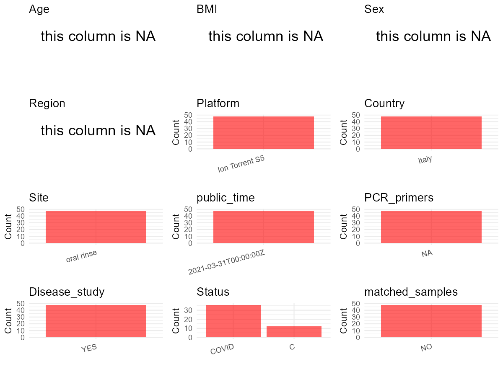

R Notebook: Metadata Processing Workflow
================

# Step 1: Obtain Initial Metadata from Each Project

To obtain the initial metadata: 1. Search for the BioProject ID (e.g.,
“PRJEBXXXX”) on the [NCBI SRA
website](https://www.ncbi.nlm.nih.gov/Traces/study/). 2. In the “Select”
table, click on “Metadata” and download the file. 3. The downloaded file
is typically named “SraRunTable.csv” and contains metadata for the
project.

``` r
# Load necessary libraries
library(dplyr)
library(ggplot2)
library(cowplot)
library(stringr)

# Set working directory (update this path to your local directory)
setwd("E:/bioproject_YL/PRJEB42999")

# Read the initial metadata files
initial_meta <- read.csv("SraRunTable.csv", header = T)

# Display the first few rows of the metadata
head(initial_meta)
```

    ##          Run Assay.Type AvgSpotLen     Bases BioProject    BioSample     Bytes
    ## 1 ERR5264305        WGS        206 624664239 PRJEB42999 SAMEA8005050 482938227
    ## 2 ERR5264306        WGS        205 558108717 PRJEB42999 SAMEA8005051 433084372
    ## 3 ERR5264307        WGS        209 545472918 PRJEB42999 SAMEA8005052 421279915
    ## 4 ERR5264308        WGS        204 457120933 PRJEB42999 SAMEA8005053 353543858
    ## 5 ERR5264309        WGS        209 501676482 PRJEB42999 SAMEA8005054 389131823
    ## 6 ERR5264310        WGS        206 588248897 PRJEB42999 SAMEA8005055 454827490
    ##                          Center.Name Consent DATASTORE.filetype
    ## 1 UNIVERSITA' DEGLI STUDI DI FERRARA  public   fastq,run.zq,sra
    ## 2 UNIVERSITA' DEGLI STUDI DI FERRARA  public   fastq,run.zq,sra
    ## 3 UNIVERSITA' DEGLI STUDI DI FERRARA  public   fastq,run.zq,sra
    ## 4 UNIVERSITA' DEGLI STUDI DI FERRARA  public   fastq,run.zq,sra
    ## 5 UNIVERSITA' DEGLI STUDI DI FERRARA  public   fastq,run.zq,sra
    ## 6 UNIVERSITA' DEGLI STUDI DI FERRARA  public   fastq,run.zq,sra
    ##   DATASTORE.provider                     DATASTORE.region
    ## 1         gs,ncbi,s3 gs.us-east1,ncbi.public,s3.us-east-1
    ## 2         gs,ncbi,s3 gs.us-east1,ncbi.public,s3.us-east-1
    ## 3         gs,ncbi,s3 gs.us-east1,ncbi.public,s3.us-east-1
    ## 4         gs,ncbi,s3 gs.us-east1,ncbi.public,s3.us-east-1
    ## 5         gs,ncbi,s3 gs.us-east1,ncbi.public,s3.us-east-1
    ## 6         gs,ncbi,s3 gs.us-east1,ncbi.public,s3.us-east-1
    ##   ENA.FIRST.PUBLIC..run. ENA_first_public ENA.LAST.UPDATE..run. ENA_last_update
    ## 1              2021/3/30        2021/3/30              2021/2/9        2021/2/9
    ## 2              2021/3/30        2021/3/30              2021/2/9        2021/2/9
    ## 3              2021/3/30        2021/3/30              2021/2/9        2021/2/9
    ## 4              2021/3/30        2021/3/30              2021/2/9        2021/2/9
    ## 5              2021/3/30        2021/3/30              2021/2/9        2021/2/9
    ## 6              2021/3/30        2021/3/30              2021/2/9        2021/2/9
    ##   Experiment  external_id host_scientific_name
    ## 1 ERX5054641 SAMEA8005050         Homo sapiens
    ## 2 ERX5054642 SAMEA8005051         Homo sapiens
    ## 3 ERX5054643 SAMEA8005052         Homo sapiens
    ## 4 ERX5054644 SAMEA8005053         Homo sapiens
    ## 5 ERX5054645 SAMEA8005054         Homo sapiens
    ## 6 ERX5054646 SAMEA8005055         Homo sapiens
    ##                   INSDC_center_alias                  INSDC_center_name
    ## 1 UNIVERSITA' DEGLI STUDI DI FERRARA UNIVERSITA' DEGLI STUDI DI FERRARA
    ## 2 UNIVERSITA' DEGLI STUDI DI FERRARA UNIVERSITA' DEGLI STUDI DI FERRARA
    ## 3 UNIVERSITA' DEGLI STUDI DI FERRARA UNIVERSITA' DEGLI STUDI DI FERRARA
    ## 4 UNIVERSITA' DEGLI STUDI DI FERRARA UNIVERSITA' DEGLI STUDI DI FERRARA
    ## 5 UNIVERSITA' DEGLI STUDI DI FERRARA UNIVERSITA' DEGLI STUDI DI FERRARA
    ## 6 UNIVERSITA' DEGLI STUDI DI FERRARA UNIVERSITA' DEGLI STUDI DI FERRARA
    ##     INSDC_first_public    INSDC_last_update INSDC_status     Instrument
    ## 1 2021-03-30T17:22:55Z 2021-02-09T09:12:52Z       public Ion Torrent S5
    ## 2 2021-03-30T17:22:55Z 2021-02-09T09:12:52Z       public Ion Torrent S5
    ## 3 2021-03-30T17:22:55Z 2021-02-09T09:12:52Z       public Ion Torrent S5
    ## 4 2021-03-30T17:22:55Z 2021-02-09T09:12:52Z       public Ion Torrent S5
    ## 5 2021-03-30T17:22:55Z 2021-02-09T09:12:52Z       public Ion Torrent S5
    ## 6 2021-03-30T17:22:55Z 2021-02-09T09:12:52Z       public Ion Torrent S5
    ##   Library.Name LibraryLayout   LibrarySelection LibrarySource
    ## 1  unspecified        SINGLE size fractionation   METAGENOMIC
    ## 2  unspecified        SINGLE size fractionation   METAGENOMIC
    ## 3  unspecified        SINGLE size fractionation   METAGENOMIC
    ## 4  unspecified        SINGLE size fractionation   METAGENOMIC
    ## 5  unspecified        SINGLE size fractionation   METAGENOMIC
    ## 6  unspecified        SINGLE size fractionation   METAGENOMIC
    ##                Organism    Platform          ReleaseDate          create_date
    ## 1 human oral metagenome ION_TORRENT 2021-03-31T00:00:00Z 2021-04-15T07:08:00Z
    ## 2 human oral metagenome ION_TORRENT 2021-03-31T00:00:00Z 2021-04-15T07:06:00Z
    ## 3 human oral metagenome ION_TORRENT 2021-03-31T00:00:00Z 2021-04-15T07:07:00Z
    ## 4 human oral metagenome ION_TORRENT 2021-03-31T00:00:00Z 2021-04-15T07:06:00Z
    ## 5 human oral metagenome ION_TORRENT 2021-03-31T00:00:00Z 2021-04-15T07:05:00Z
    ## 6 human oral metagenome ION_TORRENT 2021-03-31T00:00:00Z 2021-04-15T07:09:00Z
    ##   version  Sample.Name Sample_name SRA.Study Submitter_Id tissue_type
    ## 1       1 SAMEA8005050     COVID-1 ERP126917      COVID-1  oropharynx
    ## 2       1 SAMEA8005051     COVID-2 ERP126917      COVID-2  oropharynx
    ## 3       1 SAMEA8005052     COVID-3 ERP126917      COVID-3  oropharynx
    ## 4       1 SAMEA8005053     COVID-4 ERP126917      COVID-4  oropharynx
    ## 5       1 SAMEA8005054     COVID-5 ERP126917      COVID-5  oropharynx
    ## 6       1 SAMEA8005055     COVID-6 ERP126917      COVID-6  oropharynx

# Step 2: Create a Uniform Metadata Template

The uniform metadata should include the following columns:

1.  **BioProject**: Project ID (e.g., “PRJNA339212”)
2.  **Run**: Sample ID (e.g., “ERRXXXXXX” or “SRRXXXXXX”)
3.  **sample_name**: Original sample name submitted by the authors (not
    the database-assigned ID)
4.  **Age**: Age of the subject (if available)
5.  **BMI**: Body Mass Index (if available)
6.  **Sex**: Sex of the subject (“F” or “M”)
7.  **Region**: Targeted 16S rRNA region (e.g., “V3-V4”)
8.  **Platform**: Sequencing platform (e.g., “Illumina MiSeq”)
9.  **Country**: Country of sample origin (e.g., “China”)
10. **Site**: Sample site (e.g., “saliva”, “dental plaque”)
11. **public_time**: Data release date (format: “YYYY-MM-DD”)
12. **PCR_primers**: PCR primers used (e.g., “515F-806R”)
13. **title**: Title of the associated publication
14. **Disease_study**: Whether the study involves a disease (“YES” or
    “NO”)
15. **Status**: Disease status (e.g., “T2DM”, “HC”). Note: If the study
    includes both disease and healthy samples, this must be specified
    per sample.
16. **matched_samples**: matched samples (“YES” or “NO”)

``` r
# Create a uniform metadata dataframe
metadata <- data.frame(
  BioProject = initial_meta$BioProject,
  Run = initial_meta$Run,
  sample_name = initial_meta$Submitter_Id,
  Age = NA,
  BMI = NA,  
  Sex = NA,
  Region = NA,
  Platform = initial_meta$Instrument,
  Country = "Italy",
  Site = "oral rinse",
  public_time = initial_meta$ReleaseDate,
  Status = initial_meta$Sample_name,
  stringsAsFactors = FALSE
)
```

# Step 3: Manually Add Information from the Publication

Some information (e.g. PCR primers, study title, disease status) must be
manually extracted from the publication and added to the metadata.

``` r
# Add information obtained from the publication
metadata$PCR_primers <- "NA"
metadata$title <- "Oral microbiome dysbiosis is associated with symptoms severity and local immune inflammatory response in COVID-19 patients A cross-sectional study"
metadata$Disease_study <- "YES"
# Assign disease status based on sample_name patterns
metadata <- metadata %>%
  mutate(Status = case_when(
    str_detect(Status, "^COVID") ~ "COVID",
    str_detect(Status, "^CTR") ~ "C",
    TRUE ~ Status
  ))

# Check initial data distribution
cat("Initial sample distribution:\n")
```

    ## Initial sample distribution:

``` r
table(metadata$sample_name)
```

    ## 
    ##  COVID-1 COVID-10 COVID-11 COVID-12 COVID-13 COVID-14 COVID-15 COVID-16 
    ##        1        1        1        1        1        1        1        1 
    ## COVID-17 COVID-18 COVID-19  COVID-2 COVID-20 COVID-21 COVID-22 COVID-23 
    ##        1        1        1        1        1        1        1        1 
    ## COVID-24 COVID-25 COVID-26 COVID-27 COVID-28 COVID-29  COVID-3 COVID-30 
    ##        1        1        1        1        1        1        1        1 
    ## COVID-31 COVID-32 COVID-33 COVID-34 COVID-35 COVID-36  COVID-4  COVID-5 
    ##        1        1        1        1        1        1        1        1 
    ##  COVID-6  COVID-7  COVID-8  COVID-9    CTR-1   CTR-10   CTR-11   CTR-12 
    ##        1        1        1        1        1        1        1        1 
    ##    CTR-2    CTR-3    CTR-4    CTR-5    CTR-6    CTR-7    CTR-8    CTR-9 
    ##        1        1        1        1        1        1        1        1

``` r
table(metadata$Site)
```

    ## 
    ## oral rinse 
    ##         48

``` r
# Calculate sampling frequency per subject
sample_counts <- table(metadata$sample_name)
cat("\nNumber of samples per subject:\n")
```

    ## 
    ## Number of samples per subject:

``` r
print(sample_counts)
```

    ## 
    ##  COVID-1 COVID-10 COVID-11 COVID-12 COVID-13 COVID-14 COVID-15 COVID-16 
    ##        1        1        1        1        1        1        1        1 
    ## COVID-17 COVID-18 COVID-19  COVID-2 COVID-20 COVID-21 COVID-22 COVID-23 
    ##        1        1        1        1        1        1        1        1 
    ## COVID-24 COVID-25 COVID-26 COVID-27 COVID-28 COVID-29  COVID-3 COVID-30 
    ##        1        1        1        1        1        1        1        1 
    ## COVID-31 COVID-32 COVID-33 COVID-34 COVID-35 COVID-36  COVID-4  COVID-5 
    ##        1        1        1        1        1        1        1        1 
    ##  COVID-6  COVID-7  COVID-8  COVID-9    CTR-1   CTR-10   CTR-11   CTR-12 
    ##        1        1        1        1        1        1        1        1 
    ##    CTR-2    CTR-3    CTR-4    CTR-5    CTR-6    CTR-7    CTR-8    CTR-9 
    ##        1        1        1        1        1        1        1        1

``` r
# Create matched_samples column
metadata$matched_samples <- ifelse(metadata$sample_name %in% names(sample_counts[sample_counts >= 2]), "YES", "NO")

cat("\nMatched samples distribution:\n")
```

    ## 
    ## Matched samples distribution:

``` r
table(metadata$matched_samples)
```

    ## 
    ## NO 
    ## 48

``` r
# Identify samples for removal: single samples excluding oral rinse
single_samples <- names(sample_counts[sample_counts == 1])
samples_to_remove <- metadata$sample_name %in% single_samples & 
                     !(metadata$Site %in% c("oral rinse"))

cat("\nNumber of samples to be removed:", sum(samples_to_remove), "\n")
```

    ## 
    ## Number of samples to be removed: 0

``` r
# Remove identified samples
metadata_clean <- metadata[!samples_to_remove, ]

cat("\nFinal sample distribution after cleaning:\n")
```

    ## 
    ## Final sample distribution after cleaning:

``` r
table(metadata_clean$sample_name)
```

    ## 
    ##  COVID-1 COVID-10 COVID-11 COVID-12 COVID-13 COVID-14 COVID-15 COVID-16 
    ##        1        1        1        1        1        1        1        1 
    ## COVID-17 COVID-18 COVID-19  COVID-2 COVID-20 COVID-21 COVID-22 COVID-23 
    ##        1        1        1        1        1        1        1        1 
    ## COVID-24 COVID-25 COVID-26 COVID-27 COVID-28 COVID-29  COVID-3 COVID-30 
    ##        1        1        1        1        1        1        1        1 
    ## COVID-31 COVID-32 COVID-33 COVID-34 COVID-35 COVID-36  COVID-4  COVID-5 
    ##        1        1        1        1        1        1        1        1 
    ##  COVID-6  COVID-7  COVID-8  COVID-9    CTR-1   CTR-10   CTR-11   CTR-12 
    ##        1        1        1        1        1        1        1        1 
    ##    CTR-2    CTR-3    CTR-4    CTR-5    CTR-6    CTR-7    CTR-8    CTR-9 
    ##        1        1        1        1        1        1        1        1

``` r
table(metadata_clean$Site)
```

    ## 
    ## oral rinse 
    ##         48

``` r
table(metadata_clean$matched_samples)
```

    ## 
    ## NO 
    ## 48

``` r
# Use cleaned dataset for subsequent analysis
metadata <- metadata_clean
```

# Step 4: Summarize and Validate the Metadata

``` r
# Check the number of unique runs and sample names
print(paste("Number of unique runs:", length(unique(metadata$Run))))
```

    ## [1] "Number of unique runs: 48"

``` r
print(paste("Number of unique sample names:", length(unique(metadata$sample_name))))
```

    ## [1] "Number of unique sample names: 48"

# Step 5: Visualize the Metadata

``` r

```


# Step 6: Finalize and Export the Metadata

``` r
# Reorder columns to match the desired format
metadata <- metadata[, c(
  "BioProject", "Run", "sample_name", "Age", "BMI", "Sex", 
  "Region", "Platform", "Country", "Site", "public_time", 
  "PCR_primers", "title", "Disease_study", "Status", "matched_samples"
)]

# Export the uniform metadata to a CSV file
write.csv(metadata, file = "metadata.csv", quote = FALSE)
head(metadata)
```

    ##   BioProject        Run sample_name Age BMI Sex Region       Platform Country
    ## 1 PRJEB42999 ERR5264305     COVID-1  NA  NA  NA     NA Ion Torrent S5   Italy
    ## 2 PRJEB42999 ERR5264306     COVID-2  NA  NA  NA     NA Ion Torrent S5   Italy
    ## 3 PRJEB42999 ERR5264307     COVID-3  NA  NA  NA     NA Ion Torrent S5   Italy
    ## 4 PRJEB42999 ERR5264308     COVID-4  NA  NA  NA     NA Ion Torrent S5   Italy
    ## 5 PRJEB42999 ERR5264309     COVID-5  NA  NA  NA     NA Ion Torrent S5   Italy
    ## 6 PRJEB42999 ERR5264310     COVID-6  NA  NA  NA     NA Ion Torrent S5   Italy
    ##         Site          public_time PCR_primers
    ## 1 oral rinse 2021-03-31T00:00:00Z          NA
    ## 2 oral rinse 2021-03-31T00:00:00Z          NA
    ## 3 oral rinse 2021-03-31T00:00:00Z          NA
    ## 4 oral rinse 2021-03-31T00:00:00Z          NA
    ## 5 oral rinse 2021-03-31T00:00:00Z          NA
    ## 6 oral rinse 2021-03-31T00:00:00Z          NA
    ##                                                                                                                                                title
    ## 1 Oral microbiome dysbiosis is associated with symptoms severity and local immune inflammatory response in COVID-19 patients A cross-sectional study
    ## 2 Oral microbiome dysbiosis is associated with symptoms severity and local immune inflammatory response in COVID-19 patients A cross-sectional study
    ## 3 Oral microbiome dysbiosis is associated with symptoms severity and local immune inflammatory response in COVID-19 patients A cross-sectional study
    ## 4 Oral microbiome dysbiosis is associated with symptoms severity and local immune inflammatory response in COVID-19 patients A cross-sectional study
    ## 5 Oral microbiome dysbiosis is associated with symptoms severity and local immune inflammatory response in COVID-19 patients A cross-sectional study
    ## 6 Oral microbiome dysbiosis is associated with symptoms severity and local immune inflammatory response in COVID-19 patients A cross-sectional study
    ##   Disease_study Status matched_samples
    ## 1           YES  COVID              NO
    ## 2           YES  COVID              NO
    ## 3           YES  COVID              NO
    ## 4           YES  COVID              NO
    ## 5           YES  COVID              NO
    ## 6           YES  COVID              NO

## Notes for Students:

1.  **Metadata Accuracy**: Always cross-check the metadata with the
    original publication to ensure accuracy.
2.  **Manual Entries**: Columns like `PCR_primers`, and `Status` often
    require manual entry based on the publication.
3.  **Disease Status**: Be careful when assigning `Status`—some studies
    include both disease and healthy samples.
4.  **Visualization**: The plots help quickly identify the distribution
    of values in each column, which is useful for quality control.
5.  **Reproducibility**: Update the working directory and file paths to
    match your local environment.
