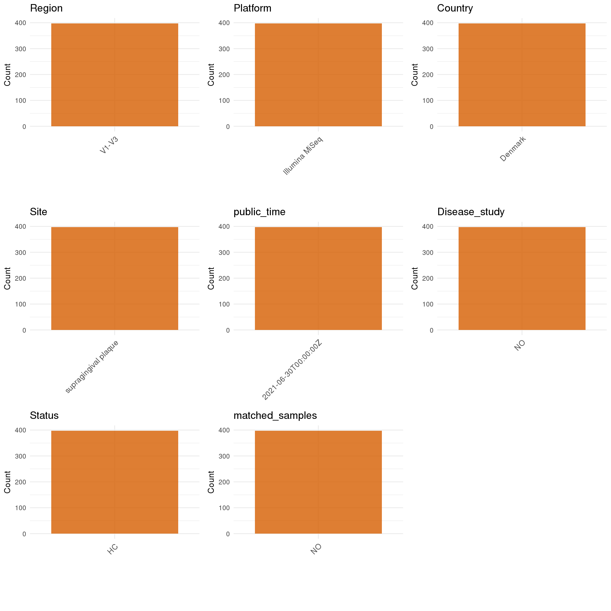

# Step 1: Obtain Initial Metadata from Each Project

This step sets the project directory and loads the raw SRA metadata.

```{r message=FALSE, warning=FALSE}
# Load libraries
library(dplyr)
library(ggplot2)
library(cowplot)

# (1) Setting working directory
project_id <- "PRJEB43048"

base_dir <- "E:/工作区/VSCode/RNAproject/collect_metadata_respon/project"
setwd(file.path(base_dir, project_id))

# (2) Loading raw SRA metadata file
sra_file <- "SraRunTable.csv"
initial_meta <- read.csv(sra_file, header = TRUE, stringsAsFactors = FALSE)
```

# Step 2: Data Overview

First, you need to get an overview of the data, which includes two steps: reading the article and reading the initial metadata. This step is very IMPORTANT!

```{r message=FALSE, warning=FALSE}
# (1) Read the article in the following order: abstract, the beginning of the results section, and the methods.
# Paper-supported study facts used for this project:
# - Title: Probiotics Do Not Alter the Long-Term Stability of the Supragingival Microbiota in Healthy Subjects: A Randomized Controlled Trial
# - Study design: randomized placebo-controlled longitudinal trial with baseline, week 4, week 8, and week 12 sampling
# - Study population: 110 orally and systemically healthy individuals aged 19-31 years, probiotic n = 55 and placebo n = 55
# - Sample type for this metadata: pooled supragingival plaque
# - Methods sampling counts: 440 plaque samples planned and 400 plaque samples collected
# - Results sequencing counts: 31 samples failed quality control and 369 samples were analyzed downstream
# - SRA deposition: SraRunTable.csv contains 398 human amplicon runs, so the deposited run count is lower than the collected sample count reported in the paper
# - Sequencing from Methods: bacterial 16S V1-V3, primers 27F and 534R, sequenced on Illumina MiSeq (2 x 300)
#
# === AUDIT LOG (2026-05-09) ===
# Issue 1: is_time_series was incorrectly set to "yes" for an intervention study.
#   - This is a probiotic vs placebo intervention trial, not a natural time-series.
#   - Per CLAUDE.md rules: intervention/treatment follow-up studies should have is_time_series = "no".
#   - Fix: Changed is_time_series from "yes" to "no".
#
# Issue 2: pcr_primers was stored as full sequences instead of primer names.
#   - Original: F-AGAGTTTGATCCTGGCTCAG,R-ATTACCGCGGCTGCTGG
#   - Verified via grok-search (PMC3811346, PMC4536222): 27F-534R is the standard name for V1-V3 primers.
#   - 27F sequence: AGAGTTTGATCCTGGCTCAG (position 8-27)
#   - 534R sequence: ATTACCGCGGCTGCTGG (position 518-534)
#   - Fix: Changed to standard format "27F-534R".
#
# Issue 3: subject_id was incorrectly left as NA.
#   - Sample_name format analysis: YYMMDD-XXX (e.g., "201005-100", "201002-50").
#   - Analysis shows same suffix XXX appears across different date prefixes (multiple timepoints per subject).
#   - Example: suffix "100" appears in 201005, 201002, 201014, etc. (same person sampled repeatedly).
#   - 157 unique suffixes found, matching ~110 subjects with dropout at later timepoints.
#   - Fix: Extract subject_id from Sample_name suffix (the numeric part after "-").
#   - Source: user decision based on data pattern analysis (no supplementary material available).
#
# Issue 4: site confirmed as "supragingival plaque" (方案A).
#   - Paper Section 4.4: pooled samples from lingual surface of lower molars/incisors + buccal surface of upper molars/canines.
#   - Since samples are pooled, use the paper's standard term "supragingival plaque".
#   - site_group = "oral" is correct.
#
# Issue 5: status = HC (healthy control) confirmed.
#   - Paper explicitly states: "110 orally and systemically healthy individuals" aged 19-31 years.
#   - Inclusion criteria: no dental caries, periodontitis, or systemic diseases.
#   - This is a preventive/prophylactic study on probiotics in healthy population, NOT a disease study.
#   - disease_study = "no" and status = "HC" are correct.

# (2) IMPORTANT: summarize what initial_meta directly provides versus what still requires the paper
# head(initial_meta, 10)
# colnames(initial_meta)
# table(initial_meta$common_name)
# table(initial_meta$host_scientific_name)
# table(initial_meta$Instrument)
# table(initial_meta$ReleaseDate)
# table(substr(initial_meta$Sample_name, 1, 6))
# Directly available in SRA: Run, BioSample, Sample_name, ReleaseDate, Instrument, host_scientific_name
# Must come from the paper: site, status, age_info, sequencing_region, pcr_primers, and the longitudinal interpretation
# All deposited rows are human paired-end amplicon samples sequenced on Illumina MiSeq.
# Sample_name mixes several date-like prefixes and numeric suffixes, but the paper reports repeated sampling at four time points.
# Still unavailable after paper review: stable subject_id, per-sample age, per-sample sex, and per-sample bmi.
# The raw SRA names do not provide a reliable one-column subject identifier for the 110-person cohort, so subject_id is left NA.
```

# Step 3: Removing Control and Non-human Samples

First, we need to remove control samples(including both negative controls and positive controls) and non-human samples.

```{r}
# (1) Parameter setup
control_column <- ""
control_keywords <- c()

species_column <- "host_scientific_name"
unique(initial_meta[[species_column]])
non_human_keywords <- c()

# (2) Remove controls and non-human samples. DO NOT need to modify code in this part, just run it.
n_samples <- nrow(initial_meta)
# Control evaluation
if (length(control_keywords) > 0) {
  if (is.null(control_column) || control_column == "") {
    stop("Error: control_keywords provided but control_column is missing.")
  }

  if (!(control_column %in% colnames(initial_meta))) {
    stop(sprintf("Error: Column '%s' not found in initial_meta.", control_column))
  }

  control_pattern <- paste(control_keywords, collapse = "|")
  control_text <- initial_meta[[control_column]]
  is_control <- grepl(control_pattern, control_text)

} else {
  is_control <- rep(FALSE, n_samples)
}

# Non-human evaluation
if (length(non_human_keywords) > 0) {
  if (is.null(species_column) || species_column == "") {
    stop("Error: non_human_keywords provided but species_column is missing.")
  }

  if (!(species_column %in% colnames(initial_meta))) {
    stop(sprintf("Error: Column '%s' not found in initial_meta.", species_column))
  }

  non_human_pattern <- paste(non_human_keywords, collapse = "|")
  species_text <- initial_meta[[species_column]]
  is_non_human <- grepl(non_human_pattern, species_text)
} else {
  is_non_human <- rep(FALSE, n_samples)
}

# Execute removal
samples_to_remove <- is_control | is_non_human
initial_meta <- initial_meta[!samples_to_remove, ]

cat("Initial samples counts:", n_samples, "\n")
cat("Removed control samples:", sum(is_control), "\n")
cat("Removed non-human samples:", sum(is_non_human), "\n")
cat("Total samples removed ", sum(samples_to_remove), "\n")
cat("Remaining samples after Step 2:", nrow(initial_meta), "\n")
```

# Step 4: Creating a Uniform Metadata Template

This step converts the raw SRA table into the standard metadata format used in our meta-analysis.

```{r}
# Extract subject_id from Sample_name: format is YYMMDD-XXX where XXX is the subject number
# Example: "201005-100" -> subject_id = "100", "201002-50" -> subject_id = "50"
raw_subject_id <- sub("^.*-", "", initial_meta$Sample_name)

metadata <- data.frame(
  bioproject = initial_meta$BioProject,
  sample_id = initial_meta$Run,
  subject_id = raw_subject_id,  # AUDIT FIX: Extract from Sample_name suffix (Issue 3)
  age = NA_real_,
  age_info = "19-31 years",
  bmi = NA_real_,
  sex = NA_character_,
  sequencing_region = "V1-V3",
  platform = "Illumina MiSeq",
  country = "Denmark",
  site = "supragingival plaque",  # AUDIT: Paper standard term for pooled samples (方案A)
  site_group = "pending",
  public_time = sub("T.*$", "", initial_meta$ReleaseDate),
  pcr_primers = "27F-534R",  # AUDIT FIX: Changed from sequence format to standard primer name (Issue 2)
  title = "Probiotics Do Not Alter the Long-Term Stability of the Supragingival Microbiota in Healthy Subjects: A Randomized Controlled Trial",
  disease_study = "no",
  status = "HC",
  matched_samples = "yes",
  is_time_series = "no",  # AUDIT FIX: Changed from "yes" to "no" because this is an intervention study (Issue 1)
  stringsAsFactors = FALSE
)

# Source notes for non-obvious fields:
# - subject_id: extracted from Sample_name suffix (YYMMDD-XXX format, where XXX is the subject number).
#   Same suffix appears across different dates representing repeated sampling of the same person.
# - age_info uses the cohort age range from Table 1 because per-subject ages are not available in SRA.
# - sex is left NA because only group-level female/male counts are reported in Table 1.
# - sequencing_region, platform, and pcr_primers come from Methods sections 4.7 and 4.8 rather than SRA instrument metadata.
# - pcr_primers: 27F-534R (verified via grok-search PMC4536222: "27F-534R primer pair covering the V1-V3 regions").
# - site: "supragingival plaque" (paper standard term for pooled samples from multiple tooth surfaces).
# - country is set to Denmark because participants were recruited at the University of Copenhagen, Denmark.
# - status is set to HC because the paper explicitly describes orally and systemically healthy subjects.
# - the paper reports 400 collected plaque samples and 369 downstream-analyzed samples after QC, whereas SRA contains 398 deposited runs.
# - matched_samples is "yes" because the study design involves repeated sampling at baseline/week4/week8/week12.
# - is_time_series is "no" because this is an intervention study (probiotic vs placebo), not a natural time-series study per CLAUDE.md rules.
metadata$public_time <- as.Date(metadata$public_time)
```

# Step 5: Manually solving pending issues

This step involves two parts: (1) handle the columns with the `raw_` prefix, and next (2) handle the `site_group` and `matched_samples` columns.

```{r}
# (1) No raw_ columns needed for this project.
metadata <- metadata
```

```{r}
# (2) Filling the 'site_group' and 'matched_samples' columns
unique(metadata$site)
Oral_site = c("supragingival plaque")
Gut_site = c("feces")

metadata <- metadata %>%
  mutate(site_group = case_when(
    site %in% Oral_site ~ "oral",
    site %in% Gut_site ~ "gut",
    TRUE ~ "other"
  ))

# matched_samples is set from the repeated-measures study design rather than computed from Sample_name,
# because the deposited run labels do not preserve a reliable one-column subject identifier.
metadata$matched_samples <- "yes"
```

```{r}
# (3) check if there is pending value in metadata. If there is pending value, go on modify the metadata.
has_pending <- function(col) {
  if (is.character(col) || is.factor(col)) {
    any(col == "pending", na.rm = TRUE)
  } else {
    FALSE
  }
}

any_pending_value <- any(sapply(metadata, has_pending))

if (!any_pending_value) {
  message("Good! No cell contains the value 'pending'.")
} else {
  pending_cols <- names(metadata)[sapply(metadata, has_pending)]
  message("Columns containing 'pending': ", paste(pending_cols, collapse = ", "))
  message("Please continue to resolve these pending columns!")
}
```

# Step 6: Visualize the Metadata

This step makes a quick set of plots for checking the distribution of key metadata fields.

```{r}
plot_data <- metadata %>%
  select(-bioproject, -sample_id, -subject_id, -title)

create_simple_plots <- function(data) {
  plots <- list()
  continuous_vars <- c("age", "bmi")

  for (col in colnames(data)) {
    if (all(is.na(data[[col]]))) {
      p <- ggplot() +
        annotate("text", x = 0.5, y = 0.5, label = "this column is NA", size = 6) +
        labs(title = col) +
        theme_void()
    } else if (col %in% continuous_vars && is.numeric(data[[col]])) {
      p <- ggplot(data, aes(x = .data[[col]])) +
        geom_histogram(fill = "blue", alpha = 0.6, bins = 20, na.rm = TRUE) +
        labs(title = col, x = col, y = "Count") +
        theme_minimal()
    } else {
      count_data <- as.data.frame(table(data[[col]], useNA = "ifany"))
      p <- ggplot(count_data, aes(x = reorder(Var1, -Freq), y = Freq)) +
        geom_col(fill = "red", alpha = 0.6) +
        labs(title = col, x = NULL, y = "Count") +
        theme_minimal() +
        theme(axis.text.x = element_text(angle = 15, hjust = 1))
    }
    plots[[col]] <- p
  }

  return(plots)
}

plots <- create_simple_plots(plot_data)
p <- plot_grid(plots$age,
               plots$bmi,
               plots$sex,
               plots$site,
               plots$site_group,
               plots$sequencing_region,
               plots$platform,
               plots$country,
               plots$status,
               plots$matched_samples,
               ncol = 3, align = "hv", axis = "lb")
ggsave("Metadata_Summary.png", plot = p, width = 8, height = 6, dpi = 150)
```

```{r}

```

# Step 7: Sort and export the metadata

This step saves the cleaned metadata table as the final `metadata.csv` file.

```{r}
fixed_cols <- c("bioproject", "sample_id", "subject_id", "age", "age_info",
                "bmi", "sex", "platform", "sequencing_region", "pcr_primers",
                "country", "site", "site_group", "disease_study", "status",
                "title", "public_time", "matched_samples", "is_time_series")
metadata <- metadata %>%
  select(all_of(fixed_cols))

write.csv(metadata, file = "metadata.csv", quote = TRUE, row.names = FALSE)
```
