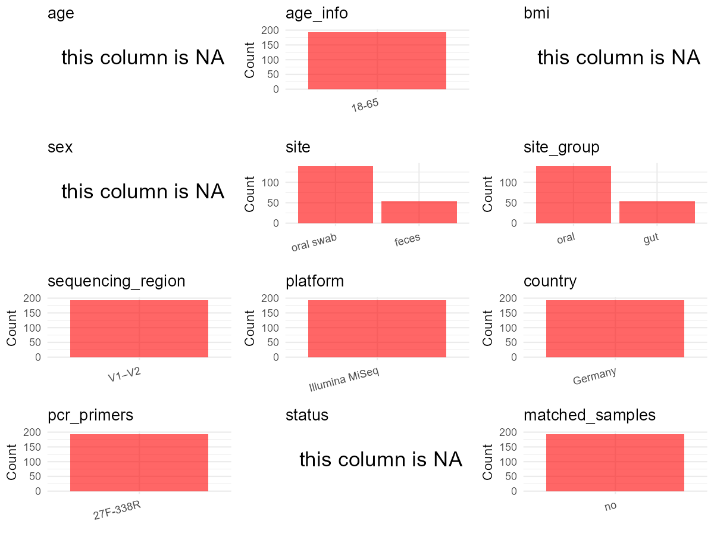

R Notebook: Metadata Processing Workflow
================

# Step 1: Obtain Initial Metadata from Each Project

This step sets the project directory, loads the raw SRA metadata, and
optionally merges supplement tables.

``` r
# Load libraries
library(dplyr)
library(ggplot2)
library(cowplot)

# (1) Setting working directory
# EDIT HERE: change project_id for each study
project_id <- "PRJEB44538" 

base_dir <- "E:/oral/26/metadata-2604/Oral-Metadata-YL-02"
setwd(file.path(base_dir, project_id))

# (2) Loading raw SRA metadata file
sra_file <- "SraRunTable.csv"
initial_meta <- read.csv(sra_file, header = TRUE)

# (3) OPTIONAL: If extra metadata (e.g., Table.x or supplemental materials) are available from the article, you may need to merge the file with initial_meta manually. Below is example code for merging. Depending on the specific case of each study, you can customize the code as needed.
#supp_table <- read.csv("supplemental_table_v2.csv", header = TRUE)
#initial_meta <- left_join(initial_meta, supp_table, by = "Sample.Name")
```

# Step 2: Data Overview

First, you need to get an overview of the data, which includes two
steps: reading the article and reading the initial metadata. This step
is very IMPORTANT!

``` r
# (1) Read the article in the following order: abstract, the beginning of the results section, and the methods. Understand the sample size, experimental design, and disease group overview. Clarify the sampling sites; for oral and gut samples, specify the exact sites like supragingival plaque, tongue, etc.

# (2) IMPORTANT: MUST go through each column of initial_meta
head(initial_meta, 10)
```

    ##           Run Assay.Type AvgSpotLen    Bases BioProject    BioSample    Bytes
    ## 1  ERR5770496   AMPLICON        602 15486450 PRJEB44538 SAMEA8619452  9992196
    ## 2  ERR5770497   AMPLICON        602 19148416 PRJEB44538 SAMEA8619453 12342038
    ## 3  ERR5770498   AMPLICON        602 15884372 PRJEB44538 SAMEA8619454 10260238
    ## 4  ERR5770499   AMPLICON        602 13074236 PRJEB44538 SAMEA8619455  8395456
    ## 5  ERR5770500   AMPLICON        602 19381390 PRJEB44538 SAMEA8619456 12349416
    ## 6  ERR5770501   AMPLICON        602 10867906 PRJEB44538 SAMEA8619457  7076464
    ## 7  ERR5770502   AMPLICON        602 18474778 PRJEB44538 SAMEA8619458 11886826
    ## 8  ERR5770503   AMPLICON        602 16107714 PRJEB44538 SAMEA8619459 10387288
    ## 9  ERR5770504   AMPLICON        602 10586170 PRJEB44538 SAMEA8619460  6771902
    ## 10 ERR5770505   AMPLICON        602 13106744 PRJEB44538 SAMEA8619461  8456636
    ##           Center.Name Collection_Date common_name Consent DATASTORE.filetype
    ## 1  UNIVERSITY OF KIEL            2019 Human stool  public   fastq,run.zq,sra
    ## 2  UNIVERSITY OF KIEL            2019 Human stool  public   fastq,run.zq,sra
    ## 3  UNIVERSITY OF KIEL            2019 Human stool  public   fastq,run.zq,sra
    ## 4  UNIVERSITY OF KIEL            2019 Human stool  public   fastq,run.zq,sra
    ## 5  UNIVERSITY OF KIEL            2019 Human stool  public   fastq,run.zq,sra
    ## 6  UNIVERSITY OF KIEL            2019 Human stool  public   fastq,run.zq,sra
    ## 7  UNIVERSITY OF KIEL            2019 Human stool  public   fastq,run.zq,sra
    ## 8  UNIVERSITY OF KIEL            2019 Human stool  public   fastq,run.zq,sra
    ## 9  UNIVERSITY OF KIEL            2019 Human stool  public   fastq,run.zq,sra
    ## 10 UNIVERSITY OF KIEL            2019 Human stool  public   fastq,run.zq,sra
    ##    DATASTORE.provider                     DATASTORE.region
    ## 1          gs,ncbi,s3 gs.us-east1,ncbi.public,s3.us-east-1
    ## 2          gs,ncbi,s3 gs.us-east1,ncbi.public,s3.us-east-1
    ## 3          gs,ncbi,s3 gs.us-east1,ncbi.public,s3.us-east-1
    ## 4          gs,ncbi,s3 gs.us-east1,ncbi.public,s3.us-east-1
    ## 5          gs,ncbi,s3 gs.us-east1,ncbi.public,s3.us-east-1
    ## 6          gs,ncbi,s3 gs.us-east1,ncbi.public,s3.us-east-1
    ## 7          gs,ncbi,s3 gs.us-east1,ncbi.public,s3.us-east-1
    ## 8          gs,ncbi,s3 gs.us-east1,ncbi.public,s3.us-east-1
    ## 9          gs,ncbi,s3 gs.us-east1,ncbi.public,s3.us-east-1
    ## 10         gs,ncbi,s3 gs.us-east1,ncbi.public,s3.us-east-1
    ##    ENA.FIRST.PUBLIC..run. ENA.LAST.UPDATE..run. environment_.biome.
    ## 1              2021-04-27            2021-04-26       ENVO:00000446
    ## 2              2021-04-27            2021-04-26       ENVO:00000446
    ## 3              2021-04-27            2021-04-26       ENVO:00000446
    ## 4              2021-04-27            2021-04-26       ENVO:00000446
    ## 5              2021-04-27            2021-04-26       ENVO:00000446
    ## 6              2021-04-27            2021-04-26       ENVO:00000446
    ## 7              2021-04-27            2021-04-26       ENVO:00000446
    ## 8              2021-04-27            2021-04-26       ENVO:00000446
    ## 9              2021-04-27            2021-04-26       ENVO:00000446
    ## 10             2021-04-27            2021-04-26       ENVO:00000446
    ##    environment_.feature. environment_.material. Experiment  external_id
    ## 1           ENVO:2100003         UBERON:0002097 ERX5478803 SAMEA8619452
    ## 2           ENVO:2100003         UBERON:0002097 ERX5478804 SAMEA8619453
    ## 3           ENVO:2100003         UBERON:0002097 ERX5478805 SAMEA8619454
    ## 4           ENVO:2100003         UBERON:0002097 ERX5478806 SAMEA8619455
    ## 5           ENVO:2100003         UBERON:0002097 ERX5478807 SAMEA8619456
    ## 6           ENVO:2100003         UBERON:0002097 ERX5478808 SAMEA8619457
    ## 7           ENVO:2100003         UBERON:0002097 ERX5478809 SAMEA8619458
    ## 8           ENVO:2100003         UBERON:0002097 ERX5478810 SAMEA8619459
    ## 9           ENVO:2100003         UBERON:0002097 ERX5478811 SAMEA8619460
    ## 10          ENVO:2100003         UBERON:0002097 ERX5478812 SAMEA8619461
    ##    geo_loc_name_country geo_loc_name_country_continent
    ## 1               Germany                         Europe
    ## 2               Germany                         Europe
    ## 3               Germany                         Europe
    ## 4               Germany                         Europe
    ## 5               Germany                         Europe
    ## 6               Germany                         Europe
    ## 7               Germany                         Europe
    ## 8               Germany                         Europe
    ## 9               Germany                         Europe
    ## 10              Germany                         Europe
    ##    geographic_location_.country_and.or_sea. geographic_location_.latitude.
    ## 1                                   Germany                       54.32133
    ## 2                                   Germany                       54.32133
    ## 3                                   Germany                       54.32133
    ## 4                                   Germany                       54.32133
    ## 5                                   Germany                       54.32133
    ## 6                                   Germany                       54.32133
    ## 7                                   Germany                       54.32133
    ## 8                                   Germany                       54.32133
    ## 9                                   Germany                       54.32133
    ## 10                                  Germany                       54.32133
    ##    geographic_location_.longitude.  INSDC_center_name   INSDC_first_public
    ## 1                         10.13489 UNIVERSITY OF KIEL 2021-04-27T00:42:00Z
    ## 2                         10.13489 UNIVERSITY OF KIEL 2021-04-27T00:42:00Z
    ## 3                         10.13489 UNIVERSITY OF KIEL 2021-04-27T00:42:00Z
    ## 4                         10.13489 UNIVERSITY OF KIEL 2021-04-27T00:42:00Z
    ## 5                         10.13489 UNIVERSITY OF KIEL 2021-04-27T00:42:00Z
    ## 6                         10.13489 UNIVERSITY OF KIEL 2021-04-27T00:42:00Z
    ## 7                         10.13489 UNIVERSITY OF KIEL 2021-04-27T00:42:00Z
    ## 8                         10.13489 UNIVERSITY OF KIEL 2021-04-27T00:42:00Z
    ## 9                         10.13489 UNIVERSITY OF KIEL 2021-04-27T00:42:00Z
    ## 10                        10.13489 UNIVERSITY OF KIEL 2021-04-27T00:42:00Z
    ##       INSDC_last_update INSDC_status     Instrument investigation_type
    ## 1  2021-04-26T15:14:39Z       public Illumina MiSeq         metagenome
    ## 2  2021-04-26T15:14:39Z       public Illumina MiSeq         metagenome
    ## 3  2021-04-26T15:14:39Z       public Illumina MiSeq         metagenome
    ## 4  2021-04-26T15:14:39Z       public Illumina MiSeq         metagenome
    ## 5  2021-04-26T15:14:39Z       public Illumina MiSeq         metagenome
    ## 6  2021-04-26T15:14:39Z       public Illumina MiSeq         metagenome
    ## 7  2021-04-26T15:14:40Z       public Illumina MiSeq         metagenome
    ## 8  2021-04-26T15:14:40Z       public Illumina MiSeq         metagenome
    ## 9  2021-04-26T15:14:40Z       public Illumina MiSeq         metagenome
    ## 10 2021-04-26T15:14:40Z       public Illumina MiSeq         metagenome
    ##    Library.Name LibraryLayout LibrarySelection LibrarySource
    ## 1        J10135        PAIRED              PCR   METAGENOMIC
    ## 2        J10137        PAIRED              PCR   METAGENOMIC
    ## 3        J10138        PAIRED              PCR   METAGENOMIC
    ## 4        J10139        PAIRED              PCR   METAGENOMIC
    ## 5        J10140        PAIRED              PCR   METAGENOMIC
    ## 6        J10141        PAIRED              PCR   METAGENOMIC
    ## 7        J10143        PAIRED              PCR   METAGENOMIC
    ## 8        J10147        PAIRED              PCR   METAGENOMIC
    ## 9        J10148        PAIRED              PCR   METAGENOMIC
    ## 10       J10150        PAIRED              PCR   METAGENOMIC
    ##                Organism Platform  project_name          ReleaseDate
    ## 1  human gut metagenome ILLUMINA MS study 2020 2021-04-28T00:00:00Z
    ## 2  human gut metagenome ILLUMINA MS study 2020 2021-04-28T00:00:00Z
    ## 3  human gut metagenome ILLUMINA MS study 2020 2021-04-28T00:00:00Z
    ## 4  human gut metagenome ILLUMINA MS study 2020 2021-04-28T00:00:00Z
    ## 5  human gut metagenome ILLUMINA MS study 2020 2021-04-28T00:00:00Z
    ## 6  human gut metagenome ILLUMINA MS study 2020 2021-04-28T00:00:00Z
    ## 7  human gut metagenome ILLUMINA MS study 2020 2021-04-28T00:00:00Z
    ## 8  human gut metagenome ILLUMINA MS study 2020 2021-04-28T00:00:00Z
    ## 9  human gut metagenome ILLUMINA MS study 2020 2021-04-28T00:00:00Z
    ## 10 human gut metagenome ILLUMINA MS study 2020 2021-04-28T00:00:00Z
    ##             create_date version  Sample.Name Sample_name
    ## 1  2021-04-30T14:13:00Z       1 SAMEA8619452      J10135
    ## 2  2021-04-30T14:13:00Z       1 SAMEA8619453      J10137
    ## 3  2021-05-07T16:30:00Z       1 SAMEA8619454      J10138
    ## 4  2021-05-07T16:30:00Z       1 SAMEA8619455      J10139
    ## 5  2021-05-07T16:30:00Z       1 SAMEA8619456      J10140
    ## 6  2021-04-30T14:13:00Z       1 SAMEA8619457      J10141
    ## 7  2021-04-30T14:13:00Z       1 SAMEA8619458      J10143
    ## 8  2021-05-07T16:30:00Z       1 SAMEA8619459      J10147
    ## 9  2021-05-07T16:30:00Z       1 SAMEA8619460      J10148
    ## 10 2021-05-07T16:30:00Z       1 SAMEA8619461      J10150
    ##                                                 Sequencing_method SRA.Study
    ## 1  Illumina MiSeq using v3 chemistry for 2x300bp paired-end reads ERP128598
    ## 2  Illumina MiSeq using v3 chemistry for 2x300bp paired-end reads ERP128598
    ## 3  Illumina MiSeq using v3 chemistry for 2x300bp paired-end reads ERP128598
    ## 4  Illumina MiSeq using v3 chemistry for 2x300bp paired-end reads ERP128598
    ## 5  Illumina MiSeq using v3 chemistry for 2x300bp paired-end reads ERP128598
    ## 6  Illumina MiSeq using v3 chemistry for 2x300bp paired-end reads ERP128598
    ## 7  Illumina MiSeq using v3 chemistry for 2x300bp paired-end reads ERP128598
    ## 8  Illumina MiSeq using v3 chemistry for 2x300bp paired-end reads ERP128598
    ## 9  Illumina MiSeq using v3 chemistry for 2x300bp paired-end reads ERP128598
    ## 10 Illumina MiSeq using v3 chemistry for 2x300bp paired-end reads ERP128598
    ##    Submitter_Id ENA_first_public ENA_last_update INSDC_center_alias
    ## 1        J10135       2021-04-27      2021-04-26 UNIVERSITY OF KIEL
    ## 2        J10137       2021-04-27      2021-04-26 UNIVERSITY OF KIEL
    ## 3        J10138       2021-04-27      2021-04-26 UNIVERSITY OF KIEL
    ## 4        J10139       2021-04-27      2021-04-26 UNIVERSITY OF KIEL
    ## 5        J10140       2021-04-27      2021-04-26 UNIVERSITY OF KIEL
    ## 6        J10141       2021-04-27      2021-04-26 UNIVERSITY OF KIEL
    ## 7        J10143       2021-04-27      2021-04-26 UNIVERSITY OF KIEL
    ## 8        J10147       2021-04-27      2021-04-26 UNIVERSITY OF KIEL
    ## 9        J10148       2021-04-27      2021-04-26 UNIVERSITY OF KIEL
    ## 10       J10150       2021-04-27      2021-04-26 UNIVERSITY OF KIEL
    ##    human_oral_environmental_package human_gut_environmental_package
    ## 1                                                         human-gut
    ## 2                                                         human-gut
    ## 3                                                         human-gut
    ## 4                                                         human-gut
    ## 5                                                         human-gut
    ## 6                                                         human-gut
    ## 7                                                         human-gut
    ## 8                                                         human-gut
    ## 9                                                         human-gut
    ## 10                                                        human-gut
    ##    ENA.FIRST.PUBLIC ENA.LAST.UPDATE Scientific_Name
    ## 1                                                  
    ## 2                                                  
    ## 3                                                  
    ## 4                                                  
    ## 5                                                  
    ## 6                                                  
    ## 7                                                  
    ## 8                                                  
    ## 9                                                  
    ## 10

``` r
# IMPORTANT: Check the unique values in the column of interest or query column.
lapply(initial_meta[c('human_oral_environmental_package', 'human_gut_environmental_package')], table) # site
```

    ## $human_oral_environmental_package
    ## 
    ##            human-oral 
    ##         54        140 
    ## 
    ## $human_gut_environmental_package
    ## 
    ##           human-gut 
    ##       140        54

``` r
lapply(initial_meta[c('common_name')], table) # organism
```

    ## $common_name
    ## 
    ## Human stool  Human swab 
    ##          54         140

``` r
table(initial_meta$Submitter_Id) # subject id
```

    ## 
    ## I02199 I02200 I02202 I02205 I02207 I02210 I02211 I02214 I02221 I02222 I02223 
    ##      1      1      1      1      1      1      1      1      1      1      1 
    ## I02224 I02226 I02228 I02229 I02230 I02231 I02233 I02236 I02239 I02240 I02241 
    ##      1      1      1      1      1      1      1      1      1      1      1 
    ## I02242 I02243 I02244 I02245 I02246 I02247 I02248 I02249 I02251 I02252 I06621 
    ##      1      1      1      1      1      1      1      1      1      1      1 
    ## I06622 I06623 I06624 I06625 I17251 I17252 I17254 I17255 I17256 I17257 I17259 
    ##      1      1      1      1      1      1      1      1      1      1      1 
    ## I17261 I17262 I17264 I17265 I17267 J03122 J03123 J03124 J03126 J03127 J03128 
    ##      1      1      1      1      1      1      1      1      1      1      1 
    ## J03129 J03130 J03131 J03137 J03138 J03140 J03141 J03142 J03143 J03147 J03148 
    ##      1      1      1      1      1      1      1      1      1      1      1 
    ## J03150 J03152 J03153 J03154 J03155 J03156 J03158 J03160 J03161 J03162 J03163 
    ##      1      1      1      1      1      1      1      1      1      1      1 
    ## J03164 J03165 J03166 J03167 J03168 J03169 J03170 J03171 J03172 J03173 J03174 
    ##      1      1      1      1      1      1      1      1      1      1      1 
    ## J03176 J03177 J03178 J03179 J03180 J03181 J03182 J03183 J03184 J03185 J03186 
    ##      1      1      1      1      1      1      1      1      1      1      1 
    ## J06243 J06244 J06245 J10135 J10137 J10138 J10139 J10140 J10141 J10143 J10147 
    ##      1      1      1      1      1      1      1      1      1      1      1 
    ## J10148 J10150 J10152 J10155 J10156 J10159 J10162 J10164 J10165 J10166 J10167 
    ##      1      1      1      1      1      1      1      1      1      1      1 
    ## J10168 J10171 J10172 J10173 J10174 J10175 J10180 J10181 J10183 J10184 J10185 
    ##      1      1      1      1      1      1      1      1      1      1      1 
    ## J10187 J10193 J10194 J10196 J10197 J10200 J10203 J10204 J10208 J10209 J10213 
    ##      1      1      1      1      1      1      1      1      1      1      1 
    ## J10214 J10215 J10217 J10218 J10219 J10220 J10224 J10226 J10228 J10232 J10234 
    ##      1      1      1      1      1      1      1      1      1      1      1 
    ## J10235 J10238 J16008 J16011 J16019 J16020 J16021 J16023 J16025 J16029 J16038 
    ##      1      1      1      1      1      1      1      1      1      1      1 
    ## J16041 J16042 J16044 J16046 J16047 J16048 J16058 J16059 J16060 J16066 J16069 
    ##      1      1      1      1      1      1      1      1      1      1      1 
    ## J16075 J16080 J16082 J16086 J16087 J16088 J16089 J16090 J16091 J16093 J16095 
    ##      1      1      1      1      1      1      1      1      1      1      1 
    ## J16098 J16099 J16108 J16111 J16112 J16114 J16115 
    ##      1      1      1      1      1      1      1

``` r
#table(initial_meta$sequencing_meth..exp.) # output is Sequencing by synthesis
table(initial_meta$Platform) # output is Illumina. according to the methods, Illumina is correct.
```

    ## 
    ## ILLUMINA 
    ##      194

``` r
#table(initial_meta$target_subfragment..exp.)
```

# Step 3: Removing Control and Non-human Samples

First, we need to remove control samples(including both negative
controls and positive controls) and non-human samples.

``` r
# (1) EDIT HERE: Parameter setup
control_column <- "" # column name in initial_meta
# unique(initial_meta[[control_column]])
control_keywords <- c() # Enter exact keywords

species_column <- "" # column name in initial_meta
unique(initial_meta[[species_column]])
```

    ## NULL

``` r
non_human_keywords <- c() # Enter exact keywords

# (2) Remove controls and non-human samples. DO NOT need to modify code in this part, just run it.
n_samples <- nrow(initial_meta)
# Control evaluation
if (length(control_keywords) > 0) {
  if (is.null(control_column) || control_column == "") {
    stop("Error: control_keywords provided but control_column is missing.")
  }
  
  if (!(control_column %in% colnames(initial_meta))) {
    stop(sprintf("Error: Column '%s' not found in initial_meta.", control_column))
  }
  
  control_pattern <- paste(control_keywords, collapse = "|")
  control_text <- initial_meta[[control_column]]
  is_control <- grepl(control_pattern, control_text)
  
} else {
  is_control <- rep(FALSE, n_samples)
}

# Non-human evaluation
if (length(non_human_keywords) > 0) {
  if (is.null(species_column) || species_column == "") {
    stop("Error: non_human_keywords provided but species_column is missing.")
  }
  
  if (!(species_column %in% colnames(initial_meta))) {
    stop(sprintf("Error: Column '%s' not found in initial_meta.", species_column))
  }
  
  non_human_pattern <- paste(non_human_keywords, collapse = "|")
  species_text <- initial_meta[[species_column]]
  is_non_human <- grepl(non_human_pattern, species_text)
} else {
  is_non_human <- rep(FALSE, n_samples)
}

# Execute removal
samples_to_remove <- is_control | is_non_human
initial_meta <- initial_meta[!samples_to_remove, ]

cat("Initial samples counts:",n_samples,"\n")
```

    ## Initial samples counts: 194

``` r
cat("Removed control samples:", sum(is_control), "\n")
```

    ## Removed control samples: 0

``` r
cat("Removed non-human samples:", sum(is_non_human), "\n")
```

    ## Removed non-human samples: 0

``` r
cat("Total samples removed ", sum(samples_to_remove), "\n")
```

    ## Total samples removed  0

``` r
cat("Remaining samples after Step 2:", nrow(initial_meta), "\n")
```

    ## Remaining samples after Step 2: 194

# Step 4: Creating a Uniform Metadata Template

This step converts the raw SRA table into the standard metadata format
used in our meta-analysis. The uniform metadata should include the
following columns: 1. **bioproject**: Project ID from SRA or other
database e.g. `PRJNA1234`, `CNP1234`, ‘OEP1234’, ‘qiita_1234’ 2.
**sample_id**: SRA sample/run ID. Unique id for each sample!
e.g. `DRR1234567`, `ERR1234567` and `SRR1234567`. If no such column
exists, can use column like sample_name. 3. **subject_id**: subject id
for each person if available. e.g. `patient_01`, `Host_03_before`,
`subject12` 4. **age**: Age of the subject if available. e.g. `35`, `42`
\| not `adult`, `chilren` 5. **age_info**: If the age is not explicitly
stated but approximate age range information is available, mark it in
this column. e.g., `18-55`, `children`, `infant`, `elder` 6. **bmi**:
Body Mass Index if available. e.g. `22.5`, `18.9` \| not `normal`,
`overweight` 7. **sex**: Sex of the subject. Mandatory to write as M/F
\| not `female`, `woman` 8. **sequencing_region**: Targeted 16S rRNA
region. e.g. `V3-V4`, `V4` 9. **platform**: Sequencing platform.
e.g. `Illumina MiSeq`, `454 GS FLX Titanium`, `Ion Torrent` 10.
**country**: Country of sample origin. e.g. `China`, `Japan` \| not city
name like `Beijing` 11. **site**: Sampling site. For oral and gut sites,
specify the exact sites as detailed as possible. For example, if it is
known to be supragingival plaque, do not record it as ‘dental plaque’,
unless the original text provides only a vague description.
e.g. `saliva`, `tongue coating` \| not broad term like `oral` 12.
**site_group**: only accepts one of following three values: ‘oral’,
‘gut’, or ‘other’. 13. **public_time**: Data release date.
e.g. `2021-06-22` \| not `June 2021` 14. **pcr_primers**: PCR primers
used. e.g. `515F-806R`, `27F-338R` \| not primer sequences 15.
**title**: Title of the associated publication. 16. **disease_study**:
Whether the study involves disease samples. If it’s not clear, can
record as NA. Only three values accepted: ‘yes’, ‘no’ or NA 17.
**status**: Disease status for each sample if available, else record as
NA. Only accept following abbreviations, Write full names for all other
diseases. HC: healthy control CD: Crohn’s disease CRC: colorectal cancer
COPD: chronic obstructive pulmonary disease HIV: human immunodeficiency
virus ICU: intensive care unit OSCC: oral squamous cell carcinoma RA:
rheumatoid arthritis UC: ulcerative colitis 18. **matched_samples**:
Whether the subject has matched samples. Only accept ‘yes’ or ‘no’. 19.
**is_time_series**: Whether the study is a time series study. Only
accept ‘yes’ or ‘no’.

``` r
# Extract columns from initial_meta as follows: (1) No modification needed → extract directly. (2) Modification needed → create a new column with the prefix raw_ and mark the original column as “pending”. (3) Need to find or determine based on the article.
metadata <- data.frame(
  bioproject = initial_meta$BioProject,
  sample_id = initial_meta$Run,
  subject_id = initial_meta$Submitter_Id,
  age = NA,
  age_info = "18-65",
  bmi = NA,
  sex = NA,
  sequencing_region = "V1–V2", # extract from methods section
  platform = "Illumina MiSeq", # extract from methods section, NOT initial_meta
  country = initial_meta$geo_loc_name_country,
  raw_site = initial_meta$common_name,
  site = "pending", # modify later
  site_group = "pending", # modify later
  public_time = initial_meta$ReleaseDate,
  pcr_primers = "27F-338R", # Format: xxF-xxR
  title = "B-cell-depletion reverses dysbiosis of the microbiome in multiple sclerosis patients", # extract from article
  disease_study = "yes", # determine according to the article
  status = NA, # Can not distinguish between patients and healthy people, so fill in the NA. Article: We conducted an observational, longitudinal clinical cohort study analysing four timepoints over 12 months in 36 MS patients, of whom 22 initiated B‐cell depleting therapy with ocrelizumab and a healthy control group.
  # Article: Age- and gender-matched healthy controls (HCs) from the same geographic area were chosen from another study collective with identical phenotypic and lifestyle data and sample assessment (Supplemental Table S1).
  matched_samples = "pending", # modify later
  is_time_series = "no", # determine according to the article. Although there are multiple sampling time points, information about the different sampling points corresponding to sample _ id cannot be obtained, so fill in no.
  # Article: For microbiota analysis of the oral cavity and the gut, all patients provided stool and swab samples twice before the first administration of ocrelizumab (day 7 and day 0, timepoint (TP)1) 2 weeks after the first infusion (day 14, TP2), as well as 6 (TP3) and 12 (TP4) months later.
  stringsAsFactors = FALSE
)
metadata$public_time <- as.Date(metadata$public_time)
```

# Step 5: Manually solving pending issues

This step involves two parts: (1) handle the columns with the `raw_`
prefix, and next (2) handle the `site_group` and `matched_samples`
columns.

``` r
# (1) Handle the columns with the `raw_` prefix.
# In this part, you need to customize the code based on the situation of the raw_ columns to obtain the content of the target columns. IMPORTANT: Add comments if the modification is not straightforward!!
metadata <- metadata %>%
  mutate(site = case_when(
    grepl("Human swab", raw_site) ~ "oral swab",
    grepl("Human stool", raw_site) ~ "feces",
    TRUE ~ NA_character_
  )) # According to the 'common_name' column of initial_meta
```

``` r
# (2) Filling the 'site_group' and 'matched_samples' columns
# editing site_group
unique(metadata$site)
```

    ## [1] "feces"     "oral swab"

``` r
# EDIT HERE: add oral sites
Oral_site = c("oral swab")
# EDIT HERE: add gut sites
Gut_site = c("feces")
# just run
metadata <- metadata %>%
  mutate(site_group = case_when(
    site %in% Oral_site ~ "oral",
    site %in% Gut_site ~ "gut",
    TRUE ~ "other" 
  ))

# editing matched_samples, just run.
metadata$matched_samples <- ifelse(
  ave(metadata$subject_id, metadata$subject_id, FUN = length) > 1, 
  "yes", 
  "no"
)
```

``` r
# (3) check if there is pending value in metadata. If there is pending value, go on modify the metadata.
# Function to check if a column contains "pending"
has_pending <- function(col) {
  if (is.character(col) || is.factor(col)) {
    any(col == "pending", na.rm = TRUE)
  } else {
    FALSE
  }
}

# Check for any pending value
any_pending_value <- any(sapply(metadata, has_pending))

if (!any_pending_value) {
  message("Good! No cell contains the value 'pending'.")
} else {
  pending_cols <- names(metadata)[sapply(metadata, has_pending)]
  message("Columns containing 'pending': ", paste(pending_cols, collapse = ", "))
  message("Please continue to resolve these pending columns!")
}
```

    ## Good! No cell contains the value 'pending'.

# Step 6: Visualize the Metadata

This step makes a quick set of plots for checking the distribution of
key metadata fields.

``` r
# Select columns for visualization, just run
plot_data <- metadata %>%
  select(-bioproject, -sample_id, -subject_id, -title)

create_simple_plots <- function(data) {
  plots <- list()
  continuous_vars <- c("age", "bmi")

  for (col in colnames(data)) {
    if (all(is.na(data[[col]]))) {
      p <- ggplot() +
        annotate("text", x = 0.5, y = 0.5, label = "this column is NA", size = 6) +
        labs(title = col) +
        theme_void()
    } else if (col %in% continuous_vars && is.numeric(data[[col]])) {
      p <- ggplot(data, aes(x = .data[[col]])) +
        geom_histogram(fill = "blue", alpha = 0.6, bins = 20, na.rm = TRUE) +
        labs(title = col, x = col, y = "Count") +
        theme_minimal()
    } else {
      count_data <- as.data.frame(table(data[[col]], useNA = "ifany"))
      p <- ggplot(count_data, aes(x = reorder(Var1, -Freq), y = Freq)) +
        geom_col(fill = "red", alpha = 0.6) +
        labs(title = col, x = NULL, y = "Count") +
        theme_minimal() +
        theme(axis.text.x = element_text(angle = 15, hjust = 1))
    }
    plots[[col]] <- p
  }

  return(plots)
}

# Generate and arrange plots
plots <- create_simple_plots(plot_data)
p <- plot_grid(plots$age,
               plots$age_info,
               plots$bmi,
               plots$sex,
               plots$site,
               plots$site_group,
               plots$sequencing_region,
               plots$platform,
               plots$country,
               plots$pcr_primers,
               plots$status,
               plots$matched_samples,
               ncol = 3, align = "hv", axis = "lb")
ggsave("Metadata_Summary_v2.png", plot = p, width = 8, height = 6, dpi = 150)
```

``` r
# Insert Metadata_Summary.png into the current Rmd output

```


# Step 7: Sort and export the metadata

This step saves the cleaned metadata table as the final `metadata.csv`
file.

``` r
# Reorder the data frame
fixed_cols <- c("bioproject", "sample_id", "subject_id", "age", "age_info",
                "bmi", "sex", "platform", "sequencing_region", "pcr_primers", 
                "country", "site", "site_group", "disease_study", "status", 
                "title", "public_time", "matched_samples", "is_time_series")  
metadata <- metadata %>%
  select(all_of(fixed_cols), everything())

# save metadata 
# head(metadata)
write.csv(metadata, file = "metadata_v2.csv", quote = TRUE)
```
