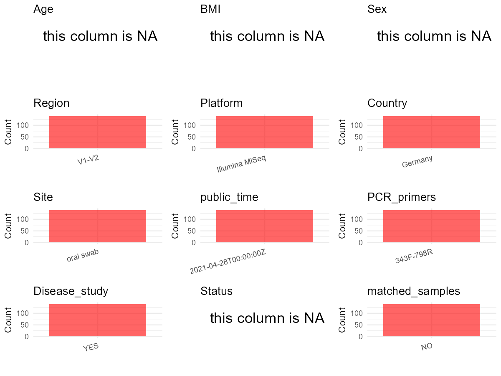

R Notebook: Metadata Processing Workflow
================

# Step 1: Obtain Initial Metadata from Each Project

To obtain the initial metadata: 1. Search for the BioProject ID (e.g.,
“PRJEBXXXX”) on the [NCBI SRA
website](https://www.ncbi.nlm.nih.gov/Traces/study/). 2. In the “Select”
table, click on “Metadata” and download the file. 3. The downloaded file
is typically named “SraRunTable.csv” and contains metadata for the
project.

``` r
# Load necessary libraries
library(dplyr)
library(ggplot2)
library(cowplot)

# Set working directory (update this path to your local directory)
setwd("D:/oral_project/PRJEB44538")

# Read the initial metadata files
initial_meta<-read.csv("SraRunTable.csv",header = T)

# Combine the two metadata files
#meta <- rbind(initial_meta, initial_meta1)

#Remove entries where Organism is "gut metagenome" (non-oral samples)
#initial_meta <- subset(initial_meta,isolation_source!= "feces")

# Check the number of samples containing "HT" in Sample.Name (e.g., healthy controls)
#nrow(subset(meta, grepl("HT", Sample.Name)))

# Display the first few rows of the metadata
head(initial_meta)
```

    ##          Run Assay.Type AvgSpotLen    Bases BioProject    BioSample    Bytes
    ## 1 ERR5770496   AMPLICON        602 15486450 PRJEB44538 SAMEA8619452  9992196
    ## 2 ERR5770497   AMPLICON        602 19148416 PRJEB44538 SAMEA8619453 12342038
    ## 3 ERR5770498   AMPLICON        602 15884372 PRJEB44538 SAMEA8619454 10260238
    ## 4 ERR5770499   AMPLICON        602 13074236 PRJEB44538 SAMEA8619455  8395456
    ## 5 ERR5770500   AMPLICON        602 19381390 PRJEB44538 SAMEA8619456 12349416
    ## 6 ERR5770501   AMPLICON        602 10867906 PRJEB44538 SAMEA8619457  7076464
    ##          Center.Name Collection_Date common_name Consent DATASTORE.filetype
    ## 1 UNIVERSITY OF KIEL            2019 Human stool  public   fastq,run.zq,sra
    ## 2 UNIVERSITY OF KIEL            2019 Human stool  public   fastq,run.zq,sra
    ## 3 UNIVERSITY OF KIEL            2019 Human stool  public   fastq,run.zq,sra
    ## 4 UNIVERSITY OF KIEL            2019 Human stool  public   fastq,run.zq,sra
    ## 5 UNIVERSITY OF KIEL            2019 Human stool  public   fastq,run.zq,sra
    ## 6 UNIVERSITY OF KIEL            2019 Human stool  public   fastq,run.zq,sra
    ##   DATASTORE.provider                     DATASTORE.region
    ## 1         gs,ncbi,s3 gs.us-east1,ncbi.public,s3.us-east-1
    ## 2         gs,ncbi,s3 gs.us-east1,ncbi.public,s3.us-east-1
    ## 3         gs,ncbi,s3 gs.us-east1,ncbi.public,s3.us-east-1
    ## 4         gs,ncbi,s3 gs.us-east1,ncbi.public,s3.us-east-1
    ## 5         gs,ncbi,s3 gs.us-east1,ncbi.public,s3.us-east-1
    ## 6         gs,ncbi,s3 gs.us-east1,ncbi.public,s3.us-east-1
    ##   ENA.FIRST.PUBLIC..run. ENA.LAST.UPDATE..run. environment_.biome.
    ## 1             2021-04-27            2021-04-26       ENVO:00000446
    ## 2             2021-04-27            2021-04-26       ENVO:00000446
    ## 3             2021-04-27            2021-04-26       ENVO:00000446
    ## 4             2021-04-27            2021-04-26       ENVO:00000446
    ## 5             2021-04-27            2021-04-26       ENVO:00000446
    ## 6             2021-04-27            2021-04-26       ENVO:00000446
    ##   environment_.feature. environment_.material. Experiment  external_id
    ## 1          ENVO:2100003         UBERON:0002097 ERX5478803 SAMEA8619452
    ## 2          ENVO:2100003         UBERON:0002097 ERX5478804 SAMEA8619453
    ## 3          ENVO:2100003         UBERON:0002097 ERX5478805 SAMEA8619454
    ## 4          ENVO:2100003         UBERON:0002097 ERX5478806 SAMEA8619455
    ## 5          ENVO:2100003         UBERON:0002097 ERX5478807 SAMEA8619456
    ## 6          ENVO:2100003         UBERON:0002097 ERX5478808 SAMEA8619457
    ##   geo_loc_name_country geo_loc_name_country_continent
    ## 1              Germany                         Europe
    ## 2              Germany                         Europe
    ## 3              Germany                         Europe
    ## 4              Germany                         Europe
    ## 5              Germany                         Europe
    ## 6              Germany                         Europe
    ##   geographic_location_.country_and.or_sea. geographic_location_.latitude.
    ## 1                                  Germany                       54.32133
    ## 2                                  Germany                       54.32133
    ## 3                                  Germany                       54.32133
    ## 4                                  Germany                       54.32133
    ## 5                                  Germany                       54.32133
    ## 6                                  Germany                       54.32133
    ##   geographic_location_.longitude.  INSDC_center_name   INSDC_first_public
    ## 1                        10.13489 UNIVERSITY OF KIEL 2021-04-27T00:42:00Z
    ## 2                        10.13489 UNIVERSITY OF KIEL 2021-04-27T00:42:00Z
    ## 3                        10.13489 UNIVERSITY OF KIEL 2021-04-27T00:42:00Z
    ## 4                        10.13489 UNIVERSITY OF KIEL 2021-04-27T00:42:00Z
    ## 5                        10.13489 UNIVERSITY OF KIEL 2021-04-27T00:42:00Z
    ## 6                        10.13489 UNIVERSITY OF KIEL 2021-04-27T00:42:00Z
    ##      INSDC_last_update INSDC_status     Instrument investigation_type
    ## 1 2021-04-26T15:14:39Z       public Illumina MiSeq         metagenome
    ## 2 2021-04-26T15:14:39Z       public Illumina MiSeq         metagenome
    ## 3 2021-04-26T15:14:39Z       public Illumina MiSeq         metagenome
    ## 4 2021-04-26T15:14:39Z       public Illumina MiSeq         metagenome
    ## 5 2021-04-26T15:14:39Z       public Illumina MiSeq         metagenome
    ## 6 2021-04-26T15:14:39Z       public Illumina MiSeq         metagenome
    ##   Library.Name LibraryLayout LibrarySelection LibrarySource
    ## 1       J10135        PAIRED              PCR   METAGENOMIC
    ## 2       J10137        PAIRED              PCR   METAGENOMIC
    ## 3       J10138        PAIRED              PCR   METAGENOMIC
    ## 4       J10139        PAIRED              PCR   METAGENOMIC
    ## 5       J10140        PAIRED              PCR   METAGENOMIC
    ## 6       J10141        PAIRED              PCR   METAGENOMIC
    ##               Organism Platform  project_name          ReleaseDate
    ## 1 human gut metagenome ILLUMINA MS study 2020 2021-04-28T00:00:00Z
    ## 2 human gut metagenome ILLUMINA MS study 2020 2021-04-28T00:00:00Z
    ## 3 human gut metagenome ILLUMINA MS study 2020 2021-04-28T00:00:00Z
    ## 4 human gut metagenome ILLUMINA MS study 2020 2021-04-28T00:00:00Z
    ## 5 human gut metagenome ILLUMINA MS study 2020 2021-04-28T00:00:00Z
    ## 6 human gut metagenome ILLUMINA MS study 2020 2021-04-28T00:00:00Z
    ##            create_date version  Sample.Name Sample_name
    ## 1 2021-04-30T14:13:00Z       1 SAMEA8619452      J10135
    ## 2 2021-04-30T14:13:00Z       1 SAMEA8619453      J10137
    ## 3 2021-05-07T16:30:00Z       1 SAMEA8619454      J10138
    ## 4 2021-05-07T16:30:00Z       1 SAMEA8619455      J10139
    ## 5 2021-05-07T16:30:00Z       1 SAMEA8619456      J10140
    ## 6 2021-04-30T14:13:00Z       1 SAMEA8619457      J10141
    ##                                                Sequencing_method SRA.Study
    ## 1 Illumina MiSeq using v3 chemistry for 2x300bp paired-end reads ERP128598
    ## 2 Illumina MiSeq using v3 chemistry for 2x300bp paired-end reads ERP128598
    ## 3 Illumina MiSeq using v3 chemistry for 2x300bp paired-end reads ERP128598
    ## 4 Illumina MiSeq using v3 chemistry for 2x300bp paired-end reads ERP128598
    ## 5 Illumina MiSeq using v3 chemistry for 2x300bp paired-end reads ERP128598
    ## 6 Illumina MiSeq using v3 chemistry for 2x300bp paired-end reads ERP128598
    ##   Submitter_Id ENA_first_public ENA_last_update INSDC_center_alias
    ## 1       J10135       2021-04-27      2021-04-26 UNIVERSITY OF KIEL
    ## 2       J10137       2021-04-27      2021-04-26 UNIVERSITY OF KIEL
    ## 3       J10138       2021-04-27      2021-04-26 UNIVERSITY OF KIEL
    ## 4       J10139       2021-04-27      2021-04-26 UNIVERSITY OF KIEL
    ## 5       J10140       2021-04-27      2021-04-26 UNIVERSITY OF KIEL
    ## 6       J10141       2021-04-27      2021-04-26 UNIVERSITY OF KIEL
    ##   human_oral_environmental_package human_gut_environmental_package
    ## 1                                                        human-gut
    ## 2                                                        human-gut
    ## 3                                                        human-gut
    ## 4                                                        human-gut
    ## 5                                                        human-gut
    ## 6                                                        human-gut
    ##   ENA.FIRST.PUBLIC ENA.LAST.UPDATE Scientific_Name
    ## 1                                                 
    ## 2                                                 
    ## 3                                                 
    ## 4                                                 
    ## 5                                                 
    ## 6

# Step 2: Create a Uniform Metadata Template

The uniform metadata should include the following columns:

1.  **BioProject**: Project ID (e.g., “PRJNA339212”)
2.  **Run**: Sample ID (e.g., “ERRXXXXXX” or “SRRXXXXXX”)
3.  **sample_name**: Original sample name submitted by the authors (not
    the database-assigned ID)
4.  **Age**: Age of the subject (if available)
5.  **BMI**: Body Mass Index (if available)
6.  **Sex**: Sex of the subject (“F” or “M”)
7.  **Region**: Targeted 16S rRNA region (e.g., “V3-V4”)
8.  **Platform**: Sequencing platform (e.g., “Illumina MiSeq”)
9.  **Country**: Country of sample origin (e.g., “China”)
10. **Site**: Sample site (e.g., “saliva”, “dental plaque”)
11. **public_time**: Data release date (format: “YYYY-MM-DD”)
12. **PCR_primers**: PCR primers used (e.g., “515F-806R”)
13. **title**: Title of the associated publication
14. **Disease_study**: Whether the study involves a disease (“YES” or
    “NO”)
15. **Status**: Disease status (e.g., “T2DM”, “HC”). Note: If the study
    includes both disease and healthy samples, this must be specified
    per sample.

``` r
# Create a uniform metadata dataframe
metadata <- data.frame(
  BioProject = initial_meta$BioProject,
  Run = initial_meta$Run,
  sample_name = initial_meta$Submitter_Id,
  Age = NA,
  BMI = NA,
  Sex=NA,
  Region = "V1-V2",
  Platform = initial_meta$Instrument,
  Country = initial_meta$geo_loc_name_country,
  Site = initial_meta$common_name,
  public_time = initial_meta$ReleaseDate,
  stringsAsFactors = FALSE
)%>%mutate(Site=case_when(Site=="Human stool"~"Feces",Site=="Human swab"~"oral swab"))
```

# Step 3: Manually Add Information from the Publication

Some information (e.g. PCR primers, study title, disease status) must be
manually extracted from the publication and added to the metadata.

``` r
# Add information obtained from the publication
metadata$PCR_primers <- "343F-798R"
metadata$title <- "B‑cell‑depletion reverses dysbiosis of the microbiome in multiple sclerosis patients"
#metadata<-subset(uniform_meta,Site!="feces")
metadata$Disease_study <- "YES"
# Assign disease status based on sample_name patterns
metadata$Status <-NA
#extract subject id by remove prefix of sample_name
#metadata$sample_name <- gsub("S-Saliva-.*|F", "", metadata$sample_name)
#get subjects id with Saliva available
keep_subjects<-subset(metadata,Site=="oral swab")
#remove subjects without Saliva samples
metadata<-subset(metadata,sample_name %in% keep_subjects$sample_name)
#get subjects sampling counts
sample_counts <- table(metadata$sample_name)
# Create matched_samples column, any subjects have >=2 samples will be label "YES", otherwise "NO"
metadata$matched_samples <- ifelse(metadata$sample_name %in% names(sample_counts[sample_counts >= 2]), "YES", "NO")
```

# Step 4: Summarize and Validate the Metadata

``` r
# Check the number of unique runs and sample names
print(paste("Number of unique runs:", length(unique(metadata$Run))))
```

    ## [1] "Number of unique runs: 140"

``` r
print(paste("Number of unique sample names:", length(unique(metadata$sample_name))))
```

    ## [1] "Number of unique sample names: 140"

# Step 5: Visualize the Metadata

``` r

```


# Step 6: Finalize and Export the Metadata

``` r
# Reorder columns to match the desired format
metadata <- metadata[, c(
  "BioProject", "Run", "sample_name", "Age", "BMI", "Sex", 
  "Region", "Platform", "Country", "Site", "public_time", 
  "PCR_primers", "title", "Disease_study", "Status","matched_samples"
)]

# Export the uniform metadata to a CSV file
write.csv(metadata, file = "metadata.csv", quote = FALSE)
head(metadata)
```

    ##    BioProject        Run sample_name Age BMI Sex Region       Platform Country
    ## 55 PRJEB44538 ERR5770651      I02200  NA  NA  NA  V1-V2 Illumina MiSeq Germany
    ## 56 PRJEB44538 ERR5770652      I02202  NA  NA  NA  V1-V2 Illumina MiSeq Germany
    ## 57 PRJEB44538 ERR5770653      I02245  NA  NA  NA  V1-V2 Illumina MiSeq Germany
    ## 58 PRJEB44538 ERR5770654      J03181  NA  NA  NA  V1-V2 Illumina MiSeq Germany
    ## 59 PRJEB44538 ERR5770655      I02236  NA  NA  NA  V1-V2 Illumina MiSeq Germany
    ## 60 PRJEB44538 ERR5770656      J03158  NA  NA  NA  V1-V2 Illumina MiSeq Germany
    ##         Site          public_time PCR_primers
    ## 55 oral swab 2021-04-28T00:00:00Z   343F-798R
    ## 56 oral swab 2021-04-28T00:00:00Z   343F-798R
    ## 57 oral swab 2021-04-28T00:00:00Z   343F-798R
    ## 58 oral swab 2021-04-28T00:00:00Z   343F-798R
    ## 59 oral swab 2021-04-28T00:00:00Z   343F-798R
    ## 60 oral swab 2021-04-28T00:00:00Z   343F-798R
    ##                                                                                   title
    ## 55 B‑cell‑depletion reverses dysbiosis of the microbiome in multiple sclerosis patients
    ## 56 B‑cell‑depletion reverses dysbiosis of the microbiome in multiple sclerosis patients
    ## 57 B‑cell‑depletion reverses dysbiosis of the microbiome in multiple sclerosis patients
    ## 58 B‑cell‑depletion reverses dysbiosis of the microbiome in multiple sclerosis patients
    ## 59 B‑cell‑depletion reverses dysbiosis of the microbiome in multiple sclerosis patients
    ## 60 B‑cell‑depletion reverses dysbiosis of the microbiome in multiple sclerosis patients
    ##    Disease_study Status matched_samples
    ## 55           YES     NA              NO
    ## 56           YES     NA              NO
    ## 57           YES     NA              NO
    ## 58           YES     NA              NO
    ## 59           YES     NA              NO
    ## 60           YES     NA              NO

## Notes for Students:

1.  **Metadata Accuracy**: Always cross-check the metadata with the
    original publication to ensure accuracy.
2.  **Manual Entries**: Columns like `PCR_primers`, and `Status` often
    require manual entry based on the publication.
3.  **Disease Status**: Be careful when assigning `Status`—some studies
    include both disease and healthy samples.
4.  **Visualization**: The plots help quickly identify the distribution
    of values in each column, which is useful for quality control.
5.  **Reproducibility**: Update the working directory and file paths to
    match your local environment.
