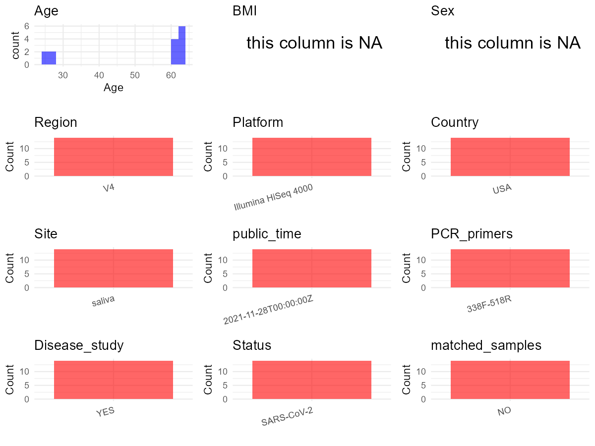

R Notebook: Metadata Processing Workflow
================

# Step 1: Obtain Initial Metadata from Each Project

To obtain the initial metadata: 1. Search for the BioProject ID (e.g.,
“PRJEBXXXX”) on the [NCBI SRA
website](https://www.ncbi.nlm.nih.gov/Traces/study/). 2. In the “Select”
table, click on “Metadata” and download the file. 3. The downloaded file
is typically named “SraRunTable.csv” and contains metadata for the
project.

``` r
# Load necessary libraries
library(dplyr)
library(ggplot2)
library(cowplot)

# Set working directory (update this path to your local directory)
setwd("D:/oral_project/PRJEB47800")

# Read the initial metadata files
initial_meta<-read.csv("SraRunTable.csv",header = T)

# Combine the two metadata files
#meta <- rbind(initial_meta, initial_meta1)

#Remove entries non-oral samples
#initial_meta <- subset(initial_meta,isolate %in% c("saliva","tongue coat"))

# Check the number of samples containing "HT" in Sample.Name (e.g., healthy controls)
#nrow(subset(meta, grepl("HT", Sample.Name)))

# Display the first few rows of the metadata
head(initial_meta)
```

    ##          Run Assay.Type AvgSpotLen       Bases BioProject    BioSample
    ## 1 ERR7017391        WGS        300 21947248200 PRJEB47800 SAMEA9995420
    ## 2 ERR7017392        WGS        300 18682026000 PRJEB47800 SAMEA9995421
    ## 3 ERR7017393        WGS        300 15307510800 PRJEB47800 SAMEA9995422
    ## 4 ERR7017394        WGS        300 13815660000 PRJEB47800 SAMEA9995423
    ## 5 ERR7017395        WGS        300 24125263200 PRJEB47800 SAMEA9995424
    ## 6 ERR7017396        WGS        300 23969421300 PRJEB47800 SAMEA9995425
    ##        Bytes        Center.Name Collection_Date Consent DATASTORE.filetype
    ## 1 9154264540 RUTGERS UNIVERISTY      2020-09-16  public   fastq,run.zq,sra
    ## 2 7465571510 RUTGERS UNIVERISTY      2020-09-16  public   fastq,run.zq,sra
    ## 3 6387509972 RUTGERS UNIVERISTY      2020-09-16  public   fastq,run.zq,sra
    ## 4 5675485554 RUTGERS UNIVERISTY      2020-09-16  public   fastq,run.zq,sra
    ## 5 9949751244 RUTGERS UNIVERISTY      2020-09-16  public   fastq,run.zq,sra
    ## 6 9989622926 RUTGERS UNIVERISTY      2020-09-16  public   fastq,run.zq,sra
    ##   DATASTORE.provider                     DATASTORE.region
    ## 1         gs,ncbi,s3 gs.us-east1,ncbi.public,s3.us-east-1
    ## 2         gs,ncbi,s3 gs.us-east1,ncbi.public,s3.us-east-1
    ## 3         gs,ncbi,s3 gs.us-east1,ncbi.public,s3.us-east-1
    ## 4         gs,ncbi,s3 gs.us-east1,ncbi.public,s3.us-east-1
    ## 5         gs,ncbi,s3 gs.us-east1,ncbi.public,s3.us-east-1
    ## 6         gs,ncbi,s3 gs.us-east1,ncbi.public,s3.us-east-1
    ##   ENA.FIRST.PUBLIC..run. ENA_first_public ENA.LAST.UPDATE..run. ENA_last_update
    ## 1             2021-11-18       2021-11-18            2021-11-18      2021-11-18
    ## 2             2021-11-18       2021-11-18            2021-11-18      2021-11-18
    ## 3             2021-11-18       2021-11-18            2021-11-18      2021-11-18
    ## 4             2021-11-18       2021-11-18            2021-11-18      2021-11-18
    ## 5             2021-11-18       2021-11-18            2021-11-18      2021-11-18
    ## 6             2021-11-18       2021-11-18            2021-11-18      2021-11-18
    ##   environment_.biome.    environment_.feature. environment_.material.
    ## 1         Urban Biome Human-associated habitat                 saliva
    ## 2         Urban Biome Human-associated habitat                 saliva
    ## 3         Urban Biome Human-associated habitat                 saliva
    ## 4         Urban Biome Human-associated habitat                 saliva
    ## 5         Urban Biome Human-associated habitat                 saliva
    ## 6         Urban Biome Human-associated habitat                 saliva
    ##   Experiment  external_id geo_loc_name_country geo_loc_name_country_continent
    ## 1 ERX6586437 SAMEA9995420                  USA                  North America
    ## 2 ERX6586438 SAMEA9995421                  USA                  North America
    ## 3 ERX6586439 SAMEA9995422                  USA                  North America
    ## 4 ERX6586440 SAMEA9995423                  USA                  North America
    ## 5 ERX6586441 SAMEA9995424                  USA                  North America
    ## 6 ERX6586442 SAMEA9995425                  USA                  North America
    ##   geographic_location_.country_and.or_sea. geographic_location_.latitude.
    ## 1                                      USA                         40.524
    ## 2                                      USA                         40.524
    ## 3                                      USA                         40.524
    ## 4                                      USA                         40.524
    ## 5                                      USA                         40.524
    ## 6                                      USA                         40.524
    ##   geographic_location_.longitude. Host_Age human_oral_environmental_package
    ## 1                          74.469       61                       human-oral
    ## 2                          74.469       61                       human-oral
    ## 3                          74.469       61                       human-oral
    ## 4                          74.469       61                       human-oral
    ## 5                          74.469       28                       human-oral
    ## 6                          74.469       28                       human-oral
    ##   INSDC_center_alias  INSDC_center_name   INSDC_first_public
    ## 1 RUTGERS UNIVERISTY RUTGERS UNIVERISTY 2021-11-18T00:18:25Z
    ## 2 RUTGERS UNIVERISTY RUTGERS UNIVERISTY 2021-11-18T00:18:25Z
    ## 3 RUTGERS UNIVERISTY RUTGERS UNIVERISTY 2021-11-18T00:18:25Z
    ## 4 RUTGERS UNIVERISTY RUTGERS UNIVERISTY 2021-11-18T00:18:25Z
    ## 5 RUTGERS UNIVERISTY RUTGERS UNIVERISTY 2021-11-18T00:18:25Z
    ## 6 RUTGERS UNIVERISTY RUTGERS UNIVERISTY 2021-11-18T00:18:25Z
    ##      INSDC_last_update INSDC_status          Instrument investigation_type
    ## 1 2021-11-18T00:18:25Z       public Illumina HiSeq 4000         metagenome
    ## 2 2021-11-18T00:18:25Z       public Illumina HiSeq 4000         metagenome
    ## 3 2021-11-18T00:18:25Z       public Illumina HiSeq 4000         metagenome
    ## 4 2021-11-18T00:18:25Z       public Illumina HiSeq 4000         metagenome
    ## 5 2021-11-18T00:18:25Z       public Illumina HiSeq 4000         metagenome
    ## 6 2021-11-18T00:18:25Z       public Illumina HiSeq 4000         metagenome
    ##   Library.Name LibraryLayout LibrarySelection LibrarySource
    ## 1  unspecified        PAIRED       RANDOM PCR   METAGENOMIC
    ## 2  unspecified        PAIRED       RANDOM PCR   METAGENOMIC
    ## 3  unspecified        PAIRED       RANDOM PCR   METAGENOMIC
    ## 4  unspecified        PAIRED       RANDOM PCR   METAGENOMIC
    ## 5  unspecified        PAIRED       RANDOM PCR   METAGENOMIC
    ## 6  unspecified        PAIRED       RANDOM PCR   METAGENOMIC
    ##   miscellaneous_parameter                Organism Platform         project_name
    ## 1                       2 human saliva metagenome ILLUMINA Saliva methods pilot
    ## 2                       2 human saliva metagenome ILLUMINA Saliva methods pilot
    ## 3                       1 human saliva metagenome ILLUMINA Saliva methods pilot
    ## 4                       1 human saliva metagenome ILLUMINA Saliva methods pilot
    ## 5                       2 human saliva metagenome ILLUMINA Saliva methods pilot
    ## 6                       1 human saliva metagenome ILLUMINA Saliva methods pilot
    ##            ReleaseDate          create_date version sample_material_processing
    ## 1 2021-11-28T00:00:00Z 2021-12-24T05:03:00Z       1        human_DNA_depletion
    ## 2 2021-11-28T00:00:00Z 2021-12-24T04:24:00Z       1        human_DNA_depletion
    ## 3 2021-11-28T00:00:00Z 2021-12-24T04:10:00Z       1        human_DNA_depletion
    ## 4 2021-11-28T00:00:00Z 2021-12-24T04:16:00Z       1        human_DNA_depletion
    ## 5 2021-11-28T00:00:00Z 2021-12-24T04:52:00Z       1        human_DNA_depletion
    ## 6 2021-11-28T00:00:00Z 2021-12-27T13:47:00Z       1        human_DNA_depletion
    ##    Sample.Name Sample_name       Sequencing_method SRA.Study Submitter_Id
    ## 1 SAMEA9995420 SSP1F2P.std Sequencing by Synthesis ERP132103  SSP1F2P.std
    ## 2 SAMEA9995421  SSP1F2P.HD Sequencing by Synthesis ERP132103   SSP1F2P.HD
    ## 3 SAMEA9995422  SSP1FP.std Sequencing by Synthesis ERP132103   SSP1FP.std
    ## 4 SAMEA9995423   SSP1FP.HD Sequencing by Synthesis ERP132103    SSP1FP.HD
    ## 5 SAMEA9995424 SSP2S2P.std Sequencing by Synthesis ERP132103  SSP2S2P.std
    ## 6 SAMEA9995425  SSP2SP.std Sequencing by Synthesis ERP132103   SSP2SP.std

# Step 2: Create a Uniform Metadata Template

The uniform metadata should include the following columns:

1.  **BioProject**: Project ID (e.g., “PRJNA339212”)
2.  **Run**: Sample ID (e.g., “ERRXXXXXX” or “SRRXXXXXX”)
3.  **sample_name**: Original sample name submitted by the authors (not
    the database-assigned ID)
4.  **Age**: Age of the subject (if available)
5.  **BMI**: Body Mass Index (if available)
6.  **Sex**: Sex of the subject (“F” or “M”)
7.  **Region**: Targeted 16S rRNA region (e.g., “V3-V4”)
8.  **Platform**: Sequencing platform (e.g., “Illumina MiSeq”)
9.  **Country**: Country of sample origin (e.g., “China”)
10. **Site**: Sample site (e.g., “saliva”, “dental plaque”)
11. **public_time**: Data release date (format: “YYYY-MM-DD”)
12. **PCR_primers**: PCR primers used (e.g., “515F-806R”)
13. **title**: Title of the associated publication
14. **Disease_study**: Whether the study involves a disease (“YES” or
    “NO”)
15. **Status**: Disease status (e.g., “T2DM”, “HC”). Note: If the study
    includes both disease and healthy samples, this must be specified
    per sample.
16. **matched_samples**: matched samples (“YES” or “NO”)

``` r
# Create a uniform metadata dataframe
metadata <- data.frame(
  BioProject = initial_meta$BioProject,
  Run = initial_meta$Run,
  sample_name = initial_meta$Sample_name,
  Age = initial_meta$Host_Age,
  BMI = NA,
  Sex = NA,
  Region = "V4",
  Platform = initial_meta$Instrument,
  Country = initial_meta$geo_loc_name_country,
  Site = initial_meta$environment_.material.,
  public_time = initial_meta$ReleaseDate,
  stringsAsFactors = FALSE
)
```

# Step 3: Manually Add Information from the Publication

Some information (e.g. PCR primers, study title, disease status) must be
manually extracted from the publication and added to the metadata.

``` r
# Add information obtained from the publication
metadata$PCR_primers <- "338F-518R"
metadata$title <- "Assessing saliva microbiome collection and processing methods"
metadata$Disease_study <- "YES"
# Assign disease status based on sample_name patterns
metadata$Status<-"SARS-CoV-2"

#get subjects id according to sample id
metadata$sample_name<-gsub("SSP","",metadata$sample_name)
#get subjects id with Saliva available
keep_subjects<-subset(metadata,Site %in% "saliva")
#remove subjects without Saliva samples
metadata<-subset(metadata,sample_name %in% keep_subjects$sample_name)
#get subjects sampling counts
sample_counts <- table(metadata$sample_name)
# Create matched_samples column, any subjects have >=2 samples will be label "YES", otherwise "NO"
metadata$matched_samples <- ifelse(metadata$sample_name %in% names(sample_counts[sample_counts >= 2]), "YES", "NO")
```

# Step 4: Summarize and Validate the Metadata

``` r
# Check the number of unique runs and sample names
print(paste("Number of unique runs:", length(unique(metadata$Run))))
```

    ## [1] "Number of unique runs: 14"

``` r
print(paste("Number of unique sample names:", length(unique(metadata$sample_name))))
```

    ## [1] "Number of unique sample names: 14"

# Step 5: Visualize the Metadata

``` r

```


# Step 6: Finalize and Export the Metadata

``` r
# Reorder columns to match the desired format
metadata <- metadata[, c(
  "BioProject", "Run", "sample_name", "Age", "BMI", "Sex", 
  "Region", "Platform", "Country", "Site", "public_time", 
  "PCR_primers", "title", "Disease_study", "Status","matched_samples"
)]

# Export the uniform metadata to a CSV file
write.csv(metadata, file = "metadata.csv", quote = TRUE)
head(metadata)
```

    ##   BioProject        Run sample_name Age BMI Sex Region            Platform
    ## 1 PRJEB47800 ERR7017391    1F2P.std  61  NA  NA     V4 Illumina HiSeq 4000
    ## 2 PRJEB47800 ERR7017392     1F2P.HD  61  NA  NA     V4 Illumina HiSeq 4000
    ## 3 PRJEB47800 ERR7017393     1FP.std  61  NA  NA     V4 Illumina HiSeq 4000
    ## 4 PRJEB47800 ERR7017394      1FP.HD  61  NA  NA     V4 Illumina HiSeq 4000
    ## 5 PRJEB47800 ERR7017395    2S2P.std  28  NA  NA     V4 Illumina HiSeq 4000
    ## 6 PRJEB47800 ERR7017396     2SP.std  28  NA  NA     V4 Illumina HiSeq 4000
    ##   Country   Site          public_time PCR_primers
    ## 1     USA saliva 2021-11-28T00:00:00Z   338F-518R
    ## 2     USA saliva 2021-11-28T00:00:00Z   338F-518R
    ## 3     USA saliva 2021-11-28T00:00:00Z   338F-518R
    ## 4     USA saliva 2021-11-28T00:00:00Z   338F-518R
    ## 5     USA saliva 2021-11-28T00:00:00Z   338F-518R
    ## 6     USA saliva 2021-11-28T00:00:00Z   338F-518R
    ##                                                           title Disease_study
    ## 1 Assessing saliva microbiome collection and processing methods           YES
    ## 2 Assessing saliva microbiome collection and processing methods           YES
    ## 3 Assessing saliva microbiome collection and processing methods           YES
    ## 4 Assessing saliva microbiome collection and processing methods           YES
    ## 5 Assessing saliva microbiome collection and processing methods           YES
    ## 6 Assessing saliva microbiome collection and processing methods           YES
    ##       Status matched_samples
    ## 1 SARS-CoV-2              NO
    ## 2 SARS-CoV-2              NO
    ## 3 SARS-CoV-2              NO
    ## 4 SARS-CoV-2              NO
    ## 5 SARS-CoV-2              NO
    ## 6 SARS-CoV-2              NO

## Notes for Students:

1.  **Metadata Accuracy**: Always cross-check the metadata with the
    original publication to ensure accuracy.
2.  **Manual Entries**: Columns like `PCR_primers`, and `Status` often
    require manual entry based on the publication.
3.  **Disease Status**: Be careful when assigning `Status`—some studies
    include both disease and healthy samples.
4.  **Visualization**: The plots help quickly identify the distribution
    of values in each column, which is useful for quality control.
5.  **Reproducibility**: Update the working directory and file paths to
    match your local environment.
