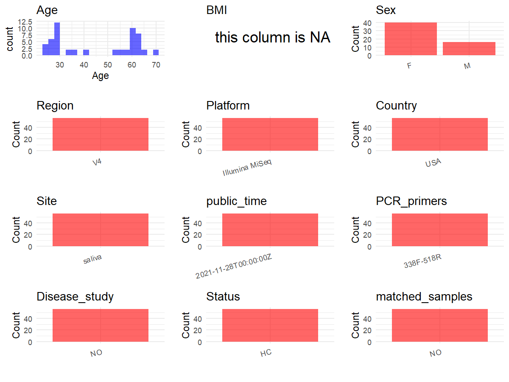

R Notebook: Metadata Processing Workflow
================

# Step 1: Obtain Initial Metadata from Each Project

To obtain the initial metadata: 1. Search for the BioProject ID (e.g.,
“PRJEBXXXX”) on the [NCBI SRA
website](https://www.ncbi.nlm.nih.gov/Traces/study/). 2. In the “Select”
table, click on “Metadata” and download the file. 3. The downloaded file
is typically named “SraRunTable.csv” and contains metadata for the
project.

``` r
# Load necessary libraries
library(dplyr)
library(ggplot2)
library(cowplot)

# Set working directory (update this path to your local directory)
setwd("E:/bioproject/PRJEB48040")

# Read the initial metadata files
initial_meta <- read.csv("SraRunTable.csv", header = T)

# Display the first few rows of the metadata
head(initial_meta)
```

    ##          Run Assay.Type AvgSpotLen barcode..exp.   Bases BioProject
    ## 1 ERR7013435   AMPLICON        150  CAAATGGTCGTC   81900 PRJEB48040
    ## 2 ERR7013436   AMPLICON        150  ACACGCGGTTTA   61650 PRJEB48040
    ## 3 ERR7013437   AMPLICON        150  AGGACGCCAGCA  526200 PRJEB48040
    ## 4 ERR7013438   AMPLICON        150  AAGCCGGGTCCG  173700 PRJEB48040
    ## 5 ERR7013439   AMPLICON        150  GTTGACCATCGC 3371250 PRJEB48040
    ## 6 ERR7013440   AMPLICON        150  AGACACCAATGT 5207100 PRJEB48040
    ##       BioSample   Bytes  center_name..exp.
    ## 1 SAMEA10332182  102134 Rutgers University
    ## 2 SAMEA10332183   95147 Rutgers University
    ## 3 SAMEA10332184  342226 Rutgers University
    ## 4 SAMEA10332185  152191 Rutgers University
    ## 5 SAMEA10332186 2161160 Rutgers University
    ## 6 SAMEA10332187 3444051 Rutgers University
    ##                                          Center.Name center_project_name..exp.
    ## 1 UNIVERSITY OF CALIFORNIA SAN DIEGO MICROBIOME INIT      Saliva methods pilot
    ## 2 UNIVERSITY OF CALIFORNIA SAN DIEGO MICROBIOME INIT      Saliva methods pilot
    ## 3 UNIVERSITY OF CALIFORNIA SAN DIEGO MICROBIOME INIT      Saliva methods pilot
    ## 4 UNIVERSITY OF CALIFORNIA SAN DIEGO MICROBIOME INIT      Saliva methods pilot
    ## 5 UNIVERSITY OF CALIFORNIA SAN DIEGO MICROBIOME INIT      Saliva methods pilot
    ## 6 UNIVERSITY OF CALIFORNIA SAN DIEGO MICROBIOME INIT      Saliva methods pilot
    ##   collection_timestamp colletion_method Consent DATASTORE.filetype
    ## 1              9/17/20  No preservative  public   fastq,run.zq,sra
    ## 2              9/17/20  No preservative  public   fastq,run.zq,sra
    ## 3              9/17/20  No preservative  public   fastq,run.zq,sra
    ## 4              9/17/20     Preservative  public   fastq,run.zq,sra
    ## 5              9/16/20  No preservative  public   fastq,run.zq,sra
    ## 6              9/16/20     Preservative  public   fastq,run.zq,sra
    ##   DATASTORE.provider                     DATASTORE.region dna_extracted
    ## 1         gs,ncbi,s3 gs.us-east1,ncbi.public,s3.us-east-1          TRUE
    ## 2         gs,ncbi,s3 gs.us-east1,ncbi.public,s3.us-east-1          TRUE
    ## 3         gs,ncbi,s3 gs.us-east1,ncbi.public,s3.us-east-1          TRUE
    ## 4         gs,ncbi,s3 gs.us-east1,ncbi.public,s3.us-east-1          TRUE
    ## 5         gs,ncbi,s3 gs.us-east1,ncbi.public,s3.us-east-1          TRUE
    ## 6         gs,ncbi,s3 gs.us-east1,ncbi.public,s3.us-east-1          TRUE
    ##   elevation    emp_status          empo_1            empo_2              empo_3
    ## 1        21 EMP_Processed         Control          Negative Sterile water blank
    ## 2        21 EMP_Processed         Control          Negative Sterile water blank
    ## 3        21 EMP_Processed         Control          Negative Sterile water blank
    ## 4        21 EMP_Processed         Control          Negative Sterile water blank
    ## 5        21 EMP_Processed Host-associated Animal-associated    Animal secretion
    ## 6        21 EMP_Processed Host-associated Animal-associated    Animal secretion
    ##   ENA.FIRST.PUBLIC..run. ENA_first_public ENA.LAST.UPDATE..run. ena_last_update
    ## 1             2021/11/17       2021/11/17            2021/11/17      2021/11/17
    ## 2             2021/11/17       2021/11/17            2021/11/17      2021/11/17
    ## 3             2021/11/17       2021/11/17            2021/11/17      2021/11/17
    ## 4             2021/11/17       2021/11/17            2021/11/17      2021/11/17
    ## 5             2021/11/17       2021/11/17            2021/11/17      2021/11/17
    ## 6             2021/11/17       2021/11/17            2021/11/17      2021/11/17
    ##   env_package Experiment   external_id host_subject_id INSDC_center_alias
    ## 1  human-oral ERX6583668 SAMEA10332182              M2             UCSDMI
    ## 2  human-oral ERX6583669 SAMEA10332183              M3             UCSDMI
    ## 3  human-oral ERX6583670 SAMEA10332184              M4             UCSDMI
    ## 4  human-oral ERX6583671 SAMEA10332185              MP             UCSDMI
    ## 5  human-oral ERX6583672 SAMEA10332186            10FN             UCSDMI
    ## 6  human-oral ERX6583673 SAMEA10332187            10SP             UCSDMI
    ##                                          INSDC_center_name   INSDC_first_public
    ## 1 University of California San Diego Microbiome Initiative 2021-11-17T16:28:35Z
    ## 2 University of California San Diego Microbiome Initiative 2021-11-17T16:28:35Z
    ## 3 University of California San Diego Microbiome Initiative 2021-11-17T16:28:35Z
    ## 4 University of California San Diego Microbiome Initiative 2021-11-17T16:28:35Z
    ## 5 University of California San Diego Microbiome Initiative 2021-11-17T16:28:35Z
    ## 6 University of California San Diego Microbiome Initiative 2021-11-17T16:28:35Z
    ##      INSDC_last_update INSDC_status     Instrument Lattitude  Library.Name
    ## 1 2021-11-17T16:28:35Z       public Illumina MiSeq  40.524 N   13807.Mock2
    ## 2 2021-11-17T16:28:35Z       public Illumina MiSeq  40.524 N   13807.Mock3
    ## 3 2021-11-17T16:28:35Z       public Illumina MiSeq  40.524 N   13807.Mock4
    ## 4 2021-11-17T16:28:35Z       public Illumina MiSeq  40.524 N   13807.MockP
    ## 5 2021-11-17T16:28:35Z       public Illumina MiSeq  40.524 N 13807.SSP10FN
    ## 6 2021-11-17T16:28:35Z       public Illumina MiSeq  40.524 N 13807.SSP10SP
    ##   LibraryLayout LibrarySelection LibrarySource lognitude
    ## 1        SINGLE              PCR   METAGENOMIC  74.469 W
    ## 2        SINGLE              PCR   METAGENOMIC  74.469 W
    ## 3        SINGLE              PCR   METAGENOMIC  74.469 W
    ## 4        SINGLE              PCR   METAGENOMIC  74.469 W
    ## 5        SINGLE              PCR   METAGENOMIC  74.469 W
    ## 6        SINGLE              PCR   METAGENOMIC  74.469 W
    ##                  Organism                                 pcr_primers..exp.
    ## 1              metagenome FWD:GTGCCAGCMGCCGCGGTAA; REV:GGACTACHVGGGTWTCTAAT
    ## 2              metagenome FWD:GTGCCAGCMGCCGCGGTAA; REV:GGACTACHVGGGTWTCTAAT
    ## 3              metagenome FWD:GTGCCAGCMGCCGCGGTAA; REV:GGACTACHVGGGTWTCTAAT
    ## 4              metagenome FWD:GTGCCAGCMGCCGCGGTAA; REV:GGACTACHVGGGTWTCTAAT
    ## 5 human saliva metagenome FWD:GTGCCAGCMGCCGCGGTAA; REV:GGACTACHVGGGTWTCTAAT
    ## 6 human saliva metagenome FWD:GTGCCAGCMGCCGCGGTAA; REV:GGACTACHVGGGTWTCTAAT
    ##   physical_specimen_location physical_specimen_remaining Platform
    ## 1         Rutgers University                        TRUE ILLUMINA
    ## 2         Rutgers University                        TRUE ILLUMINA
    ## 3         Rutgers University                        TRUE ILLUMINA
    ## 4         Rutgers University                        TRUE ILLUMINA
    ## 5         Rutgers University                        TRUE ILLUMINA
    ## 6         Rutgers University                        TRUE ILLUMINA
    ##             primer..exp.          ReleaseDate   run_center..exp. run_date..exp.
    ## 1 CCGGACTACHVGGGTWTCTAAT 2021-11-28T00:00:00Z Rutgers University      2011/1/20
    ## 2 CCGGACTACHVGGGTWTCTAAT 2021-11-28T00:00:00Z Rutgers University      2011/1/20
    ## 3 CCGGACTACHVGGGTWTCTAAT 2021-11-28T00:00:00Z Rutgers University      2011/1/20
    ## 4 CCGGACTACHVGGGTWTCTAAT 2021-11-28T00:00:00Z Rutgers University      2011/1/20
    ## 5 CCGGACTACHVGGGTWTCTAAT 2021-11-28T00:00:00Z Rutgers University      2011/1/20
    ## 6 CCGGACTACHVGGGTWTCTAAT 2021-11-28T00:00:00Z Rutgers University      2011/1/20
    ##            create_date version run_prefix..exp.   Sample.Name
    ## 1 2021-12-23T04:02:00Z       1           CK6254 SAMEA10332182
    ## 2 2021-12-23T04:02:00Z       1           CK6254 SAMEA10332183
    ## 3 2021-12-23T04:02:00Z       1           CK6254 SAMEA10332184
    ## 4 2021-12-23T04:02:00Z       1           CK6254 SAMEA10332185
    ## 5 2021-12-23T04:03:00Z       1           CK6254 SAMEA10332186
    ## 6 2021-12-23T04:04:00Z       1           CK6254 SAMEA10332187
    ##                     Sample_name sample_type sequencing_method..exp. SRA.Study
    ## 1   qiita_sid_13807:13807.Mock2      saliva Sequencing by Synthesis ERP132364
    ## 2   qiita_sid_13807:13807.Mock3      saliva Sequencing by Synthesis ERP132364
    ## 3   qiita_sid_13807:13807.Mock4      saliva Sequencing by Synthesis ERP132364
    ## 4   qiita_sid_13807:13807.MockP      saliva Sequencing by Synthesis ERP132364
    ## 5 qiita_sid_13807:13807.SSP10FN      saliva Sequencing by Synthesis ERP132364
    ## 6 qiita_sid_13807:13807.SSP10SP      saliva Sequencing by Synthesis ERP132364
    ##                    Submitter_Id target_gene..exp. target_subfragment..exp.
    ## 1   qiita_sid_13807:13807.Mock2          16S rRNA                       V4
    ## 2   qiita_sid_13807:13807.Mock3          16S rRNA                       V4
    ## 3   qiita_sid_13807:13807.Mock4          16S rRNA                       V4
    ## 4   qiita_sid_13807:13807.MockP          16S rRNA                       V4
    ## 5 qiita_sid_13807:13807.SSP10FN          16S rRNA                       V4
    ## 6 qiita_sid_13807:13807.SSP10SP          16S rRNA                       V4
    ##     env_biome              env_feature env_material Host_age host_age_units
    ## 1                                                         NA               
    ## 2                                                         NA               
    ## 3                                                         NA               
    ## 4                                                         NA               
    ## 5 Urban Biome Human-associated habitat       saliva       70          years
    ## 6 Urban Biome Human-associated habitat       saliva       70          years
    ##   host_common_name host_scientific_name host_sex host_taxid Sample_Day
    ## 1                                                        NA         NA
    ## 2                                                        NA         NA
    ## 3                                                        NA         NA
    ## 4                                                        NA         NA
    ## 5            human         Homo sapiens     male       9606          1
    ## 6            human         Homo sapiens     male       9606          1
    ##   sample_order
    ## 1           NA
    ## 2           NA
    ## 3           NA
    ## 4           NA
    ## 5            1
    ## 6            2

# Step 2: Create a Uniform Metadata Template

The uniform metadata should include the following columns:

1.  **BioProject**: Project ID (e.g., “PRJNA339212”)
2.  **Run**: Sample ID (e.g., “ERRXXXXXX” or “SRRXXXXXX”)
3.  **sample_name**: Original sample name submitted by the authors (not
    the database-assigned ID)
4.  **Age**: Age of the subject (if available)
5.  **BMI**: Body Mass Index (if available)
6.  **Sex**: Sex of the subject (“F” or “M”)
7.  **Region**: Targeted 16S rRNA region (e.g., “V3-V4”)
8.  **Platform**: Sequencing platform (e.g., “Illumina MiSeq”)
9.  **Country**: Country of sample origin (e.g., “China”)
10. **Site**: Sample site (e.g., “saliva”, “dental plaque”)
11. **public_time**: Data release date (format: “YYYY-MM-DD”)
12. **PCR_primers**: PCR primers used (e.g., “515F-806R”)
13. **title**: Title of the associated publication
14. **Disease_study**: Whether the study involves a disease (“YES” or
    “NO”)
15. **Status**: Disease status (e.g., “T2DM”, “HC”). Note: If the study
    includes both disease and healthy samples, this must be specified
    per sample.
16. **matched_samples**: matched samples (“YES” or “NO”)

``` r
# Create a uniform metadata dataframe
metadata <- data.frame(
  BioProject = initial_meta$BioProject,
  Run = initial_meta$Run,
  sample_name = initial_meta$host_subject_id,
  Age = initial_meta$Host_age,
  BMI = NA,  
  Sex = initial_meta$host_sex,
  Region = initial_meta$target_subfragment..exp.,
  Platform = initial_meta$Instrument,
  Site = initial_meta$env_material,
  public_time = initial_meta$ReleaseDate,
  stringsAsFactors=FALSE
)

# Use abbreviations to indicate gender
metadata <- metadata %>%
  mutate(Sex = recode(Sex, "female" = "F", "male" = "M"))
```

# Step 3: Manually Add Information from the Publication

Some information (e.g. PCR primers, study title, disease status) must be
manually extracted from the publication and added to the metadata.

``` r
# Add information obtained from the publication
metadata$Country <- "USA"
metadata$PCR_primers <- "338F-518R"
metadata$title <- "Assessing saliva microbiome collection and processing methods"
metadata$Disease_study <- "NO"

# Assign disease status based on sample_name patterns
metadata$Status <- "HC"

# Check initial data distribution
cat("Initial sample distribution:\n")
```

    ## Initial sample distribution:

``` r
table(metadata$sample_name)
```

    ## 
    ## 10FN 10SP 11FP 11SN 12FN 12SP 13FP 13SN 14FN 14SP 15FP 15SN 16FN 16SP 17FP 17SN 
    ##    1    1    1    1    1    1    1    1    1    1    1    1    1    1    1    1 
    ## 18FN 18SP 19FP 19SN 1F2P  1FP 1S2N  1SN 20FN 20SP 21FP 21SN 22FN 22SP 2F2N  2FN 
    ##    1    1    1    1    1    1    1    1    1    1    1    1    1    1    1    1 
    ## 2S2P  2SP 3F2P  3FP 3S2N  3SN 4F2N  4FN 4S2P  4SP  5FP  5SN  6FN  6SP  7FP  7SN 
    ##    1    1    1    1    1    1    1    1    1    1    1    1    1    1    1    1 
    ## 8F2N  8FN 8S2P  8SP 9F2P  9FP 9S2N  9SN   M2   M3   M4   MP 
    ##    1    1    1    1    1    1    1    1    1    1    1    1

``` r
table(metadata$Site)
```

    ## 
    ##        saliva 
    ##      4     56

``` r
# Calculate sampling frequency per subject
sample_counts <- table(metadata$sample_name)
cat("\nNumber of samples per subject:\n")
```

    ## 
    ## Number of samples per subject:

``` r
print(sample_counts)
```

    ## 
    ## 10FN 10SP 11FP 11SN 12FN 12SP 13FP 13SN 14FN 14SP 15FP 15SN 16FN 16SP 17FP 17SN 
    ##    1    1    1    1    1    1    1    1    1    1    1    1    1    1    1    1 
    ## 18FN 18SP 19FP 19SN 1F2P  1FP 1S2N  1SN 20FN 20SP 21FP 21SN 22FN 22SP 2F2N  2FN 
    ##    1    1    1    1    1    1    1    1    1    1    1    1    1    1    1    1 
    ## 2S2P  2SP 3F2P  3FP 3S2N  3SN 4F2N  4FN 4S2P  4SP  5FP  5SN  6FN  6SP  7FP  7SN 
    ##    1    1    1    1    1    1    1    1    1    1    1    1    1    1    1    1 
    ## 8F2N  8FN 8S2P  8SP 9F2P  9FP 9S2N  9SN   M2   M3   M4   MP 
    ##    1    1    1    1    1    1    1    1    1    1    1    1

``` r
# Create matched_samples column
metadata$matched_samples <- ifelse(metadata$sample_name %in% names(sample_counts[sample_counts >= 2]), "YES", "NO")

cat("\nMatched samples distribution:\n")
```

    ## 
    ## Matched samples distribution:

``` r
table(metadata$matched_samples)
```

    ## 
    ## NO 
    ## 60

``` r
# Identify samples for removal: single samples excluding saliva and tongue coat
single_samples <- names(sample_counts[sample_counts == 1])
samples_to_remove <- metadata$sample_name %in% single_samples & 
                     !(metadata$Site %in% c("saliva", "tongue coat"))

cat("\nNumber of samples to be removed:", sum(samples_to_remove), "\n")
```

    ## 
    ## Number of samples to be removed: 4

``` r
# Remove identified samples
metadata_clean <- metadata[!samples_to_remove, ]

cat("\nFinal sample distribution after cleaning:\n")
```

    ## 
    ## Final sample distribution after cleaning:

``` r
table(metadata_clean$sample_name)
```

    ## 
    ## 10FN 10SP 11FP 11SN 12FN 12SP 13FP 13SN 14FN 14SP 15FP 15SN 16FN 16SP 17FP 17SN 
    ##    1    1    1    1    1    1    1    1    1    1    1    1    1    1    1    1 
    ## 18FN 18SP 19FP 19SN 1F2P  1FP 1S2N  1SN 20FN 20SP 21FP 21SN 22FN 22SP 2F2N  2FN 
    ##    1    1    1    1    1    1    1    1    1    1    1    1    1    1    1    1 
    ## 2S2P  2SP 3F2P  3FP 3S2N  3SN 4F2N  4FN 4S2P  4SP  5FP  5SN  6FN  6SP  7FP  7SN 
    ##    1    1    1    1    1    1    1    1    1    1    1    1    1    1    1    1 
    ## 8F2N  8FN 8S2P  8SP 9F2P  9FP 9S2N  9SN 
    ##    1    1    1    1    1    1    1    1

``` r
table(metadata_clean$Site)
```

    ## 
    ## saliva 
    ##     56

``` r
table(metadata_clean$matched_samples)
```

    ## 
    ## NO 
    ## 56

``` r
# Use cleaned dataset for subsequent analysis
metadata <- metadata_clean
```

# Step 4: Summarize and Validate the Metadata

``` r
# Check the number of unique runs and sample names
print(paste("Number of unique runs:", length(unique(metadata$Run))))
```

    ## [1] "Number of unique runs: 56"

``` r
print(paste("Number of unique sample names:", length(unique(metadata$sample_name))))
```

    ## [1] "Number of unique sample names: 56"

# Step 5: Visualize the Metadata

``` r

```

<!-- -->

# Step 6: Finalize and Export the Metadata

``` r
# Reorder columns to match the desired format
metadata <- metadata[, c(
  "BioProject", "Run", "sample_name", "Age", "BMI", "Sex", 
  "Region", "Platform", "Country", "Site", "public_time", 
  "PCR_primers", "title", "Disease_study", "Status", "matched_samples"
)]

# Export the uniform metadata to a CSV file
write.csv(metadata, file = "metadata.csv", quote = FALSE)
head(metadata)
```

    ##    BioProject        Run sample_name Age BMI Sex Region       Platform Country
    ## 5  PRJEB48040 ERR7013439        10FN  70  NA   M     V4 Illumina MiSeq     USA
    ## 6  PRJEB48040 ERR7013440        10SP  70  NA   M     V4 Illumina MiSeq     USA
    ## 7  PRJEB48040 ERR7013441        11FP  25  NA   F     V4 Illumina MiSeq     USA
    ## 8  PRJEB48040 ERR7013442        11SN  25  NA   F     V4 Illumina MiSeq     USA
    ## 9  PRJEB48040 ERR7013443        12FN  27  NA   F     V4 Illumina MiSeq     USA
    ## 10 PRJEB48040 ERR7013444        12SP  27  NA   F     V4 Illumina MiSeq     USA
    ##      Site          public_time PCR_primers
    ## 5  saliva 2021-11-28T00:00:00Z   338F-518R
    ## 6  saliva 2021-11-28T00:00:00Z   338F-518R
    ## 7  saliva 2021-11-28T00:00:00Z   338F-518R
    ## 8  saliva 2021-11-28T00:00:00Z   338F-518R
    ## 9  saliva 2021-11-28T00:00:00Z   338F-518R
    ## 10 saliva 2021-11-28T00:00:00Z   338F-518R
    ##                                                            title Disease_study
    ## 5  Assessing saliva microbiome collection and processing methods            NO
    ## 6  Assessing saliva microbiome collection and processing methods            NO
    ## 7  Assessing saliva microbiome collection and processing methods            NO
    ## 8  Assessing saliva microbiome collection and processing methods            NO
    ## 9  Assessing saliva microbiome collection and processing methods            NO
    ## 10 Assessing saliva microbiome collection and processing methods            NO
    ##    Status matched_samples
    ## 5      HC              NO
    ## 6      HC              NO
    ## 7      HC              NO
    ## 8      HC              NO
    ## 9      HC              NO
    ## 10     HC              NO

## Notes for Students:

1.  **Metadata Accuracy**: Always cross-check the metadata with the
    original publication to ensure accuracy.
2.  **Manual Entries**: Columns like `PCR_primers`, and `Status` often
    require manual entry based on the publication.
3.  **Disease Status**: Be careful when assigning `Status`—some studies
    include both disease and healthy samples.
4.  **Visualization**: The plots help quickly identify the distribution
    of values in each column, which is useful for quality control.
5.  **Reproducibility**: Update the working directory and file paths to
    match your local environment.
