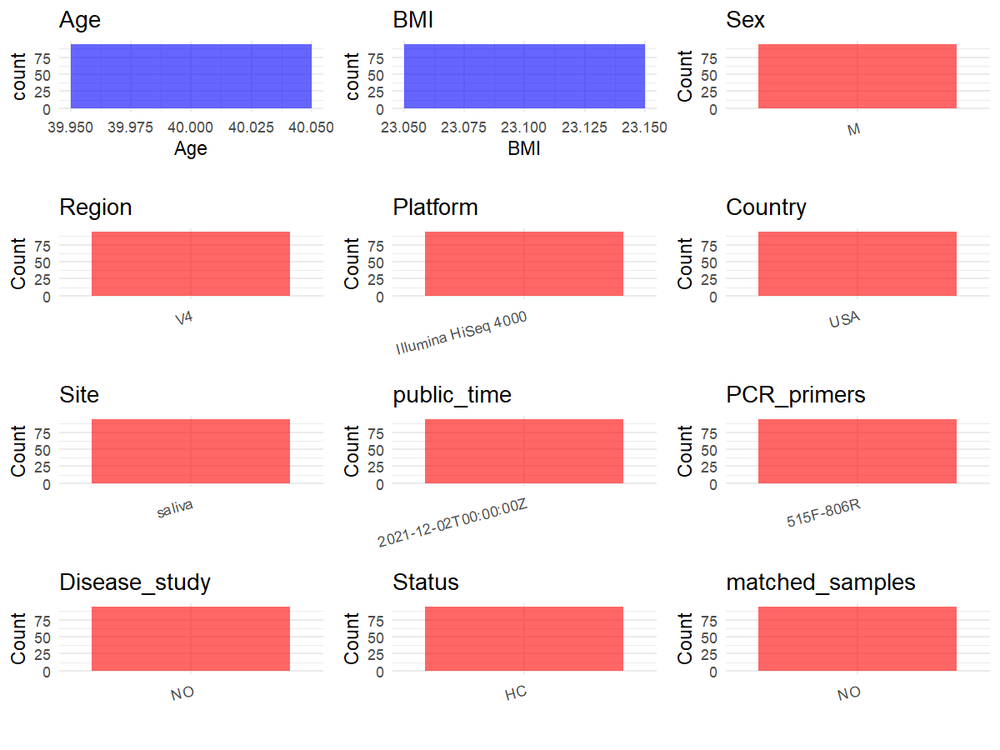

R Notebook: Metadata Processing Workflow
================

# Step 1: Obtain Initial Metadata from Each Project

To obtain the initial metadata: 1. Search for the BioProject ID (e.g.,
“PRJEBXXXX”) on the [NCBI SRA
website](https://www.ncbi.nlm.nih.gov/Traces/study/). 2. In the “Select”
table, click on “Metadata” and download the file. 3. The downloaded file
is typically named “SraRunTable.csv” and contains metadata for the
project.

``` r
# Load necessary libraries
library(dplyr)
library(ggplot2)
library(cowplot)

# Set working directory (update this path to your local directory)
setwd("E:/bioproject/PRJEB48620")

# Read the initial metadata files
initial_meta <- read.csv("SraRunTable.csv", header = T)

# Display the first few rows of the metadata
head(initial_meta)
```

    ##          Run Assay.Type AvgSpotLen barcode..exp.   Bases BioProject
    ## 1 ERR7247035   AMPLICON        151  TTCTCGGTTCTC 2997048 PRJEB48620
    ## 2 ERR7247036   AMPLICON        151  TTATCCAGTCCT 3211166 PRJEB48620
    ## 3 ERR7247037   AMPLICON        151  CACCGTGACACT 2622719 PRJEB48620
    ## 4 ERR7247038   AMPLICON        151  CAGAGCTAATTG 2195389 PRJEB48620
    ## 5 ERR7247039   AMPLICON        151  AGGTCATCTTGG 1902751 PRJEB48620
    ## 6 ERR7247040   AMPLICON        151  TGACGCCTCCAA 2332648 PRJEB48620
    ##       BioSample   Bytes center_name..exp.
    ## 1 SAMEA10792706 2000939              CCME
    ## 2 SAMEA10792707 2101166              CCME
    ## 3 SAMEA10792708 1694555              CCME
    ## 4 SAMEA10792709 1481510              CCME
    ## 5 SAMEA10792710 1277859              CCME
    ## 6 SAMEA10792711 1525907              CCME
    ##                                          Center.Name center_project_name..exp.
    ## 1 UNIVERSITY OF CALIFORNIA SAN DIEGO MICROBIOME INIT                      CCME
    ## 2 UNIVERSITY OF CALIFORNIA SAN DIEGO MICROBIOME INIT                      CCME
    ## 3 UNIVERSITY OF CALIFORNIA SAN DIEGO MICROBIOME INIT                      CCME
    ## 4 UNIVERSITY OF CALIFORNIA SAN DIEGO MICROBIOME INIT                      CCME
    ## 5 UNIVERSITY OF CALIFORNIA SAN DIEGO MICROBIOME INIT                      CCME
    ## 6 UNIVERSITY OF CALIFORNIA SAN DIEGO MICROBIOME INIT                      CCME
    ##   collection_timestamp Consent DATASTORE.filetype DATASTORE.provider
    ## 1           2013/10/16  public   fastq,run.zq,sra         gs,ncbi,s3
    ## 2           2013/10/16  public   fastq,run.zq,sra         gs,ncbi,s3
    ## 3           2013/10/16  public   fastq,run.zq,sra         gs,ncbi,s3
    ## 4           2013/10/16  public   fastq,run.zq,sra         gs,ncbi,s3
    ## 5           2013/10/16  public   fastq,run.zq,sra         gs,ncbi,s3
    ## 6           2013/10/16  public   fastq,run.zq,sra         gs,ncbi,s3
    ##                       DATASTORE.region Day     Diet elevation          empo_1
    ## 1 gs.us-east1,ncbi.public,s3.us-east-1   1 omnivore    1624.1 Host-associated
    ## 2 gs.us-east1,ncbi.public,s3.us-east-1   1 omnivore    1624.1 Host-associated
    ## 3 gs.us-east1,ncbi.public,s3.us-east-1   1 omnivore    1624.1 Host-associated
    ## 4 gs.us-east1,ncbi.public,s3.us-east-1   1 omnivore    1624.1 Host-associated
    ## 5 gs.us-east1,ncbi.public,s3.us-east-1   1 omnivore    1624.1 Host-associated
    ## 6 gs.us-east1,ncbi.public,s3.us-east-1   1 omnivore    1624.1 Host-associated
    ##   empo_2           empo_3 ENA.FIRST.PUBLIC..run. ENA_first_public
    ## 1 Animal Animal secretion             2021/11/10       2021/11/10
    ## 2 Animal Animal secretion             2021/11/10       2021/11/10
    ## 3 Animal Animal secretion             2021/11/10       2021/11/10
    ## 4 Animal Animal secretion             2021/11/10       2021/11/10
    ## 5 Animal Animal secretion             2021/11/10       2021/11/10
    ## 6 Animal Animal secretion             2021/11/10       2021/11/10
    ##   ENA.LAST.UPDATE..run. ena_last_update        env_biome
    ## 1            2021/11/10      2021/11/10 ENVO:urban biome
    ## 2            2021/11/10      2021/11/10 ENVO:urban biome
    ## 3            2021/11/10      2021/11/10 ENVO:urban biome
    ## 4            2021/11/10      2021/11/10 ENVO:urban biome
    ## 5            2021/11/10      2021/11/10 ENVO:urban biome
    ## 6            2021/11/10      2021/11/10 ENVO:urban biome
    ##                     env_feature env_material env_package Experiment
    ## 1 ENVO:human-associated habitat       saliva  human-oral ERX6816494
    ## 2 ENVO:human-associated habitat       saliva  human-oral ERX6816495
    ## 3 ENVO:human-associated habitat       saliva  human-oral ERX6816496
    ## 4 ENVO:human-associated habitat       saliva  human-oral ERX6816497
    ## 5 ENVO:human-associated habitat       saliva  human-oral ERX6816498
    ## 6 ENVO:human-associated habitat       saliva  human-oral ERX6816499
    ##     external_id Host_age host_age_units host_body_habitat host_body_mass_index
    ## 1 SAMEA10792706       40          years     UBERON:saliva                 23.1
    ## 2 SAMEA10792707       40          years     UBERON:saliva                 23.1
    ## 3 SAMEA10792708       40          years     UBERON:saliva                 23.1
    ## 4 SAMEA10792709       40          years     UBERON:saliva                 23.1
    ## 5 SAMEA10792710       40          years     UBERON:saliva                 23.1
    ## 6 SAMEA10792711       40          years     UBERON:saliva                 23.1
    ##   host_body_product host_body_site host_common_name host_height
    ## 1     UBERON:saliva   UBERON:mouth            human         1.8
    ## 2     UBERON:saliva   UBERON:mouth            human         1.8
    ## 3     UBERON:saliva   UBERON:mouth            human         1.8
    ## 4     UBERON:saliva   UBERON:mouth            human         1.8
    ## 5     UBERON:saliva   UBERON:mouth            human         1.8
    ## 6     UBERON:saliva   UBERON:mouth            human         1.8
    ##   host_height_units host_scientific_name host_subject_id host_taxid
    ## 1                 m         Homo sapiens        2052:M11       9606
    ## 2                 m         Homo sapiens        2052:M11       9606
    ## 3                 m         Homo sapiens        2052:M11       9606
    ## 4                 m         Homo sapiens        2052:M11       9606
    ## 5                 m         Homo sapiens        2052:M11       9606
    ## 6                 m         Homo sapiens        2052:M11       9606
    ##     host_weight host_weight_units Hour INSDC_center_alias
    ## 1 not collected                kg    8             UCSDMI
    ## 2 not collected                kg   10             UCSDMI
    ## 3 not collected                kg   10             UCSDMI
    ## 4 not collected                kg   10             UCSDMI
    ## 5 not collected                kg   10             UCSDMI
    ## 6 not collected                kg   11             UCSDMI
    ##                                          INSDC_center_name   INSDC_first_public
    ## 1 University of California San Diego Microbiome Initiative 2021-11-10T16:23:23Z
    ## 2 University of California San Diego Microbiome Initiative 2021-11-10T16:23:23Z
    ## 3 University of California San Diego Microbiome Initiative 2021-11-10T16:23:23Z
    ## 4 University of California San Diego Microbiome Initiative 2021-11-10T16:23:23Z
    ## 5 University of California San Diego Microbiome Initiative 2021-11-10T16:23:23Z
    ## 6 University of California San Diego Microbiome Initiative 2021-11-10T16:23:23Z
    ##      INSDC_last_update INSDC_status          Instrument LATITUDE
    ## 1 2021-11-10T16:23:23Z       public Illumina HiSeq 4000    40.01
    ## 2 2021-11-10T16:23:23Z       public Illumina HiSeq 4000    40.01
    ## 3 2021-11-10T16:23:23Z       public Illumina HiSeq 4000    40.01
    ## 4 2021-11-10T16:23:23Z       public Illumina HiSeq 4000    40.01
    ## 5 2021-11-10T16:23:23Z       public Illumina HiSeq 4000    40.01
    ## 6 2021-11-10T16:23:23Z       public Illumina HiSeq 4000    40.01
    ##                  Library.Name LibraryLayout LibrarySelection LibrarySource
    ## 1  14058.1.M11.saliva.1168567        SINGLE              PCR   METAGENOMIC
    ## 2 14058.10.M11.saliva.1168573        SINGLE              PCR   METAGENOMIC
    ## 3 14058.11.M11.saliva.1168556        SINGLE              PCR   METAGENOMIC
    ## 4 14058.12.M11.saliva.1168590        SINGLE              PCR   METAGENOMIC
    ## 5 14058.13.M11.saliva.1168512        SINGLE              PCR   METAGENOMIC
    ## 6 14058.14.M11.saliva.1168536        SINGLE              PCR   METAGENOMIC
    ##   life_stage longitude mf_sample_number min              Organism
    ## 1      adult   -105.27                1  25 human oral metagenome
    ## 2      adult   -105.27               10   4 human oral metagenome
    ## 3      adult   -105.27               11  19 human oral metagenome
    ## 4      adult   -105.27               12  33 human oral metagenome
    ## 5      adult   -105.27               13  48 human oral metagenome
    ## 6      adult   -105.27               14   3 human oral metagenome
    ##                                   pcr_primers..exp. physical_specimen_location
    ## 1 FWD:GTGCCAGCMGCCGCGGTAA; REV:GGACTACHVGGGTWTCTAAT                     UCSDMI
    ## 2 FWD:GTGCCAGCMGCCGCGGTAA; REV:GGACTACHVGGGTWTCTAAT                     UCSDMI
    ## 3 FWD:GTGCCAGCMGCCGCGGTAA; REV:GGACTACHVGGGTWTCTAAT                     UCSDMI
    ## 4 FWD:GTGCCAGCMGCCGCGGTAA; REV:GGACTACHVGGGTWTCTAAT                     UCSDMI
    ## 5 FWD:GTGCCAGCMGCCGCGGTAA; REV:GGACTACHVGGGTWTCTAAT                     UCSDMI
    ## 6 FWD:GTGCCAGCMGCCGCGGTAA; REV:GGACTACHVGGGTWTCTAAT                     UCSDMI
    ##   Platform        primer..exp.          ReleaseDate run_center..exp.
    ## 1 ILLUMINA GTGCCAGCMGCCGCGGTAA 2021-12-02T00:00:00Z             CCME
    ## 2 ILLUMINA GTGCCAGCMGCCGCGGTAA 2021-12-02T00:00:00Z             CCME
    ## 3 ILLUMINA GTGCCAGCMGCCGCGGTAA 2021-12-02T00:00:00Z             CCME
    ## 4 ILLUMINA GTGCCAGCMGCCGCGGTAA 2021-12-02T00:00:00Z             CCME
    ## 5 ILLUMINA GTGCCAGCMGCCGCGGTAA 2021-12-02T00:00:00Z             CCME
    ## 6 ILLUMINA GTGCCAGCMGCCGCGGTAA 2021-12-02T00:00:00Z             CCME
    ##            create_date version   Sample.Name
    ## 1 2021-11-16T17:00:00Z       1 SAMEA10792706
    ## 2 2021-11-16T17:00:00Z       1 SAMEA10792707
    ## 3 2021-11-16T17:02:00Z       1 SAMEA10792708
    ## 4 2021-11-16T17:00:00Z       1 SAMEA10792709
    ## 5 2021-11-16T17:00:00Z       1 SAMEA10792710
    ## 6 2021-11-16T17:03:00Z       1 SAMEA10792711
    ##                                   Sample_name sample_type
    ## 1  qiita_sid_14058:14058.1.M11.saliva.1168567      saliva
    ## 2 qiita_sid_14058:14058.10.M11.saliva.1168573      saliva
    ## 3 qiita_sid_14058:14058.11.M11.saliva.1168556      saliva
    ## 4 qiita_sid_14058:14058.12.M11.saliva.1168590      saliva
    ## 5 qiita_sid_14058:14058.13.M11.saliva.1168512      saliva
    ## 6 qiita_sid_14058:14058.14.M11.saliva.1168536      saliva
    ##   sequencing_method..exp.  sex smoker SRA.Study
    ## 1 Sequencing by synthesis male      n ERP133009
    ## 2 Sequencing by synthesis male      n ERP133009
    ## 3 Sequencing by synthesis male      n ERP133009
    ## 4 Sequencing by synthesis male      n ERP133009
    ## 5 Sequencing by synthesis male      n ERP133009
    ## 6 Sequencing by synthesis male      n ERP133009
    ##                                  Submitter_Id target_gene..exp.
    ## 1  qiita_sid_14058:14058.1.M11.saliva.1168567          16S rRNA
    ## 2 qiita_sid_14058:14058.10.M11.saliva.1168573          16S rRNA
    ## 3 qiita_sid_14058:14058.11.M11.saliva.1168556          16S rRNA
    ## 4 qiita_sid_14058:14058.12.M11.saliva.1168590          16S rRNA
    ## 5 qiita_sid_14058:14058.13.M11.saliva.1168512          16S rRNA
    ## 6 qiita_sid_14058:14058.14.M11.saliva.1168536          16S rRNA
    ##   target_subfragment..exp. activity
    ## 1                       V4    sleep
    ## 2                       V4         
    ## 3                       V4      muc
    ## 4                       V4      eat
    ## 5                       V4         
    ## 6                       V4

# Step 2: Create a Uniform Metadata Template

The uniform metadata should include the following columns:

1.  **BioProject**: Project ID (e.g., “PRJNA339212”)
2.  **Run**: Sample ID (e.g., “ERRXXXXXX” or “SRRXXXXXX”)
3.  **sample_name**: Original sample name submitted by the authors (not
    the database-assigned ID)
4.  **Age**: Age of the subject (if available)
5.  **BMI**: Body Mass Index (if available)
6.  **Sex**: Sex of the subject (“F” or “M”)
7.  **Region**: Targeted 16S rRNA region (e.g., “V3-V4”)
8.  **Platform**: Sequencing platform (e.g., “Illumina MiSeq”)
9.  **Country**: Country of sample origin (e.g., “China”)
10. **Site**: Sample site (e.g., “saliva”, “dental plaque”)
11. **public_time**: Data release date (format: “YYYY-MM-DD”)
12. **PCR_primers**: PCR primers used (e.g., “515F-806R”)
13. **title**: Title of the associated publication
14. **Disease_study**: Whether the study involves a disease (“YES” or
    “NO”)
15. **Status**: Disease status (e.g., “T2DM”, “HC”). Note: If the study
    includes both disease and healthy samples, this must be specified
    per sample.
16. **matched_samples**: matched samples (“YES” or “NO”)

``` r
# Create a uniform metadata dataframe
metadata <- data.frame(
  BioProject = initial_meta$BioProject,
  Run = initial_meta$Run,
  sample_name = initial_meta$Library.Name,
  Age = initial_meta$Host_age,
  BMI = initial_meta$host_body_mass_index,  
  Sex = initial_meta$sex,
  Region = initial_meta$target_subfragment..exp.,
  Platform = initial_meta$Instrument,
  Site = initial_meta$env_material,
  public_time = initial_meta$ReleaseDate,
  stringsAsFactors=FALSE
)

# Use abbreviations to indicate gender
metadata <- metadata %>%
  mutate(Sex = recode(Sex, "female" = "F", "male" = "M"))
```

# Step 3: Manually Add Information from the Publication

Some information (e.g. PCR primers, study title, disease status) must be
manually extracted from the publication and added to the metadata.

``` r
# Add information obtained from the publication
metadata$Country <- "USA"
metadata$PCR_primers <- "515F-806R"
metadata$title <- "Diurnal and eating-associated microbial patterns revealed via high-frequency saliva sampling"
metadata$Disease_study <- "NO"
# Assign disease status based on sample_name patterns
metadata$Status <- "HC"

#extract subject id by remove prefix of sample_name
metadata$sample_name <- gsub("M11", "", metadata$sample_name)

# Check initial data distribution
cat("Initial sample distribution:\n")
```

    ## Initial sample distribution:

``` r
table(metadata$sample_name)
```

    ## 
    ##  14058.1..saliva.1168567 14058.10..saliva.1168573 14058.11..saliva.1168556 
    ##                        1                        1                        1 
    ## 14058.12..saliva.1168590 14058.13..saliva.1168512 14058.14..saliva.1168536 
    ##                        1                        1                        1 
    ## 14058.15..saliva.1168584 14058.16..saliva.1168539 14058.17..saliva.1168511 
    ##                        1                        1                        1 
    ## 14058.18..saliva.1168552 14058.19..saliva.1168553  14058.2..saliva.1168561 
    ##                        1                        1                        1 
    ## 14058.20..saliva.1168525 14058.21..saliva.1168555 14058.22..saliva.1168530 
    ##                        1                        1                        1 
    ## 14058.23..saliva.1168571 14058.24..saliva.1168580 14058.25..saliva.1168514 
    ##                        1                        1                        1 
    ## 14058.26..saliva.1168526 14058.27..saliva.1168540 14058.28..saliva.1168583 
    ##                        1                        1                        1 
    ## 14058.29..saliva.1168547  14058.3..saliva.1168562 14058.30..saliva.1168505 
    ##                        1                        1                        1 
    ## 14058.32..saliva.1168576 14058.33..saliva.1168515 14058.34..saliva.1168559 
    ##                        1                        1                        1 
    ## 14058.36..saliva.1168554 14058.37..saliva.1168581 14058.38..saliva.1168521 
    ##                        1                        1                        1 
    ## 14058.39..saliva.1168566  14058.4..saliva.1168558 14058.40..saliva.1168503 
    ##                        1                        1                        1 
    ## 14058.41..saliva.1168551 14058.42..saliva.1168518 14058.43..saliva.1168545 
    ##                        1                        1                        1 
    ## 14058.44..saliva.1168542 14058.45..saliva.1168519 14058.46..saliva.1168574 
    ##                        1                        1                        1 
    ## 14058.47..saliva.1168544 14058.48..saliva.1168560 14058.49..saliva.1168596 
    ##                        1                        1                        1 
    ##  14058.5..saliva.1168507 14058.50..saliva.1168588 14058.51..saliva.1168537 
    ##                        1                        1                        1 
    ## 14058.52..saliva.1168529 14058.53..saliva.1168508 14058.54..saliva.1168582 
    ##                        1                        1                        1 
    ## 14058.55..saliva.1168509 14058.56..saliva.1168538 14058.57..saliva.1168522 
    ##                        1                        1                        1 
    ## 14058.58..saliva.1168541 14058.59..saliva.1168535  14058.6..saliva.1168502 
    ##                        1                        1                        1 
    ## 14058.60..saliva.1168546 14058.61..saliva.1168585 14058.62..saliva.1168528 
    ##                        1                        1                        1 
    ## 14058.63..saliva.1168520 14058.64..saliva.1168516 14058.65..saliva.1168597 
    ##                        1                        1                        1 
    ## 14058.66..saliva.1168550 14058.67..saliva.1168593 14058.68..saliva.1168510 
    ##                        1                        1                        1 
    ## 14058.69..saliva.1168557  14058.7..saliva.1168517 14058.70..saliva.1168568 
    ##                        1                        1                        1 
    ## 14058.71..saliva.1168595 14058.72..saliva.1168586 14058.73..saliva.1168533 
    ##                        1                        1                        1 
    ## 14058.74..saliva.1168592 14058.75..saliva.1168524 14058.76..saliva.1168549 
    ##                        1                        1                        1 
    ## 14058.77..saliva.1168548 14058.78..saliva.1168563 14058.79..saliva.1168578 
    ##                        1                        1                        1 
    ##  14058.8..saliva.1168543 14058.80..saliva.1168513 14058.81..saliva.1168564 
    ##                        1                        1                        1 
    ## 14058.82..saliva.1168589 14058.83..saliva.1168504 14058.84..saliva.1168577 
    ##                        1                        1                        1 
    ## 14058.85..saliva.1168506 14058.86..saliva.1168570 14058.87..saliva.1168587 
    ##                        1                        1                        1 
    ## 14058.88..saliva.1168591 14058.89..saliva.1168572  14058.9..saliva.1168569 
    ##                        1                        1                        1 
    ## 14058.90..saliva.1168575 14058.91..saliva.1168527 14058.92..saliva.1168523 
    ##                        1                        1                        1 
    ## 14058.93..saliva.1168531 14058.94..saliva.1168565 14058.95..saliva.1168579 
    ##                        1                        1                        1 
    ## 14058.96..saliva.1168594 
    ##                        1

``` r
table(metadata$Site)
```

    ## 
    ## saliva 
    ##     94

``` r
# Calculate sampling frequency per subject
sample_counts <- table(metadata$sample_name)
cat("\nNumber of samples per subject:\n")
```

    ## 
    ## Number of samples per subject:

``` r
print(sample_counts)
```

    ## 
    ##  14058.1..saliva.1168567 14058.10..saliva.1168573 14058.11..saliva.1168556 
    ##                        1                        1                        1 
    ## 14058.12..saliva.1168590 14058.13..saliva.1168512 14058.14..saliva.1168536 
    ##                        1                        1                        1 
    ## 14058.15..saliva.1168584 14058.16..saliva.1168539 14058.17..saliva.1168511 
    ##                        1                        1                        1 
    ## 14058.18..saliva.1168552 14058.19..saliva.1168553  14058.2..saliva.1168561 
    ##                        1                        1                        1 
    ## 14058.20..saliva.1168525 14058.21..saliva.1168555 14058.22..saliva.1168530 
    ##                        1                        1                        1 
    ## 14058.23..saliva.1168571 14058.24..saliva.1168580 14058.25..saliva.1168514 
    ##                        1                        1                        1 
    ## 14058.26..saliva.1168526 14058.27..saliva.1168540 14058.28..saliva.1168583 
    ##                        1                        1                        1 
    ## 14058.29..saliva.1168547  14058.3..saliva.1168562 14058.30..saliva.1168505 
    ##                        1                        1                        1 
    ## 14058.32..saliva.1168576 14058.33..saliva.1168515 14058.34..saliva.1168559 
    ##                        1                        1                        1 
    ## 14058.36..saliva.1168554 14058.37..saliva.1168581 14058.38..saliva.1168521 
    ##                        1                        1                        1 
    ## 14058.39..saliva.1168566  14058.4..saliva.1168558 14058.40..saliva.1168503 
    ##                        1                        1                        1 
    ## 14058.41..saliva.1168551 14058.42..saliva.1168518 14058.43..saliva.1168545 
    ##                        1                        1                        1 
    ## 14058.44..saliva.1168542 14058.45..saliva.1168519 14058.46..saliva.1168574 
    ##                        1                        1                        1 
    ## 14058.47..saliva.1168544 14058.48..saliva.1168560 14058.49..saliva.1168596 
    ##                        1                        1                        1 
    ##  14058.5..saliva.1168507 14058.50..saliva.1168588 14058.51..saliva.1168537 
    ##                        1                        1                        1 
    ## 14058.52..saliva.1168529 14058.53..saliva.1168508 14058.54..saliva.1168582 
    ##                        1                        1                        1 
    ## 14058.55..saliva.1168509 14058.56..saliva.1168538 14058.57..saliva.1168522 
    ##                        1                        1                        1 
    ## 14058.58..saliva.1168541 14058.59..saliva.1168535  14058.6..saliva.1168502 
    ##                        1                        1                        1 
    ## 14058.60..saliva.1168546 14058.61..saliva.1168585 14058.62..saliva.1168528 
    ##                        1                        1                        1 
    ## 14058.63..saliva.1168520 14058.64..saliva.1168516 14058.65..saliva.1168597 
    ##                        1                        1                        1 
    ## 14058.66..saliva.1168550 14058.67..saliva.1168593 14058.68..saliva.1168510 
    ##                        1                        1                        1 
    ## 14058.69..saliva.1168557  14058.7..saliva.1168517 14058.70..saliva.1168568 
    ##                        1                        1                        1 
    ## 14058.71..saliva.1168595 14058.72..saliva.1168586 14058.73..saliva.1168533 
    ##                        1                        1                        1 
    ## 14058.74..saliva.1168592 14058.75..saliva.1168524 14058.76..saliva.1168549 
    ##                        1                        1                        1 
    ## 14058.77..saliva.1168548 14058.78..saliva.1168563 14058.79..saliva.1168578 
    ##                        1                        1                        1 
    ##  14058.8..saliva.1168543 14058.80..saliva.1168513 14058.81..saliva.1168564 
    ##                        1                        1                        1 
    ## 14058.82..saliva.1168589 14058.83..saliva.1168504 14058.84..saliva.1168577 
    ##                        1                        1                        1 
    ## 14058.85..saliva.1168506 14058.86..saliva.1168570 14058.87..saliva.1168587 
    ##                        1                        1                        1 
    ## 14058.88..saliva.1168591 14058.89..saliva.1168572  14058.9..saliva.1168569 
    ##                        1                        1                        1 
    ## 14058.90..saliva.1168575 14058.91..saliva.1168527 14058.92..saliva.1168523 
    ##                        1                        1                        1 
    ## 14058.93..saliva.1168531 14058.94..saliva.1168565 14058.95..saliva.1168579 
    ##                        1                        1                        1 
    ## 14058.96..saliva.1168594 
    ##                        1

``` r
# Create matched_samples column
metadata$matched_samples <- ifelse(metadata$sample_name %in% names(sample_counts[sample_counts >= 2]), "YES", "NO")

cat("\nMatched samples distribution:\n")
```

    ## 
    ## Matched samples distribution:

``` r
table(metadata$matched_samples)
```

    ## 
    ## NO 
    ## 94

``` r
# Identify samples for removal: single samples excluding saliva and tongue coat
single_samples <- names(sample_counts[sample_counts == 1])
samples_to_remove <- metadata$sample_name %in% single_samples & 
                     !(metadata$Site %in% c("saliva", "tongue coat"))

cat("\nNumber of samples to be removed:", sum(samples_to_remove), "\n")
```

    ## 
    ## Number of samples to be removed: 0

``` r
# Remove identified samples
metadata_clean <- metadata[!samples_to_remove, ]

cat("\nFinal sample distribution after cleaning:\n")
```

    ## 
    ## Final sample distribution after cleaning:

``` r
table(metadata_clean$sample_name)
```

    ## 
    ##  14058.1..saliva.1168567 14058.10..saliva.1168573 14058.11..saliva.1168556 
    ##                        1                        1                        1 
    ## 14058.12..saliva.1168590 14058.13..saliva.1168512 14058.14..saliva.1168536 
    ##                        1                        1                        1 
    ## 14058.15..saliva.1168584 14058.16..saliva.1168539 14058.17..saliva.1168511 
    ##                        1                        1                        1 
    ## 14058.18..saliva.1168552 14058.19..saliva.1168553  14058.2..saliva.1168561 
    ##                        1                        1                        1 
    ## 14058.20..saliva.1168525 14058.21..saliva.1168555 14058.22..saliva.1168530 
    ##                        1                        1                        1 
    ## 14058.23..saliva.1168571 14058.24..saliva.1168580 14058.25..saliva.1168514 
    ##                        1                        1                        1 
    ## 14058.26..saliva.1168526 14058.27..saliva.1168540 14058.28..saliva.1168583 
    ##                        1                        1                        1 
    ## 14058.29..saliva.1168547  14058.3..saliva.1168562 14058.30..saliva.1168505 
    ##                        1                        1                        1 
    ## 14058.32..saliva.1168576 14058.33..saliva.1168515 14058.34..saliva.1168559 
    ##                        1                        1                        1 
    ## 14058.36..saliva.1168554 14058.37..saliva.1168581 14058.38..saliva.1168521 
    ##                        1                        1                        1 
    ## 14058.39..saliva.1168566  14058.4..saliva.1168558 14058.40..saliva.1168503 
    ##                        1                        1                        1 
    ## 14058.41..saliva.1168551 14058.42..saliva.1168518 14058.43..saliva.1168545 
    ##                        1                        1                        1 
    ## 14058.44..saliva.1168542 14058.45..saliva.1168519 14058.46..saliva.1168574 
    ##                        1                        1                        1 
    ## 14058.47..saliva.1168544 14058.48..saliva.1168560 14058.49..saliva.1168596 
    ##                        1                        1                        1 
    ##  14058.5..saliva.1168507 14058.50..saliva.1168588 14058.51..saliva.1168537 
    ##                        1                        1                        1 
    ## 14058.52..saliva.1168529 14058.53..saliva.1168508 14058.54..saliva.1168582 
    ##                        1                        1                        1 
    ## 14058.55..saliva.1168509 14058.56..saliva.1168538 14058.57..saliva.1168522 
    ##                        1                        1                        1 
    ## 14058.58..saliva.1168541 14058.59..saliva.1168535  14058.6..saliva.1168502 
    ##                        1                        1                        1 
    ## 14058.60..saliva.1168546 14058.61..saliva.1168585 14058.62..saliva.1168528 
    ##                        1                        1                        1 
    ## 14058.63..saliva.1168520 14058.64..saliva.1168516 14058.65..saliva.1168597 
    ##                        1                        1                        1 
    ## 14058.66..saliva.1168550 14058.67..saliva.1168593 14058.68..saliva.1168510 
    ##                        1                        1                        1 
    ## 14058.69..saliva.1168557  14058.7..saliva.1168517 14058.70..saliva.1168568 
    ##                        1                        1                        1 
    ## 14058.71..saliva.1168595 14058.72..saliva.1168586 14058.73..saliva.1168533 
    ##                        1                        1                        1 
    ## 14058.74..saliva.1168592 14058.75..saliva.1168524 14058.76..saliva.1168549 
    ##                        1                        1                        1 
    ## 14058.77..saliva.1168548 14058.78..saliva.1168563 14058.79..saliva.1168578 
    ##                        1                        1                        1 
    ##  14058.8..saliva.1168543 14058.80..saliva.1168513 14058.81..saliva.1168564 
    ##                        1                        1                        1 
    ## 14058.82..saliva.1168589 14058.83..saliva.1168504 14058.84..saliva.1168577 
    ##                        1                        1                        1 
    ## 14058.85..saliva.1168506 14058.86..saliva.1168570 14058.87..saliva.1168587 
    ##                        1                        1                        1 
    ## 14058.88..saliva.1168591 14058.89..saliva.1168572  14058.9..saliva.1168569 
    ##                        1                        1                        1 
    ## 14058.90..saliva.1168575 14058.91..saliva.1168527 14058.92..saliva.1168523 
    ##                        1                        1                        1 
    ## 14058.93..saliva.1168531 14058.94..saliva.1168565 14058.95..saliva.1168579 
    ##                        1                        1                        1 
    ## 14058.96..saliva.1168594 
    ##                        1

``` r
table(metadata_clean$Site)
```

    ## 
    ## saliva 
    ##     94

``` r
table(metadata_clean$matched_samples)
```

    ## 
    ## NO 
    ## 94

``` r
# Use cleaned dataset for subsequent analysis
metadata <- metadata_clean
```

# Step 4: Summarize and Validate the Metadata

``` r
# Check the number of unique runs and sample names
print(paste("Number of unique runs:", length(unique(metadata$Run))))
```

    ## [1] "Number of unique runs: 94"

``` r
print(paste("Number of unique sample names:", length(unique(metadata$sample_name))))
```

    ## [1] "Number of unique sample names: 94"

# Step 5: Visualize the Metadata

``` r

```

<!-- -->

# Step 6: Finalize and Export the Metadata

``` r
# Reorder columns to match the desired format
metadata <- metadata[, c(
  "BioProject", "Run", "sample_name", "Age", "BMI", "Sex", 
  "Region", "Platform", "Country", "Site", "public_time", 
  "PCR_primers", "title", "Disease_study", "Status", "matched_samples"
)]

# Export the uniform metadata to a CSV file
write.csv(metadata, file = "metadata.csv", quote = FALSE)
head(metadata)
```

    ##   BioProject        Run              sample_name Age  BMI Sex Region
    ## 1 PRJEB48620 ERR7247035  14058.1..saliva.1168567  40 23.1   M     V4
    ## 2 PRJEB48620 ERR7247036 14058.10..saliva.1168573  40 23.1   M     V4
    ## 3 PRJEB48620 ERR7247037 14058.11..saliva.1168556  40 23.1   M     V4
    ## 4 PRJEB48620 ERR7247038 14058.12..saliva.1168590  40 23.1   M     V4
    ## 5 PRJEB48620 ERR7247039 14058.13..saliva.1168512  40 23.1   M     V4
    ## 6 PRJEB48620 ERR7247040 14058.14..saliva.1168536  40 23.1   M     V4
    ##              Platform Country   Site          public_time PCR_primers
    ## 1 Illumina HiSeq 4000     USA saliva 2021-12-02T00:00:00Z   515F-806R
    ## 2 Illumina HiSeq 4000     USA saliva 2021-12-02T00:00:00Z   515F-806R
    ## 3 Illumina HiSeq 4000     USA saliva 2021-12-02T00:00:00Z   515F-806R
    ## 4 Illumina HiSeq 4000     USA saliva 2021-12-02T00:00:00Z   515F-806R
    ## 5 Illumina HiSeq 4000     USA saliva 2021-12-02T00:00:00Z   515F-806R
    ## 6 Illumina HiSeq 4000     USA saliva 2021-12-02T00:00:00Z   515F-806R
    ##                                                                                          title
    ## 1 Diurnal and eating-associated microbial patterns revealed via high-frequency saliva sampling
    ## 2 Diurnal and eating-associated microbial patterns revealed via high-frequency saliva sampling
    ## 3 Diurnal and eating-associated microbial patterns revealed via high-frequency saliva sampling
    ## 4 Diurnal and eating-associated microbial patterns revealed via high-frequency saliva sampling
    ## 5 Diurnal and eating-associated microbial patterns revealed via high-frequency saliva sampling
    ## 6 Diurnal and eating-associated microbial patterns revealed via high-frequency saliva sampling
    ##   Disease_study Status matched_samples
    ## 1            NO     HC              NO
    ## 2            NO     HC              NO
    ## 3            NO     HC              NO
    ## 4            NO     HC              NO
    ## 5            NO     HC              NO
    ## 6            NO     HC              NO

## Notes for Students:

1.  **Metadata Accuracy**: Always cross-check the metadata with the
    original publication to ensure accuracy.
2.  **Manual Entries**: Columns like `PCR_primers`, and `Status` often
    require manual entry based on the publication.
3.  **Disease Status**: Be careful when assigning `Status`—some studies
    include both disease and healthy samples.
4.  **Visualization**: The plots help quickly identify the distribution
    of values in each column, which is useful for quality control.
5.  **Reproducibility**: Update the working directory and file paths to
    match your local environment.
