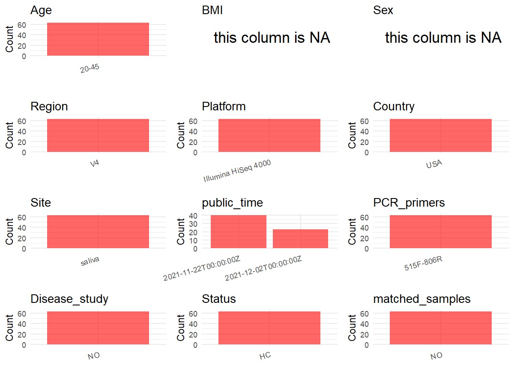

R Notebook: Metadata Processing Workflow
================

# Step 1: Obtain Initial Metadata from Each Project

To obtain the initial metadata: 1. Search for the BioProject ID (e.g.,
“PRJEBXXXX”) on the [NCBI SRA
website](https://www.ncbi.nlm.nih.gov/Traces/study/). 2. In the “Select”
table, click on “Metadata” and download the file. 3. The downloaded file
is typically named “SraRunTable.csv” and contains metadata for the
project.

``` r
# Load necessary libraries
library(dplyr)
library(ggplot2)
library(cowplot)

# Set working directory (update this path to your local directory)
setwd("E:/bioproject/PRJEB48622")

# Read the initial metadata files
initial_meta <- read.csv("SraRunTable.csv", header = T) 

# Remove entries non-oral samples
initial_meta <- initial_meta[!initial_meta$env_material 
  %in% c("sterile water", "anthropogenic environmental material"), ]

# Display the first few rows of the metadata
head(initial_meta)
```

    ##          Run Assay.Type AvgSpotLen barcode..exp.    Bases BioProject
    ## 1 ERR7247363   AMPLICON        149  CCTGGTGTCCGT 13302759 PRJEB48622
    ## 2 ERR7247364   AMPLICON        149  CCATCGACGCTC 10071932 PRJEB48622
    ## 3 ERR7247365   AMPLICON        149  AGTTTGCGAGAT 15203478 PRJEB48622
    ## 4 ERR7247366   AMPLICON        149  TACGTTTGGCGA 11744587 PRJEB48622
    ## 5 ERR7247367   AMPLICON        149  TACTAGATATTA  9808314 PRJEB48622
    ## 6 ERR7247368   AMPLICON        149  GGTCTCCTACAG 11138901 PRJEB48622
    ##       BioSample   Bytes center_name..exp.
    ## 1 SAMEA10793030 6203930              CCME
    ## 2 SAMEA10793031 4758648              CCME
    ## 3 SAMEA10793032 7058132              CCME
    ## 4 SAMEA10793033 5501455              CCME
    ## 5 SAMEA10793034 4597118              CCME
    ## 6 SAMEA10793035 5381358              CCME
    ##                                          Center.Name center_project_name..exp.
    ## 1 UNIVERSITY OF CALIFORNIA SAN DIEGO MICROBIOME INIT                      CCME
    ## 2 UNIVERSITY OF CALIFORNIA SAN DIEGO MICROBIOME INIT                      CCME
    ## 3 UNIVERSITY OF CALIFORNIA SAN DIEGO MICROBIOME INIT                      CCME
    ## 4 UNIVERSITY OF CALIFORNIA SAN DIEGO MICROBIOME INIT                      CCME
    ## 5 UNIVERSITY OF CALIFORNIA SAN DIEGO MICROBIOME INIT                      CCME
    ## 6 UNIVERSITY OF CALIFORNIA SAN DIEGO MICROBIOME INIT                      CCME
    ##   collection_timestamp Consent DATASTORE.filetype DATASTORE.provider
    ## 1           2014-09-22  public   fastq,run.zq,sra         gs,ncbi,s3
    ## 2           2014-09-22  public   fastq,run.zq,sra         gs,ncbi,s3
    ## 3           2014-09-22  public   fastq,run.zq,sra         gs,ncbi,s3
    ## 4           2014-09-22  public   fastq,run.zq,sra         gs,ncbi,s3
    ## 5           2014-09-22  public   fastq,run.zq,sra         gs,ncbi,s3
    ## 6           2014-09-22  public   fastq,run.zq,sra         gs,ncbi,s3
    ##                       DATASTORE.region elevation          empo_1 empo_2
    ## 1 gs.us-east1,ncbi.public,s3.us-east-1    1624.1 Host-associated Animal
    ## 2 gs.us-east1,ncbi.public,s3.us-east-1    1624.1 Host-associated Animal
    ## 3 gs.us-east1,ncbi.public,s3.us-east-1    1624.1 Host-associated Animal
    ## 4 gs.us-east1,ncbi.public,s3.us-east-1    1624.1 Host-associated Animal
    ## 5 gs.us-east1,ncbi.public,s3.us-east-1    1624.1 Host-associated Animal
    ## 6 gs.us-east1,ncbi.public,s3.us-east-1    1624.1 Host-associated Animal
    ##             empo_3 ENA.FIRST.PUBLIC..run. ENA_first_public
    ## 1 Animal secretion             2021-11-10       2021-11-10
    ## 2 Animal secretion             2021-11-10       2021-11-10
    ## 3 Animal secretion             2021-11-10       2021-11-10
    ## 4 Animal secretion             2021-11-10       2021-11-10
    ## 5 Animal secretion             2021-11-10       2021-11-10
    ## 6 Animal secretion             2021-11-10       2021-11-10
    ##   ENA.LAST.UPDATE..run. ena_last_update   env_biome              env_feature
    ## 1            2021-11-10      2021-11-10 urban biome human-associated habitat
    ## 2            2021-11-10      2021-11-10 urban biome human-associated habitat
    ## 3            2021-11-10      2021-11-10 urban biome human-associated habitat
    ## 4            2021-11-10      2021-11-10 urban biome human-associated habitat
    ## 5            2021-11-10      2021-11-10 urban biome human-associated habitat
    ## 6            2021-11-10      2021-11-10 urban biome human-associated habitat
    ##   env_material env_package Experiment   external_id extraction_robot..exp.
    ## 1       saliva  human-oral ERX6816822 SAMEA10793030               HOWE-KF1
    ## 2       saliva  human-oral ERX6816823 SAMEA10793031               HOWE-KF1
    ## 3       saliva  human-oral ERX6816824 SAMEA10793032               HOWE-KF1
    ## 4       saliva  human-oral ERX6816825 SAMEA10793033               HOWE-KF1
    ## 5       saliva  human-oral ERX6816826 SAMEA10793034               HOWE-KF1
    ## 6       saliva  human-oral ERX6816827 SAMEA10793035               HOWE-KF1
    ##   extractionkit_lot..exp. host_age_units host_height_units host_subject_id
    ## 1                  PM15G7          years                 m              MA
    ## 2                  PM15G7          years                 m              MA
    ## 3                  PM15G7          years                 m              MA
    ## 4                  PM15G7          years                 m              MA
    ## 5                  PM15G7          years                 m              MA
    ## 6                  PM15G7          years                 m              MA
    ##   host_weight_units INSDC_center_alias
    ## 1                kg             UCSDMI
    ## 2                kg             UCSDMI
    ## 3                kg             UCSDMI
    ## 4                kg             UCSDMI
    ## 5                kg             UCSDMI
    ## 6                kg             UCSDMI
    ##                                          INSDC_center_name   INSDC_first_public
    ## 1 University of California San Diego Microbiome Initiative 2021-11-10T16:23:23Z
    ## 2 University of California San Diego Microbiome Initiative 2021-11-10T16:23:23Z
    ## 3 University of California San Diego Microbiome Initiative 2021-11-10T16:23:23Z
    ## 4 University of California San Diego Microbiome Initiative 2021-11-10T16:23:23Z
    ## 5 University of California San Diego Microbiome Initiative 2021-11-10T16:23:23Z
    ## 6 University of California San Diego Microbiome Initiative 2021-11-10T16:23:23Z
    ##      INSDC_last_update INSDC_status          Instrument LATITUDE Library.Name
    ## 1 2021-11-10T16:23:23Z       public Illumina HiSeq 4000    40.01  14059.36748
    ## 2 2021-11-10T16:23:23Z       public Illumina HiSeq 4000    40.01  14059.36749
    ## 3 2021-11-10T16:23:23Z       public Illumina HiSeq 4000    40.01  14059.36750
    ## 4 2021-11-10T16:23:23Z       public Illumina HiSeq 4000    40.01  14059.36751
    ## 5 2021-11-10T16:23:23Z       public Illumina HiSeq 4000    40.01  14059.36752
    ## 6 2021-11-10T16:23:23Z       public Illumina HiSeq 4000    40.01  14059.36753
    ##   LibraryLayout LibrarySelection LibrarySource linkerprimersequence..exp.
    ## 1        SINGLE              PCR   METAGENOMIC      GTGTGCCAGCMGCCGCGGTAA
    ## 2        SINGLE              PCR   METAGENOMIC      GTGTGCCAGCMGCCGCGGTAA
    ## 3        SINGLE              PCR   METAGENOMIC      GTGTGCCAGCMGCCGCGGTAA
    ## 4        SINGLE              PCR   METAGENOMIC      GTGTGCCAGCMGCCGCGGTAA
    ## 5        SINGLE              PCR   METAGENOMIC      GTGTGCCAGCMGCCGCGGTAA
    ## 6        SINGLE              PCR   METAGENOMIC      GTGTGCCAGCMGCCGCGGTAA
    ##   longitude mastermix_lot..exp.              Organism
    ## 1   -105.27           151029801 human oral metagenome
    ## 2   -105.27           151029801 human oral metagenome
    ## 3   -105.27           151029801 human oral metagenome
    ## 4   -105.27           151029801 human oral metagenome
    ## 5   -105.27           151029801 human oral metagenome
    ## 6   -105.27           151029801 human oral metagenome
    ##                                   pcr_primers..exp. physical_specimen_location
    ## 1 FWD:GTGCCAGCMGCCGCGGTAA; REV:GGACTACHVGGGTWTCTAAT                     UCSDMI
    ## 2 FWD:GTGCCAGCMGCCGCGGTAA; REV:GGACTACHVGGGTWTCTAAT                     UCSDMI
    ## 3 FWD:GTGCCAGCMGCCGCGGTAA; REV:GGACTACHVGGGTWTCTAAT                     UCSDMI
    ## 4 FWD:GTGCCAGCMGCCGCGGTAA; REV:GGACTACHVGGGTWTCTAAT                     UCSDMI
    ## 5 FWD:GTGCCAGCMGCCGCGGTAA; REV:GGACTACHVGGGTWTCTAAT                     UCSDMI
    ## 6 FWD:GTGCCAGCMGCCGCGGTAA; REV:GGACTACHVGGGTWTCTAAT                     UCSDMI
    ##   Platform plating..exp.        primer..exp. primer_plate..exp.
    ## 1 ILLUMINA            JG GTGCCAGCMGCCGCGGTAA                  8
    ## 2 ILLUMINA            JG GTGCCAGCMGCCGCGGTAA                  8
    ## 3 ILLUMINA            JG GTGCCAGCMGCCGCGGTAA                  8
    ## 4 ILLUMINA            JG GTGCCAGCMGCCGCGGTAA                  8
    ## 5 ILLUMINA            JG GTGCCAGCMGCCGCGGTAA                  8
    ## 6 ILLUMINA            JG GTGCCAGCMGCCGCGGTAA                  8
    ##   processing_robot..exp.          ReleaseDate run_center..exp.
    ## 1                   ROBE 2021-12-02T00:00:00Z             CCME
    ## 2                   ROBE 2021-12-02T00:00:00Z             CCME
    ## 3                   ROBE 2021-12-02T00:00:00Z             CCME
    ## 4                   ROBE 2021-12-02T00:00:00Z             CCME
    ## 5                   ROBE 2021-12-02T00:00:00Z             CCME
    ## 6                   ROBE 2021-12-02T00:00:00Z             CCME
    ##            create_date version   Sample.Name                 Sample_name
    ## 1 2021-11-16T18:38:00Z       1 SAMEA10793030 qiita_sid_14059:14059.36748
    ## 2 2021-11-16T18:36:00Z       1 SAMEA10793031 qiita_sid_14059:14059.36749
    ## 3 2021-11-16T18:38:00Z       1 SAMEA10793032 qiita_sid_14059:14059.36750
    ## 4 2021-11-16T18:38:00Z       1 SAMEA10793033 qiita_sid_14059:14059.36751
    ## 5 2021-11-16T18:36:00Z       1 SAMEA10793034 qiita_sid_14059:14059.36752
    ## 6 2021-11-16T18:36:00Z       1 SAMEA10793035 qiita_sid_14059:14059.36753
    ##   sample_type sequencing_method..exp. SRA.Study                Submitter_Id
    ## 1      saliva Sequencing by synthesis ERP133011 qiita_sid_14059:14059.36748
    ## 2      saliva Sequencing by synthesis ERP133011 qiita_sid_14059:14059.36749
    ## 3      saliva Sequencing by synthesis ERP133011 qiita_sid_14059:14059.36750
    ## 4      saliva Sequencing by synthesis ERP133011 qiita_sid_14059:14059.36751
    ## 5      saliva Sequencing by synthesis ERP133011 qiita_sid_14059:14059.36752
    ## 6      saliva Sequencing by synthesis ERP133011 qiita_sid_14059:14059.36753
    ##   target_gene..exp. target_subfragment..exp. tm1000_8_tool..exp.
    ## 1          16S rRNA                       V4             108379Z
    ## 2          16S rRNA                       V4             108379Z
    ## 3          16S rRNA                       V4             108379Z
    ## 4          16S rRNA                       V4             108379Z
    ## 5          16S rRNA                       V4             108379Z
    ## 6          16S rRNA                       V4             108379Z
    ##   tm300_8_tool..exp. tm50_8_tool..exp. water_lot..exp. well_id..exp.
    ## 1            311313B           111075B        RNBD7780           E11
    ## 2            311313B           111075B        RNBD7780            H9
    ## 3            311313B           111075B        RNBD7780            F8
    ## 4            311313B           111075B        RNBD7780           C11
    ## 5            311313B           111075B        RNBD7780           C10
    ## 6            311313B           111075B        RNBD7780           D10
    ##        Host_age host_body_habitat host_body_mass_index host_body_product
    ## 1 not collected     UBERON:saliva        not collected     UBERON:saliva
    ## 2 not collected     UBERON:saliva        not collected     UBERON:saliva
    ## 3 not collected     UBERON:saliva        not collected     UBERON:saliva
    ## 4 not collected     UBERON:saliva        not collected     UBERON:saliva
    ## 5 not collected     UBERON:saliva        not collected     UBERON:saliva
    ## 6 not collected     UBERON:saliva        not collected     UBERON:saliva
    ##   host_body_site host_common_name   host_height host_scientific_name host_taxid
    ## 1         saliva            human not collected         Homo sapiens       9606
    ## 2         saliva            human not collected         Homo sapiens       9606
    ## 3         saliva            human not collected         Homo sapiens       9606
    ## 4         saliva            human not collected         Homo sapiens       9606
    ## 5         saliva            human not collected         Homo sapiens       9606
    ## 6         saliva            human not collected         Homo sapiens       9606
    ##     host_weight
    ## 1 not collected
    ## 2 not collected
    ## 3 not collected
    ## 4 not collected
    ## 5 not collected
    ## 6 not collected

# Step 2: Create a Uniform Metadata Template

The uniform metadata should include the following columns:

1.  **BioProject**: Project ID (e.g., “PRJNA339212”)
2.  **Run**: Sample ID (e.g., “ERRXXXXXX” or “SRRXXXXXX”)
3.  **sample_name**: Original sample name submitted by the authors (not
    the database-assigned ID)
4.  **Age**: Age of the subject (if available)
5.  **BMI**: Body Mass Index (if available)
6.  **Sex**: Sex of the subject (“F” or “M”)
7.  **Region**: Targeted 16S rRNA region (e.g., “V3-V4”)
8.  **Platform**: Sequencing platform (e.g., “Illumina MiSeq”)
9.  **Country**: Country of sample origin (e.g., “China”)
10. **Site**: Sample site (e.g., “saliva”, “dental plaque”)
11. **public_time**: Data release date (format: “YYYY-MM-DD”)
12. **PCR_primers**: PCR primers used (e.g., “515F-806R”)
13. **title**: Title of the associated publication
14. **Disease_study**: Whether the study involves a disease (“YES” or
    “NO”)
15. **Status**: Disease status (e.g., “T2DM”, “HC”). Note: If the study
    includes both disease and healthy samples, this must be specified
    per sample.
16. **matched_samples**: matched samples (“YES” or “NO”)

``` r
# Create a uniform metadata dataframe
metadata <- data.frame(
  BioProject = initial_meta$BioProject,
  Run = initial_meta$Run,
  sample_name = initial_meta$Library.Name,
  Age = "20-45", 
  BMI = NA, 
  Sex = NA,
  Region = initial_meta$target_subfragment..exp.,
  Platform = initial_meta$Instrument,
  Site = initial_meta$env_material,
  public_time = initial_meta$ReleaseDate,
  matched_samples = NA,
  stringsAsFactors = FALSE
)
```

# Step 3: Manually Add Information from the Publication

Some information (e.g. PCR primers, study title, disease status) must be
manually extracted from the publication and added to the metadata.

``` r
# Add information obtained from the publication
metadata$Country <- "USA"
metadata$PCR_primers <- "515F-806R"
metadata$title <- "Diurnal and eating-associated microbial patterns revealed via high-frequency saliva sampling"
metadata$Disease_study <- "NO"
# Assign disease status based on sample_name patterns
metadata$Status <- "HC"

#extract subject id by remove prefix of sample_name
metadata$sample_name <- gsub("14059", "", metadata$sample_name)

# Check initial data distribution
cat("Initial sample distribution:\n")
```

    ## Initial sample distribution:

``` r
table(metadata$sample_name)
```

    ## 
    ## .36748 .36749 .36750 .36751 .36752 .36753 .36754 .36755 .36756 .36757 .36758 
    ##      1      1      1      1      1      1      1      1      1      1      1 
    ## .36759 .36760 .36761 .36762 .36763 .36764 .36765 .36766 .36767 .36768 .36769 
    ##      1      1      1      1      1      1      1      1      1      1      1 
    ## .36770 .36771 .36772 .36773 .36774 .36775 .36776 .36777 .36779 .36780 .36781 
    ##      1      1      1      1      1      1      1      1      1      1      1 
    ## .36782 .36783 .36784 .36785 .36786 .36787 .36788 .36789 .36790 .36791 .36792 
    ##      1      1      1      1      1      1      1      1      1      1      1 
    ## .36793 .36794 .36795 .36796 .36797 .36798 .36799 .36800 .36801 .36802 .36803 
    ##      1      1      1      1      1      1      1      1      1      1      1 
    ## .36804 .36805 .36806 .36807 .36808 .36809 .36810 .36811 .36812 .36813 .36814 
    ##      1      1      1      1      1      1      1      1      1      1      1 
    ## .36815 .36816 .36817 .36818 .36819 .36820 .36821 .36822 .36823 .36824 .36825 
    ##      1      1      1      1      1      1      1      1      1      1      1

``` r
table(metadata$Site)
```

    ## 
    ## saliva tongue  tooth 
    ##     63      7      7

``` r
# Calculate sampling frequency per subject
sample_counts <- table(metadata$sample_name)
cat("\nNumber of samples per subject:\n")
```

    ## 
    ## Number of samples per subject:

``` r
print(sample_counts)
```

    ## 
    ## .36748 .36749 .36750 .36751 .36752 .36753 .36754 .36755 .36756 .36757 .36758 
    ##      1      1      1      1      1      1      1      1      1      1      1 
    ## .36759 .36760 .36761 .36762 .36763 .36764 .36765 .36766 .36767 .36768 .36769 
    ##      1      1      1      1      1      1      1      1      1      1      1 
    ## .36770 .36771 .36772 .36773 .36774 .36775 .36776 .36777 .36779 .36780 .36781 
    ##      1      1      1      1      1      1      1      1      1      1      1 
    ## .36782 .36783 .36784 .36785 .36786 .36787 .36788 .36789 .36790 .36791 .36792 
    ##      1      1      1      1      1      1      1      1      1      1      1 
    ## .36793 .36794 .36795 .36796 .36797 .36798 .36799 .36800 .36801 .36802 .36803 
    ##      1      1      1      1      1      1      1      1      1      1      1 
    ## .36804 .36805 .36806 .36807 .36808 .36809 .36810 .36811 .36812 .36813 .36814 
    ##      1      1      1      1      1      1      1      1      1      1      1 
    ## .36815 .36816 .36817 .36818 .36819 .36820 .36821 .36822 .36823 .36824 .36825 
    ##      1      1      1      1      1      1      1      1      1      1      1

``` r
# Create matched_samples column
metadata$matched_samples <- ifelse(metadata$sample_name %in% names(sample_counts[sample_counts >= 2]), "YES", "NO")

cat("\nMatched samples distribution:\n")
```

    ## 
    ## Matched samples distribution:

``` r
table(metadata$matched_samples)
```

    ## 
    ## NO 
    ## 77

``` r
# Identify samples for removal: single samples excluding saliva and tongue coat
single_samples <- names(sample_counts[sample_counts == 1])
samples_to_remove <- metadata$sample_name %in% single_samples & 
                     !(metadata$Site %in% c("saliva", "tongue coat"))

cat("\nNumber of samples to be removed:", sum(samples_to_remove), "\n")
```

    ## 
    ## Number of samples to be removed: 14

``` r
# Remove identified samples
metadata_clean <- metadata[!samples_to_remove, ]

cat("\nFinal sample distribution after cleaning:\n")
```

    ## 
    ## Final sample distribution after cleaning:

``` r
table(metadata_clean$sample_name)
```

    ## 
    ## .36748 .36749 .36750 .36751 .36752 .36753 .36754 .36755 .36756 .36757 .36758 
    ##      1      1      1      1      1      1      1      1      1      1      1 
    ## .36759 .36760 .36761 .36762 .36763 .36764 .36765 .36766 .36767 .36768 .36769 
    ##      1      1      1      1      1      1      1      1      1      1      1 
    ## .36770 .36773 .36776 .36777 .36779 .36782 .36783 .36784 .36787 .36788 .36789 
    ##      1      1      1      1      1      1      1      1      1      1      1 
    ## .36792 .36793 .36794 .36797 .36798 .36799 .36802 .36803 .36804 .36805 .36806 
    ##      1      1      1      1      1      1      1      1      1      1      1 
    ## .36807 .36808 .36809 .36810 .36811 .36812 .36813 .36814 .36815 .36816 .36817 
    ##      1      1      1      1      1      1      1      1      1      1      1 
    ## .36818 .36819 .36820 .36821 .36822 .36823 .36824 .36825 
    ##      1      1      1      1      1      1      1      1

``` r
table(metadata_clean$Site)
```

    ## 
    ## saliva 
    ##     63

``` r
table(metadata_clean$matched_samples)
```

    ## 
    ## NO 
    ## 63

``` r
# Use cleaned dataset for subsequent analysis
metadata <- metadata_clean
```

# Step 4: Summarize and Validate the Metadata

``` r
# Check the number of unique runs and sample names
print(paste("Number of unique runs:", length(unique(metadata$Run))))
```

    ## [1] "Number of unique runs: 63"

``` r
print(paste("Number of unique sample names:", length(unique(metadata$sample_name))))
```

    ## [1] "Number of unique sample names: 63"

# Step 5: Visualize the Metadata

``` r

```

<!-- -->

# Step 6: Finalize and Export the Metadata

``` r
# Reorder columns to match the desired format
metadata <- metadata[, c(
  "BioProject", "Run", "sample_name", "Age", "BMI", "Sex", 
  "Region", "Platform", "Country", "Site", "public_time", 
  "PCR_primers", "title", "Disease_study", "Status", "matched_samples"
)]

# Export the uniform metadata to a CSV file
write.csv(metadata, file = "metadata.csv", quote = FALSE)
head(metadata)
```

    ##   BioProject        Run sample_name   Age BMI Sex Region            Platform
    ## 1 PRJEB48622 ERR7247363      .36748 20-45  NA  NA     V4 Illumina HiSeq 4000
    ## 2 PRJEB48622 ERR7247364      .36749 20-45  NA  NA     V4 Illumina HiSeq 4000
    ## 3 PRJEB48622 ERR7247365      .36750 20-45  NA  NA     V4 Illumina HiSeq 4000
    ## 4 PRJEB48622 ERR7247366      .36751 20-45  NA  NA     V4 Illumina HiSeq 4000
    ## 5 PRJEB48622 ERR7247367      .36752 20-45  NA  NA     V4 Illumina HiSeq 4000
    ## 6 PRJEB48622 ERR7247368      .36753 20-45  NA  NA     V4 Illumina HiSeq 4000
    ##   Country   Site          public_time PCR_primers
    ## 1     USA saliva 2021-12-02T00:00:00Z   515F-806R
    ## 2     USA saliva 2021-12-02T00:00:00Z   515F-806R
    ## 3     USA saliva 2021-12-02T00:00:00Z   515F-806R
    ## 4     USA saliva 2021-12-02T00:00:00Z   515F-806R
    ## 5     USA saliva 2021-12-02T00:00:00Z   515F-806R
    ## 6     USA saliva 2021-12-02T00:00:00Z   515F-806R
    ##                                                                                          title
    ## 1 Diurnal and eating-associated microbial patterns revealed via high-frequency saliva sampling
    ## 2 Diurnal and eating-associated microbial patterns revealed via high-frequency saliva sampling
    ## 3 Diurnal and eating-associated microbial patterns revealed via high-frequency saliva sampling
    ## 4 Diurnal and eating-associated microbial patterns revealed via high-frequency saliva sampling
    ## 5 Diurnal and eating-associated microbial patterns revealed via high-frequency saliva sampling
    ## 6 Diurnal and eating-associated microbial patterns revealed via high-frequency saliva sampling
    ##   Disease_study Status matched_samples
    ## 1            NO     HC              NO
    ## 2            NO     HC              NO
    ## 3            NO     HC              NO
    ## 4            NO     HC              NO
    ## 5            NO     HC              NO
    ## 6            NO     HC              NO

## Notes for Students:

1.  **Metadata Accuracy**: Always cross-check the metadata with the
    original publication to ensure accuracy.
2.  **Manual Entries**: Columns like `PCR_primers`, and `Status` often
    require manual entry based on the publication.
3.  **Disease Status**: Be careful when assigning `Status`—some studies
    include both disease and healthy samples.
4.  **Visualization**: The plots help quickly identify the distribution
    of values in each column, which is useful for quality control.
5.  **Reproducibility**: Update the working directory and file paths to
    match your local environment.
