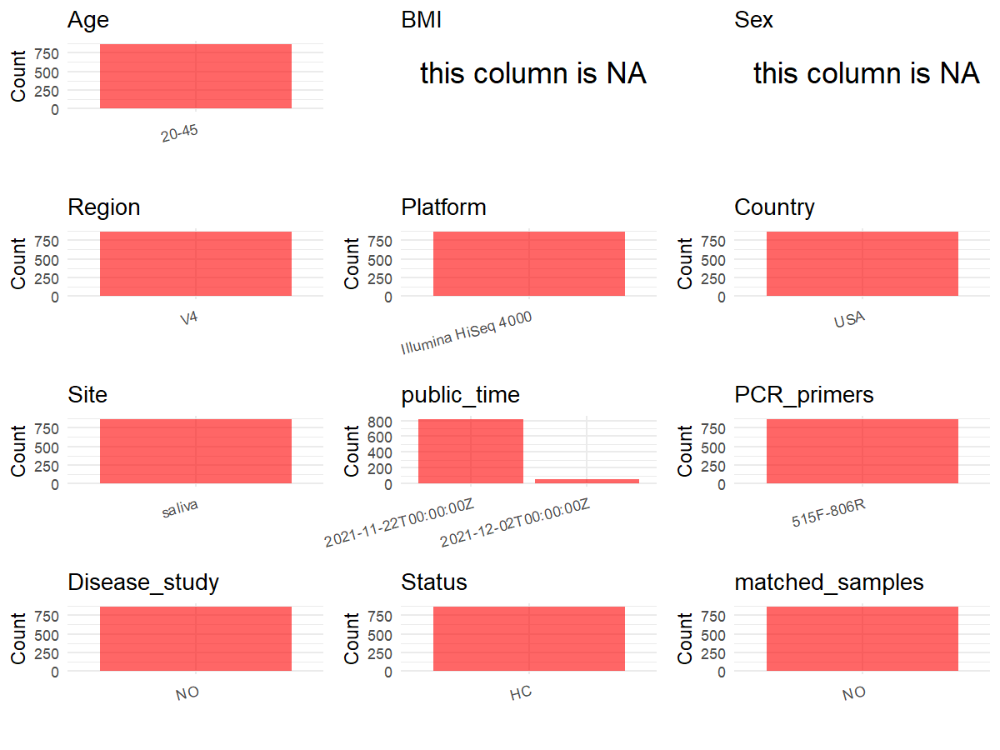

R Notebook: Metadata Processing Workflow
================

# Step 1: Obtain Initial Metadata from Each Project

To obtain the initial metadata: 1. Search for the BioProject ID (e.g.,
“PRJEBXXXX”) on the [NCBI SRA
website](https://www.ncbi.nlm.nih.gov/Traces/study/). 2. In the “Select”
table, click on “Metadata” and download the file. 3. The downloaded file
is typically named “SraRunTable.csv” and contains metadata for the
project.

``` r
# Load necessary libraries
library(dplyr)
library(ggplot2)
library(cowplot)

# Set working directory (update this path to your local directory)
setwd("E:/bioproject/PRJEB48623")

# Read the initial metadata files
initial_meta <- read.csv("SraRunTable.csv", header = T) 

# Display the first few rows of the metadata
head(initial_meta)
```

    ##          Run Assay.Type AvgSpotLen barcode..exp.   Bases BioProject
    ## 1 ERR7247444   AMPLICON        151  ATCGTAGTGGTC 3425435 PRJEB48623
    ## 2 ERR7247445   AMPLICON        151  GCTGCCCACCTA 1274591 PRJEB48623
    ## 3 ERR7247446   AMPLICON        151  TCGAGAGTTTGC 2579533 PRJEB48623
    ## 4 ERR7247447   AMPLICON        151  CGTTCTGGTGGT 3366696 PRJEB48623
    ## 5 ERR7247448   AMPLICON        151  ACGGTACCCTAC 1859263 PRJEB48623
    ## 6 ERR7247449   AMPLICON        151  GTCACTCCGAAC 3027852 PRJEB48623
    ##       BioSample   Bytes center_name..exp.
    ## 1 SAMEA10793111 2026879              CCME
    ## 2 SAMEA10793112  759262              CCME
    ## 3 SAMEA10793113 1526630              CCME
    ## 4 SAMEA10793114 2006675              CCME
    ## 5 SAMEA10793115 1137693              CCME
    ## 6 SAMEA10793116 1824799              CCME
    ##                                          Center.Name center_project_name..exp.
    ## 1 UNIVERSITY OF CALIFORNIA SAN DIEGO MICROBIOME INIT                      CCME
    ## 2 UNIVERSITY OF CALIFORNIA SAN DIEGO MICROBIOME INIT                      CCME
    ## 3 UNIVERSITY OF CALIFORNIA SAN DIEGO MICROBIOME INIT                      CCME
    ## 4 UNIVERSITY OF CALIFORNIA SAN DIEGO MICROBIOME INIT                      CCME
    ## 5 UNIVERSITY OF CALIFORNIA SAN DIEGO MICROBIOME INIT                      CCME
    ## 6 UNIVERSITY OF CALIFORNIA SAN DIEGO MICROBIOME INIT                      CCME
    ##   collection_timestamp Consent DATASTORE.filetype DATASTORE.provider
    ## 1           2014-09-15  public   fastq,run.zq,sra         gs,ncbi,s3
    ## 2           2014-09-15  public   fastq,run.zq,sra         gs,ncbi,s3
    ## 3           2014-09-15  public   fastq,run.zq,sra         gs,ncbi,s3
    ## 4           2014-09-15  public   fastq,run.zq,sra         gs,ncbi,s3
    ## 5           2014-09-15  public   fastq,run.zq,sra         gs,ncbi,s3
    ## 6           2014-09-15  public   fastq,run.zq,sra         gs,ncbi,s3
    ##                       DATASTORE.region Day elevation          empo_1 empo_2
    ## 1 gs.us-east1,ncbi.public,s3.us-east-1   1    1624.1 Host-associated Animal
    ## 2 gs.us-east1,ncbi.public,s3.us-east-1   1    1624.1 Host-associated Animal
    ## 3 gs.us-east1,ncbi.public,s3.us-east-1   1    1624.1 Host-associated Animal
    ## 4 gs.us-east1,ncbi.public,s3.us-east-1   1    1624.1 Host-associated Animal
    ## 5 gs.us-east1,ncbi.public,s3.us-east-1   1    1624.1 Host-associated Animal
    ## 6 gs.us-east1,ncbi.public,s3.us-east-1   1    1624.1 Host-associated Animal
    ##             empo_3 ENA.FIRST.PUBLIC..run. ENA.LAST.UPDATE..run.   env_biome
    ## 1 Animal secretion             2021-11-10            2021-11-10 urban biome
    ## 2 Animal secretion             2021-11-10            2021-11-10 urban biome
    ## 3 Animal secretion             2021-11-10            2021-11-10 urban biome
    ## 4 Animal secretion             2021-11-10            2021-11-10 urban biome
    ## 5 Animal secretion             2021-11-10            2021-11-10 urban biome
    ## 6 Animal secretion             2021-11-10            2021-11-10 urban biome
    ##                env_feature env_material env_package Experiment   external_id
    ## 1 human-associated habitat       saliva  human-oral ERX6816903 SAMEA10793111
    ## 2 human-associated habitat       saliva  human-oral ERX6816904 SAMEA10793112
    ## 3 human-associated habitat       saliva  human-oral ERX6816905 SAMEA10793113
    ## 4 human-associated habitat       saliva  human-oral ERX6816906 SAMEA10793114
    ## 5 human-associated habitat       saliva  human-oral ERX6816907 SAMEA10793115
    ## 6 human-associated habitat       saliva  human-oral ERX6816908 SAMEA10793116
    ##        Host_age host_age_units host_body_habitat host_body_mass_index
    ## 1 not collected          years     UBERON:saliva        not collected
    ## 2 not collected          years     UBERON:saliva        not collected
    ## 3 not collected          years     UBERON:saliva        not collected
    ## 4 not collected          years     UBERON:saliva        not collected
    ## 5 not collected          years     UBERON:saliva        not collected
    ## 6 not collected          years     UBERON:saliva        not collected
    ##   host_body_product host_body_site host_common_name   host_height
    ## 1     UBERON:saliva         saliva            human not collected
    ## 2     UBERON:saliva         saliva            human not collected
    ## 3     UBERON:saliva         saliva            human not collected
    ## 4     UBERON:saliva         saliva            human not collected
    ## 5     UBERON:saliva         saliva            human not collected
    ## 6     UBERON:saliva         saliva            human not collected
    ##   host_height_units host_scientific_name host_subject_id host_taxid
    ## 1                 m         Homo sapiens              MA       9606
    ## 2                 m         Homo sapiens              MA       9606
    ## 3                 m         Homo sapiens              MA       9606
    ## 4                 m         Homo sapiens              MA       9606
    ## 5                 m         Homo sapiens              MA       9606
    ## 6                 m         Homo sapiens              MA       9606
    ##     host_weight host_weight_units Hour
    ## 1 not collected                kg    7
    ## 2 not collected                kg    7
    ## 3 not collected                kg    8
    ## 4 not collected                kg    9
    ## 5 not collected                kg    9
    ## 6 not collected                kg   10
    ##                                          INSDC_center_name   INSDC_first_public
    ## 1 University of California San Diego Microbiome Initiative 2021-11-10T16:23:23Z
    ## 2 University of California San Diego Microbiome Initiative 2021-11-10T16:23:23Z
    ## 3 University of California San Diego Microbiome Initiative 2021-11-10T16:23:23Z
    ## 4 University of California San Diego Microbiome Initiative 2021-11-10T16:23:23Z
    ## 5 University of California San Diego Microbiome Initiative 2021-11-10T16:23:23Z
    ## 6 University of California San Diego Microbiome Initiative 2021-11-10T16:23:23Z
    ##      INSDC_last_update INSDC_status          Instrument LATITUDE Library.Name
    ## 1 2021-11-10T16:23:23Z       public Illumina HiSeq 4000    40.01     14062.19
    ## 2 2021-11-10T16:23:23Z       public Illumina HiSeq 4000    40.01     14062.19
    ## 3 2021-11-10T16:23:23Z       public Illumina HiSeq 4000    40.01     14062.19
    ## 4 2021-11-10T16:23:23Z       public Illumina HiSeq 4000    40.01     14062.19
    ## 5 2021-11-10T16:23:23Z       public Illumina HiSeq 4000    40.01     14062.19
    ## 6 2021-11-10T16:23:23Z       public Illumina HiSeq 4000    40.01     14062.19
    ##   LibraryLayout LibrarySelection LibrarySource longitude min
    ## 1        SINGLE              PCR   METAGENOMIC   -105.27   0
    ## 2        SINGLE              PCR   METAGENOMIC   -105.27  30
    ## 3        SINGLE              PCR   METAGENOMIC   -105.27  40
    ## 4        SINGLE              PCR   METAGENOMIC   -105.27   5
    ## 5        SINGLE              PCR   METAGENOMIC   -105.27  35
    ## 6        SINGLE              PCR   METAGENOMIC   -105.27   0
    ##                Organism                                 pcr_primers..exp.
    ## 1 human oral metagenome FWD:GTGCCAGCMGCCGCGGTAA; REV:GGACTACHVGGGTWTCTAAT
    ## 2 human oral metagenome FWD:GTGCCAGCMGCCGCGGTAA; REV:GGACTACHVGGGTWTCTAAT
    ## 3 human oral metagenome FWD:GTGCCAGCMGCCGCGGTAA; REV:GGACTACHVGGGTWTCTAAT
    ## 4 human oral metagenome FWD:GTGCCAGCMGCCGCGGTAA; REV:GGACTACHVGGGTWTCTAAT
    ## 5 human oral metagenome FWD:GTGCCAGCMGCCGCGGTAA; REV:GGACTACHVGGGTWTCTAAT
    ## 6 human oral metagenome FWD:GTGCCAGCMGCCGCGGTAA; REV:GGACTACHVGGGTWTCTAAT
    ##   physical_specimen_location Platform        primer..exp.          ReleaseDate
    ## 1                     UCSDMI ILLUMINA GTGCCAGCMGCCGCGGTAA 2021-11-22T00:00:00Z
    ## 2                     UCSDMI ILLUMINA GTGCCAGCMGCCGCGGTAA 2021-11-22T00:00:00Z
    ## 3                     UCSDMI ILLUMINA GTGCCAGCMGCCGCGGTAA 2021-11-22T00:00:00Z
    ## 4                     UCSDMI ILLUMINA GTGCCAGCMGCCGCGGTAA 2021-11-22T00:00:00Z
    ## 5                     UCSDMI ILLUMINA GTGCCAGCMGCCGCGGTAA 2021-11-22T00:00:00Z
    ## 6                     UCSDMI ILLUMINA GTGCCAGCMGCCGCGGTAA 2021-11-22T00:00:00Z
    ##   run_center..exp.          create_date version   Sample.Name
    ## 1             CCME 2021-11-16T17:20:00Z       1 SAMEA10793111
    ## 2             CCME 2021-11-16T17:20:00Z       1 SAMEA10793112
    ## 3             CCME 2021-11-16T17:20:00Z       1 SAMEA10793113
    ## 4             CCME 2021-11-16T17:20:00Z       1 SAMEA10793114
    ## 5             CCME 2021-11-16T17:20:00Z       1 SAMEA10793115
    ## 6             CCME 2021-11-16T17:21:00Z       1 SAMEA10793116
    ##                   Sample_name sample_type sequencing_method..exp. SRA.Study
    ## 1 qiita_sid_14062:14062.19122      saliva Sequencing by synthesis ERP133012
    ## 2 qiita_sid_14062:14062.19123      saliva Sequencing by synthesis ERP133012
    ## 3 qiita_sid_14062:14062.19124      saliva Sequencing by synthesis ERP133012
    ## 4 qiita_sid_14062:14062.19125      saliva Sequencing by synthesis ERP133012
    ## 5 qiita_sid_14062:14062.19126      saliva Sequencing by synthesis ERP133012
    ## 6 qiita_sid_14062:14062.19127      saliva Sequencing by synthesis ERP133012
    ##                  Submitter_Id target_gene..exp. target_subfragment..exp.
    ## 1 qiita_sid_14062:14062.19122          16S rRNA                       V4
    ## 2 qiita_sid_14062:14062.19123          16S rRNA                       V4
    ## 3 qiita_sid_14062:14062.19124          16S rRNA                       V4
    ## 4 qiita_sid_14062:14062.19125          16S rRNA                       V4
    ## 5 qiita_sid_14062:14062.19126          16S rRNA                       V4
    ## 6 qiita_sid_14062:14062.19127          16S rRNA                       V4
    ##   ENA_first_public ena_last_update INSDC_center_alias events  Other sleep
    ## 1       2021-11-10      2021-11-10             UCSDMI  sleep          yes
    ## 2       2021-11-10      2021-11-10             UCSDMI                    
    ## 3       2021-11-10      2021-11-10             UCSDMI  sleep          yes
    ## 4       2021-11-10      2021-11-10             UCSDMI                    
    ## 5       2021-11-10      2021-11-10             UCSDMI        shower      
    ## 6       2021-11-10      2021-11-10             UCSDMI          talk      
    ##   ena_first_public ena_last_update.1 Scientific_Name
    ## 1                                                   
    ## 2                                                   
    ## 3                                                   
    ## 4                                                   
    ## 5                                                   
    ## 6

# Step 2: Create a Uniform Metadata Template

The uniform metadata should include the following columns:

1.  **BioProject**: Project ID (e.g., “PRJNA339212”)
2.  **Run**: Sample ID (e.g., “ERRXXXXXX” or “SRRXXXXXX”)
3.  **sample_name**: Original sample name submitted by the authors (not
    the database-assigned ID)
4.  **Age**: Age of the subject (if available)
5.  **BMI**: Body Mass Index (if available)
6.  **Sex**: Sex of the subject (“F” or “M”)
7.  **Region**: Targeted 16S rRNA region (e.g., “V3-V4”)
8.  **Platform**: Sequencing platform (e.g., “Illumina MiSeq”)
9.  **Country**: Country of sample origin (e.g., “China”)
10. **Site**: Sample site (e.g., “saliva”, “dental plaque”)
11. **public_time**: Data release date (format: “YYYY-MM-DD”)
12. **PCR_primers**: PCR primers used (e.g., “515F-806R”)
13. **title**: Title of the associated publication
14. **Disease_study**: Whether the study involves a disease (“YES” or
    “NO”)
15. **Status**: Disease status (e.g., “T2DM”, “HC”). Note: If the study
    includes both disease and healthy samples, this must be specified
    per sample.
16. **matched_samples**: matched samples (“YES” or “NO”)

``` r
# Create a uniform metadata dataframe
metadata <- data.frame(
  BioProject = initial_meta$BioProject,
  Run = initial_meta$Run,
  sample_name = initial_meta$Library.Name,
  Age = "20-45",
  BMI = NA, 
  Sex = NA,
  Region = initial_meta$target_subfragment..exp.,
  Platform = initial_meta$Instrument,
  Site = initial_meta$env_material,
  public_time = initial_meta$ReleaseDate,
  matched_samples = NA,
  stringsAsFactors = FALSE
)
```

# Step 3: Manually Add Information from the Publication

Some information (e.g. PCR primers, study title, disease status) must be
manually extracted from the publication and added to the metadata.

``` r
# Add information obtained from the publication
metadata$Country <- "USA"
metadata$PCR_primers <- "515F-806R"
metadata$title <- "Diurnal and eating-associated microbial patterns revealed via high-frequency saliva sampling"
metadata$Disease_study <- "NO"
# Assign disease status based on sample_name patterns
metadata$Status <- "HC"

#extract subject id by remove prefix of sample_name
metadata$sample_name <- gsub("14062", "", metadata$sample_name)

# Check initial data distribution
cat("Initial sample distribution:\n")
```

    ## Initial sample distribution:

``` r
table(metadata$sample_name)
```

    ## 
    ## .19122 .19123 .19124 .19125 .19126 .19127 .19128  .1913 .19131 .19132 .19133 
    ##      1      1      1      1      1      1      1      1      1      1      1 
    ## .19134 .19135 .19136 .19137 .19138 .19139  .1914 .19141 .19142 .19143 .19144 
    ##      1      1      1      1      1      1      1      1      1      1      1 
    ## .19145 .19146 .19147 .19148 .19149  .1915 .19151 .19152 .19153 .19154 .19155 
    ##      1      1      1      1      1      1      1      1      1      1      1 
    ## .19156 .19157 .19158 .19159  .1916 .19161 .19162 .19163 .19164 .19165 .19166 
    ##      1      1      1      1      1      1      1      1      1      1      1 
    ## .19167 .19168 .19169  .1917 .19171 .19172 .19173 .19174 .19175 .19176 .19177 
    ##      1      1      1      1      1      1      1      1      1      1      1 
    ## .19178 .19179  .1918 .19181 .19182 .19183 .19184 .19185 .19186 .19187 .19188 
    ##      1      1      1      1      1      1      1      1      1      1      1 
    ## .19189  .1919 .19191 .19192 .19193 .19194 .19195 .19197 .19198 .19199   .192 
    ##      1      1      1      1      1      1      1      1      1      1      1 
    ## .19201 .19202 .19203 .19204 .19205 .19206 .19207 .19208 .19209  .1921 .19211 
    ##      1      1      1      1      1      1      1      1      1      1      1 
    ## .19212 .19213 .19214 .19215 .19216 .19217 .19218 .19219  .1922 .19221 .19222 
    ##      1      1      1      1      1      1      1      1      1      1      1 
    ## .19223 .19224 .19225 .19226 .19227 .19228 .19229  .1923 .19231 .19232 .19233 
    ##      1      1      1      1      1      1      1      1      1      1      1 
    ## .19234 .19235 .19236 .19237 .19238 .19239  .1924 .19241 .19242 .19243 .19244 
    ##      1      1      1      1      1      1      1      1      1      1      1 
    ## .19245 .19246 .19247 .19248 .19249  .1925 .19251 .19252 .19253 .19254 .19255 
    ##      1      1      1      1      1      1      1      1      1      1      1 
    ## .19256 .19257 .19258 .19259  .1926 .19261 .19262 .19263 .19264 .19265 .19266 
    ##      1      1      1      1      1      1      1      1      1      1      1 
    ## .19267 .19268 .19269  .1927 .19271 .19272 .19273 .19274 .19275 .19276 .19277 
    ##      1      1      1      1      1      1      1      1      1      1      1 
    ## .19278 .19279  .1928 .19281 .19282 .19283 .19284 .19285 .19286 .19287 .19288 
    ##      1      1      1      1      1      1      1      1      1      1      1 
    ## .19289 .19291 .19292 .19293 .19294 .19295 .19296 .19297 .19298 .19299   .193 
    ##      1      1      1      1      1      1      1      1      1      1      1 
    ## .19301 .19302 .19303 .19304 .19305 .19306 .19307 .19308 .19309  .1931 .19311 
    ##      1      1      1      1      1      1      1      1      1      1      1 
    ## .19312 .19313 .19314 .19315 .19316 .19317 .19318 .19319  .1932 .19321 .19322 
    ##      1      1      1      1      1      1      1      1      1      1      1 
    ## .19323 .19324 .19325 .19326 .19327 .19328 .19329  .1933 .19331 .19332 .19333 
    ##      1      1      1      1      1      1      1      1      1      1      1 
    ## .19334 .19335 .19336 .19337 .19338 .19339  .1934 .19341 .19342 .19343 .19344 
    ##      1      1      1      1      1      1      1      1      1      1      1 
    ## .19345 .19346 .19347 .19348 .19349  .1935 .19351 .19352 .19353 .19354 .19355 
    ##      1      1      1      1      1      1      1      1      1      1      1 
    ## .19356 .19357 .19358 .19359  .1936 .19361 .19362 .19363 .19364 .19365 .19366 
    ##      1      1      1      1      1      1      1      1      1      1      1 
    ## .19367 .19368 .19369  .1937 .19371 .19372 .19373 .19374 .19375 .19377 .19378 
    ##      1      1      1      1      1      1      1      1      1      1      1 
    ## .19379  .1938 .19381 .19382 .19383 .19384 .19385 .19386 .19387 .19388 .19389 
    ##      1      1      1      1      1      1      1      1      1      1      1 
    ##  .1939 .19391 .19392 .19393 .19394 .19395 .19396 .19397 .19398 .19399   .194 
    ##      1      1      1      1      1      1      1      1      1      1      1 
    ## .19401 .19402 .19403 .19404 .19405 .19406 .19407 .19408 .19409  .1941 .19411 
    ##      1      1      1      1      1      1      1      1      1      1      1 
    ## .19412 .19413 .19414 .19415 .19416 .19417 .19418 .19419  .1942 .19421 .19422 
    ##      1      1      1      1      1      1      1      1      1      1      1 
    ## .19423 .19424 .19425 .19426 .19427 .19428 .19429  .1943 .19431 .19432 .19433 
    ##      1      1      1      1      1      1      1      1      1      1      1 
    ## .19434 .19435 .19436 .19437 .19438 .19439  .1944 .19441 .19442 .19443 .19444 
    ##      1      1      1      1      1      1      1      1      1      1      1 
    ## .19445 .19446 .19447 .19448 .19449  .1945 .19451 .19452 .19453 .19454 .19455 
    ##      1      1      1      1      1      1      1      1      1      1      1 
    ## .19456 .19457 .19458 .19459  .1946 .19461 .19462 .19463 .19464 .19465 .19466 
    ##      1      1      1      1      1      1      1      1      1      1      1 
    ## .19467 .19468 .19469  .1947 .19471 .19472 .19473 .19474 .19475 .19476 .19477 
    ##      1      1      1      1      1      1      1      1      1      1      1 
    ## .19479  .1948 .19481 .19482 .19483 .19484 .19485 .19486 .19487 .19488 .19489 
    ##      1      1      1      1      1      1      1      1      1      1      1 
    ##  .1949 .19491 .19492 .19493 .19494 .19495 .19496 .19497 .19498 .19499   .195 
    ##      1      1      1      1      1      1      1      1      1      1      1 
    ## .19501 .19502 .19503 .19504 .19505 .19506 .19507 .19508 .19509  .1951 .19511 
    ##      1      1      1      1      1      1      1      1      1      1      1 
    ## .19512 .19514 .19515 .19516 .19517 .19518 .19519  .1952 .19521 .19522 .19523 
    ##      1      1      1      1      1      1      1      1      1      1      1 
    ## .19524 .19525 .19526 .19527 .19528 .19529  .1953 .19531 .19532 .19533 .19534 
    ##      1      1      1      1      1      1      1      1      1      1      1 
    ## .19535 .19536 .19537 .19538 .19539  .1954 .19541 .19572 .19573 .19574 .19575 
    ##      1      1      1      1      1      1      1      1      1      1      1 
    ## .19576 .19577 .19578 .19579  .1958 .19581 .19582 .19583 .19584 .19585 .19587 
    ##      1      1      1      1      1      1      1      1      1      1      1 
    ## .19588 .19589  .1959 .19591 .19592 .19593 .19594 .19595 .19596 .19597 .19598 
    ##      1      1      1      1      1      1      1      1      1      1      1 
    ## .19599   .196 .19601 .19602 .19603 .19604 .19605 .19606 .19607 .19608 .19609 
    ##      1      1      1      1      1      1      1      1      1      1      1 
    ##  .1961 .19611 .19612 .19613 .19614 .19615 .19616 .19617 .19618 .19619  .1962 
    ##      1      1      1      1      1      1      1      1      1      1      1 
    ## .19621 .19622 .19623 .19624 .19625 .19627 .19628 .19629  .1963 .19631 .19632 
    ##      1      1      1      1      1      1      1      1      1      1      1 
    ## .19633 .19634 .19635 .19636 .19637 .19638 .19639  .1964 .19641 .19642 .19643 
    ##      1      1      1      1      1      1      1      1      1      1      1 
    ## .19644 .19645 .19646 .19647 .19648 .19649  .1965 .19651 .19652 .19653 .19654 
    ##      1      1      1      1      1      1      1      1      1      1      1 
    ## .19655 .19657  .1966 .19661 .19662 .19663 .19664 .19665 .19666 .19667 .19668 
    ##      1      1      1      1      1      1      1      1      1      1      1 
    ## .19669  .1967 .19671 .19672 .19673 .19674 .19675 .19676 .19677 .19679  .1968 
    ##      1      1      1      1      1      1      1      1      1      1      1 
    ## .19681 .19682 .19683 .19684 .19685 .19686 .19687 .19688 .19689  .1969 .19691 
    ##      1      1      1      1      1      1      1      1      1      1      1 
    ## .19692 .19693 .19694 .19695 .19696 .19697 .19698 .19699   .197 .19701 .19702 
    ##      1      1      1      1      1      1      1      1      1      1      1 
    ## .19703 .19704 .19705 .19706 .19707 .19708 .19709  .1971 .19711 .19712 .19713 
    ##      1      1      1      1      1      1      1      1      1      1      1 
    ## .19714 .19715 .19716 .19717 .19718 .19719  .1972 .19722 .19723 .19724 .19725 
    ##      1      1      1      1      1      1      1      1      1      1      1 
    ## .19726 .19727 .19728 .19729  .1973 .19731 .19732 .19733 .19734 .19735 .19736 
    ##      1      1      1      1      1      1      1      1      1      1      1 
    ## .19737 .19738 .19739  .1974 .19743 .19744 .19745 .19746 .19747 .19748 .19749 
    ##      1      1      1      1      1      1      1      1      1      1      1 
    ##  .1975 .19751 .19752 .19753 .19754 .19755 .19756 .19757 .19758 .19759  .1976 
    ##      1      1      1      1      1      1      1      1      1      1      1 
    ## .19761 .19762 .19763 .19764 .19765 .19766 .19767 .19768 .19769  .1977 .19771 
    ##      1      1      1      1      1      1      1      1      1      1      1 
    ## .19772 .19773 .19774 .19775 .19776 .19777 .19778 .19779  .1978 .19781 .19782 
    ##      1      1      1      1      1      1      1      1      1      1      1 
    ## .19783 .19784 .19785 .19786 .19787 .19788 .19789  .1979 .19791 .19792 .19793 
    ##      1      1      1      1      1      1      1      1      1      1      1 
    ## .19794 .19795 .19796 .19797 .19798 .19799   .198 .19801 .19802 .19803 .19804 
    ##      1      1      1      1      1      1      1      1      1      1      1 
    ## .19805 .19806 .19807 .19808 .19809  .1981 .19811 .19812 .19813 .19814 .19815 
    ##      1      1      1      1      1      1      1      1      1      1      1 
    ## .19816 .19817 .19818 .19819  .1982 .19821 .19822 .19823 .19824 .19825 .19826 
    ##      1      1      1      1      1      1      1      1      1      1      1 
    ## .19827 .19828 .19829  .1983 .19831 .19832 .19833 .19834 .19835 .19836 .19837 
    ##      1      1      1      1      1      1      1      1      1      1      1 
    ## .19838 .19839  .1984 .19841 .19842 .19843 .19844 .19845 .19846 .19847 .19848 
    ##      1      1      1      1      1      1      1      1      1      1      1 
    ## .19849  .1985 .19851 .19852 .19853 .19854 .19855 .19856 .19857 .19858 .19859 
    ##      1      1      1      1      1      1      1      1      1      1      1 
    ##  .1986 .19861 .19862 .19863 .19864 .19865 .19866 .19867 .19868 .19869  .1987 
    ##      1      1      1      1      1      1      1      1      1      1      1 
    ## .19871 .19872 .19873 .19874 .19875 .19876 .19877 .19878 .19879  .1988 .19881 
    ##      1      1      1      1      1      1      1      1      1      1      1 
    ## .19882 .19883 .19884 .19886 .19887 .19888 .19889  .1989 .19891 .19892 .19893 
    ##      1      1      1      1      1      1      1      1      1      1      1 
    ## .19894 .19895 .19896 .19897 .19898 .19899   .199 .19901 .19902 .19903 .19905 
    ##      1      1      1      1      1      1      1      1      1      1      1 
    ## .19906 .19907 .19908 .19909  .1991 .19911 .19912 .19913 .19914 .19915 .19916 
    ##      1      1      1      1      1      1      1      1      1      1      1 
    ## .19917 .19918 .19919  .1992 .19921 .19922 .19923 .19924 .19925 .19926 .19927 
    ##      1      1      1      1      1      1      1      1      1      1      1 
    ## .19928 .19929  .1993 .19931 .19932 .19933 .19934 .19935 .19936 .19937 .19938 
    ##      1      1      1      1      1      1      1      1      1      1      1 
    ## .19939  .1994 .19941 .19942 .19943 .19944 .19945 .19946 .19947 .19948 .19949 
    ##      1      1      1      1      1      1      1      1      1      1      1 
    ##  .1995 .19951 .19952 .19953 .19954 .19955 .19956 .19957 .19958 .19959  .1996 
    ##      1      1      1      1      1      1      1      1      1      1      1 
    ## .19961 .19962 .19963 .19964 .19965 .19966 .19967 .19968 .19969  .1997 .19971 
    ##      1      1      1      1      1      1      1      1      1      1      1 
    ## .19972 .19973 .19974 .19975 .19976 .19977 .19978 .19979  .1998 .19981 .19982 
    ##      1      1      1      1      1      1      1      1      1      1      1 
    ## .19983 .19984 .19985 .19986 .19988 .19989  .1999 .19991 .19992 .19993 .19994 
    ##      1      1      1      1      1      1      1      1      1      1      1 
    ## .19995 .19996 .19997 .19998 .19999 .20001 .20002 .20003 .20004 .20005 .20006 
    ##      1      1      1      1      1      1      1      1      1      1      1 
    ## .20007 .20008 .20009  .2001 .20011 .20012 .20013 .20014 .20015 .20016 .20017 
    ##      1      1      1      1      1      1      1      1      1      1      1 
    ## .20018 .20019  .2002 .20021 .20022 .20224 .20225 .20226 .20227 .20228 .20229 
    ##      1      1      1      1      1      1      1      1      1      1      1 
    ##  .2023 .20231 .20233 .20234 .20235 .20236 .20237 .20296 
    ##      1      1      1      1      1      1      1      1

``` r
table(metadata$Site)
```

    ## 
    ## saliva 
    ##    866

``` r
# Calculate sampling frequency per subject
sample_counts <- table(metadata$sample_name)
cat("\nNumber of samples per subject:\n")
```

    ## 
    ## Number of samples per subject:

``` r
print(sample_counts)
```

    ## 
    ## .19122 .19123 .19124 .19125 .19126 .19127 .19128  .1913 .19131 .19132 .19133 
    ##      1      1      1      1      1      1      1      1      1      1      1 
    ## .19134 .19135 .19136 .19137 .19138 .19139  .1914 .19141 .19142 .19143 .19144 
    ##      1      1      1      1      1      1      1      1      1      1      1 
    ## .19145 .19146 .19147 .19148 .19149  .1915 .19151 .19152 .19153 .19154 .19155 
    ##      1      1      1      1      1      1      1      1      1      1      1 
    ## .19156 .19157 .19158 .19159  .1916 .19161 .19162 .19163 .19164 .19165 .19166 
    ##      1      1      1      1      1      1      1      1      1      1      1 
    ## .19167 .19168 .19169  .1917 .19171 .19172 .19173 .19174 .19175 .19176 .19177 
    ##      1      1      1      1      1      1      1      1      1      1      1 
    ## .19178 .19179  .1918 .19181 .19182 .19183 .19184 .19185 .19186 .19187 .19188 
    ##      1      1      1      1      1      1      1      1      1      1      1 
    ## .19189  .1919 .19191 .19192 .19193 .19194 .19195 .19197 .19198 .19199   .192 
    ##      1      1      1      1      1      1      1      1      1      1      1 
    ## .19201 .19202 .19203 .19204 .19205 .19206 .19207 .19208 .19209  .1921 .19211 
    ##      1      1      1      1      1      1      1      1      1      1      1 
    ## .19212 .19213 .19214 .19215 .19216 .19217 .19218 .19219  .1922 .19221 .19222 
    ##      1      1      1      1      1      1      1      1      1      1      1 
    ## .19223 .19224 .19225 .19226 .19227 .19228 .19229  .1923 .19231 .19232 .19233 
    ##      1      1      1      1      1      1      1      1      1      1      1 
    ## .19234 .19235 .19236 .19237 .19238 .19239  .1924 .19241 .19242 .19243 .19244 
    ##      1      1      1      1      1      1      1      1      1      1      1 
    ## .19245 .19246 .19247 .19248 .19249  .1925 .19251 .19252 .19253 .19254 .19255 
    ##      1      1      1      1      1      1      1      1      1      1      1 
    ## .19256 .19257 .19258 .19259  .1926 .19261 .19262 .19263 .19264 .19265 .19266 
    ##      1      1      1      1      1      1      1      1      1      1      1 
    ## .19267 .19268 .19269  .1927 .19271 .19272 .19273 .19274 .19275 .19276 .19277 
    ##      1      1      1      1      1      1      1      1      1      1      1 
    ## .19278 .19279  .1928 .19281 .19282 .19283 .19284 .19285 .19286 .19287 .19288 
    ##      1      1      1      1      1      1      1      1      1      1      1 
    ## .19289 .19291 .19292 .19293 .19294 .19295 .19296 .19297 .19298 .19299   .193 
    ##      1      1      1      1      1      1      1      1      1      1      1 
    ## .19301 .19302 .19303 .19304 .19305 .19306 .19307 .19308 .19309  .1931 .19311 
    ##      1      1      1      1      1      1      1      1      1      1      1 
    ## .19312 .19313 .19314 .19315 .19316 .19317 .19318 .19319  .1932 .19321 .19322 
    ##      1      1      1      1      1      1      1      1      1      1      1 
    ## .19323 .19324 .19325 .19326 .19327 .19328 .19329  .1933 .19331 .19332 .19333 
    ##      1      1      1      1      1      1      1      1      1      1      1 
    ## .19334 .19335 .19336 .19337 .19338 .19339  .1934 .19341 .19342 .19343 .19344 
    ##      1      1      1      1      1      1      1      1      1      1      1 
    ## .19345 .19346 .19347 .19348 .19349  .1935 .19351 .19352 .19353 .19354 .19355 
    ##      1      1      1      1      1      1      1      1      1      1      1 
    ## .19356 .19357 .19358 .19359  .1936 .19361 .19362 .19363 .19364 .19365 .19366 
    ##      1      1      1      1      1      1      1      1      1      1      1 
    ## .19367 .19368 .19369  .1937 .19371 .19372 .19373 .19374 .19375 .19377 .19378 
    ##      1      1      1      1      1      1      1      1      1      1      1 
    ## .19379  .1938 .19381 .19382 .19383 .19384 .19385 .19386 .19387 .19388 .19389 
    ##      1      1      1      1      1      1      1      1      1      1      1 
    ##  .1939 .19391 .19392 .19393 .19394 .19395 .19396 .19397 .19398 .19399   .194 
    ##      1      1      1      1      1      1      1      1      1      1      1 
    ## .19401 .19402 .19403 .19404 .19405 .19406 .19407 .19408 .19409  .1941 .19411 
    ##      1      1      1      1      1      1      1      1      1      1      1 
    ## .19412 .19413 .19414 .19415 .19416 .19417 .19418 .19419  .1942 .19421 .19422 
    ##      1      1      1      1      1      1      1      1      1      1      1 
    ## .19423 .19424 .19425 .19426 .19427 .19428 .19429  .1943 .19431 .19432 .19433 
    ##      1      1      1      1      1      1      1      1      1      1      1 
    ## .19434 .19435 .19436 .19437 .19438 .19439  .1944 .19441 .19442 .19443 .19444 
    ##      1      1      1      1      1      1      1      1      1      1      1 
    ## .19445 .19446 .19447 .19448 .19449  .1945 .19451 .19452 .19453 .19454 .19455 
    ##      1      1      1      1      1      1      1      1      1      1      1 
    ## .19456 .19457 .19458 .19459  .1946 .19461 .19462 .19463 .19464 .19465 .19466 
    ##      1      1      1      1      1      1      1      1      1      1      1 
    ## .19467 .19468 .19469  .1947 .19471 .19472 .19473 .19474 .19475 .19476 .19477 
    ##      1      1      1      1      1      1      1      1      1      1      1 
    ## .19479  .1948 .19481 .19482 .19483 .19484 .19485 .19486 .19487 .19488 .19489 
    ##      1      1      1      1      1      1      1      1      1      1      1 
    ##  .1949 .19491 .19492 .19493 .19494 .19495 .19496 .19497 .19498 .19499   .195 
    ##      1      1      1      1      1      1      1      1      1      1      1 
    ## .19501 .19502 .19503 .19504 .19505 .19506 .19507 .19508 .19509  .1951 .19511 
    ##      1      1      1      1      1      1      1      1      1      1      1 
    ## .19512 .19514 .19515 .19516 .19517 .19518 .19519  .1952 .19521 .19522 .19523 
    ##      1      1      1      1      1      1      1      1      1      1      1 
    ## .19524 .19525 .19526 .19527 .19528 .19529  .1953 .19531 .19532 .19533 .19534 
    ##      1      1      1      1      1      1      1      1      1      1      1 
    ## .19535 .19536 .19537 .19538 .19539  .1954 .19541 .19572 .19573 .19574 .19575 
    ##      1      1      1      1      1      1      1      1      1      1      1 
    ## .19576 .19577 .19578 .19579  .1958 .19581 .19582 .19583 .19584 .19585 .19587 
    ##      1      1      1      1      1      1      1      1      1      1      1 
    ## .19588 .19589  .1959 .19591 .19592 .19593 .19594 .19595 .19596 .19597 .19598 
    ##      1      1      1      1      1      1      1      1      1      1      1 
    ## .19599   .196 .19601 .19602 .19603 .19604 .19605 .19606 .19607 .19608 .19609 
    ##      1      1      1      1      1      1      1      1      1      1      1 
    ##  .1961 .19611 .19612 .19613 .19614 .19615 .19616 .19617 .19618 .19619  .1962 
    ##      1      1      1      1      1      1      1      1      1      1      1 
    ## .19621 .19622 .19623 .19624 .19625 .19627 .19628 .19629  .1963 .19631 .19632 
    ##      1      1      1      1      1      1      1      1      1      1      1 
    ## .19633 .19634 .19635 .19636 .19637 .19638 .19639  .1964 .19641 .19642 .19643 
    ##      1      1      1      1      1      1      1      1      1      1      1 
    ## .19644 .19645 .19646 .19647 .19648 .19649  .1965 .19651 .19652 .19653 .19654 
    ##      1      1      1      1      1      1      1      1      1      1      1 
    ## .19655 .19657  .1966 .19661 .19662 .19663 .19664 .19665 .19666 .19667 .19668 
    ##      1      1      1      1      1      1      1      1      1      1      1 
    ## .19669  .1967 .19671 .19672 .19673 .19674 .19675 .19676 .19677 .19679  .1968 
    ##      1      1      1      1      1      1      1      1      1      1      1 
    ## .19681 .19682 .19683 .19684 .19685 .19686 .19687 .19688 .19689  .1969 .19691 
    ##      1      1      1      1      1      1      1      1      1      1      1 
    ## .19692 .19693 .19694 .19695 .19696 .19697 .19698 .19699   .197 .19701 .19702 
    ##      1      1      1      1      1      1      1      1      1      1      1 
    ## .19703 .19704 .19705 .19706 .19707 .19708 .19709  .1971 .19711 .19712 .19713 
    ##      1      1      1      1      1      1      1      1      1      1      1 
    ## .19714 .19715 .19716 .19717 .19718 .19719  .1972 .19722 .19723 .19724 .19725 
    ##      1      1      1      1      1      1      1      1      1      1      1 
    ## .19726 .19727 .19728 .19729  .1973 .19731 .19732 .19733 .19734 .19735 .19736 
    ##      1      1      1      1      1      1      1      1      1      1      1 
    ## .19737 .19738 .19739  .1974 .19743 .19744 .19745 .19746 .19747 .19748 .19749 
    ##      1      1      1      1      1      1      1      1      1      1      1 
    ##  .1975 .19751 .19752 .19753 .19754 .19755 .19756 .19757 .19758 .19759  .1976 
    ##      1      1      1      1      1      1      1      1      1      1      1 
    ## .19761 .19762 .19763 .19764 .19765 .19766 .19767 .19768 .19769  .1977 .19771 
    ##      1      1      1      1      1      1      1      1      1      1      1 
    ## .19772 .19773 .19774 .19775 .19776 .19777 .19778 .19779  .1978 .19781 .19782 
    ##      1      1      1      1      1      1      1      1      1      1      1 
    ## .19783 .19784 .19785 .19786 .19787 .19788 .19789  .1979 .19791 .19792 .19793 
    ##      1      1      1      1      1      1      1      1      1      1      1 
    ## .19794 .19795 .19796 .19797 .19798 .19799   .198 .19801 .19802 .19803 .19804 
    ##      1      1      1      1      1      1      1      1      1      1      1 
    ## .19805 .19806 .19807 .19808 .19809  .1981 .19811 .19812 .19813 .19814 .19815 
    ##      1      1      1      1      1      1      1      1      1      1      1 
    ## .19816 .19817 .19818 .19819  .1982 .19821 .19822 .19823 .19824 .19825 .19826 
    ##      1      1      1      1      1      1      1      1      1      1      1 
    ## .19827 .19828 .19829  .1983 .19831 .19832 .19833 .19834 .19835 .19836 .19837 
    ##      1      1      1      1      1      1      1      1      1      1      1 
    ## .19838 .19839  .1984 .19841 .19842 .19843 .19844 .19845 .19846 .19847 .19848 
    ##      1      1      1      1      1      1      1      1      1      1      1 
    ## .19849  .1985 .19851 .19852 .19853 .19854 .19855 .19856 .19857 .19858 .19859 
    ##      1      1      1      1      1      1      1      1      1      1      1 
    ##  .1986 .19861 .19862 .19863 .19864 .19865 .19866 .19867 .19868 .19869  .1987 
    ##      1      1      1      1      1      1      1      1      1      1      1 
    ## .19871 .19872 .19873 .19874 .19875 .19876 .19877 .19878 .19879  .1988 .19881 
    ##      1      1      1      1      1      1      1      1      1      1      1 
    ## .19882 .19883 .19884 .19886 .19887 .19888 .19889  .1989 .19891 .19892 .19893 
    ##      1      1      1      1      1      1      1      1      1      1      1 
    ## .19894 .19895 .19896 .19897 .19898 .19899   .199 .19901 .19902 .19903 .19905 
    ##      1      1      1      1      1      1      1      1      1      1      1 
    ## .19906 .19907 .19908 .19909  .1991 .19911 .19912 .19913 .19914 .19915 .19916 
    ##      1      1      1      1      1      1      1      1      1      1      1 
    ## .19917 .19918 .19919  .1992 .19921 .19922 .19923 .19924 .19925 .19926 .19927 
    ##      1      1      1      1      1      1      1      1      1      1      1 
    ## .19928 .19929  .1993 .19931 .19932 .19933 .19934 .19935 .19936 .19937 .19938 
    ##      1      1      1      1      1      1      1      1      1      1      1 
    ## .19939  .1994 .19941 .19942 .19943 .19944 .19945 .19946 .19947 .19948 .19949 
    ##      1      1      1      1      1      1      1      1      1      1      1 
    ##  .1995 .19951 .19952 .19953 .19954 .19955 .19956 .19957 .19958 .19959  .1996 
    ##      1      1      1      1      1      1      1      1      1      1      1 
    ## .19961 .19962 .19963 .19964 .19965 .19966 .19967 .19968 .19969  .1997 .19971 
    ##      1      1      1      1      1      1      1      1      1      1      1 
    ## .19972 .19973 .19974 .19975 .19976 .19977 .19978 .19979  .1998 .19981 .19982 
    ##      1      1      1      1      1      1      1      1      1      1      1 
    ## .19983 .19984 .19985 .19986 .19988 .19989  .1999 .19991 .19992 .19993 .19994 
    ##      1      1      1      1      1      1      1      1      1      1      1 
    ## .19995 .19996 .19997 .19998 .19999 .20001 .20002 .20003 .20004 .20005 .20006 
    ##      1      1      1      1      1      1      1      1      1      1      1 
    ## .20007 .20008 .20009  .2001 .20011 .20012 .20013 .20014 .20015 .20016 .20017 
    ##      1      1      1      1      1      1      1      1      1      1      1 
    ## .20018 .20019  .2002 .20021 .20022 .20224 .20225 .20226 .20227 .20228 .20229 
    ##      1      1      1      1      1      1      1      1      1      1      1 
    ##  .2023 .20231 .20233 .20234 .20235 .20236 .20237 .20296 
    ##      1      1      1      1      1      1      1      1

``` r
# Create matched_samples column
metadata$matched_samples <- ifelse(metadata$sample_name %in% names(sample_counts[sample_counts >= 2]), "YES", "NO")

cat("\nMatched samples distribution:\n")
```

    ## 
    ## Matched samples distribution:

``` r
table(metadata$matched_samples)
```

    ## 
    ##  NO 
    ## 866

``` r
# Identify samples for removal: single samples excluding saliva and tongue coat
single_samples <- names(sample_counts[sample_counts == 1])
samples_to_remove <- metadata$sample_name %in% single_samples & 
                     !(metadata$Site %in% c("saliva", "tongue coat"))

cat("\nNumber of samples to be removed:", sum(samples_to_remove), "\n")
```

    ## 
    ## Number of samples to be removed: 0

``` r
# Remove identified samples
metadata_clean <- metadata[!samples_to_remove, ]

cat("\nFinal sample distribution after cleaning:\n")
```

    ## 
    ## Final sample distribution after cleaning:

``` r
table(metadata_clean$sample_name)
```

    ## 
    ## .19122 .19123 .19124 .19125 .19126 .19127 .19128  .1913 .19131 .19132 .19133 
    ##      1      1      1      1      1      1      1      1      1      1      1 
    ## .19134 .19135 .19136 .19137 .19138 .19139  .1914 .19141 .19142 .19143 .19144 
    ##      1      1      1      1      1      1      1      1      1      1      1 
    ## .19145 .19146 .19147 .19148 .19149  .1915 .19151 .19152 .19153 .19154 .19155 
    ##      1      1      1      1      1      1      1      1      1      1      1 
    ## .19156 .19157 .19158 .19159  .1916 .19161 .19162 .19163 .19164 .19165 .19166 
    ##      1      1      1      1      1      1      1      1      1      1      1 
    ## .19167 .19168 .19169  .1917 .19171 .19172 .19173 .19174 .19175 .19176 .19177 
    ##      1      1      1      1      1      1      1      1      1      1      1 
    ## .19178 .19179  .1918 .19181 .19182 .19183 .19184 .19185 .19186 .19187 .19188 
    ##      1      1      1      1      1      1      1      1      1      1      1 
    ## .19189  .1919 .19191 .19192 .19193 .19194 .19195 .19197 .19198 .19199   .192 
    ##      1      1      1      1      1      1      1      1      1      1      1 
    ## .19201 .19202 .19203 .19204 .19205 .19206 .19207 .19208 .19209  .1921 .19211 
    ##      1      1      1      1      1      1      1      1      1      1      1 
    ## .19212 .19213 .19214 .19215 .19216 .19217 .19218 .19219  .1922 .19221 .19222 
    ##      1      1      1      1      1      1      1      1      1      1      1 
    ## .19223 .19224 .19225 .19226 .19227 .19228 .19229  .1923 .19231 .19232 .19233 
    ##      1      1      1      1      1      1      1      1      1      1      1 
    ## .19234 .19235 .19236 .19237 .19238 .19239  .1924 .19241 .19242 .19243 .19244 
    ##      1      1      1      1      1      1      1      1      1      1      1 
    ## .19245 .19246 .19247 .19248 .19249  .1925 .19251 .19252 .19253 .19254 .19255 
    ##      1      1      1      1      1      1      1      1      1      1      1 
    ## .19256 .19257 .19258 .19259  .1926 .19261 .19262 .19263 .19264 .19265 .19266 
    ##      1      1      1      1      1      1      1      1      1      1      1 
    ## .19267 .19268 .19269  .1927 .19271 .19272 .19273 .19274 .19275 .19276 .19277 
    ##      1      1      1      1      1      1      1      1      1      1      1 
    ## .19278 .19279  .1928 .19281 .19282 .19283 .19284 .19285 .19286 .19287 .19288 
    ##      1      1      1      1      1      1      1      1      1      1      1 
    ## .19289 .19291 .19292 .19293 .19294 .19295 .19296 .19297 .19298 .19299   .193 
    ##      1      1      1      1      1      1      1      1      1      1      1 
    ## .19301 .19302 .19303 .19304 .19305 .19306 .19307 .19308 .19309  .1931 .19311 
    ##      1      1      1      1      1      1      1      1      1      1      1 
    ## .19312 .19313 .19314 .19315 .19316 .19317 .19318 .19319  .1932 .19321 .19322 
    ##      1      1      1      1      1      1      1      1      1      1      1 
    ## .19323 .19324 .19325 .19326 .19327 .19328 .19329  .1933 .19331 .19332 .19333 
    ##      1      1      1      1      1      1      1      1      1      1      1 
    ## .19334 .19335 .19336 .19337 .19338 .19339  .1934 .19341 .19342 .19343 .19344 
    ##      1      1      1      1      1      1      1      1      1      1      1 
    ## .19345 .19346 .19347 .19348 .19349  .1935 .19351 .19352 .19353 .19354 .19355 
    ##      1      1      1      1      1      1      1      1      1      1      1 
    ## .19356 .19357 .19358 .19359  .1936 .19361 .19362 .19363 .19364 .19365 .19366 
    ##      1      1      1      1      1      1      1      1      1      1      1 
    ## .19367 .19368 .19369  .1937 .19371 .19372 .19373 .19374 .19375 .19377 .19378 
    ##      1      1      1      1      1      1      1      1      1      1      1 
    ## .19379  .1938 .19381 .19382 .19383 .19384 .19385 .19386 .19387 .19388 .19389 
    ##      1      1      1      1      1      1      1      1      1      1      1 
    ##  .1939 .19391 .19392 .19393 .19394 .19395 .19396 .19397 .19398 .19399   .194 
    ##      1      1      1      1      1      1      1      1      1      1      1 
    ## .19401 .19402 .19403 .19404 .19405 .19406 .19407 .19408 .19409  .1941 .19411 
    ##      1      1      1      1      1      1      1      1      1      1      1 
    ## .19412 .19413 .19414 .19415 .19416 .19417 .19418 .19419  .1942 .19421 .19422 
    ##      1      1      1      1      1      1      1      1      1      1      1 
    ## .19423 .19424 .19425 .19426 .19427 .19428 .19429  .1943 .19431 .19432 .19433 
    ##      1      1      1      1      1      1      1      1      1      1      1 
    ## .19434 .19435 .19436 .19437 .19438 .19439  .1944 .19441 .19442 .19443 .19444 
    ##      1      1      1      1      1      1      1      1      1      1      1 
    ## .19445 .19446 .19447 .19448 .19449  .1945 .19451 .19452 .19453 .19454 .19455 
    ##      1      1      1      1      1      1      1      1      1      1      1 
    ## .19456 .19457 .19458 .19459  .1946 .19461 .19462 .19463 .19464 .19465 .19466 
    ##      1      1      1      1      1      1      1      1      1      1      1 
    ## .19467 .19468 .19469  .1947 .19471 .19472 .19473 .19474 .19475 .19476 .19477 
    ##      1      1      1      1      1      1      1      1      1      1      1 
    ## .19479  .1948 .19481 .19482 .19483 .19484 .19485 .19486 .19487 .19488 .19489 
    ##      1      1      1      1      1      1      1      1      1      1      1 
    ##  .1949 .19491 .19492 .19493 .19494 .19495 .19496 .19497 .19498 .19499   .195 
    ##      1      1      1      1      1      1      1      1      1      1      1 
    ## .19501 .19502 .19503 .19504 .19505 .19506 .19507 .19508 .19509  .1951 .19511 
    ##      1      1      1      1      1      1      1      1      1      1      1 
    ## .19512 .19514 .19515 .19516 .19517 .19518 .19519  .1952 .19521 .19522 .19523 
    ##      1      1      1      1      1      1      1      1      1      1      1 
    ## .19524 .19525 .19526 .19527 .19528 .19529  .1953 .19531 .19532 .19533 .19534 
    ##      1      1      1      1      1      1      1      1      1      1      1 
    ## .19535 .19536 .19537 .19538 .19539  .1954 .19541 .19572 .19573 .19574 .19575 
    ##      1      1      1      1      1      1      1      1      1      1      1 
    ## .19576 .19577 .19578 .19579  .1958 .19581 .19582 .19583 .19584 .19585 .19587 
    ##      1      1      1      1      1      1      1      1      1      1      1 
    ## .19588 .19589  .1959 .19591 .19592 .19593 .19594 .19595 .19596 .19597 .19598 
    ##      1      1      1      1      1      1      1      1      1      1      1 
    ## .19599   .196 .19601 .19602 .19603 .19604 .19605 .19606 .19607 .19608 .19609 
    ##      1      1      1      1      1      1      1      1      1      1      1 
    ##  .1961 .19611 .19612 .19613 .19614 .19615 .19616 .19617 .19618 .19619  .1962 
    ##      1      1      1      1      1      1      1      1      1      1      1 
    ## .19621 .19622 .19623 .19624 .19625 .19627 .19628 .19629  .1963 .19631 .19632 
    ##      1      1      1      1      1      1      1      1      1      1      1 
    ## .19633 .19634 .19635 .19636 .19637 .19638 .19639  .1964 .19641 .19642 .19643 
    ##      1      1      1      1      1      1      1      1      1      1      1 
    ## .19644 .19645 .19646 .19647 .19648 .19649  .1965 .19651 .19652 .19653 .19654 
    ##      1      1      1      1      1      1      1      1      1      1      1 
    ## .19655 .19657  .1966 .19661 .19662 .19663 .19664 .19665 .19666 .19667 .19668 
    ##      1      1      1      1      1      1      1      1      1      1      1 
    ## .19669  .1967 .19671 .19672 .19673 .19674 .19675 .19676 .19677 .19679  .1968 
    ##      1      1      1      1      1      1      1      1      1      1      1 
    ## .19681 .19682 .19683 .19684 .19685 .19686 .19687 .19688 .19689  .1969 .19691 
    ##      1      1      1      1      1      1      1      1      1      1      1 
    ## .19692 .19693 .19694 .19695 .19696 .19697 .19698 .19699   .197 .19701 .19702 
    ##      1      1      1      1      1      1      1      1      1      1      1 
    ## .19703 .19704 .19705 .19706 .19707 .19708 .19709  .1971 .19711 .19712 .19713 
    ##      1      1      1      1      1      1      1      1      1      1      1 
    ## .19714 .19715 .19716 .19717 .19718 .19719  .1972 .19722 .19723 .19724 .19725 
    ##      1      1      1      1      1      1      1      1      1      1      1 
    ## .19726 .19727 .19728 .19729  .1973 .19731 .19732 .19733 .19734 .19735 .19736 
    ##      1      1      1      1      1      1      1      1      1      1      1 
    ## .19737 .19738 .19739  .1974 .19743 .19744 .19745 .19746 .19747 .19748 .19749 
    ##      1      1      1      1      1      1      1      1      1      1      1 
    ##  .1975 .19751 .19752 .19753 .19754 .19755 .19756 .19757 .19758 .19759  .1976 
    ##      1      1      1      1      1      1      1      1      1      1      1 
    ## .19761 .19762 .19763 .19764 .19765 .19766 .19767 .19768 .19769  .1977 .19771 
    ##      1      1      1      1      1      1      1      1      1      1      1 
    ## .19772 .19773 .19774 .19775 .19776 .19777 .19778 .19779  .1978 .19781 .19782 
    ##      1      1      1      1      1      1      1      1      1      1      1 
    ## .19783 .19784 .19785 .19786 .19787 .19788 .19789  .1979 .19791 .19792 .19793 
    ##      1      1      1      1      1      1      1      1      1      1      1 
    ## .19794 .19795 .19796 .19797 .19798 .19799   .198 .19801 .19802 .19803 .19804 
    ##      1      1      1      1      1      1      1      1      1      1      1 
    ## .19805 .19806 .19807 .19808 .19809  .1981 .19811 .19812 .19813 .19814 .19815 
    ##      1      1      1      1      1      1      1      1      1      1      1 
    ## .19816 .19817 .19818 .19819  .1982 .19821 .19822 .19823 .19824 .19825 .19826 
    ##      1      1      1      1      1      1      1      1      1      1      1 
    ## .19827 .19828 .19829  .1983 .19831 .19832 .19833 .19834 .19835 .19836 .19837 
    ##      1      1      1      1      1      1      1      1      1      1      1 
    ## .19838 .19839  .1984 .19841 .19842 .19843 .19844 .19845 .19846 .19847 .19848 
    ##      1      1      1      1      1      1      1      1      1      1      1 
    ## .19849  .1985 .19851 .19852 .19853 .19854 .19855 .19856 .19857 .19858 .19859 
    ##      1      1      1      1      1      1      1      1      1      1      1 
    ##  .1986 .19861 .19862 .19863 .19864 .19865 .19866 .19867 .19868 .19869  .1987 
    ##      1      1      1      1      1      1      1      1      1      1      1 
    ## .19871 .19872 .19873 .19874 .19875 .19876 .19877 .19878 .19879  .1988 .19881 
    ##      1      1      1      1      1      1      1      1      1      1      1 
    ## .19882 .19883 .19884 .19886 .19887 .19888 .19889  .1989 .19891 .19892 .19893 
    ##      1      1      1      1      1      1      1      1      1      1      1 
    ## .19894 .19895 .19896 .19897 .19898 .19899   .199 .19901 .19902 .19903 .19905 
    ##      1      1      1      1      1      1      1      1      1      1      1 
    ## .19906 .19907 .19908 .19909  .1991 .19911 .19912 .19913 .19914 .19915 .19916 
    ##      1      1      1      1      1      1      1      1      1      1      1 
    ## .19917 .19918 .19919  .1992 .19921 .19922 .19923 .19924 .19925 .19926 .19927 
    ##      1      1      1      1      1      1      1      1      1      1      1 
    ## .19928 .19929  .1993 .19931 .19932 .19933 .19934 .19935 .19936 .19937 .19938 
    ##      1      1      1      1      1      1      1      1      1      1      1 
    ## .19939  .1994 .19941 .19942 .19943 .19944 .19945 .19946 .19947 .19948 .19949 
    ##      1      1      1      1      1      1      1      1      1      1      1 
    ##  .1995 .19951 .19952 .19953 .19954 .19955 .19956 .19957 .19958 .19959  .1996 
    ##      1      1      1      1      1      1      1      1      1      1      1 
    ## .19961 .19962 .19963 .19964 .19965 .19966 .19967 .19968 .19969  .1997 .19971 
    ##      1      1      1      1      1      1      1      1      1      1      1 
    ## .19972 .19973 .19974 .19975 .19976 .19977 .19978 .19979  .1998 .19981 .19982 
    ##      1      1      1      1      1      1      1      1      1      1      1 
    ## .19983 .19984 .19985 .19986 .19988 .19989  .1999 .19991 .19992 .19993 .19994 
    ##      1      1      1      1      1      1      1      1      1      1      1 
    ## .19995 .19996 .19997 .19998 .19999 .20001 .20002 .20003 .20004 .20005 .20006 
    ##      1      1      1      1      1      1      1      1      1      1      1 
    ## .20007 .20008 .20009  .2001 .20011 .20012 .20013 .20014 .20015 .20016 .20017 
    ##      1      1      1      1      1      1      1      1      1      1      1 
    ## .20018 .20019  .2002 .20021 .20022 .20224 .20225 .20226 .20227 .20228 .20229 
    ##      1      1      1      1      1      1      1      1      1      1      1 
    ##  .2023 .20231 .20233 .20234 .20235 .20236 .20237 .20296 
    ##      1      1      1      1      1      1      1      1

``` r
table(metadata_clean$Site)
```

    ## 
    ## saliva 
    ##    866

``` r
table(metadata_clean$matched_samples)
```

    ## 
    ##  NO 
    ## 866

``` r
# Use cleaned dataset for subsequent analysis
metadata <- metadata_clean
```

# Step 4: Summarize and Validate the Metadata

``` r
# Check the number of unique runs and sample names
print(paste("Number of unique runs:", length(unique(metadata$Run))))
```

    ## [1] "Number of unique runs: 866"

``` r
print(paste("Number of unique sample names:", length(unique(metadata$sample_name))))
```

    ## [1] "Number of unique sample names: 866"

# Step 5: Visualize the Metadata

``` r

```

<!-- -->

# Step 6: Finalize and Export the Metadata

``` r
# Reorder columns to match the desired format
metadata <- metadata[, c(
  "BioProject", "Run", "sample_name", "Age", "BMI", "Sex", 
  "Region", "Platform", "Country", "Site", "public_time", 
  "PCR_primers", "title", "Disease_study", "Status", "matched_samples"
)]

# Export the uniform metadata to a CSV file
write.csv(metadata, file = "metadata.csv", quote = FALSE)
head(metadata)
```

    ##   BioProject        Run sample_name   Age BMI Sex Region            Platform
    ## 1 PRJEB48623 ERR7247444      .19122 20-45  NA  NA     V4 Illumina HiSeq 4000
    ## 2 PRJEB48623 ERR7247445      .19123 20-45  NA  NA     V4 Illumina HiSeq 4000
    ## 3 PRJEB48623 ERR7247446      .19124 20-45  NA  NA     V4 Illumina HiSeq 4000
    ## 4 PRJEB48623 ERR7247447      .19125 20-45  NA  NA     V4 Illumina HiSeq 4000
    ## 5 PRJEB48623 ERR7247448      .19126 20-45  NA  NA     V4 Illumina HiSeq 4000
    ## 6 PRJEB48623 ERR7247449      .19127 20-45  NA  NA     V4 Illumina HiSeq 4000
    ##   Country   Site          public_time PCR_primers
    ## 1     USA saliva 2021-11-22T00:00:00Z   515F-806R
    ## 2     USA saliva 2021-11-22T00:00:00Z   515F-806R
    ## 3     USA saliva 2021-11-22T00:00:00Z   515F-806R
    ## 4     USA saliva 2021-11-22T00:00:00Z   515F-806R
    ## 5     USA saliva 2021-11-22T00:00:00Z   515F-806R
    ## 6     USA saliva 2021-11-22T00:00:00Z   515F-806R
    ##                                                                                          title
    ## 1 Diurnal and eating-associated microbial patterns revealed via high-frequency saliva sampling
    ## 2 Diurnal and eating-associated microbial patterns revealed via high-frequency saliva sampling
    ## 3 Diurnal and eating-associated microbial patterns revealed via high-frequency saliva sampling
    ## 4 Diurnal and eating-associated microbial patterns revealed via high-frequency saliva sampling
    ## 5 Diurnal and eating-associated microbial patterns revealed via high-frequency saliva sampling
    ## 6 Diurnal and eating-associated microbial patterns revealed via high-frequency saliva sampling
    ##   Disease_study Status matched_samples
    ## 1            NO     HC              NO
    ## 2            NO     HC              NO
    ## 3            NO     HC              NO
    ## 4            NO     HC              NO
    ## 5            NO     HC              NO
    ## 6            NO     HC              NO

## Notes for Students:

1.  **Metadata Accuracy**: Always cross-check the metadata with the
    original publication to ensure accuracy.
2.  **Manual Entries**: Columns like `PCR_primers`, and `Status` often
    require manual entry based on the publication.
3.  **Disease Status**: Be careful when assigning `Status`—some studies
    include both disease and healthy samples.
4.  **Visualization**: The plots help quickly identify the distribution
    of values in each column, which is useful for quality control.
5.  **Reproducibility**: Update the working directory and file paths to
    match your local environment.
