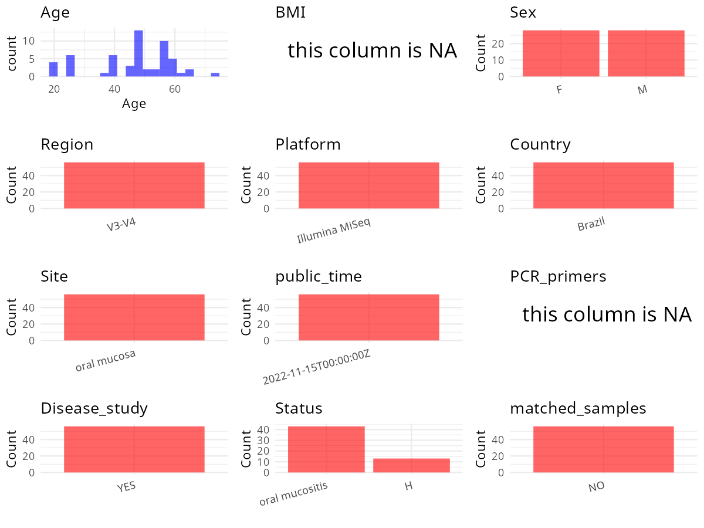

R Notebook: Metadata Processing Workflow
================

# Step 1: Obtain Initial Metadata from Each Project

To obtain the initial metadata: 1. Search for the BioProject ID (e.g.,
“PRJEBXXXX”) on the [NCBI SRA
website](https://www.ncbi.nlm.nih.gov/Traces/study/). 2. In the “Select”
table, click on “Metadata” and download the file. 3. The downloaded file
is typically named “SraRunTable.csv” and contains metadata for the
project.

``` r
# Load necessary libraries
library(dplyr)
library(ggplot2)
library(cowplot)
library(stringr)

# Set working directory (update this path to your local directory)
setwd("/home/hby/oral_project/PRJEB49175")

# Read the initial metadata files
initial_meta <- read.csv("SraRunTable.csv", header = T)

# Combine the two metadata files
# meta <- rbind(initial_meta, initial_meta1)

# Remove entries non-oral samples
# initial_meta <- subset(initial_meta,isolate %in% c("saliva","tongue coat"))

# Check the number of samples containing "HT" in Sample.Name (e.g., healthy controls)
# nrow(subset(meta, grepl("HT", Sample.Name)))

# Display the first few rows of the metadata
head(initial_meta)
```

    ##          Run Assay.Type AvgSpotLen     Bases BioProject     BioSample    Bytes            Center.Name Collection_Date Consent DATASTORE.filetype DATASTORE.provider
    ## 1 ERR7460349   AMPLICON        501   1031727 PRJEB49175 SAMEA11356548   895325 HOSPITAL SIRIO-LIBANES   not collected  public   fastq,run.zq,sra         gs,ncbi,s3
    ## 2 ERR7460350   AMPLICON        501  90151961 PRJEB49175 SAMEA11356549 61700177 HOSPITAL SIRIO-LIBANES   not collected  public   fastq,run.zq,sra         gs,ncbi,s3
    ## 3 ERR7460351   AMPLICON        423  66953439 PRJEB49175 SAMEA11356550 45713171 HOSPITAL SIRIO-LIBANES   not collected  public   fastq,run.zq,sra         gs,ncbi,s3
    ## 4 ERR7460352   AMPLICON        489 121265312 PRJEB49175 SAMEA11356551 82747102 HOSPITAL SIRIO-LIBANES   not collected  public   fastq,run.zq,sra         gs,ncbi,s3
    ## 5 ERR7460353   AMPLICON        492 119733020 PRJEB49175 SAMEA11356552 81132839 HOSPITAL SIRIO-LIBANES   not collected  public   fastq,run.zq,sra         gs,ncbi,s3
    ## 6 ERR7460354   AMPLICON        600  36468316 PRJEB49175 SAMEA11356553 21120482 HOSPITAL SIRIO-LIBANES   not collected  public   fastq,run.zq,sra         gs,ncbi,s3
    ##                       DATASTORE.region ENA.FIRST.PUBLIC..run. ena_first_public ENA.LAST.UPDATE..run. ena_last_update environment_.biome. environment_.feature. environment_.material.
    ## 1 gs.us-east1,ncbi.public,s3.us-east-1             2022/11/14       2022/11/14            2022/11/14      2022/11/14         oral mucosa           oral mucosa                   swab
    ## 2 gs.us-east1,ncbi.public,s3.us-east-1             2022/11/14       2022/11/14            2022/11/14      2022/11/14         oral mucosa           oral mucosa                   swab
    ## 3 gs.us-east1,ncbi.public,s3.us-east-1             2022/11/14       2022/11/14            2022/11/14      2022/11/14         oral mucosa           oral mucosa                   swab
    ## 4 gs.us-east1,ncbi.public,s3.us-east-1             2022/11/14       2022/11/14            2022/11/14      2022/11/14         oral mucosa           oral mucosa                   swab
    ## 5 gs.us-east1,ncbi.public,s3.us-east-1             2022/11/14       2022/11/14            2022/11/14      2022/11/14         oral mucosa           oral mucosa                   swab
    ## 6 gs.us-east1,ncbi.public,s3.us-east-1             2022/11/14       2022/11/14            2022/11/14      2022/11/14         oral mucosa           oral mucosa                   swab
    ##   Experiment   external_id geo_loc_name_country geo_loc_name_country_continent geographic_location_.country_and.or_sea. geographic_location_.latitude. geographic_location_.longitude.
    ## 1 ERX7031049 SAMEA11356548               Brazil                  South America                                   Brazil                  not collected                   not collected
    ## 2 ERX7031050 SAMEA11356549               Brazil                  South America                                   Brazil                  not collected                   not collected
    ## 3 ERX7031051 SAMEA11356550               Brazil                  South America                                   Brazil                  not collected                   not collected
    ## 4 ERX7031052 SAMEA11356551               Brazil                  South America                                   Brazil                  not collected                   not collected
    ## 5 ERX7031053 SAMEA11356552               Brazil                  South America                                   Brazil                  not collected                   not collected
    ## 6 ERX7031054 SAMEA11356553               Brazil                  South America                                   Brazil                  not collected                   not collected
    ##   Host_Age host_body_site host_sex human_oral_environmental_package      INSDC_center_name   INSDC_first_public    INSDC_last_update INSDC_status     Instrument investigation_type
    ## 1 48.62149    oral mucosa   female                       human-oral Hospital Sirio-Libanes 2022-11-14T15:52:31Z 2022-11-14T15:52:31Z       public Illumina MiSeq   bacteria_archaea
    ## 2 65.91923    oral mucosa     male                       human-oral Hospital Sirio-Libanes 2022-11-14T15:52:31Z 2022-11-14T15:52:31Z       public Illumina MiSeq   bacteria_archaea
    ## 3 49.23477    oral mucosa   female                       human-oral Hospital Sirio-Libanes 2022-11-14T15:52:31Z 2022-11-14T15:52:31Z       public Illumina MiSeq   bacteria_archaea
    ## 4 49.23477    oral mucosa   female                       human-oral Hospital Sirio-Libanes 2022-11-14T15:52:31Z 2022-11-14T15:52:31Z       public Illumina MiSeq   bacteria_archaea
    ## 5 49.23477    oral mucosa   female                       human-oral Hospital Sirio-Libanes 2022-11-14T15:52:31Z 2022-11-14T15:52:31Z       public Illumina MiSeq   bacteria_archaea
    ## 6 62.09719    oral mucosa     male                       human-oral Hospital Sirio-Libanes 2022-11-14T15:52:31Z 2022-11-14T15:52:31Z       public Illumina MiSeq   bacteria_archaea
    ##   Library.Name LibraryLayout LibrarySelection LibrarySource              Organism patient            Phase Platform
    ## 1          220        PAIRED              PCR   METAGENOMIC human oral metagenome      #1  preconditioning ILLUMINA
    ## 2          172        PAIRED              PCR   METAGENOMIC human oral metagenome      #2  preconditioning ILLUMINA
    ## 3         611a        PAIRED              PCR   METAGENOMIC human oral metagenome      #3 mucositis healed ILLUMINA
    ## 4          608        PAIRED              PCR   METAGENOMIC human oral metagenome      #3  mucositis onset ILLUMINA
    ## 5          602        PAIRED              PCR   METAGENOMIC human oral metagenome      #3  preconditioning ILLUMINA
    ## 6           97        PAIRED              PCR   METAGENOMIC human oral metagenome      #4  preconditioning ILLUMINA
    ##                                                                     project_name          ReleaseDate          create_date version   Sample.Name sample_name Sequencing_method SRA.Study
    ## 1 Oral mucositis microbiome during allogeneic hematopoietic stem-cell transplant 2022-11-15T00:00:00Z 2022-11-22T05:04:00Z       1 SAMEA11356548         220    Illumina MiSeq ERP133638
    ## 2 Oral mucositis microbiome during allogeneic hematopoietic stem-cell transplant 2022-11-15T00:00:00Z 2022-11-22T05:04:00Z       1 SAMEA11356549         172    Illumina MiSeq ERP133638
    ## 3 Oral mucositis microbiome during allogeneic hematopoietic stem-cell transplant 2022-11-15T00:00:00Z 2022-11-22T05:04:00Z       1 SAMEA11356550        611a    Illumina MiSeq ERP133638
    ## 4 Oral mucositis microbiome during allogeneic hematopoietic stem-cell transplant 2022-11-15T00:00:00Z 2022-11-22T05:04:00Z       1 SAMEA11356551         608    Illumina MiSeq ERP133638
    ## 5 Oral mucositis microbiome during allogeneic hematopoietic stem-cell transplant 2022-11-15T00:00:00Z 2022-11-22T05:04:00Z       1 SAMEA11356552         602    Illumina MiSeq ERP133638
    ## 6 Oral mucositis microbiome during allogeneic hematopoietic stem-cell transplant 2022-11-15T00:00:00Z 2022-11-22T05:04:00Z       1 SAMEA11356553          97    Illumina MiSeq ERP133638
    ##   Submitter_Id target_gene target_subfragment     INSDC_center_alias scientific_name
    ## 1          220         16S               V3V4 Hospital Sirio-Libanes                
    ## 2          172         16S               V3V4 Hospital Sirio-Libanes                
    ## 3         611a         16S               V3V4 Hospital Sirio-Libanes                
    ## 4          608         16S               V3V4 Hospital Sirio-Libanes                
    ## 5          602         16S               V3V4 Hospital Sirio-Libanes                
    ## 6           97         16S               V3V4 Hospital Sirio-Libanes

# Step 2: Create a Uniform Metadata Template

The uniform metadata should include the following columns:

1.  **BioProject**: Project ID (e.g., “PRJNA339212”)
2.  **Run**: Sample ID (e.g., “ERRXXXXXX” or “SRRXXXXXX”)
3.  **sample_name**: Original sample name submitted by the authors (not
    the database-assigned ID)
4.  **Age**: Age of the subject (if available)
5.  **BMI**: Body Mass Index (if available)
6.  **Sex**: Sex of the subject (“F” or “M”)
7.  **Region**: Targeted 16S rRNA region (e.g., “V3-V4”)
8.  **Platform**: Sequencing platform (e.g., “Illumina MiSeq”)
9.  **Country**: Country of sample origin (e.g., “China”)
10. **Site**: Sample site (e.g., “saliva”, “dental plaque”)
11. **public_time**: Data release date (format: “YYYY-MM-DD”)
12. **PCR_primers**: PCR primers used (e.g., “515F-806R”)
13. **title**: Title of the associated publication
14. **Disease_study**: Whether the study involves a disease (“YES” or
    “NO”)
15. **Status**: Disease status (e.g., “T2DM”, “HC”). Note: If the study
    includes both disease and healthy samples, this must be specified
    per sample.
16. **matched_samples**: matched samples (“YES” or “NO”)

``` r
# Create a uniform metadata dataframe
metadata <- data.frame(
  BioProject = initial_meta$BioProject,
  Run = initial_meta$Run,
  sample_name = initial_meta$patient,
  Platform = initial_meta$Instrument,
  Country = initial_meta$geo_loc_name_country,
  Site = initial_meta$host_body_site,
  public_time = initial_meta$ReleaseDate,
  Status = initial_meta$Phase,
  BMI = NA,
  stringsAsFactors = FALSE,
  Sex = initial_meta$host_sex,
  Age = initial_meta$Host_Age,
  PCR_primers = NA
) %>%
  mutate(
    Status = case_when(
      Status == "mucositis onset" ~ "oral mucositis",
      Status == "preconditioning" ~ "oral mucositis",
      Status == "mucositis healed" ~ "H"
    ),
    Sex = case_when(
      Sex == "female" ~ "F",
      Sex == "male" ~ "M"
    )
  )
```

# Step 3: Manually Add Information from the Publication

Some information (e.g. PCR primers, study title, disease status) must be
manually extracted from the publication and added to the metadata.

``` r
# Add information obtained from the publication
metadata$Region <- "V3-V4"
metadata$title <- "Commensal oral microbiota impacts ulcerative oral mucositis clinical course in allogeneic stem cell transplant recipients"
metadata$Disease_study <- "YES"
metadata$matched_samples <- "NO"
```

# Step 4: Summarize and Validate the Metadata

``` r
# Check the number of unique runs and sample names
print(paste("Number of unique runs:", length(unique(metadata$Run))))
```

    ## [1] "Number of unique runs: 56"

``` r
print(paste("Number of unique sample names:", length(unique(metadata$sample_name))))
```

    ## [1] "Number of unique sample names: 30"

# Step 5: Visualize the Metadata

``` r

```


# Step 6: Finalize and Export the Metadata

``` r
# Reorder columns to match the desired format
metadata <- metadata[, c(
  "BioProject", "Run", "sample_name", "Age", "BMI", "Sex",
  "Region", "Platform", "Country", "Site", "public_time",
  "PCR_primers", "title", "Disease_study", "Status", "matched_samples"
)]

# Export the uniform metadata to a CSV file
write.csv(metadata, file = "metadata.csv", quote = FALSE)
head(metadata)
```

    ##   BioProject        Run sample_name      Age BMI Sex Region       Platform Country        Site          public_time PCR_primers
    ## 1 PRJEB49175 ERR7460349          #1 48.62149  NA   F  V3-V4 Illumina MiSeq  Brazil oral mucosa 2022-11-15T00:00:00Z          NA
    ## 2 PRJEB49175 ERR7460350          #2 65.91923  NA   M  V3-V4 Illumina MiSeq  Brazil oral mucosa 2022-11-15T00:00:00Z          NA
    ## 3 PRJEB49175 ERR7460351          #3 49.23477  NA   F  V3-V4 Illumina MiSeq  Brazil oral mucosa 2022-11-15T00:00:00Z          NA
    ## 4 PRJEB49175 ERR7460352          #3 49.23477  NA   F  V3-V4 Illumina MiSeq  Brazil oral mucosa 2022-11-15T00:00:00Z          NA
    ## 5 PRJEB49175 ERR7460353          #3 49.23477  NA   F  V3-V4 Illumina MiSeq  Brazil oral mucosa 2022-11-15T00:00:00Z          NA
    ## 6 PRJEB49175 ERR7460354          #4 62.09719  NA   M  V3-V4 Illumina MiSeq  Brazil oral mucosa 2022-11-15T00:00:00Z          NA
    ##                                                                                                                       title Disease_study         Status matched_samples
    ## 1 Commensal oral microbiota impacts ulcerative oral mucositis clinical course in allogeneic stem cell transplant recipients           YES oral mucositis              NO
    ## 2 Commensal oral microbiota impacts ulcerative oral mucositis clinical course in allogeneic stem cell transplant recipients           YES oral mucositis              NO
    ## 3 Commensal oral microbiota impacts ulcerative oral mucositis clinical course in allogeneic stem cell transplant recipients           YES              H              NO
    ## 4 Commensal oral microbiota impacts ulcerative oral mucositis clinical course in allogeneic stem cell transplant recipients           YES oral mucositis              NO
    ## 5 Commensal oral microbiota impacts ulcerative oral mucositis clinical course in allogeneic stem cell transplant recipients           YES oral mucositis              NO
    ## 6 Commensal oral microbiota impacts ulcerative oral mucositis clinical course in allogeneic stem cell transplant recipients           YES oral mucositis              NO

## Notes for Students:

1.  **Metadata Accuracy**: Always cross-check the metadata with the
    original publication to ensure accuracy.
2.  **Manual Entries**: Columns like `PCR_primers`, and `Status` often
    require manual entry based on the publication.
3.  **Disease Status**: Be careful when assigning `Status`—some studies
    include both disease and healthy samples.
4.  **Visualization**: The plots help quickly identify the distribution
    of values in each column, which is useful for quality control.
5.  **Reproducibility**: Update the working directory and file paths to
    match your local environment.
