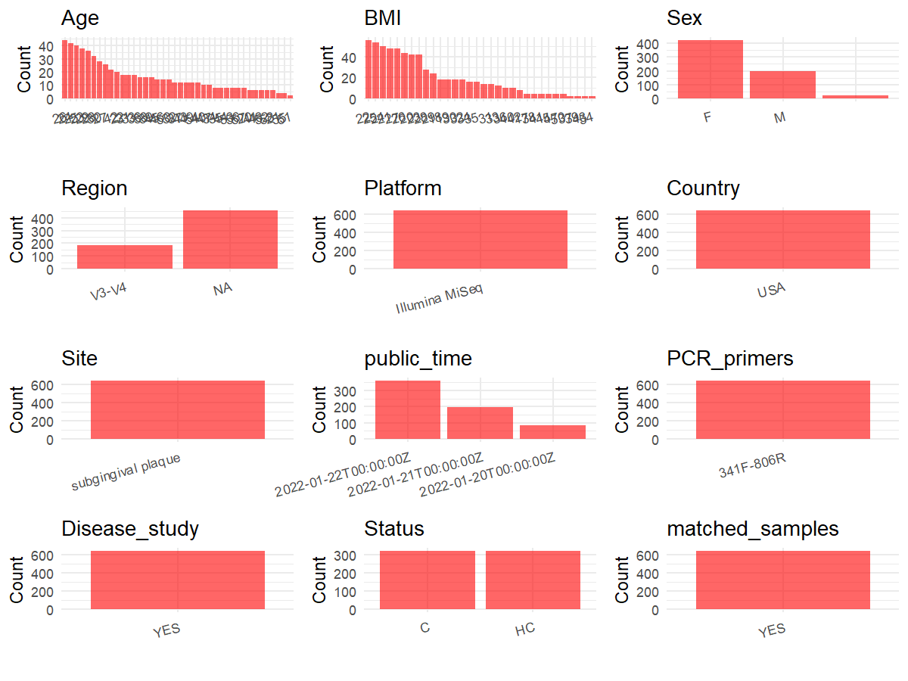

R Notebook: Metadata Processing Workflow
================

# Step 1: Obtain Initial Metadata from Each Project

To obtain the initial metadata: 1. Search for the BioProject ID (e.g.,
“PRJEBXXXX”) on the [NCBI SRA
website](https://www.ncbi.nlm.nih.gov/Traces/study/). 2. In the “Select”
table, click on “Metadata” and download the file. 3. The downloaded file
is typically named “SraRunTable.csv” and contains metadata for the
project.

``` r
# Load necessary libraries
library(dplyr)
library(ggplot2)
library(cowplot)

# Set working directory (update this path to your local directory)
setwd("E:/bioproject/PRJEB50261")

# Read the initial metadata files
initial_meta <- read.csv("SraRunTable.csv", header = T) 

# Remove entries non-oral samples
initial_meta <- initial_meta[initial_meta$sample_type != "control blank", ]

# Convert the "Age" and "BMI" string columns into numeric columns
initial_meta <- initial_meta %>%
  mutate(
    AGE = ifelse(AGE == "not collected", 
                NA, 
                round(as.numeric(as.character(AGE)), 0)),
    BMI = ifelse(BMI == "not collected", 
                NA, 
                round(as.numeric(as.character(BMI)), 0))
  ) %>%
  mutate(
    AGE = ifelse(is.na(AGE), "", AGE),
    BMI = ifelse(is.na(BMI), "", BMI)
  )

# Display the first few rows of the metadata
head(initial_meta)
```

    ##          Run Assay.Type AvgSpotLen barcode..exp.    Bases BioProject
    ## 1 ERR8049835   AMPLICON        250  CAAATTCGGGAT 19686091 PRJEB50261
    ## 2 ERR8049836   AMPLICON        250  CGAGGGAAAGTC 16123970 PRJEB50261
    ## 3 ERR8049837   AMPLICON        250  AGTTACGAGCTA 22759496 PRJEB50261
    ## 4 ERR8049838   AMPLICON        250  AGATTGACCAAC 19448215 PRJEB50261
    ## 5 ERR8049839   AMPLICON        250  CAACTCCCGTGA 20910897 PRJEB50261
    ## 6 ERR8049840   AMPLICON        250  GCATATGCACTG 24685570 PRJEB50261
    ##       BioSample    Bytes center_name..exp.
    ## 1 SAMEA12363577 10977500 Forsyth Institute
    ## 2 SAMEA12363578  9072129 Forsyth Institute
    ## 3 SAMEA12363579 12612965 Forsyth Institute
    ## 4 SAMEA12363580 10848774 Forsyth Institute
    ## 5 SAMEA12363581 11662281 Forsyth Institute
    ## 6 SAMEA12363582 14388324 Forsyth Institute
    ##                                          Center.Name collection_timestamp
    ## 1 UNIVERSITY OF CALIFORNIA SAN DIEGO MICROBIOME INIT                 2015
    ## 2 UNIVERSITY OF CALIFORNIA SAN DIEGO MICROBIOME INIT                 2015
    ## 3 UNIVERSITY OF CALIFORNIA SAN DIEGO MICROBIOME INIT                 2015
    ## 4 UNIVERSITY OF CALIFORNIA SAN DIEGO MICROBIOME INIT                 2015
    ## 5 UNIVERSITY OF CALIFORNIA SAN DIEGO MICROBIOME INIT                 2015
    ## 6 UNIVERSITY OF CALIFORNIA SAN DIEGO MICROBIOME INIT                 2015
    ##   Consent DATASTORE.filetype DATASTORE.provider
    ## 1  public   fastq,run.zq,sra         gs,ncbi,s3
    ## 2  public   fastq,run.zq,sra         gs,ncbi,s3
    ## 3  public   fastq,run.zq,sra         gs,ncbi,s3
    ## 4  public   fastq,run.zq,sra         gs,ncbi,s3
    ## 5  public   fastq,run.zq,sra         gs,ncbi,s3
    ## 6  public   fastq,run.zq,sra         gs,ncbi,s3
    ##                       DATASTORE.region dna_extracted elevation          empo_1
    ## 1 gs.us-east1,ncbi.public,s3.us-east-1          TRUE        89 Host-associated
    ## 2 gs.us-east1,ncbi.public,s3.us-east-1          TRUE        89 Host-associated
    ## 3 gs.us-east1,ncbi.public,s3.us-east-1          TRUE        89 Host-associated
    ## 4 gs.us-east1,ncbi.public,s3.us-east-1          TRUE        89 Host-associated
    ## 5 gs.us-east1,ncbi.public,s3.us-east-1          TRUE        89 Host-associated
    ## 6 gs.us-east1,ncbi.public,s3.us-east-1          TRUE        89 Host-associated
    ##              empo_2         empo_3 ENA.FIRST.PUBLIC..run. ENA.LAST.UPDATE..run.
    ## 1 Animal-associated Animal surface             2022-01-19            2022-01-19
    ## 2 Animal-associated Animal surface             2022-01-19            2022-01-19
    ## 3 Animal-associated Animal surface             2022-01-19            2022-01-19
    ## 4 Animal-associated Animal surface             2022-01-19            2022-01-19
    ## 5 Animal-associated Animal surface             2022-01-19            2022-01-19
    ## 6 Animal-associated Animal surface             2022-01-19            2022-01-19
    ##     env_biome              env_feature     env_material env_package Experiment
    ## 1 urban biome human-associated habitat organic material  human-oral ERX7616552
    ## 2 urban biome human-associated habitat organic material  human-oral ERX7616553
    ## 3 urban biome human-associated habitat organic material  human-oral ERX7616554
    ## 4 urban biome human-associated habitat organic material  human-oral ERX7616555
    ## 5 urban biome human-associated habitat organic material  human-oral ERX7616556
    ## 6 urban biome human-associated habitat organic material  human-oral ERX7616557
    ##     external_id host_age_units host_subject_id
    ## 1 SAMEA12363577          years            5791
    ## 2 SAMEA12363578          years            5791
    ## 3 SAMEA12363579          years            6411
    ## 4 SAMEA12363580          years            6411
    ## 5 SAMEA12363581          years            6455
    ## 6 SAMEA12363582          years            6455
    ##                                          INSDC_center_name   INSDC_first_public
    ## 1 University of California San Diego Microbiome Initiative 2022-01-19T16:27:52Z
    ## 2 University of California San Diego Microbiome Initiative 2022-01-19T16:27:52Z
    ## 3 University of California San Diego Microbiome Initiative 2022-01-19T16:27:52Z
    ## 4 University of California San Diego Microbiome Initiative 2022-01-19T16:27:52Z
    ## 5 University of California San Diego Microbiome Initiative 2022-01-19T16:27:52Z
    ## 6 University of California San Diego Microbiome Initiative 2022-01-19T16:27:52Z
    ##      INSDC_last_update INSDC_status     Instrument LATITUDE Library.Name
    ## 1 2022-01-19T16:27:52Z       public Illumina MiSeq  40.8075 14375.5791.D
    ## 2 2022-01-19T16:27:52Z       public Illumina MiSeq  40.8075 14375.5791.H
    ## 3 2022-01-19T16:27:52Z       public Illumina MiSeq  40.8075 14375.6411.D
    ## 4 2022-01-19T16:27:52Z       public Illumina MiSeq  40.8075 14375.6411.H
    ## 5 2022-01-19T16:27:52Z       public Illumina MiSeq  40.8075 14375.6455.D
    ## 6 2022-01-19T16:27:52Z       public Illumina MiSeq  40.8075 14375.6455.H
    ##   LibraryLayout LibrarySelection LibrarySource longitude              Organism
    ## 1        SINGLE              PCR   METAGENOMIC  -73.9626 human oral metagenome
    ## 2        SINGLE              PCR   METAGENOMIC  -73.9626 human oral metagenome
    ## 3        SINGLE              PCR   METAGENOMIC  -73.9626 human oral metagenome
    ## 4        SINGLE              PCR   METAGENOMIC  -73.9626 human oral metagenome
    ## 5        SINGLE              PCR   METAGENOMIC  -73.9626 human oral metagenome
    ## 6        SINGLE              PCR   METAGENOMIC  -73.9626 human oral metagenome
    ##   physical_specimen_location physical_specimen_remaining Platform
    ## 1          restricted access                       FALSE ILLUMINA
    ## 2          restricted access                       FALSE ILLUMINA
    ## 3          restricted access                       FALSE ILLUMINA
    ## 4          restricted access                       FALSE ILLUMINA
    ## 5          restricted access                       FALSE ILLUMINA
    ## 6          restricted access                       FALSE ILLUMINA
    ##        primer..exp.          ReleaseDate run..exp.          create_date version
    ## 1 CCTACGGGAGGCAGCAG 2022-01-20T00:00:00Z       P01 2022-07-29T09:12:00Z       1
    ## 2 CCTACGGGAGGCAGCAG 2022-01-20T00:00:00Z       P01 2022-07-21T20:39:00Z       1
    ## 3 CCTACGGGAGGCAGCAG 2022-01-20T00:00:00Z       P01 2022-07-23T18:44:00Z       1
    ## 4 CCTACGGGAGGCAGCAG 2022-01-20T00:00:00Z       P01 2022-08-01T18:41:00Z       1
    ## 5 CCTACGGGAGGCAGCAG 2022-01-20T00:00:00Z       P01 2022-07-17T07:58:00Z       1
    ## 6 CCTACGGGAGGCAGCAG 2022-01-20T00:00:00Z       P01 2022-08-02T01:34:00Z       1
    ##     Sample.Name                  Sample_name        sample_type
    ## 1 SAMEA12363577 qiita_sid_14375:14375.5791.D subgingival plaque
    ## 2 SAMEA12363578 qiita_sid_14375:14375.5791.H subgingival plaque
    ## 3 SAMEA12363579 qiita_sid_14375:14375.6411.D subgingival plaque
    ## 4 SAMEA12363580 qiita_sid_14375:14375.6411.H subgingival plaque
    ## 5 SAMEA12363581 qiita_sid_14375:14375.6455.D subgingival plaque
    ## 6 SAMEA12363582 qiita_sid_14375:14375.6455.H subgingival plaque
    ##        seq_batch..exp.   sequencing_meth..exp. SRA.Study
    ## 1 mapping-file-P01.tsv Sequencing by synthesis ERP134823
    ## 2 mapping-file-P01.tsv Sequencing by synthesis ERP134823
    ## 3 mapping-file-P01.tsv Sequencing by synthesis ERP134823
    ## 4 mapping-file-P01.tsv Sequencing by synthesis ERP134823
    ## 5 mapping-file-P01.tsv Sequencing by synthesis ERP134823
    ## 6 mapping-file-P01.tsv Sequencing by synthesis ERP134823
    ##                   Submitter_Id target_gene..exp. ENA_first_public
    ## 1 qiita_sid_14375:14375.5791.D          16S rRNA       2022-01-19
    ## 2 qiita_sid_14375:14375.5791.H          16S rRNA       2022-01-19
    ## 3 qiita_sid_14375:14375.6411.D          16S rRNA       2022-01-19
    ## 4 qiita_sid_14375:14375.6411.H          16S rRNA       2022-01-19
    ## 5 qiita_sid_14375:14375.6455.D          16S rRNA       2022-01-19
    ## 6 qiita_sid_14375:14375.6455.H          16S rRNA       2022-01-19
    ##   ena_last_update INSDC_center_alias hba1c  host_body_habitat
    ## 1      2022-01-19             UCSDMI   5.3 UBERON:oral cavity
    ## 2      2022-01-19             UCSDMI   5.3 UBERON:oral cavity
    ## 3      2022-01-19             UCSDMI   5.7 UBERON:oral cavity
    ## 4      2022-01-19             UCSDMI   5.7 UBERON:oral cavity
    ## 5      2022-01-19             UCSDMI   5.9 UBERON:oral cavity
    ## 6      2022-01-19             UCSDMI   5.9 UBERON:oral cavity
    ##                  host_body_product host_body_site host_common_name
    ## 1 UBERON:subgingival dental plaque   UBERON:tooth            human
    ## 2 UBERON:subgingival dental plaque   UBERON:tooth            human
    ## 3 UBERON:subgingival dental plaque   UBERON:tooth            human
    ## 4 UBERON:subgingival dental plaque   UBERON:tooth            human
    ## 5 UBERON:subgingival dental plaque   UBERON:tooth            human
    ## 6 UBERON:subgingival dental plaque   UBERON:tooth            human
    ##   host_scientific_name host_taxid hsinsulin    type glucosecrc meandbp meansbp
    ## 1         Homo sapiens       9606     4.745 disease         84      76     124
    ## 2         Homo sapiens       9606     4.745 healthy         84      76     124
    ## 3         Homo sapiens       9606     4.968 disease         89    68.5     117
    ## 4         Homo sapiens       9606     4.968 healthy         89    68.5     117
    ## 5         Homo sapiens       9606     5.306 disease         90    71.5     128
    ## 6         Homo sapiens       9606     5.306 healthy         90    71.5     128
    ##   prediabetes visit   meanaloss      meanpd pdge3 pdge4 peralge3 perpdge3
    ## 1          no     1 0.103448276 1.988505747    39     1        0     0.22
    ## 2          no     1 0.103448276 1.988505747    39     1        0     0.22
    ## 3         yes     1  1.12745098  1.62037037    12     1      0.1     0.11
    ## 4         yes     1  1.12745098  1.62037037    12     1      0.1     0.11
    ## 5         yes     1         1.5 1.571428571    20     2     0.32     0.12
    ## 6         yes     1         1.5 1.571428571    20     2     0.32     0.12
    ##   perpdge4      perbop  aapperio alge3 totbop BMI AGE    Host_age    sex educ
    ## 1     0.01 0.218390805 none/mild     0     38  26  26 25.88364134   male    1
    ## 2     0.01 0.218390805 none/mild     0     38  26  26 25.88364134   male    1
    ## 3     0.01 0.351851852  moderate    10     38  30  52 52.20533881   male    1
    ## 4     0.01 0.351851852  moderate    10     38  30  52 52.20533881   male    1
    ## 5     0.01 0.130718954  moderate    54     20  31  54 53.59069131 female    0
    ## 6     0.01 0.130718954  moderate    54     20  31  54 53.59069131 female    0
    ##   raceethn cigcurr description..exp. center_project_name..exp.
    ## 1        3       0                       ORIGINS plaque wave 2
    ## 2        3       0                       ORIGINS plaque wave 2
    ## 3        0       0                       ORIGINS plaque wave 2
    ## 4        0       0                       ORIGINS plaque wave 2
    ## 5        0       0                       ORIGINS plaque wave 2
    ## 6        0       0                       ORIGINS plaque wave 2
    ##    run_center..exp. sample_plate..exp. target_subfragment..exp. homair
    ## 1 Forsyth Institute            plate 2                     V3V4       
    ## 2 Forsyth Institute            plate 2                     V3V4       
    ## 3 Forsyth Institute            plate 2                     V3V4       
    ## 4 Forsyth Institute            plate 2                     V3V4       
    ## 5 Forsyth Institute            plate 2                     V3V4       
    ## 6 Forsyth Institute            plate 2                     V3V4       
    ##   ena_first_public ena_last_update.1 Scientific_Name
    ## 1                                                   
    ## 2                                                   
    ## 3                                                   
    ## 4                                                   
    ## 5                                                   
    ## 6

# Step 2: Create a Uniform Metadata Template

The uniform metadata should include the following columns:

1.  **BioProject**: Project ID (e.g., “PRJNA339212”)
2.  **Run**: Sample ID (e.g., “ERRXXXXXX” or “SRRXXXXXX”)
3.  **sample_name**: Original sample name submitted by the authors (not
    the database-assigned ID)
4.  **Age**: Age of the subject (if available)
5.  **BMI**: Body Mass Index (if available)
6.  **Sex**: Sex of the subject (“F” or “M”)
7.  **Region**: Targeted 16S rRNA region (e.g., “V3-V4”)
8.  **Platform**: Sequencing platform (e.g., “Illumina MiSeq”)
9.  **Country**: Country of sample origin (e.g., “China”)
10. **Site**: Sample site (e.g., “saliva”, “dental plaque”)
11. **public_time**: Data release date (format: “YYYY-MM-DD”)
12. **PCR_primers**: PCR primers used (e.g., “515F-806R”)
13. **title**: Title of the associated publication
14. **Disease_study**: Whether the study involves a disease (“YES” or
    “NO”)
15. **Status**: Disease status (e.g., “T2DM”, “HC”). Note: If the study
    includes both disease and healthy samples, this must be specified
    per sample.
16. **matched_samples**: matched samples (“YES” or “NO”)

``` r
# Create a uniform metadata dataframe
metadata <- data.frame(
  BioProject = initial_meta$BioProject,
  Run = initial_meta$Run,
  sample_name = initial_meta$host_subject_id,
  Age = initial_meta$AGE,
  BMI = initial_meta$BMI,
  Sex = initial_meta$sex,
  Region = initial_meta$target_subfragment..exp.,
  Platform = initial_meta$Instrument,
  Site = initial_meta$sample_type,
  public_time = initial_meta$ReleaseDate,
  Status = initial_meta$type,
  matched_samples = NA,
  stringsAsFactors=FALSE
)

# Use abbreviations to indicate gender
metadata <- metadata %>%
  mutate(Sex = recode(Sex, "female" = "F", "male" = "M","not collected" = c()))

# Add a horizontal bar between V3 and V4
metadata <- metadata %>%
  mutate(Region = recode(Region, "V3V4" = "V3-V4"), Region = na_if(Region, ""))
```

# Step 3: Manually Add Information from the Publication

Some information (e.g. PCR primers, study title, disease status) must be
manually extracted from the publication and added to the metadata.

``` r
# Add information obtained from the publication
metadata$Country <- "USA"
metadata$PCR_primers <- "341F-806R"
metadata$title <- "Early microbial markers of periodontal and cardiometabolic diseases in ORIGINS"
metadata$Disease_study <- "YES"

# Assign disease status based on sample_name patterns
metadata <- metadata %>%
  mutate(Status = 
           recode(Status, "disease" = "C", "healthy" = "HC", "not collected" = c())
         )

# Check initial data distribution
cat("Initial sample distribution:\n")
```

    ## Initial sample distribution:

``` r
table(metadata$sample_name)
```

    ## 
    ##   10001   10012   10023   10034   10045   10056 10057.H   10067   10078   10089 
    ##       1       2       1       2       1       1       1       1       1       2 
    ##   10090   10102   10113   10124   10135   10146   10157   10168   10179   10180 
    ##       1       1       1       2       1       1       1       2       1       1 
    ##   10191   10203   10214   10225   10236   10247   10258   10269   10270   10281 
    ##       1       1       1       1       2       2       1       1       1       1 
    ##   10292   10304   10315   10326   10337   10348   10359   10360   10371   10382 
    ##       1       1       1       1       1       1       1       1       2       2 
    ##   10393   10405   10427   10438   10449   10450   10461   10472   10483   10494 
    ##       1       1       1       1       1       1       1       1       1       1 
    ##   10506   10517   10528   10539   10540   10551   10562   10573   10584   10595 
    ##       1       1       1       1       2       1       1       1       2       2 
    ##   10607   10618   10629   10630   10641   10652   10663   10674   10685   10696 
    ##       1       1       1       1       1       1       2       1       2       1 
    ##   10708   10719   10720   10731   10742   10753   10764   10775   10786   10797 
    ##       1       2       2       1       1       1       1       1       2       1 
    ##   10809   10810   10821   10832   10843   10854   10865   10876   10887   10898 
    ##       1       1       1       1       1       1       2       1       1       1 
    ##   10900   10911   10922   10933   10944   10955   10966   10977   10988   10999 
    ##       1       1       1       1       1       1       1       2       2       1 
    ##   11002   11013   11024   11035   11046   11068   11079   11080   11091   11103 
    ##       1       2       1       1       1       1       1       1       1       1 
    ##   11114   11125   11136   11147   11158   11169   11170   11181   11192   11204 
    ##       1       1       1       1       1       1       1       1       1       1 
    ##   11215   11226   11237   11248   11259   11260   11271   11282   11293   11305 
    ##       1       1       1       2       1       1       2       1       1       2 
    ##   11316   11327   11338   11349   11350   11361   11372   11383   11394   11406 
    ##       1       2       1       1       1       1       1       1       1       1 
    ##   11417   11428   11439   11440   11451   11462   11473    3081    3104    3115 
    ##       1       1       2       2       2       1       1       1       1       1 
    ##    3126    3137    3148    3159    3160    3171    3182    3193    3205    3216 
    ##       1       1       2       2       1       1       1       1       2       2 
    ##    3227    3238    3249    3250    3261    3272    3283    3294    3317    3328 
    ##       2       2       2       2       2       2       2       1       1       2 
    ##    3339    3340    3351    3362    3373    3384    3395    3418    3429    3430 
    ##       1       2       2       2       2       1       1       2       2       2 
    ##    3441    3452    3463    3474    3496    3508    3519    3520    3531    3542 
    ##       2       1       1       1       2       2       1       1       1       2 
    ##    3553    3575    3586    3609    3610    3621    3632    3643    3654    3665 
    ##       1       2       1       2       1       1       1       1       2       2 
    ##    3676    3687    3698    3700    3711    3722    3733    3744    3755    3777 
    ##       2       2       2       1       2       2       1       2       2       2 
    ##    3788    3799    3801    3812    3823    3845    3856    3867    3878    3889 
    ##       1       2       1       2       1       2       2       2       2       2 
    ##    3913    3924    3935    3946    3957    3968    3979    3980    3991    4004 
    ##       2       2       2       2       1       1       2       2       2       1 
    ##    4015    4026    4037    4048    4059    4060    4071    4082    4093    4105 
    ##       2       2       1       2       2       2       1       2       2       2 
    ##    4116    4127    4138    4149    4150  4150.D    4161    4172    4183    4194 
    ##       2       2       1       2       1       1       2       1       1       2 
    ##    4206    4217    4228    4239    4240    4251    4262    4273    4284    4295 
    ##       2       2       2       1       1       2       1       2       2       1 
    ##    4307    4318    4329    4330    4341    4363    4385    4396    4408    4419 
    ##       1       1       2       2       2       1       1       1       1       2 
    ##    4420    4431    4442    4453    4464    4475    4486    4497    4509    4510 
    ##       1       2       1       1       1       1       1       1       1       1 
    ##    4521    4532    4554    4565    4576    4587    4598    4600    4611    4622 
    ##       1       1       2       1       1       2       1       1       1       1 
    ##    4644    4655    4666    4677    4688    4699    4701    4712    4723    4734 
    ##       2       2       1       2       2       1       2       1       2       2 
    ##    4745    4756    4767    4778    4802    4813    4824    4835    4846    4868 
    ##       1       2       1       1       2       2       1       1       2       1 
    ##    4879    4880    4891    4903    4925    4947    4958    4969    4970    4992 
    ##       1       2       1       1       2       2       1       1       1       2 
    ##    5005    5016    5027    5038    5049    5050    5072    5094    5106    5117 
    ##       1       1       2       2       2       1       2       1       2       2 
    ##    5128    5139    5140    5151    5162    5173    5195    5207    5218    5229 
    ##       1       1       1       2       2       1       1       1       1       1 
    ##    5230    5241    5252    5263    5274    5285    5296    5308    5320    5331 
    ##       1       1       1       1       2       1       2       2       1       2 
    ##    5342    5353    5375    5386    5397    5409    5410    5421    5432    5443 
    ##       2       2       1       2       1       2       1       2       1       1 
    ##    5454    5465    5476    5487    5498    5500    5511    5522    5533    5544 
    ##       1       2       1       1       2       2       2       2       2       2 
    ##    5555    5566    5577    5588    5599    5601    5612    5623    5634    5656 
    ##       1       1       1       1       2       2       2       1       1       2 
    ##    5667    5678    5689    5690    5702    5713    5724    5735    5746    5768 
    ##       1       1       1       2       2       2       2       1       2       2 
    ##    5779    5780    5791    5803    5814    5825    5836    5847    5858    5870 
    ##       2       1       2       1       2       1       2       1       2       2 
    ##    5881    5892    5904    5915    5926    5937    5948    5959    5960    5971 
    ##       1       1       2       2       1       1       1       2       2       1 
    ##    5982    5993    6006    6017    6028    6039    6040    6051    6062    6073 
    ##       2       1       2       1       2       2       2       2       1       2 
    ##    6084    6095    6107    6118    6130    6141    6152    6163    6174    6185 
    ##       2       2       2       1       2       2       1       2       1       2 
    ##    6196    6208    6219    6220    6231    6242    6253    6264    6275    6286 
    ##       2       2       2       1       1       2       1       2       1       2 
    ##    6297    6309    6310    6321    6332    6343    6354    6365    6376    6387 
    ##       1       2       2       2       1       2       2       1       2       1 
    ##    6398    6400    6411    6433    6444    6455    6466    6477    6488    6499 
    ##       2       2       2       1       2       2       1       2       1       2 
    ##    6501    6512    6534    6545    6556    6578    6589    6590    6602    6613 
    ##       2       1       2       2       2       2       1       2       1       1 
    ##    6635    6657    6668    6679    6691    6703    6714    6725    6736    6747 
    ##       2       2       2       1       1       2       1       1       2       1 
    ##    6758    6769    6770    6781    6792    6804    6815    6826    6837    6848 
    ##       1       2       1       2       2       1       2       1       2       1 
    ##    6859    6860    6871  6880.D  6880.H    6882    6893    6916    6927    6938 
    ##       1       2       2       1       1       2       1       2       2       2 
    ##    6949    6950    6961    6972    6983    6994    7007    7018    7029    7030 
    ##       2       2       1       2       1       1       2       2       1       2 
    ##    7041    7052    7063    7074    7085    7096    7108    7119    7120    7131 
    ##       2       2       1       1       2       1       2       1       2       2 
    ##    7142    7153    7164    7175    7186    7197    7209    7232    7243    7254 
    ##       2       2       2       2       2       1       2       1       1       1 
    ##    7276    7287    7298    7300  7331.D  7331.H    7333    7344    7355    7366 
    ##       1       2       2       2       1       1       1       2       1       2 
    ##    7377    7388    7399    7401    7412    7423    7434    7445    7456    7467 
    ##       2       2       1       2       1       1       1       2       1       2 
    ##    7478    7489    7490    7502    7513    7524    7535    7546    7557    7568 
    ##       1       2       1       2       2       1       1       2       2       2 
    ##    7579    7591    7603    7614    7625    7636    7647    7658    7669    7670 
    ##       1       1       1       1       1       2       1       2       2       1 
    ##    7681    7692    7704    7715    7726    7737    7748    7759    7760    7771 
    ##       2       1       2       2       1       2       1       2       1       1 
    ##    7782    7793    7805    7816    7827    7838    7849    7850    7861    7872 
    ##       2       2       1       1       1       1       1       1       1       2 
    ##    7883    7894    7906    7917    7928    7939    7940    7951    7962    7973 
    ##       1       1       2       1       1       1       1       1       2       1 
    ##    7984    7995    8008    8020    8031    8042    8053    8064    8075    8086 
    ##       2       1       1       1       1       1       1       2       1       1 
    ##    8097    8109    8110    8121    8132    8143    8154    8165    8176    8187 
    ##       1       2       2       2       1       1       2       2       2       1 
    ##    8198    8200    8211    8222    8244    8255    8266    8277    8288    8299 
    ##       1       2       2       1       2       2       2       2       1       2 
    ##    8301    8312    8323    8334    8345    8356    8367    8378    8389    8390 
    ##       1       2       2       2       2       1       1       2       2       1 
    ##    8402    8413    8424    8435  8440.H    8457  8466.H    8468    8479    8480 
    ##       2       1       2       2       1       1       1       1       1       1 
    ##    8491    8503    8514    8525    8536    8547    8558    8569    8570    8581 
    ##       2       1       1       1       1       2       1       1       1       1 
    ##    8592    8604    8615    8637    8648    8659    8660    8671    8682    8693 
    ##       1       1       1       2       1       2       1       1       1       1 
    ##    8705    8716    8727    8738    8749    8750    8761    8772    8783    8794 
    ##       1       1       1       2       1       1       1       1       1       1 
    ##    8806    8817    8828    8839    8851    8862    8873  8894.H    8895    8907 
    ##       1       1       1       1       1       1       1       1       1       1 
    ##    8918    8929    8930    8941    8952    8963    8974    8985    8996    9009 
    ##       1       1       1       1       2       1       1       2       2       1 
    ##    9010    9021    9032    9043    9054    9065    9076    9087    9098    9100 
    ##       1       1       2       2       1       2       1       1       1       1 
    ##    9111    9122    9133    9144    9155    9166    9177    9188    9199    9201 
    ##       1       1       1       1       1       2       1       1       1       1 
    ##    9212    9223    9234    9245    9256    9267    9278    9289    9290    9302 
    ##       1       1       1       1       1       1       1       2       2       1 
    ##    9313    9324    9335    9346    9357    9368    9379    9380    9391    9403 
    ##       2       1       2       1       1       1       2       1       2       1 
    ##    9414    9425    9436    9447    9458    9469    9470    9481    9492    9504 
    ##       1       1       1       1       2       2       1       2       1       1 
    ##    9515    9526    9548    9559    9560    9571    9582    9593    9605    9616 
    ##       2       1       1       1       1       2       1       1       1       2 
    ##    9627    9638    9649    9650    9661    9672    9683    9694    9706    9717 
    ##       1       2       1       1       2       1       1       1       1       1 
    ##    9728    9739    9740    9751    9762    9784    9795    9807    9818    9829 
    ##       2       1       2       1       1       1       1       1       1       1 
    ##    9830    9841    9852    9863    9874    9885    9896    9908    9919    9920 
    ##       1       1       2       1       1       1       2       1       1       1 
    ##    9931    9942    9953    9964  9973.H    9975    9986    9997 
    ##       1       2       1       2       1       1       1       1

``` r
table(metadata$Site)
```

    ## 
    ## subgingival plaque 
    ##               1118

``` r
# Calculate sampling frequency per subject
sample_counts <- table(metadata$sample_name)
cat("\nNumber of samples per subject:\n")
```

    ## 
    ## Number of samples per subject:

``` r
print(sample_counts)
```

    ## 
    ##   10001   10012   10023   10034   10045   10056 10057.H   10067   10078   10089 
    ##       1       2       1       2       1       1       1       1       1       2 
    ##   10090   10102   10113   10124   10135   10146   10157   10168   10179   10180 
    ##       1       1       1       2       1       1       1       2       1       1 
    ##   10191   10203   10214   10225   10236   10247   10258   10269   10270   10281 
    ##       1       1       1       1       2       2       1       1       1       1 
    ##   10292   10304   10315   10326   10337   10348   10359   10360   10371   10382 
    ##       1       1       1       1       1       1       1       1       2       2 
    ##   10393   10405   10427   10438   10449   10450   10461   10472   10483   10494 
    ##       1       1       1       1       1       1       1       1       1       1 
    ##   10506   10517   10528   10539   10540   10551   10562   10573   10584   10595 
    ##       1       1       1       1       2       1       1       1       2       2 
    ##   10607   10618   10629   10630   10641   10652   10663   10674   10685   10696 
    ##       1       1       1       1       1       1       2       1       2       1 
    ##   10708   10719   10720   10731   10742   10753   10764   10775   10786   10797 
    ##       1       2       2       1       1       1       1       1       2       1 
    ##   10809   10810   10821   10832   10843   10854   10865   10876   10887   10898 
    ##       1       1       1       1       1       1       2       1       1       1 
    ##   10900   10911   10922   10933   10944   10955   10966   10977   10988   10999 
    ##       1       1       1       1       1       1       1       2       2       1 
    ##   11002   11013   11024   11035   11046   11068   11079   11080   11091   11103 
    ##       1       2       1       1       1       1       1       1       1       1 
    ##   11114   11125   11136   11147   11158   11169   11170   11181   11192   11204 
    ##       1       1       1       1       1       1       1       1       1       1 
    ##   11215   11226   11237   11248   11259   11260   11271   11282   11293   11305 
    ##       1       1       1       2       1       1       2       1       1       2 
    ##   11316   11327   11338   11349   11350   11361   11372   11383   11394   11406 
    ##       1       2       1       1       1       1       1       1       1       1 
    ##   11417   11428   11439   11440   11451   11462   11473    3081    3104    3115 
    ##       1       1       2       2       2       1       1       1       1       1 
    ##    3126    3137    3148    3159    3160    3171    3182    3193    3205    3216 
    ##       1       1       2       2       1       1       1       1       2       2 
    ##    3227    3238    3249    3250    3261    3272    3283    3294    3317    3328 
    ##       2       2       2       2       2       2       2       1       1       2 
    ##    3339    3340    3351    3362    3373    3384    3395    3418    3429    3430 
    ##       1       2       2       2       2       1       1       2       2       2 
    ##    3441    3452    3463    3474    3496    3508    3519    3520    3531    3542 
    ##       2       1       1       1       2       2       1       1       1       2 
    ##    3553    3575    3586    3609    3610    3621    3632    3643    3654    3665 
    ##       1       2       1       2       1       1       1       1       2       2 
    ##    3676    3687    3698    3700    3711    3722    3733    3744    3755    3777 
    ##       2       2       2       1       2       2       1       2       2       2 
    ##    3788    3799    3801    3812    3823    3845    3856    3867    3878    3889 
    ##       1       2       1       2       1       2       2       2       2       2 
    ##    3913    3924    3935    3946    3957    3968    3979    3980    3991    4004 
    ##       2       2       2       2       1       1       2       2       2       1 
    ##    4015    4026    4037    4048    4059    4060    4071    4082    4093    4105 
    ##       2       2       1       2       2       2       1       2       2       2 
    ##    4116    4127    4138    4149    4150  4150.D    4161    4172    4183    4194 
    ##       2       2       1       2       1       1       2       1       1       2 
    ##    4206    4217    4228    4239    4240    4251    4262    4273    4284    4295 
    ##       2       2       2       1       1       2       1       2       2       1 
    ##    4307    4318    4329    4330    4341    4363    4385    4396    4408    4419 
    ##       1       1       2       2       2       1       1       1       1       2 
    ##    4420    4431    4442    4453    4464    4475    4486    4497    4509    4510 
    ##       1       2       1       1       1       1       1       1       1       1 
    ##    4521    4532    4554    4565    4576    4587    4598    4600    4611    4622 
    ##       1       1       2       1       1       2       1       1       1       1 
    ##    4644    4655    4666    4677    4688    4699    4701    4712    4723    4734 
    ##       2       2       1       2       2       1       2       1       2       2 
    ##    4745    4756    4767    4778    4802    4813    4824    4835    4846    4868 
    ##       1       2       1       1       2       2       1       1       2       1 
    ##    4879    4880    4891    4903    4925    4947    4958    4969    4970    4992 
    ##       1       2       1       1       2       2       1       1       1       2 
    ##    5005    5016    5027    5038    5049    5050    5072    5094    5106    5117 
    ##       1       1       2       2       2       1       2       1       2       2 
    ##    5128    5139    5140    5151    5162    5173    5195    5207    5218    5229 
    ##       1       1       1       2       2       1       1       1       1       1 
    ##    5230    5241    5252    5263    5274    5285    5296    5308    5320    5331 
    ##       1       1       1       1       2       1       2       2       1       2 
    ##    5342    5353    5375    5386    5397    5409    5410    5421    5432    5443 
    ##       2       2       1       2       1       2       1       2       1       1 
    ##    5454    5465    5476    5487    5498    5500    5511    5522    5533    5544 
    ##       1       2       1       1       2       2       2       2       2       2 
    ##    5555    5566    5577    5588    5599    5601    5612    5623    5634    5656 
    ##       1       1       1       1       2       2       2       1       1       2 
    ##    5667    5678    5689    5690    5702    5713    5724    5735    5746    5768 
    ##       1       1       1       2       2       2       2       1       2       2 
    ##    5779    5780    5791    5803    5814    5825    5836    5847    5858    5870 
    ##       2       1       2       1       2       1       2       1       2       2 
    ##    5881    5892    5904    5915    5926    5937    5948    5959    5960    5971 
    ##       1       1       2       2       1       1       1       2       2       1 
    ##    5982    5993    6006    6017    6028    6039    6040    6051    6062    6073 
    ##       2       1       2       1       2       2       2       2       1       2 
    ##    6084    6095    6107    6118    6130    6141    6152    6163    6174    6185 
    ##       2       2       2       1       2       2       1       2       1       2 
    ##    6196    6208    6219    6220    6231    6242    6253    6264    6275    6286 
    ##       2       2       2       1       1       2       1       2       1       2 
    ##    6297    6309    6310    6321    6332    6343    6354    6365    6376    6387 
    ##       1       2       2       2       1       2       2       1       2       1 
    ##    6398    6400    6411    6433    6444    6455    6466    6477    6488    6499 
    ##       2       2       2       1       2       2       1       2       1       2 
    ##    6501    6512    6534    6545    6556    6578    6589    6590    6602    6613 
    ##       2       1       2       2       2       2       1       2       1       1 
    ##    6635    6657    6668    6679    6691    6703    6714    6725    6736    6747 
    ##       2       2       2       1       1       2       1       1       2       1 
    ##    6758    6769    6770    6781    6792    6804    6815    6826    6837    6848 
    ##       1       2       1       2       2       1       2       1       2       1 
    ##    6859    6860    6871  6880.D  6880.H    6882    6893    6916    6927    6938 
    ##       1       2       2       1       1       2       1       2       2       2 
    ##    6949    6950    6961    6972    6983    6994    7007    7018    7029    7030 
    ##       2       2       1       2       1       1       2       2       1       2 
    ##    7041    7052    7063    7074    7085    7096    7108    7119    7120    7131 
    ##       2       2       1       1       2       1       2       1       2       2 
    ##    7142    7153    7164    7175    7186    7197    7209    7232    7243    7254 
    ##       2       2       2       2       2       1       2       1       1       1 
    ##    7276    7287    7298    7300  7331.D  7331.H    7333    7344    7355    7366 
    ##       1       2       2       2       1       1       1       2       1       2 
    ##    7377    7388    7399    7401    7412    7423    7434    7445    7456    7467 
    ##       2       2       1       2       1       1       1       2       1       2 
    ##    7478    7489    7490    7502    7513    7524    7535    7546    7557    7568 
    ##       1       2       1       2       2       1       1       2       2       2 
    ##    7579    7591    7603    7614    7625    7636    7647    7658    7669    7670 
    ##       1       1       1       1       1       2       1       2       2       1 
    ##    7681    7692    7704    7715    7726    7737    7748    7759    7760    7771 
    ##       2       1       2       2       1       2       1       2       1       1 
    ##    7782    7793    7805    7816    7827    7838    7849    7850    7861    7872 
    ##       2       2       1       1       1       1       1       1       1       2 
    ##    7883    7894    7906    7917    7928    7939    7940    7951    7962    7973 
    ##       1       1       2       1       1       1       1       1       2       1 
    ##    7984    7995    8008    8020    8031    8042    8053    8064    8075    8086 
    ##       2       1       1       1       1       1       1       2       1       1 
    ##    8097    8109    8110    8121    8132    8143    8154    8165    8176    8187 
    ##       1       2       2       2       1       1       2       2       2       1 
    ##    8198    8200    8211    8222    8244    8255    8266    8277    8288    8299 
    ##       1       2       2       1       2       2       2       2       1       2 
    ##    8301    8312    8323    8334    8345    8356    8367    8378    8389    8390 
    ##       1       2       2       2       2       1       1       2       2       1 
    ##    8402    8413    8424    8435  8440.H    8457  8466.H    8468    8479    8480 
    ##       2       1       2       2       1       1       1       1       1       1 
    ##    8491    8503    8514    8525    8536    8547    8558    8569    8570    8581 
    ##       2       1       1       1       1       2       1       1       1       1 
    ##    8592    8604    8615    8637    8648    8659    8660    8671    8682    8693 
    ##       1       1       1       2       1       2       1       1       1       1 
    ##    8705    8716    8727    8738    8749    8750    8761    8772    8783    8794 
    ##       1       1       1       2       1       1       1       1       1       1 
    ##    8806    8817    8828    8839    8851    8862    8873  8894.H    8895    8907 
    ##       1       1       1       1       1       1       1       1       1       1 
    ##    8918    8929    8930    8941    8952    8963    8974    8985    8996    9009 
    ##       1       1       1       1       2       1       1       2       2       1 
    ##    9010    9021    9032    9043    9054    9065    9076    9087    9098    9100 
    ##       1       1       2       2       1       2       1       1       1       1 
    ##    9111    9122    9133    9144    9155    9166    9177    9188    9199    9201 
    ##       1       1       1       1       1       2       1       1       1       1 
    ##    9212    9223    9234    9245    9256    9267    9278    9289    9290    9302 
    ##       1       1       1       1       1       1       1       2       2       1 
    ##    9313    9324    9335    9346    9357    9368    9379    9380    9391    9403 
    ##       2       1       2       1       1       1       2       1       2       1 
    ##    9414    9425    9436    9447    9458    9469    9470    9481    9492    9504 
    ##       1       1       1       1       2       2       1       2       1       1 
    ##    9515    9526    9548    9559    9560    9571    9582    9593    9605    9616 
    ##       2       1       1       1       1       2       1       1       1       2 
    ##    9627    9638    9649    9650    9661    9672    9683    9694    9706    9717 
    ##       1       2       1       1       2       1       1       1       1       1 
    ##    9728    9739    9740    9751    9762    9784    9795    9807    9818    9829 
    ##       2       1       2       1       1       1       1       1       1       1 
    ##    9830    9841    9852    9863    9874    9885    9896    9908    9919    9920 
    ##       1       1       2       1       1       1       2       1       1       1 
    ##    9931    9942    9953    9964  9973.H    9975    9986    9997 
    ##       1       2       1       2       1       1       1       1

``` r
# Create matched_samples column
metadata$matched_samples <- ifelse(metadata$sample_name %in% names(sample_counts[sample_counts >= 2]), "YES", "NO")

cat("\nMatched samples distribution:\n")
```

    ## 
    ## Matched samples distribution:

``` r
table(metadata$matched_samples)
```

    ## 
    ##  NO YES 
    ## 478 640

``` r
# Identify samples for removal: single samples excluding saliva and tongue coat
single_samples <- names(sample_counts[sample_counts == 1])
samples_to_remove <- metadata$sample_name %in% single_samples & 
                     !(metadata$Site %in% c("saliva", "tongue coat"))

cat("\nNumber of samples to be removed:", sum(samples_to_remove), "\n")
```

    ## 
    ## Number of samples to be removed: 478

``` r
# Remove identified samples
metadata_clean <- metadata[!samples_to_remove, ]

cat("\nFinal sample distribution after cleaning:\n")
```

    ## 
    ## Final sample distribution after cleaning:

``` r
table(metadata_clean$sample_name)
```

    ## 
    ## 10012 10034 10089 10124 10168 10236 10247 10371 10382 10540 10584 10595 10663 
    ##     2     2     2     2     2     2     2     2     2     2     2     2     2 
    ## 10685 10719 10720 10786 10865 10977 10988 11013 11248 11271 11305 11327 11439 
    ##     2     2     2     2     2     2     2     2     2     2     2     2     2 
    ## 11440 11451  3148  3159  3205  3216  3227  3238  3249  3250  3261  3272  3283 
    ##     2     2     2     2     2     2     2     2     2     2     2     2     2 
    ##  3328  3340  3351  3362  3373  3418  3429  3430  3441  3496  3508  3542  3575 
    ##     2     2     2     2     2     2     2     2     2     2     2     2     2 
    ##  3609  3654  3665  3676  3687  3698  3711  3722  3744  3755  3777  3799  3812 
    ##     2     2     2     2     2     2     2     2     2     2     2     2     2 
    ##  3845  3856  3867  3878  3889  3913  3924  3935  3946  3979  3980  3991  4015 
    ##     2     2     2     2     2     2     2     2     2     2     2     2     2 
    ##  4026  4048  4059  4060  4082  4093  4105  4116  4127  4149  4161  4194  4206 
    ##     2     2     2     2     2     2     2     2     2     2     2     2     2 
    ##  4217  4228  4251  4273  4284  4329  4330  4341  4419  4431  4554  4587  4644 
    ##     2     2     2     2     2     2     2     2     2     2     2     2     2 
    ##  4655  4677  4688  4701  4723  4734  4756  4802  4813  4846  4880  4925  4947 
    ##     2     2     2     2     2     2     2     2     2     2     2     2     2 
    ##  4992  5027  5038  5049  5072  5106  5117  5151  5162  5274  5296  5308  5331 
    ##     2     2     2     2     2     2     2     2     2     2     2     2     2 
    ##  5342  5353  5386  5409  5421  5465  5498  5500  5511  5522  5533  5544  5599 
    ##     2     2     2     2     2     2     2     2     2     2     2     2     2 
    ##  5601  5612  5656  5690  5702  5713  5724  5746  5768  5779  5791  5814  5836 
    ##     2     2     2     2     2     2     2     2     2     2     2     2     2 
    ##  5858  5870  5904  5915  5959  5960  5982  6006  6028  6039  6040  6051  6073 
    ##     2     2     2     2     2     2     2     2     2     2     2     2     2 
    ##  6084  6095  6107  6130  6141  6163  6185  6196  6208  6219  6242  6264  6286 
    ##     2     2     2     2     2     2     2     2     2     2     2     2     2 
    ##  6309  6310  6321  6343  6354  6376  6398  6400  6411  6444  6455  6477  6499 
    ##     2     2     2     2     2     2     2     2     2     2     2     2     2 
    ##  6501  6534  6545  6556  6578  6590  6635  6657  6668  6703  6736  6769  6781 
    ##     2     2     2     2     2     2     2     2     2     2     2     2     2 
    ##  6792  6815  6837  6860  6871  6882  6916  6927  6938  6949  6950  6972  7007 
    ##     2     2     2     2     2     2     2     2     2     2     2     2     2 
    ##  7018  7030  7041  7052  7085  7108  7120  7131  7142  7153  7164  7175  7186 
    ##     2     2     2     2     2     2     2     2     2     2     2     2     2 
    ##  7209  7287  7298  7300  7344  7366  7377  7388  7401  7445  7467  7489  7502 
    ##     2     2     2     2     2     2     2     2     2     2     2     2     2 
    ##  7513  7546  7557  7568  7636  7658  7669  7681  7704  7715  7737  7759  7782 
    ##     2     2     2     2     2     2     2     2     2     2     2     2     2 
    ##  7793  7872  7906  7962  7984  8064  8109  8110  8121  8154  8165  8176  8200 
    ##     2     2     2     2     2     2     2     2     2     2     2     2     2 
    ##  8211  8244  8255  8266  8277  8299  8312  8323  8334  8345  8378  8389  8402 
    ##     2     2     2     2     2     2     2     2     2     2     2     2     2 
    ##  8424  8435  8491  8547  8637  8659  8738  8952  8985  8996  9032  9043  9065 
    ##     2     2     2     2     2     2     2     2     2     2     2     2     2 
    ##  9166  9289  9290  9313  9335  9379  9391  9458  9469  9481  9515  9571  9616 
    ##     2     2     2     2     2     2     2     2     2     2     2     2     2 
    ##  9638  9661  9728  9740  9852  9896  9942  9964 
    ##     2     2     2     2     2     2     2     2

``` r
table(metadata_clean$Site)
```

    ## 
    ## subgingival plaque 
    ##                640

``` r
table(metadata_clean$matched_samples)
```

    ## 
    ## YES 
    ## 640

``` r
# Use cleaned dataset for subsequent analysis
metadata <- metadata_clean
```

# Step 4: Summarize and Validate the Metadata

``` r
# Check the number of unique runs and sample names
print(paste("Number of unique runs:", length(unique(metadata$Run))))
```

    ## [1] "Number of unique runs: 640"

``` r
print(paste("Number of unique sample names:", length(unique(metadata$sample_name))))
```

    ## [1] "Number of unique sample names: 320"

# Step 5: Visualize the Metadata

``` r

```

<!-- -->

# Step 6: Finalize and Export the Metadata

``` r
# Reorder columns to match the desired format
metadata <- metadata[, c(
  "BioProject", "Run", "sample_name", "Age", "BMI", "Sex", 
  "Region", "Platform", "Country", "Site", "public_time", 
  "PCR_primers", "title", "Disease_study", "Status", "matched_samples"
)]

# Export the uniform metadata to a CSV file
write.csv(metadata, file = "metadata.csv", quote = FALSE)
head(metadata)
```

    ##   BioProject        Run sample_name Age BMI Sex Region       Platform Country
    ## 1 PRJEB50261 ERR8049835        5791  26  26   M  V3-V4 Illumina MiSeq     USA
    ## 2 PRJEB50261 ERR8049836        5791  26  26   M  V3-V4 Illumina MiSeq     USA
    ## 3 PRJEB50261 ERR8049837        6411  52  30   M  V3-V4 Illumina MiSeq     USA
    ## 4 PRJEB50261 ERR8049838        6411  52  30   M  V3-V4 Illumina MiSeq     USA
    ## 5 PRJEB50261 ERR8049839        6455  54  31   F  V3-V4 Illumina MiSeq     USA
    ## 6 PRJEB50261 ERR8049840        6455  54  31   F  V3-V4 Illumina MiSeq     USA
    ##                 Site          public_time PCR_primers
    ## 1 subgingival plaque 2022-01-20T00:00:00Z   341F-806R
    ## 2 subgingival plaque 2022-01-20T00:00:00Z   341F-806R
    ## 3 subgingival plaque 2022-01-20T00:00:00Z   341F-806R
    ## 4 subgingival plaque 2022-01-20T00:00:00Z   341F-806R
    ## 5 subgingival plaque 2022-01-20T00:00:00Z   341F-806R
    ## 6 subgingival plaque 2022-01-20T00:00:00Z   341F-806R
    ##                                                                            title
    ## 1 Early microbial markers of periodontal and cardiometabolic diseases in ORIGINS
    ## 2 Early microbial markers of periodontal and cardiometabolic diseases in ORIGINS
    ## 3 Early microbial markers of periodontal and cardiometabolic diseases in ORIGINS
    ## 4 Early microbial markers of periodontal and cardiometabolic diseases in ORIGINS
    ## 5 Early microbial markers of periodontal and cardiometabolic diseases in ORIGINS
    ## 6 Early microbial markers of periodontal and cardiometabolic diseases in ORIGINS
    ##   Disease_study Status matched_samples
    ## 1           YES      C             YES
    ## 2           YES     HC             YES
    ## 3           YES      C             YES
    ## 4           YES     HC             YES
    ## 5           YES      C             YES
    ## 6           YES     HC             YES

## Notes for Students:

1.  **Metadata Accuracy**: Always cross-check the metadata with the
    original publication to ensure accuracy.
2.  **Manual Entries**: Columns like `PCR_primers`, and `Status` often
    require manual entry based on the publication.
3.  **Disease Status**: Be careful when assigning `Status`—some studies
    include both disease and healthy samples.
4.  **Visualization**: The plots help quickly identify the distribution
    of values in each column, which is useful for quality control.
5.  **Reproducibility**: Update the working directory and file paths to
    match your local environment.
