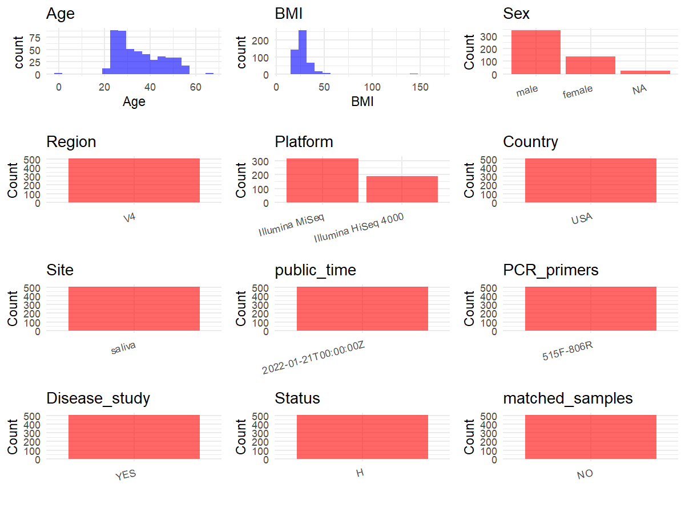

R Notebook: Metadata Processing Workflow
================

# Step 1: Obtain Initial Metadata from Each Project

To obtain the initial metadata: 1. Search for the BioProject ID (e.g.,
“PRJEBXXXX”) on the [NCBI SRA
website](https://www.ncbi.nlm.nih.gov/Traces/study/). 2. In the “Select”
table, click on “Metadata” and download the file. 3. The downloaded file
is typically named “SraRunTable.csv” and contains metadata for the
project.

``` r
# Load necessary libraries
library(dplyr)
library(ggplot2)
library(cowplot)

# Set working directory (update this path to your local directory)
setwd("D:/metadata/PRJEB50306")

# Read the initial metadata files
initial_meta<-read.csv("SraRunTable.csv",header = T)

# Combine the two metadata files
#meta <- rbind(initial_meta, initial_meta1)

#Remove entries non-oral samples


# Check the number of samples containing "HT" in Sample.Name (e.g., healthy controls)
#nrow(subset(meta, grepl("HT", Sample.Name)))

# Display the first few rows of the metadata
head(initial_meta)
```

    ##          Run anonymized_name Assay.Type AvgSpotLen    Bases BioProject
    ## 1 ERR8053779            3069        WGS        144 12659854 PRJEB50306
    ## 2 ERR8053780            3070        WGS        149 14886248 PRJEB50306
    ## 3 ERR8053781            3081        WGS        143 20183025 PRJEB50306
    ## 4 ERR8053782            3092        WGS        148 40177124 PRJEB50306
    ## 5 ERR8053783            3115        WGS        150 28967997 PRJEB50306
    ## 6 ERR8053784            3137        WGS        149 18607692 PRJEB50306
    ##       BioSample    Bytes center_name..exp.
    ## 1 SAMEA12383654  5746998       U Minnesota
    ## 2 SAMEA12383655  7056162       U Minnesota
    ## 3 SAMEA12383656  8251734       U Minnesota
    ## 4 SAMEA12383657 18724183       U Minnesota
    ## 5 SAMEA12383658 11740720       U Minnesota
    ## 6 SAMEA12383659  7607865       U Minnesota
    ##                                          Center.Name center_project_name..exp.
    ## 1 UNIVERSITY OF CALIFORNIA SAN DIEGO MICROBIOME INIT                   Origins
    ## 2 UNIVERSITY OF CALIFORNIA SAN DIEGO MICROBIOME INIT                   Origins
    ## 3 UNIVERSITY OF CALIFORNIA SAN DIEGO MICROBIOME INIT                   Origins
    ## 4 UNIVERSITY OF CALIFORNIA SAN DIEGO MICROBIOME INIT                   Origins
    ## 5 UNIVERSITY OF CALIFORNIA SAN DIEGO MICROBIOME INIT                   Origins
    ## 6 UNIVERSITY OF CALIFORNIA SAN DIEGO MICROBIOME INIT                   Origins
    ##   collection_timestamp Consent DATASTORE.filetype DATASTORE.provider
    ## 1           2016/11/22  public   fastq,run.zq,sra         gs,ncbi,s3
    ## 2           2016/11/22  public   fastq,run.zq,sra         gs,ncbi,s3
    ## 3           2016/11/22  public   fastq,run.zq,sra         gs,ncbi,s3
    ## 4           2016/11/22  public   fastq,run.zq,sra         gs,ncbi,s3
    ## 5           2016/11/22  public   fastq,run.zq,sra         gs,ncbi,s3
    ## 6           2016/11/22  public   fastq,run.zq,sra         gs,ncbi,s3
    ##                       DATASTORE.region dna_extracted elevation          empo_1
    ## 1 gs.us-east1,ncbi.public,s3.us-east-1          TRUE        75 Host-associated
    ## 2 gs.us-east1,ncbi.public,s3.us-east-1          TRUE        75 Host-associated
    ## 3 gs.us-east1,ncbi.public,s3.us-east-1          TRUE        75 Host-associated
    ## 4 gs.us-east1,ncbi.public,s3.us-east-1          TRUE        75 Host-associated
    ## 5 gs.us-east1,ncbi.public,s3.us-east-1          TRUE        75 Host-associated
    ## 6 gs.us-east1,ncbi.public,s3.us-east-1          TRUE        75 Host-associated
    ##   empo_2           empo_3 ENA_FIRST_PUBLIC ENA.LAST.UPDATE..run.   env_biome
    ## 1 Animal Animal secretion        2022/1/20             2022/1/20 urban biome
    ## 2 Animal Animal secretion        2022/1/20             2022/1/20 urban biome
    ## 3 Animal Animal secretion        2022/1/20             2022/1/20 urban biome
    ## 4 Animal Animal secretion        2022/1/20             2022/1/20 urban biome
    ## 5 Animal Animal secretion        2022/1/20             2022/1/20 urban biome
    ## 6 Animal Animal secretion        2022/1/20             2022/1/20 urban biome
    ##                env_feature env_material Env_package Experiment   external_id
    ## 1 human-associated habitat       saliva  human-oral ERX7620500 SAMEA12383654
    ## 2 human-associated habitat       saliva  human-oral ERX7620501 SAMEA12383655
    ## 3 human-associated habitat       saliva  human-oral ERX7620502 SAMEA12383656
    ## 4 human-associated habitat       saliva  human-oral ERX7620503 SAMEA12383657
    ## 5 human-associated habitat       saliva  human-oral ERX7620504 SAMEA12383658
    ## 6 human-associated habitat       saliva  human-oral ERX7620505 SAMEA12383659
    ##   geo_loc_name_country geo_loc_name_country_continent geo_loc_name
    ## 1                  USA                  North America       USA:NY
    ## 2                  USA                  North America       USA:NY
    ## 3                  USA                  North America       USA:NY
    ## 4                  USA                  North America       USA:NY
    ## 5                  USA                  North America       USA:NY
    ## 6                  USA                  North America       USA:NY
    ##    host_body_habitat host_body_product host_body_site host_common_name
    ## 1 UBERON:oral cavity     UBERON:saliva  UBERON:tongue            human
    ## 2 UBERON:oral cavity     UBERON:saliva  UBERON:tongue            human
    ## 3 UBERON:oral cavity     UBERON:saliva  UBERON:tongue            human
    ## 4 UBERON:oral cavity     UBERON:saliva  UBERON:tongue            human
    ## 5 UBERON:oral cavity     UBERON:saliva  UBERON:tongue            human
    ## 6 UBERON:oral cavity     UBERON:saliva  UBERON:tongue            human
    ##   host_height_units host_scientific_name host_subject_id host_weight_units
    ## 1                cm         Homo sapiens            3069                kg
    ## 2                cm         Homo sapiens            3070                kg
    ## 3                cm         Homo sapiens            3081                kg
    ## 4                cm         Homo sapiens            3092                kg
    ## 5                cm         Homo sapiens            3115                kg
    ## 6                cm         Homo sapiens            3137                kg
    ##                                          INSDC_center_name   INSDC_first_public
    ## 1 University of California San Diego Microbiome Initiative 2022-01-20T20:48:41Z
    ## 2 University of California San Diego Microbiome Initiative 2022-01-20T20:48:41Z
    ## 3 University of California San Diego Microbiome Initiative 2022-01-20T20:48:41Z
    ## 4 University of California San Diego Microbiome Initiative 2022-01-20T20:48:41Z
    ## 5 University of California San Diego Microbiome Initiative 2022-01-20T20:48:41Z
    ## 6 University of California San Diego Microbiome Initiative 2022-01-20T20:48:41Z
    ##      INSDC_last_update INSDC_status          Instrument LATITUDE
    ## 1 2022-01-20T20:48:41Z       public Illumina HiSeq 4000    39.28
    ## 2 2022-01-20T20:48:41Z       public Illumina HiSeq 4000    39.28
    ## 3 2022-01-20T20:48:41Z       public Illumina HiSeq 4000    39.28
    ## 4 2022-01-20T20:48:41Z       public Illumina HiSeq 4000    39.28
    ## 5 2022-01-20T20:48:41Z       public Illumina HiSeq 4000    39.28
    ## 6 2022-01-20T20:48:41Z       public Illumina HiSeq 4000    39.28
    ##           Library.Name LibraryLayout LibrarySelection LibrarySource LONGITUDE
    ## 1 11808.3069.SALB.W2V1        PAIRED              PCR   METAGENOMIC    -76.61
    ## 2 11808.3070.SALB.W2V1        PAIRED              PCR   METAGENOMIC    -76.61
    ## 3 11808.3081.SALB.W2V1        PAIRED              PCR   METAGENOMIC    -76.61
    ## 4 11808.3092.SALB.W2V1        PAIRED              PCR   METAGENOMIC    -76.61
    ## 5 11808.3115.SALB.W2V1        PAIRED              PCR   METAGENOMIC    -76.61
    ## 6 11808.3137.SALB.W2V1        PAIRED              PCR   METAGENOMIC    -76.61
    ##                Organism physical_specimen_location physical_specimen_remaining
    ## 1 human oral metagenome                     UCSDMI                        TRUE
    ## 2 human oral metagenome                     UCSDMI                        TRUE
    ## 3 human oral metagenome                     UCSDMI                        TRUE
    ## 4 human oral metagenome                     UCSDMI                        TRUE
    ## 5 human oral metagenome                     UCSDMI                        TRUE
    ## 6 human oral metagenome                     UCSDMI                        TRUE
    ##   Platform                                 project_title          ReleaseDate
    ## 1 ILLUMINA Saliva bacterial DNA, ORIGINS Wave 2, Visit 1 2022-01-21T00:00:00Z
    ## 2 ILLUMINA Saliva bacterial DNA, ORIGINS Wave 2, Visit 1 2022-01-21T00:00:00Z
    ## 3 ILLUMINA Saliva bacterial DNA, ORIGINS Wave 2, Visit 1 2022-01-21T00:00:00Z
    ## 4 ILLUMINA Saliva bacterial DNA, ORIGINS Wave 2, Visit 1 2022-01-21T00:00:00Z
    ## 5 ILLUMINA Saliva bacterial DNA, ORIGINS Wave 2, Visit 1 2022-01-21T00:00:00Z
    ## 6 ILLUMINA Saliva bacterial DNA, ORIGINS Wave 2, Visit 1 2022-01-21T00:00:00Z
    ##   run_center..exp.          create_date version         run_prefix..exp.
    ## 1           UCSDMI 2022-07-28T01:35:00Z       1 3069_SALB_W2V1_S769_L005
    ## 2           UCSDMI 2022-07-28T01:35:00Z       1 3070_SALB_W2V1_S770_L005
    ## 3           UCSDMI 2022-07-21T19:08:00Z       1 3081_SALB_W2V1_S771_L005
    ## 4           UCSDMI 2022-07-28T01:35:00Z       1 3092_SALB_W2V1_S772_L005
    ## 5           UCSDMI 2022-07-28T01:35:00Z       1 3115_SALB_W2V1_S829_L005
    ## 6           UCSDMI 2022-07-19T21:43:00Z       1 3137_SALB_W2V1_S917_L005
    ##     Sample.Name                          Sample_name       sample_plate..exp.
    ## 1 SAMEA12383654 qiita_sid_11808:11808.3069.SALB.W2V1 Origins_Cherrypicked_P11
    ## 2 SAMEA12383655 qiita_sid_11808:11808.3070.SALB.W2V1 Origins_Cherrypicked_P11
    ## 3 SAMEA12383656 qiita_sid_11808:11808.3081.SALB.W2V1 Origins_Cherrypicked_P11
    ## 4 SAMEA12383657 qiita_sid_11808:11808.3092.SALB.W2V1 Origins_Cherrypicked_P11
    ## 5 SAMEA12383658 qiita_sid_11808:11808.3115.SALB.W2V1 Origins_Cherrypicked_P11
    ## 6 SAMEA12383659 qiita_sid_11808:11808.3137.SALB.W2V1 Origins_Cherrypicked_P12
    ##   sample_type   sequencing_meth..exp. SRA.Study
    ## 1      tongue sequencing by synthesis ERP134873
    ## 2      tongue sequencing by synthesis ERP134873
    ## 3      tongue sequencing by synthesis ERP134873
    ## 4      tongue sequencing by synthesis ERP134873
    ## 5      tongue sequencing by synthesis ERP134873
    ## 6      tongue sequencing by synthesis ERP134873
    ##                           Submitter_Id
    ## 1 qiita_sid_11808:11808.3069.SALB.W2V1
    ## 2 qiita_sid_11808:11808.3070.SALB.W2V1
    ## 3 qiita_sid_11808:11808.3081.SALB.W2V1
    ## 4 qiita_sid_11808:11808.3092.SALB.W2V1
    ## 5 qiita_sid_11808:11808.3115.SALB.W2V1
    ## 6 qiita_sid_11808:11808.3137.SALB.W2V1
    ##                        well_description..exp. ENA_first_public ENA_last_update
    ## 1  Origins_Cherrypicked_P11_3069_SALB_W2V1_B1        2022/1/20       2022/1/20
    ## 2  Origins_Cherrypicked_P11_3070_SALB_W2V1_D1        2022/1/20       2022/1/20
    ## 3  Origins_Cherrypicked_P11_3081_SALB_W2V1_F1        2022/1/20       2022/1/20
    ## 4  Origins_Cherrypicked_P11_3092_SALB_W2V1_H1        2022/1/20       2022/1/20
    ## 5 Origins_Cherrypicked_P11_3115_SALB_W2V1_J15        2022/1/20       2022/1/20
    ## 6 Origins_Cherrypicked_P12_3137_SALB_W2V1_J14        2022/1/20       2022/1/20
    ##   INSDC_center_alias aapperio4 aapperio    ahei1    ahei2    ahei3    ahei4
    ## 1             UCSDMI        NA       NA 45.55743 48.72504 45.55743 48.72504
    ## 2             UCSDMI        NA       NA 44.17522 46.02022 44.17522 46.02022
    ## 3             UCSDMI         2        1 29.10837 41.06662 29.10837 41.06662
    ## 4             UCSDMI        NA       NA 61.15725 64.80207 61.15725 64.80207
    ## 5             UCSDMI         2        1 29.47009 35.91997 29.47009 35.91997
    ## 6             UCSDMI         0        0 47.63097 56.76485 47.63097 56.76485
    ##   apdqs apdqst cigcurr CRP educ glucosecrc hba1c Host_age host_age_units
    ## 1    50      0       0 2.2    1         97   5.2 47.04997          years
    ## 2    67      2      NA 1.3   NA         71   5.0       NA          years
    ## 3    50      0       0 0.8    0         88   5.1 30.32991          years
    ## 4    59      1       0 0.8    1         80   6.0 52.42710          years
    ## 5    70      2       0 1.9    1         78   5.3 27.67146          years
    ## 6    62      1       0 0.6    1         84   5.3 54.10267          years
    ##   host_body_mass_index host_height host_life_stage host_taxid host_weight
    ## 1             33.45565       185.5           adult       9606   115.12174
    ## 2             24.41330       163.0           adult       9606    64.86371
    ## 3             33.32175       165.0           adult       9606    90.71847
    ## 4             21.59888       169.0           adult       9606    61.68856
    ## 5                   NA          NA           adult       9606          NA
    ## 6             20.13569       174.0           adult       9606    60.96281
    ##   insulinv1 meanaloss meandbp   meanpd meansbp METS Original_ID    perbop
    ## 1    13.010        NA    78.0       NA   120.5    0        3069        NA
    ## 2     2.503        NA    71.0       NA   100.0   NA        3070        NA
    ## 3    12.759 1.1851852    74.5 2.086420   135.0    0        3081 0.2469136
    ## 4     4.487        NA    73.0       NA   115.5    0        3092        NA
    ## 5     2.824 0.9761905    76.5 1.595238   112.5    0        3115 0.2619048
    ## 6     4.248 0.4895833    67.0 2.062500   117.0    0        3137 0.1197917
    ##   prediabetes raceethn sex totmisst height  WeightKG      BMI Barcode..exp.
    ## 1           0        1   0       32  185.5 115.12174 33.45565              
    ## 2           0       NA  NA       32  163.0  64.86371 24.41330              
    ## 3           0        2   1        5  165.0  90.71847 33.32175              
    ## 4           1        3   1       32  169.0  61.68856 21.59888              
    ## 5           0        0   1        4     NA        NA       NA              
    ## 6           0        1   1        0  174.0  60.96281 20.13569              
    ##   linker..exp. linkerprimersequence..exp. mastermix_lot..exp. orig_name..exp.
    ## 1                                                          NA                
    ## 2                                                          NA                
    ## 3                                                          NA                
    ## 4                                                          NA                
    ## 5                                                          NA                
    ## 6                                                          NA                
    ##   pcr_primers..exp. primer_date..exp. primer_plate..exp. project_name..exp.
    ## 1                                  NA                 NA                   
    ## 2                                  NA                 NA                   
    ## 3                                  NA                 NA                   
    ## 4                                  NA                 NA                   
    ## 5                                  NA                 NA                   
    ## 6                                  NA                 NA                   
    ##   target_gene..exp. target_subfragment..exp. water_lot..exp. well_id..exp.
    ## 1                                                                         
    ## 2                                                                         
    ## 3                                                                         
    ## 4                                                                         
    ## 5                                                                         
    ## 6                                                                         
    ##   i5_index_id..exp. i7_index_id..exp. index2..exp. index..exp.
    ## 1       iTru5_101_A      iTru7_205_08     CGGTTGTT    AGCCAAGT
    ## 2       iTru5_102_A      iTru7_205_09     TCAGGCTT    TGACTGAC
    ## 3       iTru5_103_A      iTru7_205_10     TGGTCCTT    CACCTGTT
    ## 4       iTru5_104_A      iTru7_205_11     CACGTTGT    ATCCGGTA
    ## 5       iTru5_101_F      iTru7_210_08     CAGTCCAA    CTTACAGC
    ## 6       iTru5_117_E      iTru7_402_12     CTTACCTG    TCTCGTGT
    ##   orig_sample_id..exp. run_date..exp.
    ## 1       3069_SALB_W2V1        8/24/18
    ## 2       3070_SALB_W2V1        8/24/18
    ## 3       3081_SALB_W2V1        8/24/18
    ## 4       3092_SALB_W2V1        8/24/18
    ## 5       3115_SALB_W2V1        8/24/18
    ## 6       3137_SALB_W2V1        8/24/18
    ##                                                           runid..exp.
    ## 1 180824_K00180_0664_AHW2LFBBXX_RKL_0030_Sarkis_UVA_Cheetah_BurkGold2
    ## 2 180824_K00180_0664_AHW2LFBBXX_RKL_0030_Sarkis_UVA_Cheetah_BurkGold2
    ## 3 180824_K00180_0664_AHW2LFBBXX_RKL_0030_Sarkis_UVA_Cheetah_BurkGold2
    ## 4 180824_K00180_0664_AHW2LFBBXX_RKL_0030_Sarkis_UVA_Cheetah_BurkGold2
    ## 5 180824_K00180_0664_AHW2LFBBXX_RKL_0030_Sarkis_UVA_Cheetah_BurkGold2
    ## 6 180824_K00180_0664_AHW2LFBBXX_RKL_0030_Sarkis_UVA_Cheetah_BurkGold2
    ##   sample_project..exp. sample_well..exp. V..exp. ENA_first_public.1
    ## 1        ORIGINS_11219                B1       5                   
    ## 2        ORIGINS_11219                D1       5                   
    ## 3        ORIGINS_11219                F1       5                   
    ## 4        ORIGINS_11219                H1       5                   
    ## 5        ORIGINS_11219               J15       5                   
    ## 6        ORIGINS_11219               J14       5                   
    ##   ENA_last_update.1 Scientific_Name
    ## 1                                  
    ## 2                                  
    ## 3                                  
    ## 4                                  
    ## 5                                  
    ## 6

# Step 2: Create a Uniform Metadata Template

The uniform metadata should include the following columns:

1.  **BioProject**: Project ID (e.g., “PRJNA339212”)
2.  **Run**: Sample ID (e.g., “ERRXXXXXX” or “SRRXXXXXX”)
3.  **sample_name**: Original sample name submitted by the authors (not
    the database-assigned ID)
4.  **Age**: Age of the subject (if available)
5.  **BMI**: Body Mass Index (if available)
6.  **Sex**: Sex of the subject (“F” or “M”)
7.  **Region**: Targeted 16S rRNA region (e.g., “V3-V4”)
8.  **Platform**: Sequencing platform (e.g., “Illumina MiSeq”)
9.  **Country**: Country of sample origin (e.g., “China”)
10. **Site**: Sample site (e.g., “saliva”, “dental plaque”)
11. **public_time**: Data release date (format: “YYYY-MM-DD”)
12. **PCR_primers**: PCR primers used (e.g., “515F-806R”)
13. **title**: Title of the associated publication
14. **Disease_study**: Whether the study involves a disease (“YES” or
    “NO”)
15. **Status**: Disease status (e.g., “T2DM”, “HC”). Note: If the study
    includes both disease and healthy samples, this must be specified
    per sample.
16. **matched_samples**: matched samples (“YES” or “NO”)

``` r
# Create a uniform metadata dataframe
metadata <- data.frame(
  BioProject = initial_meta$BioProject,
  Run = initial_meta$Run,
  sample_name = initial_meta$Sample.Name,
  Age = initial_meta$Host_age,
  BMI = initial_meta$BMI,
  Sex=initial_meta$sex,
  Region = "V4",
  Platform = initial_meta$Instrument,
  Country = initial_meta$geo_loc_name_country,
  Site = initial_meta$env_material,
  public_time = initial_meta$ReleaseDate,
  stringsAsFactors = FALSE
)
```

# Step 3: Manually Add Information from the Publication

Some information (e.g. PCR primers, study title, disease status) must be
manually extracted from the publication and added to the metadata.

``` r
# Add information obtained from the publication
metadata$PCR_primers <- "515F-806R"
metadata$title <- "Early microbial markers of periodontal and cardiometabolic diseases in ORIGINS"
metadata$Disease_study <- "YES"
# Assign disease status based on sample_name patterns
metadata$Status<-"H"
metadata <- metadata %>%
  mutate(Sex = case_when(
    initial_meta$sex == "0" ~ "female",
    initial_meta$sex == "1" ~ "male"
  ))

keep_subjects <- unique(subset(metadata, Site == "saliva")$sample_name)
metadata <- subset(metadata, sample_name %in% keep_subjects)


metadata$matched_samples <- "NO"
```

# Step 4: Summarize and Validate the Metadata

``` r
# Check the number of unique runs and sample names
print(paste("Number of unique runs:", length(unique(metadata$Run))))
```

    ## [1] "Number of unique runs: 504"

``` r
print(paste("Number of unique sample names:", length(unique(metadata$sample_name))))
```

    ## [1] "Number of unique sample names: 319"

# Step 5: Visualize the Metadata

``` r

```

<!-- -->

# Step 6: Finalize and Export the Metadata

``` r
# Reorder columns to match the desired format
metadata <- metadata[, c(
  "BioProject", "Run", "sample_name", "Age", "BMI", "Sex", 
  "Region", "Platform", "Country", "Site", "public_time", 
  "PCR_primers", "title", "Disease_study", "Status","matched_samples"
)]

# Export the uniform metadata to a CSV file
write.csv(metadata, file = "metadata.csv", quote = TRUE)
head(metadata)
```

    ##   BioProject        Run   sample_name      Age      BMI    Sex Region
    ## 1 PRJEB50306 ERR8053779 SAMEA12383654 47.04997 33.45565 female     V4
    ## 2 PRJEB50306 ERR8053780 SAMEA12383655       NA 24.41330   <NA>     V4
    ## 3 PRJEB50306 ERR8053781 SAMEA12383656 30.32991 33.32175   male     V4
    ## 4 PRJEB50306 ERR8053782 SAMEA12383657 52.42710 21.59888   male     V4
    ## 5 PRJEB50306 ERR8053783 SAMEA12383658 27.67146       NA   male     V4
    ## 6 PRJEB50306 ERR8053784 SAMEA12383659 54.10267 20.13569   male     V4
    ##              Platform Country   Site          public_time PCR_primers
    ## 1 Illumina HiSeq 4000     USA saliva 2022-01-21T00:00:00Z   515F-806R
    ## 2 Illumina HiSeq 4000     USA saliva 2022-01-21T00:00:00Z   515F-806R
    ## 3 Illumina HiSeq 4000     USA saliva 2022-01-21T00:00:00Z   515F-806R
    ## 4 Illumina HiSeq 4000     USA saliva 2022-01-21T00:00:00Z   515F-806R
    ## 5 Illumina HiSeq 4000     USA saliva 2022-01-21T00:00:00Z   515F-806R
    ## 6 Illumina HiSeq 4000     USA saliva 2022-01-21T00:00:00Z   515F-806R
    ##                                                                            title
    ## 1 Early microbial markers of periodontal and cardiometabolic diseases in ORIGINS
    ## 2 Early microbial markers of periodontal and cardiometabolic diseases in ORIGINS
    ## 3 Early microbial markers of periodontal and cardiometabolic diseases in ORIGINS
    ## 4 Early microbial markers of periodontal and cardiometabolic diseases in ORIGINS
    ## 5 Early microbial markers of periodontal and cardiometabolic diseases in ORIGINS
    ## 6 Early microbial markers of periodontal and cardiometabolic diseases in ORIGINS
    ##   Disease_study Status matched_samples
    ## 1           YES      H              NO
    ## 2           YES      H              NO
    ## 3           YES      H              NO
    ## 4           YES      H              NO
    ## 5           YES      H              NO
    ## 6           YES      H              NO

## Notes for Students:

1.  **Metadata Accuracy**: Always cross-check the metadata with the
    original publication to ensure accuracy.
2.  **Manual Entries**: Columns like `PCR_primers`, and `Status` often
    require manual entry based on the publication.
3.  **Disease Status**: Be careful when assigning `Status`—some studies
    include both disease and healthy samples.
4.  **Visualization**: The plots help quickly identify the distribution
    of values in each column, which is useful for quality control.
5.  **Reproducibility**: Update the working directory and file paths to
    match your local environment.
